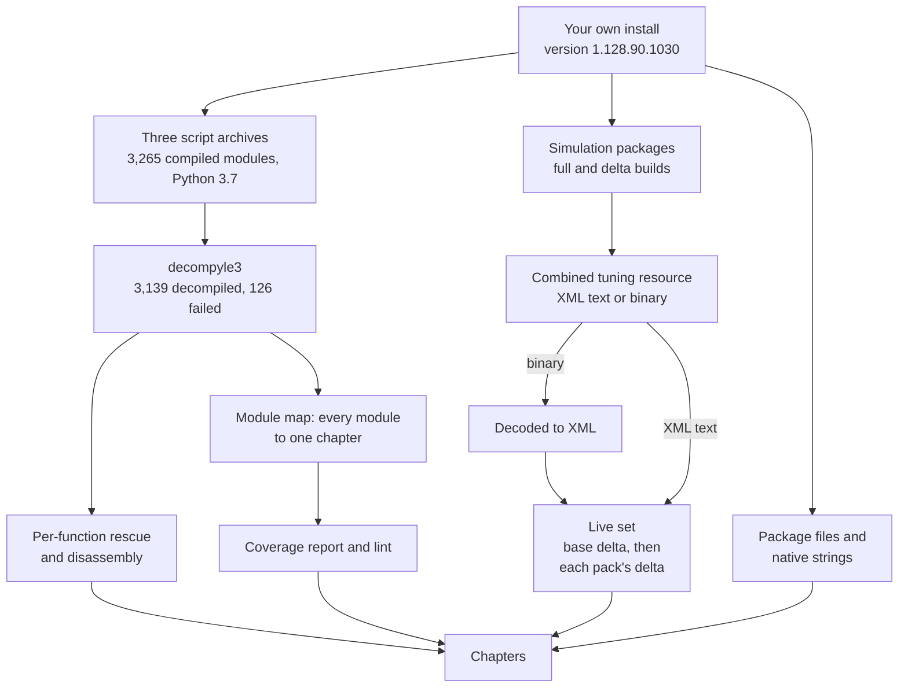

# 0.01 Reading guide, glossary and how to reproduce

*Game version 1.128.90.1030 (Steam, Linux/Proton): the base game plus EP04, EP06, EP09, EP12, GP04, GP12, SP01 and SP42. This page explains how to read the book and how its sources were made. Its own figures are counts over the authors' working copy of the game and over the book's own files. Written 2026-10-12. Checked 2026-10-12: 98 claims checked, 15 corrected, 2 relabelled, none removed, 4 added; the authorship section and the check figures were checked again after the last chapter: 19 claims checked, 6 corrected, 2 added. Checked again 2026-10-13: 75 claims checked, 11 corrected, 0 relabelled, 0 removed.*

## What this book is

This book explains how The Sims 4 works on the inside: the rules the game follows and the numbers it uses, read from the game's own files. It is written for four kinds of reader: players who want to know why their Sim did something, modders who want to know what to change, designers who want to see how the systems fit together, and programmers who want to see how the engine is built. No chapter assumes you have opened the files yourself.

Everything was read from one install: version **1.128.90.1030** from Steam, running on Linux through Proton. Game updates change both tuning and code, so a number here may differ in another version. The install holds the base game and eight packs:

| Code | Pack |
|---|---|
| EP04 | Cats & Dogs |
| EP06 | Get Famous |
| EP09 | Eco Lifestyle |
| EP12 | High School Years |
| GP04 | Vampires |
| GP12 | Werewolves |
| SP01 | Luxury Party |
| SP42 | Grunge Revival |

The game's UI tuning lists 118 pack ids: the base game, 21 expansion packs (EP01 to EP21), 12 game packs (GP01 to GP12), 83 stuff packs (SP01 to SP87, with no SP19, SP27, SP85 or SP86) and one free pack (FP01). The script side's `Pack` enum declares 24 more ids (up to GP20 and SP99) that have no display name and no update folder in this version. Every pack name in this book is the English name the game itself shows, read from its UI tuning and its string table, never from memory. The UI tuning gives a pack a short name and a credits title; of the installed packs they differ only for SP01, whose credits call it Luxury Party Stuff. A chapter writes a pack as code and name on first use, "EP04 (Cats & Dogs)", and as the code after that. [9.04 Pack index](9.04-pack-index.md) lists every pack and the sections that mention it.

The book holds knowledge only: descriptions, names, identifiers and numbers. It is not a mod, a tool or official documentation. It contains no game files, no decompiled modules, no tuning dumps and no game assets, and it quotes EA's code only a few lines at a time. Nothing in it unlocks content you have not bought. It is an unofficial community work, not affiliated with or endorsed by Electronic Arts or Maxis. The Sims is a trademark of Electronic Arts Inc.

Some of the game cannot be read this way. The client executable is encrypted, so the renderer, the UI's own code and the client side of Create a Sim are known only from their text strings and from what the Python sends them. The native engine library, `Simulation_x64.dll`, is known from its strings, its class names and the functions the authors looked at. A small share of the Python did not decompile (see [How to reproduce](#2-decompile-the-gameplay-scripts)). Every chapter has a Limits section that says what it could not read and why.

## Who made this book

One person asked for this book, set its limits and decides what is published. The rest was done by AI agents, Anthropic's Claude models. A coordinating session set the method, ran the tools and split the work into chapters. Most system chapters then went to two agents in turn: a writer, who drafted the chapter from the decompiled code, the tuning and the file bytes, and a checker, who re-derived its load-bearing claims from the same sources without trusting the draft (see [The check line](#the-check-line)). Nine chapters (1.01, 2.01, 2.02, 2.05, 3.01, 3.02, 3.04, 3.05 and 3.07) began instead as research notes that other agents had written earlier: one agent turned each note into a chapter and checked it, so the text that agent added was checked by its own author. Two editor agents then went through 38 of the 44 system chapters: they re-ran the counts behind the figures that depend on the live tuning on the corrected live merge described under [step 4](#4-merge-the-live-tuning-in-the-right-order), re-tested claims that a value is not set, and corrected pack names and some wording. The other six (6.01 to 6.03 and 8.01 to 8.03) were checked after the merge was corrected. The appendices and the glossary are generated by a script from the chapters and the book's data files, except the hand-written introduction of 9.03. The agents' instructions named the game's own files as the sources, treated earlier notes as leads to re-check, ruled out naming a pack from memory, and asked for a label and a source on every claim in How it works: the module, class, method or tuning record it was read from. A reader who rebuilds those sources (see [How to reproduce](#how-to-reproduce)) can open the place a claim cites and see the same thing.

A second pass followed on 2026-10-13. Deepening agents read the modules that the File indexes had only listed and the modules that had failed to decompile (function by function, and in the bytecode where even that failed), and wrote what they found into the chapters. Then every system chapter was checked again by an agent that had not worked on it (the six longest by two such agents, one half each). That checker listed every load-bearing claim instead of a sample and re-checked each one against the source before it read the first check's log, so the nine chapters that began as notes now have an independent check too. A checker could change only its own chapter, so what it found wrong in other chapters was written down; editor agents then re-read the source of each item about a system chapter and applied it or recorded why not, and the items about the appendices were checked when the coordinating session rebuilt them. The coordinating session also fixed a fault in the book's own tuning decoder (see [8.02](8.02-tuning-formats.md)) and rebuilt the live merge; no count in the book depended on the spots it changed.

The checks were made by agents, and the person who asked for the book did not re-check the claims by hand. Two checks, the first correcting about one claim in six and the second about one in eight, will not have caught everything. Treat the book as a careful reading of the game's files: where it and the game disagree, the game is right. Error reports that name the chapter, the claim and what you found are welcome through the repository.

## How the book is organised

| Part | Chapters | What it covers |
|---|---|---|
| 0 Start here | 0.01 to 0.04 | this guide, the architecture, the tuning system, and the tests, loot and effects every system uses |
| 1 Engine | 1.01 to 1.04 | time and lot loading, saves, performance and level of detail, debug tools and cheats |
| 2 The world | 2.01 to 2.07 | lots, objects, Build/Buy, weather, the sky, worlds and travel, neighbourhood systems |
| 3 The Sim | 3.01 to 3.13 | Create a Sim, sculpting and parts, needs, autonomy, interactions, animation, personality, relationships, life cycle, skills and careers, occults, pets, Sim states |
| 4 Society | 4.01 to 4.05 | situations and NPCs, story progression, clubs and factions, events, scenarios |
| 5 Economy | 5.01 to 5.02 | money, bills, perks, rewards, businesses |
| 6 Activities | 6.01 to 6.03 | crafting and cooking, gardening, fishing and collecting, other pack systems |
| 7 Presentation | 7.01 to 7.03 | UI and dialogs, audio, effects and camera, thumbnails and the gallery |
| 8 Data formats | 8.01 to 8.04 | package files, tuning formats, Sim and CAS files, the save file |
| 9 Appendices | 9.01 to 9.04 | every number in one table, the module index, coverage and gaps, the pack index |

## How to read a chapter

### The eight sections

Every system chapter (0.02 to 0.04 and all of Parts 1 to 8) opens with its title and one line in italics, then has the same eight sections in the same order.

1. **In plain words.** Two to four short paragraphs a player can follow, with no code names: what the system does and what about it would surprise you.
2. **Key facts.** Eight to fifteen bullets, each one concrete: a rule, a number, a threshold or an order of operations.
3. **How it works.** One subsection per mechanism, with at least one diagram of the main flow. Every claim carries a label and a source (see below).
4. **Numbers.** A table of every tuning value the chapter cites: name, value, unit, where it lives, and which build it came from.
5. **Data shapes.** The main classes, tuning fields and records, briefly, so that someone could rebuild the model.
6. **For modders.** Which tuning to change for the common tweaks, the console commands the system registers and what they do, and the traps: values that look editable but are decided in native code, or that a newer build overrides.
7. **Limits.** What the chapter could not read (code that did not decompile, packs that are not installed, logic that lives only in the executables) and why.
8. **File index.** Every code module the book assigns to the chapter, one line each, with a depth: `deep` (read and explained), `skim` (read for the table) or `listed` (only its names read, with the reason). Then the tuning names the chapter used.

A player can stop after Key facts. A modder will want Numbers and For modders. A programmer will read How it works, Data shapes and the File index.

### Observed and Inferred

Every claim in How it works carries one of two labels.

- **Observed** means the authors read it directly: in the decompiled code, in the tuning, or in the bytes of a file. The source follows in brackets, so you can open the same place and see the same thing.
- **Inferred** means a conclusion drawn from observed facts without seeing the deciding step, usually because that step is in native code or in a module that did not decompile. Treat it as a well-founded guess.

When a chapter says a value was "read from bytecode" or "read in the disassembly", the module did not decompile, or its decompiled source was wrong at that spot. Decompiled source can be wrong even when it decompiles: [0.02 Architecture](0.02-architecture.md) shows a call that the decompiled text wrongly nests inside a check, while the bytecode makes the call either way.

### Sources, code paths and tuning names

A code source is written as `module.py: Class.method`, for example `autonomy_component.py: AutonomyComponent.get_time_until_next_update`. Module paths are relative to the two gameplay roots: `core/` (the shared library: the `sims4` package with tuning, commands, logging and maths, plus enums, caches and the protobuf runtime) and `simulation/` (the gameplay). A chapter may shorten a path to its file name when that name is unique; the File index gives the full path.

Tuning names come in two forms. **Module tuning** is a record attached to one Python module that sets that module's class-level constants; it is named by the dotted module path, such as `sims.bills`. **Instance tuning** is the many records of one type (a buff, an interaction, a career), each named as the developers named it, such as `buff_AutonomyMod_SocializeNow`. [0.03 The tuning system](0.03-tuning-system.md) explains both.

### Full, delta and live tuning

The base game and each installed pack except SP42 (which ships no tuning) carry their tuning in two builds, and the book says which one every number came from.

- **Full build**: the pack's `SimulationFullBuild0.package`, an older, complete snapshot of its tuning, which the game does not use (**Inferred**, see Live). The base game's full build is the only one stored as XML text.
- **Delta build**: the pack's `SimulationDeltaBuild0.package`, the current tuning and the copy the game uses. It carries the same resource key as the full build and replaces it whole. The base game's delta build ("base delta") is also the live copy of all module tuning, because module tuning exists only in the base game's builds (446 module records in the base delta, none in any pack).
- **Live**: the record set running in this install: the base delta build, then each installed pack's delta build in turn. Records are keyed by their type and id, and a later record replaces an earlier one whole, never field by field (**Observed**, `merged_tuning_manager.py: MergedTuningManager._load_res_node`). A count of "live buffs" is a count over this set. **Observed**: each pack's full and delta builds carry the same combined-tuning resource key, and `MergedTuningManager.load` loads one resource for each key the resource manager lists, so only one of the two is read. **Inferred**: the copy that wins is the delta (or its byte-identical preload). The resolver is native code, but `Data/Simulation/Resource.cfg` ranks the preload (-15) and the delta (-20) above the full build (-30), and only the delta holds content the game plainly has: the word "toddler", in any letter case, occurs nowhere in the base full build and 1,732 times in the base delta. [0.03](0.03-tuning-system.md) gives the package priorities.
- **Code default**: the value written in the Python, which applies when no tuning sets the field.

A row of a Numbers table puts these together. This one is from [5.01 Money, bills, perks and rewards](5.01-money-bills-rewards.md):

| Name | Value | Unit | Where | Build |
|---|---|---|---|---|
| `BILL_BRACKETS` | 1.8 / 2.7 / 3.15 / 4.9 | percent | `sims.bills` | delta; full 2 / 3 / 3.5 / 5; code 10 |

Read it as: the bill brackets are module tuning of `sims.bills`; the live values come from the base delta; the older full build had 2, 3, 3.5 and 5; and 10 is the Python's own default for a bracket whose percentage the tuning leaves unset.

### Patch data, pack not installed

The game's `Delta` folder has a folder of update data for each of the 117 packs, owned or not. The data of a pack you do not own does not run. A chapter may cite it to describe a missing pack's system, and then always says "patch data, pack not installed". Such data is never counted in a live total and never presented as live.

### Units

- **Sim minutes** are the usual unit of time in tuning: `TunableSimMinute` is by far the most common time field in the decompiled code (204 declarations, against 54 for the next, `TunableTimeOfDay`). "30 Sim minutes" means game time.
- At normal speed one Sim minute takes 1.5 real seconds, one Sim hour 90 real seconds and one Sim day 36 real minutes. The faster speeds multiply game time by 3, 7 and 36 (code defaults the live tuning leaves in place); the last is granted only while every Sim in the household is doing something that asks for it, such as sleeping. [1.01 Time, scheduling and lot loading](1.01-time-scheduling-loading.md) has the details.
- **Ticks**: the game clock counts 25 ticks per Sim second (`REAL_MILLISECONDS_PER_SIM_SECOND` in `date_and_time.py`), so 1,500 per Sim minute and 2,160,000 per Sim day. At normal speed one tick passes per real millisecond.
- **Real seconds** (`TunableRealSecond`) are wall-clock time: processing budgets and time slices, fades and cooldowns. They do not speed up with the game.
- **Times of day and week** (`TunableTimeOfDay`, `TunableTimeOfWeek`) are clock readings, such as Monday 05:00, when the weekly bill is placed. A week has seven days.
- **Money** is in Simoleons. **Distances** are in game units the chapters call metres. A Numbers row whose unit says "(Inferred unit)" took the unit from the size of the values, because the code does not name it.

### The check line

Each chapter is fact-checked by an agent other than the one that drafted it (for nine chapters, the first check was made by the agent that converted an earlier note; see [Who made this book](#who-made-this-book)) and then checked again by another agent. The italic line under the title says how far that has gone.

- "Written <date>, not yet checked" means the chapter has not been through the check. Read its numbers with more care.
- "Checked <date>: 119 claims checked, 23 corrected, 4 relabelled, 1 removed" (from [3.04 Autonomy](3.04-autonomy.md)) means the checker listed the chapter's load-bearing claims (every key fact, formula, Numbers row, order of operations and surprising Observed label) and re-checked each one against the source directly, without trusting the chapter's citation.
- **Checked** is the number of claims on that list. **Corrected** is how many were wrong in the draft (a number, a unit, an order, a citation) and were fixed in place. **Relabelled** claims moved between Observed and Inferred. **Removed** claims could not be supported and were deleted. Some lines also count claims the checker **added**.
- "Deepened <date>: <n> modules newly explained, <m> failed decompiles read" marks the second pass's deepening. The text it added was then covered by the second check.
- "Checked again <date>" is the second, independent check, counted the same way. It listed every load-bearing claim, so its list is longer than the first check's in 42 of the 44 chapters.
- "Cross-chapter edits <date>: <n> applied" counts corrections that the checkers or deepening writers of other chapters found and an editor agent applied after re-reading the source. They are not in the check counts.

A high corrected count describes the draft before the check; the corrections are already in the text. Claims outside the checker's list were not each re-verified; the sources the chapters cite are there so that you can test them. As of 2026-10-12, all 44 system chapters had been checked once: 5,306 claims, of which 944 (about one in six) were corrected. The second check of 2026-10-13 covered all 44 again: 9,414 claims, of which 1,136 (about one in eight) were corrected, 45 relabelled and 14 removed. Changes made after a chapter's last check, by the editor agents or the coordinating session, are not in these counts.

## Reading paths

The chapters can be read in any order, and each links to its neighbours instead of repeating them. These paths are good starting points.

### For players

Read the In plain words and Key facts of each.

1. [3.03 Needs, statistics and commodities](3.03-needs-statistics.md): how needs fall and what fills them.
2. [3.04 Autonomy](3.04-autonomy.md): how a Sim picks what to do when you are not directing it.
3. [3.07 Personality and feelings](3.07-personality-feelings.md): traits, emotions, wants and aspirations.
4. [3.08 Relationships, socials and memories](3.08-relationships-socials.md): friendship, romance and what a social does to them.
5. [3.10 Skills, careers and school](3.10-skills-careers-school.md): how skills level and how jobs and school pay out.
6. [3.09 Life cycle](3.09-life-cycle.md): aging, babies, family and death.
7. [5.01 Money, bills, perks and rewards](5.01-money-bills-rewards.md): where Simoleons come from and how the bill is worked out.
8. [4.02 Story progression, households and townies](4.02-story-progression-townies.md): what the rest of the world does while you play one household.

With the installed packs: [3.12 Pets and horses](3.12-pets-horses.md) for EP04 (Cats & Dogs), [3.11 Occults and the supernatural](3.11-occults.md) for GP04 (Vampires) and GP12 (Werewolves), [3.13 Sickness, luck, fame and other Sim states](3.13-health-luck-fame.md) for the fame of EP06 (Get Famous), [2.07 Neighbourhood systems](2.07-neighbourhood-systems.md) for the eco footprint and civic policies of EP09 (Eco Lifestyle), and [3.10 Skills, careers and school](3.10-skills-careers-school.md) for the high school days of EP12 (High School Years).

### For modders

Read How it works for the mechanism, then Numbers and For modders.

1. [0.03 The tuning system](0.03-tuning-system.md): records, ids, load order, what overrides what, and why a pack reference can vanish.
2. [0.04 Tests, loot and effects](0.04-tests-loot-effects.md): the building blocks most tuning mods edit.
3. [8.01 Package files and resource types](8.01-package-files.md) and [8.02 Tuning XML and binary delta tuning](8.02-tuning-formats.md): the files a mod ships in.
4. [1.04 Debug tools, cheats and telemetry](1.04-debug-cheats-telemetry.md): which console commands exist in the retail game. In short: Live commands always work, Cheat commands need `testingcheats` (or automation mode), Automation commands run only in automation mode, and DebugOnly or untyped commands are never registered.
5. [3.05 Interactions, postures and routing](3.05-interactions-postures-routing.md) and [2.02 Objects: components, states and wear](2.02-objects-states-wear.md): what an object offers and how a Sim uses it.
6. [3.07 Personality and feelings](3.07-personality-feelings.md) and [3.03 Needs, statistics and commodities](3.03-needs-statistics.md): traits, buffs and the statistics they move.
7. [4.01 Situations, roles and NPC scheduling](4.01-situations-npcs.md): events, visitors and NPC jobs.
8. [8.03 Sim and CAS files](8.03-sim-cas-files.md) and [8.04 The save file format](8.04-save-file-format.md): Sims, parts and saves on disk.

### For designers

Read In plain words, How it works and Numbers: the systems are mostly data, so the tuning tables show the balance.

1. [3.03 Needs, statistics and commodities](3.03-needs-statistics.md) and [3.04 Autonomy](3.04-autonomy.md): needs, urgency curves and the scoring that turns them into choices.
2. [3.07 Personality and feelings](3.07-personality-feelings.md): emotions, wants and aspirations as layers of goals.
3. [4.01 Situations, roles and NPC scheduling](4.01-situations-npcs.md) and [4.02 Story progression, households and townies](4.02-story-progression-townies.md): how the game fills a lot with people and moves the world forward off screen.
4. [4.04 Holidays, festivals, live events and competitions](4.04-events-holidays-festivals.md) and [4.05 Scenarios, pivotal moments and calls to action](4.05-scenarios-moments.md): authored goals and events.
5. [5.01 Money, bills, perks and rewards](5.01-money-bills-rewards.md) and [5.02 Businesses](5.02-businesses.md): the economy's faucets and sinks.
6. [2.07 Neighbourhood systems](2.07-neighbourhood-systems.md): systems that act on a whole neighbourhood.
7. [9.01 Every number, in one table](9.01-numbers-index.md): every cited value in one place.

### For programmers

Read How it works, Data shapes and the File index.

1. [0.02 Architecture](0.02-architecture.md): the executable, the native engine library and the Python, and how they call each other.
2. [0.03 The tuning system](0.03-tuning-system.md): how data becomes Python classes at start-up.
3. [1.01 Time, scheduling and lot loading](1.01-time-scheduling-loading.md): the clock, the timelines, alarms and the load states.
4. [1.02 Saves and persistence](1.02-saves-persistence.md) and [8.04 The save file format](8.04-save-file-format.md).
5. [1.03 Performance, budgets and level of detail](1.03-performance-lod.md).
6. [3.05 Interactions, postures and routing](3.05-interactions-postures-routing.md) and [3.06 Animation, thought balloons and the hand-off to the client](3.06-animation.md): the interaction queue, the posture graph and what is sent to the client.
7. [8.01 Package files and resource types](8.01-package-files.md) and [8.02 Tuning XML and binary delta tuning](8.02-tuning-formats.md).
8. [9.02 Module index](9.02-module-index.md) and [9.03 Coverage and known gaps](9.03-coverage-and-gaps.md): where each module is explained, and which modules could not be read.

## Glossary

The [glossary](glossary.md) gathers the game terms the chapters define, one line each. It covers the tuning vocabulary (record, module tuning, shared node), the machinery of a Sim and a lot (commodity, buff, super interaction, mixer, situation, zone), and this page's own words (Observed, Inferred, full build, delta build, live tuning, patch data). When a chapter uses a term without explaining it, look there first.

## How to reproduce

Everything in the book can be re-derived from your own copy of the game, except the counts taken from the authors' sample saves in 1.02, 1.03 and 8.04. The decompiler, its bytecode library and Ghidra are open-source projects. The authors' scripts that read the game are small (the largest, the live merge, is under 200 lines; the page assembler that builds the appendices is larger) and are described here by what they do, so you can write your own.



### 1. Your own copy of the game

Install the game from your own account. Work on copies and never write into the game folder. The version string is in `Game/Bin/Default.ini`. The folders that matter:

| Folder | What it holds |
|---|---|
| `Game/Bin` | the client executables `TS4_x64.exe` and `TS4_DX9_x64.exe`, the engine library `Simulation_x64.dll`, the Python 3.7 runtime `python37_x64.dll`, `Default.ini`, and `Python/` with the native extension modules and `generated.zip` (57 compiled protocol-buffer modules, the message formats [0.02](0.02-architecture.md) reads) |
| `Data/Simulation` | the base game's simulation packages (`SimulationFullBuild0`, `SimulationDeltaBuild0`, `SimulationPreload`) and `Gameplay/`, which holds the three script archives |
| `Data/Client` | the client packages, the English string table `Strings_ENG_US.package`, UI and thumbnails |
| `EP04`, `GP04` and so on | one folder per installed pack, with that pack's full builds |
| `Delta` | one folder of update data for each of the 117 packs, installed or not, including the packs' delta builds |

### 2. Decompile the gameplay scripts

**Observed.** The gameplay is compiled Python in three ordinary zip archives under `Data/Simulation/Gameplay`: `base.zip` (420 compiled modules, the Python standard library EA ships), `core.zip` (121) and `simulation.zip` (2,724); each archive also holds a 256-byte file named `key`. All 3,265 modules start with bytecode magic number 3394, the format of Python 3.7, which matches the runtime the game ships.

The authors decompiled them with **decompyle3 3.9.3** (with its bytecode library **xdis 6.1.8**), running under Python 3.12. A batch driver walks the extracted tree and decompiles every module that has no source yet in a pool of worker processes (16 by default, each replaced after 50 modules), with a 3 GB memory cap and a 180-second timeout per module, and appends each failure to a list. A single-file driver decompiles one module under the same memory cap, without a timeout.

Results: **3,139 modules decompiled and 126 failed** (37 of the 420 standard-library modules, 7 of the 121 in `core` and 82 of the 2,724 in `simulation`). In `core` and `simulation` the loss is 89 of 2,845 modules, about 3 percent; two of the 89 belong to the protobuf runtime library, so 87 are gameplay code. The failure list the batch driver keeps is incomplete. The first batch run was stopped part way, and part of the remaining work went through the single-file driver, which reports a failure only on its error output, so 46 of those 89 failures are missing from the list. **Observed**: every failure in the list sorts before `simulation/objects/animals/` and every missing one sorts after it. Treat any compiled module with no decompiled source as failed.

**Why they failed.** decompyle3 rebuilds `if` blocks, loops and `try` blocks by matching the pattern of jumps in the bytecode against a grammar of Python 3.7 statements. **Observed** in the decompile logs and a re-run of the modules whose message was not kept: 115 of the 126 failures stopped with "Deparsing stopped due to parse error", which means the grammar rejected part of the module, so none of it was printed. Five more were rejected by the parser outright (the three whose message was kept, at the first instruction of a code block), and six tripped one of decompyle3's own consistency checks, for example on a `try`/`else` block and on a comprehension filter. **Observed** (file sizes): big modules fail far more often. 12 of the 20 largest gameplay modules failed and 18 of the largest 50, against 89 of all 2,845. The failures include central modules such as `interactions/base/interaction`, `interactions/base/super_interaction`, `interactions/constraints`, `postures/posture_graph`, `postures/transition_sequence`, `distributor/ops`, `careers/career_base`, `crafting/crafting_interactions` and `sims/household`. **Inferred**: a large module has more functions, so more chances that one of them holds a jump pattern the grammar does not know. The logs name the rule that gave up, not one Python construct behind all the failures.

**Rescue.** A third driver loads a failed module with xdis and decompiles each function and class body on its own, nested ones included, writing a marker for every one that still fails. It does not print the module's own top-level statements (its imports and module constants). In a sample of four failed modules rescued this way (three broadcaster modules and `interactions/constraints`), only 6 of 509 functions and other code blocks still failed. Those are read in the disassembly from xdis's `pydisasm`. Four modules (`cython_utils`, `interactions/constraints`, `postures/posture_graph` and `postures/posture_specs`) also ship as compiled native extensions, Cython `.pyd` files in `Game/Bin/Python/DLLs`, which cannot be decompiled; [0.02](0.02-architecture.md) covers them.

### 3. Read the full and delta tuning

**Observed.** Each simulation package of the base game and of every installed pack except SP42 holds one combined tuning resource (type `0x62E94D38`) with all of that build's tuning records. Pull it out with a package reader (step 5).

- The **base full build** is XML text. Shared pieces of tuning are stored once, in `<g s="merged">` groups, and referred to as `<r x="..."/>`. The authors' indexer lists records whose name or class matches a pattern, prints one record with every reference expanded and every numeric id annotated with the name of the record it points at, resolves an id to a name, and caches its index. It files records by name, so where two record types share a name it reaches only one of them.
- The **delta builds and every pack's full build** are binary: a SimData "DATA" file, version 0x101, whose schemas are named `PackedXmlDocument`, `PackedXmlNode` and `PackedXmlAttribute`. A decoder of about 60 lines walks the string table, nodes and attributes and writes the same XML text (42 MB for the base delta, in under ten seconds), and the same indexer then reads it. Its first version wrote an element with neither attributes nor children as text. The format tells the two apart only by row position, and the decoder has used it since 2026-10-13 ([8.02](8.02-tuning-formats.md)).

Always resolve shared references before you decide that a field is not set: a script that scans raw child elements sees only `<r x="..."/>` and reports "not set" for values that are there.

### 4. Merge the live tuning in the right order

The live set is built as described under [Full, delta and live tuning](#full-delta-and-live-tuning): the base delta build, then each installed pack's delta build, keyed by record type and id. The full builds stay out: each shares its resource key with its delta build, and the game loads each key once. In outline (the authors' own sketch):

```python
live = {}
sources = [base_delta]                  # the full builds are left out
for pack in installed_packs:            # EP04, EP06, ... SP42
    sources.append(pack.delta)
for source in sources:
    for record in source.instance_records():
        key = (record.instance_type, record.instance_id)
        live[key] = record              # the whole record, never field by field
```

Done this way, the live set of this install has 72,956 instance records. Only 6 of them appear in two live builds, so the order of the packs barely matters. Four mistakes made counts wrong in drafts of this book:

- applying a pack's delta before its full build;
- keying records by name: a name is unique only within a record type, and 135 names in the base delta alone belong to two types (77 of them to both an animation and an interaction);
- keying each build's records by name before merging by type and id, which still drops the 216 live records whose name another record in the same build shares (72,740 kept);
- merging the full builds in at all, which kept 3,570 records the delta builds had dropped (76,526 counted instead of 72,956) and gave 207 base-game records the older copy from a pack's full build.

[8.02 Tuning XML and binary delta tuning](8.02-tuning-formats.md) measures each of these. Leave out the `Delta` folders of packs you do not have. SP42 ships no combined tuning, so it adds no records. The merged set takes about 2.4 GB of memory in Python, so keep counting scripts short-lived: load, count, print, exit.

### 5. Read package files and native strings

**Package files.** A read-only reader of about 140 lines handles the DBPF 2.1 format the game uses: it reads the header and the resource index (including the fields an index may store once for all entries) and undoes the two compression schemes it handles, zlib and EA's RefPack. It does three things: count a package's resources by type, list the resources whose decompressed bytes contain a string (searched as plain text and as UTF-16), and write one resource out by type, group and instance. That is enough to pull out the tuning resources, the SimData records and the string tables that give every English name in the book. [8.01 Package files and resource types](8.01-package-files.md) describes the format.

**Native code.** `Simulation_x64.dll` is not encrypted. The authors read a copy of it statically: its text strings, its exports, its C++ class names (RTTI), and selected functions as pseudo-code, cross-references and string searches in Ghidra. Ghidra was driven through a reverse-engineering tool called REA, kept running as a small local service so the 17.4 MB library was analysed once and queried many times. The client executable is encrypted, so only its readable text strings were used.

### 6. Map every module to a chapter and measure coverage

A rule file of 302 path prefixes assigns every decompiled module to exactly one chapter (the longest matching prefix wins) or to a skip list: the Python standard library, the protobuf runtime and a Cython build shim, 404 modules in all. The other 2,735 modules belong to the system chapters. A coverage tool then reports, per chapter, how many of its modules some system chapter cites: by full path, by path under its root package, or by bare file name when that name is unique. The same tool lints each page: the title line, the required sections (system chapters only), no em dash, code blocks of 12 lines at most, and relative links that resolve or name a planned chapter.

The 89 modules of `core` and `simulation` that did not decompile have no source file, so the coverage figures cannot see them. [9.03 Coverage and known gaps](9.03-coverage-and-gaps.md) lists them with the chapter the rule file gives each and the chapters that name it; two belong to the skipped protobuf runtime, and one, `display_snippet_tuning`, matches no rule.

### The tools, by what they do

| Tool | What it does |
|---|---|
| Batch decompiler | decompiles every compiled module that has no source yet in a pool of worker processes, with a memory cap and a per-module timeout; logs failures |
| Single-file decompiler | decompiles one module under the same memory cap and exits with an error if it fails |
| Per-function decompiler | decompiles each function of a failed module separately and marks the ones that still fail |
| Disassembler (`pydisasm`, from xdis) | prints the bytecode of whatever no decompiler pass recovers |
| Tuning indexer | finds records by name, class or type, prints one with shared references expanded and ids named, resolves an id to a name |
| Binary tuning decoder | turns the binary combined tuning into the same XML text |
| Live merge | builds the live set in the order above; counts records per class, finds records by name with the build that won, prints one record, and walks records with references resolved |
| Package reader | counts resources by type, searches decompressed resources for a string, writes one resource out |
| Analysis service | keeps one REA and Ghidra session on the engine library open and answers queries over a local socket |
| Coverage and lint | maps modules to chapters, reports what each chapter cites, and checks each page's format |

### Rules the authors kept

- Work only from your own installed copy, and never change anything in the game folder.
- Never decrypt, dump or patch the executables `TS4_x64.exe` and `TS4_DX9_x64.exe`; only their readable strings were used. The activation library was left alone.
- Quote EA's code only in short excerpts and summarize the rest in your own words. No code block in this book runs past 12 lines (diagrams excepted). Identifiers, tuning names and numbers are fine.
- Ship no game assets: no images, audio, models or textures from the game, and no bulk tuning dumps, only tables of the values that matter.
- Name packs only as the game names them, and never count a pack you do not have in a live total.
