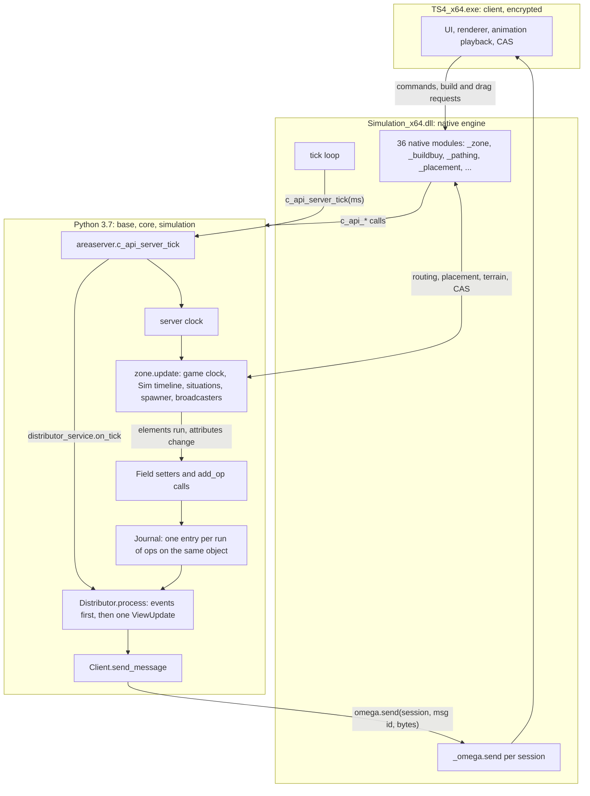
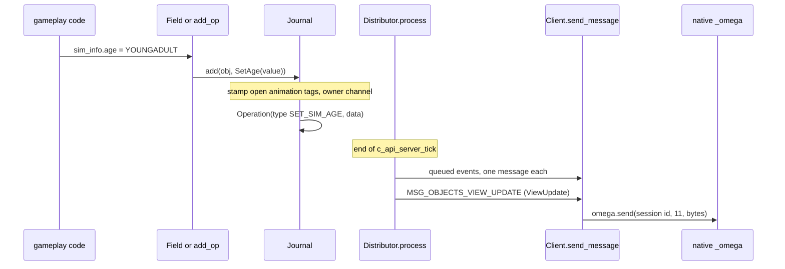
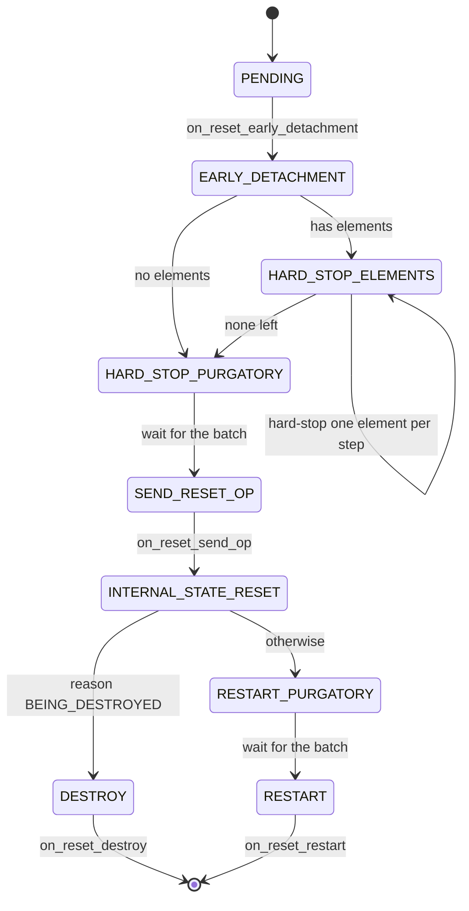

# 0.02 Architecture: the executable, the engine library and the Python

*Game version 1.128.90.1030 (Steam, Linux/Proton). Counts are for the base game code, which ships every pack's scripts; per-install counts use this install (EP04, EP06, EP09, EP12 High School Years, GP04, GP12, SP01, SP42). Written 2026-10-12. Checked 2026-10-12: 101 claims checked, 30 corrected, 3 relabelled, 1 removed.*

## In plain words

The Sims 4 is three programs stacked on top of each other inside one game. At the bottom is the game window itself, which draws the world, plays the animations, runs the menus and Create a Sim. In the middle is an engine library that knows the hard geometry of a lot: where walls and floors are, where an object may stand, how a Sim can walk from A to B. On top sits the gameplay, written in the Python language: needs, moods, careers, relationships, situations, money, every rule a player meets. The gameplay owns the truth. The window only shows what the gameplay tells it and asks the gameplay before anything changes.

On every tick of its loop the engine wakes the gameplay up, the gameplay advances the clock and runs whatever its Sims are doing, and then it sends the window one bundle of changes: this Sim moved, that object changed colour, a notification appeared. The window never works out a rule for itself. When you drag an object in Build Mode or click a pie menu option, the window sends a request down, and the gameplay or the engine answers it.

Three things about this are surprising. First, most of the gameplay can be read: about 3,100 of its 3,265 script files turn back into readable code, while the window's own code is encrypted and only its text strings can be read. Second, the game checks your packs at start-up and simply never starts the parts of the game you do not own: on this install 22 of the 74 save-wide game systems and 3 of the 50 per-lot systems are thrown away before they start. Third, a few everyday helpers are slightly off: a tuned "50% chance" in some places is really 49.5%, because the random roll runs from 0 to 100 inclusive.

## Key facts

- **Three layers.** `TS4_x64.exe` (client: renderer, UI, animation and route playback, Create a Sim; encrypted), `Simulation_x64.dll` (native engine, 17.4 MB, not encrypted, 2,830 C++ class and struct names in its RTTI), and Python 3.7 gameplay in `base.zip`, `core.zip` and `simulation.zip` plus `generated.zip` (protocol buffers) and four Cython `.pyd` modules.
- **3,265 Python modules, 126 failed to decompile**: base 420 (37 failed), core 121 (7), simulation 2,724 (82). The failures include `simulation/distributor/ops.py` and `core/sims4/log.py`.
- **Native calls Python by name.** The DLL names 71 `c_api_*` functions; Python defines 80 entry points (79 in decompiled modules plus `c_api_register_global_importer` in `core/macros.py`, read from bytecode). 70 match, 1 exists only in the DLL (`c_api_sim_exit`), 10 only in Python.
- **Python imports 36 EA native modules** (`_zone`, `_buildbuy`, `_pathing`, `_placement`, `_cas` and more). The DLL carries 40 `PyInit_` names; 5 of them (`_action_primitive`, `_mdz`, `_ops`, `_primitive`, `_social`) are never imported by any script.
- **One server tick, in order:** the core service tick (a no-op in the retail build), `game_services.on_tick` (empty), the server clock, `zone.update` (or only the save timeline while a save runs), then one distributor flush to the client. While a save is in progress no zone update and no client update happen. The flush runs even when no zone is loaded (bytecode; the decompiled source nests it wrongly).
- **Almost everything the client sees is an Op.** `ops.py` defines 267 Op subclasses, one of them (`GenericProtocolBufferOp`) carrying any of the 444 operation types it is given. Consecutive ops on the same object share one entry, and each flush sends at most one `MSG_OBJECTS_VIEW_UPDATE` (message id 11), after any queued event messages. A few ops and events are sent at once outside the flush, and four code paths send raw messages directly.
- **About 108 attributes are declared as distributed Fields** (104 in 22 decompiled modules, 4 more in `sims/sim.py`, read from bytecode): assigning to them queues the matching op automatically. Nothing is queued while no client is attached.
- **Three service tiers.** 14 global entries (2 init-critical, the other 12 started one per native init tick), 74 game services, 50 zone services. Each tier starts in list order and stops and saves in reverse.
- **Pack gating happens at registration.** Every service object is constructed first; one whose `required_packs` are all missing is then dropped by `register_service`, so it is never set up, started or saved, and its getter returns `None`. This install runs 51 game and 47 zone services. `RelgraphService` is never created on any install (`RELGRAPH_ENABLED = False`).
- **Ownership checks go to native code.** `mtx.has_entitlement` and `sims4.common.is_available_pack` are thin wrappers over `_zone`. The 142-value `Pack` enum covers BASE_GAME, EP01 to EP21, FP01 (Holiday), GP01 to GP20 and SP01 to SP99.
- **Commands default to DebugOnly, which the retail build never registers.** Of the 1,588 command declarations in the decompiled modules, 507 are Live, 363 Automation, 66 Cheat and 652 DebugOnly (123 explicit, 529 by default). Five command modules that did not decompile add 141 more (bytecode: 37 Live, 80 Automation, 17 Cheat, 7 DebugOnly).
- **Object ids come from native `_guid`**; 11 manager ids (0 to 10) name the kinds of object the client knows about.
- **Reset and destroy are one pipeline** of 7 processing stages. The service always advances the lowest stage first, so a batch of resets moves in waves; destroying is a reset with reason `BEING_DESTROYED`.
- **Python garbage collection is switched off during tuning load** and switched back on after it (`TimeStampService`).
- **Module tuning ids are FNV-1 64 hashes** of the module path with every dot turned into a hyphen: `services-fire_service` gives 8818301941467280642, `situations-ambient-ambient_service` gives 3456987952383780934.

## How it works

### The three layers on disk

**Observed** (game folder `Game/Bin`, `Data/Simulation/Gameplay`, `Default.ini`):

| Layer | Files | Size | Readable |
|---|---|---|---|
| Client | `Game/Bin/TS4_x64.exe` (and `TS4_DX9_x64.exe`, 43.9 MB) | 45.2 MB | strings only: 106,192 ASCII and 1,520 UTF-16 of 6 or more characters |
| Client rules | `GraphicsRules.sgr`, `GraphicsCards.sgr`, `Ts4CommonRules.sgr`, `Default.ini` | 3 to 175 KB each | plain text |
| Native engine | `Game/Bin/Simulation_x64.dll` | 17.4 MB | yes: strings, exports, 2,830 RTTI class and struct names (2,095 of them in the `Sims4` namespace) |
| Python runtime | `Game/Bin/python37_x64.dll` | 3.7 MB | CPython 3.7.0, built from EA's own copy of the source (its paths name `external\python\python-3.7.0`) |
| Gameplay scripts | `Data/Simulation/Gameplay/base.zip`, `core.zip`, `simulation.zip` | 1.8, 0.3, 10.1 MB | decompiles (bytecode magic 3394, Python 3.7) |
| Protocol buffers | `Game/Bin/Python/generated.zip` | 0.5 MB | 57 generated `*_pb2` modules |
| Compiled gameplay | `Game/Bin/Python/DLLs`: `cython_utils_x64.pyd`, `interactions/constraints_x64.pyd`, `postures/posture_graph_x64.pyd`, `postures/posture_specs_x64.pyd` | 20 KB to 1.8 MB | native code (Cython), not decompiled |

`Default.ini` names the build: game version 1.128.90.1030, code version 1.200.000.718, configuration `Release_x64`, project `lib.code.compile.vs2017` (**Observed**, `[Version]` section). Its `[Config]` and `[PlumbBob]` sections hold client constants such as the pie menu dead zone (28) and the plumbob colours.

`base.zip` is the Python standard library EA ships (420 modules). `core.zip` is EA's engine-neutral layer (121 modules: 69 in `sims4`, 21 Google protobuf, 18 top-level, 7 `native`, 6 `shared_commands`). `simulation.zip` is the game (2,724 modules: 51 top-level files and 142 sub-packages; the largest are `objects` 270, `situations` 261, `sims` 197, `interactions` 185, `routing` 98, `gsi_handlers` 84, `server_commands` 68). **Observed** (file counts over the extracted compiled modules).

**Observed** (`simulation/__app_paths__.py: configure_app_paths`): when the game runs from archives, the script root is `Gameplay/simulation.zip`; in a development layout it is `Scripts/Server`. **Observed** (`simulation/__hooks__.py: system_init`): native start-up calls `system_init`, which turns on EA's import hook (`sims4.importer`) and, when the native `_profile` module exists, registers a garbage-collection callback.

**Inferred** (no `python37` or `c_api_` strings in the client's readable strings; `python37` and every `c_api_` name are in the DLL, and the client holds the name `Simulation_x64` as a UTF-16 string): the DLL embeds the Python interpreter and drives it; the executable loads the DLL into the same process.

### The client: what can and cannot be read

**Observed** (teardown 1, `TS4_x64.exe` strings): the client holds the renderer, the UI, the build tools the player drives, animation playback, the sky and weather effects, and Create a Sim. **Inferred** (the path planner is native `_pathing` in the DLL): the client plays back routes the simulation has planned. Its code is encrypted by EA's activation layer, so this book reads only its strings and its rule files, and never its code.

The `.sgr` files are scripts in a small rules language (`seti`, `setb`, `if`, `setProp`; **Observed**, `Ts4CommonRules.sgr`). They score the CPU, the GPU (a table of about 2,000 device ids in five levels in `GraphicsCards.sgr`), video memory and RAM, and pick a graphics preset. How the tiers are picked and what each preset changes is in [1.03 Performance, budgets and level of detail](1.03-performance-lod.md).

**Inferred** (reported by teardown 1; the count was not re-checked for this chapter): the client explains a refused build action from a shared list of about 470 error codes and never re-checks the rule itself. The rule lives in the DLL or the Python. Placement and the build pipeline are in [2.03 Build/Buy, placement and slots](2.03-build-buy-placement.md).

### The engine library and its native modules

**Observed** (Python imports across `core` and `simulation`, `PyInit_` strings in `Simulation_x64.dll`): most gameplay-facing native modules (`_zone`, `_omega`, `_guid`, `_buildbuy`, `_placement`, `_cas`, `_terrain`, `_commands`, `_sim_irq`, `_areaops`, `_kingdom`) are imported inside `try` / `except` (usually `except ImportError`), and the `except` branch defines a stub class with the same functions (for example `simulation/omega.py`, `simulation/mtx.py`, `simulation/id_generator.py`). The core types are imported with no fallback (`_math`, `_resourceman`, `_common_types`, `_hashutil`, `_geometry`, `_weakrefutils`, `_sims4_collections`), so the scripts cannot load without the engine at all. In the game the native module always wins. Some stubs return optimistic values: the `_zone.has_entitlement` stub returns `True`, the `_omega.send` stub returns `True` (`simulation/mtx.py`, `simulation/omega.py`).

The PyInit names do not always match the module names (`PyInit__CAS` registers `_cas`, `PyInit_HashModule` registers `_hashutil`, `PyInit__PythonPersistenceModule` registers `_persistence_module`). `_areaops` has a name string in the DLL and no `PyInit_` export, so it is registered some other way (**Inferred**). `_net_proto2___python` is the protobuf C++ accelerator, not EA code.

| Native module | Names used | What it provides | Python wrapper |
|---|---|---|---|
| `_common_types` | 142 | pack ids | `core/sims4/common.py` |
| `_pathing` | 134 | path planner, routing contexts, goals, footprints, portals, connectivity, walkstyles, ray tests, world bounds | `simulation/routing/__init__.py` |
| `_buildbuy` | 88 | lot, venue and plex queries, household inventory, floor features, pools and ponds, catalog tags and prices, `test_location_for_object` | `simulation/build_buy.py` |
| `_placement` | 64 | find-good-location (FGL) searches, placement and routing footprints, the Sim quadtree | `simulation/placement.py` |
| `_cas` | 36 | native SimInfo and outfit data, random Sims, offspring, households, CAS part tags, the native relationship graph | `simulation/cas/cas.py` |
| `_animation` | 27 | ARB and ASM base classes, censor states, rig joint lookups | `core/native/animation/` |
| `_geometry` | 20 | Polygon, CompoundPolygon, QuadTree, Rect, Circle, facing ranges, cone constraints | `core/sims4/geometry.py` |
| `_zone` | 19 | world and lot description ids, rent, eco footprint, entitlements, pack availability, inviting Sims | `simulation/mtx.py`, `core/sims4/common.py` |
| `_terrain` | 11 | terrain and lot level height, water depth, snow mask, coastline adjustment | `simulation/terrain.py` |
| `_hashutil` | 11 | `hash32`, `hash64` (FNV-1), debug unhash tables | `core/sims4/hash_util.py` |
| `_math` | 8 | Vector2, Vector3, Quaternion, Transform | `core/sims4/math.py` |
| `_commands` | 7 | console command registry and output | `core/sims4/commands.py` |
| `_profiler`, `_profile`, `_perf_api` | 5, 3, 3 | profiling scopes, GC hook, perf counters | `core/sims4/profiler.py`, `simulation/__hooks__.py`, `core/native/performance/counters.py` |
| `_pythonutils` | 4 | GC policy, high-water GC, closure patching | `core/pythonutils.py` |
| `_areaops` | 4 | GSI save and load, op requests, native assert | `simulation/areaops.py` |
| `_resourceman` | `*` | resource `Key`, `load`, `list`, hot-swap registration | `core/sims4/resources.py` |
| `_tuning` | 2 | `BinaryTuning`, the reader for binary (delta) tuning | `core/sims4/tuning/merged_tuning_manager.py` |
| `_debugvis`, `_profanity_filter` | 2, 2 | debug draw layers; text check and scan | `simulation/debugvis.py`, `simulation/profanity.py` |
| `_omega` | 1 | `send(session_id, msg_id, bytes)` to the client | `simulation/omega.py` |
| `_guid` | 1 | `generate_s4guid`, object ids | `simulation/id_generator.py` |
| `_sim_irq` | 1 | `handle_sim_irq`, lets native work run mid-script | `core/sims4/sim_irq_service.py` |
| `_sims4_collections` | 1 | native `frozendict` | `core/sims4/collections.py` |
| `_weakrefutils` | 1 | `clear_weak_refs` on object removal | `simulation/indexed_manager.py` |
| `_footprints`, `_line_of_sight`, `_lot` | 1 each | `PolygonFootprint`, `_LineOfSight`, lot id lookup | `core/sims4/geometry.py`, line of sight component, `simulation/world/__init__.py` |
| `_persistence_module`, `_persistence_primitives` | 1, 0 | `run_persistence_operation`; persist version constants | `simulation/persistence_module.py`, `simulation/primitives/persistence_primitives.py` |
| `_trace` | 6 | log output and console colour | `core/api_config.py`, `core/sims4/console_colors.py`, `core/sims4/log.py` (did not decompile) |
| `_kingdom` | 4 | the kingdom system of EP21 (Royalty & Legacy, not installed) | `simulation/kingdom/kingdom.py` |
| `_filemonitor` | `*` | file watching | `core/sims4/filewatcher.py` |
| `_telemetry`, `_collection_utils` | 1 each | telemetry events, a dict helper | `core/sims4/telemetry.py`, `simulation/animation/asm.py` |

What these modules do in depth belongs to their systems: routing and placement in [3.05 Interactions, postures and routing](3.05-interactions-postures-routing.md) and [2.03 Build/Buy, placement and slots](2.03-build-buy-placement.md), CAS in [3.01 Create a Sim: how a person is built](3.01-create-a-sim.md), resources in [8.01 Package files and resource types](8.01-package-files.md), binary tuning in [8.02 Tuning XML and binary delta tuning](8.02-tuning-formats.md).

### How native code calls Python: the c_api entry points

**Observed** (`Simulation_x64.dll` strings around `c_api_server_tick`): the DLL keeps each entry point's name next to the module it lives in and the format strings it calls with, plus the same error-code table Python uses (0 success, -1 exception, -2 timeout, -3 no account, -4 no client, -5 no household, -6 load Sims failed, -7 Sim not found, -8 client disconnected). **Observed** (`simulation/areaserver.py` constants): Python defines the same nine codes.

**Observed** (`core/sims4/utils.py: exception_protected`, `c_api_can_fail`): nearly every entry point is wrapped so that a Python exception is logged and turned into a default return value, so no exception crosses back into C++. `c_api_can_fail` logs when the return value is one of the listed error codes. **Observed** (`simulation/areaserver.py: synchronous`): entry points that take a callback run the function, always call the callback with the result (in a `finally`), and then return success to native.

| Area | Module | Entry points | Count |
|---|---|---|---|
| Server lifecycle | `simulation/areaserver.py` | `server_init`, `server_init_tick`, `server_ready`, `server_tick`, `server_shutdown` | 5 |
| Zone lifecycle | `simulation/areaserver.py` | `zone_init`, `zone_loaded`, `zone_shutdown`, `setup_sim_spawner_data` | 4 |
| Clients and Sims | `simulation/areaserver.py` | `client_connect`, `client_disconnect`, `request_client_disconnect`, `add_sims`, `notify_client_in_main_menu` | 5 |
| Queries from native | `simulation/areaserver.py` | `get_household_funds`, `get_simulator_debt`, `get_simulator_responsiveness`, `notify_business_rules_state_change` | 4 |
| Build/Buy | `simulation/build_buy.py` | session begin and end, venue type, lot traits, zones and dynamic areas changed, mannequins (get, update, delete), save object data, foundation and level height, household inventory add and remove, `modify_household_funds`, navmesh and wall contour updates, blueprint apply begin and end, lot clearing begin and end, reset Sims to landing strip, `set_object_location` and `_ex` | 23 |
| Objects | `simulation/objects/system.py` | create, find, destroy, reset objects; parents, children, slots; modular pieces and owners; state index; Build/Buy use flags and lockout; part owner; delay posture graph adds | 26 |
| Save data | `simulation/services/persistence_service.py` | `get_data_readonly`, `get_data_readwrite`, `release_data`, `save_data`, `get_world_id_from_zone` | 5 |
| Routing | `simulation/routing/__init__.py`, `routing/portals/portal_component.py` | `navmesh_fence_callback`, `navmesh_updated_callback`, `get_portal_duration` | 3 |
| Entitlements | `simulation/mtx.py` | `entitlement_unlocked`, `entitlement_purchase_failed` | 2 |
| Live drag | `simulation/server_commands/live_drag_commands.py` | `live_drag_end` | 1 |
| Debug | `simulation/services/__init__.py` | `gsi_dump` | 1 |
| Import hook | `core/macros.py` (bytecode only) | `register_global_importer`, which installs EA's module-suite importer on `sys.meta_path` | 1 |

The ten Python-only entry points (`navmesh_update`, `set_object_location`, the two entitlement callbacks, `set_build_buy_lockout`, `set_part_owner`, the two posture-graph delay calls, `gsi_dump`, `release_data`) have no exact name string in the DLL (**Observed**). They are either dead, called through a name the DLL builds at run time, or called from the client (**Inferred**; the client's code cannot be read). `c_api_entitlement_unlocked` raises a "dead code as of 8/6/2014" error on entry (**Observed**, `simulation/mtx.py`). The other way round, `c_api_sim_exit` is the one DLL name that no Python module defines (**Observed**, decompiled source and bytecode).

The persistence entry points hand native the whole save-game protobuf: `get_data_readwrite` also sets a read-write lock that `save_data` releases and that marks the Sim data cache dirty (**Observed**, `simulation/services/persistence_service.py: c_api_get_data_readwrite`, `c_api_save_data`). Saves are in [1.02 Saves and persistence](1.02-saves-persistence.md).

### Start-up and the per-tick loop

**Observed** (`simulation/areaserver.py`, `simulation/services/__init__.py: start_global_services`, `core/sims4/core_services.py`): native start-up runs in this order.

1. `c_api_server_init(initial_ticks)` creates the server clock and the global services and starts the two init-critical ones (server clock, persistence). The rest wait.
2. `c_api_server_init_tick()` is called repeatedly; each call starts one deferred global service (`ServiceManager.start_single_service`) and returns `True` once none are left. A service may ask for several calls (`can_incremental_start`, `update_incremental_start`); the tuning loader is the big one.
3. `c_api_zone_init` builds the persistence caches, starts the game services (`game_services.start_services`: 74 in the code, 51 on this install), creates the `Zone` and starts its zone services (50 in the code, 47 on this install).
4. `c_api_zone_loaded`, then `c_api_client_connect` run the zone spin-up. That sequence and its 39 states are in [1.01 Time, scheduling and lot loading](1.01-time-scheduling-loading.md).

**Observed** (`simulation/areaserver.py: c_api_server_tick`): once a lot is running, every server tick does:

1. `sims4.core_services.on_tick()`. In the retail build this does nothing: `SUPPORT_RELOADING_SCRIPTS` and `SUPPORT_GSI` are both `False` (`core/sims4/core_services.py`).
2. `game_services.on_tick()`, an empty function.
3. The server clock is set to `absolute_ticks` (1 tick = 1 real millisecond), never moving backwards.
4. If the current zone is instantiated: while `persistence_service.save_timeline` exists, only the save timeline is simulated and the function returns before step 5; otherwise `zone.update(absolute_ticks)` runs the game clock, the Sim timeline and the per-tick services.
5. `distributor_service.on_tick()`, which sends this tick's changes to the client. The bytecode reaches this call whether or not a zone is instantiated; the decompiled source nests it under the zone check, which is wrong.

How the tick is turned into game time, the 33 ms time slice and the speed rules are in [1.01 Time, scheduling and lot loading](1.01-time-scheduling-loading.md). Whether native calls the tick once per rendered frame or on its own schedule cannot be read in Python (see Limits).

**Observed** (`core/sims4/sim_irq_service.py`): `SimIrqService` is the first zone service. Long-running Python (placement searches, autonomy content sets, posture specs, ASM work, group socials, crafting, footprint checks and test-based scores: 10 call sites in decompiled modules, and the function is also loaded in four modules that did not decompile, `interaction`, `loot`, `posture_graph` and `transition_sequence`) calls `yield_to_irq()`, which hands control to native `_sim_irq.handle_sim_irq(zone_id)` while a client is connected. It is on by default and the `--no-simyield` command-line flag turns it off. **Inferred**: this is how the client stays responsive while one Python tick runs long.

### The distributor: from a changed attribute to a client message

**Observed** (`simulation/distributor/system.py`, `simulation/distributor/fields.py`, rescued functions of `simulation/distributor/ops.py`): nearly all gameplay state reaches the client through the distributor. It works in four steps.

1. **An Op is created.** An `Op` is a small Python object holding one protobuf payload. Its `write(msg)` fills a `DistributorOps_pb2.Operation`: `type` (one of 444 enum values, such as `SET_LOCATION` or `SET_SIM_AGE`) and `data` (the serialized payload). The rescued `ops.pyc` defines 267 subclasses of `Op` (269 classes counting `Op` itself and `DistributionSet`), for example `SetAge` (writes `SetSimAge` with type `SET_SIM_AGE`), `ObjectCreate`, `ClientCreate`, `SetLocation`, `Heartbeat`.
2. **It is queued in the Journal.** Code calls `Distributor.add_op(obj, op)`, `add_op_with_no_owner(op)` (194 call sites in decompiled modules and more in 13 that did not decompile, for example the per-tick `Heartbeat` from `clock.py`) or assigns a distributed `Field`. `Journal.add` stamps the op with every animation tag that is currently open (`block_on_tag`), and, if the op runs inside a `ResettableElement`, adds a channel for the object that owns that task. `add_op` does nothing while no client is attached.
3. **The Journal is turned into protobuf at once.** Each entry stores the object id, the manager id (some ops on a SimInfo are re-addressed to `MGR_OBJECT`; the decompiled condition is tangled with the task-owner check), the finished `Operation` and the payload type. Inside `dependent_block()` entries are held back and released together.
4. **The flush.** `Distributor.process()` first sends every queued event (`add_event(msg_id, msg)`: 34 call sites, raw messages such as dialogs, travel requests and save locks) through `Client.send_message`, then walks the Journal in order and builds one `ViewUpdate`. A new `ViewUpdateEntry` starts each time the (manager id, object id) pair changes, so order is kept and runs of ops on one object share an entry. The `ViewUpdate` goes out as `MSG_OBJECTS_VIEW_UPDATE` (id 11).

**Observed** (`distributor/system.py: Distributor.add_event`, `send_op_with_no_owner_immediate`, `add_client`, `remove_client`): a few paths skip the wait for the end of the tick. `add_event(..., immediate=True)` sends every queued event at once (pie menu and phone menu creation, the feature-params refresh in `zone.py`, and dialogs or interactable flags when the caller asks); `send_op_with_no_owner_immediate` (3 call sites) builds and sends its own one-entry `ViewUpdate`; attaching or removing the client flushes too. Four call sites skip the distributor and call `Client.send_message` directly: `server_commands/localization_commands.py`, `MSG_GSI_OPEN` in `developer_commands.py`, `MSG_GAMEPLAY_OPTIONS` in `server/account.py` and `MSG_SET_CHEAT_STATUS` in `services/cheat_service.py`.

**Observed** (`distributor/fields.py: Field.__set__`): a `Field` is a property that knows its op. Assigning to it runs the setter and, when a client is attached and the object is `valid_for_distribution`, queues `op(new_value)`. About 104 `@...Field(...)` declarations exist across 22 modules; `sims/sim_info_base_wrapper.py` declares the Sim's age as a `Field` with `op=SetAge` and priority HIGH. When an object is first created on the client, `Field.get_operations_gen` sends every field of the object and its components, HIGH priority first, and skips fields still at their default.

**Observed** (`distributor/sparse.py`): `SparseMessage` wraps a protobuf with a `set_fields` list; only touched fields are recorded, so a `SparseField` op carries just the fields that changed, and a create op sends the full message.

**Observed** (`ops.py: Op.add_additional_channel`, `Op.block_on_tag`; `system.py: Journal._build_journal_entry`): every op has a primary channel (its own object) and optional additional channels, each a (manager id, object id, mask) triple; an animation tag is a channel on manager 0 (`MGR_UNMANAGED`). `immediate=True` sets the primary mask override to 0. **Inferred** (field names, no client code): the client holds an op until the channels it waits on are released, which is how a state change lines up with the animation that causes it.

**Observed** (`distributor/system.py: Distributor.add_client`, `_add_ops_for_client_connect`; `server/client.py: get_objects_in_view_gen`): only one client may be attached; a second raises `ValueError`. On connect, every object in every distributable manager is created on the client in dependency order (`graph_algos.topological_sort` over `get_create_after_objs`, so a client's active Sim and household come before the client object itself).

Message counts (**Observed**, descriptors in `generated.zip`): 57 proto files define 1,511 message types; `Consts.MessageTypes` lists 320 message ids (`MSG_INVALID` = 0, 307 ids from `MSG_OBJECT_UPDATE` = 2 up to `MSG_SHOW_FAMILY_TREE_UI` = 1232, and 12 neighbourhood and cache ids from `MSG_NS_UPDATE_ZONE` = 5000 up to `MSG_CACHE_UPDATE_VENUE` = 5012); `DistributorOps.Operation.Type` lists 444 operation types (from `OBJECT_DELETE` = 1 up to `GSI_DATA` = 1332). Ids are not dense: new ones are appended at the end.

### Sending and receiving: omega, clients and accounts

**Observed** (`simulation/omega.py: send`): `omega.send(session_id, msg_id, data)` calls native `_omega.send`; a `False` return raises `KeyError("Failed to find ZoneSessionContext ...")`. **Observed** (`simulation/server/client.py: Client.send_message`): the client object serializes the protobuf and calls `omega.send` with its own id, which is the session id. After disconnect it only logs a warning.

**Observed** (`simulation/server/client.py`, `simulation/server/clientmanager.py`): a `Client` is itself a distributed object (`ClientCreate` and `ClientDelete` ops). It holds the session id, the account, the household id, the selectable Sims (the "skewer"), the active Sim, the pie menu choices, live-drag state and the interaction source and priority for clicks (pie menu, High). `ClientManager` is a game service and a `DistributableObjectManager` with manager id `MGR_CLIENT`; it looks clients up by household, household id or account.

**Observed** (`simulation/server/account.py`, `simulation/server/account_service.py`): an `Account` is keyed by the Nucleus id, keeps a persona name, locale, save slot id, a weak set of households and clients, an achievement tracker and gameplay key-value data. `AccountService` is a global service; `SYSTEM_ACCOUNT_ID` gets a stand-in "SystemAccount".

The other direction runs through commands and c_api calls. **Observed** (`server_commands/interaction_commands.py`): picking a pie menu option arrives as the Live commands `interactions.choices` and `interactions.select`. **Inferred**: the UI sends these command lines to `_commands`, which calls the registered Python handler; the names are not in the client's readable strings, so they likely live in the UI's own script files in the client packages.

### Commands and their permission levels

**Observed** (`core/sims4/commands.py: CommandType`, `Command`; `server_commands/__init__.py: is_command_available`):

| CommandType | Value | Registered in retail | Runs when |
|---|---|---|---|
| DebugOnly | 1 | never (`is_valid_command` returns False) | not at all |
| Automation | 3 | yes | `paths.AUTOMATION_MODE` is on |
| Cheat | 4 | yes | `CheatService.cheats_enabled` (set by `testingcheats true`), or `paths.AUTOMATION_MODE` is on |
| Live | 5 | yes | always |

`DebugOnly` is the default of the `Command` decorator, so a command declared without `command_type` does not exist in the shipped game. Across the decompiled `core` and `simulation` modules there are 1,588 declarations: 507 Live, 363 Automation, 66 Cheat, 123 explicit DebugOnly and 529 that take the default, so 652 of them are absent from the shipped game. Five command modules that did not decompile (`performance_commands`, `memory_commands`, `sim_commands`, `statistic_commands`, `user_account_data_commands`) hold 141 more, counted from bytecode: 37 Live, 80 Automation, 17 Cheat, 7 DebugOnly. A command can also name a `pack`; it is registered only if that pack is available. Running a Cheat command writes a telemetry hook with its name and arguments (**Observed**, `Command.invoke_command`). **Observed** (`services/cheat_service.py`): the cheat flag and a sticky `cheats_ever_enabled` flag are saved in the account data, so they survive a reload. The cheat and debug command catalogue is in [1.04 Debug tools, cheats and telemetry](1.04-debug-cheats-telemetry.md).

**Observed** (`server/account_service.py: AccountService.check_command_permission`): for a Cheat command it returns the cheat flag; for any other type it calls `account.check_command_permission`, a method `Account` does not have. Nothing in Python calls it and the DLL strings do not name it (**Inferred**: dead code).

### Services: the three tiers

**Observed** (`core/sims4/service_manager.py`): a `Service` has `setup`, `start`, `stop`, `pre_save`, `save`, `load`, `save_options`, `load_options` and the hooks `on_client_connect`, `on_client_disconnect`, `on_zone_load`, `on_zone_unload`, `on_all_households_and_sim_infos_loaded`, `on_all_sims_spawned`, `on_cleanup_zone_objects`, `on_sim_reset`. A `ServiceManager`:

- `register_service` drops the service if none of its `required_packs` is available, and instantiates it if a class was passed. The game and zone lists build every instance before they register it, so a pack-gated service on an install without its pack is constructed and then thrown away: it is never set up, started or saved, and its getter returns `None`.
- `start_services` first runs `setup()` on every service and stores each one on the container under its snake_case class name (`FireService` becomes `zone.fire_service`), then calls `start()` in list order. An exception is logged and the next service starts anyway.
- `stop_services` pops services in reverse order. `save_all_services` runs every `pre_save` in reverse order, then every `save` in reverse order; an exception there aborts the save and records that service's `save_error_code`.

**Observed** (`simulation/services/__init__.py: start_global_services`): the global tier, in order. Init-critical: the server clock and `PersistenceService`. Then `DistributorService`, `InternService`, start interning, `TimeStampService` (switches Python GC off and stamps the time), one `TuningInstanceManager` that loads all 117 instance tuning types, `FinalizeTuningService`, `TimeStampService` again (GC back on, logs the elapsed load time), stop interning, `TerrainService`, `ZoneManager`, `AccountService`, `RentalPostCasService`. With script reloading or GSI enabled (development builds only) file-watcher, reload, command-buffer and HTTP services are added to this list.

**Observed** (`simulation/game_services.py: start_services`, `required_packs` in each module, bytecode for the ones that did not decompile): the 74 game services, in start order (51 on this install: 22 of the 28 pack-gated ones are dropped and the Relgraph slot stays empty). They live for the whole save and survive travel (`disable_shutdown` while traveling). Gate is the pack list from `required_packs`; "base" means every install.

| # | Service | Owns | Gate |
|---|---|---|---|
| 1 | GlobalFlagService | save-wide gameplay flags | base |
| 2 | ZoneReservationService | reservations that mark a zone as in use (`reserve_zone`) | base |
| 3 | LifestyleService | lifestyle statistics | base |
| 4 | BusinessService | owned businesses | base |
| 5 | CallToActionService | calls to action | base |
| 6 | GameClock | game time and speed | base |
| 7 | TimeService | the Sim timeline and alarms | base |
| 8 | ConfigService | content mode (PRODUCTION or DEMO in code; the tuned enum adds TEST and STC_TEST) | base |
| 9 | CheatService | cheats-enabled flags | base |
| 10 | EventManagerService | test events that drive goals and progress | base |
| 11 | ClientManager | clients (manager `MGR_CLIENT`) | base |
| 12 | UtilitiesManager | household power and water | base |
| 13 | HouseholdManager | households (`MGR_HOUSEHOLD`) | base |
| 14 | RelationshipService | relationships | base |
| 15 | RelgraphService | native relationship graph | never created (`RELGRAPH_ENABLED` is `False`) |
| 16 | AgingService | aging options and progress | base |
| 17 | SimInfoManager | every SimInfo (`MGR_SIM_INFO`) | base |
| 18 | CurfewService | household curfews | base |
| 19 | SicknessService | sicknesses | base |
| 20 | HiddenSimService | Sims hidden from the world | base |
| 21 | HolidayService | holidays | EP05 (Seasons) |
| 22 | SeasonService | seasons | EP05 |
| 23 | WeatherService | weather | EP05 or EP10 (Snowy Escape) |
| 24 | NarrativeService | world narratives | base |
| 25 | GlobalPolicyService | global policies | base |
| 26 | ClubService | clubs | EP02 (Get Together) |
| 27 | RabbitHoleService | off-screen activities, at most 10 queued per Sim | base |
| 28 | LotDecorationService | lot decorations | EP05 |
| 29 | StyleService | styled outfits for situation Sims | base |
| 30 | TutorialService | tutorials and tips | base |
| 31 | TrendService | trends | base |
| 32 | ObjectLostAndFoundService | objects left on other lots and their return | base |
| 33 | AnimalService | farm animals | EP11 (Cottage Living) or EP14 (Horse Ranch) |
| 34 | LandlordService | apartment landlords | EP03 (City Living) |
| 35 | MultiUnitOwnershipService | multi-unit lots | EP15 (For Rent) |
| 36 | RoommateService | roommates | EP08 (Discover University) |
| 37 | OrganizationService | organizations | base |
| 38 | StreetService | street civic policies | EP09 (Eco Lifestyle) |
| 39 | VenueGameService | save-wide venue data | EP09 or EP12 High School Years |
| 40 | RegionService | regions | base |
| 41 | CullingService | townie population culling | base |
| 42 | LiveEventService | live events | base |
| 43 | ExperimentService | experiments | base |
| 44 | PurchasePickerService | purchase picker stock | base |
| 45 | MiscOptionsService | miscellaneous options | base |
| 46 | LunarCycleService | moon phases | base |
| 47 | LunarEventsService | lunar events | base |
| 48 | ClanService | clans | GP12 (Werewolves) |
| 49 | SocialMediaService | in-game social media | base |
| 50 | PromService | prom | EP12 |
| 51 | GraduationService | high-school graduation | EP12 |
| 52 | FashionTrendService | fashion trends | EP12 |
| 53 | HorseCompetitionService | horse competitions | base |
| 54 | SimResponsivenessService | the responsiveness metric native reads | base |
| 55 | MultiUnitEventService | multi-unit events | EP15 |
| 56 | SimSecretsService | Sim secrets | EP15 or EP21 |
| 57 | TenantApplicationService | tenant applications | EP15 |
| 58 | MatchmakingService | matchmaking | EP16 (Lovestruck) |
| 59 | AttractionService | attraction | EP16 |
| 60 | SatisfactionService | satisfaction | EP16 |
| 61 | ReincarnationService | reincarnation | base |
| 62 | WillService | wills | EP17 (Life & Death) |
| 63 | UniqueObjectService | unique objects | base |
| 64 | PaymentAlteringService | payment modifiers | base |
| 65 | LuckService | luck | EP19 (Enchanted by Nature) |
| 66 | ImaginaryFriendService | imaginary friends | EP20 (Adventure Awaits) |
| 67 | CustomScheduleService | custom schedules | EP20 |
| 68 | KingdomService | kingdoms | EP21 |
| 69 | DynastyService | dynasties | EP21 |
| 70 | FamilyTreeService | family tree | base |
| 71 | FamilyTreeForgeryService | family tree forgery | EP21 |
| 72 | GlobalSimObjectRelationshipService | which objects each Sim knows about | base |
| 73 | SimCompetitionService | Sim competitions | base |
| 74 | AutosaveService | autosave and save reminders | base |

**Observed** (`simulation/zone.py: Zone.start_services`, `required_packs` in each module): the 50 zone services, in start order. They live for one lot visit. Three are pack-gated and none of their packs is installed here, so this install runs 47.

| # | Service | Owns | Gate |
|---|---|---|---|
| 1 | SimIrqService | yielding to native during long scripts | base |
| 2 | PlexService | apartment units | base |
| 3 | LocatorManager | locators | base |
| 4 | ResetAndDeleteService | the reset pipeline | base |
| 5 | ObjectManager | objects in the world (`MGR_OBJECT`) | base |
| 6 | InventoryManager | objects in inventories (created with manager id `MGR_OBJECT`; `MGR_INVENTORY` is never used in Python) | base |
| 7 | ConditionalLayerService | conditional world layers | base |
| 8 | DoorService | doors and locks | base |
| 9 | PropManager | animation props | base |
| 10 | TravelGroupManager | travel groups (`MGR_TRAVEL_GROUP`) | base |
| 11 | PostureGraphService | the posture graph (Cython) | base |
| 12 | ArbAccumulatorService | batching of animation requests | base |
| 13 | AutonomyService | the autonomy queue | base |
| 14 | SimSpawnerService | spawning Sims onto the lot | base |
| 15 | EnsembleService | ensembles | base |
| 16 | SituationManager | situations (`MGR_SITUATION`) | base |
| 17 | ScenarioService | scenarios | base |
| 18 | DemographicsService | demographics | base |
| 19 | SimFilterService | Sim filters | base |
| 20 | NPCHostedSituationService | NPC-hosted events | base |
| 21 | PartyManager | parties (`MGR_PARTY`) | base |
| 22 | SocialGroupManager | social groups (`MGR_SOCIAL_GROUP`) | base |
| 23 | UiDialogService | open dialogs and their responses | base |
| 24 | CalendarService | the household calendar | base |
| 25 | DramaScheduleService | scheduled drama nodes | base |
| 26 | ObjectClusterService | object clusters | base |
| 27 | SocialGroupClusterService | social group clusters | base |
| 28 | NeighborhoodPopulationService | populating homes | base |
| 29 | ServiceNpcService | service NPCs | base |
| 30 | VenueService | the current lot's venue | base |
| 31 | AmbientService | walkbys | base |
| 32 | StoryProgressionService | story progression | base |
| 33 | ZoneSpinUpService | the spin-up state machine | base |
| 34 | PrivacyService | privacy zones | base |
| 35 | FireService | fire | base |
| 36 | ZoneModifierService | lot traits | base |
| 37 | BroadcasterService | broadcasters | base |
| 38 | BroadcasterRealTimeService | real-time broadcasters | base |
| 39 | CleanupService | the daily open-street cleanup | base |
| 40 | CareerService | careers | base |
| 41 | DaycareService | daycare | base |
| 42 | LaundryService | laundry | SP13 (Laundry Day) |
| 43 | PhotographyService | photos | base |
| 44 | AdoptionService | the adoption pool | base |
| 45 | GardeningService | gardening | base |
| 46 | ObjectRoutingService | routing objects and their caps | base |
| 47 | DustService | dust | SP22 (Bust The Dust) |
| 48 | DynamicAreaService | dynamic areas | base |
| 49 | WispService | wisps | EP19 |
| 50 | MasterController | work scheduling for Sims | base |

**Observed** (`services/__init__.py`, 159 functions): the gameplay never holds a service directly; it calls a getter such as `services.time_service()` (game tier: `game_services.service_manager.time_service`) or `services.get_fire_service()` (zone tier: `current_zone().fire_service`). Getters for pack-gated services use `getattr(..., None)`, so `services.season_service()` is `None` without EP05 and every caller checks for it.

Zones and the zone manager in outline: `ZoneManager` (a global service) creates one `Zone` per lot load, the zone holds the zone services as attributes, and `zone.update` drives them by zone state. The states, spin-up and travel are in [1.01 Time, scheduling and lot loading](1.01-time-scheduling-loading.md).

### Packs and entitlements at runtime

**Observed** (`core/sims4/common.py`): `Pack` has 142 values read from native `_common_types`. At import time the module asks `_zone.is_available_pack` for each one and keeps the set in `available_packs`, but `is_available_pack(pack)` asks the native function again on every call. It first returns `False` for packs in `unloaded_packs`, which the `--skip_packs` command-line option fills (`core/sims4/tuning/merged_tuning_manager.py`); with it, the combined tuning of those packs is not loaded. `are_packs_available(packs)` is true if any listed pack is available.

**Observed** (`simulation/mtx.py`): `has_entitlement(guid)`, `is_displayable(guid)` and `show_mtx_lock_icon(guid)` are the native `_zone` functions under another name. `server/online_tests.py: IsEntitledTest` lets tuning test an entitlement, `IsOnlineTest` asks `cas.is_online_entitled()`, `IsLiveEventActive` checks a live event, `ContentModeTest` checks the ConfigService mode.

**Observed** (`server_commands/mtx_commands.py: show_pack_entitlements`): the command prints `sims4.common.get_available_packs()`, which returns every `Pack` value, owned or not. It is declared without a command type, so it is DebugOnly and absent from the retail game anyway.

**Observed** (`services/tuning_managers.py: InstanceTuningManagers._hot_load_unload_packs`): packs can be loaded or unloaded while the game runs. All caches are cleared, a fresh `TuningInstanceManager` loads or unloads only those packs' tuning with GC switched off, and tuning is finalized again. **Inferred**: this serves installing or removing a pack without a restart. Where a system needs a pack, this book says so per chapter. It names a pack in full only where the pack's own data on this install confirms the name (EP12 High School Years); every other pack is given by its code.

### Object ids and indexed managers

**Observed** (`simulation/id_generator.py: generate_object_id`): object ids come from native `_guid.generate_s4guid()`; the stub counts up from 1. **Observed** (`simulation/indexed_manager.py: IndexedManager.add`, `remove`): an `IndexedManager` is a service keyed by id. `add` keeps an object's existing id or asks for a new one, raises `ObjectIDError` on a collision, then sets `obj.manager` and `obj.id` and calls the ON_OBJECT_ADD callbacks. `remove` marks the id as being removed, runs the ON_OBJECT_REMOVE callbacks, clears native weak references, deletes the entry, sets `obj.id = 0` and runs the post-remove callbacks. Three callback types exist: add, remove, location changed.

**Observed** (`objects/object_manager.py: DistributableObjectManager.setup`): managers whose contents the client must see register themselves in `game_services.service_manager.client_object_managers`. The 11 manager ids are in Data shapes.

**Observed** (`core/uid.py: UniqueIdGenerator`): smaller id spaces (distributor tags from 1, and others) use a counter that wraps from `max_uid` (default `MAX_UINT32`) back to `min_uid`.

### Resets and destruction

**Observed** (`simulation/services/reset_and_delete_service.py`): resetting and destroying share one service. `trigger_reset(obj, reason)` makes a `ResetRecord`, or raises the reason of an existing record when the new one is more severe (`NONE` < `RESET_EXPECTED` < `RESET_ON_ERROR` < `BEING_DESTROYED`) and sends that record back to `PENDING`. It collects dependencies: the elements to hard-stop (`on_reset_get_elements_to_hard_stop`) and other objects that must reset with it (`on_reset_get_interdependent_reset_records`), recursively. Then it processes immediately, inside the call.

The processing loop repeatedly takes one record from the lowest non-empty stage and advances it one step. The purgatory stages are waiting rooms: a record sits there until every record behind it has caught up, so all elements of a batch are hard-stopped before any reset op is sent, and every internal state is reset before any object restarts. Sims that do not restart themselves are handed to the master controller at the end. Sims reset during Build Mode are reset again on exit (`on_build_buy_exit`).

The step out of HARD_STOP_ELEMENTS is garbled in the decompiled code; the bytecode shows the loop above, staying in the stage while elements remain (**Observed**, bytecode of `ResetAndDeleteService._process_one_record`). A `HardStopError` raised while hard-stopping an element puts the record back at the front of its stage and propagates; any other exception is logged as "partially reset object" and the record moves on (**Observed**).

**Observed** (`simulation/reset.py: ResettableElement`): a `ResettableElement` wraps the root of a task. When scheduled it registers itself with its object; on hard stop it tells the object, or, if never registered, kicks the reset service. The distributor uses the nearest `ResettableElement` on the running timeline to find which object owns an op (`Journal.add`).

### Mutexes and staged elements

**Observed** (`simulation/mutex.py: with_mutex`): a mutex is a key in a dictionary of FIFO queues. The first element to arrive runs at once; later ones queue a "soft sleep forever" element and are woken in order with `trigger_soft_stop` when the holder finishes. The only user is the posture transition code (`postures/transition.py: get_entry_exit_mutex_key`). The key is the target object of the source or destination posture when that posture is tuned with `mutex_entry_exit_animations`, so two Sims do not play the entry or exit animation of that object at once. The release code is not in a `finally` block (**Observed**, bytecode: no `SETUP_FINALLY` in the function). **Inferred**: a holder that is hard-stopped before it finishes leaves its queue slot behind.

**Observed** (`simulation/primitives/staged.py: StageControllerElement`): a parent element with progress Init, FirstStage, Sleeping, SecondStage, Done, used to run part of a Sim's work, sleep, and resume the rest.

### Core utilities

**Observed** (`core/sims4/math.py`): Python names over native `_math` (Vector2, Vector3, Quaternion, Transform), constants (`EPSILON` = 1.192092896e-07, the float32 machine epsilon; `QUATERNION_EPSILON` = 0.001; `MAX_FLOAT` = 3.402823466e+38), interpolation, angle helpers, `Location` (transform, routing surface, parent, slot), `LinearCurve` and utility curves, `Operator` and `Threshold` used by tests. `MAX_INT64` is written as 922337203685477580, one digit short of the real value; nothing reads it.

**Observed** (`core/sims4/geometry.py`): polygon helpers over native `_geometry` and `_footprints`: point-in-polygon, random points in polygons, inflation, restricted polygons, and `SpatialQuery` over the object quadtree.

**Observed** (`core/sims4/random.py`): `weighted_random_item` draws `uniform(0, total)` and walks the weights. `random_chance(chance)` returns `False` for 0 and `True` for 100; otherwise it returns `randint(0, 100) < chance`. `randint` includes both ends, so there are 101 outcomes and a tuned 50 succeeds 50 times in 101 (49.5%); in general a chance between 0 and 100 succeeds ceil(chance) times in 101. 11 call sites in decompiled modules use it (walkbys, the ambient service, situation jobs, small business income, relationship bit locks) and one more sits in the bytecode of `roommate_service`. `random_orientation` passes an integer from 0 to 360 to `math.py: angle_to_yaw_quaternion`, while every other caller passes radians (0 to `TWO_PI`); **Inferred**: the function takes radians, so this one caller is off by its unit, and the result is still spread around the circle.

**Observed** (`core/sims4/hash_util.py`, checked by hand): `hash32` and `hash64` live in native `_hashutil`; Python only forwards to them. Recomputing known values by hand shows they are FNV-1 (multiply, then xor): `hash32("posture")` = 2909789983, which is the `POSTURE` resource type. A module tuning resource is keyed by `hash64` of the module name with every dot replaced by a hyphen (`core/sims4/tuning/serialization.py`): `hash64("services-fire_service")` = 8818301941467280642, the id of the fire service's module tuning. EA's own tuning instances carry assigned ids (small numbers such as 518932); a name is hashed only when code passes a file name to `get_resource_key`.

**Observed** (`core/sims4/resources.py`): `Key(type, instance, group)` is native. `Types` lists the fixed resource types and 117 instance tuning types made with `_add_inst_tuning`; when a type gives no `resource_type`, it is `hash32` of its file extension. `get_resource_key` accepts an int, a numeric string or a file name (hashed with `Key.hash64`). The tuning system that uses these keys is [0.03 The tuning system](0.03-tuning-system.md).

**Observed** (`core/sims4/localization/__init__.py: _create_localized_string`): a localized string sent to the client is a `LocalizedString` protobuf holding the string's 32-bit hash and its tokens; the client looks up the text. Strings and dialogs are in [7.01 UI, dialogs, notifications and tutorials](7.01-ui-dialogs-tutorials.md).

**Observed** (`core/paths.py`): build flags read at start-up. In the retail build `IS_ARCHIVE` is set from the archive layout, `DEBUG_AVAILABLE`, `AUTOMATION_MODE` and `SUPPORT_RELOADING_RESOURCES` default to `False`, `IS_DESKTOP` to `True`. The file and directory watcher modules (`core/sims4/filewatcher.py` and its handlers and services) are only used when reloading is enabled, which it never is in retail.

**Observed** (`core/intern_service.py`): while tuning loads, `InternService.intern(key)` returns one shared object per equal value, then the dictionary is dropped. **Inferred**: this saves memory on the many repeated tuning values.

### Smaller services in this chapter's module list

**Observed** (`services/fire_service.py`, full and delta tuning `services.fire_service`): the first fire on a lot starts the fire brigade situation, the fire alarms and sprinklers, locks saving, and sets a spread alarm: first check after 30 Sim minutes, then every 13 (full and delta; code defaults 15 and 15). At each check the fire tries to spread if `uniform(0, 1)` is at most `FIRE_SPREAD_CHANCE` (code default 0.9, full tuning 0.75, delta tuning 1), so in the live game every check tries. A try (`spread_fire`) makes up to `MAX_NUM_ATTEMPTS_TO_PLACE_FIRE` (10) attempts; each picks a burning fire, rolls its `FIRE_OBJECT_SPREAD_CHANCE` (tested multipliers, base 1 in delta), picks a spot a short way in front of it and runs the placement tests; the first spot that passes gets one new fire. On a lot with sprinkler objects, sprinklers switch on 20 Sim minutes after the fire starts (`SPRINKLER_ACTIVATION_TIME`; code default 30), then re-check for burning fires every 20 Sim minutes in full tuning and every 5 in delta (`SPRINKLER_RUN_TIME`; code default 15), switching off when none are left. Insurance covers 50% of the loss on burned objects (`FIRE_INSURANCE_CLAIM_PERCENTAGE`; code default 60), or the catalog value times a multiplier when a `FIRE_INSURANCE_CLAIM_MULTIPLIERS` test passes. Fire itself is covered with objects and states in [2.02 Objects: components, states and wear](2.02-objects-states-wear.md).

**Observed** (`services/autosave_service.py`): real-time autosave every 30, 60 or 120 real minutes and save reminders every 15, 30, 60 or 120 real minutes by option (code defaults; delta tuning sets only `SAVE_REMINDER_LOOT`). Sim-time autosave runs daily or weekly at midnight (`WEEKLY_AUTOSAVE_DAY = 0`, Sunday, a plain constant in the code).

**Observed** (`services/object_routing_service.py`, delta tuning `services.object_routing_service`): at most 30 objects route at once (code default); the soft cap threshold is 10, a blocked object waits 120 Sim minutes, a promotion waits 15 (delta tuning; code defaults 5, 1 and 5).

**Observed** (others): `services/cleanup_service.py` runs `OPEN_STREET_CLEANUP_ACTIONS` daily at 4:00 on objects that are not in use and not on the active lot. `services/style_service.py` dresses a situation Sim in a styled outfit with 20% chance. `services/relgraph_service.py` returns `None` from `get_relgraph_service` because `RELGRAPH_ENABLED` is `False`. `services/rental_post_cas_service.py` defers a business-ownership fix for a household until the zone owner is known. `services/terrain_service.py` creates the terrain object (definition 816, full and delta) and the ocean (definition 207279 in delta), and sets up walkstyle portals. `services/persistence_service.py` holds the save data and its read-write lock and `PersistenceTuning` (`SAVE_GAME_COOLDOWN` 0 s; a Sim saved off its home lot goes home after 180 to 240 Sim minutes).

## Numbers

| Name | Value | Unit | Where | Source |
|---|---|---|---|---|
| Python modules (pyc) | 3,265 (base 420, core 121, simulation 2,724) | modules | `Data/Simulation/Gameplay/*.zip` | count |
| Failed decompiles | 126 (37, 7, 82) | modules | the decompiled source against the extracted compiled modules | count |
| Native PyInit names | 40 | modules | `Simulation_x64.dll` | count |
| EA native modules imported | 36 | modules | `core`, `simulation` imports | count |
| Native modules never imported | 5 | modules | `_action_primitive`, `_mdz`, `_ops`, `_primitive`, `_social` | count |
| c_api names in the DLL | 71 | functions | `Simulation_x64.dll` | count |
| c_api entry points in Python | 80 (79 decompiled, 1 in `core/macros.py` bytecode) | functions | 10 modules | count |
| Shared c_api names | 70 (1 DLL-only, 10 Python-only) | functions | both | count |
| DLL class and struct names | 2,830 (2,095 in the `Sims4` namespace) | names | RTTI | count |
| Client strings | 106,192 ASCII, 1,520 UTF-16 | strings of 6 or more characters | `TS4_x64.exe` | count |
| Operation types | 444 | enum values | `DistributorOps.Operation.Type` | count |
| Op subclasses | 267 | classes | `distributor/ops.pyc` | count |
| Proto files, messages | 57, 1,511 | | `generated.zip` | count |
| Message ids | 320 | enum values | `Consts.MessageTypes` | count |
| `MSG_OBJECTS_VIEW_UPDATE` | 11 | message id | `Consts.MessageTypes` | code |
| Distributed Field declarations | about 108 (104 in 22 decompiled modules, 4 in `sims/sim.py` bytecode) | declarations | `simulation` | count |
| Global service entries | 14 (2 init-critical) | services | `services/__init__.py` | code |
| Game services | 74 (28 pack-gated, 1 disabled) | services | `game_services.py` | code |
| Zone services | 50 (3 pack-gated) | services | `zone.py` | code |
| Services created on this install | 51 game, 47 zone | services | packs above | count |
| Instance tuning types | 117 | types | `core/sims4/resources.py` | code |
| `Pack` values | 142 | packs | `core/sims4/common.py` | code |
| Manager ids | 11 (0 to 10) | ids | `Consts.ManagerIds` | code |
| Command declarations | 1,588 | commands | `core`, `simulation` | count |
| Live, Automation, Cheat, DebugOnly | 507, 363, 66, 652 (123 explicit, 529 by default) | commands | `@Command` in decompiled modules | count |
| Commands in five failed modules | 141 (37 Live, 80 Automation, 17 Cheat, 7 DebugOnly) | commands | bytecode | count |
| CommandType values | DebugOnly 1, Automation 3, Cheat 4, Live 5 | | `core/sims4/commands.py` | code |
| c_api error codes | 0 to -8 | return codes | `areaserver.py`, DLL strings | code |
| `yield_to_irq` call sites | 10, plus 4 failed modules that load it | calls | `simulation` | count |
| `random_chance(50)` real chance | 49.5 | % | `core/sims4/random.py` | code |
| `EPSILON` | 1.192092896e-07 | | `core/sims4/math.py` | code |
| `QUATERNION_EPSILON` | 0.001 | | `core/sims4/math.py` | code |
| `MAX_INT64` as written | 922337203685477580 | | `core/sims4/math.py` | code (wrong, unused) |
| `NUM_MAX_RABBIT_HOLES` | 10 | per Sim | `services/rabbit_hole_service.py` | code |
| `FIRE_SPREAD_CHANCE` | 0.75 full, 1 delta (code 0.9) | probability | `services.fire_service` | full / delta |
| `FIRE_OBJECT_SPREAD_CHANCE` | base 1, with tested multipliers | probability | `services.fire_service` | delta (absent from full) |
| `FIRE_SPREAD_INTIAL_TIME_IN_SIM_MINUTES` | 30 (code 15) | Sim minutes | `services.fire_service` | full and delta |
| `FIRE_SPREAD_REPEATING_TIME_IN_SIM_MINUTES` | 13 (code 15) | Sim minutes | `services.fire_service` | full and delta |
| `SPRINKLER_RUN_TIME` (check interval) | 20 full, 5 delta (code 15) | Sim minutes | `services.fire_service` | full / delta |
| `SPRINKLER_ACTIVATION_TIME` | 20 (code 30) | Sim minutes | `services.fire_service` | full and delta |
| `SPRINKLER_PUDDLE_CHANCE` | 30 | % | `services.fire_service` | full and delta |
| `FIRE_INSURANCE_CLAIM_PERCENTAGE` | 50 (code 60) | % | `services.fire_service` | full and delta |
| `FIRE_ALARM_ACTIVATION_RADIUS` | 10 (code 5.0) | m (Inferred unit) | `services.fire_service` | full and delta |
| `MAX_NUM_ATTEMPTS_TO_PLACE_FIRE` | 10 | attempts | `services.fire_service` | full and delta |
| `FLAMMABLE_COMMODITY_DECAY_PER_FIRE` | 2 | per fire | `services.fire_service` | full and delta |
| `FIRE_STRENGTH_COMMODITY_SUPRESSION_DECAY` | 20 (code 15) | | `services.fire_service` | full and delta |
| `FIRE_QUADTREE_RADIUS` | 0.4 (code 1.0) | m | `services.fire_service` | full and delta |
| `SCORCH_TERRAIN_CLEANUP_HOUR` | 4 (code 3) | hour | `services.fire_service` | full and delta |
| `REAL_TIME_AUTOSAVE_*_INTERVAL_MINUTES` | 30, 60, 120 | real minutes | `services.autosave_service` | code default |
| `SAVE_REMINDER_*_INTERVAL_MINUTES` | 15, 30, 60, 120 | real minutes | `services.autosave_service` | code default |
| `SAVE_REMINDER_LOOT` | 518932 (`randomWeightedLoot_SaveReminder_Start`) | loot id | `services.autosave_service` | delta |
| `OBJECT_ROUTING_HARD_CAP` | 30 | objects | `services.object_routing_service` | code default |
| `OBJECT_ROUTING_SOFT_CAP_THRESHOLD` | 10 (code 5) | objects | `services.object_routing_service` | delta |
| `ROUTE_WAIT_DURATION` | 120 (code 1) | Sim minutes | `services.object_routing_service` | delta |
| `PROMOTION_WAIT_DURATION` | 15 (code 5) | Sim minutes | `services.object_routing_service` | delta |
| `CACHE_INVALIDATION_TIME` | 15 | Sim minutes | `services.object_routing_service` | code default |
| `DISTANCE_PER_FLOOR`, `DISTANCE_PER_ROOM` | 50, 10 | distance cost | `primitives.routing_utils` | code default (module tuning empty) |
| `UNREACHABLE_GOAL_COST` | 100000 | distance cost | `primitives/routing_utils.py` | code |
| `SAVE_GAME_COOLDOWN` | 0 | real seconds | `services.persistence_service` | full and delta |
| `MINUTES_STAY_ON_LOT_BEFORE_GO_HOME` | 180 to 240 | Sim minutes | `services.persistence_service` | full and delta |
| `STYLE_OUTFIT_SELECTION_ODDS` | 20 | % | `services/style_service.py` | code default |
| `OPEN_STREET_CLEANUP_TIME` | 4:00 | time of day | `services/cleanup_service.py` | code default |
| `TERRAIN_DEFINITION` | 816 | object definition | `services.terrain_service` | full and delta |
| `OCEAN_DEFINITION` | 207279 | object definition | `services.terrain_service` | delta |
| `WEEKLY_AUTOSAVE_DAY` | 0 (Sunday) | day | `services/autosave_service.py` | code constant |
| `DEFAULT_CONTENT_MODE` | PRODUCTION | | `server/config_service.py` | code default |

## Data shapes

Operation and view update (**Observed**, descriptors in `generated.zip`):

| Message | Fields |
|---|---|
| `Operation` | `type` (enum, 444 values), `data` (bytes, the serialized payload), `data_context` (enum), `primary_channel_mask_override` (fixed32), `additional_channels` (repeated `OperationChannel`) |
| `OperationChannel` | `id` (`ManagerObjectId`: `manager_id` enum, `object_id` uint64), `mask` (fixed32) |
| `ViewUpdateEntry` | `primary_channel` (`OperationChannel`), `operation_list` (`OperationList` of `Operation`) |
| `ViewUpdate` | `entries` (repeated `ViewUpdateEntry`) |

Manager ids (**Observed**, `Consts.ManagerIds`): 0 `MGR_UNMANAGED`, 1 `MGR_OBJECT`, 2 `MGR_SOCIAL_GROUP`, 3 `MGR_SIM_INFO`, 4 `MGR_CLIENT`, 5 `MGR_SITUATION`, 6 `MGR_PARTY`, 7 `MGR_HOUSEHOLD`, 8 `MGR_SYSTEM`, 9 `MGR_INVENTORY`, 10 `MGR_TRAVEL_GROUP`. No Python manager is created with `MGR_INVENTORY`; the inventory manager uses `MGR_OBJECT`.

Python records:

| Class | Fields and members |
|---|---|
| `Op` (`distributor/ops.py`) | `_additional_channels` (set of manager id, object id, mask), `_force_execution_on_tag`, `_primary_channel_mask_override` (0 when `immediate`), `write(msg)`, `serialize_op(msg, payload, type)`, `payload_type`, `block_on_task_owner` (default True), `is_create_op` |
| `Journal.JournalEntry` (`distributor/system.py`) | `object` (id), `protocol_buffer` (`Operation`), `payload_type`, `manager_id`, `debug_object_name` |
| `Distributor` | `journal`, `client` (one), `events` (list of msg id, msg), `_pending_creates` |
| `Field` (`distributor/fields.py`) | getter, setter, `op` class, `priority` (LOW -1, NORMAL 0, HIGH 1), `default` (skipped on create), `should_distribute_fn` |
| `SparseMessage` (`distributor/sparse.py`) | wrapped protobuf, its `SparseMessageData.set_fields` list of touched field numbers |
| `Client` (`server/client.py`) | `id` (session id), `manager`, account, household id, selectable Sims, active Sim info, choice menu, live-drag objects, `active` |
| `Account` (`server/account.py`) | `id` (Nucleus id), persona name, locale, `save_slot_id`, households, clients, achievement tracker, gameplay data |
| `Service` (`core/sims4/service_manager.py`) | `required_packs` (default BASE_GAME), `save_error_code`, `can_incremental_start`, lifecycle and hook methods listed above |
| `ResetRecord` (`services/reset_and_delete_service.py`) | `obj`, `reset_reason`, `source`, `cause`, `params`, `stage`, `elements` to hard-stop, `is_being_processed` |
| `Key` (native, `core/sims4/resources.py`) | `type` (32-bit), `instance` (64-bit), `group` (32-bit) |
| `InstanceTuningDefinition` | `type_name`, plural, `file_extension`, `resource_type` (FNV-1 32 of the extension by default), `manager_name`, `manager_type`, `use_guid_for_ref`, `base_game_only`, `require_reference` |

The service hooks a lot load drives, roughly in this order (**Inferred** from the entry point order in `simulation/areaserver.py`; the exact sequence is in [1.01 Time, scheduling and lot loading](1.01-time-scheduling-loading.md)): `setup`, `start`, `load`, `on_zone_load`, `on_client_connect`, `on_all_households_and_sim_infos_loaded`, `on_all_sims_spawned`; on leaving: `pre_save`, `save`, `on_zone_unload`, `on_client_disconnect`, `stop`.

## For modders

**Tuning to change.** Service constants are module tuning, one resource per Python module, named after the module and keyed by FNV-1 64 of the module name with every dot replaced by a hyphen (`services-fire_service`). The values that matter here:

- Fire: `services.fire_service` (`FIRE_SPREAD_CHANCE`, `FIRE_OBJECT_SPREAD_CHANCE`, the spread timers, `SPRINKLER_RUN_TIME`, `FIRE_INSURANCE_CLAIM_PERCENTAGE`). Edit the delta value: it is the live one.
- Autosave and reminders: `services.autosave_service`. Only `SAVE_REMINDER_LOOT` is tuned; the intervals are code defaults, so a tuning override must add them.
- Routing objects: `services.object_routing_service` caps and waits.
- Save behaviour: `services.persistence_service` (`SAVE_GAME_COOLDOWN`, `MINUTES_STAY_ON_LOT_BEFORE_GO_HOME`).

**Script mods.** A `.ts4script` runs in the same Python as the game. Useful facts from this layer:

- Register commands with an explicit `command_type` in the decorator. Without it the command is DebugOnly and is silently never registered. EA's own `objects.gsi_reset_grid_coordinates` shows the trap: its `command_type` is written as a parameter of the function instead of the decorator (`server_commands/object_commands.py`), so it is DebugOnly.
- Reach services through `services.*` getters and check for `None` on anything pack-gated. Your own `Service` subclass can override `required_packs`.
- Change client-visible state through the gameplay's own attributes (the `Field` properties) or `Distributor.instance().add_op`. Ops added with no client attached are dropped.
- Native functions cannot be changed from Python, only the Python names that point at them (for example `mtx.has_entitlement` is a reference to `_zone.has_entitlement`).

**Commands this chapter's modules define** (all untyped, so DebugOnly; none is registered in the retail game): `distributor.gsi.toggle_op_details`, `distributor.gsi.hide_op <op type>`, `distributor.gsi.show_op <op type>`, `distributor.gsi.show_all_ops` (GSI logging of distributor ops; `simulation/distributor/distributor_commands.py`), `mtx.show_pack_entitlements` (would list every pack). The cheat switch that gates every Cheat command is `testingcheats true|false` (Live, `server_commands/cheat_commands.py`), which sets `CheatService.cheats_enabled`; the full list is in [1.04 Debug tools, cheats and telemetry](1.04-debug-cheats-telemetry.md).

**Traps.**

- Delta tuning overrides full tuning where it lists a value (`FIRE_SPREAD_CHANCE` 1 against 0.75, `SPRINKLER_RUN_TIME` 5 against 20). Read both, see [8.02 Tuning XML and binary delta tuning](8.02-tuning-formats.md).
- `random_chance` is one short: a tuned percentage `p` between 0 and 100 really fires ceil(`p`) times in 101; only 0 and 100 are exact.
- Placement, routing, terrain, CAS generation and entitlement checks are native. Their Python modules are thin wrappers.
- The Cython modules (`posture_graph`, `posture_specs`, `constraints`, `cython_utils`) run as compiled `.pyd`; patching the Python source of those modules in a mod may have no effect (**Inferred**).
- A service that throws in `start()` is logged and skipped, and the game carries on with a half-working system.
- During a save the world does not update and the tick returns before the distributor flush, so queued ops wait until the save is over.

## Limits

- **The client's code is encrypted.** Everything about `TS4_x64.exe` comes from its strings and rule files. Who calls the ten Python-only c_api functions, how the client orders ops by channel, and which command lines the UI sends cannot be confirmed.
- **Failed decompiles relevant here**: `simulation/distributor/ops.py` (read per function: 266 of its 269 class bodies decompiled; `CustomizableObjectDataList`, `ShowHorseCompetitionSelector` and `ShowSimCompetitionSelector` did not), `core/sims4/log.py`, `core/sims4/tuning/tunable.py`, `core/macros.py` (its one c_api entry point read from bytecode), `simulation/sims/sim.py` (its `Field` declarations counted from bytecode), five command modules (`performance_commands`, `memory_commands`, `sim_commands`, `statistic_commands`, `user_account_data_commands`, whose declarations were counted from bytecode); the services `weather/weather_service`, `clubs/club_service`, `objects/animals/animal_service`, `services/roommate_service`, `services/matchmaking_service`, `sims/secrets/sim_secrets_service`, `multi_unit/tenant_application_service`, `postures/posture_graph`, `filters/sim_filter_service`, `story_progression/story_progression_service`, `broadcasters/broadcaster_service`. For those, only the pack gates were read from bytecode.
- **Native bodies were not traced for this chapter.** Native module contents are given by the names Python uses. How `_areaops` is registered without an export, and whether the DLL calls the server tick per rendered frame or on a timer, are open.
- **Missing packs.** Services gated to packs not installed here (EP02, EP03, EP05, EP08, EP10, EP11, EP14 to EP17, EP19 to EP21, SP13, SP22) are constructed and dropped at registration on this install, so they never run; what they do is known only from their code.
- **Delta tuning lists only overrides**, so "code default" values above are what the game uses unless a pack's own tuning sets them.
- The file and directory watcher, reload and GSI HTTP services exist in the code but are switched off in retail, so their behaviour was not observed.

## File index

| Module | What it holds | Depth |
|---|---|---|
| `core/accumulator.py` | `HarmonicMeanAccumulator` | skim |
| `core/algos.py` | shortest-path search, distributing a total over parts, bit counting | skim |
| `core/api_config.py` | logs native and gameplay API mismatches once per key through `_trace` | skim |
| `core/assertions.py` | `not_recursive` and `hot_path` debug decorators | skim |
| `core/caches.py` | `cached` decorators and `clear_all_caches`, used on pack hot-load | skim |
| `core/contour.py` | contour lines over a hexagonal `HeightField` | skim |
| `core/debug_breakpoint.py` | `trigger_breakpoint` | skim |
| `core/default_property_stream_reader.py` | typed reads from a default property stream | skim |
| `core/enum.py` | EA's enum metaclass, `Int`, `IntFlags`, `LongFlags` | skim |
| `core/framewrapper.py` | frame helpers that detect ctypes and stackless | skim |
| `core/graph_algos.py` | `topological_sort` (client create order), strongly connected components | skim |
| `core/intern_service.py` | `InternService` and its start and stop markers | deep |
| `core/native/__init__.py` | package marker for the native wrappers | listed: empty |
| `core/paths.py` | path roots and build flags | deep |
| `core/pythonutils.py` | GC policy wrappers over `_pythonutils` | skim |
| `core/sims4/__init__.py` | package marker | listed: empty |
| `core/sims4/callback_utils.py` | `CallableList`, callback events, exception-consuming contexts | skim |
| `core/sims4/class_utils.py` | `find_class`, `named_subclass` | skim |
| `core/sims4/collections.py` | `frozendict`, `ListSet`, `AttributeDict`, `enumdict`, immutable slots | skim |
| `core/sims4/color.py` | ARGB colour helpers | skim |
| `core/sims4/common.py` | `Pack` enum and pack availability | deep |
| `core/sims4/core_services.py` | the global service manager and its retail-off dev services | deep |
| `core/sims4/directory_watcher_handler.py` | script reload handler (dev only) | skim |
| `core/sims4/directory_watcher_service.py` | directory watcher service (dev only) | skim |
| `core/sims4/file_change_handler.py` | resource reload handler (dev only) | skim |
| `core/sims4/file_change_service.py` | file change service (dev only) | skim |
| `core/sims4/filewatcher.py` | directory watchers over `_filemonitor` | skim |
| `core/sims4/geometry.py` | polygon helpers and spatial queries | skim |
| `core/sims4/hash_util.py` | forwards FNV-1 hashing to native `_hashutil`, unhash helpers | deep |
| `core/sims4/math.py` | vectors, constants, `Location`, curves, operators | deep |
| `core/sims4/priority_queue.py` | `PriorityQueueWithGarbage` | skim |
| `core/sims4/protocol_buffer_utils.py` | `has_field`, custom option persistence | skim |
| `core/sims4/random.py` | weighted picks, `random_chance` | deep |
| `core/sims4/repr_utils.py` | repr helpers | skim |
| `core/sims4/resources.py` | resource keys, types, 117 instance tuning types, loader | deep |
| `core/sims4/service_manager.py` | `Service` and `ServiceManager` | deep |
| `core/sims4/sim_irq_service.py` | `SimIrqService`, `yield_to_irq` | deep |
| `core/sims4/unified_keys_dict.py` | `UnifiedKeysManager` singleton for tuning structure keys | skim |
| `core/sims4/utils.py` | `exception_protected`, `c_api_can_fail`, class helpers | deep |
| `core/sims4/zone_utils.py` | current zone id, zone numbers, change callbacks | skim |
| `core/singletons.py` | `DEFAULT`, `UNSET` and other singletons | skim |
| `core/uid.py` | `UniqueIdGenerator` | deep |
| `simulation/__app_paths__.py` | script root for archive and dev layouts | skim |
| `simulation/__hooks__.py` | `system_init` and `system_shutdown` | skim |
| `simulation/areaops.py` | wrappers over `_areaops` | deep |
| `simulation/areaserver.py` | server, zone and client c_api entry points, the tick, and error codes (tick read from bytecode) | deep |
| `simulation/cython.py` | Cython shim | skim |
| `simulation/cython_utils.py` | picks compiled or pure helpers | skim |
| `simulation/cython_utils_ph.py` | pure-Python fallback constants | skim |
| `simulation/distributor/__init__.py` | the distributor logger | skim |
| `simulation/distributor/distributor_commands.py` | four GSI op-logging commands (DebugOnly) | deep |
| `simulation/distributor/distributor_service.py` | creates the distributor, flushes it each tick | deep |
| `simulation/distributor/fields.py` | `Field`, `ComponentField` | deep |
| `simulation/distributor/rollback.py` | `ProtocolBufferRollback` for repeated fields | deep |
| `simulation/distributor/shared_messages.py` | `MessageOp`, icon info messages, helpers for selectable Sims | skim |
| `simulation/distributor/sparse.py` | `SparseMessage`, `SparseField` | deep |
| `simulation/distributor/system.py` | `Journal`, `Distributor` | deep |
| `simulation/game_services.py` | the 74 game services | deep |
| `simulation/id_generator.py` | object ids from `_guid` | deep |
| `simulation/indexed_manager.py` | `IndexedManager` | deep |
| `simulation/mtx.py` | entitlement wrappers and dead unlock callbacks | deep |
| `simulation/mutex.py` | `with_mutex` | deep |
| `simulation/omega.py` | `send` to the client | deep |
| `simulation/primitives/__init__.py` | package marker | listed: empty |
| `simulation/primitives/persistence_primitives.py` | `PersistVersion` constants | skim |
| `simulation/primitives/routing_utils.py` | path distance estimates, `DistanceEstimationTuning` | skim |
| `simulation/primitives/staged.py` | `StageControllerElement` | skim |
| `simulation/reset.py` | `ResettableElement`, `ResettableObjectMixin` | deep |
| `simulation/server/__init__.py` | package marker | listed: empty |
| `simulation/server/account.py` | `Account` | skim |
| `simulation/server/account_service.py` | `AccountService`, command permission check | deep |
| `simulation/server/client.py` | `Client`, `SelectableSims`, live drag | deep (send, create, connect), skim (live drag) |
| `simulation/server/clientmanager.py` | `ClientManager` | deep |
| `simulation/server/config_service.py` | `ConfigService`, content modes | skim |
| `simulation/server/live_drag_operations.py` | state operation that allows or disables live drag on an object | skim |
| `simulation/server/live_drag_tuning.py` | live-drag sell dialogs, states, locations, permissions | skim |
| `simulation/server/online_tests.py` | live event, online, entitlement, content mode and account gameplay data tests | skim |
| `simulation/server/pick_info.py` | `PickType` and `PickTerrainType` for clicks | skim |
| `simulation/services/__init__.py` | service getters, global services, `TimeStampService` | deep |
| `simulation/services/autosave_service.py` | autosave and save reminders | skim |
| `simulation/services/cheat_service.py` | `CheatService` | deep |
| `simulation/services/cleanup_service.py` | daily open-street cleanup | skim |
| `simulation/services/fire_service.py` | fire spread, alarms, sprinklers, insurance | skim |
| `simulation/services/fire_visualization.py` | debug drawing of the fire quadtree | skim |
| `simulation/services/global_sim_object_relationship_service.py` | Sims' knowledge of objects by tag | skim |
| `simulation/services/object_lost_and_found_service.py` | returning objects left on other lots | skim |
| `simulation/services/object_routing_service.py` | caps and waits for routing objects | skim |
| `simulation/services/persistence_service.py` | save data, locks, `PersistenceTuning`, save c_api | skim |
| `simulation/services/prom_service.py` | prom pacts and bits (EP12 High School Years) | skim |
| `simulation/services/rabbit_hole_service.py` | rabbit holes, 10 per Sim | skim |
| `simulation/services/reincarnation_service.py` | reincarnation data and save lock | skim |
| `simulation/services/relgraph_service.py` | disabled relationship graph service | deep |
| `simulation/services/rental_post_cas_service.py` | deferred business-owner fix after CAS | skim |
| `simulation/services/reset_and_delete_service.py` | the reset pipeline | deep |
| `simulation/services/roommate_service_utils/__init__.py` | package marker | listed: empty |
| `simulation/services/roommate_service_utils/roommate_enums.py` | roommate leave reasons and test timing | skim |
| `simulation/services/roommate_service_utils/roommate_loot_ops.py` | roommate loot operations (EP08, not installed) | skim |
| `simulation/services/roommate_service_utils/roommate_tests.py` | roommate tests (EP08, not installed) | skim |
| `simulation/services/style_service.py` | styled outfits for situation Sims | skim |
| `simulation/services/terrain_service.py` | terrain and ocean objects, walkstyle portals | skim |
| `simulation/services/tuning_managers.py` | lazy instance managers, pack hot-load and unload | skim |
| `simulation/services/zone_reservation_service.py` | zone reservations | skim |

Tuning names used: `services.fire_service`, `services.autosave_service`, `services.object_routing_service`, `services.persistence_service`, `services.terrain_service`, `services.cleanup_service`, `services.rabbit_hole_service`, `services.reincarnation_service`, `services.prom_service`, `primitives.routing_utils`, `server.config_service`, `randomWeightedLoot_SaveReminder_Start` (518932).
