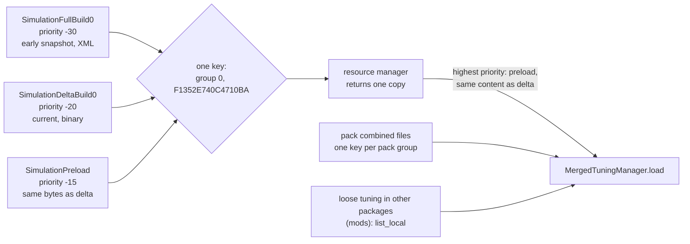
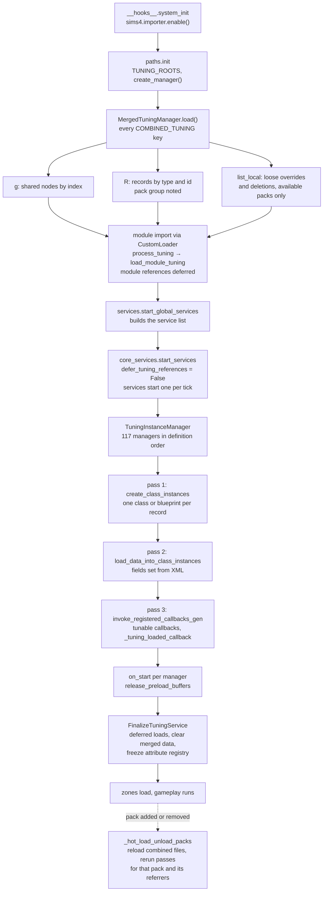

# 0.03 The tuning system

*Game version 1.128.90.1030 (Steam, Linux/Proton). Counts come from the base game plus the installed packs EP04 Cats & Dogs, EP06 Get Famous, EP09 Eco Lifestyle, EP12 High School Years, GP04 Vampires, GP12 Werewolves and SP01 Luxury Party (SP42 is installed but ships no tuning). Written 2026-10-12. Checked 2026-10-12: 86 claims checked, 26 corrected, 2 relabelled, 1 removed.*

## In plain words

Most of what a player would call "the rules" of The Sims 4 is data, kept in records called tuning. How fast hunger drops, what a moodlet does, which interactions a fridge offers, how much a career pays, which tags a chair carries: each of these is a named tuning record. The game's Python code decides what kinds of record can exist and which fields each kind has. The tuning fills in the values. At start-up the game reads every record and turns it into a small piece of Python, so a moodlet such as "Happy" becomes a class the rest of the game uses exactly as if a programmer had typed it in.

Each pack ships its tuning as one large file. Every game update replaces the whole base game file with a fresh, complete copy; an early copy, most likely the one the game launched with, stays on disk beside it and is never read. Packs add records under their own ids and do not overwrite the base game's. The base game itself mentions thousands of pack records (about 1,000 from Cats & Dogs alone). When you do not own a pack, most of those mentions are quietly dropped while loading instead of breaking anything.

Three things tend to surprise people. This install holds about 73,400 live records, and in the base game only about 1,800 of its 47,600 have an id made from the record's name; the rest carry numbers handed out by the developers' tools. Identical pieces of tuning are stored once and become one shared object in memory. And the shipped game cannot reload tuning while it runs: that switch is wired off, and only whole packs can be loaded or unloaded on the fly.

## Key facts

- Tuning ships as one `COMBINED_TUNING` resource (type `0x62E94D38`) per pack, keyed by the pack id as the resource group. No individual tuning files ship in EA's packages.
- The base game holds three copies of the same key: `SimulationFullBuild0` (an early snapshot, XML text, 14,527,097 bytes) and `SimulationDeltaBuild0` plus `SimulationPreload` (byte-identical, binary, 32,472,930 bytes). If the highest priority wins (the resolver is native, so this is inferred), the preload's -15 beats the delta's -20 and the full build's -30; either way the live content is the current delta tuning and the full build is never read.
- Live tuning in this install: 73,402 records (72,956 instance records plus 446 module tuning records), 47,609 in the base game (all 446 module tuning records among them) and 25,799 in the seven packs, 6 of which replace base records with the same id. 72,574 sit in the 100 record types that Python manages.
- `sims4.resources.Types` defines 117 tuning types: one for module tuning (`tun`) and 116 instance types, each with its own instance manager. 114 of the 117 type ids are the FNV-1 32-bit hash of the lowercased file extension; only `tun`, `relbit` and `notebook_entry` differ.
- Load order: module tuning is applied while each Python module is imported; instance tuning runs later in three passes over all 117 managers (create classes, fill fields, run callbacks), yielding to the engine once 0.25 s have passed. A finalize step then frees the raw data.
- Every instance record becomes a Python subclass named after the record, except in 15 managers (buff, trait, action, animation and 11 more), where it becomes a lighter "blueprint" object.
- A field missing from a record gets the default from the Python code, and an override of a record replaces the whole record. Nothing is merged field by field.
- Ids: records whose id comes from their name use FNV-1 64 of the lowercased name (1,832 in the base game, including all 446 module tuning files, whose names use dashes for dots). All other base ids are at most 539,645.
- Identical subtrees are stored once (two inline name fragments in `sims.sim_spawner` are the only exceptions): the base delta has 102,039 shared nodes and 835,550 references to them, and each shared node is turned into one Python value that every user shares.
- A `pack_safe` reference to a record that is not loaded makes the surrounding list entry disappear. A missing reference that is not pack-safe quietly becomes `None`, and a list keeps that `None` as an entry.
- In the 12 partitioned dynamic enums (`Tag` among them), values are numbered by pack: below 8192 is the base game, then one block of 2048 values per pack id.
- Tags: the live `tag` module tuning defines 5,611 `Tag` values (1,114 in the full build) and 73 `TagCategory` values (43 in the full build), including values for packs that are not installed.
- `_tuning_loaded_callback` (32 definitions in the decompiled source, 41 in the bytecode) runs at load. `_verify_tuning_callback` (101 in source, 115 in bytecode) never runs at start-up: its pass has no caller and the per-tunable verify hooks are compiled out. It does run on the records re-read during a pack hot-load or unload.
- Live tuning reload is disabled (`SUPPORT_RELOADING_RESOURCES = False`, and `--enable_tuning_reload` is parsed but never stored). Pack hot-load still works: the engine triggers it through a native hook. `tuning.load_pack` and `tuning.unload_pack` reach it too, but as `Automation` commands they only run in automation mode.
- Every other `tuning.*` console command is `DebugOnly` and is never registered in the retail build.

## How it works

### What tuning is

**Observed** (`sims4/tuning/tunable_base.py`, the rescued `tunable.py`, counts over the decompiled source of `core` and `simulation`): a "tunable" is a Python object that describes one field: its type, its default and how to read it from XML. Code declares tunables in three places:

- `INSTANCE_TUNABLES` on a class (762 declarations): the fields every record of that type has. `REMOVE_INSTANCE_TUNABLES` (192) takes inherited fields away and `lock_instance_tunables` (238 calls) pins a field to a fixed value for a subclass.
- CAPITALISED class attributes on a plain class inside a module (2,442 such tunable assignments, none at module top level): one value for the whole module, filled by module tuning.
- `FACTORY_TUNABLES` (2,031): a reusable bundle of fields that other tunables embed (a test, a loot operation, a curve).

Tuning is the data that fills those declarations. Python code reads the result as ordinary class attributes, for example `buff.visible` or `AnimalCommandTuning.DISABLE_BIRDS_GLOBAL_FLAGS`.

### Instance tuning and module tuning

**Observed** (`sims4/resources.py: Types`, `sims4/tuning/module_tuning.py: ModuleTuningManager`):

- **Instance tuning** is many records of one type: buffs, interactions, careers. Each record has a type, a 64-bit instance id, a name, a Python class (`c`) and that class's module (`m`). An `InstanceManager` per type owns them.
- **Module tuning** is one record per Python module. It sets the class-level tunables of that module, for example the `tag` record fills the `Tag` and `TagCategory` enums. Its type is `TUNING` (extension `tun`, id `0x03B33DDF`), owned by `ModuleTuningManager`. The base delta has 446 module tuning records; the full build has 167.

**Observed** (combined files of all installed packs): packs ship no module tuning at all. Every one of the 446 `tun` records sits in the base game file, including the enum values that packs add (see Tags). So a pack can extend an enum only through the base game's module tuning.

### Where tuning lives: one combined file per pack

**Observed** (`sims4/tuning/merged_tuning_manager.py: MergedTuningManager._load_combined_file_by_key`, decoded with the binary tuning decoder): each pack has a single `COMBINED_TUNING` resource. The base game's key is group 0, instance `F1352E740C4710BA`; Cats & Dogs uses group `0x19`, instance `E23BB17404760CFF`. The group is the pack id. The tree inside looks like this (shape only, values invented):

```xml
<combined>
  <g s="merged">                     <!-- shared subtrees, addressed by x -->
    <L x="1234"><T>5</T><T>9</T></L>
  </g>
  <R n="buff">                       <!-- one group per record type -->
    <I c="Buff" i="buff" m="buffs.buff" n="Buff_Example" s="12345">
      <T n="visible">True</T>
      <r n="some_list" x="1234"/>    <!-- points into the shared group -->
    </I>
  </R>
  <R n="tun"><M n="tag" s="15608553923092786359">...</M></R>
</combined>
```

- **Observed** (`merged_tuning_manager.py`, `NAME_ABBR`): the one-letter tags are `T` (a single value), `E` (enum), `U` (tuple), `V` (variant, its `t` attribute names the chosen option), `L` (list), `C` (class inside a module), `M` (module record), `I` (instance record) and `r` (reference into the shared group by `x` index).
- **Observed** (`_load_combined_file_by_key`, and the first bytes of every extracted file): the base game's full build is plain XML text. Every other combined file (all deltas and all pack full builds) is a binary packed form, which the native `_tuning.is_binary_merged_tuning` detects and `_tuning.BinaryTuning` exposes as the same tree. The byte layout is in [8.02 Tuning XML and binary delta tuning](8.02-tuning-formats.md).
- **Observed** (package scan with the package reader): the packages hold the combined file plus SimData records (type `0x545AC67A`; the community name, since `sims4.resources.Types` calls this id `PLAYLIST`): 23,095 in the base delta, 21,920 in the preload and 5,925 in the base full build. 1,175 of the base delta's entries are empty (size 0, compression code `0xFFE0`), each on a key the full build also has, which leaves 21,920 real ones, under the same keys as the preload's 21,920. **Inferred**: the empty entries are deletion markers ([8.02 Tuning XML and binary delta tuning](8.02-tuning-formats.md)). In code, 402 tunables are marked `ExportModes.ClientBinary` and 437 `All`, out of 890 `export_modes=` arguments. **Inferred**: SimData is the client-side copy of those exported tunables, read by the client, while the Python reads only the combined file.
- **Observed** (`Types`): `TUNING_DESCRIPTION` (`0x962C5034`, the developer schema files) is defined but not shipped.

### Which copy wins: full build, delta build and preload



- **Observed** (`Data/Simulation/Resource.cfg`): `SimulationPreload` priority -15, `SimulationDeltaBuild0` -20, `SimulationFullBuild0` -30, `magalog` -40. A pack's `Delta/<pack>/ResourceSimulation.cfg` gives preload -14, delta -20, magalog -29, full -30, and the cfg in the pack's own folder gives delta -20, full -30, magalog -40.
- **Observed** (sha1 of the extracted resources): the base delta and preload copies are byte-identical, and so is each installed pack's delta and preload pair. All three base copies carry the same key, so a single lookup returns one of them.
- **Inferred** (native resource manager, not readable): a key present in several mounted packages resolves to the highest priority. That returns the preload copy (-15), whose bytes are the delta's, so the live content is the current delta tuning either way. It fits everything the Python sees: `MergedTuningManager.load` asks for every `COMBINED_TUNING` key once through `get_all_resources_of_type` and loads whatever comes back.
- **Observed** (comparison of the two decoded base files by type and id): the full build has 20,351 instance records, 167 module records, 84 record types and 29,541 shared nodes. The delta has 47,163 instances, 446 modules, 122 types and 102,039 shared nodes. Of 20,518 full-build records, 17,439 are still in the delta, 3,079 were removed since, and 66 kept their id under a new name. The delta has 30,170 records the full build never had. The delta's combined tuning therefore replaces the full build's completely (the delta package as a whole is a patch layer of changed resources: [8.01 Package files and resource types](8.01-package-files.md)). A pack's `Version.ini` records its two builds separately (EP04 (Cats & Dogs): `baseassetsversion` `1.assets.ml-ep04.2` against `assetsversion` `1.assets.ml-ep04.438`); the base game's version file is `Game/Bin/Default.ini`. **Inferred** (no toddler records, highest small id 101,957): the full build is the launch build or close to it.
- **Observed** (the package reader over `Delta/`): the install has `Delta/` folders for 117 packs, and 82 of them carry a combined tuning file (79 in their delta build; SP57 (Cozy Kitsch), SP70 (SpongeBob Kid's Room) and SP82 (Yard Charm) only in their preload package), including packs that are not installed. For example `Delta/EP05` (Seasons, not installed) fills 198 MB, mostly client data, and holds a 3,884,946-byte combined file under group `0x1A`. **Inferred** (the executable is encrypted; its strings only show the `ResourceSimulation.cfg` and `PackedFile` patterns): nothing in the Python filters combined files by pack, so the engine must mount a pack's folders only when the pack is installed.

### How a pack adds tuning

**Observed** (`MergedTuningManager._load_res_node`, `InstanceManager._create_class_instance`):

1. Every combined file loads into the same table, keyed by record type and instance id. A later file with the same id would overwrite an earlier one (a plain dictionary store).
2. When the file's group is not 0, the id is noted in `res_id_group_map` so the record keeps its pack.
3. The manager registers every record under a key with group 0 and keeps the real key, with the pack group, in `_remapped_keys`. Lookups by id therefore do not care which pack a record came from.

**Observed** (decoded live files of every installed pack against the base delta):

| Pack | Group | Live records | Shared nodes | Ids also in the base delta |
|---|---|---|---|---|
| Base game | 0x00 | 47,609 | 102,039 | |
| EP04 Cats & Dogs | 0x19 | 7,248 | 16,874 | 0 |
| EP06 Get Famous | 0x1B | 5,849 | 13,181 | 0 |
| EP09 Eco Lifestyle | 0x1E | 3,983 | 10,758 | 0 |
| EP12 High School Years | 0x35 | 4,916 | 11,107 | 0 |
| GP04 Vampires | 0x11 | 1,499 | 6,527 | 0 |
| GP12 Werewolves | 0x3F | 2,215 | 7,480 | 6 (the `auCASPart_BodyScar*` camera records, same names, client side) |
| SP01 Luxury Party | 0x01 | 89 | 792 | 0 |

So in the live data packs only add. The packs' own full builds still contain records that the base game took over later (116 ids in SP01's full build, 54 in GP04's, 14 in EP04's such as `buff_Sim_ReturnToLot_Cooldown`, 12 in EP09's, 7 in EP06's, 6 in GP12's and 4 in EP12's). Those stale copies sit under the pack delta's priority and never load.

**Observed** (leaf values of the decoded base delta): the base game names ids that only an installed pack defines. 997 distinct EP04 ids appear as values in the base file, 774 for EP06, 772 for EP12, 681 for EP09, 452 for GP04, 430 for GP12 and 38 for SP01; interactions dominate, then buffs and loot actions. **Inferred**: these are `pack_safe` references (for example the pet versions of `generic_consume_food`). They are why pack safety exists: the base game lists pack content, and loading drops what is missing.

### The instance managers and `sims4.resources.Types`

**Observed** (`sims4/resources.py: InstanceTuningDefinition`, `Types._add_inst_tuning`): each of the 117 definitions gives a type name, a file extension (default: the name), a resource type (default: `hash32` of the extension), a manager name (default: name plus `_manager`), a manager kind and three flags. The definitions build `INSTANCE_TUNING_DEFINITIONS` and `TYPE_RES_DICT` (type id to extension).

| Manager kind | Count | Examples |
|---|---|---|
| `INSTANCE_MANAGER` | 97 | snippet, posture, career, venue, drama_node |
| `INSTANCED_CLASS_MANAGER` | 15 | object_state, recipe, buff, trait, objective, tutorial_tip, animation, balloon, action, situation_job, situation_goal, situation_goal_set, sim_filter, role_state, broadcaster |
| `MODULE_TUNING_MANAGER` | 1 | tuning (`tun`) |
| `STATISTIC_INSTANCE_MANAGER` | 1 | statistic |
| `ASPIRATION_INSTANCE_MANAGER` | 1 | aspiration |
| `INTERACTION_INSTANCE_MANAGER` | 1 | interaction (manager name `affordance_manager`) |
| `DEFINITION_MANAGER` | 1 | object (manager name `definition_manager`) |

- **Observed** (`sims4/tuning/instance_manager_types.py`, `instance_manager_utils.py: MANAGER_TYPES`): the kind strings map to manager classes. `InstancedClassInstanceManager` (`instanced_class_manager.py`) only answers `True` to `is_instanced_class_tuning_manager`.
- **Observed** (definitions): `require_reference` is set on 78 types, `base_game_only` on 2 (`slot_type`, `slot_type_set`), and `use_guid_for_ref=False` on the same 2. **Observed** (all uses of these flags): `require_reference` and `base_game_only` are only written into the developer schema export; nothing enforces them at load.
- **Observed** (hash test over all 117 definitions): 116 give their resource id explicitly, and 113 of those equal FNV-1 32 of the lowercased extension. The three that do not are `tun` `0x03B33DDF`, `relbit` `0x0904DF10` and `notebook_entry` `0x9902FA76`. The last definition, `tdesc_debug`, gives no id and takes the default hash, `0x6A17611C`.
- **Observed** (base delta): 89 Python types have base records and 28 have none, because their content is pack-only (`season`, `sickness`, `university`, `clan` and so on). The delta also has 33 record types that no Python manager reads (675 records: `camera` 418, `casmodifiertuning` 108, `client_tutorial` 51, `Renderer_*`, `Telemetry_*` and others). **Inferred**: the client reads these.

Biggest live types (the base delta plus each installed pack's delta, keyed by type and id as the game loads them; recounted 2026-10-12 in the editor pass):

| Type | Records | Type | Records |
|---|---|---|---|
| interaction | 13,983 | statistic | 1,528 |
| action (loot) | 10,250 | objective | 1,332 |
| buff | 7,583 | trait | 1,209 |
| object_state | 4,807 | tutorial_tip | 994 |
| snippet | 4,335 | role_state | 844 |
| animation | 3,480 | aspiration | 843 |
| recipe | 3,101 | sim_filter | 736 |
| object | 2,665 | whim | 680 |
| situation_goal | 2,326 | drama_node | 677 |

**Observed** (class attribute `c` in the base delta): the base records name 553 distinct classes, 499 of them in the Python-managed types; the other 54 are client classes such as `Client_CASThumbnailCamera`. The largest are `LootActions` 5,573, `Buff` 4,676, `SuperInteraction` 3,151, `AnimationElement` 2,045, `GameObject` 1,817 and `ObjectStateValue` 1,757.

### The load pipeline, end to end



1. **Observed** (`simulation/__hooks__.py: system_init`, `sims4/importer/custom_import.py: enable`): the importer replaces Python's path finder with `CustomFinder` and `CustomLoader`, so every game module goes through the tuning hook after it executes.
2. **Observed** (`paths.py: init`, checked against the bytecode because the decompile mis-indents it): `paths.init` always sets `TUNING_ROOTS`, then creates the merged manager and calls `MergedTuningManager.load()`. **Inferred**: the engine calls `paths.init`, since no Python code does.
3. **Observed** (`MergedTuningManager.load`): it walks every combined key. A `--skip_packs` command-line argument can leave chosen packs out and marks them unloaded.
   - Each `g` child is stored by its `x` index in `indexed_tunables`.
   - Each `R` child stores its records under `_tuning_resources[ext][id]`.
   - Then `sims4.resources.list_local` returns loose tuning resources and deleted keys of the tuning types. They are kept only if `is_available_pack(key.group)`. **Inferred** (the native `list_local` cannot be read): this is how loose tuning files in other packages (mods) add, override or delete records.
4. **Observed** (`CustomLoader.post_load`, `serialization.py: process_tuning`, `load_module_tuning`): each imported module is scanned for tunables. If it has any, its module record (or a loose override with the same key) is fed into it. `_ignore_modules` skips the importer itself and standard modules such as `os`, `re`, `xml` and `google.protobuf`.
5. **Observed** (`services/__init__.py: start_global_services`, `sims4/core_services.py: start_services`): `start_global_services` builds a service list and hands it to `core_services.start_services`, which first sets `defer_tuning_references = False` and then starts the services one per engine tick. The list is the distributor, the intern service and its start step, a timestamp, then `TuningInstanceManager` with all 117 managers in definition order, then `FinalizeTuningService`, another timestamp, the end of interning, and then terrain, zone manager, account and rental services. `TuningInstanceManager.can_incremental_start` is `True`. `update_incremental_start` returns to the engine once 0.25 s (`TUNING_CALLBACK_YIELD_TIME_INTERVAL`) have passed, checked at each yield point (after every manager in passes 1 and 2, after every record in pass 3), so the loading screen stays responsive.
6. **Observed** (`TuningInstanceManager._execute_gen`): three passes, each over every manager, described below. After them come `on_start` (or `on_packs_loaded` during a hot-load) and `sims4.resources.release_preload_buffers()`.
7. **Observed** (`serialization.py: finalize_tuning`): deferred tunables are resolved, the merged manager is cleared (`SUPPORT_RELOADING_RESOURCES` is `False`), the cleanup helpers null their attributes, and `TUNING_ATTRIBUTES_REGISTRY` is frozen.
8. **Observed** (`TunableReference.load_etree_node`): because the flag is already `False` when instance tuning runs, instance references resolve at once. Only module tuning, which runs at import while the flag is still `True`, needs deferral.

### Module tuning: filling a module at import

- **Observed** (`serialization.py: _scan_module_rec`, `_replace_tunables`, `_process_module_tunables`, checked in the bytecode): the scan looks inside the module's classes only; an object that is not a class reports no tunables, and no shipped module declares a tunable at top level. It moves each one into a `MODULE_TUNABLES` dictionary and deletes the attribute. Any tunable whose `needs_deferring` is set is marked `deferred`, since no instance manager has loaded yet at import time. The constructors of `TunableReference`, `TunableTuple` (and so every variant, optional and factory built on it) and every list, set and mapping set that flag unconditionally. Only `TunableDynamicEnumElements` (`dynamic_enum.py`) clears it again, so in module tuning plain scalars, enum entries and the dynamic enums' own value lists load at once and everything else waits.
- **Observed** (`load_module_tuning`): the module's key comes from `get_resource_key`. If `local_key_exists` (a loose override), that file is loaded; otherwise the `M` node from the combined file. Afterwards, every tunable found in the scan is visited: a value that was loaded (and is not deferred) gets its `callback`; one that was absent is set to the code default.
- **Observed** (hash check over all 446 base records): a module record's id is FNV-1 64 of the module name with dots replaced by dashes, for example `global_flags-global_flags`.
- **Observed** (`ETreeTuningLoader._load_node`): `C` children step into the named class inside the module and `r` children are followed into the shared group. A name the code no longer declares logs "no longer tunable" and is skipped.

### Instance tuning: three passes

**Pass 1, create classes.** **Observed** (`InstanceManager.create_class_instances`, `serialization.py: create_class_instance`, `ETreeClassCreator`):

- `MergedTuningManager.get_all_res_ids` returns every (group, id) pair for the type: combined records, plus loose ones, minus loose deletions.
- For each pair, a deleted key returns nothing. A loose key loads the loose file; anything else uses the combined node.
- The creator reads `c` and `m`, finds the Python class and calls `generate_tuned_type(name)`. That builds a new subclass named after the record, in the pseudo-module `sims4.tuning.class.instances`. Instanced-class managers build a blueprint instead (next section).
- `register_tuned_class` stores the result under `Key(type, id)`. A second registration of the same key logs "Attempting to re-register" and keeps the first.

**Pass 2, fill fields.** **Observed** (`load_data_into_class_instances`, `load_from_xml`, `ETreeTuningLoader._load_tunable`):

- For each child of the record, the loader looks the name up in `cls.get_tunables()`. A tag that does not match the tunable's kind logs "Incorrectly matched tuning types".
- The value is built by the tunable's `load_etree_node`, or taken from the shared cache for an `r` node, and set on the class.
- Tunables with a callback are queued as `TuningCallbackHelper` objects.
- Fields the record does not mention keep the class default that the metaclass set.
- **Observed** (the same method, bytecode): a record whose class has an `additional_pack` value is deleted when that pack is unavailable. **Observed** (`drama_node.pyc` bytecode, which did not decompile): `BaseDramaNode.INSTANCE_TUNABLES` declares `additional_pack`, so a drama node can require a second pack. No record in the base game, the installed packs or the EP11 (Cottage Living) delta sets it, so the check never fires in this install.
- **Observed** (bytecode of `ETreeTuningLoader._load_tunable`, `_load_node` and `load_data_into_class_instances`): an exception while loading one field aborts the remaining fields of that record. `_load_tunable` logs "Error occurred within the tag named ..." and re-raises, `_load_node` has no handler, and the manager catches it and logs "Exception while finalizing tuning". The class keeps code defaults for the rest, the record's per-field callbacks are not queued, and its `_tuning_loaded_callback` still runs in pass 3.

**Pass 3, callbacks.** **Observed** (`invoke_registered_callbacks_gen`, `_invoke_tunable_callbacks`):

- For each record, the queued per-field callbacks run first (160 `callback=` declarations in code), then the class's `_tuning_loaded_callback` (32 definitions in 29 decompiled files; the bytecode has 41 in 37 files, the rest in modules that did not decompile). The pass yields after each record so the time slicing can return to the engine. During a hot-load it skips base game records.
- After its last record, a manager marks itself complete and runs any `add_on_load_complete` callbacks.
- **Inferred**: because pass 2 finished for every manager before pass 3 began, a `_tuning_loaded_callback` can read any other record's fields. It cannot rely on another manager's callbacks having run if that manager comes later in definition order. The order starts with the module tuning manager (`tuning`), then snippet, posture, slot_type, static_commodity, relationship_bit, object_state, recipe, game_ruleset, statistic, mood, buff, trait and ends with tdesc_debug.

### Metaclasses and blueprints

- **Observed** (`sims4/tuning/instances.py: TunedInstanceMetaclass`): a class whose metaclass is this takes a `manager=` argument and registers itself as a class template with that manager. Its `get_tunables` walks the class's ancestors from the root down, merging each `INSTANCE_TUNABLES` and removing names listed in `REMOVE_INSTANCE_TUNABLES`. `lock_instance_tunables(cls, **values)` sets fixed values and drops those fields from what tuning may change.
- **Observed** (`HashedTunedInstanceMetaclass.assign_guid`): this variant also sets `guid` to `hash32(name)`, and `guid64` to `hash64(name)` when the manager does not use the id for `guid64`. In code, 110 class declarations use the hashed metaclass and 38 the plain one, across 117 files.
- **Observed** (`instances.py: create_tuning_blueprint_class`): for the 15 instanced-class managers, a record becomes a `TuningBlueprint` object. Besides three fixed slots (`tuning_name`, `resource_key`, `guid64`) it holds each tuned field as an ordinary attribute, and every attribute set on it is noted in `TUNING_ATTRIBUTES_REGISTRY_DYNAMIC`. Calling the blueprint creates an object of the real class (for example a live `Buff` on a Sim). Its `init_blueprint` then copies every noted attribute onto the new object. **Inferred**: this saves memory, because the 7,583 buff records exist as plain objects instead of 7,583 Python classes.
- **Observed** (other metaclasses): `SnippetInstanceMetaclass` (snippets), `DynamicEnumMetaclass` (tunable enums) and `TdescFragMetaClass` (reusable schema fragments).

### The tunable types

**Observed** (`tunable.py` failed as a whole module and was rescued function by function; 76 top-level classes and helpers, only `AutoFactoryInit` and its `__init__` stayed unreadable): the family tree, with how often each is constructed across the game's code.

| Family | Types (calls in code) | What the tuned value becomes |
|---|---|---|
| Base | `TunableBase`, `Tunable` (2,723) | a converted scalar (`int`, `float`, `str`, `bool`; bools accept true/t/false/f) |
| Numeric | `TunableRange` (669), `TunablePercent` (77), `TunableAngle` (27), `TunableInterval` (157), `TunableThreshold` (119), `TunableOperator` (28), `TunableRate` (2), `TunableLiteralOrRandomValue` (9) | clamped numbers; percent is divided by 100; angle is read in degrees and stored in radians |
| Structure | `TunableTuple` (1,439), `TunableVariant` (549), `OptionalTunable` (1,831) | a named tuple; one chosen option; a value or `None` |
| Collections | `TunableList` (1,580), `TunableSet` (350), `TunableMapping` (629) | a tuple, a frozenset, a frozendict |
| Enums | `TunableEnumEntry` (2,051), `TunableEnumWithFilter` (106), `TunableEnumSet` (88), `TunableEnumFlags` (112), `TunableTag` (78), `TunableTags` (91) | enum members |
| References | `TunableReference` (2,835), `TunablePackSafeReference` (660), `TunableResourceKey` (151), `TunablePackSafeResourceKey` (30), 26 typed resource keys such as `TunableCasPart` (18) and `TunableLotDescription` (17) | the referenced class, or a resource key |
| Factories | `TunableFactory` and `.TunableFactory()` (3,054), `TunableReferenceFactory` (3) | a callable wrapper or a built object |
| Text, time, geometry | `TunableLocalizedString` (524), `TunableLocalizedStringFactory` (489), `TunableSimMinute` (204), `TunableTimeOfDay` (55), `TunableTimeSpan` (53), `TunableRealSecond` (24), `TunableVector3` (24), `TunableVector2` (17), `TunableCurve` (39), `TunableColor` (11), `TunableStringHash32` (49), `TunableStringHash64` (15) | localized string ids, times, vectors, curves, hashes |
| Helpers from `tunable_utils` | `TunableTestSet` (254), `TunableWhiteBlackList` (38), `TunableObjectGeneratorVariant` (10), `TunableMultiplier` (5), `TunableBlacklist` (4), `TunableWhitelist` (3), `TunableObjectFilterVariant` (3), `TunableOffset` (2), `TunableModel` (2) | see the last subsection |

Behaviour worth knowing, all **Observed** in the rescued `tunable.py`:

- `TunableRange` clamps an out-of-range value to the nearest bound and logs an error. `TunablePercent` defaults its range to 0 to 100; `TunableAngle` to 0 to 2π radians.
- An unreadable value logs "has an invalid value" and falls back to the default. When the tunable is `pack_safe`, it raises `UnavailablePackSafeResourceError` instead.
- `TunableTuple` fills keys the XML leaves out with their defaults. `TunableVariant` picks its option from the `t` attribute and supports `locked_args`, fixed values that tuning cannot change. `OptionalTunable` is a variant with the two options `disabled` and `enabled`.
- Collections skip an element that raises `UnavailablePackSafeResourceError` or `TunableMinimumLengthError` (`tunable_errors.py`). Any other element error is logged as "Failed to load element ... Skipping".
- The shipped `TunableBase` (`tunable_base.py`) keeps only six slots per tunable: `callback`, `deferred`, `needs_deferring`, `is_fragment`, `_cache_key` and `_has_callback`. Its constructor still accepts `description`, `export_modes`, `tuning_group` and the other schema arguments, then throws them away, so the TDESC export code in `serialization.py` cannot produce anything useful in the retail build. Each tunable registers with `CacheKeyCleanupHelper`, which nulls its cache key at finalize.

### Factories: `FACTORY_TUNABLES` and `AutoFactoryInit`

- **Observed** (rescued `tunable.py`: `TunableFactory`, `TunableSingletonFactory`, `create_auto_factory`): a class that mixes in `HasTunableFactory` (305 class declarations) or `HasTunableSingletonFactory` (1,091) gets a generated `TunableFactory` built from its `FACTORY_TUNABLES` and any `@factory_option` hooks. `AutoFactoryInit` (1,297 class declarations) turns the tuned fields into attributes in `__init__`.
- **Observed** (same): a plain factory stores the tuned keyword arguments in a `TunableFactoryWrapper`. Gameplay calls the wrapper later, adding live arguments, to build the object (for example a loot operation built per use). A singleton factory builds its object once, at load, and every use shares it.
- **Inferred** (from the counts): a large share of what a modder edits sits in factories embedded inside records: tests, loot operations, conditions and curves. Their XML shape follows each factory's `FACTORY_TUNABLES`.

### References, pack safety and deferral

- **Observed** (rescued `TunableReference.load_etree_node`, `InstanceManager.get`): a reference's text is an id. `get_resource_key` turns a digit string into `Key(type, id)` and any other string into `Key.hash64(file name without extension)`. The manager looks the key up.
  - **Observed** (bytecode of `InstanceManager.get`): a missing key on a non-pack-safe reference returns `None` with no log, and the reference keeps that `None`. Inside a list the `None` stays as an element (the `fail_none_if_not_pack_safe` check is compiled out). The reference's error-and-default path runs only when the lookup raises: a class-restriction `ValueError` (below), or a `KeyError`, where a reference into the object definition manager (`Types.OBJECT`) takes the default without an error.
  - On a `pack_safe` reference (1,315 `pack_safe=True` arguments in code), the manager calls `add_tuning_dependency` (a no-op in retail, `BUILD_TUNING_DEPENDENCIES_MAP` is `False`) and raises `UnavailablePackSafeResourceError`. `TunableReference` re-raises it, and it climbs to the nearest list, set or mapping, which drops the element. `TunablePackSafeReference` catches it itself and returns `None`. With no list or set above it, it reaches `_load_tunable` and aborts the rest of the record (pass 2).
- **Observed** (`InstanceManager.verify_class_restrictions`): a reference with `class_restrictions` checks the target's class and ancestors. A mismatch raises `ValueError`, which the reference loader logs before falling back to the default.
- **Observed** (`ETreeTuningLoader._load_tunable`, `_DeferredEtreeTunableLoader`): while `sims4.core_services.defer_tuning_references` is `True` (during module import), a deferred tunable is stored as a loader object. Most are module references deferred automatically; only 3 tunables in code ask for it with `deferred=True`.
  - The loader resolves on first attribute access (its `__get__` replaces itself with the value) or at `finalize_deferred_loads`.
  - A missing pack-safe target there becomes the default.
  - A reference that is not deferred and loads while the flag is `True` logs "Please mark this tunable as deferred" and becomes `None`.

### The shared-value cache

**Observed** (`MergedTuningManager.get_tunable`, checked against the bytecode): with `USE_CACHE` on, the value built from a shared node is stored under (node index, the tunable's `cache_key`). The next record that points at the same node with a compatible tunable gets the same Python object back. Cache keys separate tunables that read the same text differently, for example `TunablePercent_{default}` or `TunableStringHash32`.

**Inferred**: shared values must be treated as read-only. Code that mutated one would change it for every record that shares it. Collections load as tuples, frozensets and frozendicts, which keeps them immutable.

### Callbacks, and verify checks that only run on hot-load

- **Observed** (`instance_manager.py`): the constants `TUNING_LOADED_CALLBACK`, `VERIFY_TUNING_CALLBACK` and `GET_TUNING_SUGGESTIONS` name the three class hooks.
- **Observed** (`tunable_base.py: TunableBase.has_verify_tunable_callback` returns `False`; `InstanceManager.invoke_verify_tuning_callback_gen` has no caller in the source, in any bytecode file or in the native strings; the status string `VERIFY_CALLBACKS` is never logged): the 31 `verify_tunable_callback=` arguments never run, and `_verify_tuning_callback` (101 definitions in 85 decompiled files, 115 in 95 files in the bytecode) never runs at the first load.
- **Observed** (bytecode of `TuningInstanceManager._execute_gen`, `unload_packs`, `InstanceManager.on_packs_loaded`, `reload_dependency_tunings`, `reload_by_instance_id`): during a pack hot-load or unload, each manager re-reads the records that the TD cache lists as referrers of the changed pack. `reload_by_instance_id` runs `_tuning_loaded_callback` and then `_verify_tuning_callback` on each of them. So the class-level verify checks do run, but only on those re-read records. The verify bodies are real checks that log errors.
- **Observed**: `_get_tuning_suggestions` (8 definitions) has one entry point, the DebugOnly `tuning.inspect` command. The hits in `route_event.py` and `script_object.py` are suggestion methods that forward to their factories.
- **Inferred**: the checks inside `_verify_tuning_callback` methods describe what EA's own tools enforce on tuning. They are a good guide to valid values, but the retail game does not check them at start-up, so a broken mod loads without these errors.

### Finalize

**Observed** (`serialization.py: finalize_tuning`, `FinalizeTuningService.start`, `tunable_perf.py`):

1. Every pending deferred loader resolves and its callback runs.
2. The merged manager is cleared, which frees the shared-node table and the combined trees.
3. Each `TuningAttrCleanupHelper` sets its tracked attribute to `None` on every tunable it registered (for example the `cache_key` strings), then helpers are switched off. `NO_OP_CLEANUP_HELPER` is the stand-in when nothing needs cleaning.
4. On the first load, `TUNING_ATTRIBUTES_REGISTRY` is frozen from the dynamic registry into tuples; on later loads (hot-load) the two are merged.

### Identity: instance ids and hashing

- **Observed** (`sims4/hash_util.py`): `hash32` and `hash64` come from the native `_hashutil`. Tests against shipped data show they are FNV-1 (multiply, then xor) over the lowercased UTF-8 name. 1,368 base records with mixed-case names match only the lowercased hash. The tuning dependency cache key `td_pickle_cache_BASE_GAME` matches the same rule.
- **Observed** (base delta ids):

| Id range | Records | Meaning |
|---|---|---|
| below 2^16 | 12,631 | ids handed out by EA's tools |
| 2^16 to 2^32 | 33,146 | same; the highest is 539,645 |
| above 2^32 | 1,832 | FNV-1 64 of the record name; 905 of them have bit 63 set |

- **Observed** (hash check): every 64-bit id equals FNV-1 64 of its record name. The name-hashed groups are all module tuning, `slot_type`, `slot_type_set`, `camera` and other client tuning. No hand-assigned id reaches bit 31.
- **Observed** (`InstanceManager.register_tuned_class`): when the manager uses ids for references (114 of 116 instance types), `guid64` is the instance id. For `slot_type` and `slot_type_set` it is the name hash set by the hashed metaclass.
- **Observed** (`hash_util.unhash_with_fallback`): unknown hashes below 2^33 print as `0x` plus 8 hex digits (`{:#010x}`), larger ones as `0x` plus 16.
- **Inferred** (community practice, consistent with these ranges): custom records with 64-bit ids derived from a unique name with bit 63 set, or 32-bit keys with bit 31 set, cannot collide with EA's hand-assigned ids.

### Dynamic enums

- **Observed** (`sims4/tuning/dynamic_enum.py`): `DynamicEnum`, `DynamicEnumLocked` and `DynamicEnumFlags` are enums whose members come from module tuning. Their metaclass adds an `_elements` list tunable, and `finalize` deletes old tuned members and adds the newly tuned ones. In code there are 122 dynamic enums: 30 locked, 4 flag enums and 12 partitioned. Of the partitioned ones, 5 are locked (`Tag`, `BucksType`, `DeathType`, `NarrativeProgressionEvent`, `RebateItem`) and 7 are not.
- **Observed** (`_get_pack_from_enum_value`): in a partitioned enum, a value below 8192 belongs to the base game. Above that, the pack is `(value - 8192) // 2048 + 1`, a block of 2,048 values per pack id.
- **Observed** (`DynamicEnumMetaclass.finalize`, checked in the bytecode): on a partitioned enum that is not locked, values from unavailable packs are skipped. A locked partitioned enum such as `Tag` keeps every value. `is_enum_value_available` lets code ask, and one `TunableEnumEntry` uses `validate_pack_availability`.
- **Observed** (`validate_locked_enum_id`): locked enums require a unique id per member and log a clash.

### Tags

- **Observed** (`simulation/tag.py`): `Tag` is a `DynamicEnumLocked`, partitioned and display-sorted, exported to the client and the server. `TagCategory` is locked but not partitioned. `TunableTag` and `TunableTags` default to `pack_safe=True` and treat `Tag.INVALID` (0) as invalid. `filter_prefixes` limits the tag picker (prefix constants such as `interaction`, `Spawn`, `PortalDisallowance`).
- **Observed** (module tuning `tag`, id 15608553923092786359): the base-game delta tuning defines 5,611 `Tag` values, 3,326 of them below 8192 and the rest in 54 pack blocks up to block 141 (EP21 (Royalty & Legacy)). The full build has 1,114 tags. `TagCategory` has 73 values (43 in the full build).
- **Observed** (tag values per block for installed packs): EP04's block holds 102 values (`Ears_Down`, `Main_Pet_Social`), EP06's 208, EP09's 65, EP12's 65, GP04's 25 (`Func_VampireTome`, `Func_Garlic`), GP12's 17 and SP01's (block 1) 25. The low blocks also hold some general names (block 1 has `Skill_Psychic`, `Style_Witch` and `Style_Pirate`), so read a block as a numbering range only.
- **Inferred**: because `Tag` is locked, a tag's number never changes with the packs a player owns. Saves and objects can store tag numbers safely.

### Snippets

- **Observed** (`simulation/snippets.py: define_snippet`): each call creates a record class named from the snippet type (for example `TestSetInstance`) in the `snippet` manager, with one tunable called `value`. It also creates two tunable types: `Tunable<Name>Reference` and `Tunable<Name>Snippet`. The second is a variant with options `literal` (tune it in place) and `reference` (point at a shared snippet record), plus an optional `list_reference`. There are 43 `define_snippet` calls in 34 decompiled files; more sit in modules with no decompiled source (`ui/screen_slam.pyc` calls it for `ScreenSlam`).
- **Observed** (`SnippetInstanceMetaclass`): a snippet class forwards attribute access, calls, length and iteration to its `value`, so code uses a snippet as if it were the value itself.
- **Observed** (base delta): 2,651 snippet records across 41 classes. The largest are `TestSetInstance` 831, `ScreenSlam` 367, `Notification` 273, `AffordanceList` 214, `Outfit` 210 and `AdventureMoment` 162.

### Tunable multipliers and tested sums

**Observed** (`simulation/tunable_multiplier.py`):

- `TunableMultiplier`: `base_value` (default 1) multiplied by the `multiplier` (default 1, minimum 0) of EVERY entry whose tests pass. The tooltip is the first passing entry's. `TunableMultiplier.ONE` is the shared neutral instance.
- `TestedSum`: `base_value` (default 0) plus the sum of passing modifiers (`get_modified_value`), or plus only the largest passing modifier (`get_max_modifier`). A modifier with `multiply_by_count` scales by the test's numeric result. The decompile inverts the test check (`if not not result`); the meaning is "skip failing entries".
- `TunableStatisticModifierCurve`, `TunableSkillModifierCurve` (optionally the effective skill level) and `TunableObjectCostModifierCurve` read a statistic, skill or object value through a curve, and return 1.0 when the subject is missing.

### Tunable time

**Observed** (`simulation/tunable_time.py`):

- `TunableTimeOfDay`: hour 0 to 23 (default 12) and minute 0 to 59 (default 0).
- `TunableTimeOfWeek`: the same plus a `Days` value (`SUNDAY` 0 to `SATURDAY` 6, default Sunday).
- `TunableTimeSpan` and `TunableTimeSpanSingleton`: days (0 or more), hours 0 to 23 and minutes 0 to 59, all default 0.
- `TunableTimeOfDayMapping` builds a sorted table of hour and minute keys. `get_entry_data` returns the last entry at or before the current time, plus the start and the next change. Before the first key of the day it returns `None` and does not wrap to the previous evening.

`TunableSimMinute` and `TunableRealSecond` are plain float ranges in sim minutes and real seconds (rescued `tunable.py`). How sim time runs is in [1.01 Time, scheduling and lot loading](1.01-time-scheduling-loading.md).

### Pack availability checks

**Observed** (`sims4/common.py`; all the call sites below):

- `is_available_pack(pack)` is the native `_zone.is_available_pack` minus packs marked unloaded. `are_packs_available` is true if ANY of the given packs is available. `get_available_packs` returns all `Pack` values that pass.
- Tuning consults it directly in five places:
  - loose overrides are kept only for available groups (`MergedTuningManager._load_combined_file_by_key`);
  - partitioned, unlocked enums skip unavailable values;
  - `@Command(pack=...)` registers a command only when its pack is available (`is_valid_command`);
  - a record whose class sets `additional_pack` is deleted when that pack is missing;
  - `get_available_packs` picks which tuning dependency caches to read.
- Pack-safe references never ask: they only see that the target record did not load.
- **Inferred**: combined files themselves are not filtered in Python, so the engine's mounting is what keeps unowned packs' tuning out.

### Pack hot-load and the tuning dependencies cache

- **Observed** (`services/tuning_managers.py: InstanceTuningManagers`, `register_for_pack_hot_load`, `_hot_load_unload_packs`): after the first load, a callback is registered with the native `register_pack_hotload_callback` hook (native string `resourceman_register_pack_hotload_callback`). When packs are added:
  1. `prepare_hot_load_unload` reloads every combined file, and only goes on if one of the changed packs has tuning.
  2. A new `TuningInstanceManager` runs with `packs_to_load`, so only records of those groups are created, filled and called back, and `on_packs_loaded` replaces `on_start`.
  3. Records that referenced the new pack's records are queued through `pending_reload_inst_ids`. `on_packs_loaded` then re-reads each one with `reload_by_instance_id`, which also runs its `_tuning_loaded_callback` and `_verify_tuning_callback`.
  4. `finalize_tuning` runs again, and `USE_CACHE` is off during the hot-load.

  Unloading goes through `TuningInstanceManager.unload_packs`, which asks each manager to drop that pack's records and collects their referrers.
- **Observed** (`sims4/tuning/tuning_dependencies_cache.py: read_td_cache_from_resource`): referrers come from a prebuilt cache per pack. It is a `TD_CACHE` resource (`0x346CB93E`) keyed by `hash64("td_pickle_cache_<PACK>")`, starting with the bytes `version#0001` and followed by a pickled map from (id, type) to the records that reference it.
  - The base game's cache lists 17,406 referenced keys and 238,404 referrer links (interaction 7,513, buff 2,596, action 2,059 among the keys).
  - EP04's lists 3,489 keys and 49,966 links.
  - The base cache's keys are mostly pack records and its referrers are base records; 1,436 referrers are module tuning names such as `restaurants-restaurant_tuning.tun`.
  - Each package also carries a second cache under `td_pickle_cache_py_unopt_<PACK>` (base: `4CFB105AA36A19E1`, 17,417 keys), which the retail code never reads.
- **Inferred**: this is how a pack bought or enabled while the game runs can appear without a restart: base records that named the pack's content (and dropped it at first load) are re-read.

### Global flags

- **Observed** (`global_flags/global_flags.py`, delta module tuning `global_flags.global_flags`): `GlobalFlags` is a `DynamicEnumFlags` with `DEFAULT = 0` in code. Live tuning adds `BIRDS` 1, `DISABLE_FRUIT_SPAWNERS` 2, `DISABLE_RABBIT_SPAWNERS` 4 and `DISABLE_FOXES_SPAWNING` 8. The full build has no such record.
- **Observed** (`global_flag_service.py: GlobalFlagService`): a single integer bitmask with `add_flag`, `remove_flag` and `has_any_flag`, starting at 0. It has no save or load methods, so flags last for the session only.
- **Observed** (`global_flag_test.py: GlobalFlagTest`, registered as test `global_flag` in `event_testing/tests.py`): passes if any listed flag is set, or the opposite with `negate`.
- **Observed** (`objects/animals/animal_commands.py`, `global_flag_commands.py`): besides `flags.add_flag` and `flags.remove_flag`, the only code that sets a flag is `animals.set_birds_allowed`, which adds or removes `AnimalCommandTuning.DISABLE_BIRDS_GLOBAL_FLAGS`. All three are `Automation` commands (see For modders). **Inferred**: the birds, fruit spawners, rabbits and foxes these flags name belong to EP11 Cottage Living, whose delta tuning on disk holds the fox and rabbit records. That pack is not installed here, so this install cannot show the flags in use.

### Playstyles

- **Observed** (`playstyles/playstyle_enums.py`, delta module tuning `playstyles.playstyle_enums`): `Playstyle` is a `DynamicEnum` with `INVALID = -1` in code. Tuning adds seven values, 0 to 6: `Personality Stylist`, `Less Live Artist`, `Content Omnivore`, `Experience Achiever`, `Sim Perfectionist`, `Social Storyteller` and `Legacy Writer`. The names contain spaces, which the enum accepts.
- **Observed** (all uses): only `gameplay_scenarios/scenario.py` reads it, in `Scenario.RECOMMENDED_SCENARIOS` (`recommended_scenarios_for_playstyles` and `recommended_scenarios_no_playstyle`). That module did not decompile. Scenarios are covered in [4.05 Scenarios, pivotal moments and calls to action](4.05-scenarios-moments.md).

### Reload: what survives in the shipped code

- **Observed** (`paths.py`, bytecode): `SUPPORT_RELOADING_RESOURCES = False`. The `--enable_tuning_reload` argument is parsed, but its value is never stored. **Observed** (`sims4/core_services.py`): `SUPPORT_RELOADING_SCRIPTS` is a `False and ...` expression.
- **Observed** (`sims4/reload_service.py`, `module_tuning.py`): `ReloadService` is only defined when `SUPPORT_RELOADING_SCRIPTS` is set (script reloading). `InstanceManager.reload_by_key` raises "Reloading tuning is not supported for optimized python builds.", and so does `ModuleTuningManager.reload_by_key`. `ModuleTuningManager.reload_by_instance_id` re-runs `process_tuning` on the module.
- **Observed** (`sims4/reload.py`): the module still matters at run time. `sims4.reload.protected(globals())` appears 97 times in 95 modules; it marks module state that a script reload must keep (caches, registries, generated classes such as snippets). `protected` records every name created inside its block in `__reload_hooks__`. `reload_file` re-executes a module and calls `process_tuning` on it. `update_module_dict` then patches the old module's functions and classes in place with the new code, except the protected names, which keep their old values. `__reload_context__` hooks let classes control how tuned attributes are replaced. **Observed** (`snippets.py` lines 60 and 95): `define_snippet` writes its generated classes into the calling module inside a `protected` block and then calls `sims4.reload.update_module_dict`, so that code runs in retail at import too. **Inferred**: nothing else in it is triggered by tuning in retail.

### The importer

- **Observed** (`sims4/importer/custom_import.py`):
  - `CustomFinder` first looks for a compiled `.pyd` in a folder under `DLL_PATH` named after the module's package, then falls back to Python's normal path search (which covers the script archives `base.zip`, `core.zip` and `simulation.zip` in `Data/Simulation/Gameplay`, Inferred from `sys.path`). Four modules ship compiled with Cython: `cython_utils`, `postures.posture_specs`, `postures.posture_graph` and `interactions.constraints`. The `--pure_python` switch makes them load from plain Python instead.
  - Every found module gets a `CustomLoader` (or `LegacyCustomLoader` for old-style loaders), whose `post_load` runs `process_tuning` on it unless `_should_ignore_module` says otherwise.
- **Observed** (`sims4/importer/utils.py`): `module_names_gen` walks folders and `.zip` and `.ts4script` archives to list modules. `import_modules` (no Python caller) imports them all. **Inferred**: the native side uses these to load mod script archives.
- **Observed** (`sims4/importer/layering.py`): `check_import` logs "LAYERING VIOLATION" when a lower layer imports a higher one. It is skipped when running from archives (`IS_ARCHIVE`), so the retail game never checks.

### Helper tunables in `tunable_utils`

**Observed** (`simulation/tunable_utils/*`):

- `TunableTestedList`: entries of test plus item. Passing items are returned; `stop_processing` (or `STOP_PROCESSING_ALWAYS`) ends the walk early.
- `TunableWhitelist` and `TunableBlacklist`: a frozenset of items plus a threshold (default 1 match). The decompile drops the "item in list" filter in the counting expression; the bytecode has it. `TunableWhiteBlackList` combines a whitelist (`everything` or a set) with a blacklist (`nothing` or a set).
- `create_object.py`: `ObjectCreator` and `RecipeCreator` build an object from a definition or a recipe, with weighted quality.
- `TunableModel`: a model taken from a resource key or from an object definition. `TunableOffset`: `fixed` or `random_in_circle`.
- `placement_tuning.py`: orientation and facing restrictions plus radial, linear and angular scoring for placing objects.
- `TunableObjectFilterVariant`: filter objects by Sim, tags, terrain, portal flags or state, or allow all (default by Sim). `TunableObjectGeneratorVariant`: pick objects from a participant, gardening, stored objects or preferences.
- `taggables_tests.py: SituationIdentityTest`: passes if a situation is in a list or carries one of the tags.

## Numbers

| Name | Value | Unit | Where | Source |
|---|---|---|---|---|
| `COMBINED_TUNING` resource type | 0x62E94D38 | type id | `sims4/resources.py: Types` | code |
| `TUNING` (module tuning) type | 0x03B33DDF | type id | `Types` | code |
| `TD_CACHE` type | 0x346CB93E | type id | `Types` | code |
| `TUNING_DESCRIPTION` type | 0x962C5034 | type id | `Types` (not shipped) | code |
| SimData type | 0x545AC67A | type id | packages | package scan |
| Base combined key | group 0, F1352E740C4710BA | key | all three base packages | package scan |
| EP04 combined key | group 0x19, E23BB17404760CFF | key | EP04 full, delta and preload | package scan |
| Base priorities | Preload -15, Delta -20, Full -30, magalog -40 | priority | `Data/Simulation/Resource.cfg` | config |
| Pack delta priorities | Preload -14, Delta -20, magalog -29, Full -30 | priority | `Delta/<pack>/ResourceSimulation.cfg` | config |
| Base full combined size | 14,527,097 | bytes | `SimulationFullBuild0` | full |
| Base delta combined size | 32,472,930 | bytes | `SimulationDeltaBuild0`, `SimulationPreload` | delta |
| Base records, full build | 20,351 instances, 167 modules, 84 types | records | `SimulationFullBuild0` | full |
| Base records live | 47,163 instances, 446 modules, 122 types | records | `SimulationDeltaBuild0` | delta |
| Shared nodes | 29,541 full, 102,039 delta | nodes | `g` group | full / delta |
| References to shared nodes | 835,550 | references | base delta | delta |
| Live records, this install | 73,408 (73,402 distinct type and id pairs, 73,388 distinct ids) | records | base plus 7 pack deltas | delta |
| Python-managed live records | 72,574 in 100 types | records | same | delta |
| SimData records | 23,095 delta (21,920 real, 1,175 empty deletion markers), 21,920 preload, 5,925 full | records | base packages | delta / full |
| Delta folders | 117, of which 82 carry combined tuning (3 only in the preload) | folders | `Delta/` | install |
| Tuning type definitions | 117 (1 module, 116 instance) | types | `Types._add_inst_tuning` | code |
| `require_reference` types | 78 | types | `Types` | code |
| `base_game_only` / no guid types | 2 (`slot_type`, `slot_type_set`) | types | `Types` | code |
| `TUNING_CALLBACK_YIELD_TIME_INTERVAL` | 0.25 | real seconds | `instance_manager.py` | code |
| Base enum value limit | 8192 | enum value | `dynamic_enum.py: _get_pack_from_enum_value` | code |
| Enum block per pack | 2048 | enum values | same | code |
| `TD_CACHE_VERSION` | `version#0001` | header bytes | `tuning_dependencies_cache.py` | code |
| TD cache, base game | 17,406 keys, 238,404 links | entries | `td_pickle_cache_BASE_GAME` | delta |
| TD cache, EP04 | 3,489 keys, 49,966 links | entries | `td_pickle_cache_EP04` | delta |
| `Tag` values | 5,611 delta, 1,114 full | values | module tuning `tag` | delta / full |
| `Tag` values below 8192 | 3,326 | values | module tuning `tag` | delta |
| `TagCategory` values | 73 delta, 43 full | values | module tuning `tag` | delta / full |
| `Tag.INVALID`, `TagCategory.INVALID` | 0 | enum value | `tag.py` | code |
| `GlobalFlags` values | BIRDS 1, DISABLE_FRUIT_SPAWNERS 2, DISABLE_RABBIT_SPAWNERS 4, DISABLE_FOXES_SPAWNING 8 | bit | module tuning `global_flags.global_flags` | delta only |
| `GlobalFlags.DEFAULT` | 0 | bit | `global_flags.py` | code |
| `Playstyle` values | 0 to 6 (seven names) | enum value | module tuning `playstyles.playstyle_enums` | delta only |
| `Playstyle.INVALID` | -1 | enum value | `playstyle_enums.py` | code |
| `TunableMultiplier.base_value` default | 1 | factor | `tunable_multiplier.py` | code |
| Multiplier entry default / minimum | 1 / 0 | factor | `_get_tunable_multiplier_list_entry` | code |
| `TestedSum.base_value` default | 0 | value | `tunable_multiplier.py` | code |
| `TunablePercent` default range | 0 to 100, stored ÷ 100 | percent | rescued `tunable.py` | code |
| `TunableAngle` default range | 0 to 2π, read in degrees | radians | rescued `tunable.py` | code |
| `TunableTimeOfDay` defaults | 12:00, hour 0 to 23, minute 0 to 59 | time | `tunable_time.py` | code |
| `TunableTimeSpan` ranges | days 0 or more, hours 0 to 23, minutes 0 to 59 | duration | `tunable_time.py` | code |
| `Days` | SUNDAY 0 to SATURDAY 6 | enum value | `tunable_time.py` | code |
| Base ids by size | 12,631 below 2^16; 33,146 up to 539,645; 1,832 name hashes | records | base delta | delta |

## Data shapes

**An instance record** (combined tree, `I` node): attributes `n` (name), `s` (instance id), `c` (class), `m` (module), `i` (type extension). Children are fields named by `n`. For example the base record `Mood_Happy` (id 14640, class `Mood`, module `statistics.mood`) carries `audio_stings_on_add`, `base_color`, `buff_polarity` (`POSITIVE`), `buffs`, `descriptions` and `edge_color`, and several of them are `r` links into the shared group.

**A module record** (`M` node): `n` is the dotted module name and `s` its id (FNV-1 64 of the name with dashes). `C` children name classes inside the module; leaf children name the CAPS tunables.

**`MergedTuningManager`** (one per process, cleared at finalize):

| Field | Holds |
|---|---|
| `indexed_tunables` | shared node index → tree node |
| `indexed_constructed_tunables` | (index, cache_key) → built Python value |
| `_tuning_resources` | extension → {instance id → record node} |
| `res_id_group_map` | instance id → pack group (non-base only) |
| `local_key_map`, `local_deleted_key_map` | type → set of (group, id) from loose files |
| `binxml_list` | the native binary trees, kept alive while in use |

**`InstanceManager`** (one per type, `services.get_instance_manager(Types.X)`): `TYPE`, `PATH`, `_tuned_classes` (Key(type, id) → class or blueprint), `_remapped_keys` (group-0 key → real key), `_callback_helper`, `_class_templates`, flags `use_guid_for_ref`, `base_game_only`, `require_reference`, `pending_reload_inst_ids` for hot-load. Main calls: `get(name_or_id_or_key, pack_safe=False, class_restrictions=())`, `types` and `get_ordered_types`.

**A generated record class**: a subclass of the code class, `__name__` = record name, `__module__` = `sims4.tuning.class.instances`, plus `resource_key`, `guid64` (and `guid` for hashed metaclasses) and one class attribute per tuned field.

**A `TuningBlueprint`**: slots `tuning_name`, `resource_key`, `guid64`, plus every tuned field as an attribute, listed in `TUNING_ATTRIBUTES_REGISTRY[id(blueprint)]`. Calling it builds an instance of the code class and copies those attributes onto it.

**A tunable** (`TunableBase` subclass): `_type` or a template, `default`, `_cache_key`, `callback`, `deferred`, `needs_deferring`, `is_fragment`, plus per kind: `minimum` and `maximum` for ranges, `tunable_items` for tuples and variants, `_template` for collections, `_manager` and `pack_safe` and `_class_restrictions` for references.

**The tuning dependencies cache** (per pack): the header `version#0001`, then a pickled dict {(instance id, type): set of (referrer id, referrer type)}.

## For modders

**Common tweaks.**

- To change a record (a buff, an interaction, a trait), ship a package with a loose tuning resource of the same type and instance id. The loader prefers a loose key over the combined file (`create_class_instance`, `load_from_xml`). Copy the whole current record from the delta tuning (read it with the tuning indexer over the decoded delta), because fields you leave out become code defaults and nothing is merged.
- To change a module constant (for example a tag list or a global value), override that module's `tun` record. That replaces the entire module's tuning. **Inferred** (from the whole-record rule): an old copy of `tag` built for an earlier game version deletes every tag added since.
- To add a record, give it a new id. A 64-bit FNV-1 hash of a unique, prefixed name with the top bit set keeps clear of EA's ids. Reference it from other tuning by its decimal id.
- To remove a record, the loader honours deleted keys from `list_local` (`local_deleted_key_map`). **Inferred**: this needs the resource manager's delete marker, which most tools do not write. Overriding the record with harmless values is the usual route.

**Group ids.** The group of a loose tuning key must be an available pack (0 for the base game), or `MergedTuningManager` ignores it. **Inferred** (from `InstanceManager._create_class_instance`, `register_tuned_class` and `_remapped_keys`): to override a pack's record, keep that pack's group in the key (EP04 is `0x19`). With group 0, both copies register under one group-less key and the first one wins; `_remapped_keys` still points that key at the pack's (group, id), and `local_key_exists` compares group and id, so the data load still reads the pack's original. Module tuning overrides use group 0, the default of `Key.hash64`. Test it in game.

**Console commands this system registers.**

| Command | Type | What it does |
|---|---|---|
| `flags.add_flag <GlobalFlags>` | Automation | sets a global flag for the session |
| `flags.remove_flag <GlobalFlags>` | Automation | clears it |
| `animals.set_birds_allowed` | Automation | adds or removes `DISABLE_BIRDS_GLOBAL_FLAGS` |
| `tuning.load_pack <pack>` | Automation | hot-loads a pack's tuning through `_hot_load_unload_packs` |
| `tuning.unload_pack <pack>` | Automation | unloads it |
| `tuning.inspect`, `tuning.import`, `tuning.print_debug_statistics`, `tuning.reload`, `tuning.localwork.refresh_cache`, `tuning.localwork.analyze`, `tuning.resend_clock_tuning`, `tuning.print_load_cache_info`, `tuning.dump_load_cache`, `tuning.dump_tuning_dependencies_cache` | DebugOnly | not registered in retail: `sims4.commands.Command` returns early for `DebugOnly` |

`CommandType` values are `DebugOnly` 1, `Automation` 3, `Cheat` 4 and `Live` 5. **Observed** (`sims4/commands.py: is_command_available`, bytecode): an `Automation` command runs only when `paths.AUTOMATION_MODE` is `True`; turning cheats on unlocks `Cheat` and above, not `Automation`. **Inferred**: `AUTOMATION_MODE` comes from the `automation_mode` argument to `paths.init` and is off in a normal session, so the five commands above do nothing for a player. Which commands a player can type is in [1.04 Debug tools, cheats and telemetry](1.04-debug-cheats-telemetry.md).

**Traps.**

- Absent means default. A field left out of an override gets the Python default, and EA's tuned value is lost.
- The full build is an old snapshot. The tuning indexer (full build) reads it, and 30,170 records exist only in the delta. Take values from the tuning indexer (decoded delta), which decodes the live copy.
- Shared values are shared. A script that mutates a tuned list or dict (where it is mutable at all) changes every record that pointed at the same shared node.
- `pack_safe` hides mistakes. A typo in a reference inside a pack-safe list silently drops that entry. Outside a list it raises and aborts the rest of the record (Observed, see pass 2).
- A missing reference that is not pack-safe is just as quiet: it becomes `None` with no log, and inside a list the `None` stays as an entry that game code then has to cope with.
- Verify callbacks do not run at start-up. A value EA's tools would reject loads without complaint; the checks only fire on records re-read during a pack hot-load or unload.
- Module tuning resolves late. Every module tunable that is a reference, tuple, variant, factory or collection is deferred until finalize or its first read. **Inferred**: script code that reads it during import, before instance tuning has loaded, cannot find the target.
- Client-side tuning bypasses Python. **Inferred**: the 33 base record types without a Python manager (camera, renderer, CAS modifiers) and the SimData copies of `ClientBinary` tunables are read by the client. Changing the server-side XML alone may do nothing on screen.
- Enum values need room. A custom tag added in a pack block of an unavailable pack is kept (tags are locked), but in an unlocked partitioned enum it would vanish for players without that pack.
- There is no tuning reload in retail. Changes need a restart (or a pack hot-load, which only re-reads pack records and their referrers).

## Limits

- `sims4/tuning/tunable.py` does not decompile as a module. It was rescued function by function (4,239 lines). `AutoFactoryInit` and `AutoFactoryInit.__init__` stayed unreadable, so how it copies factory arguments onto attributes is inferred from its users.
- Several control-flow details were checked against the bytecode because the decompile is wrong or mangled: `paths.init` indentation, the never-stored reload flag, the `DynamicEnumMetaclass.finalize` condition, the whitelist counting filter, `get_tunable`'s cache path, and inverted `if not not` tests in `instance_manager.py`, `tunable_multiplier.py` and `commands.py`. `InstanceManager.load_data_into_class_instances` reads oddly in the decompile (the load call sits inside the hot-load branch); the bytecode shows `load_from_xml` always runs, and the exception behaviour in pass 2 is taken from the bytecode.
- Some modules have no decompiled source at all (`drama_node.pyc`, `ui/screen_slam.pyc`, `gameplay_scenarios/scenario.pyc` among them). Their declarations were read from bytecode where it mattered (`additional_pack`, the extra callback definitions); text counts over the decompiled source miss them.
- The resource manager, `_hashutil`, `_tuning.BinaryTuning`, `_zone.is_available_pack`, pack mounting and the pack hot-load trigger are native. The executable is encrypted and was not opened, so priority resolution, which `Delta/` folders mount, and the hash variant (confirmed only by matching shipped data) are inferred from behaviour.
- `gameplay_scenarios/scenario.py` failed to decompile, so how playstyles pick scenarios is known only from tuning names.
- Packs that are not installed could not be checked in game. Their combined files are on disk, but nothing here was run with them. The global flags for birds, fruit, rabbits and foxes need EP11 Cottage Living.
- SP42 (Grunge Revival) has no combined tuning, so it adds no records.
- Earlier notes said the binary delta tuning could not be read. That is no longer true: the binary tuning decoder decodes it, and every live number in this chapter comes from the decoded delta unless marked full.
- Counts of tunable constructions are text counts over the decompiled source. A few are inflated by imports and docstrings or missed where a decompile failed.

## File index

| Module | What it holds | Depth |
|---|---|---|
| `core/sims4/importer/__init__.py` | re-exports `custom_import` | skim |
| `core/sims4/importer/custom_import.py` | `CustomFinder`, `CustomLoader`, `enable`, Cython and `.pyd` handling, the tuning hook after import | deep |
| `core/sims4/importer/layering.py` | `check_import` and the "LAYERING VIOLATION" log, skipped in archives | skim |
| `core/sims4/importer/utils.py` | `module_names_gen` over folders, `.zip` and `.ts4script`; `import_modules` | skim |
| `core/sims4/reload.py` | `protected`, `reload_file`, `update_module_dict`, reload contexts | deep |
| `core/sims4/reload_service.py` | `ReloadService`, defined only when script reloading is on | skim |
| `core/sims4/tuning/__init__.py` | empty package marker | skim |
| `core/sims4/tuning/dynamic_enum.py` | dynamic enums, pack partitions, locked id checks | deep |
| `core/sims4/tuning/geometric.py` | vectors, distance squared, polygons, curves, utility curves | skim |
| `core/sims4/tuning/instance_manager.py` | `TuningInstanceManager` passes, `InstanceManager` create, load, callbacks, get, hot-load, verify only on hot-load reloads | deep |
| `core/sims4/tuning/instance_manager_types.py` | the six manager kind strings | skim |
| `core/sims4/tuning/instance_manager_utils.py` | `MANAGER_TYPES`, kind to manager class | skim |
| `core/sims4/tuning/instanced_class_manager.py` | manager variant that builds blueprints | skim |
| `core/sims4/tuning/instances.py` | `TunedInstanceMetaclass`, hashed variant, blueprints, `lock_instance_tunables` | deep |
| `core/sims4/tuning/merged_tuning_manager.py` | loads combined files, shared nodes, loose keys, value cache | deep |
| `core/sims4/tuning/module_tuning.py` | `ModuleTuningManager`, module name read from a record header | skim |
| `core/sims4/tuning/serialization.py` | module tuning, class creation, XML loader, deferred loader, finalize, TDESC export | deep |
| `core/sims4/tuning/tunable_base.py` | `TunableBase`, tags and attributes, `ExportModes`, stripped verify hook | deep |
| `core/sims4/tuning/tunable_errors.py` | `TunableMinimumLengthError` | skim |
| `core/sims4/tuning/tunable_hash.py` | `TunableStringHash32` and `TunableStringHash64` | skim |
| `core/sims4/tuning/tunable_perf.py` | `TuningAttrCleanupHelper`, `NO_OP_CLEANUP_HELPER` | skim |
| `core/sims4/tuning/tuning_dependencies_cache.py` | per-pack referrer cache read for hot-load | deep |
| `simulation/global_flags/__init__.py` | empty package marker | skim |
| `simulation/global_flags/global_flag_commands.py` | `flags.add_flag`, `flags.remove_flag` | deep |
| `simulation/global_flags/global_flag_service.py` | session bitmask service | deep |
| `simulation/global_flags/global_flag_test.py` | `GlobalFlagTest` | deep |
| `simulation/global_flags/global_flags.py` | `GlobalFlags` flag enum | deep |
| `simulation/playstyles/__init__.py` | empty package marker | skim |
| `simulation/playstyles/playstyle_enums.py` | `Playstyle` enum | deep |
| `simulation/snippets.py` | `define_snippet`, snippet metaclass and variants, affordance filter | deep |
| `simulation/tag.py` | `Tag`, `TagCategory`, `TunableTag`, `TunableTags` | deep |
| `simulation/tunable_multiplier.py` | `TunableMultiplier`, `TestedSum`, modifier curves | deep |
| `simulation/tunable_time.py` | time of day, time of week, time spans, `Days`, time-of-day map | deep |
| `simulation/tunable_utils/__init__.py` | empty package marker | skim |
| `simulation/tunable_utils/create_object.py` | `ObjectCreator`, `RecipeCreator` | skim |
| `simulation/tunable_utils/placement_tuning.py` | placement restrictions and scoring | skim |
| `simulation/tunable_utils/taggables_tests.py` | `SituationIdentityTest` | skim |
| `simulation/tunable_utils/tested_list.py` | `TunableTestedList` and stop processing | skim |
| `simulation/tunable_utils/tunable_blacklist.py` | `TunableBlacklist` | skim |
| `simulation/tunable_utils/tunable_model.py` | `TunableModel` | skim |
| `simulation/tunable_utils/tunable_object_filter.py` | `TunableObjectFilterVariant` | skim |
| `simulation/tunable_utils/tunable_object_generator.py` | `TunableObjectGeneratorVariant` | skim |
| `simulation/tunable_utils/tunable_offset.py` | `TunableOffset` | skim |
| `simulation/tunable_utils/tunable_white_black_list.py` | `TunableWhiteBlackList` | skim |
| `simulation/tunable_utils/tunable_whitelist.py` | `TunableWhitelist` | skim |

Also read, owned by other chapters: `core/sims4/resources.py`, `core/sims4/hash_util.py`, `core/sims4/common.py`, `core/paths.py`, `core/sims4/core_services.py`, `core/sims4/commands.py`, `simulation/services/__init__.py`, `simulation/services/tuning_managers.py`, `simulation/__hooks__.py` ([0.02 Architecture: the executable, the engine library and the Python](0.02-architecture.md)); `simulation/server_commands/tuning_commands.py` ([1.04 Debug tools, cheats and telemetry](1.04-debug-cheats-telemetry.md)); `simulation/objects/animals/animal_commands.py`; the rescued `core/sims4/tuning/tunable.py`. Package layout: [8.01 Package files and resource types](8.01-package-files.md).

**Tuning names used:** the base `COMBINED_TUNING` records (full and delta) and those of EP04, EP06, EP09, EP12, GP04, GP12 and SP01; module tuning `tag`, `global_flags.global_flags`, `playstyles.playstyle_enums`; `Scenario.RECOMMENDED_SCENARIOS` (`recommended_scenarios_for_playstyles`, `recommended_scenarios_no_playstyle`); `AnimalCommandTuning.DISABLE_BIRDS_GLOBAL_FLAGS`; `Mood_Happy`; `buff_Sim_ReturnToLot_Cooldown`; `generic_consume_food_cat_humanFood`; the `td_pickle_cache_BASE_GAME` and `td_pickle_cache_EP04` caches.
