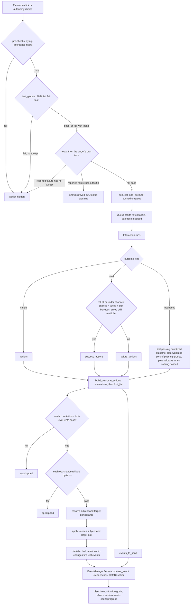
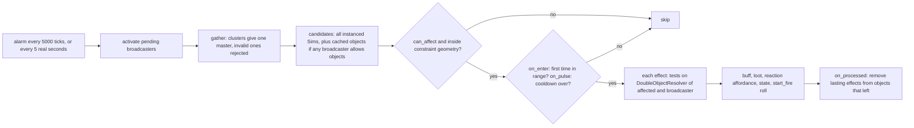

# 0.04 Tests, loot and effects: the glue every system uses

*Game version 1.128.90.1030 (Steam, Linux/Proton). Numbers come from the base game plus EP04, EP06, EP09, EP12 (High School Years), GP04, GP12 and SP01 (SP42 ships no simulation tuning), the live tuning (the base delta build plus each installed pack's delta build). Written 2026-10-12. Checked 2026-10-12: 81 claims checked, 39 corrected, 2 relabelled, 2 removed.*

## In plain words

Nearly every rule in the game is built from three parts. A *test* asks a yes-or-no question about the Sims and objects involved: is this Sim a teen or older, is the toilet broken, does the Sim have the Good trait. A *loot* is a bundle of small consequences: fill the Fun need, add a moodlet, break the object, show a notification. An *effect modifier* is a lasting change carried by a moodlet: while the moodlet lasts, the Sim may cook better, want to nap more, or lose some options from the pie menu.

When you click an object, the game runs the tests of every option it could show. An option whose tests fail silently is hidden. An option whose tests fail with an explanation is shown greyed out, and the explanation is its tooltip. When the Sim finishes the action, the action's outcome decides success or failure and hands out its loot. Each piece of a loot bundle can have its own chance and its own tests, so one bundle can, for example, wear a toilet down two times in three and, for Sims with one particular trait, break it outright one time in twenty.

Whatever happens is also reported to a central listener. Aspirations, achievements, whims and event goals wait on that listener and count: "make 3 friends", "earn 5,000 Simoleons". That is why one action can tick a goal you were not thinking about.

Some objects *broadcast*. A fire, a decorated room, a small kitchen appliance or a playing stereo checks every few seconds which Sims and objects are in range, often only those that can see it, and applies a moodlet, a reaction, or a chance that something happens. A room's decor moodlets and Sims panicking at a fire both work this way.

## Key facts

- The general test menu has **330** test kinds, backed by **386** test classes in 98 script files. Installed tuning holds **1,324** reusable test sets (snippets).
- A test set is an OR of AND groups. Groups are tried in order, the first group whose tests all pass wins, and an empty test set passes.
- Whether a failing pie-menu option is hidden or greyed out depends only on whether the reported failure carries a tooltip. When several test lists fail, the target object's tests are reported first, then `tests`, then `test_globals`.
- A test names the roles it needs (Actor, TargetSim, Object, Lot and 171 more, **175** in all), and a *resolver* fills each role from the current interaction, event or pair of objects.
- Test results are cached, but the cache is dropped on every sim-clock step, every statistic change and every test event, so it only saves work inside one evaluation pass.
- **23** declarations make tests "safe to skip" (mood, buffs, motives, skill in use and similar). These tests are skipped when a queued interaction starts, so a Sim's mood can change while it waits in the queue without cancelling the action.
- Installed tuning has **9,672** loot actions holding **22,438** op entries. There are **234** op kinds plus a nested-loot option; 129 kinds and the nested option are used at least once. The `statistics` op (6,557) and the `buff` op (5,380) are more than half of all entries.
- **8,621** op entries (38.4%) carry their own tests and **1,645** tune their own chance. After 100%, the most common chance is 50% (307 entries).
- A pass/fail outcome's success chance is: tuned chance, plus moodlet success bonuses, then times the skill multiplier, clamped to 0..1.
- **158** test events are fired from 162 places in the scripts. **1,332** objectives listen to them. Aspiration tracking ignores NPCs by default.
- Game effect modifiers come in **16** kinds and live only on buffs: **1,742** of 7,583 live buffs carry at least one, and 1,398 of those carry an autonomy modifier. Tested modifiers are tested once, when the buff is added.
- Installed tuning has **545** broadcasters. Game-time broadcasters are swept every 5,000 clock ticks (200 sim seconds, about 3.3 sim minutes). A pulsing broadcaster's default cooldown is 8 sim minutes, and the most common radius is 5.
- The whole environment score (decor moodlets) runs through one real-time broadcaster, `broadcaster_EnvironmentScore`.
- A high-risk small appliance has a **1.5%** chance per pulse to set flammable objects within radius 1 on fire (`broadcaster_SmallAppliance_FireRisk_High`).

## How it works

### What a test is

- **Observed** (`event_testing/test_base.py: BaseTest`): a test is a tuned object with:
  - `get_expected_args()`, which maps each argument name to the participant type that fills it;
  - a `tooltip` slot;
  - a `safe_to_skip` flag;
  - hooks for the event manager (`get_test_events_to_register`, `get_custom_event_registration_keys`).
- **Observed** (`event_testing/results.py: TestResult`): calling a test returns a `TestResult`. It is truthy or falsy and carries:
  - a debug `reason`;
  - an optional `tooltip` (a localized string factory, filled with the participants when shown);
  - an optional `icon`;
  - `influence_by_active_mood`.
- **Observed** (`event_testing/results.py: TestResultNumeric`): `TestResultNumeric` adds `current_value`, `goal_value` and `is_money`, which objectives use for progress bars.
- **Observed** (`event_testing/resolver.py: Resolver.__call__`): a resolver runs a test in four steps:
  1. It reads the expected arguments once and stores them on the test as `expected_kwargs`.
  2. It resolves each participant type.
  3. It passes a single object for single-valued types (`SINGLE_TYPES`) and a tuple for all others.
  4. It calls the test.
  When the module-level `test_profile` is set, it also times the resolve and test steps.

### The test catalogue

- **Observed** (`event_testing/tests.py: TunableTestVariant.TEST_VARIANTS`): the general menu, used by every `TunableTestSet`, has 330 entries from 101 modules. Counted by the module each factory comes from, resolving names imported into `tests.py` back to their modules:

| Source of the test factory | Entries |
|---|---|
| `event_testing/test_variants.py` | 68 |
| `objects/object_tests.py` | 40 |
| `sims/sim_info_tests.py` | 23 |
| `small_business/small_business_tests.py` (code marks it EP18 (Businesses & Hobbies), not installed) | 15 |
| `event_testing/statistic_tests.py` | 10 |
| `aspirations/aspiration_tests.py` | 9 |
| `relationships/relationship_tests.py` | 8 |
| `business/business_tests.py`, `world/world_tests.py`, `statistics/skill_tests.py` | 7 each |
| `server/online_tests.py`, `drama_scheduler/drama_node_tests.py`, `restaurants/restaurant_tests.py`, `sims/university/university_tests.py` | 5 each |
| `dynasty/dynasty_tests.py`, `sims/outfits/outfit_tests.py` | 4 each |
| 86 other modules (holidays, households, scenarios, weather, clubs, crafting, fishing, luck and others) | 1 to 3 each, 115 in total |
| `test_set_reference`, defined in `tests.py` itself | 1 |

- **Observed** (by grep over the scripts): 386 classes list `BaseTest` directly in their bases, across 98 files. 113 of them are in `event_testing`. 252 test classes are decorated `@cached_test`.
- **Observed** (`event_testing/test_variants.py`): this 5,178-line module holds 68 of the general tests. They cover situations (running, job, guest attire, medal, Sim count), careers (assignments, gigs, daily tasks, work hours), the lot (owner, front door, floor features, portals), day and time, party size and age, social group, posture, routability, fire, topics, bills and `user_running_interaction`. `CareerCanBePromotedTest` (`can_be_promoted`) has a defect on noble Sims: it calls `sim_can_promote(sim_info)` with one argument (`CALL_METHOD (1 positional argument)`) where the method takes two, so with EP21 (Royalty & Legacy) installed it raises TypeError. Here the call is skipped because `services.kingdom_service()` is None. Two live base test sets use the test: `testSet_Career_Promotable_Actor` and `testSet_Career_Promotable_PickedSim`. Age, gender, species and trait tests come from `sims/sim_info_tests.py`.
- **Observed** (`event_testing/statistic_tests.py`): `StatThresholdTest`, `RelativeStatTest`, `RankedStatThresholdTest`, `MotiveThresholdTest`, `StatInMotionTest`, `TunableStatOfCategoryTest`, `CommodityAdvertisedTest`, `CommodityDesiredByOtherSims`, `StatisticEquivalencyTest`, `StatFromParticipantThresholdTest`.
- **Observed** (`event_testing/tests_with_data.py`): tests that read event data instead of current state. They answer questions like "ran this interaction" (`ParticipantRanInteractionTest`, `ParticipantStartedInteractionTest`), `SimoleonsEarnedTest`, `WhimCompletedTest`, `OffspringCreatedTest`, `TotalTravelTest`, `TotalTimeElapsedByTagTest`, `InMultipleMoodsTest` and more.
- **Observed** (more test menus):
  - `event_testing/objective_tuning.py: TunableObjectiveTestVariant`: 57 options, for objectives.
  - `event_testing/common_event_tests.py: CommonEventTestVariant`: 42 options with tooltips locked off, for situation goals and similar listeners.
  - `event_testing/pie_menu_color_test.py: TunablePieMenuColorTestVariant`: one option, a mood test, for pie-menu tinting.
  - `event_testing/constraint_tests.py: SimsInConstraintTests`: checks which Sims stand inside a tuned constraint. It validates against recursion at load.
  - `event_testing/scholarship_tests.py: ScholarshipStatusTest`: university code, which the scripts mark EP08 (Discover University); not installed.
  - `event_testing/tests_object.py: NumberTaggedObjectsOwnedFactory`: counts tagged objects owned.

### Test sets: ORs of ANDs

- **Observed** (`event_testing/tests.py: CompoundTestList.run_tests`, checked against its disassembly): `TunableTestSet` produces a `CompoundTestList`, which is a list of groups. Evaluation works like this:
  - Groups are tried in order.
  - Inside a group, evaluation stops at the first failing test.
  - The whole set stops at the first group that passes.
  - An empty set returns `TestResult.TRUE`.
  This is the "tests" field on interactions, loot ops and most other places.
- **Observed** (`event_testing/tests.py: TestList.run_tests`): `TunableGlobalTestSet` produces a flat AND list (`TestList`), used for interactions' `test_globals`. It keeps a fail-fast order: a test that fails is moved to the front of `_failfast_tests` so it runs first next time.
- **Observed** (`event_testing/tests.py: TestSetInstance`): a reusable test set is a SNIPPET instance, `TestSetInstance`, referenced from any test list through the `test_set_reference` option.
  - It receives the resolver itself as its one participant and reads `skip_safe_tests` and `search_for_tooltip` from it.
  - Its optional `invert_test` flips the result and can give its own tooltip for the inverted failure.
  - Its `safe_to_skip` is always False.
  - Installed tuning has 1,324 of them (831 base, 493 in packs).
- **Observed** (`event_testing/tests.py: TunableTestSet`, `TunableTestSetWithTooltip`): `TunableTestSet` locks each test's tooltip to None, and `TunableTestSetWithTooltip` allows tooltips.
- **Observed** (`event_testing/test_utils.py: get_disallowed_ages`): a cached helper that reads an affordance's `test_globals` for `SimInfoTest` age limits.

### Participants and resolvers

- **Observed** (`interactions/__init__.py: ParticipantType`): `ParticipantType` is a long flag enum (wider than 64 bits) with 175 flags. Examples, with their values:
  - Actor 1, Object 2, TargetSim 4, Listeners 8, All 16, AllSims 32, Lot 64, CraftingProcess 128, CarriedObject 512, Affordance 1024
  - LotOwners 1<<17, CreatedObject 1<<18, PickedObject 1<<21, SocialGroup 1<<22, PickedSim 1<<24
  - LiveDragActor 1<<31, ActiveHousehold 1<<39
  - the highest is PickedSecretOwner at 1<<174 (there is also `Invalid = 0`)
  Because they are flags, one field can name several roles at once (`Actor | TargetSim`).
- **Observed** (`event_testing/resolver.py`): the resolver classes, and what each fills:

| Resolver | Built for | How it fills the main roles |
|---|---|---|
| `InteractionResolver` | interaction tests, outcomes, loot | Actor = the context Sim's SimInfo. Object = the target (as SimInfo if a Sim). TargetSim = the target only if it is a Sim. Affordance and InteractionContext come straight through. Every other role is asked of the interaction (`interaction.get_participants`). |
| `AffordanceResolver` | autonomy and pie menus before an interaction exists | Supports early testing: a test whose participants cannot be known yet passes as TRUE. |
| `SingleSimResolver` | buffs, traits, loot on one Sim | Actor and CustomSim = the Sim. TargetSim gives nothing. 35 roles handled. |
| `DoubleSimResolver` | socials, relationships | TargetSim and Object = the second Sim. 15 roles. |
| `SingleObjectResolver` | object states and tuning | 30 roles. |
| `DoubleObjectResolver` | broadcasters, loot commands, filters | Actor, PickedObject, CarriedObject, LiveDragActor = source. Object, TargetSim, Listeners, LiveDragTarget = target. 26 roles. |
| `SingleActorAndObjectResolver`, `DoubleSimAndObjectResolver` | Sim plus object pairs | 20 and 21 roles. |
| `DataResolver` | the event manager | Wraps a SimInfo plus the event's keyword data. 4 roles of its own. |
| `GlobalResolver`, `ZoneResolver`, `StreetResolver`, `LotResolver`, `HouseholdResolver`, `PhotoResolver`, `AwayActionResolver`, `VenuePolicyProviderResolver`, `SingleSimAndHouseholdResolver` | special cases | Mostly shared roles. |

- **Observed** (`event_testing/resolver.py: Resolver.get_particpants_shared`; the misspelling is in the code): roles that do not depend on the resolver come from one shared function. These include Lot, LotOwners, ActiveHousehold, Street, CurrentRegion and CurrentZoneId.
- **Observed** (`event_testing/resolver.py: _to_sim_info`): Sims are handed to tests as SimInfo, except babies, which stay as their object.
- **Observed** (the disassembly of `Interaction.get_participants`, lines 3078 to 4148 of the original source): this method resolves the interaction-specific roles. It failed to decompile and was read from disassembly only. It is long enough that it calls `yield_to_irq` to let the interrupt checker run. [3.05 Interactions, postures and routing](3.05-interactions-postures-routing.md) covers it.

### Caching and safe-to-skip tests

- **Observed** (`core/caches.py: cached_test`, checked against its disassembly): a cached test keys its result on the test plus the frozen set of its resolved arguments. There is one cache dictionary per decorated test class, and when it is cleared, every stored result of that class goes. It is cleared:
  - when `skip_cache_once` is set;
  - when the global cache version has changed and `test.qualifies_for_cache_clear()` is true. That is the default; `WeatherTest` only qualifies when the weather changed.
  The module flag `caches.skip_cache` bypasses the cache entirely.
- **Observed** (`core/caches.py: clear_all_caches`): each call bumps the version and empties the "barebones" caches. Every 1,000 versions, or when forced, it also clears every `@cached` function cache.
- **Observed** (grep for `clear_all_caches`, 17 calling files): the cache is cleared by:
  - the time service on every sim-time advance (`time_service.py` hooks it to `on_time_advanced`);
  - every statistic value change that notifies watchers (`statistics/base_statistic.py`);
  - every `EventManagerService.process_event` and `process_events_for_household`;
  - buff, state, tooltip, reservation and object parent changes;
  - bucks and degree trackers;
  - preroll autonomy, pack hot-loading, and forced clears when a zone is removed, during zone spin-up and on tuning reload.
- **Inferred**: so a cached result lives only within one pass. Examples are building one pie menu or scoring one autonomy request.
- **Observed** (`event_testing/tests.py: CompoundTestList.run_tests`, `TestList.run_tests`): with `skip_safe_tests`, any test whose `safe_to_skip` is true counts as passed.
- **Observed** (grep for `safe_to_skip=True`): 23 declarations, in 22 test classes and one mixin. They are:
  - AgeUpTest, BuffTest, BuffThresholdTest, BuffAddedTest, MoodTest;
  - SelectedAspirationTest and its track variant;
  - SkillInUseTest, SkillsComparisonTest;
  - RelativeStatTest, MotiveThresholdTest, StatInMotionTest, TunableStatOfCategoryTest, and the `SpecifiedStatThresholdMixin`, which `StatThresholdTest` and its relatives inherit;
  - `TestBasedScoreThresholdTest`;
  - in `test_variants.py`: CollectionThresholdTest, TopicTest, PartySizeTest, PartyAgeTest, TotalSimoleonsEarnedTest, TotalTimePlayedTest, PostureTest, SituationSimCountTest.

### When tests run

- **Observed** (`Interaction.test`, read from its bytecode, since `interactions/base/interaction.py` failed to decompile): an interaction's own test runs these checks in this order:
  1. pre-checks: the target is not locked out by Build/Buy, a visible super interaction has a target or an icon, the context has a Sim (unless the interaction is Sim-less), the inventory or world location is allowed, and no other Sim is holding the target;
  2. incest prevention, a debug gate, the fire service's test, and the class's `_test` hook;
  3. if `_tunable_tests_enabled`: a dying check (super interactions, unless shift is held or it is a cancel option);
  4. affordance filters, only where `_should_test_affordance_filters` allows: super interactions from the pie menu (not Sim-less ones), social super interactions also from autonomy, social mixers from autonomy and the pie menu, other mixers never;
  5. `test_globals`;
  6. `tests`, then tests added at run time through `add_additional_test`. These run when `test_globals` passed, or failed with a tooltip while tooltips are being searched;
  7. the target object's own tests for this affordance (`target.get_affordance_tests`);
  8. `test_autonomous`, only when `tests` passed and the request comes from autonomy, never searching for tooltips;
  9. the utilities test, the funds test (with the "cannot afford" tooltip), item cost and the save-lock tooltip.
  When more than one of steps 5 to 8 fails, the failure reported is the target's (step 7), then `tests`, then `test_globals`, then `test_autonomous`.
- **Observed** (`interactions/aop.py: AffordanceObjectPair.test_and_execute`): pushing an interaction tests the affordance through its aop, then executes it only if the test passed. The aop can carry `skip_safe_tests` and `skip_test_on_execute`.
- **Observed** (`interactions/interaction_queue.py: run_interaction_gen`): the queue tests again when an interaction starts, with `skip_safe_tests=True` and `interaction_starting=True`. A failure cancels the interaction with `FinishingType.FAILED_TESTS`.
- **Observed** (`interactions/interaction_queue.py: process_one_interaction_gen`): the head of the queue is re-tested before it is processed, skipping safe tests when the head says so (`skip_test_on_execute`).
- **Observed** (`autonomy/content_sets.py: get_valid_aops_gen`, `aop_valid_for_scoring`): when content sets are built, each candidate mixer and target pair is tested through `aop.test(context, skip_safe_tests=False)`, which runs `Interaction.test` above.
- **Observed** (`autonomy/content_sets.py`, mixer generation): when a mixer has at least 2 candidate targets (`MINIMUM_TARGETS_TO_TEST_AFFORDANCE_EARLY = 2`) and failed options are not wanted, the mixer is first tested once with an `AffordanceResolver(affordance, sim)`: `test_globals`, then `tests`, then `test_autonomous` for the autonomy source, all with `skip_safe_tests=False` and `search_for_tooltip=False`. A failure skips every target at once. [3.04 Autonomy](3.04-autonomy.md) covers the scoring around it.
- **Observed** (`interactions/utils/loot_basic_op.py: BaseLootOperation.test_resolver`): every loot op runs its own tests when it is applied. See below.

### Tooltips from failed tests

- **Observed** (`event_testing/tests.py: CompoundTestList.run_tests`, with `search_for_tooltip=True`): inside a group:
  - a failing test that has a tooltip is remembered (the first one), and evaluation goes on;
  - a failing test without a tooltip clears that memory and ends the group.
  If no group passes, the set returns the remembered tooltip failure.
- **Observed** (`event_testing/tests.py: _verify_tooltip_tuning`): at load, it is a tuning error to place a tooltip test before a test without a tooltip in the same group.
- **Observed** (`interactions/choices.py: ChoiceMenu.add_aop`): a pie-menu option is handled by its test result:
  - if its test fails without a tooltip, the option is dropped;
  - if it fails with a tooltip, the option is added as a menu item that carries the failure, which the client shows greyed out.
- **Observed** (`interactions/choices.py: ChoiceMenu.is_valid_aop`): the `interactions.show_failure_reason` debug command turns every failure reason into a "Failure" tooltip.
- **Observed** (`server_commands/interaction_commands.py`): some tooltips come from outside the test set. A whole menu can be disabled while the Sim's phone is unavailable, the lot is on fire, or the queue is full. [7.01 UI, dialogs and tutorials](7.01-ui-dialogs-tutorials.md) covers how they are drawn.

### Test-based scores

- **Observed** (`event_testing/test_based_score.py: TestBasedScore`): instance type `test_based_score`, 65 instances. Its score is the sum of the scores of the tests that pass, plus the numeric `current_value` of batch tests.
- **Observed** (`event_testing/test_based_score.py: TestBasedScore.passes_threshold`, checked against its disassembly): for a "greater than" threshold, it sums the passing negative-score tests first, then walks the positive scores from largest to smallest. It stops early once the threshold is reached or can no longer be reached. "Less than" mirrors this.
- **Observed** (`event_testing/test_based_score_threshold.py: TestBasedScoreThresholdTest`): the test that compares a score to a threshold. It is safe to skip.

### The event manager

- **Observed** (`event_testing/test_events.py: TestEvent`): `TestEvent` is a dynamic enum with 158 events (values 1 to 159; value 10 is unused). Examples: `SkillValueChange` 1, `ObjectAdd` 2, `InteractionComplete` 3, `ItemCrafted` 5, `SimoleonsEarned` 7, `TraitAddEvent` 9, `BuffBeganEvent` 15, `MoodChange` 18, `UpdateObjectiveData` 55.
- **Observed** (grep for `process_event(`): systems fire events with `services.get_event_manager().process_event(event, sim_info=..., **data)`, from 162 call sites. The most frequent events at call sites are:
  - `TestedGameOptionChanged` 15
  - `AvailableDaycareSimsChanged` 9
  - `BusinessDataUpdated` 5
  - `StatValueUpdate` 4
  - `SkillValueChange` 4
  - `CivicPoliciesChanged` 4
- **Observed** (`event_testing/test_event_loots.py: ProcessEventOp`): the `event` loot op fires an event from tuning for the subject's SimInfo. It is used 130 times.
- **Observed** (`event_testing/event_manager_service.py: EventManagerService`): the service keeps a map from (event, custom key) to a set of handlers.
  - `register_tests` registers each test's `get_test_events_to_register()` plus its custom keys. For example, `StatThresholdTest` registers (`SkillLevelChange`, its stat) and (`StatValueUpdate`, its stat), so it only wakes for that one stat.
  - `process_event` returns at once if the service is disabled. Otherwise it:
    1. clears the test caches;
    2. runs the `DataMapHandler` counters on the Sim's aspiration data object and, for selectable Sims, the achievement data object;
    3. builds a `DataResolver(sim_info, event_kwargs, custom_keys)` and calls `handler.handle_event(sim_info, event, resolver)` on every matching handler.
- **Observed** (`event_testing/event_manager_service.py: register_events_for_objectives`): at load it registers:
  - aspirations, unless `do_not_register_events_on_load`;
  - achievements;
  - household milestones.
  `register_events_for_update` registers `UpdateObjectiveData` so that loaded objectives refresh.
- **Observed** (`event_testing/register_test_event_mixin.py: RegisterTestEventMixin`): a mixin with `_register_test_event`, `_register_test_event_for_keys` and `_unregister_for_all_test_events`.
- **Observed** (grep for the registration calls and the mixin): 112 modules register for events directly or use this mixin (110 outside `event_testing` itself). Situations alone account for 36, then small business 6; services, relationships, open street directors, objects and aspirations 4 each; careers 3. Whims and situation goals are covered in [4.01 Situations and NPCs](4.01-situations-npcs.md).

### Objectives, milestones and counters

- **Observed** (`event_testing/objective_tuning.py: Objective`): an objective (instance type `objective`, 1,332 installed) has:
  - an `objective_test`, one of the 57 objective test kinds;
  - `additional_tests`;
  - an `objective_completion_type`, one of 8: iterations (the default), sim_info_statistic, unique_targets, unique_locations, unique_worlds, tag_checklist, iterations_single_situation, use_test_result;
  - `completion_loot`, `loot_on_completion_ui_update` and `relative_to_unlock_moment`.
- **Observed** (`event_testing/objective_tuning.py: Objective.run_test`): it runs in four steps:
  1. Check that the event is one the test registered for, or `UpdateObjectiveData`.
  2. Ask the completion type whether to test at all (`check_if_should_test`).
  3. Run the test through the resolver, adding the data object and `objective_guid64` (`event_testing/test_constants.py` names these keys).
  4. If the test passed, run `additional_tests`. Then always call the completion type's `increment_data` with both results; the completion type decides what counts. The tuning description of `additional_tests` says they do not apply with the `use_test_result` completion type.
- **Observed** (`event_testing/milestone.py: Milestone`): the base for aspirations and achievements. It has `objectives` and an `objective_completion_type`: complete_all, or complete_subset with `number_required` (default 1). It also has `track_completion_count`, `can_complete_without_objectives` and `exclusivity_type` (`event_testing/milestone_enums.py: MilestoneExclusivityEnum`).
- **Observed** (`event_testing/event_data_tracker.py: EventDataTracker.handle_event`):
  - It skips NPCs by default (`_should_handle_event` returns `not resolver.sim_info.is_npc`).
  - It counts completed objectives and runs the rest.
  - It completes the milestone when `should_milestone_complete` is true.
  - `event_testing/objective_completion_type.py: ObjectiveCompletionType` (objective complete 0, milestone complete 1) labels what was finished.
- **Observed** (`event_testing/event_data_object.py: EventDataObject`): it keeps 12 `@DataMapHandler` running counters:
  - zones traveled, relationship bits added and removed, bucks, Simoleons, career data, time spent in tagged interactions (two handlers), Simoleons earned by tag, club bucks, club gathering time, and mood changes.
  `event_testing/event_data_const.py` holds their enums (`DataType` values 1 to 3 and 5 to 13, `ObjectiveDataStorageType`, `SimoleonData`, `TimeData`, `TagData`).
- **Observed** (`event_testing/custom_tracker_objective.py: CustomTrackerObjective`): an objective driven by a commodity threshold listener (`TrackCommodity`) that calls `tracker_complete`.
- **Observed** (`event_testing/weighted_objectives.py: WeightedObjectives`): a tunable list of (objective, tests, weight) used to pick objectives.
- **Observed** (`event_testing/objective_enums.py: ObjectiveCategoryType`): a dynamic enum for grouping objectives.
- Installed tuning also has 225 aspirations, 190 career aspirations, 83 achievements, 680 whims and 598 situation goal sets, all built on these pieces. [3.10 Skills, careers and school](3.10-skills-careers-school.md) and [4.01](4.01-situations-npcs.md) use them.

### Loot actions

- **Observed** (`interactions/utils/loot.py: LootActions`, rescued per function): a loot action is instance type `action`, 9,672 installed. Its fields:
  - `loot_actions`: a list of `LootActionVariant`;
  - `tests`: tests for the whole loot;
  - `run_test_first`: default False.
- **Observed** (`interactions/utils/loot.py: LootActions.get_loot_ops_gen`, checked against its disassembly): the loot is applied like this:
  - If a resolver exists and the loot-level tests fail, nothing happens.
  - With `run_test_first`, every op is tested before any is applied, and only the ones that passed run.
  - Otherwise each op is tested as it is applied, so earlier ops can change what later ops see.
  - A nested `actions` reference (`LootType.ACTIONS`) recurses. Recursion is checked at tuning load.
- **Observed** (tuning, the base and pack delta builds keyed by instance id, recounted in the editor pass): 937 loots have loot-level tests and 509 use `run_test_first`.
- **Observed** (`interactions/utils/__init__.py: LootType`): an op reports a `LootType`, used for UI and filtering: SITUATION 1, RELATIONSHIP 2, SKILL 3, SIMOLEONS 4, GENERIC 6, RELATIONSHIP_BIT 7, TEAM_SCORE 8, GAME_OVER 9, GAME_SETUP 10, PARTY_AFFINITY 11, LIFE_EXTENSION 12, TAKE_TURN 13, ACTIONS 14, GAME_RESET 15, DISCOVER_CLUE 16, NEW_CRIME 17, SCHEDULED_DELIVERY 18, BUFF 19.

### The loot op base class

- **Observed** (`interactions/utils/loot_basic_op.py: BaseLootOperation`): every op shares:
  - `subject` (and for some ops a `target_participant_type`);
  - `tests`;
  - `subject_filter_tests`;
  - `chance` (`SuccessChance`);
  - an `advertise` flag.
  `MAXIMUM_LOOT_PARTICIPANTS` is 23.
- **Observed** (`interactions/utils/success_chance.py: SuccessChance.get_chance`): the chance is `base_chance` (a percent, default 100) times each multiplier whose tests pass, capped at 1.
- **Observed** (tuning, the base and pack delta builds keyed by instance id): 1,827 op entries have a `chance` node. 1,645 tune `base_chance` and 182 leave it at the default 100. 455 add multipliers. An older flat `chance` value survives only in 74 entries of loots that exist only in the base full build, which the game does not load.
- **Observed** (`interactions/utils/loot_basic_op.py: BaseLootOperation.test_resolver`, read from bytecode because the decompile nests it wrongly): the test step runs in this order:
  1. With no multipliers, and unless `ignore_chance` is set, roll first: fail if `random.random()` is above the chance.
  2. Run the op's tests.
  3. With multipliers, compute the full chance and roll after the tests. Here `ignore_chance` only adds a check that the chance is not 0; the roll still happens.
- **Observed** (`interactions/utils/loot_basic_op.py: BaseLootOperation.apply_to_resolver`): the apply step runs in this order:
  1. Test, unless told to skip.
  2. Resolve every subject. A tag participant means every object with that tag. Subject filter tests run through `DoubleObjectResolver(candidate, recipient)`.
  3. Resolve every target.
  4. Call `_apply_to_subject_and_target` once per pair.
- **Observed** (`interactions/utils/loot_basic_op.py`): a module-level `loot_profile`, when set, records resolve and test times per loot.
- **Observed** (`statistics/statistic_ops.py: StatisticChangeOp._apply`): the `statistics` op is a variant with 12 statistic sub-ops and 13 relationship sub-ops.
  - Change ops multiply the amount by the tuned curves, the object cost multiplier and tested multipliers, then call `tracker.add_value`.
  - Their `get_fulfillment_rate` (amount over the interaction's interval, scaled by the target's multiplier) is what autonomy reads when it scores an advertised need ([3.04](3.04-autonomy.md), [3.03 Needs and statistics](3.03-needs-statistics.md)).

Sub-op use in the 6,557 direct `statistics` entries of installed loot actions (base and pack delta builds; 19 of the 25 sub-ops are used):

| statistics sub-op | Entries |
|---|---|
| statistic_change | 2,900 |
| relationship_change | 1,326 |
| statistic_set_max | 633 |
| statistic_set | 332 |
| statistic_remove | 294 |
| relationship_set_max | 181 |
| relationship_set | 179 |
| statistic_set_min | 155 |
| the other 17 sub-ops | under 120 each |

### Every op family, counted

**Observed** (`interactions/utils/loot.py: LootActionVariant`): the variant has 235 options: 234 op kinds plus `actions`, a reference to another loot. I grouped them by name with regular expressions. The use counts are from installed tuning, the base and pack delta builds keyed by instance id, recounted in the editor pass. They add the 22,438 direct entries of `LootActions` to the 2,094 entries inside random loot tables (2,170 minus 76 `do_nothing` entries, which are left out), 24,532 in all. Member counts include both.

| Family | Kinds | Kinds used | Uses | Largest members (uses) |
|---|---|---|---|---|
| Buffs, traits, sickness | 11 | 9 | 8,232 | buff 5,860, trait_add 913, buff_removal 893, trait_remove 461 |
| Statistics, skills, needs | 7 | 5 | 7,052 | statistics 6,869, dynamic_skill_loot 169 |
| Nesting and pickers | 7 | 4 | 2,870 | actions 2,858 (2,301 direct, 557 inside random loot) |
| Objects, states, inventory | 49 | 27 | 1,817 | state_change 936, object_rewards 427, create_object 209, create_puddles 48 |
| Presentation: UI, audio, VFX | 9 | 5 | 1,481 | notification_and_dialog 1,237, create_notebook_entry 94, audio 88, vfx 60 |
| Situations, drama, stories, events | 35 | 18 | 1,100 | reaction 382, schedule_drama_node 287, headline_loot 180, event 130 |
| Relationships, knowledge, social | 33 | 20 | 800 | relationship_bits_loot 348, know_other_sims_trait 74, object_relationship 74, add_gameplay_object_preference 72 |
| Money, rewards, businesses | 30 | 13 | 744 | money_loot 409, bucks_loot 178 |
| Careers, school, aspirations, whims | 22 | 10 | 310 | career_loot 254 |
| Fire | 4 | 4 | 47 | fire 43, extinguish_nearby_fire 2, fire_clean_scorch 1, fire_deactivate_sprinkler 1 |
| Broadcasters, animals, misc | 4 | 3 | 54 | oneshot_broadcaster 41, animal_loot 9 |
| Games and turns | 7 | 7 | 17 | team_score_points 10, take_turn 2 |
| Sim records and households | 17 | 5 | 8 | transfer_name_loot, stored_sim_info_transfer, remove_stored_sim_info (2 each) |
| **Total** | **235** | **130** | **24,532** | |

- Relationship changes mostly live inside the `statistics` op, which is why the relationship family looks small.
- 105 kinds are unused in installed tuning. Many of them belong to packs that are not installed, for example the five scholarship ops (university code, marked EP08) and the small-business ops (EP18).

### Random, weighted and scored loot

- **Observed** (`interactions/utils/loot.py: RandomWeightedLoot`; the class body failed to decompile even per function and was read from its bytecode): instance type `action`, 410 installed. It has `random_loot_actions`, a list where each entry is:
  - an `action`: the loot variant plus a `do_nothing` option (`DoNothingLootOp`, a real op that does nothing), built with `statistic_pack_safe=True`. Pack-safe references let an entry that points at a missing pack's content load as None, and the code skips None entries;
  - a `weight`, a `TunableMultiplier`;
  - a `luck_option_config` (`player_perception`, `show_impacts`).
  It also has an optional `_luck_tuning` (a `LuckConfig`) and `tests`.
- **Observed** (`RandomWeightedLoot.get_loot_ops_gen`, bytecode): the pick works like this:
  1. If the loot-level `tests` fail, nothing happens.
  2. Without luck, it computes every weight, then picks with `weighted_random_index`. A picked entry that is None, a nested loot with no possible actions, or an op whose own test and chance roll fail is removed, and the pick repeats.
  3. The first entry that passes is applied, so at most one table entry runs. If every entry fails, or every weight is 0, nothing runs.
  With no resolver at all, every entry is yielded untested; that is an edge case for callers that pass none.
- **Observed** (`RandomWeightedLoot._get_luck_actions`, bytecode; it failed to decompile): when `_luck_tuning` is set and the luck service exists, the loot first drops every entry that is None or fails its tests, wraps each survivor in a `LuckOption` (weight, player perception, action), and calls `LuckService.choose_with_luck`. The result is the chosen entry, plus, when the result says to show impacts, the luck level's `impact_loot` and the luck tuning's own `loot_actions`. 10 installed random loots tune `_luck_tuning`. [3.13 Sickness, luck, fame and other Sim states](3.13-health-luck-fame.md) covers the luck service.
- **Observed** (tuning): inside the 2,170 random-table entries the most common actions are:
  - `actions` 557, `buff` 480, `statistics` 312;
  - `create_object` 175, notification 171;
  - `trait_add` 121, `do_nothing` 76, `bucks_loot` 74.
- **Observed** (`interactions/utils/loot.py: WeightedSingleSimLootActions`): a list of buff loots, each with an integer weight; `pick_loot_op` picks one by weight. 40 instances.
- **Observed** (`loot_generic/loot_action_scored_picker.py: ScoredLootActionPicker`): the `scored_loot_picker` op scores each candidate loot list with a `TestedSum`.
  - If no candidate's score moved off its base value, it runs the first list.
  - Otherwise it runs the highest-scoring list, picking at random among ties.

### Outcomes: where success and failure loot come from

- **Observed** (`interactions/utils/outcome.py`): an interaction's `outcome` is one of five kinds:

| Kind | How it decides |
|---|---|
| none | No actions. |
| single | Always runs `actions`. |
| dual | Rolls once against a chance, then runs `success_actions` or `failure_actions`. |
| test based | Picks among tested outcomes. |
| partial | Runs per picked Sim, filtered by tests, with a total-failure replacement and success or failure notifications. |

  `OutcomeResult` (`interactions/utils/outcome_enums.py`) is NONE 0, SUCCESS 1, FAILURE 2.
- **Observed** (`interactions/utils/outcome.py: InteractionOutcomeDual._get_success_chance`): the dual chance is computed in three steps:
  1. Add up the tuned `SuccessChance`, the actor's affordance success modifiers (from buffs' affordance modifiers, see below) and the buff component's general success-chance modification.
  2. Multiply by `interaction.get_skill_multiplier(success_chance_multipliers, sim)`.
  3. Clamp to 0..1.
  Success when `random.random() <= chance`.
- **Observed** (`interactions/utils/outcome.py: InteractionOutcomeTestBased.decide`; the decompile is tangled, so this was read from the bytecode): the test-based outcome is chosen like this:
  1. A debug outcome index, if set, picks directly.
  2. The first entry of `prioritized_tested_outcomes` whose tests pass wins outright.
  3. Otherwise every `tested_outcomes` group whose tests pass adds each of its outcomes whose `TunableMultiplier` weight is above 0.
  4. Fallback outcomes join (with their weights) when `use_fallback_as_default` is set, when step 3 collected nothing, or when a debug outcome style is active.
  5. A weighted random pick follows.
  Every candidate in steps 2 to 4 must also be allowed to run: `interaction.allow_outcomes` is true, or the outcome sets `force_outcome_on_exit`. While a debug style such as AUTO_SUCCEED is active, tests are skipped and each candidate is filtered by whether it matches the style.
- **Observed** (`interactions/utils/outcome.py: build_outcome_actions`): the chosen actions run in this order:
  1. the start animation, the social animation, the end animation (response);
  2. a flush of all animations;
  3. the loot;
  4. route events;
  5. the continuation push;
  6. `events_to_send`, sent to the event manager;
  7. `cancel_si`;
  8. parameterized autonomy.
  Some details of this step:
  - The loot is applied once as `LootOperationList(interaction.get_resolver(), loot_list)`. An animation event can trigger it early.
  - `loot_list` is the outcome's own loot, plus the target's affordance loot when `add_target_affordance_loot` is set. The consumable's loot is added when `consume_object` is also set; that check sits inside the `add_target_affordance_loot` branch, so `consume_object` alone adds nothing.
  - A conditional element skips the whole block unless `interaction.allow_outcomes` is true or the outcome forces itself on exit.
- **Observed** (`interactions/utils/outcome.py: DebugOutcomeStyle`): debug styles NONE, AUTO_SUCCEED, AUTO_FAIL and ROTATE, plus a per-interaction outcome index, override the roll.



### Game effect modifiers

- **Observed** (`game_effect_modifier/game_effect_type.py: GameEffectType`): 15 types:

| Value | Type | Value | Type |
|---|---|---|---|
| 0 | AFFORDANCE_MODIFIER | 9 | PIE_MENU_MODIFIER |
| 1 | EFFECTIVE_SKILL_MODIFIER | 10 | AFFORDANCE_FILTER_MODIFIER |
| 3 | CONTINUOUS_STATISTIC_MODIFIER | 11 | RELATIONSHIP_TRACK_DECAY_MODIFIER |
| 4 | RELATIONSHIP_TRACK_DECAY_LOCKER | 12 | ADVENTURE_MOMENTS_SUCCESS_MODIFIER |
| 5 | MOOD_EFFECT_MODIFIER | 13 | FORBID_BY_OBJECT_TAGS_PIE_MENU_MODIFIER |
| 6 | STATISTIC_STATIC_MODIFIER | 14 | SIM_OVERRIDE_PUT_DOWN_STRATEGY_MODIFIER |
| 7 | AUTONOMY_MODIFIER | 15 | OBJECT_SELL_PRICE_MODIFIER |
| 8 | WHIM_MODIFIER | | |

- **Observed** (`game_effect_modifier/game_effect_modifiers.py: TunableGameEffectVariant`): there are 16 tunable kinds:
  - autonomy_modifier, affordance_modifier, effective_skill_modifier, continuous_statistic_modifier;
  - relationship_track_decay_locker, relationship_track_decay_modifier;
  - satisfaction_point_multiplier, satisfaction_point_gain (both WHIM_MODIFIER, defined in `whims/whim_modifiers.py`);
  - mood_effect_modifier, statistic_static_modifier;
  - pie_menu_modifier, affordance_filters, forbid_by_object_tags_pie_menu_modifier;
  - adventure_moments_success_modifier, sim_override_put_down_strategy_modifier, object_sell_price_modifier.
- **Observed** (`buffs/buff.py`, field `game_effect_modifier`): this is the only place the `GameEffectModifiers` bundle is tuned. Traits reach it through the buffs they grant.
  - Objects use autonomy modifiers directly through states, slots and inventories. [2.02 Objects, states and wear](2.02-objects-states-wear.md) covers those.
  - [3.07 Personality and feelings](3.07-personality-feelings.md) covers the buffs themselves.
- **Observed** (`game_effect_modifier/game_effect_modifiers.py: GameEffectModifiers.on_add`, `on_remove`): when the buff is added, every plain modifier is applied with `apply_modifier(sim_info)` and its handle kept per type. Each `_tested_game_effect_modifiers` entry is tested once with a `SingleSimResolver` and applied only if it passes. On buff removal every handle is removed.
- **Observed** (`game_effect_modifier/base_game_effect_modifier.py: BaseGameEffectModifier`): each modifier implements `apply_modifier` and `remove_modifier`.
- **Observed** (`game_effect_modifier/game_effect_modifiers_handler.py`): the GSI view `game_effect_modifiers` lists a Sim's active ones.
- **Observed** (the modules named in each bullet): how each kind behaves and stacks:
  - `affordance_reference_scoring_modifier.py: AffordanceReferenceScoringModifier` (the affordance_modifier kind): targets affordances, affordance lists or interaction category tags, with blacklists and a `test`. It adds `content_score_bonus` (an integer, read by autonomy) and `success_modifier` (a percent, minimum -100, read by dual outcomes). It can also change the pie-menu parent name and icon and add basic extras. Bonuses from several buffs are summed (`GameEffectModifiers.get_affordance_scoring_modifier`, `get_affordance_success_modifier`).
  - `effective_skill_modifier.py: EffectiveSkillModifier`: adds to a skill's effective level, or to all skills. Summed. In tuning, values run from -10 to +15. The most common are +1 (49 entries), +2 (33) and -1 (23). Examples: `Buff_Trait_Bane_Sabotage` -10 to the `Skill_All` tag (the same buff also tunes an affordance modifier with `success_modifier` -100 keyed on `Interaction_All`); `Buff_Trait_CulinaryTraining` +2 to the `Skill_Cooking` tag.
  - `continuous_statistic_modifier.py: ContinuousStatisticModifier`: adds to a statistic's change rate. Summed. A non-zero rate replaces decay.
  - `statistic_static_modifier.py: StatisticStaticModifier`, checked against its disassembly:
    - It changes a statistic's value with a priority: DELTA 0, NORMALIZE 1, and CEILING, FLOOR, MULTIPLY 2 by default (minimum 2).
    - Modifiers are applied in priority order, then the value is clamped.
    - NORMALIZE quirk: above the default value it subtracts `number`, floored at the default. Below the default it adds `default_value`, not `number`, capped at the default. So for a statistic whose default is 0, NORMALIZE does nothing below the default.
  - `relationship_track_decay_modifier.py: RelationshipTrackDecayModifier`: multiplies a track's decay rate. Multipliers stack by product.
  - `relationship_track_decay_locker.py: RelationshipTrackDecayLocker`: sets the decay multiplier to 0 on every relationship the Sim has, including ones created later through a callback. It works on both Sims' tracks. Because decay multipliers stack by product, a locker's 0 always wins.
  - `mood_effect_modifier.py: MoodEffectModifier`: changes the weight of moods or mood categories. Weights multiply.
  - `pie_menu_modifier.py: PieMenuModifier`, `affordance_filter_modifier.py: AffordanceFilterModifier`, `forbid_by_object_tags_pie_menu_modifier.py: ForbidByObjectTagsPieMenuModifier`: these hide or forbid affordances, or whole tagged objects, from the pie menu and from autonomy.
  - `object_sell_price_modifier.py: ObjectSellPriceModifier`: multiplies sell price per object tag. Multipliers stack by product.
  - `sim_override_putdown_strategy_modifier.py: SimOverridePutDownStrategyModifier`: overrides where a Sim puts things down. It has an ownership mode (any 0, owned 1, unowned 2) and a priority.
  - `adventure_moments_success_modifier.py: AdventureMomentSuccessModifier`: changes adventure-moment success chances.
- **Observed** (tuning, the base and pack delta builds keyed by instance id, recounted in the editor pass): modifier entries across the 7,583 live buffs (7,568 `Buff` plus 15 `ClothingBuff`; 1,742 carry at least one; 1,398 carry an autonomy modifier):
  - autonomy_modifier 1,496 (plus 9 tested); continuous_statistic_modifier 483 (plus 74 tested);
  - affordance_modifier 189; effective_skill_modifier 156 (plus 1 tested); statistic_static_modifier 90;
  - relationship_track_decay_modifier 26 (plus 1 tested); affordance_filters 24; pie_menu_modifier 11;
  - mood_effect_modifier 8; relationship_track_decay_locker 3; object_sell_price_modifier 2; satisfaction_point_multiplier 2.

### Broadcasters

- **Observed** (`broadcasters/broadcaster.py: Broadcaster`, failed to decompile; read from its per-function rescue and its disassembly): a broadcaster (instance type `broadcaster`) is attached to an object. It has these fields:

| Field | Meaning |
|---|---|
| `clock_type` | `GAME_TIME` by default or `REAL_TIME` (`broadcasters/broadcaster_utils.py: BroadcasterClockType`) |
| `constraints` | at least one area shape |
| `effects` | what the broadcaster applies |
| `route_events` | route events for Sims passing through |
| `frequency` | `on_enter` (with `allow_multiple`, default False) or `on_pulse` (the default, with `cooldown_time` default 8 sim minutes) |
| `clustering` | an object cluster request, on by default |
| `allow_objects` | disallow by default, or from_tags, or from_flammable |
| `allow_sims` | default True |
| `allow_sim_test` | a test set for Sims |
| `immediate` | apply as soon as the broadcaster starts |
| `register_state_changed` | listen for state changes |

- **Observed** (`broadcasters/broadcaster.py: Broadcaster.can_affect`): a broadcaster never affects its own object or the objects of broadcasters linked to it.
- **Observed** (`broadcasters/broadcaster_service.py: BroadcasterService`, failed to decompile; read from the disassembly):
  - `INTERVAL` is a `TunableRealSecond` defaulting to 5. The module's tuning is empty, so it stays 5.
  - The game-time service turns that into an alarm of 5,000 clock ticks.
  - **Observed** (`clock.py: interval_in_real_seconds`, `date_and_time.py`): the helper turns 5 into a 5,000-tick span, and the game-time service hands it to a sim-time alarm. Sim time runs 25 ticks per sim second (`REAL_MILLISECONDS_PER_SIM_SECOND = 25`), so 5,000 ticks is 200 sim seconds, about 3.3 sim minutes. At normal speed that is 5 real seconds; at higher speeds the sweep comes round faster in real time.
  - `BroadcasterRealTimeService` uses a real-time alarm instead.
  - Broadcasters are kept in one quadtree per level, with `DEFAULT_QUADTREE_RADIUS = 0.1`.
- **Observed** (`broadcasters/broadcaster_service.py: BroadcasterService._update`): each sweep runs in five steps:
  1. Activate pending broadcasters.
  2. Gather the broadcasters. A cluster yields one master with the others linked to it. Invalid broadcasters are rejected: not visible to the client, in an inventory, or parented to a Sim.
  3. Take every instanced Sim, plus the cached objects when some broadcaster allows objects (filtered by the union of their tags).
  4. For each pair the broadcaster `can_affect`, test the constraint geometry and surface, then call `apply_broadcaster_effect`.
  5. Call `on_processed`, which removes lasting effects from objects that left.
- **Observed** (`broadcasters/broadcaster_effect.py`): ten effect kinds: affordance, buff, statistic_modifier, self_state_change, start_fire (`percent_chance` default 50), loot, state, self_buff, self_loot, state_value_buff.
  - Effects built on `_BroadcasterEffectTested` run their `tests` and can exclude participants. One-shot tested effects add `affected_object_cap`.
  - **Observed** (`BroadcasterEffectBuff`): the buff effect with `remove_buff` (default True) holds the buff only while the Sim stays in range. With it off, the buff is added like a loot op and runs its own course.
- **Observed** (`broadcasters/broadcaster.py: Broadcaster.apply_broadcaster_effect`): effect tests run on `DoubleObjectResolver(affected_object, broadcasting_object)`. Inside a broadcaster, Actor is the Sim or object being affected, and Object and TargetSim are the broadcaster's own object.
- **Observed** (`broadcasters/broadcaster_request.py: BroadcasterRequest`): interactions and states start broadcasters through a request with:
  - `broadcaster_types`, a tested list;
  - `participant`, default Actor;
  - `offset_time`, default 2 sim minutes when enabled.
  A request on terrain is one-shot.
- **Observed** (`broadcasters/broadcaster_loot_op.py: BroadcasterOneShotLootOp`): the `oneshot_broadcaster` loot op fires one broadcast. It accepts only immediate on-enter broadcasters.
- **Observed** (tuning, the base and pack delta builds keyed by instance id, 545 broadcasters, recounted in the editor pass):
  - Frequency: on_enter 295, on_pulse 250 (110 of them by default).
  - Pulse cooldowns: 8 (the default) 123, 20 minutes 28, 30 minutes 16.
  - Effect entries: loot 447, affordance 301, buff 227, self_loot 35, state 23, start_fire 19.
  - Constraints: circle 396, line_of_sight 374, facing 23, cone 5.
  - Circle radius: 5 (76), 6 (49), 10 (36), 4 (34), 7 (33), 25 (32), 30 (31).
  - 199 are immediate. Objects are allowed from tags in 33 and from flammability in 12. 38 disallow Sims. 3 tune real time, and the environment score broadcaster is real time through its class.
- Cost limits:
  - **Observed** from the code above: the limits are the 5-second sweep (one pass over all Sims and the cached objects), the per-broadcaster cooldown, clustering (which collapses many nearby emitters into one), the object tag filter (objects are only scanned when some broadcaster allows them), and `affected_object_cap` on one-shot effects.
  - **Inferred**: `broadcasters.info` prints the object cache because that cache is the main cost.



### Environment score

- **Observed** (`broadcasters/environment_score/environment_score_broadcaster.py: BroadcasterEnvironmentScore`): this broadcaster class locks `clock_type` to REAL_TIME. Its effects are replaced by one that registers and unregisters the broadcasting object with each Sim in range (`add_environment_score_broadcaster` and `remove_environment_score_broadcaster`).
- **Observed** (tuning, `broadcaster_EnvironmentScore`, 77266, base delta):
  - a line-of-sight constraint;
  - on_pulse with cooldown 0;
  - clustering with `density_epsilon` 8 and `radius_buffer` 2.
- **Observed** (`broadcasters/environment_score/environment_score_tuning.py: EnvironmentScoreTuning`): the tuning has three parts:
  - `ENVIRONMENT_SCORE_MOODS` maps object tags to moods;
  - `NEGATIVE_ENVIRONMENT_SCORING` and `POSITIVE_ENVIRONMENT_SCORING` name the commodities that turn totals into moodlets;
  - `BUILD_OBJECTS_ENVIRONMENT_SCORING` names the lot statistics used for build objects.
- **Observed** (`broadcasters/environment_score/environment_score_component.py: EnvironmentScoreComponent`): each object's per-mood score comes from its definition's mood tags plus any adders, times multipliers from traits and states. Negative and positive scores are separate (`environment_score_types.py: EnvironmentScoreType` MOOD_SCORING 1, NEGATIVE_SCORING 2, POSITIVE_SCORING 3).
- **Observed** (`broadcasters/environment_score/environment_score_state.py: EnvironmentScoreState`): object states can add modifiers, including per-trait ones, by adding the component on the fly.
- **Observed** (the per-function rescue of `environment_score_mixin`, the Sim side; failed to decompile): the Sim recomputes one real second after a change. It adds up:
  - the lot's build-object statistics, when the zone modifier service reports build eco effects on (an EP09 (Eco Lifestyle) feature, toggled by the EP09 command below);
  - every registered broadcasting object.
  A negative score with an active buff zeroes the positive one.
- **Observed** (tuning, `commodity_Environment_Negative`, 16585): states start at 11 (Unpleasant), 21 (Bad) and 41 (Wretched). The maximum is 100 and the decay 0. The positive side is `commodity_Environment_Positive` (97781).
- Build and buy placement of scoring objects is in [2.03 Build, buy and placement](2.03-build-buy-placement.md).

### Fire as a worked example

- **Observed** (tuning, `broadcaster_SmallAppliance_FireRisk_High`, 341021): set up as follows:
  - `allow_objects` is from_flammable and `allow_sims` is False;
  - a circle of radius 1 and line of sight up to 15;
  - one `start_fire` effect with `percent_chance` 1.5 on the default 8-minute pulse.
- **Observed** (tuning, `broadcaster_Reaction_Fire`, 75066): set up as follows:
  - a line-of-sight constraint and an on_pulse cooldown of 5;
  - `allow_sim_test` is a mood test that disallows mood 201531, which is in no installed tuning; it is `Mood_Possessed` from GP07 (StrangerVille) (patch data, pack not installed);
  - one loot effect, `loot_Reaction_Fire` (127334), with excluded participants enabled.
- **Observed** (tuning, `loot_Reaction_Fire`, base delta): six ops, so one pulse sorts Sims by who they are:
  1. `reaction`: push `fire_reacting_to_fire` (75076) on the fire at High priority, for children to elders who are not running any of 24 listed interactions, lack `trait_isGrimReaper` (16851), `trait_Hidden_isFirefighter` (237784) and `trait_Bonehilda` (253237; SP18 (Paranormal) patch data, pack not installed), lack `Buff_Situation_Fire_Panic` (73844), and pass `TestSet_Fire_OwnsLotOrOnActiveLot` (100116);
  2. `reaction`: push `fire_reacting_to_fire_GrimReaper` (100088) at High priority, for Sims with `trait_isGrimReaper` who lack `Buff_Fire_GrimReaper_Reacted` (100087);
  3. `reaction`: push `fire_Infant_Panic` (315376) at Low priority, for infants, with the same lot test;
  4. `buff`: `buff_Fire_Toddler` (157024) for toddlers and infants;
  5. `buff`: buff 220093, for Sims with one of buffs 215498, 215587 or 222830;
  6. `actions`: nested loot 411824.
  None of the ids in entries 5 and 6 is in installed tuning. In patch data, pack not installed, buffs 220093, 215498, 215587 and 222830 are GP08 (Realm of Magic) freeze-spell buffs (`buff_Sim_Chilled_Frozen_Spell`, `buff_Spells_Frozen`, `buff_Spells_Frozen_Charged`, `buff_Spells_Frozen_Fail_Visible`), and loot 411824 is EP17 (Life & Death) `loot_ChasedByDeath_Ghost_FunGain`. **Inferred**: as pack-safe references they load empty here and do nothing.

## Numbers

| Name | Value | Unit | Where | Source |
|---|---|---|---|---|
| General test menu options | 330 | options | `event_testing/tests.py: TunableTestVariant` | code |
| Classes deriving directly from `BaseTest` | 386 in 98 files | classes | scripts | code |
| `@cached_test` tests | 252 | classes | scripts | code |
| Safe-to-skip declarations | 23 (22 classes, 1 mixin) | declarations | scripts | code |
| Objective test options | 57 | options | `objective_tuning.py: TunableObjectiveTestVariant` | code |
| Common event test options | 42 | options | `common_event_tests.py` | code |
| Objective completion types | 8 | kinds | `objective_tuning.py` | code |
| `ParticipantType` flags | 175 | flags | `interactions/__init__.py` | code |
| `TestEvent` values | 158 | events | `test_events.py` | code |
| `process_event` call sites | 162 | calls | scripts | code |
| Event-registering modules | 112 | modules | scripts | code |
| `EventDataObject` counters | 12 | handlers | `event_data_object.py` | code |
| Cache full clear | every 1,000 | cache versions | `core/caches.py: clear_all_caches` | code |
| `MINIMUM_TARGETS_TO_TEST_AFFORDANCE_EARLY` | 2 | targets | `autonomy/content_sets.py` | code |
| `LootActionVariant` options | 235 (234 ops + `actions`) | options | `interactions/utils/loot.py` | code |
| `MAXIMUM_LOOT_PARTICIPANTS` | 23 | participants | `loot_basic_op.py` | code |
| `SuccessChance.base_chance` default | 100 | percent | `success_chance.py` | code |
| `GameEffectType` values | 15 | types | `game_effect_type.py` | code |
| Game effect modifier kinds | 16 | kinds | `game_effect_modifiers.py` | code |
| Static modifier priorities | DELTA 0, NORMALIZE 1, others 2 | order | `statistic_static_modifier.py` | code |
| Broadcaster sweep `INTERVAL` | 5 | real seconds at normal speed (5,000 ticks, 200 sim seconds) | `BroadcasterService` | code default, untuned |
| Pulse `cooldown_time` default | 8 | sim minutes | `Broadcaster.frequency` | code |
| `start_fire.percent_chance` default | 50 | percent | `broadcaster_effect.py` | code |
| `BroadcasterRequest.offset_time` | 2 | sim minutes | `broadcaster_request.py` | code |
| `DEFAULT_QUADTREE_RADIUS` | 0.1 | world units | `BroadcasterService` | code |
| Test set snippets | 1,324 (831 base, 493 packs) | instances | tuning | base and pack deltas |
| Test-based scores | 65 | instances | tuning | base and pack deltas |
| Loot actions / random loot | 9,672 / 410 | instances | tuning | base and pack deltas |
| Loot actions with loot-level tests / `run_test_first` | 937 / 509 | instances | tuning | base and pack deltas |
| Op entries in loot actions | 22,438 | entries | tuning | base and pack deltas |
| Random-table entries / with luck tuning | 2,170 / 10 loots | entries, instances | tuning | base and pack deltas |
| Op entries with own tests | 8,621 (38.4%) | entries | tuning | base and pack deltas |
| Op entries with a tuned `base_chance` | 1,645 (455 with multipliers) | entries | tuning | base and pack deltas |
| Most common `base_chance` values | 100 (452), 50 (307), 10 (171), 25 (122), 5 (110) | percent (entries) | tuning | base and pack deltas |
| Objectives | 1,332 | instances | tuning | base and pack deltas |
| Buffs with game effect modifiers | 1,742 of 7,583 | buffs | tuning | base and pack deltas |
| Broadcasters | 545 (261 base, 284 packs) | instances | tuning | base and pack deltas |
| `broadcaster_SmallAppliance_FireRisk_High` fire chance | 1.5 | percent per pulse | tuning | base delta |
| `broadcaster_Reaction_Fire` cooldown | 5 | sim minutes | tuning | base delta |
| `broadcaster_EnvironmentScore` cooldown | 0 | sim minutes | tuning | base delta |
| `commodity_Environment_Negative` state starts | 11, 21, 41 | points | tuning | base delta |
| `loot_Statistic_Breakage_Toilet` wear | -6.4 at 67% (base full still says -9.4) | points | tuning | base delta |

Broadcasters by source: EP04 (Cats & Dogs) 83, EP06 (Get Famous) 73, GP12 (Werewolves) 40, EP12 (High School Years) 33, GP04 (Vampires) 30, EP09 25. Loot actions by pack (base and pack delta builds): EP06 1,013, EP12 940, EP04 850, EP09 550, GP12 534, GP04 207, SP01 (Luxury Party) 5.

## Data shapes

A test set as tuning sees it. The outer list is OR and each inner list is AND. This sketch is mine, not game XML:

```text
tests:                         # TunableTestSet -> CompoundTestList
  - [ sim_info: {ages: [TEEN..ELDER]}, trait: {whitelist: [trait_Good]} ]   # group 1
  - [ test_set_reference: TestSet_Fire_OwnsLotOrOnActiveLot ]              # group 2
test_globals:                  # TunableGlobalTestSet -> TestList, AND only
  - sim_info: {species: [HUMAN]}
```

A loot action with per-op chance and tests (shape of `loot_Statistic_Breakage_Toilet`, 39706, as the base delta has it; the base full build still holds one op at -9.4):

```text
LootActions loot_Statistic_Breakage_Toilet
  run_test_first: False
  loot_actions:
    - statistics: statistic_change {subject: Object, stat: commodity_Object_Brokenness,
                                    amount: -6.4, chance: {base_chance: 67}}
    - statistics: statistic_change {subject: Object, amount: -100, chance: {base_chance: 5},
                                    tests: [trait: trait_OccultWerewolf]}
    - buff: {buff: buff_Werewolf_StrongerThanIThought,
             tests: [trait: trait_OccultWerewolf, state: Brokenness_Broken]}
    - statistics: statistic_set_min {chance: {base_chance: 5}, tests: [buff 345176 or 345177]}
```

The werewolf trait (289780) and buff (290925) come from GP12. The two buffs in the last op are in no installed tuning; in patch data, pack not installed, they are EP15 (For Rent) `buff_Role_muEvent_Cursed` (345176) and `buff_muEvent_Cursed_AfterDestroy` (345177).

Random loot:

```text
RandomWeightedLoot
  random_loot_actions:
    - {action: buff ..., weight: {base_value: 3, multipliers: [tested ...]}}
    - {action: do_nothing, weight: {base_value: 1}}
  tests: [...]
```

A test result, as built in code:

```text
TestResult(result: bool, reason: str, tooltip: LocalizedStringFactory or None,
           icon, influence_by_active_mood)
TestResultNumeric(..., current_value, goal_value, is_money)
```

A broadcaster:

```text
Broadcaster broadcaster_Reaction_Fire
  clock_type: GAME_TIME
  constraints: [line_of_sight]
  frequency: on_pulse {cooldown_time: 5}
  allow_sims: True, allow_sim_test: [mood test]
  effects: [loot {loot_list: [loot_Reaction_Fire]}]
```

An objective:

```text
Objective
  objective_test: <one of 57 objective tests>
  additional_tests: [...]
  objective_completion_type: iterations {iterations_required_to_pass: N}
  completion_loot: [LootActions ...]
```

A buff's modifiers:

```text
Buff
  game_effect_modifier:
    _game_effect_modifiers: [effective_skill_modifier {modifier_key: {skill_tag: Skill_Cooking},
                                                       modifier_value: 2}]
    _tested_game_effect_modifiers: [{game_effect_modifier: autonomy_modifier ..., test_set: [...]}]
```

## For modders

Tuning types and instances:

| Instance type | Classes | Installed count | Notes |
|---|---|---|---|
| `snippet` | `TestSetInstance` | 1,324 | Reusable test set, referenced with `test_set_reference`. |
| `test_based_score` | `TestBasedScore` | 65 | Used by `TestBasedScoreThresholdTest`. |
| `action` | `LootActions`, `RandomWeightedLoot`, `WeightedSingleSimLootActions`, `LiveDragLootActions`, `SituationGoalLootActions`, `ScheduledDeliveryLoot` | 9,672 + 410 + 40 + 22 + 101 + 5 | All loot. |
| `broadcaster` | `Broadcaster`, `BroadcasterEnvironmentScore` | 544 + 1 | `ENVIRONMENT_SCORE_BROADCASTER` must be the second class. |
| `objective` | `Objective` | 1,332 | Used by aspirations, achievements, careers, household milestones. |
| `buff` | `Buff.game_effect_modifier` | 1,742 carry modifiers | The only home of game effect modifiers. |

Commands. Command types come from `core/sims4/commands.py: CommandType`: DebugOnly 1, Automation 3, Cheat 4, Live 5. A command with no type is DebugOnly. **Inferred**: DebugOnly commands do not run in the retail build ([1.04 Debug, cheats and telemetry](1.04-debug-cheats-telemetry.md)).

| Command | Type | What it does | Where |
|---|---|---|---|
| `loot.apply_to_sim <loot> [sim]` | DebugOnly | Applies a loot with a `SingleSimResolver`. | `server_commands/loot_commands.py` |
| `loot.apply_to_sim_and_target <loot> <actor> <target>` | DebugOnly | Applies a loot with a `DoubleObjectResolver`. | same |
| `zone.trigger_test_event <n> [sim]` | Live | Fires `TestEvent(n)` for a Sim. | `server_commands/zone_commands.py` |
| `aspirations.complete_objective`, `complete_current_milestone`, `complete_aspiration` | Cheat | Force objective and milestone completion. | `server_commands/aspiration_commands.py` |
| `interactions.show_failure_reason [bool]` | DebugOnly | Shows every failing option greyed out with its reason. | `server_commands/interaction_commands.py` |
| `interactions.debug_outcome_style_set`, `debug_outcome_index_set`, `debug_outcome_print` | Automation | Force success, failure or rotation of outcomes. | same |
| `caches.enable_all_caches [bool]` | Automation | Turns test caching off or on (`caches.skip_cache`) and force clears. | `server_commands/cache_commands.py` |
| `broadcasters.add <type> [obj]` | DebugOnly | Starts a broadcaster on an object. | `server_commands/broadcaster_commands.py` |
| `broadcasters.info` | Automation | Prints both services' object caches and tag filters. | same |
| `environment_score.enable` and `.disable` | DebugOnly | Toggle environment scoring on Sims. | `server_commands/environment_score_commands.py` |
| `bb.set_build_eco_effects_enabled` | Live, EP09 | Toggles the build-object part of environment score. | `server_commands/buildbuy_commands.py` |
| `profile_util.test_caches_profile` | DebugOnly | Runs the test-cache profiler. | `server_commands/perf_test_commands.py` |

GSI views (`gsi_handlers/`): `test_event_view` shows registered events, handler counts, call counts and cost (`event_system_handlers.py`). There are also Broadcasters (`broadcaster_handlers.py`), Aspirations and aspiration events (`aspiration_handlers.py`) and `game_effect_modifiers`.

Traps:
- **Tooltip order.** Put tests without tooltips first in each group. Tuning a tooltip test before a non-tooltip test is a load error. At run time, a later failure without a tooltip hides the option even when an earlier tooltip test also failed.
- **Broadcaster roles are reversed from what you might expect.** In a broadcaster effect, Actor is the Sim or object being affected, and Object or TargetSim is the broadcaster's owner.
- **Tested game effect modifiers are evaluated once,** when the buff is added. If the condition changes later, the modifier stays or stays absent until the buff is re-added.
- **Safe-to-skip tests are not re-checked when a queued interaction starts.** A mood or buff requirement only gates the push, so do not rely on it to stop a queued action.
- **`run_test_first` matters when ops depend on each other.** Without it, an op's tests see the changes made by the ops before it in the same loot.
- **With chance multipliers, the roll happens after the tests,** and `ignore_chance=True` still rolls unless the chance is 0 (`loot_basic_op.py: BaseLootOperation.test_resolver`).
- **NORMALIZE static modifiers add the default value below the default,** not `number` (`statistic_static_modifier.py`).
- **NPCs do not progress aspiration objectives** unless a tracker overrides `_should_handle_event`.
- **A `test_set_reference` to a snippet from a missing pack drops out** and can leave its group passing, as the option's own tuning description warns (`event_testing/tests.py: TunableTestVariant`).
- **The test cache does not survive a sim tick.** A test that is expensive and evaluated every tick pays the full cost every tick.
- **`consume_object` alone adds no consumable loot.** The consumable component's loot joins the outcome only when `add_target_affordance_loot` is set as well (`outcome.py: build_outcome_actions`).
- **A random loot can apply nothing.** If every entry fails its tests and chance, or every weight is 0, no entry runs. Add a `do_nothing` entry only if you want an explicit "nothing" share; it does not act as a fallback.
- **Only the delta builds are live.** A pack's full and delta builds share one resource key, so the game loads the delta and never reads the full build, and each pack's tuning lives in its own combined resource, loaded the same way. Instances are matched by id, and the delta renames some. Counting only the base full build misses most instances (it has 20,351 records, the base delta 47,163), and it gives stale values: the base full build still has the toilet wearing by -9.4 per use where the base-game delta tuning says -6.4. See [0.03 The tuning system](0.03-tuning-system.md) and [8.02 Tuning XML and binary delta tuning](8.02-tuning-formats.md).

## Limits

- Several central modules failed to decompile:
  - `interactions/utils/loot.py`: rescued per function. The `RandomWeightedLoot` class body and `_get_luck_actions` fail even per function; both were read from disassembly (xdis), and the luck path above comes from that bytecode. What `LuckService.choose_with_luck` does with the options is in [3.13](3.13-health-luck-fame.md).
  - `broadcasters/broadcaster.py` and `broadcasters/broadcaster_service.py`: read from per-function rescues and disassembly.
  - `broadcasters/environment_score/environment_score_mixin.py`: read from per-function rescues.
  - `interactions/base/interaction.py` and `super_interaction.py`: `Interaction.test`, `Interaction.get_participants` and the affordance filter gates were read from disassembly only.
  - `event_testing/state_tests.py` and `event_testing/game_option_tests.py` (owned by other chapters).
- decompyle3 drops `if` filters in generator expressions passed to `sum()` and similar, and tangles nested `if` blocks. The behaviours stated here were checked against bytecode where it mattered: loot op gating and the chance roll, random loot picking and luck, test set loops, caching, static modifiers, test-based scores, the test-based outcome pick, the outcome loot list, `Interaction.test` and broadcaster effect gating.
- Tuning numbers cover only the installed packs. SP42 (Grunge Revival) has no simulation tuning. Ops and tests for missing packs (the university scholarship code the scripts mark EP08, the EP18 small-business code, and others) exist in code and are unused here. Several installed loots and tests reference ids that are in no installed tuning (mood 201531, the extra fire and toilet ops); the patch data of packs that are not installed names them (GP07, GP08, EP15, EP17 and SP18; see the fire and toilet examples).
- Pack names other than EP12 (High School Years) were not read from the packs' own data for this check, so they are given as codes.
- The op family grouping is my own, by name. The game has no such grouping.
- The unit of broadcaster radii is assumed to be the world unit (about one floor tile). I did not check this in the engine.
- I did not trace every one of the 330 tests or 234 ops. Their behaviour is covered in the chapters that own each system.

## File index

All 62 modules this chapter owns, with depth: deep = read in full or the parts that matter, skim = classes and key methods, listed = only named.

| Module | What it holds | Depth |
|---|---|---|
| `simulation/broadcasters/__init__.py` | empty package marker | listed |
| `simulation/broadcasters/broadcaster_effect.py` | the ten broadcaster effect kinds, tested and one-shot bases | deep |
| `simulation/broadcasters/broadcaster_loot_op.py` | `BroadcasterOneShotLootOp`, the `oneshot_broadcaster` op | deep |
| `simulation/broadcasters/broadcaster_request.py` | `BroadcasterRequest` used by interactions and states | deep |
| `simulation/broadcasters/broadcaster_utils.py` | `BroadcasterClockType` GAME_TIME / REAL_TIME | deep |
| `simulation/broadcasters/environment_score/__init__.py` | empty package marker | listed |
| `simulation/broadcasters/environment_score/environment_score_broadcaster.py` | `BroadcasterEnvironmentScore`, real-time, one custom effect | deep |
| `simulation/broadcasters/environment_score/environment_score_component.py` | per-object mood, negative and positive scores | deep |
| `simulation/broadcasters/environment_score/environment_score_state.py` | state-driven score modifiers, per trait | deep |
| `simulation/broadcasters/environment_score/environment_score_tuning.py` | module tuning: the broadcaster, mood map, commodities | deep |
| `simulation/broadcasters/environment_score/environment_score_types.py` | `EnvironmentScoreType` enum | deep |
| `simulation/event_testing/__init__.py` | `TargetIdTypes` enum for objective target ids | deep |
| `simulation/event_testing/common_event_tests.py` | `CommonEventTestVariant`, 42 tooltip-free tests | skim |
| `simulation/event_testing/constraint_tests.py` | `SimsInConstraintTests` | skim |
| `simulation/event_testing/custom_tracker_objective.py` | `CustomTrackerObjective`, `TrackCommodity` | skim |
| `simulation/event_testing/event_data_const.py` | data storage and counter enums | skim |
| `simulation/event_testing/event_data_object.py` | `EventDataObject` and its 13 counters | skim |
| `simulation/event_testing/event_data_tracker.py` | `EventDataTracker.handle_event`, milestone completion | deep |
| `simulation/event_testing/event_manager_service.py` | `EventManagerService`: register, process_event | deep |
| `simulation/event_testing/milestone.py` | `Milestone` base of aspirations and achievements | deep |
| `simulation/event_testing/milestone_enums.py` | `MilestoneExclusivityEnum` | deep |
| `simulation/event_testing/objective_completion_type.py` | `ObjectiveCompletionType` enum | deep |
| `simulation/event_testing/objective_enums.py` | `ObjectiveCategoryType` enum | deep |
| `simulation/event_testing/objective_tuning.py` | `Objective`, 57 objective tests, 8 completion types | deep |
| `simulation/event_testing/pie_menu_color_test.py` | pie-menu colour test list (mood) | deep |
| `simulation/event_testing/register_test_event_mixin.py` | `RegisterTestEventMixin` | deep |
| `simulation/event_testing/resolver.py` | every resolver and participant fill | deep |
| `simulation/event_testing/results.py` | `TestResult`, `TestResultNumeric`, `ExecuteResult`, `EnqueueResult` | deep |
| `simulation/event_testing/scholarship_tests.py` | `ScholarshipStatusTest` (EP08) | skim |
| `simulation/event_testing/statistic_tests.py` | statistic, motive, rank and commodity tests | skim |
| `simulation/event_testing/test_base.py` | `BaseTest` | deep |
| `simulation/event_testing/test_based_score.py` | `TestBasedScore`, early-exit threshold | deep |
| `simulation/event_testing/test_based_score_threshold.py` | `TestBasedScoreThresholdTest` | deep |
| `simulation/event_testing/test_constants.py` | argument key names used by objectives | deep |
| `simulation/event_testing/test_event_loots.py` | `ProcessEventOp`, the `event` loot op | deep |
| `simulation/event_testing/test_events.py` | `TestEvent`, 158 events | deep |
| `simulation/event_testing/test_utils.py` | `get_disallowed_ages` helper | deep |
| `simulation/event_testing/test_variants.py` | the bulk of general tests | skim |
| `simulation/event_testing/tests.py` | the 330-entry menu, test sets, `TestSetInstance` | deep |
| `simulation/event_testing/tests_object.py` | `NumberTaggedObjectsOwnedFactory` | skim |
| `simulation/event_testing/tests_with_data.py` | event-data tests such as ran-interaction | skim |
| `simulation/event_testing/weighted_objectives.py` | `WeightedObjectives` list | deep |
| `simulation/game_effect_modifier/__init__.py` | empty package marker | listed |
| `simulation/game_effect_modifier/adventure_moments_success_modifier.py` | adventure moment success modifier | skim |
| `simulation/game_effect_modifier/affordance_filter_modifier.py` | affordance filters | skim |
| `simulation/game_effect_modifier/affordance_reference_scoring_modifier.py` | score and success bonuses for affordances | deep |
| `simulation/game_effect_modifier/base_game_effect_modifier.py` | `BaseGameEffectModifier` interface | deep |
| `simulation/game_effect_modifier/continuous_statistic_modifier.py` | change-rate modifier | deep |
| `simulation/game_effect_modifier/effective_skill_modifier.py` | effective skill level modifier | deep |
| `simulation/game_effect_modifier/forbid_by_object_tags_pie_menu_modifier.py` | forbid tagged objects in pie menus | skim |
| `simulation/game_effect_modifier/game_effect_modifiers.py` | `GameEffectModifiers` bundle and the 16-kind variant | deep |
| `simulation/game_effect_modifier/game_effect_modifiers_handler.py` | GSI view `game_effect_modifiers` | skim |
| `simulation/game_effect_modifier/game_effect_type.py` | `GameEffectType`, 15 values | deep |
| `simulation/game_effect_modifier/mood_effect_modifier.py` | mood weight modifier | skim |
| `simulation/game_effect_modifier/object_sell_price_modifier.py` | sell price multiplier per tag | skim |
| `simulation/game_effect_modifier/pie_menu_modifier.py` | pie-menu affordance allow list | skim |
| `simulation/game_effect_modifier/relationship_track_decay_locker.py` | decay lock on all relationships | deep |
| `simulation/game_effect_modifier/relationship_track_decay_modifier.py` | decay rate multiplier | deep |
| `simulation/game_effect_modifier/sim_override_putdown_strategy_modifier.py` | put-down strategy override | skim |
| `simulation/game_effect_modifier/statistic_static_modifier.py` | static value modifier and priorities | deep |
| `simulation/loot_generic/__init__.py` | empty package marker | listed |
| `simulation/loot_generic/loot_action_scored_picker.py` | `ScoredLootActionPicker`, the `scored_loot_picker` op | deep |

Other modules read for this chapter (owned elsewhere):
- `simulation/interactions/utils/__init__.py` (`LootType`), `simulation/interactions/utils/loot.py`, `simulation/interactions/utils/loot_basic_op.py`, `simulation/interactions/utils/success_chance.py`, `simulation/interactions/utils/outcome.py`, `simulation/interactions/utils/outcome_enums.py`
- `simulation/interactions/choices.py`, `simulation/interactions/aop.py`, `simulation/interactions/interaction_queue.py`, `simulation/interactions/social/social_super_interaction.py`, `simulation/interactions/social/social_mixer_interaction.py`
- `simulation/autonomy/content_sets.py`, `simulation/statistics/statistic_ops.py`, `simulation/buffs/buff.py`, `core/caches.py`, `simulation/time_service.py`, `simulation/clock.py`, `simulation/date_and_time.py`
- the `server_commands` modules named above, the disassembly of `Interaction`, the per-function rescues of the broadcaster modules and of `environment_score_mixin`, and bytecode of `Interaction.test`, `RandomWeightedLoot` and `InteractionOutcomeTestBased.decide` (checker's disassembly, summarized in the checker's log)

Tuning names used:
- broadcasters and fire: `broadcaster_EnvironmentScore` (77266), `broadcaster_Reaction_Fire` (75066), `broadcaster_SmallAppliance_FireRisk_High` (341021), `loot_Reaction_Fire` (127334), `fire_reacting_to_fire` (75076), `fire_reacting_to_fire_GrimReaper` (100088), `fire_Infant_Panic` (315376), `buff_Fire_Toddler` (157024), `Buff_Fire_GrimReaper_Reacted` (100087), `Buff_Situation_Fire_Panic` (73844), `TestSet_Fire_OwnsLotOrOnActiveLot` (100116), `trait_isGrimReaper` (16851), `trait_Hidden_isFirefighter` (237784);
- environment score: `commodity_Environment_Negative` (16585), `commodity_Environment_Positive` (97781), `Buff_Environment_Negative_UnpleasantSurroundings` (12429), `Buff_Environment_Negative_BadSurroundings` (12428), `Buff_Environment_Negative_WretchedSurroundings` (12430);
- loot example: `loot_Statistic_Breakage_Toilet` (39706), `commodity_Object_Brokenness` (16633), `Brokenness_Broken` (15076), `trait_OccultWerewolf` (289780, GP12), `buff_Werewolf_StrongerThanIThought` (290925, GP12);
- buffs: `Buff_Trait_Bane_Sabotage` (27212), `Buff_Trait_CulinaryTraining` (28694).
