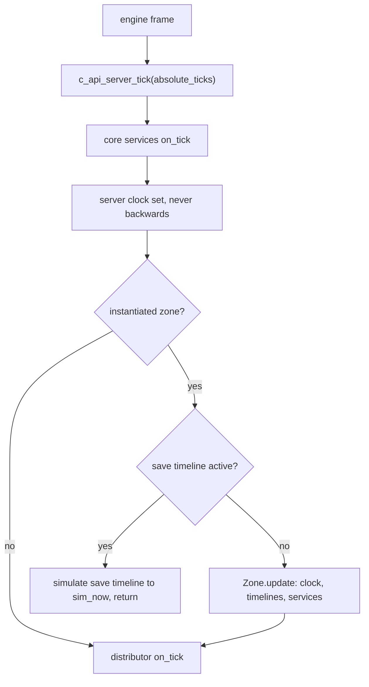
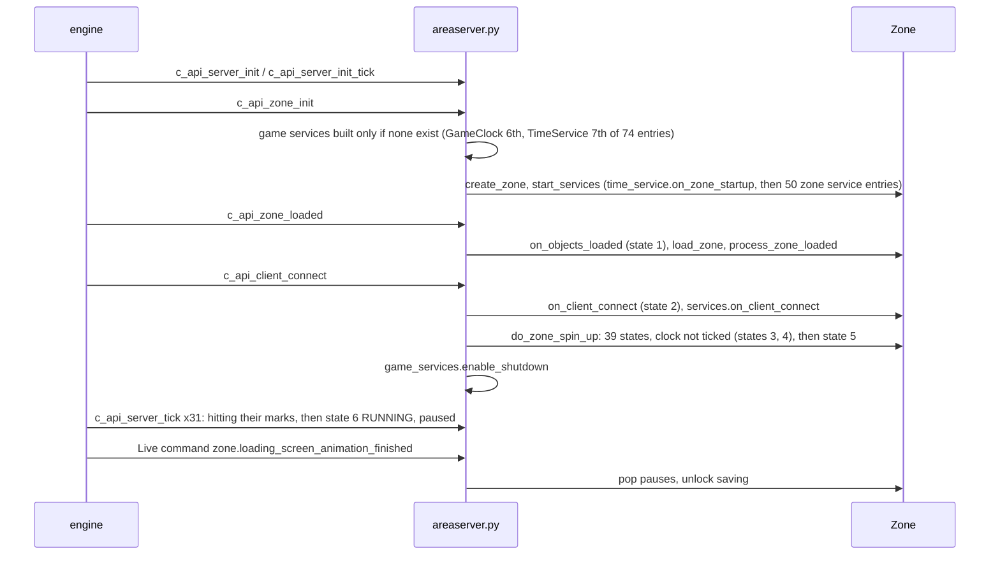

# 1.01 Time, scheduling and lot loading

*Game version 1.128.90.1030 (Steam, Linux/Proton). Code is the base game Python, which ships every pack's scripts; module tuning is read from both the full and the delta build; counts over instance tuning are live (base plus packs) on this install (EP04, EP06, EP09, EP12 High School Years, GP04, GP12, SP01, SP42). Written 2026-10-12. Checked 2026-10-12: 168 claims checked, 25 corrected, 3 relabelled, 13 removed.*

## In plain words

The game keeps two clocks. One is real time, handed over by the engine every frame. The other is the world's own clock, which runs at the speed the player picked. At normal speed one sim minute lasts one and a half real seconds, so a whole sim day lasts 36 real minutes. Speed two and speed three multiply that by 3 and by 7, and the hidden sleep speed multiplies it by 36, so a sim day then passes in one real minute.

Everything that happens in the world is a small piece of scheduled work sitting in a queue sorted by time: a Sim's next animation, a timer that fires in two hours, a weekly schedule that starts a party on Friday evening. Each frame the game moves its clock forward and then works through the queue up to the new time, but it spends at most 33 real milliseconds doing so. If it falls behind at high speed, it switches the fast speeds to slower multipliers until it catches up.

The speed itself is the winner of a pile of requests. Situations, open menus and gameplay can each ask for a speed, and underneath them all sits a permanent "paused". The newest request from the most important source wins, as long as its own condition still holds. The sleep speed is only granted when every Sim in the household is doing something that asks for it, the venue and any running event allow it, and no visitor on the lot is part of an activity that forbids sending them home.

Loading a lot is a fixed list of 39 steps that runs with the clock stopped: load the households, finish the objects, wait for the navigation mesh, spawn the Sims, restore what they were doing or give each one a plausible action if time has passed, and so on. Then a short "hitting their marks" phase lets animations settle without moving the world clock, and the game hands control to the player paused, until the loading screen finishes. When the household travels, the world clock carries on from where it was, and only timers marked to survive travel come along.

## Key facts

- One sim second is 25 game ticks and one wall tick is one real millisecond, so a sim minute is 1,500 ticks and a sim day is 2,160,000 ticks; at normal speed the two tick rates match ([details](#time-units-and-time-of-day)).
- The default speed multipliers are x1, x3, x7 and x36 (sleep speed), all code defaults: the tuning keeps an empty DEFAULT entry. A slower LOW_PERFORMANCE set of x2, x3 and x4 is tuned in both builds.
- A frame moves the game clock by at most 5 real seconds of wall time times the speed, so at x36 one frame can add at most 120 sim minutes. The rounding error carries to the next frame.
- The game clock keeps its bookkeeping even while paused: the heartbeat op, the last-seen wall time and the 5-second clock rebroadcast all run, so unpausing does not add the paused time.
- The world timeline runs for at most 33 real ms and 10,000 entries per frame (tuned 33; with the tunable off there is no time cap). Work left over is simulator debt.
- Speed is chosen from four request lists, walked in the order situation, UI modal, gameplay, initial, newest first. The first request whose condition holds wins; the initial list holds a permanent PAUSED. Conditions are evaluated only when a request is pushed, popped or removed, never polled.
- Super speed 3 (x36) is granted only through interactions that carry a game-speed liability asking for it: 108 live records do. Its condition fails on an open business, in a running situation that blocks it, or while any on-lot NPC sits in a situation that does not allow sending it home. That last flag defaults to False and only 4 live records set it True.
- Entering super speed 3 sends home every instanced NPC that may be sent home and does not live on this lot.
- If the world timeline lags the game clock by more than 10,000 ticks (6.67 sim minutes) for more than 10,000 game ticks, the faster speeds drop to the LOW_PERFORMANCE multipliers; the same duration back under the threshold restores them.
- An alarm is owned by an object and held only weakly: if the owner dies, or the caller drops the alarm handle, the alarm is cancelled.
- The 39 load states run synchronously inside the client-connect call with the game clock never ticked. Then 31 frames of hitting their marks follow with the clock still frozen, and the zone becomes RUNNING, paused.
- After the loading screen, a save made while paused stays paused; any other save resumes at normal speed. Saves only ever store PAUSED or NORMAL.
- Travel freezes the world timeline, keeps only cross-zone alarms, and restarts the new lot's game clock from the old lot's last simulated instant.

## How it works

### The whole picture

**Observed** (`areaserver.py: c_api_server_tick`, checked in bytecode): the engine calls `c_api_server_tick(absolute_ticks)` with an absolute wall-tick count. Python runs core services, sets the server clock (never backwards), then, if an instantiated zone exists, either simulates the save timeline and returns, or runs `Zone.update`. The distributor tick that flushes ops to the client runs on every call except that save early return, zone or no zone. How often the engine calls it is not visible from Python (see Limits).

### Time units and time of day

**Observed** (`date_and_time.py`, module constants and `DateAndTime`):
- `TICKS_PER_REAL_WORLD_SECOND = 1000` and `REAL_MILLISECONDS_PER_SIM_SECOND = 25`. Sim intervals are built as seconds times 25 (`clock.py: interval_in_sim_minutes` and friends), real intervals as seconds times 1000 (`interval_in_real_seconds`).
- So a sim minute is 1,500 ticks, an hour 90,000, a day 2,160,000 and a week 15,120,000. At x1 a sim minute lasts 1.5 real seconds, a sim day 36 real minutes and a sim week 252 real minutes.
- `DateAndTime` is an integer tick count. `hour()`, `minute()`, `day()` (0 is Sunday) and `week()` derive from it. `TimeSpan` rounds its delta up (`math.ceil`).
- `send_clock_tuning()` runs the native command `clock._set_milliseconds_per_sim_second 25`, so the engine and Python agree on the 25. `GameClock.__init__` calls it.
- `time_between_day_times(start, end)` handles windows that wrap past midnight (start later than end). `time_till_next_day_time` and `time_of_next_day_time` find the next occurrence of a time of day.

**Observed** (`time_service.py: TimeService.is_day_time`): day time is the window between the current region's sunrise and sunset; with no region it is never day. Sunlight and weather belong to [2.04 Weather, seasons and the ground](2.04-weather-seasons-ground.md) and [2.05 The sky and the moon](2.05-sky-and-moon.md).

**Observed** (`tunable_time.py`): `Days` runs SUNDAY 0 to SATURDAY 6. `TunableTimeOfDay` defaults to 12:00 and `TunableTimeOfWeek` to Sunday 12:00 unless a tunable passes its own default.

### The two clocks

**Observed** (`clock.py: ServerClock`): the wall clock, a tick counter set every frame by `c_api_server_tick`. The wall-clock timeline and every real-time alarm run on it.

**Observed** (`clock.py: GameClock`):
- `now() = _game_clock._ticks + _initial_ticks`. `_initial_ticks` is the world time at which this zone session's game clock started; `_game_clock._ticks` counts game ticks since.
- A new game starts at `NEW_GAME_START_TIME`, tuned Sunday 08:00 in both builds (720,000 ticks). `GameClock.setup` then replaces `_initial_ticks` with the save slot's `world_game_time` if present, and `GameClock.save` writes `world_game_time = time_service.sim_now`. The saved world time is therefore the world timeline's time, not the game clock's.
- `monotonic_time() = _game_clock._ticks + _loading_monotonic_ticks`. The loading counter only grows during hitting their marks (below), so this value keeps moving while world time is frozen.

### How one frame moves the game clock

**Observed** (`clock.py: GameClock.tick_game_clock`, checked in bytecode). When the clock is not paused:
1. `diff = absolute_ticks - _previous_absolute_ticks`. A negative diff logs an error and returns at once, skipping everything below.
2. If a debugger breakpoint was hit, `diff = 1` and the next rebroadcast is forced.
3. `diff > MAX_GAME_CLOCK_TICK_STEP` (5000) is clamped to 5000, `report_max_tick_spike` fires and the next rebroadcast is forced.
4. `ideal = diff * scale + _error_debt`, `rounded = floor(ideal + 0.5)`, `_error_debt = clamp(-1, ideal - rounded, 1)`, and `rounded` is added to the game ticks.

Paused or not, every call that did not return early then adds a `Heartbeat` op, stores `_previous_absolute_ticks = absolute_ticks`, and rebroadcasts the clock when the wall time passes the next broadcast mark, which it then sets `SECONDS_BETWEEN_CLOCK_BROADCAST` (5) real seconds ahead.

**Inferred** from the step above: because the last-seen wall time is updated while paused, a long pause does not turn into a burst of game time on unpause. At x36 the clamp caps one frame at 5000 × 36 = 180,000 ticks, 120 sim minutes.

### Speeds and multipliers

**Observed** (`clock.py: ClockSpeedMode`): PAUSED 0, NORMAL 1, SPEED2 2, SPEED3 3, INTERACTION_STARTUP_SPEED 4, SUPER_SPEED3 5. `GameSpeedChangeSource`: SITUATION 0, UI_MODAL 1, GAMEPLAY 2, INITIAL 3.

**Observed** (`clock.py: GameClock._clock_speed_to_scale`, `ClockSpeedMultipliers`): PAUSED is 0 and NORMAL is 1 (class constants). SPEED2, SPEED3 and SUPER_SPEED3 come from `CLOCK_SPEED_TYPE_MULTIPLIER_MAP[clock_speed_multiplier_type]`, whose value tuple has code defaults 3.0, 7.0 and 36.0. INTERACTION_STARTUP_SPEED uses `TUNABLE_INTERACTION_STARTUP_SPEED_MULTIPLIER` (code default 5.0).

**Observed** (module tuning `clock`, full and delta builds): the map has a DEFAULT entry with no values in both builds, so the code defaults 3/7/36 apply. LOW_PERFORMANCE is 2/3/4 in both. The delta build adds SLOWMO (enum value 64: 0.1/0.5/2) and MUSIC_SERIES (65: 1.7/2/2) and tunes the startup multiplier to 6; the full build leaves the startup multiplier at its code default 5. The live game reads the delta build ([0.03 The tuning system](0.03-tuning-system.md)).

**Observed** (`clock.py: clock_speed_multiplier_type`, `set_clock_speed_multiplier_type_override`, `_set_clock_speed_multiplier_type`): the active type is `override or base`. `ChangeClockSpeedsLiability` (`interactions/utils/change_clock_speed_liability.py`) sets the override for the length of an interaction; a second override at the same time is refused with an error. A base-type change only rebroadcasts when no override is set. **Observed** (live tuning, 3 records): every live use of that liability leaves the override at its default, DEFAULT. **Inferred**: DEFAULT is enum 0, which is falsy, so such an override does not change the multipliers; it only blocks other overrides and silences base-type rebroadcasts. No live user of SLOWMO or MUSIC_SERIES turned up under that liability.

Real time per sim span at the default multipliers (derived from the constants above):

| Speed | Scale | 1 sim minute | 1 sim hour | 1 sim day |
|---|---|---|---|---|
| NORMAL | 1 | 1.5 s | 90 s | 36 min |
| SPEED2 | 3 | 0.5 s | 30 s | 12 min |
| SPEED3 | 7 | 214 ms | 12.9 s | 5.14 min |
| SUPER_SPEED3 | 36 | 41.7 ms | 2.5 s | 60 s |
| LOW_PERFORMANCE speed 3 | 3 | 0.5 s | 30 s | 12 min |

### The speed request stack

**Observed** (`clock.py: GameClock._update_speed`, checked in bytecode because the decompile flattens it; `game_speed_requests_gen`, `_SpeedController`):
- Each source owns a list of `SpeedRequest(speed, validity_check, reason)`. `game_speed_requests_gen` walks sources in ascending order (SITUATION first, INITIAL last) and each list newest first.
- The first request with `validity_check is None or validity_check()` wins. If none passes, an error is logged and PAUSED is used. `GameClock.__init__` pushes a permanent PAUSED into INITIAL ("Initial Speed").
- On a change of speed, in this order: time-in-speed telemetry; if the new speed is NORMAL and the multiplier type is not DEFAULT, the type resets to DEFAULT without a rebroadcast; if the new speed is SUPER_SPEED3, `situation_manager.ss3_make_all_npcs_leave_now()`; the clock rebroadcast; the responsiveness service is told about pause and unpause; on PAUSED, `pythonutils.try_highwater_gc()`.
- `_update_speed` is called only from `push_speed`, `pop_speed`, `remove_request` and `set_clock_speed`. So a validity check is evaluated only when one of those four runs. Nothing polls it.

**Observed** (`clock.py`, the four entry points):
- `push_speed(speed, source=GAMEPLAY, validity_check=None, reason, immediate)` appends a request. For UI_MODAL with an empty list it first stores the current speed in `_non_ui_clock_speed`; `persistable_clock_speed` returns that stored speed while any UI_MODAL request exists, so a save with a menu open stores the speed underneath.
- `pop_speed(speed=None, source)` removes the newest request of that speed (or the newest of any speed).
- `remove_request(request, source)` removes one known request.
- `set_clock_speed(speed, source)` returns False for an unknown speed. Otherwise it empties the source's list except SUPER_SPEED3 requests, then pushes the new speed, except that SPEED3 is not pushed when the top valid request is already SUPER_SPEED3.

**Inferred** from `set_clock_speed`: a player speed button (the Live command `clock.setspeed`, gameplay source) wipes every gameplay-source request except super speed 3 ones, including pauses that gameplay code pushed. Pressing 3 while the household sleeps at super speed 3 keeps super speed 3.

### Who forces a speed

All **Observed**, at the named call sites:
- Menus and dialogs: `clock.request_pause` and `clock.unrequest_pause` map the handles "Layout Manager Set Modal Visible" and "Dialog Manager Set Dialog Visible" to UI_MODAL and every other handle to GAMEPLAY (`server_commands/clock_commands.py: _get_speed_source`).
- Build/buy: `clock.build_buy_pause_unpause` pushes or pops PAUSED in UI_MODAL (reason "Build Buy"); `clock.setspeed` is refused in build/buy.
- Phone calls: `ui/ui_dialog_service.py` sets NORMAL when a ringing dialog opens while the phone is not silenced, the game is not paused and the QA ignore flag is off.
- Welcome wagon and similar hosted visits: `situations/npc_hosted_situations.py` drops super speed 3 to NORMAL.
- Service NPCs: `situations/complex/service_npc_situation.py: start_situation` pushes SPEED3 while the clock is in super speed 3 and removes it when the situation is removed.
- Travel: `situations/situation_manager.py` pushes PAUSED in the SITUATION source ("Situation Travel") for a travel seed and removes it at stop. PAUSED is also set by `travel_service`, `travel_tuning`, `travel_elements`, `travel_group`, `travel_group_getaway`, `breaking_and_entering_zone_director`, a travel loot in `interactions/utils/loot_ops.py` and `objects/terrain.py` travel.
- Interactions: `TunableSetClockSpeed` (`interactions/utils/tunable.py`, a basic extra) sets PAUSED, NORMAL, SPEED2 or SPEED3. Super speed 3 needs a `GameSpeedLiability` (next section).
- Disconnect: `GameClock.on_client_disconnect` writes speed telemetry and sets PAUSED.

### Super speed 3

**Observed** (`interactions/utils/tunable.py: GameSpeedLiability`, checked in bytecode because the decompile's nesting is wrong):
- `on_run` does nothing if the Sim passes `GLOBAL_EXEMPT_SIM_TESTS` or the QA flag `ignore_game_speed_requests` is set. Otherwise it pushes its speed in the gameplay source. For super speed 3 it first records the Sim in a class-wide `_ss3_requests` map and attaches a validity check. The tunable `game_speed` defaults to NORMAL; live, 109 records ask for SUPER_SPEED3 and 2 for SPEED3 (beds, naps, tents, some rabbit holes).
- If the clock is not yet at super speed 3, a repeating sim alarm every `TIME_BETWEEN_CHECKS` (10 sim minutes) removes the request and pushes it again, which re-runs the check. The alarm stops once super speed 3 is reached.

The validity check fails, in this order, when:
1. the zone has a business manager whose `allow_super_speed_3` is False. That property is True when the business type sets `always_allow_super_speed_3`, else True only while the business is closed (`business/business_manager.py`). No live business type sets the flag.
2. the current venue's `allow_super_speed_three` is False (venue tunable, code default True, read in `venues/venue_tuning.pyc` bytecode). No live venue sets it False.
3. any situation has `blocks_super_speed_three` (default False; 25 live records set it True, for example the maid, wedding and house party situations). Along the way, NPCs in situations with `park_interactions_on_SS3` are each given a random "park" interaction that lets them stay.
4. some instanced Sim, hidden ones included, fails `validate_household_sim(sim) or (sim.is_npc and not on_lot_check(sim))`.

`validate_household_sim` passes a Sim that has its own super speed 3 request or a park interaction; a selectable Sim whose species has an entry in `species_affordance_mapping` (it is given that interaction); and a non-selectable roommate whose home is this zone, or a travel-group member whose group zone is this zone, when an SS3 interaction exists for it. `on_lot_check` is False for a Sim off the active lot or, in a multi-unit building, standing or heading outside this unit; otherwise it returns `not is_sim_ss3_safe(sim)`. **Observed** (`situations/situation_manager.py: is_sim_ss3_safe`): a Sim is safe only when every situation it is in has `should_send_on_lot_home_in_super_speed_3`, which defaults to False and is True in 4 live records.

**Inferred** from those rules: every selectable human Sim must be running its own super speed 3 interaction; an on-lot NPC that belongs to any ordinary situation blocks super speed 3, while an on-lot NPC in no situation at all does not; NPCs off the lot never block it. Because `_ss3_requests` is shared by every liability, the moment one sleeper's interaction ends the others' checks fail on that Sim, and the release code below drops the game to NORMAL.

**Observed** (`GameSpeedLiability.request_speed_change`): for each running situation that blocks super speed 3 and has `super_speed3_replacement_speed` (an optional tunable, SPEED3 when enabled with no value), the liability also pushes that speed, valid while the situation runs and the check would pass if that situation were ignored. It is removed when the situation ends. Two live situations enable it, one with NORMAL.

**Observed** (`GameSpeedLiability.release`): the request and any replacement requests are removed. If the clock was at super speed 3 and is no longer, `set_clock_speed(NORMAL)`. The timer, park interactions and exempt buffs are cleaned up.

**Observed** (`situations/situation_manager.py: ss3_make_all_npcs_leave_now`, checked in bytecode): for each instanced NPC it skips Sims for which any situation has `can_be_sent_home_in_super_speed_3` False (default True; 34 live records set False), Sims on the active lot that are not safe, and Sims whose home or vacation zone is this zone. Every other NPC gets `SUPER_SPEED_THREE_REQUEST_BUFF` and is made to leave at once. Separately, `allowed_in_super_speed_3` on a situation (default False, True in 7 live records) is read only by walkby and situation-shift spawning (`situations/ambient/walkby_tuning.py`, `situations/situation_shifts.py`), which skip other situations during super speed 3. Full autonomy does not run at super speed 3 at all ([3.04 Autonomy](3.04-autonomy.md)).

### Telling the client the time

**Observed** (`clock.py: GameClock._sync_clock_and_broadcast_gameclock`; `distributor/ops.pyc: SetGameTime.__init__` in bytecode): a `SetGameTime` op carries `clock_speed`, `game_speed` (the scale), `server_time`, `sync_game_time` (game ticks plus initial ticks), `monotonic_time`, `super_speed` and a serial number, and the same values go to the native `set_game_time_callback`. Super speed 3 is sent as SPEED3 with `super_speed` True. During INTERACTION_STARTUP_SPEED the op sends the loading counter as both game time and monotonic time.

Rebroadcasts happen on every speed change, on client connect, every 5 real seconds from `tick_game_clock`, on a multiplier-type change or override, on each hitting-their-marks step, and from the Automation commands `clock.setgametime` and `clock.advance_game_time`, which both add to `_initial_ticks`. The client's own interpolation is native (see Limits).

### The world timeline and its time slice

**Observed** (`time_service.py: TimeService`): `start` builds `sim_timeline` at `game_clock.now()` and `wall_clock_timeline` at `server_clock.now()`, and hooks `caches.clear_all_caches` to the sim timeline's `on_time_advanced`. `update(time_slice=True)` simulates the sim timeline up to `game_clock.now()` with `max_time_ms = MAX_TIME_SLICE_MILLISECONDS`, then the wall-clock timeline up to the server time with no time cap (an error is logged if it cannot finish). `MAX_TIME_SLICE_MILLISECONDS` is an optional tunable that is off by default (no cap); its inner value defaults to 50; the module tuning enables it at 33 in both builds.

**Observed** (`scheduling.py: Timeline.simulate`, checked in bytecode):
1. If `until < future`, it logs an error and returns True. Otherwise `future = until`, the `per_simulate_callbacks` run, and in automation mode only a debt simulator runs.
2. It pops heap entries while `heap[0].when <= until`. A cancelled entry decrements the garbage count and is skipped.
3. When an entry's time differs from `now`, `now` moves there and `on_time_advanced` fires, which clears every cache.
4. The entry runs as a trampoline: `_run`, `_resume` with child results, children run with `run_child` executed at once.
5. Only after each top-level entry does it check the budget: `count >= max_elements` (10,000) or the real-time deadline. `count` also grows for cancelled pops and for each child run inline.
6. After the loop the heap is rebuilt if garbage exceeds 100 entries and half the heap.
7. With no early exit, `now = until` and it returns True. An early exit returns False, leaving `now < future`.

**Observed** (`TimeService.get_simulator_debt`): `(sim_future - sim_now).in_minutes()`, 0 when frozen; `areaserver.py: c_api_get_simulator_debt` hands it to the engine.

**Inferred** from step 5: one long chain of synchronous children can run past the 33 ms budget, because the clock is only read between top-level entries.

**Observed** (`scheduling.py`): the heap is ordered by `(when, ix)`. `schedule` gives each entry the next serial number; `schedule_asap` negates it, so asap entries at the same time run before normal ones. Scheduling in the past logs an error but still schedules. `reschedule` leaves a dummy garbage entry behind. `filter_handles(predicate)` hard-stops every handle that fails the predicate.

### Adaptive clock speed

**Observed** (`adaptive_clock_speed.py: AdaptiveClockSpeed.update_adaptive_speed`, called from `Zone.update` only in RUNNING and not paused):
- It does nothing if `TIME_DIFFERENCE_THRESHOLD` is off, and resets both phase timers at NORMAL or PAUSED.
- `diff = game_clock.now() - sim_now` in ticks, which is the world timeline's lag.
- While `diff > threshold`, a phase timer measured in game-clock ticks runs; past `duration` it switches the base type to the reduced type. While `diff <= threshold`, a second timer runs and past `duration` it switches back to the default type. Crossing the threshold resets the other timer.
- Module tuning (both builds) enables it with default type DEFAULT and reduced type LOW_PERFORMANCE and leaves threshold and duration untuned, so both are the code default 10,000 ticks (6.67 sim minutes of lag; a duration of 1.4 real seconds at x7, 0.28 s at x36).
- Quirk: `_get_threshold_and_duration` compares the clock's type with the whole `default_speed_multiplier` tuple, which is never equal, so the reduced tuple's numbers are always used. Harmless here: both carry the same code defaults.

**Observed** (`clock.py: _update_speed`): returning to NORMAL resets the type to DEFAULT.

### Elements: the units of scheduled work

**Observed** (`elements.py`, `element_utils.py`):
- An element runs through `_run(timeline)`; it can return a result, schedule itself and return None (suspend), or run children. `FunctionElement` treats a None result as True.
- `SleepElement(delay)` schedules itself at `now + delay` and suspends; its second run returns True. A soft-stopped plain sleep still waits out its delay and then returns False. `SoftSleepElement` differs only there: a soft stop reschedules it to `now`, so it ends at once, also with False.
- `soft_stop` walks down the tree calling `_soft_stop`; an element that returns True there (`MustRunElement`) is not descended into. `hard_stop` tears the whole subtree down.
- `SequenceElement` runs children in order and skips the remaining non-must-run children after a soft stop or a failed child. `AllElement` runs its children in parallel. `WithFinallyElement` runs its finally callback on completion or hard stop; `CriticalSectionElement` runs its cleanup element after the work.
- `BusyWaitElement(child, test)` registers its test in the timeline's `per_simulate_callbacks`, so the test runs once per `simulate` call, and it soft-stops the child once the test passes.
- Others: `RepeatElement`, `ConditionalElement`, `ResultElement`, `OverrideResultElement`, `CallbackElement`, `MinimumTimeElement`, `RunChildElement`, `GeneratorElement`, `SubclassableGeneratorElement`.
- `build_element` turns a list into a `SequenceElement`, a generator function into a `GeneratorElement` and any other routine into a `FunctionElement`. `CleanupType` picks the wrapper: NotCritical 0 (plain), OnCancel 1 (critical section), OnCancelOrException 2 (with finally), RunAll 3 (each step forced to succeed).
- `soft_sleep_forever()` is a repeat of a 28-sim-day soft sleep forced to True. `sleep_until_next_tick_element()` is a busy wait on that with a test that is always true, so it ends at the next `simulate` call.

### Alarms

**Observed** (`alarms.py`):
- `add_alarm(owner, time_span, callback, repeating=False, repeating_time_span=None, use_sleep_time=True, cross_zone=False)` schedules on the sim timeline, starting from `sim_timeline.now` when `use_sleep_time` is True and from `sim_timeline.future` (the current simulate target) otherwise.
- `add_alarm_real_time(...)` always starts from `wall_clock_timeline.now`; its `use_sleep_time` only chooses accurate or lossy repeats.
- A one-shot alarm is an `AlarmElement`. A repeating alarm reschedules after its callback at `now + interval` (`RepeatingAlarmElement`) or, when `use_sleep_time` is False, at `future + interval` (`LossyRepeatingAlarmElement`). The cross-zone variants report `cross_zone()` True.
- An owner is required (`ValueError` otherwise) and is held through a weak reference whose death callback cancels the alarm.
- `_ALARM_ELEMENT_HANDLES` maps each scheduled element to a weak reference to its `AlarmHandle`. When the handle is garbage collected, the callback deletes the entry and hard-stops the element. A one-shot alarm tears its handle down after the callback runs.

**Inferred** from the two repeat rules: when a slow frame leaves debt, an accurate repeating alarm fires once for each missed interval as the timeline catches up, while a lossy one skips to the newest interval. A caller that does not keep the returned handle loses the alarm at the next garbage collection.

### Weekly schedules

**Observed** (`scheduler.py`, checked in bytecode for `schedule_next_alarm` and `date_and_time.py: time_till_timespan_of_week`):
- A `ScheduleEntry` has `days_available` (a `TunableDayAvailability` of seven day flags, default off; `scheduler_utils.py`), `start_time` (default 09:00), `duration` in hours (default 1.0), `random_start` (default False) and `schedule_shift_type` (default ALL_DAY). Each enabled day becomes a week-relative (start, end) window.
- A `WeeklySchedule` keeps the windows of entries whose shift type matches (all entries if none matches) and one alarm. `time_until_next_scheduled_event` takes the earliest window start over all entries; ties fire together.
- `time_till_timespan_of_week` returns the time to the start if it is still ahead this week; else ZERO if an end is given, the end is still ahead and at least `min_duration_remaining` is left; else the time to next week's start. The end is passed only when `schedule_immediate` is set.
- `schedule_next_alarm` raises the span to `min_alarm_time_span`, turns ZERO into one tick when `schedule_immediate`, adds the alarm, and adds an early-warning alarm `early_warning_time_span` before it when that is positive.
- When the alarm fires, a `random_start` entry gets a second alarm at a random tick inside what is left of its window; other entries call the start callback at once. Then the next alarm is scheduled with `schedule_immediate` False, so a window that just fired is not fired again.
- `add_cooldown` and `is_on_cooldown` exist, but only the random-start path checks the cooldown.
- `schedule_immediate` defaults to True at construction, so a schedule created inside an open window fires one tick later.

Subclasses carry the payload: `SituationWeeklySchedule`, `WeightedSituationsWeeklySchedule` (a weighted random pick with tests and multipliers), `SituationWeeklyScheduleVariant` and `ObjectLayerWeeklySchedule`. How situations use them is in [4.01 Situations, roles and NPC scheduling](4.01-situations-npcs.md).

### What one frame runs

**Observed** (`zone.py: Zone.update`) by zone state:
- CLIENT_CONNECTED: only `tick_game_clock`.
- HITTING_THEIR_MARKS: no clock tick. `time_service.update(time_slice=False)`, then the sim filter, situation manager, sim spawner, broadcaster, real-time broadcaster and the spin-up service.
- RUNNING: `tick_game_clock`; `time_service.update()` unless the option `perf_freeze_game_time_in_pause` is set and the clock is paused; always the sim filter, object cluster and narrative services. When not paused: situation manager, sim spawner, broadcaster, real-time broadcaster, story progression, season, weather, roommate, lunar cycle, scenario, and last the adaptive clock speed.
- Any state: `_gather_tick_metrics`, which records only after `zone.gather_tick_metrics.start`.
- `animate_instantly` and `force_process_transitions` are True while the state is not RUNNING; `route_instantly` is True then or when forced.

**Observed** (`zone.py: freeze_game_time_in_pause`; `performance/performance_commands.pyc` in bytecode, the module did not decompile): `perf_freeze_game_time_in_pause` starts False. Only the Automation commands `performance.freeze_in_pause [freeze]` and `performance.scenario.enable` set it.

**Inferred**: in a normal load the client-connect call runs the whole spin-up before returning, so the CLIENT_CONNECTED branch matters only on the World Builder path. Story progression, seasons and weather therefore stop while paused; their own cadences are in [4.02 Story progression, households and townies](4.02-story-progression-townies.md) and [2.04 Weather, seasons and the ground](2.04-weather-seasons-ground.md).

### Loading a lot: the call chain

**Observed** (`areaserver.py`, `game_services.py`, `zone.py`, `sims4/service_manager.py`), in the order the engine calls them:

1. `c_api_server_init` starts the global services; `c_api_server_init_tick` starts deferred core services one per call (`start_service_tick`).
2. `c_api_zone_init` builds the persistence caches, then `game_services.start_services(save_slot_data)` builds the game service manager only if none exists. That list has 74 entries, with `GameClock` 6th and `TimeService` 7th; `register_service` skips any whose required packs are missing. `ServiceManager.start_services` runs every `setup()` in list order and then every `start()`, so `GameClock.setup` has loaded the saved world time before `TimeService.start` builds the timelines at it. Then `create_zone`, the current zone id, `Zone.start_services`, and the game clock's `set_game_time_callback`.
3. `Zone.start_services` calls `time_service.on_zone_startup()` before it builds the zone services, then registers and starts a 50-entry list (SimIrqService first, MasterController last; pack-gated entries are skipped the same way), adds a 1-real-second repeating navmesh check alarm and starts the royalty alarm schedule.
4. `c_api_zone_loaded`: `on_objects_loaded` (state OBJECTS_LOADED), `load_zone` (game and zone services load their save data, then the zone's own fields below), `process_zone_loaded`.
5. `c_api_client_connect`: creates the client, `zone.on_client_connect` (state CLIENT_CONNECTED), `services.on_client_connect` (a clock rebroadcast among others). The World Builder household (id 1) returns here, after `GameClock.restore_saved_clock_speed`, only when not in edit-lot mode. Otherwise `do_build_mode_zone_spin_up` (edit-lot mode) or `do_zone_spin_up` runs to completion inside this call, then `game_services.enable_shutdown()`.

The `synchronous` decorator on the loaded, connect, disconnect and shutdown entry points runs the function and then the native callback. Zone states are ZONE_INIT 0, OBJECTS_LOADED 1, CLIENT_CONNECTED 2, HOUSEHOLDS_AND_SIM_INFOS_LOADED 3, ALL_SIMS_SPAWNED 4, HITTING_THEIR_MARKS 5, RUNNING 6, SHUTDOWN_STARTED 7 (`zone_types.py`). `Zone._set_zone_state` asserts each step is +1 (or SHUTDOWN_STARTED) and fires registered callbacks once; `register_callback` for a state already reached calls back at once.

### The zone spin-up

**Observed** (`zone.py: Zone.do_zone_spin_up`):
1. Hand the household, client and active Sim id to the spin-up service.
2. `_time_of_zone_spin_up = sim_now`.
3. `_initialize_clock_speed` (see "The speed you come back to").
4. `game_clock.enter_zone_spin_up()` zeroes the loading counter.
5. Start the playable sequence.
6. Loop until finished: `time_service.update(time_slice=False)`, spin-up update, sim filter, situation manager, sim spawner. The game clock is not ticked, so world time does not move and each pass only runs work due at the frozen instant.
7. On error, return False. If not traveling, write load telemetry.
8. Set HITTING_THEIR_MARKS and start that sequence.

**Observed** (`zone_spin_up_service.py: ZoneSpinUpService.update`): the current state's `on_update` runs (then `on_exit` if it returned DONE), and following states are entered while each `on_enter` returns DONE. A state whose `on_enter` returns nothing (checked in bytecode for `_StartNoWaitingState`, `_EndNoWaitingState`, `_CullPendingSimsState` and `_EditModeWeatherSetupState`) stops the chain for one pass; the base `on_update` then returns DONE. Between `_StartNoWaitingState` and `_EndNoWaitingState`, a state that returns WAITING only logs an error. An exception sets ERRORED, writes telemetry and shows `LOAD_ERROR_REQUEST_RESTART`. Statuses: CREATED 0, INITIALIZED 1, SEQUENCED 2, RUNNING 3, COMPLETED 4, ERRORED 5.

The playable sequence (`ZoneSpinUpService._playable_sequence`), in order:

| # | State | What it does |
|---|---|---|
| 1 | `_StopCaching` | `caches.skip_cache = True` |
| 2 | `_LoadHouseholdsAndSimInfosState` | pre-load options, `load_households`, `on_zone_load` (zone, game, core managers), selectable Sims to the client, state 3, `on_all_households_and_sim_infos_loaded` (zone, game, core), organizations, roommates, custom schedules, multi-unit, dialog options, relationship info, lot display info, live-drag permissions |
| 3 | `_PremadeSimFixupState` | premade Sim fixups |
| 4 | `_SimInfoFixupState` | first-load fixups for Sim infos flagged for them, then active-household fixups |
| 5 | `_SetupPortalsState` | finalizes portals that provide no routing surface |
| 6 | `_SelectZoneDirectorState` | lot premade status, zone-director requests from venue, situation seeds and drama scheduler; picks the zone director; decides which situations to load |
| 7 | `_DestinationWorldCleanUp` | returns and cleans objects left in a travel group's destination world |
| 8 | `_DetectAndCleanupInvalidObjectsState` | destroys objects within 0.1 of the world origin, then processes invalid unparented objects |
| 9 | `_SetObjectOwnershipState` | household object ownership, object preference validation |
| 10 | `_FinalizeObjectsState` | `finalize` on every object and inventory object, zone modifiers, `lot.on_finalize_load`, roommate decorations, animal aging, lost-and-found clones deleted, `finalize_statistics`, water terrain cache |
| 11 | `_SetupSurfacePortalsState` | finalizes portals that provide a routing surface |
| 12 | `_WaitForNavmeshState` | sends a routing fence and `flush_planner(False)`; WAITING until the last fence passes it |
| 13 | `_SpawnSimsState` | `sim_info_manager.on_spawn_sims_for_zone_spin_up`, which passes traveled, zone-saved, plex-saved, open-street and injected Sims to the zone director |
| 14 | `_SituationCommonState` | drama scheduler, pivotal moments, situations from the manager, venue and open-street director, career event situations, walkbys begin |
| 15 | `_FixupInventoryState` | `fixup_inventory` on every Sim info |
| 16 | `_DestroyUnclaimedObjectsState` | unclaimed objects destroyed |
| 17 | `_WaitForSimSpawnerService` | batch spawn; WAITING until done; then low-level statistic simulation for uninstanced Sims, baby state, relationships, zone director and venue hooks, state 4, career and game-service hooks; `on_exit` finalizes instanced Sims |
| 18 | `_ZoneModifierSpinUpState` | zone modifier spin-up |
| 19 | `_PrepareLotState` | unentitled craftables destroyed, `on_cleanup_zone_objects` (game then zone services); zone director cleanup and `prepare_lot` (only if not loaded from a save) under the zone-director guard; posture graph build, high-water GC, venue preparation, `on_posture_graph_built` always |
| 20 | `_CullPendingSimsState` | culls Sims pending culling |
| 21 | `_AwayActionsState` | if the household has a home: away-action trackers started or stopped; uninstantiated data loaded for the zones its Sims, travel group and home are in |
| 22 | `_InitializeDoorServiceState` | `fix_up_doors` |
| 23 | `_InitializeGreetingRelatedSituationState` | greeting situations from the zone director |
| 24 | `_SetMailboxOwnerState` | mailbox owners |
| 25 | `_StartNoWaitingState` | no-waiting stretch begins |
| 26 | `_RestoreRabbitHoleState` | rabbit holes restored |
| 27 | `_RestoreSIState` | carried-Sim and wing fixups, then interactions restored only if `should_restore_sis` |
| 28 | `_GlobalLotTuningAndCleanupState` | global lot cleanup |
| 29 | `_RestoreCareerState` | careers and coworker bits |
| 30 | `_RestoreMissingPetsState` | missing pets |
| 31 | `_PrerollAutonomyState` | caching on; for each Sim spun up with PREROLL, one autonomy pick ([3.04 Autonomy](3.04-autonomy.md)); travel outfits, vehicles; caching off again on exit |
| 32 | `_PushSimsToGoHomeState` | go-home interaction for Sims flagged PUSH_GO_HOME that are off the lot |
| 33 | `_SetActiveSimState` | active Sim set (or the next one), household hooks, known-NPC commodities |
| 34 | `_CreateFashionOutfitsInventory` | fashion trend inventory |
| 35 | `_ScheduleStartupDramaNodesState` | scorable and weekly drama nodes |
| 36 | `_StartupCommandsState` | runs a `--on_startup_commands` script if given, GSI options |
| 37 | `_StartCaching` | caching on, `clear_all_caches(force=True)` |
| 38 | `_FinalPlayableState` | special-event alarm, lot entry sting, load telemetry, telemetry alarms, `apply_save_lock` |
| 39 | `_EndNoWaitingState` | no-waiting stretch ends |

**Observed** (`zone_director.py: ZoneDirectorBase.process_traveled_and_persisted_and_resident_sims` and `_determine_zone_saved_sim_op`, checked in bytecode): traveled Sims are removed from the other lists, overstayers are sent home, then traveled, resident, injected, plex-saved, zone-saved and open-street-saved Sims are processed in that order. Zone-saved Sims are CLEARED (selectable ones spawned with PREROLL, others sent home) when a fresh zone director has `send_saved_npcs_home` or the lot owner changed; REINITIATED (PREROLL) when the active household changed or time has passed; MAINTAINED (RESTORE_SI) otherwise. Open-street Sims are cleared when time has passed there. Lots, venues and zone directors are covered in [2.01 Lots, venues and rooms](2.01-lots-venues-rooms.md).

**Observed** (`zone.py: Zone.do_build_mode_zone_spin_up`): edit-lot mode runs three states, `_EditModeWeatherSetupState`, `_EditModeAmbientSetupState` and `_EditModeSequenceCompleteState` (households, states 3 and 4, clubs, relationships, roommates, edit-mode situations and layers, footprints, `restore_saved_clock_speed`), then sets HITTING_THEIR_MARKS and RUNNING at once.

### Hitting their marks

**Observed** (`zone_spin_up_service.py: _HittingTheirMarksState`; `clock.py: advance_for_hitting_their_marks`). The sequence is `_TickDistributorState`, `_HittingTheirMarksState`, `_RestoreQueuedSIState`, `_UpdateObjectivesState`, driven by `Zone.update`:
- The first frame flushes the distributor and enters `_HittingTheirMarksState`, which pushes INTERACTION_STARTUP_SPEED and advances once.
- Each later frame counts down from 30 and advances again, until the count reaches 0. Then the active lot, sim spawner, situation manager, `Zone.on_hit_their_marks` and the scenario tracker get their hit-their-marks hooks, and the last two states, which both return DONE on entry, run in the same frame.
- Each advance adds `floor(33 × startup_scale)` to the loading counter: 198 ticks at x6, 5,940 over the 30 advances, spread across 31 frames. The game clock is never ticked here.

**Observed** (`zone.py: Zone.on_hit_their_marks`): state RUNNING, `exit_zone_spin_up` pops the startup speed, PAUSED is pushed ("Prevent game speed modifying interaction..."), and the saved camera or the active Sim gets the focus.

**Inferred**: those 5,940 ticks are 5.9 seconds of animation at normal speed, played against monotonic time. Because the op adds initial ticks to the loading counter, the client clock may show world time a few sim minutes ahead during these frames; this was not checked in game.

### The speed you come back to

**Observed** (`zone.py: Zone._initialize_clock_speed`, called during spin-up, gameplay source): the client speed starts as NORMAL and `load_zone` replaces it with the zone save's `clock_speed_mode` when present. If that speed is set, this is not a first visit and no world time has passed since the zone's save, a saved PAUSED becomes `set_clock_speed(NORMAL)` plus a pushed PAUSED, and any other saved speed is set directly. Otherwise NORMAL is set. Either way a PAUSED is pushed ("Paused during camera lerp").

**Observed** (`zone.py: Zone.on_loading_screen_animation_finished`, run by the Live commands `zone.loading_screen_animation_finished` and `clock.restore_saved_clock_speed`): `restore_saved_clock_speed` pops one PAUSED unless build/buy is open, then one more `pop_speed(PAUSED)`, then the Sim info manager, a `SimTravel` test event, business, venue, landlord, laundry, fashion and reincarnation hooks, and last the spin-up service unlocks saving.

**Observed** (`zone.py: Zone.save_zone`): the zone stores `clock_speed_mode` PAUSED when `persistable_clock_speed` is PAUSED, else NORMAL.

**Inferred** from the pushes and pops above: the camera-lerp and hit-their-marks pauses are the two that get popped, so a save made while paused comes back paused and every other save comes back at NORMAL. SPEED2, SPEED3 and super speed 3 are never restored.

### Travel and time that passed

**Observed** (`areaserver.py: c_api_request_client_disconnect`; `zone.py: Zone.on_teardown`; `time_service.py`): on travel, `game_services.disable_shutdown()` keeps the game services (and with them the clocks) alive. The zone is saved to the scratch slot, then torn down. `TimeService.on_teardown(is_travel)` keeps only handles whose element reports `cross_zone()` (others are hard-stopped) when traveling, tears the timeline down otherwise, and in both cases replaces it with a `FrozenTimeline` that reports a fixed `now`. On the next zone, `on_zone_startup` restores the real timeline, sets `future = now`, and `set_initial_ticks_for_zone_startup(now)` makes the game clock restart from that instant with zero game ticks.

**Observed** (`game_services.py: GameServiceManager`): while traveling (`allow_shutdown` False), the game service manager skips `load_all_services`, `save_all_services`, `on_all_households_and_sim_infos_loaded` and `on_all_sims_spawned`.

**Inferred**: the clock services cross travel in memory, not through the save. World time is continuous across travel, the loading time adds nothing, and simulator debt that was not worked off before travel is dropped (`future` is pulled back to `now`). A `FrozenTimeline` has no `schedule` method, so scheduling while frozen would fail.

**Observed** (`zone.py`): `load_zone` sets `_first_visit_to_zone` when the zone data has no saved venue type, `_time_of_last_save` from the zone's `game_time` (default `NEW_GAME_START_TIME` when absent) and the saved client speed. `time_elapsed_since_last_save = _time_of_zone_spin_up - _time_of_last_save`; `time_has_passed_in_world_since_zone_save` is False on a first visit and otherwise elapsed > 0. `should_restore_sis` needs no time passed, the same venue, lot owner and active household, and not a first visit.

**Observed** (grep over the decompiled Python): there is no general fast-forward of a lot. Ten modules outside `zone.py` read `time_elapsed_since_last_save` and catch up on their own, among them `situations/situation_simple.py`, the hospital and patient situations, `objects/gardening/gardening_component_base_plant.py` (fruit for the elapsed time) and `venues/venue_service.py` (venue cleanup actions when a household that does not own the lot arrives more than `ELAPSED_TIME_SINCE_LAST_VISIT_FOR_CLEANUP` minutes after the last save, code default 720). `situations/service_npcs/service_npc_manager.py` fakes service visits missed since the last save, from `on_cleanup_zone_objects` in step 19. Uninstanced Sims get low-level statistic simulation in step 17 ([3.03 Needs, statistics and commodities](3.03-needs-statistics.md)).

**Observed** (`simulate_to_time.py: SimulateToTime`, Automation command `debug.simulate_to_time`): not a fast-forward either. It adds a repeating 1-tick alarm, answers dialogs, sets a speed (1 or less gives NORMAL, 2 SPEED2, anything else SPEED3; default 3) and cancels at the target time, then pauses. At the default it runs the full simulation at x7.

### Saving and teardown, from the clock's side

**Observed** (`areaserver.py: c_api_server_tick`): while the persistence service has a `save_timeline`, each tick only simulates that timeline and returns, so `Zone.update` and the game clock stop for the save. The save itself is in [1.02 Saves and persistence](1.02-saves-persistence.md).

**Observed** (`zone.py: Zone.on_teardown`): soak end, SHUTDOWN_STARTED, object preference reset, `on_zone_unload` in core, game and zone order, the empty active household destroyed, event manager and dialogs disabled, situations destroyed, Sim infos flushed, master controller cleared, object caches cleared, posture graph and cluster teardown, batch destroy of props, inventories and objects, Sim infos and households destroyed only if shutdown is allowed, lunar cycle and lot teardown, `services.on_client_disconnect`, `time_service.on_teardown(is_traveling)`, save locks removed, spin-up cleanup.

### Debug tools in this area

**Observed**: `TimelineHandleArchiver.py` defines a GSI archiver for timeline handle snapshots. `gsi_handlers/elements_handlers.py` imports it for two GSI views ("Sim Timeline/Active Handles" and "All Handles") that return nothing unless it is enabled. Nothing calls the archive's handle hooks, and this build's `Timeline` has no `handle_archiver` attribute that those views read, so the views have nothing to show (**Inferred**: enabling them would raise). `scheduling_debugger.py` defines a pydevd-based `TimelineDebugger`; `TimeService.start` passes `debugger=None`. The commands are listed under For modders and in [1.04 Debug tools, cheats and telemetry](1.04-debug-cheats-telemetry.md).

## Numbers

| Name | Value | Unit | Where | Kind |
|---|---|---|---|---|
| `TICKS_PER_REAL_WORLD_SECOND` | 1000 | wall ticks per real second | `date_and_time.py` | code |
| `REAL_MILLISECONDS_PER_SIM_SECOND` | 25 | game ticks per sim second | `date_and_time.py` | code |
| sim minute / hour / day / week | 1,500 / 90,000 / 2,160,000 / 15,120,000 | game ticks | derived | code |
| `NEW_GAME_START_TIME` | Sunday 08:00 (720,000) | time of week (ticks) | `clock` module tuning | full and delta |
| PAUSED / NORMAL multiplier | 0 / 1 | x | `GameClock` constants | code |
| SPEED2 / SPEED3 / SUPER_SPEED3, DEFAULT | 3 / 7 / 36 | x | `TunableClockSpeedMultipliers` | code default (entry empty in both builds) |
| same, LOW_PERFORMANCE | 2 / 3 / 4 | x | `CLOCK_SPEED_TYPE_MULTIPLIER_MAP` | full and delta |
| same, SLOWMO (enum 64) | 0.1 / 0.5 / 2 | x | same | delta only |
| same, MUSIC_SERIES (enum 65) | 1.7 / 2 / 2 | x | same | delta only |
| `TUNABLE_INTERACTION_STARTUP_SPEED_MULTIPLIER` | 6 (5 in code and full build) | x | `ClockSpeedMultipliers` | delta |
| `MAX_GAME_CLOCK_TICK_STEP` | 5000 | wall ticks per frame | `GameClock` | code |
| `SECONDS_BETWEEN_CLOCK_BROADCAST` | 5 | real seconds | `GameClock` | code |
| `MAX_TIME_SLICE_MILLISECONDS` | 33 (enabled) | real ms per frame | `time_service` module tuning | full and delta; code default off, inner 50 |
| `MAX_ELEMENTS` | 10,000 | entries per simulate | `scheduling.py` | code |
| `ACCEPTABLE_GARBAGE` / `MAX_GARBAGE_FACTOR` | 100 / 0.5 | entries / share of heap | `scheduling.py` | code |
| adaptive threshold | 10,000 | ticks of lag (6.67 sim min) | `TunableAdaptiveSpeed` | code default, untuned |
| adaptive duration | 10,000 | game-clock ticks | `TunableAdaptiveSpeed` | code default, untuned |
| `GameSpeedLiability.TIME_BETWEEN_CHECKS` | 10 | sim minutes | `interactions/utils/tunable.py` | code |
| `soft_sleep_forever` step | 28 | sim days | `element_utils.py` | code |
| `ScheduleEntry` start / duration | 09:00 / 1.0 | time of day / hours | `scheduler.py` | code default |
| `TunableTimeOfDay` / `TunableTimeOfWeek` default | 12:00 / Sunday 12:00 | time | `tunable_time.py` | code default |
| hitting-their-marks countdown | 30 | frames | `_HittingTheirMarksState` | code |
| startup advance per frame | floor(33 × 6) = 198 | ticks | `advance_for_hitting_their_marks` | derived |
| navmesh check alarm | 1 | real second, repeating | `Zone.start_services` | code |
| invalid-object distance | 0.1 | world units from origin | `_DetectAndCleanupInvalidObjectsState` | code |
| game / zone service list entries | 74 / 50 | entries (pack-gated ones skipped) | `game_services.py`, `Zone.start_services` | code |
| playable / marks / edit-mode states | 39 / 4 / 3 | states | `zone_spin_up_service.py` | code |
| game-speed liabilities asking SUPER_SPEED3 / SPEED3 | 108 / 2 | live records | instance tuning | live |
| `blocks_super_speed_three` True | 25 | live records | situation tuning | live |
| `should_send_on_lot_home_in_super_speed_3` True | 4 | live records | situation tuning | live (default False) |
| `can_be_sent_home_in_super_speed_3` False | 34 | live records | situation tuning | live (default True) |
| `allowed_in_super_speed_3` True | 6 | live records | situation tuning | live (default False) |
| `super_speed3_replacement_speed` enabled | 2 | live records | situation tuning | live |
| venues with `allow_super_speed_three` False | 0 | live records | venue tuning | live (default True) |
| `ChangeClockSpeedsLiability` uses | 3, none with an override value | live records | instance tuning | live |

## Data shapes

- `SpeedRequest`: `speed` (ClockSpeedMode), `validity_check` (callable or None), `reason` (string). Each source's list is a `_SpeedController` (a Python list, newest last).
- `ElementHandle`: a list `[when, ix, timeline, scheduled, element]`. A cancelled handle has lost its fifth item. The heap orders by `(when, ix)`.
- `AlarmHandle`: `_element_handle`, `_owner_ref` (weak). `get_remaining_time()` and `finishing_time`.
- Weekly schedule alarm data: `(start_time, end_time, entry, is_random)`, times relative to the start of the week.
- `SetGameTime` op (`Area_pb2.GameTimeCommand`): `clock_speed`, `game_speed`, `server_time`, `sync_game_time`, `monotonic_time`, `super_speed`, `serial_number`.
- Save fields read or written here: save slot `gameplay_data.world_game_time` (world time in ticks); zone `gameplay_zone_data.game_time` (time of the zone's last save), `clock_speed_mode` (PAUSED or NORMAL), `venue_type_id_on_save` (its absence means first visit); open street `sim_time_on_save`. The formats are in [8.04 The save file format](8.04-save-file-format.md).
- Spin-up actions given to Sims at load: NONE, RESTORE_SI, PREROLL, PUSH_GO_HOME.

## For modders

Tuning to change (all **Observed** as tunables; effects in game not tested):

| Tuning | Effect |
|---|---|
| `clock` module: `CLOCK_SPEED_TYPE_MULTIPLIER_MAP`, DEFAULT entry | fill `speed_two_multiplier`, `speed_three_multiplier`, `super_speed_three_multiplier` to change speeds 2, 3 and sleep speed |
| `clock` module: LOW_PERFORMANCE entry | the slowed set the adaptive speed falls back to |
| `clock` module: `TUNABLE_INTERACTION_STARTUP_SPEED_MULTIPLIER` | animation speed during hitting their marks |
| `clock` module: `NEW_GAME_START_TIME` | time of week a new game starts |
| `time_service` module: `MAX_TIME_SLICE_MILLISECONDS` | real-time budget per frame for the world timeline; disabling removes the cap |
| `adaptive_clock_speed` module: `TIME_DIFFERENCE_THRESHOLD` | the lag threshold, the duration and the two multiplier types |
| situation: `blocks_super_speed_three`, `should_send_on_lot_home_in_super_speed_3`, `can_be_sent_home_in_super_speed_3`, `super_speed3_replacement_speed`, `park_interactions_on_SS3`, `allowed_in_super_speed_3` | how a situation interacts with super speed 3 |
| venue: `allow_super_speed_three`; business type: `always_allow_super_speed_3` | lot-wide permission for super speed 3 |
| interaction: `GameSpeedLiability` (`game_speed`, `species_interaction_speed_requirements`) | which interactions ask for a speed, and how pets join in |

Commands (gating from `server_commands/__init__.py: is_command_available`: Live always runs, Cheat needs cheats on, Automation and Cheat run in automation mode; turning cheats on does not unlock Automation. A command with no type is DebugOnly and is never registered in this build):

| Command | Type | Effect |
|---|---|---|
| `clock.pause` / `clock.request_pause [handle]` | Live | pushes PAUSED (UI_MODAL for the two dialog handles, else gameplay) |
| `clock.unpause` / `clock.unrequest_pause [handle]` | Live | pops that PAUSED |
| `clock.toggle_pause_unpause` | Live | either of the two |
| `clock.setspeed zero\|paused\|one\|two\|three` | Live | `set_clock_speed`; refused in build/buy; no word for super speed 3 |
| `clock.setspeed_internal <int>` | Live | `set_clock_speed(ClockSpeedMode(n))`, gameplay source. **Observed** in code, not tested: 5 gives super speed 3 with no validity check, 4 the startup speed |
| `clock.restore_saved_clock_speed`, `zone.loading_screen_animation_finished` | Live | run the end-of-loading-screen hooks again, popping up to two gameplay PAUSED requests |
| `clock.build_buy_pause_unpause <bool>` | Live | PAUSED in UI_MODAL with reason "Build Buy" |
| `clock.setgametime h m s`, `clock.advance_game_time h m s` | Automation | move the game clock forward (`_initial_ticks`), then auto-satisfy motives; the world timeline then simulates the gap |
| `clock.set_speed_multiplier_type <type>`, `clock.show_speed_info`, `clock.ignore_interaction_speed_change_requests <bool>`, `qa.clock.getgametime` | Automation | multiplier type, request dump, QA flag, time readout |
| `time_service.set_max_time_slice <ms>` | Automation | sets the slice; 0 or less turns it off |
| `performance.freeze_in_pause [bool]` | Automation | stops the world timeline while paused (also set by `performance.scenario.enable`) |
| `debug.simulate_to_time`, `timeline.list`, `timeline.clear`, `timeline.hard_stop <ix>`, `timeline.soft_stop <ix>`, `zone.gather_tick_metrics.start` / `.stop` | Automation | QA tools |
| `clock.now`, `clock.setanimspeed`, `clock.clear_ui_speed_requests`, `debug.lag`, `zone.current_region`, `zone.refresh_feature_params` | DebugOnly | not available in this build |

Traps:
- The delta build is what the game reads. A full-build value (startup multiplier 5) is not the live one (6).
- A validity check is only evaluated when a request is pushed, popped or removed. A condition that turns false later does not change the speed until something touches the request stack.
- Keep the handle `add_alarm` returns. A dropped handle is garbage collected and the alarm dies with it; so does an alarm whose owner dies.
- `use_sleep_time=False` on a repeating alarm makes it lossy: intervals missed during a slow frame are skipped.
- `set_clock_speed` in a source wipes that source's other requests (super speed 3 excepted). Use `push_speed` and keep the request to remove it later.
- A `ChangeClockSpeedsLiability` set to DEFAULT does not force the default multipliers (DEFAULT is 0, and the type is `override or base`).
- Scheduling an element in the past only logs an error; the element runs on the next simulate.
- A `--on_startup_commands` file given to the game runs its commands during spin-up step 36 (**Observed** in code; how the engine passes the argument was not checked).

## Limits

- The engine side of the clock is not readable from Python: how often `c_api_server_tick` runs, what `clock._set_milliseconds_per_sim_second` does natively, how the client interpolates between `SetGameTime` ops, and what the engine does with simulator debt and the responsiveness numbers.
- The navmesh fence in step 12 and the high-water GC are native calls; their cost was not measured.
- Several functions decompile with wrong nesting (`_update_speed`, `tick_game_clock`, `Timeline.simulate`, `GameSpeedLiability.request_speed_change`, `ss3_make_all_npcs_leave_now`, `schedule_next_alarm`, `c_api_server_tick`, `c_api_client_connect`, `_determine_zone_saved_sim_op`); those were read in bytecode. `venues/venue_tuning.py`, `interactions/base/interaction.py` and `performance/performance_commands.py` did not decompile; what is said about them comes from bytecode and strings, and a grep over the decompiled Python misses callers in them.
- Live counts walk tuning XML for named nodes. Records that inherit a value without writing it are counted as the code default.
- Nothing here was checked in a running game: every "Observed" means read in code or tuning.
- Per-system catch-up after an absence is only listed, not traced; each system's chapter owns its own.

## File index

| Module | What it holds | Depth |
|---|---|---|
| `simulation/TimelineHandleArchiver.py` | GSI archiver for timeline handle snapshots; imported by the elements GSI handlers but never fed | skim |
| `simulation/adaptive_clock_speed.py` | `AdaptiveClockSpeed`: lag watchdog that swaps multiplier types | deep |
| `simulation/alarms.py` | `add_alarm`, `add_alarm_real_time`, `AlarmHandle`, one-shot, repeating, lossy and cross-zone alarm elements, weak handle registry | deep |
| `simulation/clock.py` | `ServerClock`, `GameClock`, speed modes and sources, request stack, multipliers, tick, client sync, interval helpers | deep |
| `simulation/date_and_time.py` | tick constants, `DateAndTime`, `TimeSpan`, week and day arithmetic, `send_clock_tuning` | deep |
| `simulation/element_utils.py` | `build_element`, `CleanupType`, soft sleep helpers, `do_all`, `must_run` | deep |
| `simulation/elements.py` | the element classes: sleep, soft sleep, sequence, all, repeat, busy wait, must run, with finally, critical section, generator | deep |
| `simulation/scheduler.py` | `ScheduleEntry`, `WeeklySchedule` and its situation and object-layer subclasses | deep |
| `simulation/scheduler_utils.py` | `TunableDayAvailability` (seven day flags) | skim |
| `simulation/scheduling.py` | `Timeline` heap, `simulate`, scheduling, stops, `ElementHandle` | deep |
| `simulation/scheduling_debugger.py` | pydevd-based `TimelineDebugger`, not wired in (`debugger=None`) | skim |
| `simulation/simulate_to_time.py` | `SimulateToTime` behind `debug.simulate_to_time` | deep |
| `simulation/time_service.py` | `TimeService`: both timelines, time slice, debt, travel freeze, day time; `FrozenTimeline` | deep |
| `simulation/uninstantiated_zone.py` | `UninstantiatedZone`: lot data only, `is_instantiated` False | skim |
| `simulation/zone.py` | `Zone`: service list, update by state, spin-up, clock speed restore, save and load fields, teardown | deep |
| `simulation/zone_manager.py` | `ZoneManager`: create, get (optionally uninstantiated), uninstantiated zone data and cleanup | skim |
| `simulation/zone_spin_up_service.py` | `ZoneSpinUpService` and every spin-up state | deep |
| `simulation/zone_tests.py` | `ZoneTest`: zone source and venue, tier, apartment, modifier, world and business tests | skim |
| `simulation/zone_types.py` | `ZoneState` 0 to 7 | deep |

Other modules read for this chapter: `simulation/areaserver.py`, `simulation/game_services.py`, `core/sims4/service_manager.py`, `core/sims4/commands.py`, `simulation/server_commands/__init__.py`, `simulation/server_commands/clock_commands.py`, `simulation/server_commands/zone_commands.py`, `simulation/server_commands/timeline_commands.py`, `simulation/interactions/utils/tunable.py`, `simulation/interactions/utils/change_clock_speed_liability.py`, `simulation/situations/situation.py`, `simulation/situations/situation_manager.py`, `simulation/situations/complex/service_npc_situation.py`, `simulation/situations/npc_hosted_situations.py`, `simulation/situations/service_npcs/service_npc_manager.py`, `simulation/ui/ui_dialog_service.py`, `simulation/objects/terrain.py`, `simulation/interactions/utils/loot_ops.py`, `simulation/sims/sim_info_manager.py`, `simulation/zone_director.py`, `simulation/venues/venue_service.py`, `simulation/business/business_manager.py`, `simulation/tunable_time.py` (bytecode only: `simulation/venues/venue_tuning.pyc`, `simulation/distributor/ops.pyc`, `simulation/performance/performance_commands.pyc`).

Tuning used: module tuning `clock` (`NEW_GAME_START_TIME`, `CLOCK_SPEED_TYPE_MULTIPLIER_MAP`, `TUNABLE_INTERACTION_STARTUP_SPEED_MULTIPLIER`), `time_service` (`MAX_TIME_SLICE_MILLISECONDS`), `adaptive_clock_speed` (`TIME_DIFFERENCE_THRESHOLD`); live instance tuning for `GameSpeedLiability` `game_speed`, `change_clock_speeds_liability`, the situation super speed 3 flags, venue `allow_super_speed_three` and business `always_allow_super_speed_3`.
