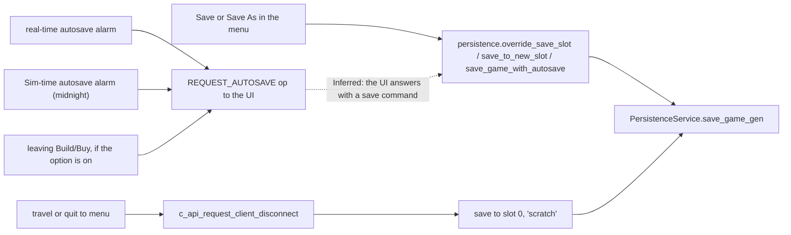
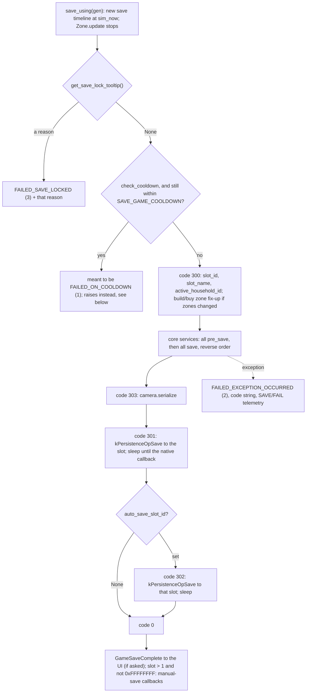

# 1.02 Saves and persistence

*Game version 1.128.90.1030 (Steam, Linux/Proton). Installed packs EP04, EP06, EP09, EP12, GP04, GP12, SP01, SP42. Code from the decompiled Python, with bytecode listings where the decompiler failed or nested blocks wrongly; tuning from the live tuning (the base delta build plus each installed pack's delta build), with the full and delta builds named where they differ. Save structure and counts checked on read-only copies of one of the authors' saves, written by earlier game versions and decoded with the 1.128 schema; no player content is reproduced. Written 2026-10-12. Checked 2026-10-12: 98 claims checked, 15 corrected, 0 relabelled, 0 removed. Deepened 2026-10-13: 0 modules newly explained, 1 failed decompile read. Checked again 2026-10-13: 155 claims checked, 23 corrected, 1 relabelled, 0 removed.*

## In plain words

The whole save sits in memory for as long as you play. The game's script layer keeps one large record of the world: every household, every Sim, a summary of every lot, every street, and the save-wide state of each game system. Saving means three things in a row. The game stops simulating, so nothing moves while the record is written. Each system writes its current state into that record, one after another. Then the engine writes the whole record to one file per save slot, together with the objects of the lot you are on.

Saves happen more often than the player sees. A save from the menu writes your named slot, and can write a second copy to the autosave slot at the same time. An autosave is only ever a request: the script side asks the game window to save, and the window does it. Leaving a lot, by travelling or by quitting, also saves, into a temporary "scratch" slot. When you travel, the systems that live for the whole save (Sims, households, relationships, the clock) skip their part of that save; they stay in memory and go with you. The lot you leave, the account and the camera are still written, and so is a Sim that a go-home split, an NPC's travel or a travel-to-object action removes from the lot. When the whole household travels, no Sim is written to the slot; their current interactions, inventory and position are copied into their in-memory records as the lot closes.

Some moments refuse a save. A death, a Sim aging, a burglary, a fire, an eviction and 55 tuned interactions (a birth or a marriage proposal, for example) lock saving, and the save button shows the reason. An autosave that comes due during a lock waits until the lock lifts. If something breaks while saving, the save is abandoned and the player sees a short code such as `510:1a2b3c4d:5e6f7a8b`: the number names the system that failed, and the two hex values are fingerprints of the error.

Not everything comes back after a load. What a Sim was doing is kept only for actions marked as saveable. Timers on objects restart from the beginning. Caches, routes and the autonomy state are rebuilt. A few things follow the player from save to save (pivotal-moment progress, a handful of key and value pairs); they are kept in a separate account file in the user folder, one level above the saves.

## Key facts

- The save order is: save lock check, cooldown check (only one command asks for it), the slot header, every core service's `pre_save` then `save` in reverse start order, the camera, the engine write to the slot, then an optional second write to the autosave slot, then the "save complete" message to the UI.
- The world stops for the whole save: while the persistence service holds a save timeline, the server tick simulates only that timeline (see [1.01](1.01-time-scheduling-loading.md)).
- Lot and save-wide state are written inside the zone manager's save: the 51 game services on this install, then the 47 zone services, each tier in reverse start order, then the lot's object list goes to the engine as its own operation.
- Travel saves to slot 0 ("scratch") with the game services switched off for that save, so the services that own Sims, households, relationships and the clock do not write. The core tier still writes the account, the lot being left, the unloaded lots and the camera, and the travel actions that remove single Sims (NPC travel, split go-home travel, `TravelToObject`) save those Sims. Everything else goes to the engine as it stood at the last full save.
- Python never writes an autosave itself. `AutosaveService` sends the UI a `REQUEST_AUTOSAVE` op; the save that follows comes back as an ordinary command (Inferred).
- Autosave intervals: real time 30, 60 or 120 real minutes; Sim time at midnight daily or weekly (Sunday); save reminders every 15, 30, 60 or 120 real minutes. All are code defaults: the module tuning sets only the reminder loot.
- A successful save to a named slot (slot id above 1, not the autosave slot) restarts the real-time autosave and reminder countdowns. Every lot load restarts them too.
- `SAVE_GAME_COOLDOWN` is 0 seconds in both builds, and only `persistence.save_game` (the scratch-slot command) checks it.
- The engine's save callback reports success or failure, and Python ignores the flag: once the lock and cooldown checks pass, the result sent to the UI is SUCCESS unless a Python exception was raised.
- 125 error code names with 124 values: 47 spin-up failures (101 to 147), 4 save steps (300 to 303), 70 named service failures (401 to 428, 501 to 541). `SERVICE_SAVE_FAILED_REGION_SERVICE` and `..._LIFESTYLE_SERVICE` share 417.
- 20 direct calls in 18 modules lock saving, and 55 live interactions carry a `save_lock` liability.
- Every save rewrites each saved Sim's record from scratch, increments its `revision`, and sets its `created` field to the current Sim time.
- A Sim at the lowest level of detail keeps its identity, appearance, household and relationship fields, but its attributes block holds only occult, death and genealogy data, and the record stops before age progress, pregnancy, aspiration, current outfit, inventory, satisfaction points, whims, mood, location and interactions; in one of the authors' saves about one Sim in twenty was stored that way.
- Cheats: `cheats_enabled` and a sticky `cheats_ever_enabled` live in the save's account record and are reported with achievement and aspiration events.

## How it works

### When saves happen

**Observed** (`server_commands/persistence_commands.py`). Four Live commands start a save; each builds a `SaveGameData(slot_id, slot_name, force_override, auto_save_slot_id)` and hands `save_game_gen` to `save_using`:

| Command | Slot | `force_override` | UI message | Cooldown checked |
|---|---|---|---|---|
| `persistence.save_game send_save_message=False check_cooldown=True` | 0, "scratch" | True | only if asked | yes, by default |
| `persistence.override_save_slot slot_id=0 slot_name='Unnamed' auto_save_slot_id=None ignore_callback=False` | given | True | yes | no |
| `persistence.save_to_new_slot` (same arguments) | given | False | yes | no |
| `persistence.save_game_with_autosave slot_id=0 slot_name='Unnamed' is_new_slot=False auto_save_slot_id=None` | given | `not is_new_slot` | yes | no |

- **Observed** (`services/persistence_service.py: save_game_gen`, `_fill_and_send_save_game_protobufs_gen`; checked in bytecode). `force_override` and `ignore_callback` are carried along and never read: the fill step receives only the slot id, the slot name and the autosave slot id.
- **Observed** (the client executable's ASCII strings). Of the four, only `persistence.save_game_with_autosave` appears as a literal in the client's strings, next to `SaveToAutoSaveSlot`, `isAutoSave` and `attemptAutoSave`. **Inferred**: the menu saves with that command, passing the autosave slot when the client decides to refresh it.
- **Observed** (`areaserver.py: c_api_request_client_disconnect`). The engine calls this to take a client off a lot (**Inferred** from the name and the travel flag: on travel and on quitting to the menu). If `is_traveling`, it first calls `game_services.disable_shutdown()`. It then runs `save_to_scratch_slot_gen` (slot 0, name "scratch", no UI message, no cooldown), writes a zone-exit telemetry hook with the player and NPC Sim counts, tears the zone down and removes the client. The World Builder zone returns at once without saving.
- **Observed** (`world/premade_household_commands.py`). A third native operation, `kPersistenceOpSaveHousehold` (1000), is used only by premade-household authoring commands. Those commands name no type, so they are DebugOnly and never register in the retail game.

### The save, step by step

- **Observed** (`persistence_service.py: save_using`, `_create_save_timeline`). `save_using` makes a fresh `scheduling.Timeline` at the current Sim time, wraps the generator so the timeline is destroyed when it ends, and schedules it. While `save_timeline` exists, `c_api_server_tick` simulates only that timeline and returns before `Zone.update` and before the distributor flush ([1.01](1.01-time-scheduling-loading.md)).
- **Observed** (`_save_game_gen`, bytecode). The lock check comes first and returns `FAILED_SAVE_LOCKED` with the lock reason. The cooldown is the real seconds since `_time_of_last_save` (or `SAVE_GAME_COOLDOWN + 1` if none). The fill runs when `not check_cooldown` or the cooldown has passed. An exception sets `FAILED_EXCEPTION_OCCURRED`, builds the code string from `save_error_code`, logs it with `logger.exception` (one of the few logger calls that produces output in retail, [0.02](0.02-architecture.md)) and writes a `SAVE`/`FAIL` telemetry hook with `etyp` (the code), `ecod` (a 64-bit hash of the code string), `expt` and `estk`. A `finally` resets `save_error_code` to `NO_ERROR`. `_time_of_last_save` is updated only when `check_cooldown` is true and the save succeeded, so of the four commands only `persistence.save_game` with its default arguments ever starts a cooldown. The cooldown branch is broken: it skips the line that sets `error_code_string` and then reads it (offset 348), so it would raise `UnboundLocalError` instead of returning `FAILED_ON_COOLDOWN`. With a cooldown of 0 it needs zero real seconds since the last cooled-down save, so it is not reached in practice.
- **Observed** (`_fill_and_send_save_game_protobufs_gen`). Order: set code 300; write `slot_id`, `slot_name` and (when there is an active household) `active_household_id` into the slot record; if `zone_manager.build_buy_zones_changed`, call `build_buy.on_zone_data_change()`; `sims4.core_services.service_manager.save_all_services(self, save_slot_data=...)`; set 303 and `camera.serialize`; set 301 and call `run_persistence_operation(kPersistenceOpSave, <the whole SaveGameData>, slot_id, on_save_complete)`, then sleep on a `soft_sleep_forever` element until the callback wakes it; if an autosave slot was given, set 302 and repeat for that slot; set `NO_ERROR`.
- **Observed** (same function). `on_save_complete(slot_id, success)` only wakes the sleeping element. The `success` flag is never read, so a failed engine write does not change the Python result. **Inferred**: the engine reports disk errors itself; `SaveGameResult.FAILED_STORAGE_FULL` (4) exists and no Python code sets it.
- **Observed** (`save_game_gen`, bytecode). With `send_save_message`, the UI gets `GameSaveComplete` (`return_status`, `save_cooldown` = `SAVE_GAME_COOLDOWN` minus the seconds since the last cooled-down save, or 0 before the first one, `failure_reason`, `slot_id`) as `MSG_GAME_SAVE_COMPLETE`. On SUCCESS with a slot id above 1 and not `AUTO_SAVE_SLOT_ID`, the manual-save callbacks run. The return value is always the result code.
- **Observed** (`camera.py: serialize`). The camera record (target Sim, target and camera positions, follow mode, zone, household) is written only if a target Sim and household were set by the client's camera updates.

### The order of service saves

**Observed** (`core/sims4/service_manager.py: save_all_services`, bytecode). The manager runs every service's `pre_save` in reverse start order, then every `save` in reverse start order, passing the same keyword arguments to each. Before the first call it remembers `persistence_service.save_error_code` once; if a call raises and the code still equals that snapshot, it stores that service's `save_error_code`; it re-raises every time; the only record it makes itself is a perf-log line (`perf_logger.info` or `debug`), which is written only when the game is started with `--profile-log-group ServicePerf` (then `perf_logger` is a `PerfLogger`; otherwise it is a plain `Logger` and the call is empty, `core/sims4/perf_log.py: get_logger`). So the most specific code set deepest in the call wins, and one failing service aborts the whole save.

**Observed** (`services/__init__.py: start_global_services`, `zone_manager.py: ZoneManager.save`, `zone.py: Zone.save_zone`, `game_services.py: GameServiceManager.save_all_services`). In reverse start order the core tier reaches `RentalPostCasService` (no `save` of its own), then `AccountService` (the account record), then `ZoneManager` (each zone in the manager), then `TerrainService` and the remaining core services, none of which has a `save`. For the loaded zone, `save_zone` runs the game services, then the zone services. `GameServiceManager.save_all_services` does nothing while `allow_shutdown` is false, which is exactly the travel case. The service lists and their start order are in [0.02](0.02-architecture.md): reversed, `AutosaveService` (74th) comes first and `GlobalFlagService` last; `SimInfoManager` (17th) saves before `RelationshipService` (14th) and `HouseholdManager` (13th); among zone services `VenueService` (30th) saves before `SituationManager` (16th), which saves before `ObjectManager` (5th).

**Observed** (`objects/object_manager.py: ObjectManager.pre_save`; `multi_unit/multi_unit_event_service.py: pre_save`). Two service `pre_save` hooks do real work. The object manager (a zone service) brings every object's commodities, and those of objects in shared lot inventories, up to date before any zone service writes. The multi-unit event service (a game service gated to EP15 (For Rent), so absent here) re-evaluates tested zone modifiers before the game services write.

### What each system writes

**Observed** (`zone.py: Zone.save_zone`). For the current lot, in order: clear and rebuild `gameplay_zone_data`; write `lot_owner_household_id_on_save`, `venue_type_id_on_save` (the active venue's id, or 0), `active_household_id_on_save`, `active_travel_group_id_on_save`; `game_time` (Sim ticks now) and `clock_speed_mode` (PAUSED if the persistable speed is paused, else NORMAL); the lot's statistics (`Lot.save`), each lot level, the architectural statistics, and the spawn point ids in index order. It then creates a fresh `ZoneObjectData` and `ObjectList`, clears the street record for this world (or creates one) and writes `world_id`, `nbh_id`, `sim_time_on_save`, `active_household_id_on_save` and `active_zone_id_on_save`. Game and zone services save into these four targets: `object_list`, `zone_data`, `open_street_data` and `save_slot_data`. Last, the object list goes to the engine with `run_persistence_operation(kPersistenceOpSaveZoneObjects, zone_objects, 0, None)`, with no callback and no wait.

**Observed** (`uninstantiated_zone.py: UninstantiatedZone.save_zone`; `zone_spin_up_service.py`, the away-action state). Lots that are not loaded but were opened for their data (the home lot and the lots where the household's Sims or travel group are, opened at spin-up, plus any lot a later `ZoneManager.get(..., allow_uninstantiated_zones=True)` lookup opened) save only their lot statistics.

| Writer | What it writes | Where |
|---|---|---|
| `SimInfoManager.save` | its Sim-info telemetry record once, then `sim_info.save_sim(full_service=True)` for every SimInfo with an account id | `sims` (one `SimData` per Sim) |
| `HouseholdManager.save` | `household.save_data()` for every household | `households` |
| `TravelGroupManager.save` | each travel group | `travel_groups` |
| `ObjectManager.save` | every object that passes `_should_save_object_on_lot` and `is_persistable`; bed counts | lot `object_list`; street `objects`; `bed_info_data` |
| `GameClock.save` | `world_game_time` = Sim now | `save_slot.gameplay_data` |
| `AccountService.save` | `Account.save_account` | `account`, plus an op to the account store |
| `CheatService.save` (a game service, so skipped on travel) | `cheats_enabled`, `cheats_ever_enabled` | `account.gameplay_account_data` |
| `SituationManager.save` | the departing travel seed; seeds of running situations by serialization option | slot, zone, street, household and tutorial records |
| `VenueService.save` | venue data, the open-street director | zone and street |
| `AmbientService`, `ConditionalLayerService` | their street state | `open_street_data` |
| `EnsembleService`, `DoorService` | ensembles, front door id | `zone_data` |
| `CurfewService` (a game service) | the curfew setting of every zone in the record, through the persistence service | each zone's `gameplay_zone_data.curfew_setting` |
| 55 save-wide services in the code: 48 game services (Relgraph among them, though it is never created) and 7 zone services (calendar, drama schedule, careers, adoption, story progression, UI dialogs, wisps); 35 of them run on this install | one sub-record each (careers and UI dialogs one more field each) | `save_slot.gameplay_data.<service>` |
| `KingdomService` (EP21 (Royalty & Legacy), not installed) | kingdom state | `save_slot.kingdom_service` |

**Observed** (a grep of every `save` method of the services in `game_services.py` and `zone.py` over the decompiled source; for the 8 that did not decompile, weather, clubs, animals, roommates, Sim secrets, tenant applications, matchmaking and story progression, the matching names in their bytecode). Of the 55, 47 are in decompiled modules. The decompiled `simulation` tree holds 107 `save` methods with the service signature (keyword targets or `**kwargs`) among 210 `def save(` methods in all; their targets are in the authors' working files, which are not published.

**A Sim.** **Observed** (`sims/sim_info.py: save_sim`, `_save_sim_base`, `_generate_sim_protocol_buffer`, `_save_sim_attributes`; checked in bytecode, because the decompiled nesting of all three is wrong).

- `save_sim` builds the attributes block (`PersistableSimInfoAttributes`), then the outfits. A Sim at `SimInfoLODLevel.MINIMUM` (1) stops there and passes those two to `_save_sim_base`. Otherwise it takes the inventory and `si_state.save_interactions()` from the live Sim, if one is instanced, and its location when that Sim is in the current zone; a Sim that is not instanced keeps the inventory it already holds (`inventory_data`), and one with a serialization option writes the transform it was loaded with.
- `_generate_sim_protocol_buffer` returns early for a MINIMUM Sim (bytecode lines 3431 to 3432). Before that point it writes the identity, names, appearance (genetics, face, skin, voice, physique), `sim_lod`, outfits, flags, household, `nucleus_id`, `revision`, the attributes block, the relationship data, `created` and three `gameplay_data` fields (serialization option, old household id, premade template and fix-up flag). Everything after it is skipped: pregnancy and age progress, primary aspiration, current outfit, inventory, satisfaction points, whims, mood, location, interactions and the go-home stamp.
- The attributes block is written tracker by tracker: occult, death and genealogy come first and are all a MINIMUM Sim keeps; then pregnancy, careers, traits, object preferences and ownership, stored object info, commodity, statistic, skill and ranked-statistic trackers, trait statistics (humans only), suntan, familiar, favorites, aspiration event data, unlocks, notebook, adventure, royalty, relics, sickness and more. An optional tracker that does not exist on this SimInfo (`None`, for example `familiar_tracker`) copies its block forward from the previous save with `MergeFrom`, so its old data survives. A MINIMUM Sim gets no such copy: its attributes block is rebuilt from those three trackers alone, so every other tracker's data is gone from that save. Whims follow the same rule from another place: `_generate_sim_protocol_buffer` (`sim_info.py`) clears the whole SimData, writes the satisfaction points (`whim_bucks`) from the satisfaction tracker or, when the Sim has none, puts back the old value (kept as `old_bucks_count`), and writes `whim_tracker` only when the Sim has a live whim tracker. A Sim saved below FULL but above MINIMUM keeps its satisfaction points and loses its whims; a MINIMUM Sim loses both, because the function returns before that step ([1.03 Performance, budgets and level of detail](1.03-performance-lod.md)).
- `_generate_sim_protocol_buffer` starts with `sim_msg.Clear()` and writes every field again. `revision` goes up by one per save, and `created` is set to the Sim time of the save on every save (bytecode line 3418, unconditional), so the field never holds a creation time after the first save.
- Two callers that are not saves trim the record near the end of `_generate_sim_protocol_buffer` (bytecode lines 3600 to 3609, so never for a MINIMUM Sim), through `core/sims4/protocol_buffer_utils.py: persist_fields_for_custom_option`. While the DebugOnly command `premade_household.generate` runs, a module flag (`SAVE_ACTIVE_HOUSEHOLD_COMMAND`) marks the Sim `SIMCREATION_PRE_MADE` and keeps only the fields that carry the field option `persist_for_new_game` (50000 in `SimsCustomOptions.proto`, 41 fields across `SimData`, `GameplaySimData` and the attributes block). Cloning a Sim (`interactions/utils/creation.py`, `save_sim(for_cloning=True)`) marks it `SIMCREATION_CLONED` and keeps only the fields with `persist_for_cloned_sim` (50001, 39 fields). The helper clears every unmarked scalar field and every sub-message with no marked field inside it; the spawn object and carried-Sim fields are written after the trim. A normal save sets neither.
- `sim_lod` is written by `_get_persisted_lod`: ACTIVE (125) is stored as FULL (100). In one of the authors' own saves, of roughly two hundred Sims, just under half were at BACKGROUND, a quarter each at BASE and INTERACTED, one in twenty at MINIMUM, and only the active household at FULL. Every MINIMUM Sim had outfits and `gameplay_data`, and none had an inventory, a mood or an outfit index. Levels of detail are explained in [1.03 Performance, budgets and level of detail](1.03-performance-lod.md).
- **Observed** (`_get_time_to_go_home` and its caller). An instanced Sim saved away from its home lot gets a fresh `game_time_expire` stamp: now plus a random integer from `MINUTES_STAY_ON_LOT_BEFORE_GO_HOME` (180 to 240 Sim minutes, both builds). A Sim away from home that is not instanced keeps the stamp it already had (`game_time_bring_home`). A toddler or younger Sim on a stayover whose travel group is on that lot gets a stamp of 0 instead (`DATE_AND_TIME_ZERO`).

**A Sim's interactions.** **Observed** (`interactions/si_state.py: save_interactions`, bytecode only; the module did not decompile). Only super interactions whose `saveable` is true are written: the running ones (sorted); the transitioning one, while its transition is running and its pipeline has not yet reached RUNNING, if it belongs to this Sim (with the body and carry posture ids); and the queued ones, except that transitioning one. Everything else the Sim was doing is dropped (**Inferred**: the Sim then picks new actions through autonomy). The restore order on load is staged, then transitioning, then queued (`interactions/si_restore.py`).

**A household.** **Observed** (`sims/household.py: save_data`, `populate_household_data`; bytecode, the module did not decompile). Before clearing the household record, `populate_household_data` copies four blocks out of it: the household inventory, the story progression rule set, and the milestone, holiday and pivotal-moment tracker blocks of any of those trackers the household does not have. It then clears the record and rewrites it: ids, name, description, home zone, funds, hidden and dependent flags, creator fields, the inventory (the copy, put back unchanged: this function does not rebuild it), the reward inventory, build/buy unlocks, last played Sim, `is_unplayed`, `is_player`, the medal list of scored situations, the collection, bucks, missing-pet, laundry, delivery, object-preference, scenario and story-progression trackers, service NPC records, move-in time, the milestone, holiday and pivotal-moment blocks (from the live tracker, or the copy), the story progression rule set (the copy, unchanged), and `sim_life_span_on_last_game_save` from the aging service.

**An object.** **Observed** (`objects/script_object.py: is_persistable`, `save_object`, bytecode; `objects/game_object.py: GameObject.save_object`).

- `is_persistable`: an object in group OBJECT persists if its tuned persistence is FULL, or BUILDBUY when saved from Build/Buy. An object in group IN_OPEN_STREET that came from the world file persists only if `_world_file_object_persists`; one on the lot, from the street, from a conditional layer or at an invalid location persists if FULL. Every other group (NONE, SIM) never persists, and from Build/Buy an object whose inventory holds undeletable objects is refused. So Sims are never written as objects; they are written as SimInfos.
- `save_object` writes `object_id`, the `attributes` blob (a `PersistenceMaster` built by forwarding `save` to every component), `guid` (the definition id; a plant saves its default definition), `loc_type` and `container_id`. `GameObject.save_object` adds the placement and appearance fields (slot, position, level, scale, state index, cost, UI metadata, owner, depreciation flags, tags, colours, material and geometry state, parent, unique inventory). The fields are listed in [8.04](8.04-save-file-format.md).
- **Observed** (`ObjectManager.save_game_object`). Group OBJECT goes to the lot list as ON_LOT; anything else goes to the street list, as FROM_OPEN_STREET when it was on the lot or at an invalid location.

**Situations.** **Observed** (`situations/situation_manager.py: SituationManager.save`). The departing travel seed goes to the slot. Each running situation that saves to the manager produces a seed, filed by its `situation_serialization_option`: LOT seeds to the zone, OPEN_STREETS to the street, HOLIDAY to the active household's holiday tracker, the three pivotal-moment options to the household or the tutorial service. DONT (0) is never saved; the base class default is LOT. In Build/Buy edit mode the manager saves the arriving travel seed and the seeds it loaded for spin-up instead. Situations themselves are covered in [4.01](4.01-situations-npcs.md).

### Save locks

- **Observed** (`persistence_service.py: lock_save`, `unlock_save`, `is_save_locked`, `get_save_lock_tooltip`). A lock holder is any object with `get_lock_save_reason()`. Locking appends it and sends `GameSaveLockUnlock(is_locked=True, lock_reason=...)` as `MSG_GAME_SAVE_LOCK_UNLOCK`. Unlocking removes it, runs the waiting unlock callbacks if no lock remains, and sends either an unlock or the reason of the newest remaining lock. While the engine holds the save record for writing (`c_api_get_data_readwrite` until `c_api_save_data` or `c_api_release_data`), saving is also locked with the generic reason. `remove_save_locks` clears everything at zone teardown.
- **Observed** (grep over the decompiled source, and `grep -a` over the modules that did not decompile, which adds none). 20 direct calls to the persistence service's `lock_save` in 18 modules (a 21st grep hit is the vampire night-time situation calling its own `lock_save` wrapper): death, aging, the interaction `SaveLockLiability`, fire, careers, narratives, zone spin-up, and the burglar, both eviction, mother plant, pet care, prisoner escort, repo, stormtrooper inspection, university kick-out, vampire night-time and strange welcome wagon situations.
- **Observed** (`zone_spin_up_service.py`). Spin-up locks saving in its final playable state and unlocks when the loading screen's animation finishes, with `SAVE_LOCK_TOOLTIP` as the reason.
- **Observed** (`interactions/utils/tunable.py: SaveLockLiability`; live tuning). The liability tunables are `save_lock_tooltip` and `should_transfer` (default True, passes to continuations). 55 live interactions list it (examples: `bassinet_DeliverBaby`, `HaveBabyAtHospital`, `computer_adoption_picker`, the propose and promise-ring mixers).
- **Observed** (`interactions/utils/tunable.py: _verify_tunable_callback`; `core/sims4/commands.py`). A console command can declare `CommandRestrictionFlags`; `RESTRICT_SAVE_UNLOCKED` marks commands that must not run under a save lock. In this build the flag goes nowhere: `register` hands the native `_commands.register` only the name, description, usage and handler, `add_command_restrictions` is an empty stub, and `get_command_restrictions` always returns `UNRESTRICTED`. So the tuning check, which would call `logger.error` (empty in retail) when an interaction that may run under a lock tunes such a command, never reaches that branch. **Inferred**: nothing visible enforces the flag; if the engine does, it learns it some other way.

### Autosave and reminders

- **Observed** (`services/autosave_service.py: AutosaveService.start`). The service registers a manual-save-complete callback and a Build/Buy exit callback, then arms its alarms from the options.
- **Observed** (`_add_real_time_autosave_alarm`). The real-time autosave is a wall-clock alarm (`add_alarm_real_time`, `cross_zone=True`) of 30, 60 or 120 real minutes by option. When it fires it handles the due autosave, then re-arms unless it is waiting for an unlock. The unlock callback only sends the request and does not re-arm, so after a deferred autosave the real-time alarm stays off until a manual save, a change of the frequency option or the next lot load.
- **Observed** (`_add_sim_time_autosave_alarm`). The Sim-time autosave is a Sim-time alarm, also `cross_zone`, to the next midnight (DAILY; if exactly at midnight, the one after) or to the next Sunday midnight (WEEKLY, `WEEKLY_AUTOSAVE_DAY = 0`, `Days.SUNDAY`; a non-positive span gets one week added). It re-arms itself each time it fires.
- **Observed** (`_handle_due_autosave`, `_request_autosave`). If an autosave is already waiting, nothing happens. If saving is locked, the service registers one unlock callback and waits. Otherwise it sends `GenericProtocolBufferOp(REQUEST_AUTOSAVE, BoolValue(True))` to the client. **Inferred**: the client then saves with the command above; Python has no other autosave path.
- **Observed** (`_on_build_buy_exit`, `_is_build_buy_exit_autosave_enabled`). Leaving Build/Buy requests an autosave when `autosave_on_build_buy_exit` is on.
- **Observed** (`_on_manual_save_complete`). A completed manual save re-arms the reminder and the real-time autosave from zero; the Sim-time alarm is untouched.
- **Observed** (`load_options` and the chain `zone_spin_up_service.py: _LoadHouseholdsAndSimInfosState` to `AccountService.on_load_options` to `Account._load_options` to each game service's `load_options`). Every lot load clears and re-arms all three timers, so the real-time autosave and the reminder start a full interval again.
- **Observed** (`_fire_save_reminder_loot`; live tuning). The reminder runs `SAVE_REMINDER_LOOT` on the active Sim, and does nothing without one. Live, that is `randomWeightedLoot_SaveReminder_Start` (518932), which picks Regular (518933, weight 200) or Unhinged (518934, untuned weight, so the multiplier default of 1): 200 to 1. Regular holds 14 notification entries and Unhinged 11.
- **Observed** (`gameplay_options/misc_options_service.py`, `autosave_options.py`). The options live in `MiscOptionsService`: real-time frequency (OFF 0, SHORT 1, LONG 2, EXTRA_LONG 3), Sim-time frequency (OFF, DAILY, WEEKLY), reminder frequency (OFF, SHORT to EXTRA_EXTRA_LONG = 4), on Build/Buy exit, on travel. Defaults: 0, 0, 4, False, True (a fresh account gets the `GameplayOptions` proto defaults, because `load_options` overwrites the `__init__` values on every load; for these five options the two sets are equal). A save without `autosave_real_time_frequency` maps the older boolean `autosave_real_time_enabled` to 1 or 0. `AutosaveService` clamps each value into its enum when it reads it. The three frequency commands refresh their alarm at once when the value changes (an unchanged value returns without touching it); the two toggles only store the value. No Python code reads `autosave_on_travel` (**Inferred**: the client uses it).
- **Observed** (`server/account.py`; the two sample saves). Python reads the options from `account.gameplay_account_data.gameplay_options` and never writes them into the record: `_save_options` fills only the copy sent to the UI as `MSG_GAMEPLAY_OPTIONS`. The samples' `gameplay_options` carry 9 fields (aging, life span, autonomy, burglar, lunar cycle and phase lock, population) and none of the six autosave fields. In the 1.128 schema those six fields default to the Python defaults, so an absent field reads as the default. **Inferred**: the engine writes the options record, and these saves (written by earlier game versions) simply hold default autosave settings.

### Travel, quitting and the scratch slot

- **Observed** (`areaserver.py`, `game_services.py`). On travel, `disable_shutdown` is called before the scratch save, so `GameServiceManager.save_all_services` and later `load_all_services` do nothing: the 51 game services keep their live state in memory across the trip. The core tier still saves: the account record (and its account-store op), the zone manager with the zone services of the lot being left (its zone and street records, and its objects to the engine), the unloaded lots' statistics, and the camera.
- **Observed** (`sims/self_interactions.py`, `world/travel_tuning.py`, `world/travel_elements.py`). The NPC travel interaction (`TravelInteraction.save_and_destroy_sim`), split go-home travel (the travel liability's `release`) and `TravelToObject` call `sim_info.save_sim()` for the Sims they remove from the lot. A whole-household trip (`TravelSimLiability.travel_player`) and travel from the map (`travel.travel_sims_to_zone` through the travel situation) call none. Instead, during teardown `SimInfo.on_zone_unload` runs `_save_for_travel` for every instanced Sim while traveling, copying its interactions, inventory and location into its in-memory record. When the Sim has no record yet it calls `save_sim`, but it keeps using the empty local it fetched before, so the next write would raise `AttributeError` (bytecode lines 3966 to 3992; **Inferred**: not reached in normal play, since Sims get a record when they are created). This runs after the scratch save, so slot 0 does not hold it ([2.06 Worlds, regions, streets and travel](2.06-worlds-regions-travel.md)). `request_client_disconnect_gen` does not check the scratch save's result, so a save lock at that moment writes nothing and the teardown goes on. **Inferred** (the native write is not visible): every other Sim, household, relationship and clock record reaches slot 0 as the in-memory record holds it, that is as of the last full save plus whatever code has written into the record directly since.
- **Observed** (`time_service.py`, in [1.01](1.01-time-scheduling-loading.md)). Alarms marked `cross_zone`, such as all three autosave alarms, survive travel; the rest are stopped.
- **Inferred** (native strings `scratch`, `scratch_%04d`, `TempDBPF_`, `zone_object_data_scratch_path`, `ZoneObjectDataScratchPair`). The engine keeps slot 0 as a working copy outside the saves folder; no `Slot_00000000.save` exists there. When the player later saves, the named slot is written from the in-memory record.

### Loading: how the record comes back

- **Inferred** (no Python reads a file). The engine loads the slot file into the persistence service's in-memory `SaveGameData`, which it reaches through `c_api_get_data_readonly` and `c_api_get_data_readwrite`.
- **Observed** (`areaserver.py: c_api_zone_init`). Zone init builds the persistence caches (zone, world and region maps, then lazily Sim and household index maps), starts the game services with the slot record (only when they do not exist yet), creates the zone and starts its zone services. Eight services accept the slot record in `setup` (the game clock, seasons, narratives, the lunar cycle, global policies, the landlord, multi-unit ownership and the plex service, which reads the zone records instead); most read their sub-record in `load`, fetching the slot record from the persistence service.
- **Observed** (`objects/system.py: c_api_create_object`; `script_object.py: attributes` setter and `load`). `c_api_create_object(zone_id, def_id, obj_id, obj_state, loc_type, content_source)` creates an object (the zone id is not passed on); the `attributes` setter parses a serialized `ObjectData` and calls `load_object`, which loads component data in component priority order. **Inferred** (no Python caller of either for saved objects): the engine creates each saved lot object this way and then passes its whole record to the setter.
- **Observed** (`areaserver.py: c_api_zone_loaded`, `zone.py: Zone.load_zone`). After the objects, `load_zone` runs the game services' `load_all_services` (skipped on travel), then the zone services', in start order, then reads the zone's times and speed ([1.01](1.01-time-scheduling-loading.md) covers what they do).
- **Observed** (`sims/household_manager.py: load_households`). In the spin-up state that loads households, every household in the record becomes a live household with its SimInfos. The manager's `_loaded` flag makes this happen once while the game services live, so not again after a trip. Then invalid relationships are purged, the family tree graph is built and each SimInfo runs `on_all_sim_infos_loaded`.
- **Observed** (`zone_spin_up_service.py`). If a spin-up state raises, spin-up ends as ERRORED, a `ZONE`/`FAIL` telemetry hook is written, and `LOAD_ERROR_REQUEST_RESTART` is shown with the code string as a token. The tuned `LOAD_ERROR` dialog is never used.

### Error codes

**Observed** (`simulation/persistence_error_types.py`). `ErrorCodes` (an `enum.Int`, not exported to tuning) has:

| Range | Meaning | Count | Set by |
|---|---|---|---|
| 0, 100 | `NO_ERROR`, `GENERIC_ERROR` | 2 | the default `Service.save_error_code` is 100; spin-up's base state too |
| 101 to 147 | a spin-up state failed (`..._STATE_FAILED`, for example 102 households and SimInfos, 121 hitting their marks, 147 tick client) | 47 | each state's `exception_error_code` |
| 300 to 303 | a save step failed: slot data, slot write, autosave write, camera | 4 | `_fill_and_send_save_game_protobufs_gen` |
| 400, 500 | `CORE_SERICES_SAVE_FAILED` (sic), `ZONE_SERVICES_SAVE_FAILED` | 2 | nothing |
| 401 to 428 | named service saves, 29 names on 28 values | 29 | that service's `save_error_code` |
| 501 to 541 | named service saves | 41 | same |

- The 400 and 500 ranges no longer match the service tiers: 401 is the core account service, 402 the game-tier business service, 403 the core zone manager; 507 is the zone-tier situation manager and 510 the game-tier SimInfo manager.
- `generate_exception_and_call_stack_string` returns the 32-bit hashes, as hex, of `str(exception)` and of the formatted traceback. `generate_exception_code_string` joins `code:exception_hash:stack_hash`. `write_exception_info_to_hook` writes the two hashes as `expt` and `estk`.
- Quirks: `FamilyTreeForgeryService.save_error_code` returns 425 (the family tree's code), so 428 is never reported; the region and lifestyle services both report 417.

### User account data

- **Observed** (`user_account_data/user_account_data_enums.py`). `UserAccountDataTypeEnum`: NONE 0, EVENTS 0x1577DC52, REWARDS 0x93741E37, PIVOTAL_MOMENTS 0xF068E4DB, GAMEPLAY_VALUES 0x2600FB7F. The package's `__init__.py` is empty.
- **Observed** (`server/account.py`). On client connect the account asks for `GetAccountDataForCurrentUser(GAMEPLAY_VALUES)`. The answer is parsed as `UserAccountStoredGameplayData` (key and value pairs) only while the account's gameplay data is still empty. Each save sends the current pairs back with `SetAccountDataForCurrentUser`. The same save writes the Nucleus id and the achievement tracker into the save's own account record.
- **Observed** (`tutorials/tutorial_service.py`). Pivotal-moment progress is read and written as `PIVOTAL_MOMENTS` account data.
- **Observed** (`user_account_data/user_account_data_commands.pyc`, not in the decompiled tree: four commands from the per-function decompile, `get_user_account_data` from the bytecode). `user_account_data.get_user_account_data` is Live: the client answers through it with a text-format `UserAccountData`. An empty string does nothing. Otherwise the text is merged into a `UserAccountData` message and routed by `data_type`: PIVOTAL_MOMENTS to `TutorialService.on_account_data_loaded`, GAMEPLAY_VALUES to `Account.handle_get_user_account_data`. EVENTS and REWARDS have no branch, so the script side ignores them when they arrive. A missing tutorial service or account only reaches `logger.warn`, which is empty in retail.
- **Observed** (the same module). The four test commands: `debug_get_user_account_data <type>` asks the client for PIVOTAL_MOMENTS, REWARDS or EVENTS by a lower-case name (`pivotalmoments`, `rewards`, `events`); `debug_set_dummy_user_account_data <type>` sends an empty record of that type back (**Inferred**: overwriting the stored one); both are DebugOnly. `print_gameplay_values` lists the account's name and value pairs and `set_gameplay_value <name> <value>` sets one (an empty value is refused); both are untyped. None registers in retail ([1.04](1.04-debug-cheats-telemetry.md)).
- **Observed** (`server/account.py`, `interactions/utils/loot_ops.py: SetAccountGameplayDataOp`, `server/online_tests.py: AccountGameplayDataTest`, live merge). The gameplay values are string pairs that follow the player from save to save. They are written by the loot `set_account_gameplay_data` (4 live loots, all base: `DiscoveryQuest_LiveMode_Status` NeedsDone and AllDone, `Emily_LiveMode_Status` Complete, `FirstTimeBurglar` Done) and read by the test `account_gameplay_data_test` (1 live use) and by the tutorial service, which treats `Emily_LiveMode_Status` Complete as finished guidance. The one test sits in `loot_Burglar_ScheduleSituation`: it schedules the burglar drama node with base chance 10 and multiplies that by 9999 while `FirstTimeBurglar` is not Done, and `loot_Burglar_SituationFromDramaNode` sets the flag. **Inferred** (the chance read as a percentage that cannot pass 100): the first schedule attempt on an account is certain, once per account rather than once per save. No Python or live tuning reads `DiscoveryQuest_LiveMode_Status`; **Inferred**: the client does, or nothing does.
- **Observed** (the copy of `accountDataDB.package`). The store, in the user folder one level above `saves/`, is a DBPF package of six resources; four of their types equal the four data type values and two are types the Python enum does not name. It is described in [8.04](8.04-save-file-format.md). Because it sits outside the slot files, this data follows the player across saves.

### Native operations and version constants

- **Observed** (`simulation/persistence_module.py`). `PersistenceOpType`: Invalid 0, Load 1, Save 2, LoadZoneObjects 3, SaveZoneObjects 4, SaveGameplayGlobalData 5, LoadGameplayGlobalData 6, SaveHousehold 1000. `run_persistence_operation(op, proto, slot_id, callback)` comes from the native `_persistence_module`; without it, a stub calls `callback(slot_id, False)` and returns False. Python uses only Save, SaveZoneObjects and SaveHousehold.
- **Observed** (`primitives/persistence_primitives.py`). `PersistVersion`: UNKNOWN 0, kPersistVersion_Implementation 1, SaveObjectDepreciation 2, SaveObjectCreateFromLotTemplate 3, SaveLoadSIFirstPass 4, GlobalSaveData 5, written as Python literals; the module imports the native `_persistence_primitives` but never reads it. No Python code reads them.
- **Observed** (`objects/persistence_groups.py`). `PersistenceGroups`: NONE 0, OBJECT 1, SIM 2, IN_OPEN_STREET 3.

### What is not saved

- **Observed**: interactions that are not `saveable`; the rest of a Sim's queue state (see above).
- **Inferred** (from [2.02](2.02-objects-states-wear.md): the state component writes only state pairs). Timed state triggers are not saved; a `trigger_on_load` trigger restarts from its first step.
- **Observed** (`alarms.py`, `time_service.py`). Alarms are not part of the record. Systems that need a time across a save store a timestamp and re-arm on load (for example the go-home stamp above and the zone's `game_time`).
- **Observed** (`AutosaveService`). Autosave and reminder countdowns restart on every load.
- **Observed** (`zone.py: Zone.save_zone`). The street record and the zone's `gameplay_zone_data` are cleared and rebuilt on every save, so anything a service stops writing disappears from the next save.
- **Observed** (`relgraph_service.py`, via [0.02](0.02-architecture.md)). `RelgraphService` is never created, so its `relgraph_service` sub-record is never written. The top-level `relgraph` field was absent from the sample saves as well.
- **Inferred**: caches, the posture graph, routing data, autonomy state and the build/buy navigation data are rebuilt at spin-up from the loaded objects ([1.01](1.01-time-scheduling-loading.md) lists the states).

## Numbers

| Name | Value | Unit | Where | Build |
|---|---|---|---|---|
| `SAVE_GAME_COOLDOWN` | 0 | real seconds | `PersistenceTuning` (module `services.persistence_service`) | full and delta |
| `MINUTES_STAY_ON_LOT_BEFORE_GO_HOME` | 180 to 240 | Sim minutes | `PersistenceTuning` | full and delta |
| `MAX_LOT_SIMULATE_ELAPSED_TIME` | 1 | (no code reads it) | full-build module tuning only | full, stale |
| Real-time autosave SHORT / LONG / EXTRA_LONG | 30 / 60 / 120 | real minutes | `AutosaveService` | code default |
| Save reminder SHORT / LONG / EXTRA_LONG / EXTRA_EXTRA_LONG | 15 / 30 / 60 / 120 | real minutes | `AutosaveService` | code default |
| `SAVE_REMINDER_LOOT` | 518932 (`randomWeightedLoot_SaveReminder_Start`) | loot id | module `services.autosave_service` | delta only |
| Reminder variants | Regular 200, Unhinged 1 | weight | loots 518933, 518934 | live |
| Reminder notification entries | 14 Regular, 11 Unhinged | entries | same | live |
| `WEEKLY_AUTOSAVE_DAY` | 0 (Sunday) | day of week | `AutosaveService` constant | code |
| Option defaults | real-time 0, Sim-time 0, reminder 4, Build/Buy exit False, travel True | enum values | `GameplayOptions` proto defaults, equal to `MiscOptionsService.__init__` | code |
| `AUTO_SAVE_SLOT_ID` | 4294967295 (0xFFFFFFFF) | slot id | `persistence_service.py` | code |
| Scratch slot | 0, "scratch" | slot id | `save_to_scratch_slot_gen` | code |
| Manual-save callbacks | slot id above 1, not the autosave slot | rule | `save_game_gen` | code |
| Error code names / values | 125 / 124 | count | `persistence_error_types.py` | code |
| Save lock call sites | 20 in 18 modules | count | `PersistenceService.lock_save` | code |
| Interactions with `save_lock` | 55 | records | live tuning | live |
| Services saved per real save | 51 game, 47 zone | count | this install, per [0.02](0.02-architecture.md) | code |
| Services with a `save_slot.gameplay_data` sub-record | 55 in the code (48 game, 7 zone), 35 on this install | count | `game_services.py`, `zone.py` service lists and their `save` methods | code |
| Python `save` methods | 107 with the service signature, 210 in all | methods | a grep over the decompiled `simulation` tree | code |
| Account gameplay value loots, tests | 4, 1 | live records | `set_account_gameplay_data`, `account_gameplay_data_test` | live merge (base delta) |
| First-burglar chance multiplier | 9999 on a base chance of 10 percent | factor | `loot_Burglar_ScheduleSituation` | live (base delta) |
| Sims per saved LOD, one sample save | about 5% / 45% / 25% / 25% / the active household | MINIMUM / BACKGROUND / BASE / INTERACTED / FULL | a count over one of the authors' saves | save |

## Data shapes

**Python records.**

| Shape | Fields or values |
|---|---|
| `SaveGameData` (namedtuple, `persistence_service.py`) | `slot_id`, `slot_name`, `force_override`, `auto_save_slot_id` |
| `SaveGameResult` | SUCCESS 0, FAILED_ON_COOLDOWN 1, FAILED_EXCEPTION_OCCURRED 2, FAILED_SAVE_LOCKED 3, FAILED_STORAGE_FULL 4 |
| `PersistenceTuning.SAVE_FAILED_REASONS` | `generic`, `on_cooldown`, `exception_occurred` (takes the code string) |
| `GameSaveComplete` (UI_pb2) | `return_status`, `save_cooldown`, `failure_reason`, `slot_id` |
| `GameSaveLockUnlock` (UI_pb2) | `is_locked`, `lock_reason` |
| `SituationSerializationOption` | DONT 0, LOT 1, OPEN_STREETS 2, HOLIDAY 3, PIVOTAL_MOMENT 4, PIVOTAL_MOMENT_ACCT_LEVEL 5, PIVOTAL_MOMENT_HOUSEHOLD_LEVEL 6 |
| `SimInfoLODLevel` | MINIMUM 1, BACKGROUND 10, BASE 25, INTERACTED 50, FULL 100, ACTIVE 125 (saved as 100) |
| `AutoSaveSimTimeTimer` | OFF 0, DAILY 1, WEEKLY 2 |
| `AutoSaveRealTimeFrequency` | OFF 0, SHORT 1, LONG 2, EXTRA_LONG 3 |
| `SaveReminderFrequency` | OFF 0, SHORT 1, LONG 2, EXTRA_LONG 3, EXTRA_EXTRA_LONG 4 |

**The in-memory record.** `PersistenceService` holds one `EA.Sims4.Persistence.SaveGameData` protobuf for the whole session; its top-level parts are the slot (`save_slot`), the account (`account`), `neighborhoods`, `households`, `sims`, `zones`, `streets`, `travel_groups`, and 15 more fields (23 in all in the 1.128 descriptor), among them `gameplay_data`, `mannequins`, `relgraph`, `custom_colors`, the gig tracking lists and two story progression rule sets. The lot objects are not in it: they travel as `ZoneObjectData` through the SaveZoneObjects operation and are stored as their own resources. The field tables are in [8.04 The save file format](8.04-save-file-format.md).

**Where the main writers put their data.**

| Target passed to `save` | Protobuf | Holds |
|---|---|---|
| `save_slot_data` | `SaveSlotData` (`gameplay_data` is `GameplaySaveSlotData`, mostly one field per save-wide service; `tenant_applications_data` (52) is written by `TenantApplicationService` (EP15, failed decompile, read in bytecode), and `once_only_drama_nodes` (12) is read or written by no Python) | slot header, world time, camera, save-wide services |
| `zone_data` | `ZoneData` (its `gameplay_zone_data`) | per-lot state: time, venue, situations, lot statistics, beds |
| `open_street_data` | `OpenStreetsData` | street objects, situation seeds, director, layers, ambient |
| `object_list` | `ObjectList` of `ObjectData` | lot objects, each with its component blob |

**Account data** (outside the slot files): `UserAccountData` (`DistributorOps.proto`) carries an optional `nucleusId` (field 1, never set by Python), `data_type` (a `UserAccountDataTypeEnum` value) and `data` (bytes); for GAMEPLAY_VALUES the bytes are a `UserAccountStoredGameplayData` with `stored_data[] {key, value}`, both strings.

## For modders

**Tuning.**

- Module `services.persistence_service`, class `PersistenceTuning`: `SAVE_GAME_COOLDOWN`, `MINUTES_STAY_ON_LOT_BEFORE_GO_HOME`, `SAVE_FAILED_REASONS`, `LOAD_ERROR_REQUEST_RESTART`, `LOAD_ERROR`.
- Module `services.autosave_service`, class `AutosaveService`: the seven interval tunables (range, minimum 1) and `SAVE_REMINDER_LOOT`. The live module tuning sets only the loot, so a mod that tunes an interval changes the code default directly.
- Interactions: the `save_lock` entry in `basic_liabilities` (`save_lock_tooltip`, `should_transfer`).

**Commands** (types from each `@Command` decorator; an untyped command is DebugOnly and is not registered in the retail game).

| Command | Type | Does |
|---|---|---|
| `persistence.save_game` | Live | save to the scratch slot; cooldown checked by default |
| `persistence.override_save_slot` | Live | save over a slot, optionally also to an autosave slot |
| `persistence.save_to_new_slot` | Live | same, as a new slot |
| `persistence.save_game_with_autosave` | Live | the client's save command |
| `misc_options.set_autosave_real_time_frequency value=1` | Live | 0 to 3 |
| `misc_options.set_autosave_sim_time_frequency value=0` | Live | 0 to 2 |
| `misc_options.set_save_reminder_frequency value=0` | Live | 0 to 4 |
| `misc_options.set_autosave_on_build_buy_exit enabled=False` | Live | toggle |
| `misc_options.set_autosave_on_travel enabled=True` | Live | toggle |
| `misc_options.autosave_status` | Live | writes (through `output`, empty in retail, so nothing shows) the Sim-time and reminder frequencies, whether an autosave waits for an unlock, and which alarms are armed |
| `misc_options.autosave_request_now`, `autosave_fire_sim_time_alarm`, `autosave_show_reminder`, `autosave_fire_reminder_alarm` | DebugOnly | test hooks |
| `user_account_data.get_user_account_data` | Live | the client's channel for account data |
| `user_account_data.debug_get_user_account_data`, `debug_set_dummy_user_account_data` | DebugOnly | test hooks |
| `user_account_data.print_gameplay_values`, `set_gameplay_value` | untyped, so DebugOnly | test hooks |
| `sims.send_gameplay_options_to_client get_default=False` | Live | sends the options record to the UI |
| `testingcheats`, `cheat.status` | Live | cheat flag; see [1.04](1.04-debug-cheats-telemetry.md) |
| `cheat.override_ever_enabled enable=False` | DebugOnly | sets the sticky flag; absent from the retail game |

**Traps.**

- A new save-wide service needs `save(save_slot_data=...)` and a matching read in `setup` or `load`, and should return its own `save_error_code`. Its `save` does not run on travel, so state changed on a trip is written only at the next real save.
- A save that hits the cooldown raises inside `_save_game_gen` (see above). Leave `SAVE_GAME_COOLDOWN` at 0.
- An exception in any `save` aborts the whole save and shows the player a code. Wrap risky code; there is no partial save.
- A field the save does not write again is lost: zone gameplay data, street records, Sim and household records are cleared before they are rebuilt (only the blocks copied out first survive: a Sim's missing optional trackers, and the household inventory, rule set and missing household trackers). A Sim reduced to MINIMUM loses everything the early return skips, satisfaction points included.
- A Sim's `created` field is the time of the last save, not of creation.
- Only `saveable` super interactions survive a load. A custom interaction that must resume needs that flag and must be able to rebuild from its saved data.
- Object timers and alarms do not survive a load. Store a timestamp and re-arm in `load`.
- `persistence.save_game` with default arguments writes the scratch slot, which the player never sees.
- A save carries the account's Nucleus id and persona name in its account record ([8.04](8.04-save-file-format.md)); a shared save shares both.

## Limits

- The engine side (file writing, the scratch copy, backups, the autosave answer, compression) is not readable. Everything about it is Inferred from the protobuf schema, strings and the files it leaves.
- The writer of the options record is native; the two sample saves hold no autosave field, which reads as the default.
- `si_state.py`, `household.py`, `sim_commands.py` and `user_account_data_commands.py` did not decompile; their parts were read from `pydisasm` listings, and `user_account_data_commands.py` also from a per-function decompile (only `get_user_account_data` failed it). `persistence_service.py`, `service_manager.py`, `sim_info.py` and `script_object.py` decompiled with wrong nesting in the functions cited; those were checked against bytecode.
- Load order inside the engine (which records it reads before Python starts) is not visible.
- No save was made or loaded in the game for this chapter; behaviour is read from code and from saved files only.
- The sample save counts come from one player's slot and are an example, not a rule.

## File index

| Module | What it holds | Depth |
|---|---|---|
| `simulation/persistence_module.py` | `PersistenceOpType`, the `run_persistence_operation` binding and its stub | deep |
| `simulation/persistence_error_types.py` | `ErrorCodes`, the exception hash and code-string helpers, telemetry field names | deep |
| `simulation/user_account_data/__init__.py` | empty package file | listed: empty (only `pass`) |
| `simulation/user_account_data/user_account_data_commands.pyc` (did not decompile; not in the manifest) | the Live account-data channel and four test commands | deep (per-function decompile, bytecode) |
| `simulation/user_account_data/user_account_data_enums.py` | `UserAccountDataTypeEnum` | deep |

Read for this chapter (owned elsewhere):

| Module | What it holds for this chapter | Owner | Depth |
|---|---|---|---|
| `simulation/services/persistence_service.py` | the save flow, locks, cooldown, slot ids, in-memory record and caches, c_api data access | 0.02 | deep (bytecode for `_save_game_gen`, `save_game_gen`) |
| `simulation/services/autosave_service.py` | autosave and reminder alarms and requests | 0.02 | deep |
| `simulation/primitives/persistence_primitives.py` | `PersistVersion` | 0.02 | deep |
| `simulation/server_commands/persistence_commands.py` | the four save commands | 1.04 | deep |
| `simulation/gameplay_options/autosave_options.py` | the three option enums | 7.01 | deep |
| `simulation/objects/persistence_groups.py` | `PersistenceGroups` | 2.02 | deep |
| `simulation/gameplay_options/misc_options_service.py` | option fields, defaults, save and load of options | 7.01 | skim |
| `simulation/gameplay_options/misc_options_commands.py` | autosave option commands and types | 7.01 | skim |
| `simulation/areaserver.py` | `c_api_zone_init`, `c_api_zone_loaded`, `c_api_request_client_disconnect`, the save early return | 0.02 | deep |
| `simulation/game_services.py` | travel gating of game-service save and load | 0.02 | deep |
| `core/sims4/service_manager.py` | `save_all_services`, `load_all_services`, `load_options` | 0.02 | deep (bytecode) |
| `simulation/services/__init__.py` | core service order | 0.02 | skim |
| `simulation/zone.py` | `Zone.save_zone`, `Zone.load_zone` | 1.01 | deep |
| `simulation/zone_manager.py` | `ZoneManager.save`, uninstantiated zones | 1.01 | deep |
| `simulation/uninstantiated_zone.py` | save and load of lots that are not loaded | 1.01 | deep |
| `simulation/zone_spin_up_service.py` | spin-up save lock, error handling, household load, away-action zones | 1.01 | skim |
| `simulation/server/account.py` | account save and load, gameplay values, options | 0.02 | deep |
| `simulation/server/account_service.py` | account save and options hooks | 0.02 | skim |
| `simulation/services/cheat_service.py` | cheat flags in the account record | 0.02 | skim |
| `simulation/sims/sim_info.py` | `save_sim`, `_save_sim_base`, `_generate_sim_protocol_buffer`, `_get_persisted_lod`, go-home stamp | 4.02 | deep (bytecode) |
| `simulation/sims/sim_info_manager.py` | SimInfo save loop | 4.02 | skim |
| `simulation/sims/sim_info_lod.py` | `SimInfoLODLevel` | 1.03 | listed (only the enum values read) |
| `simulation/sims/household_manager.py` | household save loop, `load_households` | 4.02 | skim |
| `simulation/sims/household.py` (did not decompile; not in the manifest) | `save_data`, `populate_household_data`, including the blocks copied out before the record is cleared | none | bytecode |
| `simulation/interactions/si_state.py` (did not decompile; not in the manifest) | `save_interactions` | none | bytecode |
| `simulation/interactions/si_restore.py` | restore steps and timeouts | 3.05 | skim |
| `simulation/interactions/utils/tunable.py` | `SaveLockLiability`, the command restriction check | 3.05 | skim |
| `simulation/objects/object_manager.py` | `pre_save`, `save`, `save_game_object`, `_should_save_object_on_lot` | 2.02 | skim |
| `simulation/objects/script_object.py` | `is_persistable`, `save_object`, `attributes` setter, `load` | 2.02 | deep (bytecode) |
| `simulation/objects/game_object.py` | `GameObject.save_object`, `load_object` | 2.02 | skim |
| `simulation/objects/system.py` | `c_api_create_object` (passes everything but the zone id to `create_object`) | 2.02 | skim |
| `simulation/situations/situation_manager.py` | `SituationManager.save` | 4.01 | skim |
| `simulation/situations/situation_types.py` | `SituationSerializationOption` | 4.01 | listed (only the enum read) |
| `simulation/world/lot.py` | `Lot.save`, `Lot.load` | 2.01 | skim |
| `simulation/camera.py` | `serialize`: the camera record, written only with a target Sim and household | 7.02 | skim |
| `simulation/tutorials/tutorial_service.py` | pivotal-moment account data, `GUIDANCE_COMPLETE_VALUE`, `set_account_gameplay_value` | 7.01 | skim |
| `simulation/travel_group/travel_group_manager.py` | travel group save (a zone service, so it also saves on travel) | 2.06 | skim |
| `simulation/world/premade_household_commands.py` | the SaveHousehold operation, from untyped (DebugOnly) commands | 4.02 | skim |
| `simulation/clock.py` | `GameClock.save` and `setup` (`world_game_time`) | 1.01 | skim |
| `simulation/alarms.py` | real-time alarms on the wall clock | 1.01 | listed |
| `simulation/time_service.py` | which alarms survive travel | 1.01 | listed (via 1.01) |
| `simulation/multi_unit/multi_unit_event_service.py` | its `pre_save` (re-evaluates tested zone modifiers) | 2.01 | skim |
| `simulation/services/relgraph_service.py` | never created (`RELGRAPH_ENABLED = False`), never saved | 0.02 | skim |
| `simulation/server_commands/sim_commands.pyc` (did not decompile; not in the manifest) | `sims.send_gameplay_options_to_client` | none | bytecode (one command) |
| `core/sims4/commands.py` | `Command` (untyped means DebugOnly), `register`, the restriction stubs | 1.04 | skim |
| `core/sims4/perf_log.py` | `get_logger`: a `PerfLogger` only under `--profile-log-group` | 1.03 | skim |
| `core/sims4/protocol_buffer_utils.py` | `persist_fields_for_custom_option`: the premade and clone trim | 0.02 | skim |
| `simulation/interactions/utils/creation.py` | the clone path, `save_sim(for_cloning=True)` | 3.05 | listed (only the call read) |
| `simulation/curfew/curfew_service.py` | `CurfewService.save` writes every zone's curfew setting | 3.09 | skim |
| `simulation/sims/self_interactions.py` | `TravelInteraction.save_and_destroy_sim` | 4.02 | skim |
| `simulation/world/travel_tuning.py` | `TravelSimLiability`: the split path saves Sims, `travel_player` does not | 2.06 | skim |
| `simulation/world/travel_elements.py` | `TravelToObject` saves the Sim before travel | 2.06 | skim |

Methods used (the authors' scripts are not published; [0.01](0.01-reading-guide.md#the-tools-by-what-they-do) describes the tools by what they do):

- a grep over the decompiled source for every Python `save` method and the record fields it writes
- the live save-reminder loots, read from the live merge
- the live interactions with a `save_lock` liability, read from the live merge
- `pydisasm` listings and per-function rescues of the modules that did not decompile, for the bytecode checks

The level-of-detail proportions were counted over a copy of one of the authors' saves; the save itself is not part of the book.

Native strings used (the client executable's strings, ASCII and UTF-16): `persistence.save_game_with_autosave`, `SaveToAutoSaveSlot`, `isAutoSave`, `attemptAutoSave`, `noautosave`, `REQUEST_AUTOSAVE`, the `misc_options.set_autosave_*` names, `user_account_data.get_user_account_data`, `scratch`, `scratch_%04d`, `TempDBPF_`, `accountDataDB.package`, `UserData.lock`.

Tuning used: module tuning `services.persistence_service` (full and delta) and `services.autosave_service` (delta); loots 518932, 518933 and 518934 (live); the `save_lock` liability across all live interactions.
