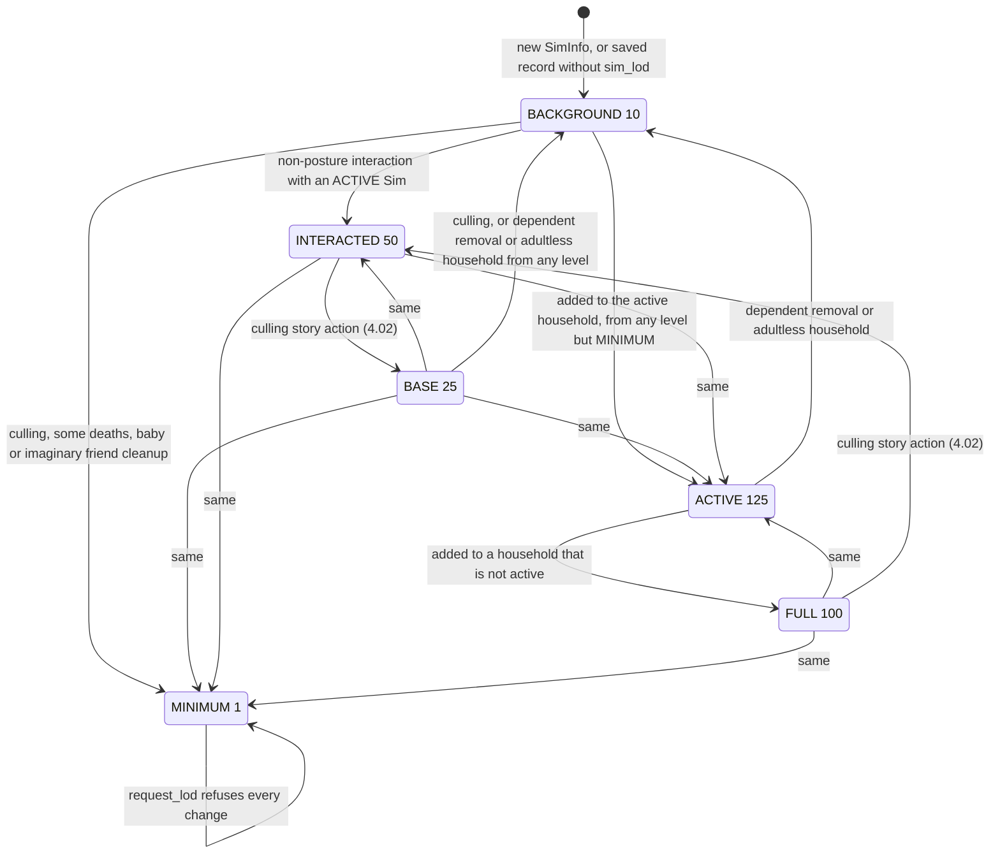
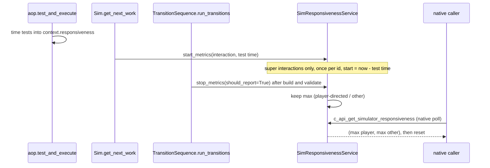
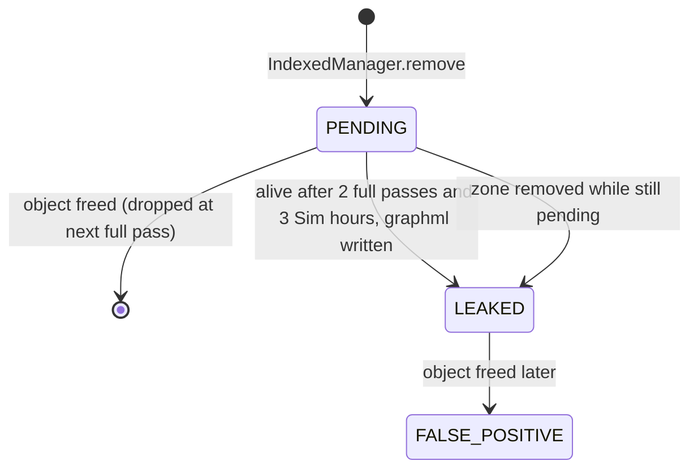

# 1.03 Performance, budgets and level of detail

*Game version 1.128.90.1030 (Steam, Linux/Proton). Code is the base game Python, which ships every pack's scripts; module tuning is read from both the full and the delta build; counts over instance tuning are live (base plus EP04 (Cats & Dogs), EP06 (Get Famous), EP09 (Eco Lifestyle), EP12 (High School Years), GP04 (Vampires), GP12 (Werewolves), SP01 (Luxury Party), SP42 (Grunge Revival)) on this install; graphics values come from the shipped `Game/Bin/*.sgr` rule files. Written 2026-10-12. Checked 2026-10-12: 172 claims checked, 26 corrected, 2 relabelled, 1 removed.*

## In plain words

Your save can hold up to about a thousand Sims, and the game keeps all of them in memory the whole time. It cannot afford to keep everything about every one of them, so each Sim has a level of detail. Your own household sits at the top and keeps everything: whims, aspiration progress, unlocks, even the colour of their phone case. A townie you once chatted with also keeps their lasting feelings toward other Sims, and short-lived ones only where your household is involved. A stranger keeps a career, friendships, most skills and the common traits, but no feelings toward anyone, no unlocks and no whims. At the bottom is a family-tree stub: a name, a face, relatives, no friendships and no way back into play. It keeps a few core traits while the game runs, but the save does not write them.

Three things about this surprise players. First, talking to an NPC promotes them: most interactions between one of your Sims and a lower-detail Sim lift that Sim one or two levels and records when it happened, which keeps them at that level longer when the nightly cull trims the population. Second, the bottom level is a one-way door. A Sim pushed there can never be raised again, never ages, cannot be spawned on a lot, and the game's general "is this Sim dead?" check answers yes. Third, details dropped on the way down are gone. Progress such as unlocks or notebook entries comes back, when a Sim rises again, only as it stood in the last save.

The rest of the chapter is about budgets. The world gets 33 milliseconds of each frame for simulation. Autonomy gets a tenth of a second per pass. The game aims to keep at most 20 visiting NPCs spawned, minus your household size, and each Sim's queue holds six interactions. When the simulation falls behind, the game records the lag as "debt" and slows the clock. Once memory use has passed a high-water mark, the game cleans it with a deep garbage collection at a moment you will not notice: when you pause, when a dialog opens, when you leave Build mode or while a lot loads. Below the mark these moments do nothing.

Most of the measuring tools the developers built (responsiveness timers, a leak tracker, object scores, profilers) are still in the game, but almost all of their commands are of the automation type, which a retail game without automation mode does not accept.

## Key facts

- Six Sim info LOD levels: MINIMUM 1, BACKGROUND 10, BASE 25, INTERACTED 50, FULL 100, ACTIVE 125. ACTIVE is saved as FULL. A new `SimInfo` starts at BACKGROUND.
- MINIMUM is one-way: `SimInfo.request_lod` refuses any change away from it, `can_instantiate_sim` is False, aging is off, and `SimInfo.is_dead` returns True. Going to MINIMUM destroys all of the Sim's relationships and removes the statistic and buff components.
- 33 Sim info trackers each declare a minimum LOD. On every LOD change the game creates the trackers that became valid, calls `on_lod_update` on all present ones, then deletes the ones no longer valid. Thresholds: 4 at MINIMUM, 14 at BACKGROUND (4 of them need packs not installed), 1 at BASE, 1 at INTERACTED (EP19 (Enchanted by Nature), not installed), 10 at FULL (1 needs EP13 (Growing Together), not installed), 3 at ACTIVE.
- Live tuning: 282 traits survive down to MINIMUM (in memory; a MINIMUM Sim's save carries no traits), 81 need FULL (66 of them phone case colours, 13 hidden traits, 2 pet quirks), 7 set BACKGROUND and 839 keep the default BACKGROUND. All 71 sentiment tracks and 4 of 47 skills (the hidden infant milestone skills) need INTERACTED; 6 EP12 (High School Years) body-type-level commodities need ACTIVE.
- When a Sim drops below INTERACTED, the sentiments in all of its relationships are removed, in both directions; at INTERACTED, short-term sentiments are removed unless either Sim is in the active household.
- After a non-posture interaction that involves an ACTIVE Sim, every participant below FULL is reported to the culling service, which raises BACKGROUND and BASE Sims to INTERACTED and stamps the time. The stamp is saved.
- Per-LOD caps (delta tuning): FULL 35, INTERACTED 100, BASE 170, BACKGROUND 628, MINIMUM 100; with the household size 8 the total cap is 1,041, and the fire meter acts at 1,197 (see [4.02](4.02-story-progression-townies.md)).
- Sim responsiveness is the wall-clock time from when a Sim takes a super interaction off its queue (backdated by the time its tests took) to the moment its transition is planned. The native side polls the worst value of each kind and the poll resets it; pausing discards pending timers.
- The high-water garbage collection (a native generation-2 pass that runs only past a memory trigger) is tried on four occasions: entering pause, showing a dialog, the Build/Buy exit hooks, and zone spin-up after the posture graph is built. Automatic GC is switched off while instance tuning loads.
- The object leak tracker, when created, reports objects that were removed from a manager yet survive 2 full GC passes and 3 Sim hours, writing a `.graphml` referrer graph. It exists only after the Automation command `object_leak_tracker.start` or the `--python_autoleak` command-line flag.
- The nine performance, memory, profiler, Sim info and culling command modules read here define 126 command names in 123 decorators. The only Live one is `culling.set_max_player_population`; 105 are Automation (3 of them `autonomy.*` aliases) and 20 are untyped (DebugOnly, never registered).
- A built-in QA budget table lists 20 Sims, 350 interactive and 250 decorative objects on the active lot, 900 objects in total and a posture graph of 3,000 nodes and 12,000 edges. Only an Automation command prints it.
- Graphics auto-detection picks one of five presets from CPU, card, video memory and RAM scores; Ultra is reachable only with at least 960 MB of texture memory. Sim render LOD distances range from "1.75, 5, 8.5, 100" (Sim quality Low) to "25, 50, 100, 1000" (Very High).

## How it works

### Sim info LOD levels

**Observed** (`sims/sim_info_lod.py: SimInfoLODLevel`). The levels are integers, so code compares them with `<` and `>=`: MINIMUM 1, BACKGROUND 10, BASE 25, INTERACTED 50, FULL 100, ACTIVE 125. Two helper maps step one level at a time. `get_next_lod` goes MINIMUM to BACKGROUND to BASE to INTERACTED to FULL and returns None from FULL and ACTIVE; `get_previous_lod` goes down from ACTIVE to MINIMUM. So the Automation command `sim_info.lod.increment_sim_info_lod` can never reach ACTIVE (**Inferred** from the map).

**Observed** (`sims/lod_mixin.py: HasTunableLodMixin`). Tuned data that should disappear from low-detail Sims carries `min_lod_value`, default BACKGROUND. Its description gives the order high to low as FULL, INTERACTED, BASE, BACKGROUND, MINIMUM and leaves out ACTIVE. Statistics (`BaseStatistic`) and traits use it.

**Observed** (`sims/sim_info.py`):

- `SimInfo.__init__` sets `_lod` to BACKGROUND. `load_sim_info` uses BACKGROUND when a saved record has no `sim_lod`; the household loader passes FULL for a played household and BASE for any other as that fallback (bytecode, `sims/household.pyc: Household.load_data`).
- `_get_persisted_lod` writes ACTIVE as FULL, so the active household is stored at 100 and raised again on load. In the sample save described in [1.02](1.02-saves-persistence.md), about half the Sims sat at BACKGROUND, a quarter each at BASE and INTERACTED, one in twenty at MINIMUM, and only the active household at FULL.
- `can_change_lod(current)` is False only when the current LOD is MINIMUM. `can_set_to_lod(new)` is False only when the new LOD is MINIMUM and `get_culling_immunity_reasons()` is not empty (both checked in bytecode). The immunity reasons are listed in [4.02](4.02-story-progression-townies.md).
- `can_instantiate_sim` is False at MINIMUM. `create_sim_instance` logs an error and refuses such a Sim; `instantiatable_sims_info_gen` skips it; `is_dead` returns True for it (`not can_instantiate_sim` or a death type).
- `AgingMixin._is_aging_disabled_common` and `AgingService.is_aging_enabled_for_sim_info` both treat MINIMUM as "never age" (`sims/aging/aging_mixin.py`, `sims/aging/aging_service.py`).
- `RelationshipService._can_create_relationship` refuses a new relationship when either Sim is MINIMUM (`relationships/relationship_service.py`).

### What happens on a LOD change

**Observed** (bytecode of `sims/sim_info.pyc: SimInfo.request_lod`; the decompiled nesting of the tracker loop is wrong). In order:

1. Same LOD: return True. Current LOD MINIMUM, or new LOD MINIMUM for an immune Sim: return False.
2. Store the new LOD, then `household.on_sim_lod_update(sim, old, new)` if the Sim has a household.
3. For each entry in `SimInfo.SIM_INFO_TRACKERS` whose `required_packs` include an available pack: compute `is_valid = is_valid_for_lod(new)`; if the tracker is missing and valid, create it; if a tracker now exists (new or old), call `on_lod_update(old, new)`; if it is not valid, set the attribute to None. A newly created tracker therefore also receives the update call.
4. `statistic_component.on_lod_update(old, new)` if the Sim has that component, then `Buffs.on_lod_update(old, new)`.
5. Only for MINIMUM: clear build/buy unlocks, unhide a hidden Sim, run the club and clan "killed or culled" hooks, refresh age settings, clear outfits down to the minimum, drop the primary aspiration, remove the statistic component (after its `on_remove`) and the buff component (after `clean_up`), and set the zone id to 0.

### What each level keeps

**Observed** (`sims/sim_info_tracker.py: BaseLODTracker`). A tracker is valid when `lod >= _tracker_lod_threshold`; the default threshold is BACKGROUND and the default `required_packs` is the base game. Thresholds per tracker (read from the decompiled source, and in bytecode for the relationship, trait and favorites trackers, whose modules did not decompile):

| Minimum LOD | Trackers |
|---|---|
| MINIMUM | relationship, trait, death, genealogy |
| BACKGROUND | pregnancy, career, story progression, template affordance, suntan, sickness, favorites, organization, fixup, lunar effect; degree (EP08 (Discover University), not installed), jewelry (SP49 (Crystal Creations), not installed), family recipes and tattoo (EP18 (Businesses & Hobbies), not installed) |
| BASE | food restriction |
| INTERACTED | luck (EP19 (Enchanted by Nature), not installed) |
| FULL | adventure, royalty, unlock, away action, notebook, whim, relic, lifestyle brand, satisfaction; developmental milestone (EP13 (Growing Together), not installed) |
| ACTIVE | aspiration, familiar, body type level (EP12) |

So a MINIMUM Sim keeps its traits (only those allowed at MINIMUM, see below), death record and family tree; its relationship tracker survives but is emptied (next sections). Those traits live only in memory: `_save_sim_attributes` (bytecode) stops after the occult, death and genealogy blocks for a MINIMUM Sim, so the save carries no traits and a reloaded MINIMUM Sim has none. What a MINIMUM Sim writes to the save is in [1.02](1.02-saves-persistence.md).

**FULL trackers.** **Observed** (`on_lod_update` of the unlock, notebook, royalty, adventure, lifestyle brand, whim and relic trackers): when the new LOD is below FULL the tracker clears its data (then `request_lod` deletes it); when the old LOD was below FULL it reloads from `persistence_service.get_sim_proto_buff(sim_id)`, the persistence service's copy of the Sim's save record. The satisfaction tracker only does the reload half. **Observed** (`sims/sim_info.py: save_sim`, `_save_sim_base`): a save made while the Sim sits below FULL copies the unlock, notebook, adventure, royalty, relic and lifestyle brand blocks forward from the previous record (`MergeFrom`, as for any missing optional tracker, see [1.02](1.02-saves-persistence.md)) and carries the satisfaction points over, but it clears `gameplay_data` and writes whims only from a live whim tracker, so the whims are gone from that save. **Inferred**: progress made since the record was last written is lost when a Sim drops below FULL.

**ACTIVE trackers.** **Observed** (`aspirations/aspirations.py: AspirationTracker.on_lod_update`): leaving ACTIVE, the aspiration tracker clears the record's `event_data_tracker` and saves itself into it before it is deleted; reaching ACTIVE, it loads from the record. Aspiration progress therefore survives a household switch. The familiar tracker dismisses the familiar and cleans up below ACTIVE and reloads on return (`familiars/familiar_tracker.py`). The EP12 body-type-level tracker locks the level commodities with `DO_NOT_CHANGE_VALUE` below ACTIVE, or removes them for species they do not apply to (`sims/body_type_level/body_type_level_tracker.py`).

### Statistics, traits and buffs across LOD changes

**Observed** (`statistics/base_statistic.py: BaseStatistic.remove_at_owner_lod`, bytecode): a statistic is removed when `lod < min_lod`. For a Sim owner that can instantiate and is currently instanced, `min_lod` is `min(BACKGROUND, min_lod_value)` unless the statistic sets `respect_lod_on_add` (default False). **Inferred**: while a Sim is spawned, a FULL-only commodity is neither refused nor removed for being above the Sim's LOD.

**Observed** (`statistics/base_statistic_tracker.py`, `statistics/commodity_tracker.py`, `statistics/statistic_tracker.py`): `add_statistic` refuses a statistic that `remove_at_owner_lod` rejects. `on_lod_update` removes the ones the new LOD rejects; those whose `min_lod_value` is ACTIVE are first stashed in `_delayed_active_lod_statistics` and re-added when the Sim reaches ACTIVE. Loading defers ACTIVE commodities the same way, and saving writes the delayed ones too, so they are not lost. `TraitStatistic` is locked to `min_lod_value` ACTIVE with `respect_lod_on_add` True (`statistics/trait_statistic.py`).

**Observed** (bytecode of `traits/trait_tracker.pyc`): `can_add_trait` refuses a trait whose `min_lod_value` is above the Sim's LOD. Loading skips such traits; ACTIVE-only ones go to `_delayed_active_lod_traits`, the rest are dropped. Saving writes equipped plus delayed traits. On an LOD increase, the initial commodities of still-valid traits are re-added; a trait that becomes invalid is stashed if its minimum is ACTIVE and then removed; at ACTIVE the stashed traits come back.

**Observed** (`objects/components/buff_component.py: BuffComponent.on_lod_update`): buffs react only to an increase and only on an instanced Sim, through each entry's `on_lod_increase`.

**Observed** (a count over the live tuning):

| Instance class | `min_lod_value` set | Records |
|---|---|---|
| Trait | MINIMUM (examples: Mean, Cheerful) | 282 |
| Trait | FULL (66 phone case colours such as `trait_Phone_BlackStripes`, 13 hidden traits such as `trait_Hidden_BeenKissed`, 2 pet quirks) | 81 |
| Trait | BACKGROUND (explicit) | 7 |
| SentimentTrack | INTERACTED | 71 |
| Skill | INTERACTED (of 47 live skills; all four are hidden infant milestone skills such as `statistic_Skill_Hidden_Infant_Crawl`) | 4 |
| BodyTypeLevelCommodity (EP12) | ACTIVE | 6 |
| Commodity | FULL (`commodity_SimInfo_TimeSinceLastSocial`, `commodity_SimInfo_TimeSinceLastSlept`) | 2 |
| Commodity | BASE (`commodity_vacation_homesick`) | 1 |
| Statistic | BACKGROUND (`statistic_prom_royalty_votes`) | 1 |
| StaticCommodity | BACKGROUND | 2 |

Of 1,209 live trait records (1,071 Trait, plus 120 Preference and 18 GameplayObjectPreference records, the likes and dislikes), 839 keep the code default BACKGROUND, so most personality traits vanish when a Sim is reduced to MINIMUM and only the 282 tagged ones stay, until the next save drops those too. Two Commodity records set `respect_lod_on_add` True. Low-level commodity simulation for Sims who are not spawned is a separate mechanism, described in [3.03](3.03-needs-statistics.md).

### Relationships across LOD changes

**Observed** (`relationships/relationship_service.py: RelationshipService.on_lod_update`): a new LOD above INTERACTED changes nothing. Above MINIMUM, it calls `notify_all_relationships_on_lod_change`; `SimRelationship` passes the change to both directions of each relationship, and `UnidirectionalRelationshipData` (bytecode of `relationships/data/unidirectional_relationship_data.pyc`) removes every sentiment when the new LOD is below INTERACTED, and at INTERACTED removes the short-term sentiments unless either Sim belongs to the active household. At MINIMUM the service removes the marriage bit, destroys all of the Sim's relationships, clears multipliers and callbacks, and destroys its object relationships. Sentiments and their cap are covered in [3.08](3.08-relationships-socials.md).

### How a Sim's LOD rises and falls

**Observed** callers of `request_lod`:

- `Household.add_sim_info` (bytecode, `sims/household.pyc`): the active household asks for ACTIVE; any other household moves an ACTIVE Sim to FULL. Loading uses the same call with `process_events=False`.
- `Interaction.perform_gen` (bytecode, `interactions/base/interaction.pyc`, source lines 6928 to 6941): after the interaction has performed, if it provides no posture, it collects the required Sims below FULL and, if any required Sim is ACTIVE, passes each of them to `CullingService.sim_interacted_with_active_sim`. That raises BACKGROUND and BASE Sims to INTERACTED, refreshes the time stamp of INTERACTED ones, and ignores MINIMUM ones (`sims/culling/culling_service.py`). The stamps are saved and decide which INTERACTED Sims are demoted first ([4.02](4.02-story-progression-townies.md)).
- `interactions/utils/creation.py`: a cloned Sim outside the active household is set to BASE.
- `interactions/utils/interaction_elements.py`: removing a dependent from a household sets BACKGROUND.
- `Household.handle_adultless_household` (bytecode, `sims/household.pyc`): when no member can live alone (after the last adult dies, for example), it destroys each instanced member and sets every member to BACKGROUND.
- The Automation command `genealogy.generate_dynasty` (`server_commands/genealogy_commands.py`) can create its dead ancestors at MINIMUM.
- `interactions/utils/death_interactions.py`: MINIMUM when `_should_set_to_min_lod()`; `sims/baby/baby.py` and `imaginary_friends/imaginary_friend_service.py` also set MINIMUM.
- Lowering for population control: `story_progression/story_progression_action_sim_info_culling.pyc` and the culling service, covered in [4.02](4.02-story-progression-townies.md).

### Household LOD and household trackers

**Observed** (bytecode of `sims/household.pyc`):

- `_max_sim_lod` starts as None and is set once by `_initialize_max_household_lod` (the highest member LOD, default MINIMUM) from `on_all_households_and_sim_infos_loaded`.
- `on_sim_lod_update` returns at once when `_max_sim_lod` is None or the new LOD is at or above it, so the value never rises during a session. Otherwise it takes the maximum LOD of the other members (default: the new LOD), raises it to the new LOD if that is higher, and if the result is below `_max_sim_lod` it stores it and calls `cleanup_trackers(new_lod=new_lod)`.
- `cleanup_trackers` calls `household_lod_cleanup()` on each household tracker that `is_valid_for_lod(new_lod)` rejects. The household trackers are bucks, laundry, missing pets, delivery, collection, object preference and story progression (threshold BACKGROUND) and the scenario tracker (FULL).

**Observed** (bytecode offsets 80 to 94: `STORE_ATTR _max_sim_lod` from `max_lod`, then `cleanup_trackers` called with `LOAD_FAST new_lod`): the argument passed is the changing Sim's own new LOD, not the new household maximum just computed. The two differ only when the Sim drops below another member that is itself below the old maximum. In code terms, a household whose top member falls from INTERACTED to MINIMUM while another stays at BASE would have every household tracker cleaned (bucks, collections, deliveries), although a member at BASE remains. **Inferred**: normal play does not reach this. The culling story action lowers Sims one level at a time, so the new LOD is the new maximum; deaths and babies that go to MINIMUM are first moved to a hidden household of their own; an adultless household sets every member to the same BACKGROUND; inside the active household the other members are ACTIVE, which makes the early return fire. Only the Automation `sim_info.lod.*` commands can set up the case, and no player-visible effect was found. Households created after the load keep `_max_sim_lod` None and never run this cleanup.

### Caps per LOD

**Observed**, delta tuning (`StoryProgressionService.ACTIONS` max population action and `CullingTuning.SIM_INFO_CAP_PER_LOD`): FULL 35, INTERACTED 100, BASE 170, BACKGROUND 628, MINIMUM 100 (code default 210 each; ACTIVE has no cap). `SimInfoManager.SIM_INFO_CAP` is `Household.MAXIMUM_SIZE` (8) plus their sum, 1,041. The fire meter (`sims/sim_info_firemeter.py`, code defaults) checks every 120 Sim minutes and acts when the count reaches `int(1,041 × 1.15)` = 1,197. `CULLING_BUFFER_PERCENTAGE` is 15 (delta; code 20). The BACKGROUND pass culls whole households until it has counted `MAX_HOUSEHOLD_CULLING` 10 Sims, so one pass removes up to 17 (bytecode of `story_progression_action_sim_info_culling.pyc`). The passes themselves are in [4.02](4.02-story-progression-townies.md).

### Sim responsiveness

**Observed** (`performance/sim_responsiveness_service.py`, `interactions/aop.py`, bytecode of `sims/sim.pyc: Sim.get_next_work` and `postures/transition_sequence.pyc: TransitionSequence.run_transitions`, `clock.py: GameClock._update_speed`, `areaserver.py`):

- `SimResponsivenessService` is a game service. It is enabled on zone load, disabled and reset on zone unload, disabled with its pending timers cleared when the clock enters PAUSED, and enabled again when the clock leaves PAUSED.
- `AffordanceObjectPair.test_and_execute` times the interaction tests with `time.perf_counter` and stores the result in `context.responsiveness`; the interaction keeps it as `_context_responsiveness`.
- `Sim.get_next_work` starts the timer through the interaction's `responsiveness_metrics_start`. `start_metrics` ignores non-super interactions and ids already pending, and backdates the start by the test time. It tags the entry as player-directed when the Sim is selectable and the interaction is user-directed.
- `TransitionSequence.run_transitions` stops the timer with `should_report=True` after `_build_transitions` and `_validate_transitions`, before the transition elements run. Leaving the pipeline any other way (`_exited_pipeline`) stops it without a report.
- A report keeps the maximum per kind (player-directed or other). With the detail callback on, a player-directed report prints "Responsiveness (Player Directed)" with seconds and the interaction name.
- The native side calls `c_api_get_simulator_responsiveness`, which returns both maxima and resets them; while the service is disabled or missing, or after an exception, it returns -1.0 twice (`INVALID_RESPONSIVENESS_VALUE`).

**Inferred**: the figure covers test time plus the time between dequeue and a planned route; time spent waiting in the queue before `get_next_work` is not included, nor the animation that follows.

### Simulator debt and the debt simulator

Simulator debt is how far the world timeline lags behind the game clock, `(sim_future - sim_now)` in Sim minutes (`time_service.py: TimeService.get_simulator_debt`; 0 when the timeline is frozen or absent). How debt builds up and how adaptive clock speed reacts to it is in [1.01](1.01-time-scheduling-loading.md).

**Observed** (`scheduling.py: Timeline.simulate`, bytecode `LOAD_CONST False; POP_JUMP_IF_TRUE; paths.AUTOMATION_MODE`): `SimDebtSimulator.try_simulate_sim_debt` runs only in automation mode, once per `simulate` call, after the time-slice deadline has been computed, so any sleep it adds is charged to that slice.

**Observed** (`performance/sim_debt_simulator.py`): with a target above 0 (set by the Automation command `performance.set_sim_debt_target`, default 0), each call records the current debt in a list of the last 100. Every 100th call it compares the average with the target: below target and not rising adds `INCREASE_STEP` 10 ms to the sleep; above target and rising subtracts `DECREASE_STEP` 5 ms. The sleep is clamped to 0 to `SLEEP_UPPER_BOUND` 100 ms and applied with `time.sleep` on every call. **Inferred**: a QA tool that slows the simulation on purpose to hold debt near a chosen level.

### Garbage collection

**Observed** (strings of `Game/Bin/python37_x64.dll`): the game's Python 3.7 has an extended `gc` module: `collect_incremental` ("Run an incremental collection"), `incremental_exclusive` (only the incremental collector runs automatically) and `incremental_nonexclusive` (threshold-based generational collects allowed again), `set_max_roots_per_pass` (0 is uncapped), `set_max_nodes_per_root`, `set_max_traversal` (capped by a native `EA_INCR_MAX_TRAVERSAL`), `get_num_objects` (non-frozen objects) and `get_freeze_count`. No compiled gameplay module names the exclusive or non-exclusive switches, and only `performance/gc_commands.py` (Automation commands) names `collect_incremental`, the `set_max_*` limits or `get_freeze_count` (byte search over the `.pyc` files). The same module toggles a `gc.DEBUG_STATSINC` flag (`mem.gc.inc_debug`), but the DLL has no such name (its debug flags are `DEBUG_STATS`, `DEBUG_COLLECTABLE`, `DEBUG_UNCOLLECTABLE`, `DEBUG_SAVEALL` and `DEBUG_LEAK`). **Inferred**: that command would stop with an AttributeError; the incremental mode, if used at all, is configured natively.

**Observed** (`performance/gc_commands.py`): the collect log prints a line for callbacks with generation 2 or 4; the object-count log counts generation 3 callbacks as its window. **Inferred**: the extended collector reports generations beyond the standard 0 to 2, with 3 used for incremental passes.

**Observed** (`core/pythonutils.py`; native doc string in the strings of `Simulation_x64.dll`): `try_highwater_gc` is native (`_pythonutils` in `Simulation_x64.dll`). Its doc string says it runs a level 2 collection only if a "highwater low trigger" has been reached, returns whether it ran, and should be called only at an opportune moment such as a modal dialog or a loading screen. Without the native module it returns False. Call sites:

| Where | When |
|---|---|
| `clock.py: GameClock._update_speed` | entering PAUSED, right after the responsiveness service is paused (bytecode) |
| `ui/ui_dialog.py: UiDialog.show_dialog` | before the dialog is sent (subclasses that override `show_dialog` without calling it skip this) |
| `build_buy.py: buildbuy_session_end` | after the Build/Buy exit hooks ([2.03](2.03-build-buy-placement.md) explains when this runs) |
| `zone_spin_up_service.py` | during spin-up, after the posture graph build |

**Observed** (`services/__init__.py: TimeStampService.start`, `start_global_services`): `TimeStampService` appears twice in the global start list, before the tuning instance managers and after `FinalizeTuningService`. Its first start calls `gc.disable()`, its second `gc.enable()`, so automatic collection is off while instance tuning loads and finalizes. **Observed** (`services/tuning_managers.py`): pack hot load and unload wrap the work in `change_gc_policy(0)` and `change_gc_policy(3)`; the policy numbers are native.

**Observed** (`zone.py`): `Zone.on_add` registers a callback that counts generation-2 stops. At zone removal the count and the minutes spent in the zone go to a `ZONESHUTDOWN` telemetry hook (and to `gc_count_log` when the Automation command `mem.gc.zone_gc_count_log_start` enabled it). `Zone.on_remove` stops services, clears caches and runs a full `gc.collect()`.

### Object leak tracker

**Observed** (`performance/object_leak_tracker.py`, `services/__init__.py`, `zone.py`, `areaserver.py`, `indexed_manager.py`, `build_buy.py`):

- The tracker exists only after `services.create_object_leak_tracker`. The Automation command `object_leak_tracker.start` creates and starts it; the `--python_autoleak` command-line flag creates it at global service start without starting it, and `Zone.on_add` then starts it.
- Its GC callback is registered once the zone is running (end of zone spin-up in `areaserver.py`, or at start if the zone already runs) and removed in `Zone.on_teardown`.
- `IndexedManager.remove` calls `track_object(obj, manager, old_id)` after clearing the object's weak references. That creates a PENDING node with a weak reference, the Python id, the type, the manager type and a time stamp (GC pass count, Sim time).
- Build/Buy adds a disable reason at `c_api_buildbuy_session_begin` and removes it at `c_api_buildbuy_session_end`. Disable reasons only pause the GC callback; removals are still recorded.
- The callback acts on generation 2 only. On "start" it clears all caches (`caches.clear_all_caches(force=True)`) and the required-slot cache, so cached references do not keep objects alive. On "stop" it adds one to the pass count, turns dead LEAKED nodes into FALSE_POSITIVE, drops dead PENDING nodes, and promotes a live PENDING node to LEAKED once 2 passes (`GC_PASS_THRESHOLD`) have run since it was recorded and 3 Sim hours (`SIM_HOUR_THRESHOLD`) have passed. Bytecode shows the hour test is skipped, and the node promoted, when either time stamp is None; the decompiled source nests it the other way.
- Each newly leaked object gets a breadth-first graph of its referrers, depth 10 (`OBJECT_REF_DEPTH`), with nodes referenced by more than 10 others (`HUB_OBJECT_THRESHOLD`) treated as hubs. It is written to `ObjectDesc_0x<id>-<Type>-<time>.graphml` (root green, hubs red, others black), and an error is logged.
- `stop_tracking` (from `Zone.on_remove`, after the full collection) reports every node still PENDING as leaked on zone removal.
- The GSI view "Object Leaks" (`performance/object_leak_handlers.py`) lists status, Python id, type, old manager, old object id and the status history.

### Leak detector and zone leak check

**Observed** (`core/sims4/leak_detector.py: find_object_refs`, `_find_leaks` in bytecode): it collects, then walks referrer chains from an object up to 15 levels, ignoring the frames of the current call stack and ending a chain at the builtins or `sys.modules` table, logs the possible leak chains, and stops after 10. Its only callers are the untyped (DebugOnly) command `mem.print_leak_chain` (bytecode of `server_commands/memory_commands.pyc`; it passes a depth of 10 by default) and `Zone._check_for_leaked_managed_objects`, which no code calls. Inside that dead method the time guard logs "terminated after 25ms" but compares `time.time()` seconds against 25. **Inferred**: unreachable in a retail game.

### Native performance counters

**Observed** (`core/native/performance/counters.py`, re-exported by `simulation/performance/counters.py`; `simulation/performance/__init__.py` star-imports the empty `core/native/performance/__init__.py`): `set_counter`, `add_counter` and `subtract_counter` come from the native `_perf_api` module (present in `Simulation_x64.dll` strings as a "Windows Performance Counter Module") with no-op fallbacks. `CounterIDs` names five counters: `autonomyQueueLength64`, `autonomyQueueTime64`, `eventTimeDeviation64`, `numPendingEvents64`, `numPrimitives64`. Python writes only one of the five, `autonomyQueueLength64` (`AutonomyService`, which also feeds the GSI performance metric), plus two counters named outside `CounterIDs`: `interaction_queue.py` adds 1 to "PerfNumInteractions" for each interaction and `mixer_interaction.py` adds 1 to "PerfNumSubInteractions". **Inferred**: the remaining counters are written natively, or not at all.

### Profilers

**Observed**:

- `core/sims4/profiler.py`: with the `__profile__` builtin set, `begin_scope`, `end_scope`, `enable_profiler`, `disable_profiler` and `flush` come from the native `_profiler` (an instrumented call-graph profiler). Without it, the fallback defines `begin_scope` twice and never defines `end_scope` or `flush` (bytecode). `scope(name)` checks `__profile__` before each call, so it never reaches the gap. The Automation commands `pyprofile.on`, `pyprofile.off` and `pyprofile.flush` (`server_commands/profiler_commands.py`) drive the profiler, and the last two call `sims4.profiler.flush()` directly. **Inferred**: with `__profile__` false they would stop with an AttributeError (automation mode only, so no retail effect). The value of the native `__profile__` builtin in a retail build was not read.
- `core/sims4/profiler_utils.py`: `create_custom_named_profiler_function` builds a wrapper whose code object carries a chosen name (32 characters at most) so a profiler shows it as a frame. `load_sim_info` uses it to label "Load LOD {} SimInfo" frames when the Automation toggle `sim_info.toggle_lod_name_into_callstack` is on. `get_timed_context` returns a `perf_counter` timer or a stub.
- `core/sims4/perf_log.py`: with `--profile-log-group <group>` on the command line, `get_logger` returns a `PerfLogger` that writes every level as an always-on log. `ServiceManager` uses the group "ServicePerf" to time each service's start, stop and zone hooks.
- `simulation/profile_utils.py`: a decorator that times calls with `time.clock`, used by the DebugOnly `profile_util.*` commands in `server_commands/perf_test_commands.py` and by `performance/test_profiling_setup.py`, and imported by `weather/weather_tests.py`.
- `simulation/__hooks__.py: system_init`: the native `_profile.notify_gc_function` is appended to `gc.callbacks` when `_profile` imports (it is present in `Simulation_x64.dll`).

### Test and loot profiling

**Observed** (`performance/test_profiling.py`, `event_testing/resolver.py`, `interactions/utils/loot_basic_op.py`): when the Automation command `performance.test_profile.enable` (or `performance.loot_profile.enable`) sets a profile dict, each test set or loot records count, resolve time, test time and maximum per subject, per resolver and per key through `record_profile_metrics`. `performance.test_profile.dump` writes the totals. `performance/test_profiling_setup.py` (`TestProfilingSetup`) sets up a weather "AnyRain" test and a trait test to time; its only caller is `server_commands/perf_test_commands.py`, behind a DebugOnly command.

### Object score and QA budgets

**Observed** (`performance/object_score_commands.py`): `performance.show_lot_score` and `performance.score_objects_in_world` give each object definition a score from per-feature weights (client state tunings 2.21291e-06, parts 1.02428e-07, statistics -4.10286e-06, commodities 2.1368e-06, inventory item 5.77201e-07, inventory 4.15715e-06, slots 2.66968e-08, posture graph nodes -1.30278e-09, provided postures -1.971e-07, client state changes 4.19944e-08, portals 1.79823e-07, interactions and autonomous interactions 0), scaled as a percentage of `HIGHEST_OBJECT_SCORE_ALLOWED` 0.007, and multiply by the number of copies. The posture-graph term uses the largest of the definition's other feature scores, read from the score counter, where the node count from `build_node_counts_list` was evidently meant (bytecode, source line 255: `object_score_counter[obj_type]` is stored as `nodes` and feeds `max(nodes.values())`; the node-count dict is only tested for membership). All of these commands are Automation, so no live effect.

**Observed** (`performance/performance_constants.py: BUDGETS`; read by `performance.log_object_statistics_summary` in `performance/performance_commands.pyc`, per-function decompile): `num_sims` 20, active lot interactive objects 350, active lot decorative 250, open street interactive 50, open street decorative 250, active lot autonomous affordances 250, total objects 900, posture graph nodes 3,000, edges 12,000. The command prints each live metric next to its budget; nothing enforces them. **Inferred**: QA targets for a "typical" lot.

### Graphics presets and render LOD (data only)

Rendering is native. Everything here is **Observed** in the rule files `Game/Bin/GraphicsRules.sgr` and `Ts4CommonRules.sgr`; what each property does is **Inferred** from its name.

**Hardware scores.** CPU speed is scaled by 1.5 with 4 or more cores and 1.3334 with 2 or 3 (1.3 and 1.1667 for a Pentium 4), minus 200 on Windows 6 and later, then compared with cutoffs (default 2500/2900/3700; AMD 2200/2600/3400; Intel and Mac 2300/2700/3600) to give Low, Medium, High or Uber. More than 2 cores turns on D3D threading and render multithreading. The card level (1 to 5, default 5) comes from the device table in `GraphicsCards.sgr`. Texture memory below 240, 480 and 960 MB gives Low, Medium and High, otherwise Uber; RAM (minus 512 MB on Windows 6 and later) at or below 1,840 MB is Low, below 2,760 Medium, below 4,608 High, otherwise Uber. Virtual memory above 4,096 MB is High, above 2,048 Medium.

**Preset choice.** `VisualQuality` has Low 1, LowMedium 2, Medium 3, High 4, Ultra 5 (0 is Custom). The auto-pick reaches Ultra only when texture memory is Uber (960 MB or more), the card level is 5, the CPU level is High or Uber and RAM is Uber; any Low card or CPU gives the Low preset.

| Preset | Scene resolution | Sim quality | Object quality | Lighting | Reflections | Edge smoothing | Effects | View distance | Post-processing |
|---|---|---|---|---|---|---|---|---|---|
| Low | Medium (25/32) | Low | Low | Low | Off | Off | Low | Low | Off |
| LowMedium | High | Low | Low | Low | Low | Off | Low | High | Off |
| Medium | High | Medium | Medium | Medium | Medium | Off | Medium | High | On |
| High | High | High | High (Medium when virtual memory is 2,048 MB or less) | High | High | Low (2x) | High | High | On |
| Ultra | High | Very High (High when virtual memory is 2,048 MB or less) | High (or Medium, same rule) | Very High | High | High (8x) | High | High | On |

**Sim render LOD** (`SimQuality`; `MinSimLOD` 0 in every tier):

| Sim quality | `RenderSimLODDistances` | `RenderSimTextureSizes` | `SimCacheSizeLimit` |
|---|---|---|---|
| Low | 1.75, 5, 8.5, 100 | 512, 512, 256, 128 | 20 or 35 |
| Medium | 5, 25, 75, 150 | 1024, 512, 256, 128 | 50, 90 or 125 |
| High | 5, 30, 85, 250 | 1024, 512, 256, 128 | 100, 175 or 250 |
| Very High | 25, 50, 100, 1000 | 2048, 1024, 512, 128 | 200, 350 or 512 |

The cache limit depends on the virtual memory and RAM levels. **Inferred**: the four distances are where a Sim's mesh steps down a detail level, with a texture size per level; the cache limit is the number of Sims whose built assets are kept.

**Object render LOD** (`ObjectQuality` Low / Medium / High): `ObjectLODBias` "4.0" / "1.0" / "0.6666" (and always "0.6666" in live edit); `ModularModelLODActive` 1 / 0 / 0 and `ModularModelLODInactive` 2 / 1 / 0; `ModelLODRangeTier` 2 / 1 / 0; `ForceActiveLotObjectsToHighLOD` false / true / true. Low also hides non-active floor objects and turns on opaque windows, simple wall corners, simple lot terrain, roof peak removal and zero-thickness walls. `ObjectLODInterestBias` is 0.56 for all tiers. `TerrainLODBoost` is 0 / 1 / 1 for terrain quality Low / Medium / High, which is auto-set from card and CPU level.

**Memory budgets.** `CacheBudget` is 160, 200, 300 or 400 MiB (167,772,160 to 419,430,400 bytes) by RAM and virtual memory level; `DeformerMapsCacheBudget` is 30, 40 or 50 MiB by core count and hyperthreading. `FrameRateLimit` defaults to 200.

**Protected Sims.** `Ts4CommonRules.sgr` defines an option `MaxProtectedSims` with counts Low 80, Medium 150, High 200 and Unlimited 0, and `GraphicsRules.sgr` picks Medium (recommending High) when the CPU level is Uber and virtual memory is High, and Low otherwise (recommending Medium when the CPU level is at least Medium and virtual memory is High). Its condition compares `$adjustedMemory` (megabytes) with `$ramLevelHigh` (the constant 3), which any machine passes. No Python reads this option (see Limits).

### Budgets across the book

Every runtime cap and budget found so far, with the value re-checked for this chapter (module tuning in both builds with shared references resolved, or the code, or the live loader).

| Budget | Value | Unit | Where | Source | Chapter |
|---|---|---|---|---|---|
| World timeline time slice | 33 | real ms per frame | `time_service` `MAX_TIME_SLICE_MILLISECONDS` | full and delta | [1.01](1.01-time-scheduling-loading.md) |
| Timeline entries per `simulate` | 10,000 | entries | `scheduling.py` `MAX_ELEMENTS` | code | [1.01](1.01-time-scheduling-loading.md) |
| Adaptive speed lag threshold | 10,000 | ticks (6.67 Sim minutes) | `adaptive_clock_speed` | code default, untuned | [1.01](1.01-time-scheduling-loading.md) |
| Season service time slice (the service exists only with EP05 (Seasons), so dormant here) | 50 | real ms | `seasons.season_service` | code default (no module record) | [2.04](2.04-weather-seasons-ground.md) |
| Time-of-day component loop | 1/30 | real s | `TimeOfDayComponent.MAX_SECONDS_PER_LOOP` | code | [2.02](2.02-objects-states-wear.md) |
| Broadcaster sweep | 5 | real s (the game-time service converts it to 5,000 ticks, so 5 real s at normal speed) | `BroadcasterService.INTERVAL` | code default, untuned | [0.04](0.04-tests-loot-effects.md) |
| Autonomy service per loop | 0.1 | real s | `autonomy.autonomy_service` `MAX_SECONDS_PER_LOOP` | full and delta | [3.04](3.04-autonomy.md) |
| Autonomy time-slicing removed after | 1 | real s | `autonomy.autonomy_modes` `MAX_REAL_SECONDS_UNTIL_TIMESLICING_IS_REMOVED` | full and delta | [3.04](3.04-autonomy.md) |
| Failed push and route-failure lockout | 15 | Sim minutes | `AutonomyModesTuning.LOCKOUT_TIME` | delta (code 240) | [3.04](3.04-autonomy.md), [3.05](3.05-interactions-postures-routing.md) |
| Interaction queue | 6 | interactions | `object_sim` `max_interactions` | live (base delta) | [3.05](3.05-interactions-postures-routing.md) |
| Mixers with no target object | 20 | mixers | `Interaction` `MAX_NOWHERE_MIXERS` | code | [3.05](3.05-interactions-postures-routing.md) |
| Social group size | 8 | Sims | `SocialGroup.maximum_sim_count` | code default; 31 of 132 live groups keep it, 85 set 2 | [3.05](3.05-interactions-postures-routing.md) |
| Animation run-ahead | 1 | real s | `MAXIMUM_TIME_DEBT` | code default (record empty) | [3.06](3.06-animation.md) |
| Zero-length ASM calls before reset | 50 | calls per Sim per tick | `MAX_ZERO_LENGTH_ASM_CALLS_FOR_RESET` | code | [3.06](3.06-animation.md) |
| Sentiments per Sim pair | 4 | sentiments | `SentimentTrackTracker.SENTIMENT_CAP` | code default (max 4) | [3.08](3.08-relationships-socials.md) |
| Played NPC to played NPC relationships | 35 | relationships | `PLAYED_NPC_TO_PLAYED_NPC_MAX_RELATIONSHIPS` | delta (code 20) | [3.08](3.08-relationships-socials.md) |
| NPC soft cap | 20 minus cap modifier minus household size | Sims | `SimSpawnerService.NPC_SOFT_CAP` | code default, untuned | [4.01](4.01-situations-npcs.md) |
| NPC spawn spacing | 5 | Sim minutes | `SimSpawnerService.SPAWN_COOLDOWN_MINUTES` | code | [4.01](4.01-situations-npcs.md) |
| Walk-by update | every 5, at most 1 new situation | Sim minutes | `AmbientService` | code | [4.01](4.01-situations-npcs.md) |
| Global user-facing situations of one display type, when the type allows several | 3 (LIVE_EVENT 2; SIM_SPECIFIC or a type with `allow_multiple_instances`: the household size) | situations | `MAX_SITUATION_INSTANCES_OF_SAME_TYPE` | code | [4.01](4.01-situations-npcs.md) |
| Situation invite limit (sent to the event planner) | 16 | Sims | `Situation.max_participants` | code default; 147 live set 20 | [4.01](4.01-situations-npcs.md) |
| Rabbit holes | 10 | per Sim | `NUM_MAX_RABBIT_HOLES` | code | [0.02](0.02-architecture.md) |
| Objects routing at once, hard cap | 30 | objects | `OBJECT_ROUTING_HARD_CAP` | code default, untuned | [0.02](0.02-architecture.md) |
| Object routing soft-cap threshold | 10 | objects | `OBJECT_ROUTING_SOFT_CAP_THRESHOLD` | delta (code 5) | [0.02](0.02-architecture.md) |
| Rain puddles, snow drifts from the weather service (dormant without EP05 (Seasons) or EP10 (Snowy Escape)) | 8 each | objects | `weather.weather_service` `PUDDLES.max`, `SNOW_DRIFT.max` | delta (code 10) | [2.04](2.04-weather-seasons-ground.md) |
| Posture graph incremental rebuild | 0 | changes | `INCREMENTAL_REBUILD_THRESHOLD` | delta (code 10) | [2.03](2.03-build-buy-placement.md) |
| Household size | 8 | Sims | `Household.MAXIMUM_SIZE` | full and delta | [4.02](4.02-story-progression-townies.md) |
| Sim infos per LOD | 35 / 100 / 170 / 628 / 100 | Sims | FULL / INTERACTED / BASE / BACKGROUND / MINIMUM | delta (code 210 each) | [4.02](4.02-story-progression-townies.md) |
| Total Sim info cap | 1,041 | Sims | `SIM_INFO_CAP` | derived | [4.02](4.02-story-progression-townies.md) |
| Fire meter | every 120, acts at 1,197 | Sim minutes, Sims | `SimInfoFireMeter` | code defaults | [4.02](4.02-story-progression-townies.md) |
| Culling buffer | 15 | percent | `culling_buffer_percentage` | delta (code 20) | [4.02](4.02-story-progression-townies.md) |
| Sims counted per BACKGROUND culling pass | 10 (whole households, so up to 17) | Sims | `MAX_HOUSEHOLD_CULLING` | code | [4.02](4.02-story-progression-townies.md) |
| Autosave | 30, 60 or 120 | real minutes | `AutosaveService` | code defaults | [1.02](1.02-saves-persistence.md) |
| Debt simulator sleep | 0 to 100, steps +10 / -5 | real ms per `simulate` | `sim_debt_simulator.py` | code, automation only | this chapter |
| Leak promotion | 2 passes and 3 | full GCs, Sim hours | `GC_PASS_THRESHOLD`, `SIM_HOUR_THRESHOLD` | code | this chapter |

## Numbers

| Name | Value | Unit | Where | Source |
|---|---|---|---|---|
| `SimInfoLODLevel` | MINIMUM 1, BACKGROUND 10, BASE 25, INTERACTED 50, FULL 100, ACTIVE 125 | level | `sims/sim_info_lod.py` | code |
| `min_lod_value` default | BACKGROUND | level | `HasTunableLodMixin` | code |
| `_tracker_lod_threshold` default | BACKGROUND | level | `BaseLODTracker` | code |
| Sim info trackers | 33 (27 usable on this install) | trackers | `SimInfo.SIM_INFO_TRACKERS` | code |
| Traits with `min_lod_value` MINIMUM / FULL / BACKGROUND | 282 / 81 / 7 of 1,209 | traits | Trait | live |
| Sentiment tracks at INTERACTED | 71 | records | SentimentTrack | live |
| Skills at INTERACTED | 4 | records | Skill | live |
| Body-type-level commodities at ACTIVE | 6 | records | BodyTypeLevelCommodity (EP12) | live |
| `respect_lod_on_add` True | 2 | records | Commodity | live |
| `sim_info_cap_per_lod` | 35 / 100 / 170 / 628 / 100 | Sims | FULL / INTERACTED / BASE / BACKGROUND / MINIMUM | delta (code 210) |
| `SIM_INFO_CAP` | 1,041 | Sims | `SimInfoManager` | derived |
| `FIREMETER_FREQUENCY` | 120 | Sim minutes | `SimInfoFireMeter` | code default |
| `SIM_INFO_ALLOWED_PERCENTAGE_ABOVE_CAP` | 15 | percent | `SimInfoFireMeter` | code default |
| `INVALID_RESPONSIVENESS_VALUE` | -1.0 | s | `sim_responsiveness_service.py` | code |
| `INCREASE_STEP` / `DECREASE_STEP` | 0.01 / 0.005 | real s | `sim_debt_simulator.py` | code |
| `SIM_DEBT_LIST_MAX_LEN` | 100 | samples and calls | `sim_debt_simulator.py` | code |
| `SLEEP_UPPER_BOUND` | 0.1 | real s | `sim_debt_simulator.py` | code |
| `GC_PASS_THRESHOLD` | 2 | full GC passes | `object_leak_tracker.py` | code |
| `SIM_HOUR_THRESHOLD` | 3 | Sim hours | `object_leak_tracker.py` | code |
| `OBJECT_REF_DEPTH` | 10 | levels | `object_leak_tracker.py` | code |
| `HUB_OBJECT_THRESHOLD` | 10 | referrers | `object_leak_tracker.py` | code |
| `find_object_refs` depth, stop | 15, 10 | levels, chains | `leak_detector.py` | code |
| `HIGHEST_OBJECT_SCORE_ALLOWED` | 0.007 | score | `object_score_commands.py` | code |
| `BUDGETS` | 20 Sims; 350 / 250 active lot interactive / decorative; 50 / 250 open street; 250 autonomous affordances; 900 total objects; 3,000 nodes; 12,000 edges | count | `performance_constants.py` | code |
| `create_custom_named_profiler_function` name | 32 | characters | `profiler_utils.py` | code |
| `RenderSimLODDistances` | Low 1.75, 5, 8.5, 100; Medium 5, 25, 75, 150; High 5, 30, 85, 250; Very High 25, 50, 100, 1000 | (Inferred: metres) | `GraphicsRules.sgr` SimQuality | data file |
| `ObjectLODBias` | 4.0 / 1.0 / 0.6666 | factor | `GraphicsRules.sgr` ObjectQuality | data file |
| `ObjectLODInterestBias` | 0.56 | factor | `GraphicsRules.sgr` | data file |
| `SimCacheSizeLimit` | 20 to 512 | Sims (Inferred) | `GraphicsRules.sgr` SimQuality | data file |
| `MaxProtectedSimCount` | 80 / 150 / 200 / 0 (unlimited) | Sims (Inferred) | `Ts4CommonRules.sgr` | data file |
| `CacheBudget` | 160 to 400 | MiB | `GraphicsRules.sgr` | data file |
| `FrameRateLimit` | 200 | fps | `Ts4CommonRules.sgr` | data file |

The cross-chapter budgets have their own table in "Budgets across the book" above.

## Data shapes

- **`SimInfoLODLevel`** (`enum.Int`): six levels plus `_prev_lod` and `_next_lod` maps; `get_previous_lod`, `get_next_lod`.
- **`HasTunableLodMixin`**: `min_lod_value` (TunableEnumEntry of `SimInfoLODLevel`, default BACKGROUND). `BaseStatistic` adds `respect_lod_on_add` (default False).
- **`BaseLODTracker`**: class property `_tracker_lod_threshold`, class method `is_valid_for_lod(lod)`. `SimInfoTracker` adds `required_packs` (default base game) and `on_lod_update(old, new)`. `HouseholdTracker` adds `household_lod_cleanup()`.
- **`SimInfo` LOD fields**: `_lod`, `request_lod`, `can_change_lod`, `can_set_to_lod`, `can_instantiate_sim`, `_get_persisted_lod`; save field `sim_lod`.
- **`Household`**: `_max_sim_lod`, `on_sim_lod_update(sim, old, new)`, `cleanup_trackers(new_lod)`, `HOUSEHOLD_TRACKERS` (8 entries).
- **`CullingService`**: `_interacting_sims` {sim id: DateAndTime}, saved; `sim_interacted_with_active_sim`, `add_sim_to_interacted_sims`.
- **`SimResponsivenessService`**: `_rsp_player_directed`, `_rsp_non_player_directed` (max seconds, -1.0 when empty), `_pending_interaction_dict` {interaction id: (start time, is player directed, guid64)}, `callback_player_directed`, `enabled`.
- **`SimDebtSimulator`** (class attributes only): `sim_debt_target`, `last_avg_debt`, `sim_debt_list`, `sim_debt_cycle_counter`, `last_sleep_delta`.
- **`ObjectLeakTracker`**: `_gc_pass_count`, `_node_buckets` {NodeStatus: set of Node}, `_disable_reasons`, `_enabled`. **`Node`**: weak ref, Python id, object type, manager type, old object id, `time_stamps` {status: (gc_pass, Sim time)}. **`NodeStatus`**: INVALID, PENDING, LEAKED, FALSE_POSITIVE.
- **`ProfileMetrics`**: count, resolve time, test time, max time, `is_test_set`. **`TestProfileRecord`**: metrics plus {resolver name: {key: ProfileMetrics}}.
- **`CounterIDs`**: five string ids for native counters.
- **`BUDGETS`**: {metric name string: integer budget}, 9 entries.

## For modders

**Tuning that matters.**

- Keep a trait, statistic or commodity on low-detail Sims: lower its `min_lod_value`. Make a commodity respect the LOD even on a spawned Sim: set `respect_lod_on_add`. A trait tuned above the Sim's LOD is refused by `can_add_trait`, which can read like a broken loot.
- More Sims at each level: raise the per-LOD caps in both `StoryProgressionService.ACTIONS` (max population) and `CullingTuning.SIM_INFO_CAP_PER_LOD`; [4.02](4.02-story-progression-townies.md) explains why both.
- Time slices and autonomy budgets are module tuning: `time_service` `MAX_TIME_SLICE_MILLISECONDS`, `autonomy.autonomy_service` `MAX_SECONDS_PER_LOOP`, `autonomy.autonomy_modes` `MAX_REAL_SECONDS_UNTIL_TIMESLICING_IS_REMOVED`. Edit the base-game delta value; for `LOCKOUT_TIME`, the delta's 15 replaces the code's 240.

**Commands** (types read from each `@Command` decorator; Automation needs automation mode, untyped is DebugOnly and never registered in retail):

| Command | Type | What it does |
|---|---|---|
| `culling.set_max_player_population <int>` | Live | sets the player population limit option (0 = none) |
| `sim_info.lod.request_sim_info_lod`, `increment_sim_info_lod`, `decrement_sim_info_lod` | Automation | change one Sim's LOD |
| `sim_info.lod.set_sims_to_lod`, `set_sims_to_minimum_lod`, `set_sims_in_household_to_lod`, `set_sims_in_household_to_minimum_lod` | Automation | bulk LOD changes |
| `sim_info.lod.create_lod_sim_infos`, `create_minimum_lod_sim_infos`, `sim_info.reduce_to_num` | Automation | population stress tools |
| `sim_info.lod.override_cap_level`, `clear_override_cap_level`, `sim_info.print_lod_count` | Automation | per-LOD cap override and counts |
| `sim_info.toggle_lod_name_into_callstack` | Automation | label Sim info loads by LOD for the profiler |
| `performance.trigger_sim_info_firemeter` | Automation | run the fire meter and print LOD counts before and after |
| `performance.status`, `performance.clock_status` | Automation | clock speed, multiplier type, deviance against threshold, autonomy queue, caches |
| `performance.log_object_statistics`, `performance.log_object_statistics_summary` | Automation | object and posture graph metrics, the summary next to `BUDGETS` |
| `performance.posture_graph_summary` | Automation | posture graph summary |
| `performance.set_sim_debt_target <float>` | Automation | target for the debt simulator |
| `performance.toggle_sim_responsiveness_details` | Automation | print each player-directed responsiveness report |
| `performance.test_profile.*`, `performance.loot_profile.*`, `performance.autonomy_profile.*`, `performance.scenario.*` | Automation | test, loot, autonomy and scenario profiling |
| `performance.show_lot_score`, `score_objects_in_world`, `dump_object_scores`, `toggle_object_load_capture`, `display_object_load_times`, `dump_object_load_times` | Automation | object score and load times |
| `performance.freeze_in_pause <bool>` | Automation | calls `freeze_game_time_in_pause`, the pause freeze described in [1.01](1.01-time-scheduling-loading.md) |
| `mem.gc.collect`, `enable`, `disable`, `inc_collect`, `inc_debug`, `set_max_roots_per_pass`, `set_max_nodes_per_root`, `set_max_traversal` | Automation | drive the collector |
| `mem.gc.collect_log`, `sample_log`, `print_garbage_count`, `print_object_count`, `garbage_dump`, `zone_gc_count_log_*`, `object_count_log_*` | Automation | GC logs and dumps |
| `object_leak_tracker.start` | Automation | create and start the leak tracker |
| `object_leak_tracker.dump`, `dump_pid` | untyped (DebugOnly) | never registered |
| `pyprofile.on`, `off`, `flush` | Automation | native call-graph profiler |
| `profile_util.*` (4 commands) | untyped (DebugOnly) | never registered |
| `mem.print_leak_chain`, `mem.get_referrers` and 7 other `mem.*` | untyped (DebugOnly) | never registered; the module's other 14 `mem.*` commands (`mem.py_gc_dump`, `mem.py_summary`, `mem.tracemalloc_*` and more) are Automation |
| `culling.cull_household`, `culling.print_scores` | untyped (DebugOnly) | never registered |
| `performance.log_alarms`, `relationship_decay_metrics`, `relationship_object_per_sim` | untyped (DebugOnly) | never registered |

**Traps.**

- A Sim at MINIMUM is permanent. Any mod that pushes Sims to MINIMUM to save memory also makes them unspawnable, unaging, traitless after the next save and "dead" to `is_dead` checks (business ownership, wills, tattoo and Sim info tests, and the scenario check `Scenario.validate_sim_infos` in `gameplay_scenarios/scenario.pyc`).
- FULL-only tracker data (unlocks, notebook, whims, royalty, adventure, relics, lifestyle brand) is deleted when a Sim drops below FULL and comes back only from the last save record; whims do not even survive a save made while the Sim sits below FULL. Do not store mod state in them for NPCs.
- Sentiments vanish, both ways, when either Sim drops below INTERACTED. A mod that wants lasting NPC-to-NPC sentiments must keep both Sims at INTERACTED or above.
- `SimInfo.request_lod` returns False, instead of raising, for an immune Sim asked to go to MINIMUM and for any Sim already at MINIMUM; check the result.
- Graphics LOD and Sim render distances live in `Game/Bin/*.sgr` and the native client; no tuning reaches them.

## Limits

- **Native code.** The high-water trigger, `change_gc_policy` values, the incremental collector internals, the profiler back ends, `_perf_api` and every render LOD consumer are in `Simulation_x64.dll`, `python37_x64.dll` or `TS4_x64.exe`, which this book does not disassemble. Their behaviour is described only from doc strings and names.
- **`MaxProtectedSims` and `SimCacheSizeLimit`.** No Python reads either; their meaning is a guess from the names.
- **Failed decompiles.** `sims/household.pyc`, `sims/sim.pyc`, `interactions/base/interaction.pyc`, `traits/trait_tracker.pyc`, `relationships/relationship_tracker.pyc`, `sims/favorites/favorites_tracker.pyc`, `postures/transition_sequence.pyc`, `server_commands/memory_commands.pyc`, `story_progression/story_progression_action_sim_info_culling.pyc` and `performance/performance_commands.pyc` were read in bytecode or per function. `get_relationship_metrics` in `performance_commands.pyc` did not decompile even per function. `relationships/data/unidirectional_relationship_data.py` decompiled with wrong nesting and was read in bytecode too.
- **Packs not installed.** The degree (EP08), jewelry (SP49), family recipes and tattoo (EP18), luck (EP19) and developmental milestone (EP13) trackers are in the base scripts but never created here because their pack is missing.
- **Frame cost.** No measurement of real frame time was made; budgets are as tuned.

## File index

| Module | What it holds | Depth |
|---|---|---|
| `core/native/performance/__init__.py` | empty package marker (`pass`) | skim |
| `core/native/performance/counters.py` | `set_counter`, `add_counter`, `subtract_counter` from `_perf_api` with no-op fallbacks; `CounterIDs` | deep |
| `core/sims4/leak_detector.py` | `find_object_refs`: referrer chain search, depth 15, stops at 10 | deep |
| `core/sims4/perf_log.py` | `PerfLogger`, `--profile-log-group`, `get_logger` | deep |
| `core/sims4/profiler.py` | native `_profiler` hooks, fallbacks (double `begin_scope`), `scope` | deep |
| `core/sims4/profiler_utils.py` | labelled and custom-named profiler functions, timed contexts | deep |
| `simulation/performance/__init__.py` | star-imports `native.performance` (which is empty) | skim |
| `simulation/performance/counters.py` | re-exports `native.performance.counters` | skim |
| `simulation/performance/gc_commands.py` | `mem.gc.*` commands, collect and object-count logs | deep |
| `simulation/performance/object_leak_commands.py` | `object_leak_tracker.start`, `dump`, `dump_pid` | deep |
| `simulation/performance/object_leak_handlers.py` | GSI "Object Leaks" schema and data | skim |
| `simulation/performance/object_leak_tracker.py` | `ObjectLeakTracker`, `Node`, `NodeStatus`, graphml writer | deep |
| `simulation/performance/object_score_commands.py` | object score weights, lot score, load time capture | deep |
| `simulation/performance/performance_constants.py` | metric names and `BUDGETS` | deep |
| `simulation/performance/sim_debt_simulator.py` | `SimDebtSimulator` | deep |
| `simulation/performance/sim_responsiveness_service.py` | `SimResponsivenessService` | deep |
| `simulation/performance/test_profiling.py` | `ProfileMetrics`, `TestProfileRecord`, `record_profile_metrics` | deep |
| `simulation/performance/test_profiling_setup.py` | `TestProfilingSetup`: rain and trait tests to time, used only by DebugOnly commands | skim |
| `simulation/profile_utils.py` | `time.clock` timing decorator for the DebugOnly `profile_util.*` commands | skim |
| `simulation/sims/lod_mixin.py` | `HasTunableLodMixin.min_lod_value` | deep |
| `simulation/sims/sim_info_lod.py` | `SimInfoLODLevel` and step maps | deep |

Other modules read for this chapter: `simulation/sims/sim_info.py`, `simulation/sims/sim_info_tracker.py`, `simulation/sims/sim_info_manager.py`, `simulation/sims/sim_info_firemeter.py`, `simulation/sims/culling/culling_service.py`, `simulation/sims/culling/culling_commands.py`, `simulation/sims/aging/aging_mixin.py`, `simulation/sims/aging/aging_service.py`, `simulation/statistics/base_statistic.py`, `simulation/statistics/base_statistic_tracker.py`, `simulation/statistics/commodity_tracker.py`, `simulation/statistics/statistic_tracker.py`, `simulation/statistics/trait_statistic.py`, `simulation/objects/components/buff_component.py`, `simulation/relationships/relationship_service.py`, `simulation/aspirations/aspirations.py`, `simulation/familiars/familiar_tracker.py`, `simulation/sims/body_type_level/body_type_level_tracker.py`, the FULL-threshold trackers named above, `simulation/households/household_tracker.py`, `simulation/gameplay_scenarios/scenario_tracker.py`, `simulation/interactions/aop.py`, `simulation/interactions/utils/death_interactions.py`, `simulation/interactions/utils/creation.py`, `simulation/interactions/interaction_queue.py`, `simulation/interactions/base/mixer_interaction.py`, `simulation/autonomy/autonomy_service.py`, `simulation/event_testing/resolver.py`, `simulation/interactions/utils/loot_basic_op.py`, `simulation/scheduling.py`, `simulation/time_service.py`, `simulation/clock.py`, `simulation/zone.py`, `simulation/zone_spin_up_service.py`, `simulation/areaserver.py`, `simulation/build_buy.py`, `simulation/indexed_manager.py`, `simulation/ui/ui_dialog.py`, `simulation/services/__init__.py`, `simulation/services/tuning_managers.py`, `simulation/services/object_routing_service.py`, `simulation/socials/group.py`, `simulation/filters/tunable.py`, `simulation/server_commands/sim_info_commands.py`, `simulation/server_commands/profiler_commands.py`, `simulation/server_commands/perf_test_commands.py`, `simulation/gsi_handlers/performance_handlers.py`, `simulation/server_commands/genealogy_commands.py`, `simulation/interactions/utils/death.py`, `simulation/__hooks__.py`, `simulation/broadcasters/broadcaster_service.pyc` (bytecode), `simulation/situations/situation_manager.py`, `core/pythonutils.py`, `core/sims4/service_manager.py` (bytecode only: `simulation/gameplay_scenarios/scenario.pyc`,  `simulation/sims/household.pyc`, `simulation/sims/sim.pyc`, `simulation/interactions/base/interaction.pyc`, `simulation/traits/trait_tracker.pyc`, `simulation/relationships/relationship_tracker.pyc`, `simulation/sims/favorites/favorites_tracker.pyc`, `simulation/relationships/data/unidirectional_relationship_data.pyc`, `simulation/postures/transition_sequence.pyc`, `simulation/performance/performance_commands.pyc`, `simulation/server_commands/memory_commands.pyc`, `simulation/story_progression/story_progression_action_sim_info_culling.pyc`). Data files: `Game/Bin/GraphicsRules.sgr`, `Game/Bin/Ts4CommonRules.sgr`, strings of `Game/Bin/python37_x64.dll` and of `Simulation_x64.dll`.

Tuning used: module tuning `time_service` (`MAX_TIME_SLICE_MILLISECONDS`), `adaptive_clock_speed`, `autonomy.autonomy_service` (`MAX_SECONDS_PER_LOOP`), `autonomy.autonomy_modes` (`MAX_REAL_SECONDS_UNTIL_TIMESLICING_IS_REMOVED`), `autonomy.autonomy_modes_tuning` (`LOCKOUT_TIME`), `sims.household` (`MAXIMUM_SIZE`), `sims.sim_spawner_service` (`NPC_SOFT_CAP`), `services.object_routing_service`, `relationships.sentiment_track_tracker`, `story_progression.story_progression_action_relationship_culling`, `animation.arb_accumulator`, `broadcasters.broadcaster_service`, `weather.weather_service`, `services.autosave_service`, `seasons.season_service`, `postures.posture_graph`, `CullingTuning` and `StoryProgressionService.ACTIONS`; live instance tuning: `min_lod_value` and `respect_lod_on_add` on traits and statistics, `object_sim` `max_interactions`, social group `maximum_sim_count`, situation `max_participants`.
