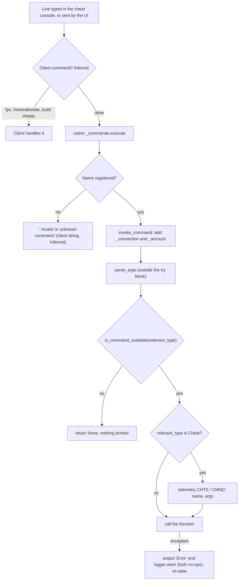

# 1.04 Debug tools, cheats and telemetry

*Game version 1.128.90.1030 (Steam, Linux/Proton). Installed packs EP04 (Cats & Dogs), EP06 (Get Famous), EP09 (Eco Lifestyle), EP12 (High School Years), GP04 (Vampires), GP12 (Werewolves), SP01 (Luxury Party) and SP42 (Grunge Revival). Commands, telemetry hooks and GSI handlers were counted from bytecode (every .pyc under core and simulation, including the modules that did not decompile); control flow the decompiler nested wrongly was read from disassembly. Tuning counts are the live tuning (the base delta build plus each installed pack's delta build); module tuning is named full or delta where the two differ. Native behaviour is read only from strings in Simulation_x64.dll and the game client. Checked 2026-10-12: 169 claims checked, 12 corrected, 1 relabelled, none removed. Deepened 2026-10-13: 119 modules newly explained, 5 failed decompiles read. Checked again 2026-10-13: 722 claims checked, 25 corrected, 2 relabelled, 0 removed. Cross-chapter edits 2026-10-13: 6 applied.*

## In plain words

The game has a text console. Every command the script side understands is a Python function with a decorator that gives it a name and a type, and the type decides who may use it. "Live" commands work for everyone at any time; most of them are never typed by a player, because the game's own interface sends them when you click a button. "Cheat" commands work only after `testingcheats true`. "Automation" commands work only when the game was started in EA's test automation mode, which players do not reach. "DebugOnly" commands, and every command whose author did not name a type, are not part of the retail game at all.

Turning cheats on is itself a Live command. It sets one switch that the save remembers, and a second switch that never turns off again and is sent to the client with every achievement and aspiration update. The first switch unlocks the Cheat commands and the shift-click cheat menu on Sims and objects. The famous money cheats are an exception: `motherlode`, `kaching` and `rosebud` are Live on PC and need cheats only on consoles. Several commands that players think of as cheats are Live too, such as editing any Sim in Create a Sim or adding a trait, because the interface itself uses them. The same goes for many commands the interface sends behind the scenes: typed by hand, they can bring any Sim to the lot, rename any Sim, or extend a vacation at whatever price the command is given, including nothing.

EA's developers also built a web inspector into the game (GSI, the Game Server Inspector), debug drawing in the 3D world, test automation hooks and a profiler. The retail build ships the code for all of these and switches them off: the inspector's web server is never created, the event logs it reads start disabled, and the debug drawing commands are either unregistered or limited to automation mode.

The game also builds telemetry: small named events such as "a cheat command ran", "household funds changed" or "a situation ended". The Python side fills in each event, adds who and where (Sim, household, zone, game time), checks it against a tuned rule list and hands it to the engine. What the engine does with it after that cannot be seen from Python. A separate A/B experiment service receives the player's test group and can give different starting buffs, dream content or pivotal moments per group.

## Key facts

- 1847 command names (1815 decorators plus 32 aliases) in 178 modules, counted from bytecode: 547 Live, 86 Cheat, 453 Automation, 132 DebugOnly and 629 with no type, which means DebugOnly.
- Only Live, Cheat and Automation commands register in retail: 1086 names before pack gates, 1010 in this install. The 761 DebugOnly names never register, and their decorator replaces the Python function with `None`. No runtime switch decides this: the DebugOnly test in the shipped bytecode is unconditional.
- Cheat and Automation commands are registered in retail and checked on every call. A refused call returns without any message.
- The command type never reaches the native console: native `register` takes a name, a description, a usage line and a handler, nothing else.
- `testingcheats` is Live. It sets `cheats_enabled` and the sticky `cheats_ever_enabled`, both saved in the save's account data; the sticky flag is sent to the client as `cheats_used` with achievement and aspiration goal updates.
- `motherlode` (+50000), `kaching` and `rosebud` (+1000) are Live on PC and Cheat on consoles (`console_type`). `money N`, which sets funds to exactly N, is Cheat everywhere.
- In retail `sims4.commands.output` is an empty function of two arguments. Only `cheat_output` and `CheatOutput` print to the console; `automation_output` goes to the automation system's own stream. So most command feedback is never shown: of 141 Live and Cheat commands in the 46 smaller command modules, 6 can print to the console. A call that passes `output` only the text raises `TypeError`, and 19 registered commands reach such a call on one error branch.
- The shift-click cheat menu offers the 99 live interactions tuned `cheat` True (62 cheat only, 37 cheat and debug). The 390 interactions tuned only `debug` True never show in retail.
- Tuning runs 62 commands through `do_command` (123 record uses). Every one that an ordinary interaction calls is Live; the Cheat, Automation and DebugOnly ones are called only from cheat or debug interactions.
- GSI is compiled out (`SUPPORT_GSI = False`): no HTTP server and no command buffer exist, even in automation mode. Its 132 handlers still register at import, and every archiver starts disabled.
- Debug visualization has 83 `debugvis.*` commands; 19 are Automation and 64 have no type, so a player can reach none of them.
- 114 telemetry writers (82 group tags) feed 202 hook call sites. A Cheat command writes `CHTS`/`CMND`; a cheat interaction writes `CHTS`/`NTRC`.
- The live telemetry rule list (14 rules) drops interaction begin and end, route failure, situation and inventory hooks. Its `FUND` and `OBJC` rules carry module tags no Python writer uses, so they can never match.
- The experiment service knows 11 experiment names; 5 have live mappings (module tuning in the base delta only) and 10 live loots or rewards test a group.
- The "cheat sheet" is the controls hint overlay (13 live hint rows in `UiTuning.CHEAT_SHEET_TUNING`) and has nothing to do with cheats; the `CheatSheetItem` instance type has no live instances.

## How it works

### The command decorator

**Observed** (`core/sims4/commands.py`; bytecode of `Command`, `is_valid_command`, `named_command` and `register`).

- **Signature.** `Command(*aliases, command_type=DebugOnly, command_restrictions=UNRESTRICTED, pack=None, console_type=None)`. The first alias is the name used in messages; every alias is registered.
- **Which type counts.** The decorator works out two types when the module is imported:
  - `relevant_type` is `console_type` when one is given and `paths.IS_DESKTOP` is false; otherwise it is `command_type`. `IS_DESKTOP` is True at module level and `paths.init` never changes it. **Inferred**: the DLL names `IS_DESKTOP` among its strings next to `paths`, so native code probably sets it per platform, leaving it True on PC, where the `command_type` counts.
  - `most_limited_type` is `min(command_type, console_type)` when a console type is given.
- **Validity.** `is_valid_command` returns False when `relevant_type` is DebugOnly, and False when `pack` is set and `sims4.common.are_packs_available(pack)` fails. Otherwise it returns True.
- **What the decorator returns.** For an invalid command `named_command` returns `None`. The decorated module-level name is therefore bound to `None`, so a DebugOnly function cannot even be called from other Python code in retail.
- **What "retail" means here.** There is no runtime release flag. `is_valid_command` compares with DebugOnly without reading any switch, and automation mode does not change it. What separates retail from EA's development build is in the compiled scripts: debug branches are cut to a constant False (`SUPPORT_GSI = False` and `SUPPORT_RELOADING_SCRIPTS = False and ...` in `core_services.py`, `affordance.debug and False` in `_can_show_affordance`, `if False or cheats_enabled` in the pie menu code, `if False:` around nexus archiving), and `output` has an empty body. No core or simulation .pyc keeps a module docstring, which a plain `python -O` build would keep. **Inferred**: the scripts were compiled with docstrings stripped; whether asserts were stripped too cannot be told, because an `assert` and an explicit `raise AssertionError` compile to the same bytecode, and about 40 functions still build an `AssertionError`. `paths.DEBUG_AVAILABLE` is unrelated: it is set only when the pydevd debugger can be imported, and no command code reads it.
- **When it runs.** The decorator runs when its module is imported, so a command exists only if its module is loaded. **Inferred**: the DLL's strings name `sims4.importer.utils`, `import_modules` and `import_modules_by_path`, so native code imports the script tree at start.
- **Registration.** For a valid command it builds `invoke_command`, sets the description to an empty string and the usage to the function's argument list, registers every alias, and returns the original function.
- **What native receives.** `register(name, restrictions, handler, description, usage, command_type)` calls native `_commands.register(name, description, usage, handler)` and nothing else. The type and the restrictions are dropped:
  - `add_command_type` and `add_command_restrictions` are empty functions;
  - `get_command_type` returns Live for every name;
  - `get_command_restrictions` returns UNRESTRICTED;
  - `get_command_info_gen` yields nothing.

**Observed** (Simulation_x64.dll strings). The native module documents `register(name, description, usage, callable) -> bool`, and also `unregister`, `execute`, `describe`, `output`, `automation_output` and `client_cheat`.

### Command types in retail

**Observed** (`CommandType` and `CommandRestrictionFlags` in `core/sims4/commands.py`; `is_command_available` in `server_commands/__init__.py`, read from bytecode because the decompile nests it wrongly).

| Type | Value | Registers in retail | A call runs when | Names |
|---|---|---|---|---|
| DebugOnly | 1 | never | never | 132 explicit + 629 untyped |
| Automation | 3 | yes | the game runs in automation mode | 453 |
| Cheat | 4 | yes | cheats are enabled, or automation mode | 86 |
| Live | 5 | yes | always | 547 |

`server_commands/__init__.py` replaces the core default (`lambda command_type: True`) with a check that runs in this order:

1. A type of Live or higher returns True.
2. A type of Cheat or higher returns True when `cheat_service.cheats_enabled` is set.
3. A type of Automation or higher returns True when `paths.AUTOMATION_MODE` is set.
4. Anything else returns False.

Because the comparisons are "or higher", a Cheat command also runs in automation mode without cheats.

`CommandRestrictionFlags` has UNRESTRICTED 0 and RESTRICT_SAVE_UNLOCKED 1. All 19 commands in `cas_commands.py` carry the flag, but retail drops restrictions at registration, so it has no effect there. **Observed**: `server/account_service.py: AccountService.check_command_permission(client_id, command_type)` returns `cheats_enabled` for Cheat commands and defers to the account for other types. No Python code calls it, and its name is not among the DLL's strings, which do hold native-to-Python callbacks such as `c_api_client_connect`. **Inferred**: nothing in the DLL calls it by name (see Limits).

### Running a command

**Observed** (bytecode of `invoke_command`, `parse_args` and `is_command_available`). **Inferred** where marked in the diagram: the client's own handling is native and not visible.

The order inside `invoke_command`:

1. The connection id and the account are passed in through the `_connection` and `_account` keyword arguments.
2. `parse_args` converts the words. It runs before the `try` block, so a bad argument raises straight to the native caller.
3. The availability check runs. A refusal returns `None` with no output and no log.
4. If the relevant type is Cheat, a `CHTS`/`CMND` telemetry hook records the command name (`name`) and `str(args)` (`args`).
5. The function runs. Any exception is passed to `output` and to `logger.warn`, both empty functions in retail (bytecode of `sims4/log.pyc`: `Logger.warn` only returns), then raised again.

**Observed** (`output`, `cheat_output`, `CheatOutput` and `AutomationOutput` in `commands.py`). `sims4.commands.output` is `pass` in this build. `CheatOutput` and `cheat_output` call native `_commands.output`, or log through `logger.always` when the connection is `NO_CONTEXT` (2^64 - 1). `AutomationOutput` calls `_commands.automation_output`, which the native documentation describes as writing "to the automation system's output stream" (Simulation_x64.dll strings), a different stream from the console's `output`. So the messages that commands print through `output`, which is most of them, never reach a retail player; `cheat.status`, `resetsim`, `death.toggle` and the other users of `CheatOutput` do. Cheat-type commands are no exception: the scenario cheats `scenarios.get_all_phases`, `get_all_active_goals`, `reset_goal` and `start_phase` write only through `output`, so with an active scenario they print nothing in retail, and without one they raise `TypeError` (see the one-argument `output` call under Unregistered and refused commands).

### Client commands and server commands

**Observed** (client strings in TS4_x64.exe, read as plain strings; native strings in Simulation_x64.dll; the command census).

- **Client help lines.** The client carries help lines for `fps { on / off }`, `fullscreen`, `headlineeffects { on / off }`, `resetsim <sim name>`, `testingcheats { true / false }`, `freerealestate { on / off }`, `casclockspeed { 0...10 } [IN CAS ONLY]`, `hovereffects { on / off }` and `matchspeedstereo { on / off }`.
- **Build mode help.** It also has help text for the build mode cheats: "MoveObjects cheat [<on/off>]", "Ignore Gameplay Unlocks cheat is %s", free build mode and showing hidden catalog objects.
- **Client-only names.** None of `fps`, `fullscreen`, `headlineeffects`, `freerealestate`, `casclockspeed`, `hovereffects` or `matchspeedstereo` is among the 1847 Python names. No .pyc contains `fulleditmode` or `moveobjects` either. These are handled by the client.
- **Names on both sides.** `resetsim` and `testingcheats` appear both as client help lines and as Python commands. **Inferred**: the client handles its own names and passes everything else to the server.
- **Feedback strings.** The client holds ": invalid or unknown command" and "Command failed". **Inferred**: these are the console's answers to an unknown name and to a raised error.
- **The server sending client commands.** `sims4.commands.client_cheat` sends one string to the client "to be executed as a client side cheat" (native doc string). For example, `sims.modify_in_cas` sends `sims.exit2cas <sim id> <household id> <active sim id>` this way.
- **Command scripts.** `command_script.run_script` reads a file under the app root, dropping anything after a `#`. A line starting with `|` goes to the server through `execute`; any other non-empty line goes to the client through `client_cheat`, or is dropped when there is no connection (its `logger.error` call is empty in retail) (bytecode; the decompile inverts the empty-line test). Zone spin-up runs such a file when the Python argument list contains `--on_startup_commands`, and `Zone.on_soak_end` runs one for `--on_shutdown_commands` (`zone.py`). **Inferred**: whether a retail launch option reaches Python's argument list is not visible.
- **Game options.** The client's string table also pairs `testingcheats` with an option key `CheatsEnabled`, in a list that pairs server commands with option keys (`sims.set_aging_unplayed_sims` with `AutoAgeUnplayed`, `dust.set_dust_enabled` with `DustSystem`, and so on). **Inferred**: a game options toggle sends the same command. `dust.set_dust_enabled` is gated on SP22 (Bust The Dust), which is not installed here, so in this install that option has no registered command.

### testingcheats and the cheat state

**Observed** (`server_commands/cheat_commands.py`, `services/cheat_service.py`, `achievements/achievements.py`, `aspirations/aspirations.py`; live module tuning).

- **`testingcheats` (Live).** Its argument defaults to `enable: bool = False`.
  - On a desktop build it applies the change at once.
  - On a console it applies at once when cheats were ever enabled or when it is switching cheats off. Otherwise it first shows `CheatDialogTuning.CONFIRM_CHEAT_DIALOG`, an OK/Cancel dialog, and enables cheats only on OK.
- **Applying the change.** Enabling calls `enable_cheats`, which sets `cheats_enabled` and `cheats_ever_enabled`, and prints "Cheats are enabled." through `CheatOutput`. Disabling clears only `cheats_enabled` and prints "Cheats are disabled.". Either way the new state is sent to the client as `CheatStatusUpdate` (`MSG_SET_CHEAT_STATUS`).
- **Saving.** `CheatService.save` writes both flags into `gameplay_account_data` of the save's account record, and `load` reads them back. The fields are covered in [8.04 The save file format](8.04-save-file-format.md) and the save flow in [1.02 Saves and persistence](1.02-saves-persistence.md).
- **Reporting.** `cheats_ever_enabled` is copied into `cheats_used` on every achievement tracker update (`ACCT_ACHIEVEMENT_TRACKER_UPDATE`) and every aspiration goals update (`SIM_GOALS_STATUS_UPDATE`) that is sent. An empty achievement update is not sent, and goal updates skip NPCs. What the client does with it is native and not visible.
- **The other cheat commands.**
  - `AutomationTestingCheats` (Live) does the same as `testingcheats` with no dialog.
  - `cheat.status` (Live) prints one of four states.
  - `cheat.force_error` (Live) logs a test exception.
  - `cheat.override_enabled` and `cheat.override_ever_enabled` are DebugOnly; `cheat.list` has no type.
- **Live tuning.** The base delta sets the confirm dialog's title and text string keys. The full build still holds a stale class `CheatCommandTuning`, with an `ENABLE_CHEATS_DIALOG` and a `JOKES` list of three strings, which the current code does not read.

### Argument parsing

**Observed** (`parse_args` and `_parse_arg` in `commands.py`; `server_commands/argument_helpers.py`; bytecode of `get_tunable_instance`).

- **Which arguments are converted.** Only parameters with a type annotation are converted, and the `*args` tail only when it is annotated. Unannotated parameters stay strings.
- **bool.** Accepts `t, true, on, 1, yes, y, enable` and `f, false, off, 0, no, n, disable`, in any case. Any other word raises `ValueError`.
- **int.** Parsed with `int(word, base=0)`, so `0x1A2B` and `0b101` work.
- **Other types.** Any other annotation is called with the word. When it fails, the error text (plus the first ten names for an enum) goes to `output`, which is silent in retail, and the exception is raised again.
- **CustomParam.** A `CustomParam` subclass can eat several words through `get_arg_count_and_value`. `SimInfoParam`, for example, accepts a sim id, or a first and last name. It compares both names ignoring case. It returns at once on a Sim whose first and last names both match (two words used), or on a first-name match whose last name is empty (one word). Otherwise it settles for another Sim with that first name and uses only one word (the decompile of this fallback is mangled, so which Sim wins there is not certain).
- **OptionalTargetParam.** Takes an object id. An empty value means the client's active Sim, and -1, -2, -3 and -4 mean the active lot, the current region, the active street's civic policy provider and the active venue's provider. `OptionalSimInfoParam` and `OptionalHouseholdParam` resolve the empty value to the active Sim info and the active household.
- **TunableInstanceParam(type).** Tries the instance manager's own lookup first. Then it returns a class whose name equals the word, ignoring case. Then it collects every class whose name contains the word: one match is returned, none or several raise `ValueError` (several also list the names). `none` returns `None`.

### Pack gates

**Observed** (`core/sims4/common.py`; the census). `pack=` takes one pack or a tuple. `are_packs_available` passes when ANY listed pack is available, and it is checked once, when the module is imported. 127 names are gated, 105 of them with a type that registers in retail. In this install 29 of those 105 belong to installed packs (EP09 (Eco Lifestyle) 27, EP12 (High School Years) 1, GP12 (Werewolves) 1), so 76 gated names do not register here.

| Pack | Live | Cheat | Automation | DebugOnly | untyped |
|---|---|---|---|---|---|
| EP01 (Get To Work) | 10 | | 2 | | |
| EP02 (Get Together) | 1 | | | | |
| EP05 (Seasons) | 2 | 3 | 2 | | 8 |
| EP05 or EP10 (Snowy Escape) | 1 | 3 | | | |
| EP07 (Island Living) | | 4 | | | |
| EP08 (Discover University) | 8 | | 2 | | 7 |
| EP09 | 16 | 1 | 10 | 1 | |
| EP10 | 2 | 1 | | | |
| EP11 (Cottage Living) or EP14 (Horse Ranch) | 1 | | | | |
| EP12 | 1 | | | 1 | |
| EP13 (Growing Together) | 2 | 1 | | | |
| EP15 (For Rent) | 7 | | | 3 | |
| EP16 (Lovestruck) | 3 | | 2 | | |
| EP17 (Life & Death) | 2 | | | | |
| EP18 (Businesses & Hobbies) | 2 | | 4 | | |
| EP19 (Enchanted by Nature) | 3 | | | 2 | |
| EP21 (Royalty & Legacy) | 4 | | 2 | | |
| GP09 (Journey to Batuu) | 1 | | | | |
| GP12 | 1 | | | | |
| SP22 (Bust The Dust) | 1 | | | | |

Most pack features are not gated this way. The EP06 (Get Famous) fame cheats (`famepoints`, `fame.set_freeze_fame`), for example, carry no `pack=`; `famepoints` instead checks at run time that the fame perk bucks type is loaded.

### Unregistered and refused commands

**Observed** (bytecode of the decorator and of `invoke_command`), with the native side **Inferred**.

- **DebugOnly or untyped command.** The name is never registered. The console answers with the client's unknown-command text (Inferred), and the Python name is `None`.
- **Pack-gated command without its pack.** Treated the same as an unregistered command.
- **Cheat command with cheats off, or Automation command outside automation mode.** The name is registered. `invoke_command` returns `None` before the function runs: no output, no log and no telemetry.
- **Bad argument.** The conversion raises before the `try` block, so the Python side logs nothing. The console's "Command failed" text is the likely result (Inferred).
- **A one-argument `output` call.** **Observed** (`core/sims4/commands.py`: `def output(s, context): pass`, argument count 2; a symbolic bytecode scan of all 2,845 .pyc files under core and simulation, which finds 31 such calls against 1,490 calls with two arguments, the same 31 the decompiled source shows). A call that passes only the text raises `TypeError` before the rest of its branch runs; `invoke_command` passes it to the empty `output` and `logger.warn` and raises it again, so the console's "Command failed" is the likely answer (Inferred). The 31 calls sit in 29 command functions and the helper `scenario_commands.get_active_scenario`. These commands register in this install (none carries a pack gate) and raise on the branch named, which is always a failure branch:
  - **Live:** `bucks.unlock_multiple_perks` (no bucks tracker found or created for that type and owner); `business.set_quality`, `business.refresh_configuration` and `restaurant.set_ingredient_quality` (no business manager for the current zone); `restaurant.show_menu_for_chef`, `restaurant.order_food_at_chef_station` and `restaurant.npc_order_food_at_chef_station` (no chef situation in the zone, once the Sims were found); `fame.turn_off_lifestyle_brand` (the Sim has no lifestyle brand tracker); `holiday.get_active_holiday_data` (no Sim info); `whims.refresh`, `whims.toggle_lock` and `whims.give_whim_from_whimset` (the Sim has no want tracker, which the message blames on its level of detail); `temple.unlock_next_room` (no temple zone director). **Inferred** from the live tuning, which holds no record of any temple or jungle class: the temple belongs to GP06 (Jungle Adventure), not installed, so here `temple.unlock_next_room` always raises.
  - **Cheat:** `scenarios.reset_active_phase`, `scenarios.start_phase`, `scenarios.get_all_phases`, `scenarios.reset_goal` and `scenarios.get_all_active_goals`, through `get_active_scenario`, when the active household has no active scenario (`start_phase` and `reset_goal` only after a valid argument). With no active household, or a household without a scenario tracker, the helper fails one step earlier, reading `active_scenario` from `None`.
  - **Automation:** `business.request_customer_situation` (alias `qa.business.request_customer_situation`), with no business manager.

  The other 15 commands with such a call never register: `layers.load_layer`, `graduation.set_current_graduate`, `set_waiting_graduate`, `set_current_valedictorian` and `set_waiting_valedictorian`, `fire.spawn_at_object`, seven `whims.*` commands (`activate_whimset`, `give_whim`, `give_whim_to_sim_and_target`, `complete_whim`, `refresh_all`, `clear_whimset_history`, `clear_whim`), and the DebugOnly `live_drag.toggle_force_enable` and `temple.show_room`.

### The command census

**Observed** (a small stack machine over every .pyc, which reads each decorator call, its keywords and the function it wraps; repeated independently by the first checker's scan and the second checker's symbolic stack scan of every .pyc, with identical results). All 89 modules without decompiled source were included. Decorators that exist only in bytecode: `server_commands/sim_commands` (106 decorators), `statistic_commands` (46), `memory_commands` (23), `performance/performance_commands` (47) and `user_account_data/user_account_data_commands` (5). No two commands share a name.

| | Decorators | Names with aliases |
|---|---|---|
| Live | 544 | 547 |
| Cheat | 83 | 86 |
| Automation | 443 | 453 |
| DebugOnly, explicit | 130 | 132 |
| No type (DebugOnly) | 615 | 629 |
| Total | 1815 | 1847 |

- **`console_type`.** Set on four decorators carrying five names. `sims.spawnsimple` and `sims.spawn` are Automation with console DebugOnly. `rosebud` (alias `kaching`) and `motherlode` are Live with console Cheat.
- **Where the decorators sit.** 1814 decorators are at module level. The 1815th, `mem.set_object_categories_checkpoint`, is inside an untyped function and never runs.
- **Four calls that are not decorators.** In four places EA code calls `sims4.commands.Command("message", _connection)` where `output` was meant: three in `restaurant.comp_order_for_sim` and one in `vet.bill_owner_for_treatment`. Each call builds a decorator and throws it away, so nothing happens; the census excludes them. All four sit on error paths (no such Sim, not on a restaurant or vet clinic lot, no business manager), so play reaches them only when the command fails, and the effect is the same as `output` in retail: silence.
- **Largest modules.** `server_commands/sim_commands` has 108 names, `object_commands` 92, `visualization_commands` 83, `business/business_commands` 74, `situation_commands` 71, and `statistic_commands` and `career_commands` 51 each.

The commands players actually use, with their effect read from the function body (the full list of 1,847 names is in the authors' working files, which are not published):

| Command | Type | Pack gate | Effect |
|---|---|---|---|
| `testingcheats true/false` | Live | | Enable or disable cheats; the argument defaults to false |
| `motherlode` | Live (console: Cheat) | | +50000 to the active Sim's household funds |
| `kaching`, `rosebud` | Live (console: Cheat) | | +1000 |
| `money N` | Cheat | | Set the Sim's household funds to exactly N |
| `resetsim First Last` | Live | | Reset the instanced Sim with that name, or print "Sim not found" |
| `sims.get_sim_id_by_name First Last` | Live | | Print the sim id |
| `traits.equip_trait T` | Live | | Add a trait; account reward traits must be granted |
| `traits.remove_trait T` | Live | | Remove a trait |
| `traits.clear_personality_traits` | Live | | Remove all personality traits |
| `sims.modify_in_cas` | Live | | Open Create a Sim for the Sim (client cheat `sims.exit2cas`) |
| `bucks.unlock_perk P true` | Live | | Unlock a perk; `true` makes it free |
| `stats.set_modifier`, `stats.solve_motive`, `stats.set_rank` | Live | | Add a statistic modifier, solve one motive, set a ranked statistic's rank |
| `interactions.push A` | Live | | Push any interaction by name or id on a Sim |
| `sims.remove_buff_from_all B` | Live | | Remove a buff from every instanced Sim |
| `cheat.status` | Live | | Print the cheat state |
| `stats.set_skill_level S N` | Cheat | | Set a skill level |
| `fillmotive M` | Cheat | | Fill one motive of the active Sim |
| `stats.fill_commodities_household` | Cheat | | Fill every commodity of the selectable Sims |
| `sims.fill_all_commodities` | Cheat | | Fill every commodity of every Sim |
| `households.disable_world_motive_decay` (and enable, household variants) | Cheat | | Stop or restart motive decay |
| `stats.set_stat S V` | Cheat | | Set any statistic on a Sim or the lot |
| `careers.promote`, `careers.demote` | Cheat | | Move a Sim one level in a career |
| `careers.add_career`, `careers.remove_career`, `careers.retire` | Cheat | | Join, leave or retire |
| `aspirations.complete_current_milestone` | Cheat | | Finish the next milestone of the primary aspiration |
| `sims.give_satisfaction_points N` | Cheat | | Add satisfaction points |
| `bucks.update_bucks_by_amount T N` | Cheat | | Add bucks of a type; refuses to go negative |
| `famepoints N`, `fame.set_freeze_fame` | Cheat | | Add fame perk points; freeze fame |
| `relationship.make_all_sims_friends` | Cheat | | Default relationship tracks (no romance) with every other Sim |
| `relationship.introduce_sim_to_all_others` | Cheat | | Introduce a Sim to everyone |
| `modifyrelationship A B N Track` | Cheat | | Add to a relationship track between two named Sims |
| `sims.add_to_family`, `sims.remove_from_family` | Cheat | | Move a Sim between households |
| `sims.remove_buff B` (alias `removeBuff`) | Cheat | | Remove a buff |
| `death.toggle`, `fire.toggle_enabled` | Cheat | | Turn death or fire off and on |
| `households.autopay_bills` | Cheat | | Toggle autopay for the active household: a bill delivered while it is on is settled without taking any money, and the flag is not saved (see [5.01](5.01-money-bills-rewards.md)) |
| `objects.consumables_infinite_toggle` | Cheat | | Toggle infinite contents for every consumable |
| `crafting.ingredients_required_toggle` | Cheat | | Craft without ingredients |
| `lifestyles.reset_all` | Cheat | | Reset a Sim's lifestyle statistics |
| `seasons.set_season`, `seasons.advance_season` | Cheat | EP05 | Change season |
| `weather.lightning_strike_here` | Cheat | EP05 or EP10 | Lightning at a point |
| `eco_footprint.set_eco_footprint_state` | Cheat | EP09 | Force the street's eco footprint |
| `clock.setspeed`, `lunar_cycle.set_locked_phase` | Live | | Game speed, a locked moon phase |
| `volcanic_eruption large/small` | Live | | Runs a schedule entry of the zone modifier `zoneModifier_lotTrait_VolcanicActivity`, which is EP07 (Island Living) patch data and not in this install's live tuning, so here the name lookup raises `ValueError` and nothing happens |

Automation commands players sometimes look for, such as `sims.add_buff`, `sims.modify_funds`, `households.modify_funds`, `sims.reset`, `sims.teleport` and `pyprofile.on`, are registered but always refused. `debug.eval`, `debug.exec` and `debug.god_mode` are untyped, so they do not exist in retail.

### The command modules, group by group

**Observed** (decompiled bodies of the 42 single-purpose modules under `server_commands/` that the first pass only listed, and of `situation_commands.py`; per-function decompile of `sim_commands.pyc`, `statistic_commands.pyc` and `memory_commands.pyc`, with `pydisasm` for the three functions that failed even per function). The commands of the bigger modules the chapter already covered (`object_commands`, `career_commands`, `interaction_commands` and the others in the File index) are not repeated here.

- **Scope.** 46 modules hold 533 decorators carrying 543 names. 272 decorators register in retail: 124 Live, 17 Cheat and 131 Automation (278 names with aliases). The other 261 (25 explicit DebugOnly, 236 with no type) never register; each group lists them by name under its table.
- **How to read Prints.** The column applies the output rule of Running a command above:
  - `console`: the body writes through `cheat_output` or `CheatOutput`, the only route that reaches a retail console;
  - `silent`: it writes only through `output` or `Output`, which are empty in retail (a body that calls `output` with the text alone raises `TypeError` on that branch instead; the commands that do are listed under Unregistered and refused commands);
  - `automation`: it writes through `automation_output`, which the native documentation calls "the automation system's output stream" (Simulation_x64.dll strings), so it is not the console either;
  - `UI`: it sends a message, an operation or a dialog to the client;
  - `none`: it writes nothing.

  A body that uses `CheatOutput` and `output` both is shown as `console`.
- **What players see.** Of the 124 Live commands, 49 write nothing, 50 write only through `output` (3 of them also to the automation stream), 18 answer the interface with a message, 1 writes only to the automation stream (`sims.set_active`) and 6 can print to the console: `resetsim`, `sims.get_sim_id_by_name`, `genealogy.show_archived_family_links`, `sims.whims_award_prize` and `sims.request_satisfaction_reward_list` (these two only when the Sim has no satisfaction tracker) and `sims.revert_modifiers_override` (only when some body parts cannot be restored exactly). None of the 17 Cheat commands here prints anything a player can read: 10 write only through `output` and 7 write nothing, so `money`, `fillmotive` or `stats.set_skill_level` succeed in silence.
- **Most Live commands are plumbing.** The client sends them when the player acts: route progress and route events (`animation.route_*`), live drag (`live_drag.*`), dialog and picker answers (`ui.dialog.*`), the event planner (`situations.start_situation_creation`, `situations.get_*`, `situations.create_gl`), saving (`persistence.*`), photo mode (`photography.get_photo_list`), the skewer (`sims.skewer_icon_activated`) and the game options (`sims.set_age_speed_option`, `autonomy.household`, `whims.set_whims_enabled`, `lifestyles.set_lifestyles_effects_enabled`, `bb.set_build_eco_effects_enabled`). The client's string table pairs several such commands with game option keys (see Client commands and server commands above).
- **Live commands that change the game without cheats.** The type check is the only gate, so each of these runs for anyone who types it:
  - `sims.summon_sim_to_zone` loads any Sim into the current zone (`SimSpawner.load_sim`);
  - `sims.set_first_name`, `sims.set_last_name` and `sims.set_packed_pronouns` rename any Sim info;
  - `zone.trigger_test_event` fires any `TestEvent` by number for a Sim (**Inferred**: this can advance any goal or aspiration objective that listens for that event);
  - `whims.give_whim_from_whimset` pushes a whim set onto a Sim, `whims.refresh` clears one want and refills the slots without it, and `whims.toggle_lock` locks or unlocks a want;
  - `drama.cancel_scheduled_node` cancels any scheduled drama node by uid, and `situations.end_tagged_situations` ends every running situation with a tag;
  - `genealogy.restore_archived_family_link` restores an archived family relationship bit;
  - `travel_groups.create_vacation` and `travel_groups.extend_vacation` take the price as an argument and charge exactly that: `create_travel_group_and_rent_zone` removes `cost` from the active household's funds only when it is non-zero, and `TravelGroup.extend_vacation` always calls `try_remove(cost)` (`travel_group_manager.py`, `travel_group.py`). The interface computes the price; typed with 0, the stay is free.
- **Familiar names that are not in retail.** `situations.create`, `drama.schedule_node`, `whims.give_whim`, `whims.complete_whim`, `pregnancy.clear`, `venues.set_venue`, `tuning.reload`, `royalty.give_royalties`, `stats.add_to_stat`, `stats.randomize_motives`, `sims.make_all_selectable` and `sims.take_out_loan` have no type; `loot.apply_to_sim` and `sims.set_familial_relationship` are DebugOnly. `animation.arb_complete` has no type either, while its partner `animation.arb_started` is Live.
- **Details read from the bodies.**
  - `stats.set_skill_level` steps up one level at a time (each level is set in turn, from the current level plus one to the target), and sets a lower level directly (`statistic_commands.pyc: set_skill_level`, per-function decompile).
  - `stats.disable_commodities` freezes a commodity with an autonomy modifier whose decay modifier for it is 0, and keeps the handle in a module dictionary; `stats.enable_commodities` removes that modifier (`_disable_commodities`).
  - `autonomy.household` accepts `on`, `true`, `full` or `3` for full autonomy, `medium` for medium, `limitedonly`, `la`, `off`, `false` or `1` for limited only, and `undefined` or `default` for undefined (`autonomy_commands.py: _parse_state`, read in bytecode because the decompile nests the first test oddly).
  - `situations.enable_perf_cheats` (Automation) freezes situation spawning and caps, disables the leave situation and NPC travel-leave, turns fire off, and sends to an inactive zone every Sim of a situation that is neither a zone director shift situation nor holds a member of the active household, then ends that situation (`situation_manager.py: SituationManager.enable_perf_cheat`). It also switches the Sim spawner service's own perf cheat (`situation_commands.py: enable_perf_cheats`).
  - The `soak.*` commands (Automation) repeat a soak party situation and maid and repair service requests on alarms (`SoakCommandsTuning`). The base delta sets the party situation (101358), the maid (15923) and the repair NPC (129477) and leaves the cooldowns at their code defaults of 1380, 1140 and 1020 Sim minutes; the full build still names `SOAK_MAID_SITUATION` and `SOAK_HANDYMAN_SITUATION`, which the code no longer has.
  - `sims.teleport` pushes the tuned `CommandTuning.TERRAIN_TELEPORT_AFFORDANCE`, while `sims.teleport_instantly` sets the Sim's location directly; both are Automation.
- **The three functions that failed even per function** (bytecode):
  - `sims.set_familial_relationship` (DebugOnly): parses the relationship as a `FamilyRelationshipIndex` name (an unknown one lists every name through `output`); for MOTHER or FATHER with a known second Sim it calls `set_parent_relation`, otherwise the genealogy tracker's `_set_family_relation` with the second Sim's id.
  - `stats.randomize_motives` (untyped): with no Sim it randomizes every initial commodity of every instanced Sim between the two bounds. With a Sim, the jump after the "Sim found" test lands on the function's return, so it does nothing: the loop for that case is unreachable in the shipped bytecode (**Inferred**: the cause of the decompiler's failure).
  - `mem.gc_dump` (untyped): collects garbage, walks every object and its referents, and writes `Index,Address,Size,Name,Repr` rows to `python_mem_dump.txt` (or the next free `python_mem_dumpN.txt`) in the current folder. A failure to turn an object into text stores "FAILED" in the size field instead of the text field.

#### Sims, households and family

Modules: `sim_commands`, `aging_commands`, `genealogy_commands`, `pregnancy_commands`, `outfit_commands`, `style_commands`, `role_commands`, `topic_commands`, `royalty_commands`, `loot_commands`.

| Command | Type | Prints | Effect |
|---|---|---|---|
| `sims.set_name_keys` | Live | none | Set a Sim's first and last name string keys |
| `sims.set_first_name` | Live | none | Rename a Sim's first name |
| `sims.set_last_name` | Live | none | Rename a Sim's last name |
| `sims.set_packed_pronouns` | Live | none | Set a Sim's custom pronouns |
| `sims.set_next` | Live | none | Select the next Sim of the household |
| `sims.set_active` | Live | automation | Select a Sim by id |
| `sims.get_travel_menu_info` | Live | UI | Send the travel menu's Sim list |
| `sims.remove_buff_from_all` | Live | silent | Remove a buff from every instanced Sim |
| `sims.reminisce_about_memory` | Live | silent | Push the memory's reminisce interaction |
| `sims.travel_to_specific_location` | Live | silent | Push the travel interaction to a lot and world |
| `sims.travel_to_friend` | Live | silent | Push the travel interaction to a friend's lot |
| `sims.visit_target_sim` | Live | silent | Switch zone to the target Sim's home |
| `sims.travel_to_target_sim` | Live | silent | Travel to the target Sim's zone |
| `sims.summon_sim_to_zone` | Live | silent, automation | Load any Sim into the current zone |
| `sims.whims_award_prize` | Live | console | Buy a satisfaction reward |
| `sims.request_satisfaction_reward_list` | Live | console | Send the reward store list |
| `resetsim` | Live | console | Reset the instanced Sim with that name |
| `sims.get_sim_id_by_name` | Live | console | Print a Sim's id |
| `sims.skewer_icon_activated` | Live | silent | Skewer icon click: an instanced human gets the tuned go-home interaction; a pet gets come-near (instanced) or bring-here (not instanced); a missing pet goes to the missing pet flow |
| `rosebud` | Live (console: Cheat) | none | +1000 funds; alias `kaching` |
| `motherlode` | Live (console: Cheat) | none | +50000 funds |
| `sims.send_gameplay_options_to_client` | Live | none | Send the game options (or their defaults) |
| `sims.inventory_view_update` | Live | none | Refresh a Sim's inventory view |
| `sims.revert_modifiers_override` | Live | console | Revert body shape changes made by modifiers |
| `sims.decrement_modifier_override` | Live | none | Step one shape modifier back by an amount |
| `sims.dump_modifiers` | Live | silent | List face and body modifiers (genetic, base, aged) |
| `sims.update_sim_info_tattoo_data` | Live | none | Apply tattoo parts from the tattoo editor |
| `sims.get_residents` | Live | UI | Send the resident list of a zone, roommates included |
| `sims.request_age_progress_update` | Live | none | Resend the Sim's age progress bar data to the client |
| `sims.set_age_speed_option` | Live | silent | Game option: set the aging speed (an `AgeSpeeds` value) |
| `sims.set_aging_enabled_option` | Live | silent | Game option: auto-aging for the played household |
| `sims.set_aging_unplayed_sims` | Live | silent | Game option: auto-aging for unplayed households |
| `genealogy.show_family_tree` | Live | automation, UI | Build and send the family tree message |
| `genealogy.show_archived_family_links` | Live | console | Print every archived and pinned family relationship bit, with how to restore it |
| `genealogy.restore_archived_family_link` | Live | none | Restore an archived family relationship bit between two Sims |
| `genealogy.unpin_family_link` | Live | none | Unpin a restored family bit |
| `outfits.set_sharing_mode` | Live | none | Set the mannequin group outfit sharing mode |
| `outfits.copy_outfit` | Live | none | Copy an outfit into another outfit category |
| `style.clear_style` | Live | none | Clear the style service's outfit data for a gender |
| `sims.add_to_family` | Cheat | silent | Move a Sim into a second Sim's household, or the active household when none is given |
| `sims.remove_from_family` | Cheat | none | Move a Sim out of a household of two or more into a hidden one |
| `sims.remove_buff` | Cheat | silent | Remove a buff; alias `removeBuff` |
| `sims.give_satisfaction_points` | Cheat | none | Add satisfaction points |
| `sims.fill_all_commodities` | Cheat | none | Fill every commodity of every Sim info |
| `money` | Cheat | none | Set funds to exactly N |
| `sims.get_all_instanced_sims` | Automation | automation | List the instanced Sim ids |
| `sims.spawnmaxsims` | Automation | silent | Spawn NPCs up to the soft cap through `sims.spawnsimple` |
| `sims.spawnmaxsimswithfilter` | Automation | silent | The same through a Sim filter |
| `sims.spawnsimple` | Automation (console: DebugOnly) | silent | Spawn N simple Sims at a point into a new, the active or a given household |
| `sims.spawn` | Automation (console: DebugOnly) | silent | Spawn Sims with a gender, age and household |
| `sims.destroy_all_household_sims_but_active_sim` | Automation | none | Destroy every other Sim of the active household |
| `sims.show_buffs` | Automation | silent, automation | List a Sim's buffs |
| `sims.add_buff` | Automation | silent | Add a buff |
| `sims.remove_all_buffs` | Automation | silent | Remove every removable buff from a Sim |
| `sims.teleport` | Automation | silent | Push the tuned terrain teleport interaction to a point |
| `sims.teleport_instantly` | Automation | silent | Set the Sim's location to a point directly |
| `sims.reset` | Automation | none | Reset a Sim |
| `sims.modify_funds` | Automation | none | Add or remove funds with any reason |
| `sims.hard_reset` | Automation | none | Reset a Sim (same body as `sims.reset`) |
| `sims.is_simulating` | Automation | automation | Report whether a Sim is simulating |
| `sims.age_up` | Automation | none | Run the Sim's auto-age callback (age up now) |
| `sims.age_down` | Automation | none | Reverse the Sim one age and reset the instanced Sim |
| `genealogy.generate_dynasty` | Automation | silent | Create N generations of ancestors for a Sim |
| `pregnancy.start` | Automation | none | Start a pregnancy between two Sims |
| `qa.pregnancy.is_pregnant` | Automation | automation | Report whether a Sim is pregnant |
| `pregnancy.force_offspring_count` | Automation | none | Force the number of babies of a pregnancy |
| `outfits.current_outfit_info` | Automation | automation | Report the Sim's current outfit category and index |
| `qa.role.current_active_role` | Automation | automation | Report a Sim's active role state |

Not registered in retail (86: D marks an explicit DebugOnly, the rest have no type): `sims.get_all_sims` (D), `sim_info.printrefs`, `sims.recreate`, `sims.make_all_selectable`, `sims.set_focus`, `sims.delete_focus`, `sims.clear_focus`, `sims.modify_focus_score`, `sims.disable_focus`, `sims.enable_focus`, `sims.force_focus_update`, `sims.print_focus`, `sims.print_focus_server`, `sims.test_focus`, `sims.set_focus_compatibility`, `sims.route_instantly`, `sims.resatisfy_constraint`, `sims.reset_multiple`, `sims.reset_all`, `sims.interrupt`, `sims.swimhere`, `sims.gohere`, `sims.allgohere`, `sims.test_avoidance`, `sims.path_test`, `sims.set_thumbnail`, `sims.clear_all_stats`, `sims.test_ignore_footprint`, `sims.test_polygonal_connectivity_handle`, `sims.test_connectivity_permissions`, `sims.test_connectivity_pt_pt`, `sims.test_raytest`, `sims.planner_build_id`, `sims.reset_periodically`, `sims.reset_random_sim_periodically`, `sims.changeoutfit` (D), `sims.get_buffs_ids_for_outfit`, `sims.set_familial_relationship` (D), `sims.toggle_random_spawning` (D), `sims.focus_camera_on_sim`, `sims.is_on_current_lot`, `sims.debug_apply_away_action`, `sims.debug_apply_default_away_action`, `sims.set_initial_adventure_moment_key_override`, `baby.set_enabled_state`, `sims.set_handedness`, `sims.set_grubby`, `sims.set_dyed`, `sims.set_messy_face`, `sims.test_path`, `sims.set_actor_type`, `sims.set_species`, `sims.test_jig`, `sims.raytest_3d`, `sims.take_out_loan`, `sims.set_ghost_colors`, `sims.find_premade_sim_info` (D), `sims.age_add_progress`, `sims.age_add_progress_percentage`, `sims.set_age_progress_percentage`, `sims.age_max_progress`, `sims.phase_up`, `genealogy.print` (D), `genealogy.find_relation`, `pregnancy.clear`, `pregnancy.seed`, `pregnancy.roll`, `pregnancy.roll_trait_genetics`, `pregnancy.impregnate_many_npcs`, `outfits.generate_outfit`, `outfits.switch_outfit`, `outfits.info`, `outfits.remove_outfit`, `outfits.get_tags`, `outfits.toggle_outfit_change_log`, `outfits.check_fashion_outfits_on_mannequin` (D), `outfits.check_thrift_store_inventory` (D), `role.add_role`, `role.remove_role`, `role.current_active_roles`, `topic.add_topic`, `topic.remove_topic`, `topic.remove_all_topics`, `royalty.give_royalties`, `loot.apply_to_sim` (D), `loot.apply_to_sim_and_target` (D).

#### Sim info level of detail and Sim filters

Modules: `sim_info_commands`, `sim_filter_commands`.

| Command | Type | Prints | Effect |
|---|---|---|---|
| `sim_info.lod.request_sim_info_lod` | Automation | silent, automation | Request a level of detail for a Sim info |
| `sim_info.lod.increment_sim_info_lod` | Automation | console, automation | Raise a Sim info's level of detail one step |
| `sim_info.lod.decrement_sim_info_lod` | Automation | console, automation | Lower it one step |
| `sim_info.lod.set_sims_to_minimum_lod` | Automation | console, automation | Set N Sim infos to minimum detail |
| `sim_info.lod.set_sims_to_lod` | Automation | console, automation | Set N Sim infos to a level of detail |
| `sim_info.lod.set_sims_in_household_to_minimum_lod` | Automation | console, automation | Set a household to minimum detail |
| `sim_info.lod.set_sims_in_household_to_lod` | Automation | console, automation | Set a household to a level of detail |
| `sim_info.lod.create_minimum_lod_sim_infos` | Automation | console | Create N minimum-detail Sim infos |
| `sim_info.lod.create_lod_sim_infos` | Automation | console | Create N Sim infos at a level of detail |
| `sim_info.print_lod_count` | Automation | console | Print the Sim info cap, the per-level caps and the count at each level |
| `sim_info.toggle_lod_name_into_callstack` | Automation | silent | Toggle the level-of-detail name in call stacks |
| `sim_info.reduce_to_num` | Automation | console | Delete Sim infos until N remain (players' Sims only when asked) |
| `sim_info.lod.override_cap_level` | Automation | console | Override the cap for one level of detail |
| `sim_info.lod.clear_override_cap_level` | Automation | console | Clear that override |
| `sim_info.remove_all_sims_of_species` | Automation | console | Delete every Sim info of one species |
| `filter.create` | Automation | automation, silent | Run a Sim filter and optionally spawn the results |
| `filter.create_household_from_template` | Automation | console | Create households from a household template |

Not registered in retail (10: D marks an explicit DebugOnly, the rest have no type): `filter.find`, `filter.find_household`, `filter.find_household_with_blacklist`, `filter.invite`, `filter.spawn_sim`, `filter.create_many_infos`, `filter.create_friends`, `filter.create_from_sim_template`, `filter.test_sim_template_generation`, `filter.create_sims_from_filter`.

#### Needs, statistics and skills

Modules: `statistic_commands`.

| Command | Type | Prints | Effect |
|---|---|---|---|
| `stats.set_modifier` | Live | silent | Add a statistic modifier |
| `stats.remove_modifier` | Live | silent | Remove it |
| `stats.solve_motive` | Live | silent | Run a full autonomy search limited to one motive and push the best interaction; when none is found, push the motive's tuned `commodity_autosolve_failure_interaction` |
| `stats.publish_ranked_stat_progress` | Live | silent | Send a ranked statistic's progress to the UI |
| `stats.set_rank` | Live | silent | Set a ranked statistic's rank |
| `lifestyles.set_lifestyles_effects_enabled` | Live | none | Game option: lifestyles on or off |
| `stats.horse_value_update` | Live | silent, UI | Send a horse's value |
| `stats.get_reincarnation_count` | Live | UI | Send a Sim's reincarnation count |
| `stats.fill_commodities` | Cheat | silent | Fill a Sim's commodities (visible only when asked) |
| `stats.fill_commodities_household` | Cheat | silent | The same for every selectable Sim |
| `stats.set_stat` | Cheat | silent | Set a statistic on a Sim or another target; alias `stats.set_commodity` |
| `fillmotive` | Cheat | none | Fill one motive of the active Sim |
| `stats.set_skill_level` | Cheat | silent | Set a skill level; going up it sets every level in between in turn |
| `stats.enable_commodities` | Cheat | silent | Undo `disable_commodities` for listed commodities |
| `stats.enable_all_commodities` | Cheat | silent | Undo it for all |
| `stats.disable_commodities` | Cheat | silent | Freeze listed commodities with a 0 decay modifier |
| `stats.disable_all_commodities` | Cheat | silent | Freeze every initial commodity of one or every Sim |
| `stats.enable_autosatisfy_curves` | Cheat | none | Turn on the autosatisfy curves of every commodity |
| `stats.disable_autosatisfy_curves` | Cheat | none | Turn them off |
| `stats.show_stats` | Automation | silent, automation | List a Sim's statistics |
| `stats.show_commodities` | Automation | silent, automation | List statistics and commodities |
| `qa.stats.show_commodities` | Automation | automation | The commodities in automation format |
| `stats.show_all_statistics` | Automation | silent, automation | Both lists in automation format |
| `stats.set_lot_level_stat` | Automation | silent | Set a statistic on one lot level |
| `stats.set_all_skills_max` | Automation | silent | Max every skill the Sim can have |
| `stats.get_rank` | Automation | silent, automation | Report it |

Not registered in retail (20: D marks an explicit DebugOnly, the rest have no type): `stats.show_static_commodities`, `mood.show_active_mood_type`, `stats.show_change`, `stats.tank_commodities`, `stats.add_to_stat`, `stats.add_stat_to_tracker`, `stats.remove_stat`, `stats.add_static_commodity_to_tracker`, `stats.remove_static_commodity_from_tracker`, `stats.clear_skill`, `stats.randomize_motives`, `stats.set_convergence`, `stats.reset_convergence`, `stats.set_commodity_percent`, `stats.set_ranked_commodity_percent_of_current_rank`, `stats.set_commodity_best_value`, `stats.set_all_sim_commodities_best_value_except`, `stats.count_commodities`, `stats.reset_daily_cap`, `stats.perform_end_of_day_behavior`.

#### Autonomy and wants

Modules: `autonomy_commands`, `whim_commands`.

| Command | Type | Prints | Effect |
|---|---|---|---|
| `autonomy.household` | Live | silent | Set the household's autonomy state (`on`, `full`, `medium`, `off`, `limitedonly`, `default`) for a settings group; the game options use it |
| `autonomy.set_autonomy_for_active_sim_option` | Live | none | Game option: autonomy for the selected Sim |
| `whims.refresh` | Live | silent | Replace a want with a new one; raises `TypeError` when the Sim has no want tracker |
| `whims.toggle_lock` | Live | silent | Lock or unlock a want; raises `TypeError` when the Sim has no want tracker |
| `whims.give_whim_from_whimset` | Live | silent | Push a whim set onto a Sim, so its wants are offered; raises `TypeError` when the Sim has no want tracker |
| `whims.set_whims_enabled` | Live | none | Game option: wants on or off |
| `autonomy.sim_randomization` | Automation | none | Set one Sim's autonomy randomization setting |
| `autonomy.household_randomization` | Automation | silent | Set the household's autonomy randomization |
| `autonomy.global` | Automation | silent | Set the global autonomy state for one settings group |
| `autonomy.global_randomization` | Automation | none | Set global autonomy randomization |
| `autonomy.global_all` | Automation | silent | Set the global autonomy state for every settings group |
| `autonomy.ambient` | Automation | silent | Toggle ambient NPCs (walkbys) on the account; alias `walkby.toggle` |
| `autonomy.override_full_autonomy_delay` | Automation | none | Override the delay between full autonomy pings and reset every autonomy timer |
| `autonomy.clear_full_autonomy_override` | Automation | none | Clear that override |
| `autonomy.override_full_autonomy_delay_after_user_action` | Automation | none | Override the autonomy delay after a player action |
| `autonomy.clear_full_autonomy_delay_after_user_action` | Automation | none | Clear that override |
| `autonomy.test_ping` | Automation | console | Run one autonomy ping on a Sim, optionally limited to one affordance, and print the choice |
| `qa.automation.start_autonomy_load_test` | Automation | none | Disable randomization, set every instanced Sim's motives to one value and start the autonomy load test |
| `qa.automation.start_single_sim_performance_test` | Automation | silent | Reset a Sim and start the single-Sim autonomy load test |
| `autonomy.show_queue` | Automation | console | Print the autonomy request queue |
| `qa.automation.show_queue` | Automation | automation | The same queue in automation format |
| `autonomy.show_update_times` | Automation | console | Print each instanced Sim's time until its next autonomy ping |
| `autonomy.distance_estimates.enable` | Automation | none | Start recording affordance distance estimates |
| `autonomy.distance_estimates.disable` | Automation | none | Stop recording them |
| `autonomy.distance_estimates.reset` | Automation | none | Reset the recorded times |
| `autonomy.distance_estimates.dump` | Automation | none | Write the recorded times to a file |
| `autonomy.distance_estimates.perform_timed_run` | Automation | none | Record for N seconds, then write the file |
| `autonomy.npc_autonomy` | Automation | none | Set one global NPC autonomy switch (`NPCAutonomyType`) |

Not registered in retail (24: D marks an explicit DebugOnly, the rest have no type): `autonomy.show`, `autonomy.sim`, `autonomy.show_timers`, `autonomy.clear_skipped_autonomy`, `autonomy.toggle_user_directed_interaction_full_autonomy_ping`, `autonomy.reset_autonomy_alarm`, `autonomy.run`, `autonomy.add_modifier`, `autonomy.remove_modifier`, `autonomy.update_sleep_schedule`, `autonomy.reset_multitasking_roll`, `autonomy.trigger_walkby` (D), `autonomy.set_anchor` (D), `autonomy.clear_anchor` (D), `autonomy.log_sim`, `whims.print_whimsets`, `whims.activate_whimset`, `whims.give_whim`, `whims.give_whim_to_sim_and_target`, `whims.complete_whim`, `whims.refresh_all`, `whims.clear_whimset_history`, `whims.offer_whims`, `whims.clear_whim`.

#### Situations, events, drama and travel

Modules: `situation_commands`, `drama_commands`, `travel_group_commands`, `zone_commands`, `calendar_commands`, `venue_commands`.

| Command | Type | Prints | Effect |
|---|---|---|---|
| `situations.set_situation_as_viewed` | Live | silent | Clear the "new" mark of a situation entry |
| `situations.get_situation_ids` | Live | UI | Event planner: send the situation ids the household may start |
| `situations.get_situation_data` | Live | UI | Event planner: send data for those situations |
| `situations.get_prepopulated_job_for_sims` | Live | UI | Event planner: send the pre-filled job assignments |
| `situations.get_preferred_activities` | Live | silent, UI | Event planner: send a job's preferred activities |
| `situations.get_sims_for_job` | Live | UI | Event planner: send the Sims available for a job |
| `situations.get_valid_situation_locations` | Live | silent, UI | Event planner: send the lots where it can take place |
| `situations.create_gl` | Live | silent, automation | Create a player event from the event planner: guest list as (job, Sim, purpose) triples, scoring, zone, time, style and colour tags |
| `situations.on_situation_goal_button_clicked` | Live | silent | Situation goal button pressed in the UI |
| `situations.refresh_goals` | Live | silent | Refresh the goals of every running situation |
| `situations.pre_destroy_user_facing_situation` | Live | silent | First step of ending a player-facing situation (all of them with no id) |
| `situations.destroy_user_facing_situation` | Live | silent | End a player-facing situation (all of them with no id) |
| `situations.make_greeted` | Live | silent | Mark a waiting player Sim as greeted |
| `situations.start_situation_creation` | Live | silent, UI | Open the event planner |
| `situations.start_situation_creation_for_edit` | Live | silent, UI | Open it to edit a scheduled event |
| `situations.activate_minimized_situation` | Live | none | Activate a minimized pivotal moment |
| `situations.activate_minimized_live_events` | Live | none | Activate minimized live events |
| `situations.reevaluate_minimized_situations` | Live | none | Re-test pending minimized situations |
| `situations.show_end_situation_dialog` | Live | silent, UI | Show the dialog that ends (or extends) an event |
| `situations.ui_element_interacted` | Live | none | Fire the `UiElementInteracted` test event with an element name |
| `situations.travel_situation_to_other_zone` | Live | silent | Move a running situation, found by tag and member, to another zone; without one, travel the Sim |
| `situations.change_situation_duration_by_amount` | Live | silent | Lengthen or shorten (minutes) a running situation found by tag and member |
| `situations.end_tagged_situations` | Live | silent | End every running situation with a tag that the Sim is in |
| `drama.travel_to_event_zone` | Live | none | Travel to a festival, or to an active venue event of that type |
| `drama.show_festival_info` | Live | none | Show a festival's info panel |
| `drama.show_festival_info_by_drama_node_uid` | Live | none | The same, by the scheduled or active node's uid |
| `drama.cancel_scheduled_node` | Live | silent | Cancel any scheduled drama node by uid (the calendar's cancel button) |
| `drama.travel_to_event` | Live | none | Push the venue event travel interaction to a zone |
| `travel_groups.create_vacation` | Live | silent | Rent a zone and create a vacation travel group; charges the `cost` argument |
| `travel_groups.end_stayover` | Live | silent | End a stayover and release its zone |
| `travel_groups.start_stayover_creation` | Live | silent, automation | Open the stayover creation flow |
| `travel_groups.extend_vacation` | Live | silent | Extend a vacation by N days and charge the `cost` argument; 0 days on a finished vacation ends it |
| `travel_groups.show_extend_vacation` | Live | none | Show the extend-vacation dialog |
| `travel_groups.end_vacation` | Live | silent | End a vacation |
| `zone.loading_screen_animation_finished` | Live | none | Client callback: the loading screen animation ended |
| `zone.trigger_test_event` | Live | none | Fire any `TestEvent` by number for a Sim |
| `calendar.set_favorite_calendar_entry` | Live | none | Mark a calendar entry favourite or not |
| `qa.situations.create` | Automation | automation | Create a situation with the Sim as host |
| `qa.situations.advance_phase` | Automation | automation | Move a situation to its next phase |
| `qa.situations.complete_goal` | Automation | automation | Force a named goal complete |
| `situations.list_jobs` | Automation | silent, automation | List a situation's jobs and their Sims |
| `qa.situations.num_sims_in_role_state` | Automation | automation | Count the Sims in a role state |
| `situations.active_goals` | Automation | silent, automation | List a situation's active goals |
| `qa.situations.info` | Automation | silent, automation | Report a situation's class, Sims, level, score and state |
| `situations.set_npc_soft_cap` | Automation | silent | Override the NPC soft cap; alias `sim_spawner_service.set_npc_soft_cap` |
| `situations.enable_perf_cheats` | Automation | silent | Performance switch: freezes situation spawning, disables the leave situation and NPC travel-leave, turns fire off, and sends home the Sims of situations that are neither shift situations nor hold a household member, ending those situations; alias `sim_spawner_service.enable_perf_cheats` |
| `situations.enable_welcome_wagon` | Automation | none | Resume or suspend the welcome wagon |
| `situations.get_situation_id` | Automation | silent, automation | Report the id of a running situation of a type |
| `drama.run_node` | Automation | silent | Run a drama node at once for an actor and an optional target |
| `drama.enable_drama_scheduler` | Automation | none | Turn the drama scheduler on |
| `drama.disable_drama_scheduler` | Automation | none | Turn the drama scheduler off |
| `qa.travel_groups.end_vacation` | Automation | automation | End the vacation of the travel group a Sim is in |
| `zone.gather_tick_metrics.start` | Automation | none | Start recording tick metrics |
| `zone.gather_tick_metrics.stop` | Automation | none | Stop and write them to a CSV |

Not registered in retail (58: D marks an explicit DebugOnly, the rest have no type): `situations.set_special_object`, `situations.create`, `situations.create_walkby`, `situations.create_with_predefined_guest_list`, `situations.create_for_venue` (D), `situations.allow_debug_situations`, `situations.destroy`, `situations.destroy_all_situations`, `situations.advance_phase`, `situations.complete_goal`, `situations.complete_goal_id`, `situations.excursions.advance_activity`, `situations.excursions.goto_activity`, `situations.save_load_test`, `situations.jobs`, `situations.show`, `situations.get_sim_score`, `situations.update_sim_score`, `situations.set_situation_score`, `situations.set_situation_medal`, `situations.add_score`, `situations.add_score_to_all`, `situations.set_constrained_goal_list`, `situations.test_end_score_callback`, `situations.test_situation_available`, `situations.reset`, `situations.change_user_facing_situation_duration` (D), `situations.force_loot_actions`, `situations.churn_jobs`, `situations.shift_change`, `situations.blacklist`, `situations.push_make_sim_leave_now_situation` (D), `situations.show_goal_by_id` (D), `situations.valid_goals` (D), `situations.enable_minimized_situations` (D), `drama.run_scheduled_node`, `drama.run_node_with_zone_id`, `drama.schedule_node`, `drama.show_scheduled_nodes`, `drama.show_active_nodes`, `drama.show_drama_calendar`, `drama.score_nodes`, `drama.print_scoring_info`, `drama.cancel_scheduled_node_by_type` (D), `drama.cancel_scheduled_node_by_instance` (D), `travel_groups.list`, `travel_groups.create`, `travel_groups.destroy`, `travel_groups.create_temporary_stay` (D), `zone.current_region`, `zone.refresh_feature_params`, `venues.set_venue`, `venues.get_venue`, `venues.test_all_venues`, `venues.print_venues`, `venues.change_zone_director`, `venues.print_zone_director`, `venues.clean_lot`.

#### Interface, camera, saving and photos

Modules: `ui_commands`, `camera_commands`, `persistence_commands`, `photo_commands`, `profanity_filter_commands`, `lighting_commands`, `live_drag_commands`, `buildbuy_commands`, `achievement_commands`, `localization_commands`, `mtx_commands`.

| Command | Type | Prints | Effect |
|---|---|---|---|
| `ui.dialog.respond` | Live | silent | Answer a dialog with a response id |
| `ui.dialog.pick_result_family_recipe` | Live | silent | Picker result with a family recipe name |
| `ui.dialog.pick_result` | Live | silent | Picker result |
| `ui.dialog.pick_result_definiton_and_count` | Live | silent | Picker result as definition ids and counts |
| `ui.dialog.text_input` | Live | silent | Text typed into a dialog field |
| `ui.toggle_silence_phone` | Live | none | Silence or unsilence the phone |
| `ui.check_for_phone_notification` | Live | UI | Set the phone badge when a phone interaction would pass its tests |
| `ui.send_phone_notification` | Live | UI | Send a phone notification for one interaction |
| `ui.create_hovertip` | Live | UI | Build an object's hover tip on request |
| `ui.dialog.multi_picker_result` | Live | none | Multi-picker result (text protobuf) |
| `ui.dialog.multi_picker_selection_update` | Live | none | Multi-picker selection change |
| `update.camera.information` | Live | none | Client report of the camera and target position and follow mode |
| `camera.focus_on_sim` | Live | silent | Focus the camera on a named Sim |
| `camera.focus_on_locator` | Live | silent | Focus the camera on a locator by id |
| `persistence.save_game` | Live | none | Save to the scratch slot (`check_cooldown` selectable) |
| `persistence.override_save_slot` | Live | none | Save over an existing slot |
| `persistence.save_to_new_slot` | Live | none | Save to a new slot |
| `persistence.save_game_with_autosave` | Live | none | Save, with the autosave slot id |
| `photography.get_photo_list` | Live | none | Client callback after photo mode: create the photos taken |
| `profanity_filter.check_text` | Live | silent | Run the native profanity filter and return the cleaned string |
| `profanity_filter.scan_text` | Live | silent | Count profanity violations in a string |
| `lighting.set_color_and_intensity` | Live | none | Light editor dialog update: colour and intensity |
| `lighting.showlighteditor` | Live | silent, UI | Open the light colour dialog for one light (0), every light in its room (1) or every light on the lot (2) |
| `lighting.auto_room_light_status` | Live | none | Turn the automatic lights of one room on or off |
| `live_drag.start` | Live | silent | Client callback: start dragging an object in live mode |
| `live_drag.end` | Live | silent | Client callback: drop it |
| `live_drag.canceled` | Live | silent | Client callback: drag cancelled |
| `live_drag.sell` | Live | silent | Client callback: sell the dragged object |
| `bb.set_build_eco_effects_enabled` | Live, EP09 | none | EP09 game option: eco footprint effects in build mode |
| `ui.dialog.pick_result_with_recipe_id` | Automation | silent | Picker result with a recipe id |
| `ui.dialog.auto_respond` | Automation | silent | Make every dialog answer itself |
| `qa.is_in_build_buy` | Automation | automation | Report whether the zone is in build/buy |
| `achievements.complete_achievement` | Automation | silent | Reset then complete an achievement for the Sim's account and send the tracker update |
| `localization.validate_strings` | Automation | silent, UI | Send every tuned string to the client for validation, per locale |

Not registered in retail (11: D marks an explicit DebugOnly, the rest have no type): `ui.dialog.notification_test`, `ui.trigger_screen_slam`, `camera.focus_on_position`, `camera.shake`, `live_drag.toggle_force_enable` (D), `bb.getuserinbuildbuy`, `bb.initforceexit`, `bb.forceexit`, `achievements.reset_data`, `achievements.list_all_achievements`, `mtx.show_pack_entitlements`.

#### Animation, routing and world plumbing

Modules: `animation_commands`, `placement_commands`, `broadcaster_commands`, `dynamic_area_commands`, `ensemble_commands`, `environment_score_commands`, `video_commands`, `timeline_commands`.

| Command | Type | Prints | Effect |
|---|---|---|---|
| `animation.arb_started` | Live | none | Client callback: an animation request block started playing (drift monitor) |
| `animation.route_complete` | Live | none | Client callback: a Sim finished a route (`route_finished`) |
| `animation.route_time_update` | Live | none | Client callback: progress along a route |
| `animation.route_event_executed` | Live | none | Client callback: a route event ran |
| `animation.route_event_skipped` | Live | none | Client callback: a route event was skipped |
| `animation.profile_boundary_condition_creation` | Automation | console | Switch boundary condition build profiling on or off |
| `animation.boundary_conditions.postures.build` | Automation | console | Build the boundary conditions of every posture |
| `animation.boundary_conditions.clear_cache` | Automation | console | Purge the ASM boundary condition cache |
| `animation.toggle_asm_name_into_callstack` | Automation | none | Toggle putting the ASM name into Python call stacks |
| `broadcasters.info` | Automation | silent | List the broadcaster caches (game time and real time) |
| `timeline.list` | Automation | silent | List the elements scheduled on the Sim timeline (not alarms) |
| `timeline.clear` | Automation | none | Hard-stop every scheduled element except alarms |
| `timeline.hard_stop` | Automation | silent | Hard-stop one element by index |
| `timeline.soft_stop` | Automation | silent | Soft-stop one element by index |

Not registered in retail (29: D marks an explicit DebugOnly, the rest have no type): `animation.asm_describe`, `animation.set_parent`, `animation.arb_log.enable`, `animation.arb_log.disable`, `animation.boundary_condition.add_log`, `animation.boundary_condition.clear_log`, `animation.list_parameter_sequences`, `animation.list_asm_params`, `animation.set_shave_time`, `animation.arb_complete`, `animation.toggle_asm_parameter_logging`, `animation.control_rotation_lookat` (D), `placement.in_navmesh`, `placement.output_slot_set`, `placement.category_flags`, `placement.test_placement`, `placement.test_current_placement`, `placement.has_floor`, `carry.get_carried_objects`, `broadcasters.add`, `debug.force_block_dynamic_area` (D), `ensembles.create_ensemble`, `ensembles.remove_sim_from_ensemble`, `ensembles.get_sims_in_sims_ensembles`, `environment_score.enable`, `environment_score.disable`, `video.object_info`, `video.set_clips`, `video.add_clips`.

#### Developer and QA tools

Modules: `memory_commands`, `profiler_commands`, `perf_test_commands`, `soak_commands`, `tuning_commands`, `career_automation_commands`.

| Command | Type | Prints | Effect |
|---|---|---|---|
| `mem.py_gc_dump` | Automation | console | Dump the garbage collector's objects to a file |
| `mem.py_tree_dump` | Automation | console | Dump the Python heap as a tree from labelled roots |
| `mem.py_garbage_dump` | Automation | console | Collect with DEBUG_SAVEALL and dump the garbage |
| `mem.py_summary` | Automation | console | Print memory by category, group and system |
| `mem.py_summary_file` | Automation | console, automation | Write that summary to `python_mem_summary-<time>.csv` |
| `mem.analyze_slots` | Automation | console | Write a CSV of memory per class and what `__slots__` would save |
| `mem.record_python_memory.start` | Automation | console | Repeatedly send the client `memory_dump` and `py.heapcheckpoint` |
| `mem.record_python_memory.stop` | Automation | none | Stop that alarm |
| `mem.tracemalloc_save_snapshot` | Automation | console | Save a tracemalloc snapshot |
| `mem.tracemalloc_dump_stats` | Automation | console | Dump or compare tracemalloc snapshots |
| `mem.tracemalloc_start` | Automation | console | Start tracemalloc |
| `mem.tracemalloc_stop` | Automation | console | Stop it |
| `mem.tracemalloc_print_memory` | Automation | console | Print tracemalloc memory |
| `mem.debugmallocstats` | Automation | console | Write the Python allocator statistics to the process's stderr (`sys._debugmallocstats`) and print `gc.get_mem_info` |
| `pyprofile.on` | Automation | none | Start the Python profiler |
| `pyprofile.off` | Automation | none | Stop and flush it |
| `pyprofile.flush` | Automation | none | Flush its output |
| `soak.enable_soak_party_situation` | Automation | console | Repeat the soak party situation every `SOAK_PARTY_COOLDOWN` Sim minutes |
| `soak.create_soak_party_situation` | Automation | none | Start one soak party |
| `soak.enable_soak_maid_situation` | Automation | console | Request the maid every `SOAK_MAID_COOLDOWN` Sim minutes |
| `soak.create_soak_maid_situation` | Automation | none | Request the maid once |
| `soak.enable_soak_handyman_situation` | Automation | console | Request the repair service every `SOAK_HANDYMAN_COOLDOWN` Sim minutes |
| `soak.create_soak_handyman_situation` | Automation | none | Request it once |
| `soak.super_size` | Automation | console | Turn on all three repeats |
| `soak.cancel_super_size` | Automation | none | Cancel every soak alarm |
| `tuning.load_pack` | Automation | silent | Hot-load a pack's tuning |
| `tuning.unload_pack` | Automation | none | Hot-unload a pack's tuning |
| `career_automation.schedule_work_now` | Automation | silent, automation | Start a career work session now |
| `career_automation.skip_first_day_flow` | Automation | silent, automation | Mark the career's first day as attended |
| `career_automation.get_career_end_time` | Automation | silent, automation | Report when the current shift ends |
| `career_automation.cancel_interactions_on_children` | Automation | silent, automation | Cancel every interaction on an object's children |

Not registered in retail (23: D marks an explicit DebugOnly, the rest have no type): `mem.get_objects`, `mem.get_object_categories`, `mem.get_game_object`, `mem.get_referents`, `mem.get_referrers`, `mem.gc_dump`, `mem.clear_merged_tuning_manager`, `mem.print_leak_chain`, `mem.set_object_categories_checkpoint`, `profile_util.clear_profile_utils`, `profile_util.main_profile`, `profile_util.posture_graph_profile`, `profile_util.test_caches_profile`, `tuning.inspect`, `tuning.import`, `tuning.print_debug_statistics`, `tuning.reload`, `tuning.localwork.refresh_cache`, `tuning.localwork.analyze`, `tuning.resend_clock_tuning`, `tuning.print_load_cache_info`, `tuning.dump_load_cache`, `tuning.dump_tuning_dependencies_cache`.

### Commands run from tuning

**Observed** (`DoCommand` in `interactions/utils/tunable.py`; live census).

The `do_command` basic extra calls `sims4.commands.execute(command + arguments, first client id)`, which goes through the native console and back into `invoke_command`. A tuned command therefore passes the same availability check as a typed one. Its tuning-time check (`_verify_tunable_callback`) asks `get_command_type`, which is a stub in retail, so it checks nothing there.

The live tuning runs 62 distinct commands from 123 (record, command) pairs. Sorted by type:

- **Live, 35 commands.** These are called from ordinary interactions (and `sims.modify_in_cas_with_householdId` also from `cheat_modify_in_cas`). One use sits in an object record: `object_drink_DraughtOfReconfiguration` runs `bucks.lock_all_perks_for_bucks_type`. Examples: `civic_policy.street.vote` (EP09), `sims.modify_in_cas_with_householdId`, `outfits.copy_outfit`, `careers.cancel_current_gig`, `bucks.lock_all_perks_for_bucks_type` and `vet.bill_owner_for_treatment`.
- **Cheat, 14 commands.** All are called from interactions tuned `cheat` or `debug`. Examples: `cheat_make_me_happy` runs `stats.fill_commodities`, and `debug_Reset` runs `objects.reset`.
- **Automation, 6, and untyped, 7.** These are called only from interactions tuned `debug` (`debug_ObjectDestroy`, `ageUp_IPCTYAE_Debug`, `debug_ForceException` and others), which never show in retail.

So no player-visible interaction is silently broken by a command type.

### The shift-click cheat menu

**Observed** (`ScriptObject._can_show_affordance` from bytecode; `should_generate_pie_menu` and `has_choices` in `server_commands/interaction_commands.py`; `aop.execute_interaction`; live tuning).

- **What the server decides.** When the player shift-clicks, `should_generate_pie_menu` returns `SHOW_DEBUG_PIE_MENU` only if `cheats_enabled` is set (the code reads `False or cheats_enabled`). This is tested before the queue, so the cheat menu opens even when the interaction queue is full. Otherwise the server builds the normal menu and forces `shift_held` to False. `has_choices` follows the same gate for the hover cursor.
- **Which affordances qualify.** `_can_show_affordance(shift_held, affordance)`:
  - With shift held, an affordance with `cheat` True is shown and every other one is left out, so the cheat menu holds only cheat interactions.
  - An affordance with `debug` True meets a stripped constant (`debug and False`) in that branch, so it is never shown.
  - Without shift, only affordances that are neither `cheat` nor `debug` are shown.
  - `cheat` is tested first, so an interaction tuned both `cheat` and `debug` does show in the cheat menu.
- **Live counts.** Of 13,983 live interactions, 62 are tuned `cheat` only, 37 `cheat` and `debug`, and 390 `debug` only (top-level fields, read through shared references). The 99 cheat interactions include:
  - the 12 utility adders (power and water, consumption and production, three sizes each);
  - 7 reputation setters;
  - 6 gardening state pickers;
  - 5 pond denizen cheats;
  - add to family and remove from family, make dirty and make clean, refill consumable, motive decay on and off, fill motives;
  - three fame cheats (freeze, rank up and rank down) and two fame quirk pickers;
  - `terrain-teleport` (teleport here);
  - `forceMarriageInteraction`.
- **Telemetry.** `aop.execute_interaction` writes a `CHTS`/`NTRC` hook (fields `name` and `trgt`) whenever an interaction tuned `cheat` runs.

**Observed** (`interactions/cheats/force_marriage_interaction.py`, bytecode of `_get_all_spouse_for_sim`; live record 147864 in the base delta). `ForceMarriageInteraction` is an immediate super interaction tuned `cheat` only.

- **Finding spouses.** For a Sim it counts as spouses that Sim's `spouse_sim_id`, every Sim whose `spouse_sim_id` is that Sim, and every Sim holding the marriage relationship bit with it in either direction.
- **Menu entries.** `potential_interactions` offers one entry for each spouse found this way on the clicked Sim, plus a "clear all" entry named by `clear_all_marriage_interaction_name`. It is a repair tool for inconsistent marriage data; it cannot marry two Sims who have no link yet.
- **What it does.** `enforce_marriage` removes the marriage bit, both ways, between the clicked Sim and every spouse found. For a spouse entry it does the same for the chosen spouse and then adds the bit in both directions between the two; "clear all" stops after the removal.

### The money cheats

**Observed** (per-function decompile and bytecode of `server_commands/sim_commands.pyc`, which failed as a whole; bytecode of `Funds._update_money`).

- **The commands.** `rosebud` and `motherlode` call `modify_fund_helper(1000)` and `modify_fund_helper(50000)` on the client's active Sim, with reason `TELEMETRY_MONEY_CHEAT`; `kaching` is a second name on `rosebud`'s decorator. `money N` computes N minus the current funds and passes the difference to the same helper. The helper adds a positive amount and calls `try_remove` for a negative one.
- **Telemetry.** Every non-zero funds change runs `_update_money`, which writes a `FUND`/`FMOD` hook with the amount (`amnt`), the reason (`resn`) and the new balance (`fund`). So each money cheat leaves a hook with the cheat reason. On PC no `CHTS`/`CMND` hook is written for these three, because their relevant type there is Live.

### GSI: the Game Server Inspector

**Observed** (`core/sims4/core_services.py`, with `SUPPORT_GSI = False` confirmed in bytecode; `sims4/gsi/dispatcher.py`, `http_service.py`, `command_buffer.py`, `schema.py`; the `command` handler in `gsi_handlers/command_handlers.py`).

- **What GSI is.** EA's inspector serves JSON over HTTP from inside the game.
  - `HttpService` answers GET requests on 127.0.0.1 (or the LAN address with `--gsi_use_lan`) on a port the system picks. It supports JSONP callbacks and sends a permissive CORS header.
  - Each path maps to a handler in `dispatch_table`. `handle_request` drops a request whose `zone_id` names an unknown zone.
  - The `directory` handler lists every schema. The `command` handler queues any console command through the `CommandBufferService`, which swaps `sims4.commands.output` for a capture while the command runs.
- **Whether it is active.** No. `start_services` creates `CommandBufferService` and `HttpService` only when `SUPPORT_GSI` is true, and it is False in this build. `http_service()` therefore returns `None`, and `start_http_server` does nothing. `command_buffer_service()` raises `RuntimeError` ("The CommandBufferService is not available") while the flag is False. `gsi.start` and `http_debug_server.start` (both Automation) hand their work to a callback that runs once the server is up, so it never runs: `gsi.start` would have sent `MSG_GSI_OPEN` with the server's address to the client from that callback.
- **How handlers register.** `@GsiHandler(path, schema)` wraps the function, parses query arguments against its signature, turns exceptions into an empty list, and adds the wrapper to `dispatch_table` at import. Retail does this too. The decorator itself returns `None` (bytecode of `_generate_handler`), so every decorated handler's module name is `None`, exactly like a DebugOnly command.
- **Schemas.** `GsiGridSchema` and the graph schemas declare fields, filters, linked sub-tables (`add_has_many`) and "view cheats": buttons that run a console command for the selected row. `add_cheat_schema` adds the global cheat panels `global_object_cheats` and `global_sim_cheats`.
- **The census** (from bytecode):
  - 132 `GsiHandler` registrations: 80 in `gsi_handlers` (17 of them in `sim_handlers.pyc`, which did not decompile) and 52 in 42 modules elsewhere (bucks, fame, relationships, sickness, restaurants, weather, the moon cycle and others). One of the 52 is the dynamic registration in `archive.register_archive_type`, one the dispatcher's `directory`.
  - 78 `GameplayArchiver` instances: 61 in `gsi_handlers` and 17 elsewhere. Two more archivers are built from subclasses: `situation_log` (`SituationDataArchiver`, a `GameplayArchiver`) and the timeline handle archiver (`TimelineHandleArchiver`), 80 in all.
  - Each `Archiver` adds two handler paths of its own when it is built: its `_toggleLog` switch and, through `register_archive_type`, its archive. The live dispatch table therefore holds more paths than the 132 decorators.
  - 2 cheat schemas.
- **What it exposes**, grouped by area (The GSI handler modules below has one row per module):
  - Sims: buffs and moods, skills, commodities, outfits, walkstyles, wants, aspirations, careers, milestones, culling and lifetime events, time lines.
  - Interactions: the interaction archive, autonomy scoring, content sets, pie menu generation, picker results, the posture graph and transition paths, animation and balloons.
  - Routing: planner, build, find-good-location, object and Sim route and goal archives, route events.
  - Society: social groups, ensembles, clubs, dynasties, relationship metrics and culling.
  - Situations and story: situations and bouncer, drama nodes, pivotal moments, story progression, zone directors, NPC services, Sim filters and the spawner.
  - Objects and world: objects, object definitions and removals, lost and found, inventories, state triggers, broadcasters, lots and lot levels, zones and zone modifiers, households, businesses, object games.
  - Engine: alarms, clock speed changes, timeline handles, distributor operations, the service manager, tuning tables (slot types, buffs, interactions, states, animation elements, traits) and performance metrics.

### Archivers and GSI dumps

**Observed** (bytecode of `sims4/gsi/archive.pyc`, rescued per function; `gsi_handlers/gameplay_archiver.py`, `gsi_dump_handlers.py`, `dump.py`; `server_commands/developer_commands.py`).

- **Records.** An archiver keeps a rolling list of records (zone id, object id, timestamp, game time, a unique id and zlib-compressed JSON). The list is trimmed to `ARCHIVE_MAX_RECORDS` (default 50, set by `gsi.set_max_gsi_log_entries`).
- **Off by default.** `BaseArchiver.__init__` sets `_archive_enabled = False` in both branches: the code that honoured `enable_archive_by_default` is stripped from the bytecode. An archiver turns on only through a GSI toggle (the path suffix `_toggleLog`), `set_archive_enabled` (called once per named archiver by `gsi.enable_archivers`, untyped), or `set_all_archivers_enabled` (`gsi.enable_all_logging`, Automation, which also turns dump-on-save on). When turning archivers on, `set_all_archivers_enabled` skips every archiver that was not built with `add_to_archive_enable_functions` set (bytecode).
- **Start-up arguments** (`zone_spin_up_service.py`, `paths.py`). `--no_gsi_archiving` sets `paths.NO_GSI_ARCHIVING` and, in automation mode, switches every archiver off. `-UseNexus` would call `enable_nexus_archiving` (which turns on the interaction, outcome and buff archives), but that call sits behind `if False`.
- **Retail cost.** `archive()` returns at once when its archiver is disabled, and many callers test `archiver.enabled` before building a record at all.
- **GameplayArchiver.** Adds per-Sim filtering and keeps records of at most `MAX_DELETED_SIM_RECORDS` = 10 deleted Sims.
- **Registering an archive** (`archive.pyc: register_archive_type` and its inner `archive_handler`, read from bytecode because both fail to decompile even per function). Each archiver type becomes one GSI path, its type name with leading and trailing slashes stripped (`strip("/")`), registered with `suppress_json`. A type registered a second time silently replaces the first schema (the `logger.error` call there is empty in retail). The schema is marked `archive`, `perf_toggle` and `unique_field` "uid", and always starts with five fields: zone id, object id, a time stamp that is the x axis and is sorted by `uid`, game time and the uid; all but the time stamp are hidden. The archiver's own schema follows. Records sit in one list, or in one list per object when the archiver is Sim-specific (`partition_by_obj`).
- **Reading an archive.** The handler takes optional `zone_id`, `object_id` (or `sim_id`), `timestamp`, `uid` and `uncompress`. It skips records of another zone or object, and records at or below the given uid, so the inspector can poll for new records only; a GSI client older than version 2 (`CLIENT_GSI_ARCHIVE_UID_FIX`) filters by time stamp instead. With `uncompress` it returns one JSON list of the decompressed records, otherwise the compressed records. A `MemoryError` returns an empty list; the `logger.error` call that would report the record count is empty in retail.
- **Dumps.** `gsi.dump` (Automation) writes every archive and the dumpable handler outputs to a compressed file under the app root (or a given folder) through `gsi_handlers.dump.save_dump_to_location`. It returns at once when `paths.NO_GSI_ARCHIVING` is set. Related commands dump on save and on an error.

### The GSI handler modules

**Observed** (each module under `gsi_handlers/` read for its `GsiHandler` registrations, archivers, schema labels and view cheats, plus a search of the decompiled source for the modules that write to each archiver; `sim_handlers.pyc` per function and, for the one function that still failed, in bytecode).

- **Two kinds of page.** A handler (H) computes a live view when the inspector asks for it, by reading managers and trackers. An archiver (A) is written to by game code while the game plays, through `archive(...)` calls placed in that code, and the inspector reads the stored records back. In retail neither does anything: no server exists to ask a handler, and every archiver starts disabled (see Archivers and GSI dumps above).
- **`enable_archive_by_default` is dead.** In these modules eight archivers ask to be on by default (`reset_log`, `removed_statistics`, `sim_spawner_service_log`, `object_route`, `sim_route`, `sim_info_lifetime`, `sim_info_culling`, `service_manager`), and `picker_log` asks to be off. The flag no longer reaches `_archive_enabled` (see above), so they are all off.
- **Record caps.** An archive keeps the larger of the global `ARCHIVE_MAX_RECORDS` (default `ARCHIVE_DEFAULT_RECORDS`, 50) and its own `max_records` (`archive.pyc: Archiver.archive`, read from bytecode: the per-function decompile nests the trim inside the `_max_records` test, but the trim runs on every call). In `gsi_handlers` nine archivers set their own: `removed_statistics` 10000, `reset_log` 500, `Distributor` 250, `greeting_archive` 200, `story_progression_pass` 200, `SimDistributor` 150, and `bouncer_archiver`, `zone_director` and `sim_spawner_service_log` 100 each. Three archivers outside `gsi_handlers` set caps too: `interactions` 200 (`sims/sim_log.py`), `crafting` 200 (`crafting/crafting_handlers.py`) and `object_routing_queue_log_archiver` 100 (`routing/object_routing/object_routing_handlers.py`).
- **View cheats.** Many pages carry buttons that run a console command on the selected row, such as `careers.promote`, `sims.add_buff`, `whims.clear_whim` or `objects.destroy`. **Inferred**: the inspector sends them to its `command` handler, which queues them in the command buffer, so they pass the same type check as typed commands.
- **Fed from.** The last column names the decompiled modules that import the archiver module. Four archive paths have no such importer. `sim_info_culling` and `sim_filter_service_archive` are written from modules that did not decompile (`story_progression/story_progression_action_sim_info_culling.pyc` and `filters/sim_filter_service.pyc` name them in their bytecode). `speed_change_log` (`clock_handlers.archive_speed_change`) and `small_business_archiver` (`small_business_handlers.archive_small_business_event`) are named by no other .pyc, so nothing in the scripts writes them.
- **`sim_handlers.pyc`** (did not decompile; read per function and from bytecode). It registers 17 handlers: `static_commodity_view`, `skill_view`, `commodity_data_view`, `autonomy_timer_view`, `sim_infos_toolbar`, `sim_infos`, `interaction_state_view`, `posture_state_view`, `ui_manager_view`, `sim_social_group_view`, `mult_motive_view`, `sim_buffs_view`, `buff_list`, `sim_traits_view`, `sim_vital_view`, `commodity_and_stat_view` and `sim_dynasty_view`. It also builds the `global_sim_cheats` panel with three buttons: "Make All Sims Happy" (`sims.fill_all_commodities`), "Reset All Sims" (`sims.reset_all`) and "Show Focus Visualization" (`debugvis.look_ats.start`). The per-Sim buttons sit on the Sim Info page as view cheats: Focus Camera (`sims.focus_camera_on_sim`, also on double click), Age Up (`sims.age_up`), and Raise LOD and Drop LOD (`sim_info.lod.increment_sim_info_lod` and `decrement_sim_info_lod`). The module also builds a motive archiver whose enable function starts a repeating alarm every `TimeSpan(5000)`; each tick it stores the six motives `motive_fun`, `motive_social`, `motive_hygiene`, `motive_hunger`, `motive_energy` and `motive_bladder` of every instanced Sim. At the 25 ticks per Sim second of `date_and_time.REAL_MILLISECONDS_PER_SIM_SECOND` that alarm is 200 Sim seconds (derived).
- **The Sim picker** (`generate_sim_info_toolbar_data`, bytecode). It returns one entry per Sim info: the sim id in hex, the name (first and last name joined by a space, or the info's `full_name` when both are empty), and the selectable and instanced flags. Entries come in three blocks, each sorted by name: selectable Sims, then other instanced Sims, then Sims that are not instanced.

| Module | GSI paths (H live view, A archive, with record cap) | Pages | Archive fed from; view cheats |
|---|---|---|---|
| `gsi_handlers/achievement_handlers.py` | H `achievement_view`, A `achievement_events` | Achievements; Achievement Events | `achievements/achievements.py`, `event_testing/event_data_tracker.py`; cheats: `achievements.complete_achievement` |
| `gsi_handlers/alarm_handlers.py` | H `alarms` | Alarms | - |
| `gsi_handlers/ambient_handlers.py` | A `ambient` | Situations/Ambient Log | `situations/ambient/ambient_service.py` |
| `gsi_handlers/animal_preference_handlers.py` | H `animal_preferences` | Animal Preferences | - |
| `gsi_handlers/animation_archive_handlers.py` | A `animation_archive`, A `object_animation_archive` | Animation Archive; Object Animation Archive | `animation/arb_element.py` |
| `gsi_handlers/aspiration_handlers.py` | H `aspiration_view`, A `aspiration_events` | Aspirations; Aspiration Events | `aspirations/aspirations.py`; cheats: `aspirations.complete_aspiration` |
| `gsi_handlers/autonomy_handlers.py` | H `autonomy_queue_view`, H `autonomy_update_time_view`, A `autonomy` | Autonomy Log; Autonomy Queue; Autonomy Update Times | `autonomy/autonomy_component.py`, `autonomy/autonomy_modes.py`, `autonomy/autonomy_service.py`, `crafting/crafting_process.py` |
| `gsi_handlers/balloon_handlers.py` | A `balloon` | Balloons | `balloon/balloon_variant.py`, `balloon/passive_balloons.py`, `balloon/tunable_balloon.py` |
| `gsi_handlers/broadcaster_handlers.py` | H `broadcasters` | Broadcasters | cheats: `debugvis.broadcasters.start`, `debugvis.broadcasters.stop` |
| `gsi_handlers/buff_handlers.py` | A `sim_buff_log`, A `sim_mood_log` | Buffs Log; Mood Log | `objects/components/buff_component.py` |
| `gsi_handlers/business_handlers.py` | H `business_managers`, A `business_archiver` | Business Managers; Business Archive | `business/business_customer_data.py`, `business/business_customer_manager.py`, `business/business_manager.py`, `restaurants/restaurant_liabilities.py`, `restaurants/restaurant_manager.py` |
| `gsi_handlers/career_handlers.py` | H `sim_career_view` | Careers | cheats: `careers.add_career`, `careers.add_performance`, `careers.demote`, `careers.lay_off`, `careers.promote`, `careers.remove_career`, `careers.retire` |
| `gsi_handlers/clock_handlers.py` | A `speed_change_log` | Speed Change Request Log | - |
| `gsi_handlers/club_bucks_archive_handlers.py` | A `club_bucks_archive` | Club Bucks Archive | `clubs/club.py` |
| `gsi_handlers/club_handlers.py` | H `club_info` | Club Info | cheats: `bucks.update_bucks_by_amount`, `clubs.create_club_from_seed`, `clubs.end_gathering_by_club_id`, `clubs.refresh_safe_seed_data_for_club`, `clubs.remove_club_by_id`, `clubs.remove_sim_from_club_by_id`, `clubs.start_gathering_by_club_id` |
| `gsi_handlers/content_set_handlers.py` | A `content_set` | Content Set Generation | `autonomy/content_sets.py` |
| `gsi_handlers/developmental_milestone_handlers.py` | H `sim_developmental_milestone_view` | Developmental Milestones | - |
| `gsi_handlers/distributor_handlers.py` | A `Distributor` (250), A `SimDistributor` (150) | Distributor Log; Distributor Log Sim | `distributor/distributor_commands.py`, `distributor/system.py`; cheats: `distributor.gsi.hide_op`, `distributor.gsi.show_all_ops`, `distributor.gsi.toggle_op_details` |
| `gsi_handlers/drama_handlers.py` | H `drama`, H `drama_tuning`, A `drama_scoring_archive`, A `drama_node_log` | Drama Nodes/Drama Scheduler; Drama Nodes/Drama Tuning Data; Drama Nodes/Drama Scoring Archive; Drama Nodes/Drama Node Log | `drama_scheduler/club_gathering_drama_node.py`, `drama_scheduler/club_invite_drama_node.py`, `drama_scheduler/drama_scheduler.py`, `drama_scheduler/multi_unit_drama_node.py`, `drama_scheduler/npc_invite_situation_drama_node.py`, `organizations/organization_service.py`, `venues/venue_event_drama_node.py`; cheats: `drama.cancel_scheduled_node`, `drama.run_node`, `drama.schedule_node` |
| `gsi_handlers/dynasty_handlers.py` | H `dynasties` | Dynasty Info | - |
| `gsi_handlers/elements_handlers.py` | H `timeline_handles`, H `timeline_active_handles` | Sim Timeline/Active Handles; Sim Timeline/All Handles | - |
| `gsi_handlers/ensemble_handlers.py` | H `ensemble_service` | Ensemble Service | cheats: `debugvis.ensembles.start`, `debugvis.ensembles.stop` |
| `gsi_handlers/event_system_handlers.py` | H `test_event_view` | Event Testing | - |
| `gsi_handlers/game_component_handlers.py` | H `game_info`, A `game_log` | Game Component Info; Game Component Log | `objects/components/game_component.py` |
| `gsi_handlers/global_policy_handlers.py` | H `global_policy_log` | Global Policy Log | - |
| `gsi_handlers/greeting_handlers.py` | A `greeting_archive` (200) | Greetings Archive | `interactions/social/greeting_socials/greetings.py` |
| `gsi_handlers/group_handlers.py` | H `social_groups`, A `group_log` | Social Groups; Social Groups Log | `socials/group.py`; cheats: `debugvis.socials.start`, `debugvis.socials.stop`, `sims.focus_camera_on_sim` |
| `gsi_handlers/household_handlers.py` | H `household_info` | Household Archive | - |
| `gsi_handlers/interaction_archive_handlers.py` | A `interaction_archive`, A `interaction_archive_mixer` | Interaction Archive (SI) | `animation/animation_element.py`, `animation/animation_utils.py`, `interactions/base/mixer_interaction.py` |
| `gsi_handlers/inventory_handlers.py` | H `inventories` | Inventories | cheats: `objects.focus_camera_on_object` |
| `gsi_handlers/live_drag_handlers.py` | A `live_drag` | Live Drag | `objects/components/live_drag_component.py`, `server/client.py`, `server_commands/live_drag_commands.py` |
| `gsi_handlers/lot_handlers.py` | H `lot_info`, H `lot_commodity_data_view` | Lot Info | - |
| `gsi_handlers/lot_level_handlers.py` | H `lot_level_commodity_data_view` | (no label) | - |
| `gsi_handlers/master_controller_handlers.py` | A `master_controller` | Master Controller Log | `sims/master_controller.py` |
| `gsi_handlers/npc_services_handlers.py` | H `npc_services` | NPC Services | - |
| `gsi_handlers/object_handlers.py` | H `object_manager`, H `object_definitions`, A `ObjectRemoved` | Object Manager; Object Definitions; Object Removed Log | `objects/gardening/gardening_handlers.py`; cheats: `objects.clear_lot`, `objects.destroy`, `objects.focus_camera_on_object`, `objects.gsi_create_obj`, `objects.gsi_create_obj_and_variants`, `objects.gsi_create_obj_in_inventory`, `objects.gsi_create_objs_from_pack`, `objects.reset` |
| `gsi_handlers/object_lost_and_found_service_handlers.py` | H `object_lost_and_found_service_objects`, H `object_lost_and_found_service_clones` | Object Lost & Found; Object Lost & Found/To Be Deleted | - |
| `gsi_handlers/outfit_handlers.py` | A `outfit_log` | Outfit Archive | `sims/outfits/outfit_tracker.py`, `sims/outfits/outfit_utils.py` |
| `gsi_handlers/performance_handlers.py` | A `performance_metrics` | Performance Metrics Log | `autonomy/autonomy_service.py` |
| `gsi_handlers/picker_handler.py` | A `picker_log` | Autonomous Object Picker Log | `interactions/base/picker_interaction.py` |
| `gsi_handlers/pivotal_moment_handlers.py` | H `pivotal_moments` | Pivotal Moments Manager | - |
| `gsi_handlers/plex_handler.py` | H `plex_info` | Plex Info | - |
| `gsi_handlers/posture_graph_handlers.py` | A `transition_path` | Transition Log | `postures/posture_scoring.py`, `server_commands/interaction_commands.py` |
| `gsi_handlers/proximity_handlers.py` | H `proximity_view` | Proximity | cheats: `debugvis.proximity.start`, `debugvis.proximity.stop` |
| `gsi_handlers/rabbit_hole_handlers.py` | H `rabbit_holes` | Rabbit Holes | - |
| `gsi_handlers/relationship_culling_handlers.py` | A `relationship_culling` | Relationship Culling Archive | `story_progression/story_progression_action_relationship_culling.py` |
| `gsi_handlers/relationship_metrics_handlers.py` | H `relationship_metrics_handlers.py` | Relationship Metrics | - |
| `gsi_handlers/reset_handlers.py` | A `reset_log` (500) | Reset Service Log | `services/reset_and_delete_service.py` |
| `gsi_handlers/route_event_handlers.py` | A `RouteEvents` | Route Event Archive | `routing/route_events/route_event_commands.py`, `routing/route_events/route_event_context.py`; cheats: `route_events.toggle_gsi_update_log` |
| `gsi_handlers/routing_handlers.py` | A `Planner`, A `Build`, A `FGL`, A `object_route`, A `sim_route`, A `goals_archive`, A `sim_goals_archive` | Path Planner Log; Navmesh Build Log; FGL Log; Object Route Archive; Sim Route Archive; Goals Archive; Goals Archive | `interactions/utils/routing.py`, `placement.py`, `routing/connectivity.py`, `routing/route_events/route_event_context.py`, `zone.py`; cheats: `debugvis.object_route.draw_additional_path`, `debugvis.object_route.draw_path`, `debugvis.object_route.erase_all_paths`, `routing.serialize_pathplanner_data` |
| `gsi_handlers/secret_handlers.py` | H `secrets_scandals` | Secrets Scandals | - |
| `gsi_handlers/sectional_sofa_handlers.py` | H `sectional_sofa_pieces` | Sectional Sofa Pieces | cheats: `debugvis.sectional_sofas.start`, `debugvis.sectional_sofas.stop`, `objects.focus_camera_on_object` |
| `gsi_handlers/service_manager_handlers.py` | H `service_manager` (its `ServiceDetailsArchive` is a `BaseArchiver` that only accumulates per-service time for this page, so it adds no archive path) | Service Manager | `sims4/service_manager.py` through `set_gsi_reporter`, which the archiver's custom enable function calls |
| `gsi_handlers/sim_filter_service_handlers.py` | A `sim_filter_service_archive` | Sim Filter Service Archive | `filters/sim_filter_service.pyc` (no source; bytecode) |
| `gsi_handlers/sim_handlers_log.py` | A `skill_change_log`, A `environmentScores`, A `pie_menu_generation_log`, A `sim_reservation_log` | Skill Change Log; Environment Score Log; Pie Menu Generation Log; Reservation Log | `broadcasters/environment_score/environment_score_component.py`, `interactions/choices.py`, `reservation/reservation_mixin.py`, `server_commands/interaction_commands.py`, `statistics/skill.py` |
| `gsi_handlers/sim_info_culling_handler.py` | A `sim_info_culling` | SimInfo Culling Archive | `story_progression/story_progression_action_sim_info_culling.pyc` (no source; bytecode) |
| `gsi_handlers/sim_info_lifetime_handlers.py` | A `sim_info_lifetime` | Sim Info Lifetime Archive | `sims/sim_info.py`, `sims/sim_spawner.py` |
| `gsi_handlers/sim_spawner_service_handlers.py` | H `sim_spawner_service_queue`, H `sim_spawner_service_global` | Sim Spawner Service/Queue; Sim Spawner Service/Global | - |
| `gsi_handlers/sim_spawner_service_log.py` | A `sim_spawner_service_log` (100) | Sim Spawner Service/Log | `sims/sim_spawner_service.py` |
| `gsi_handlers/sim_timeline_handlers.py` | A `sim_time_line_archive` | Sim Time Line | `interactions/base/mixer_interaction.py`, `interactions/interaction_queue.py`, `sims/master_controller.py` |
| `gsi_handlers/situation_handlers.py` | H `situations`, H `situation_bouncer`, H `sim_situation_view`, A `bouncer_archiver` (100), A `situation_log` | Situations/Situation Manager; Situations/Situation Bouncer; Situations/Situation Bouncer Archiver; Situations/Sim Situation View; Situations/Situation Archive | `situations/base_situation.py`, `situations/bouncer/bouncer_request.py`, `situations/situation_complex.py`; cheats: `sims.focus_camera_on_sim`, `situations.destroy` |
| `gsi_handlers/small_business_handlers.py` | H `small_business_managers`, A `small_business_archiver` | Small Business Managers; Small Business Archive | cheats: `business.sell_small_business`, `business.set_open_small_business` |
| `gsi_handlers/state_handlers.py` | A `StateTriggerLog`, A `TimedStateTriggerLog`, A `TimedStateTriggerSelectedLog`, A `TimedStateTriggerFailedLog` | State Triggers/State Trigger Log; State Triggers/Timed State Trigger All Log; State Triggers/Timed State Trigger Selected Log; State Triggers/Timed State Trigger Failed Log | `objects/components/state.py` |
| `gsi_handlers/statistic_metrics_handlers.py` | H `stat_metric_handler` | Statistic Component Metrics | - |
| `gsi_handlers/statistics_removed_handlers.py` | A `removed_statistics` (10000) | Removed Statistics Archive | `server_commands/developer_commands.py`, `statistics/base_statistic_tracker.py` |
| `gsi_handlers/story_progression_handlers.py` | H `story_progression_tracker_view`, A `story_progression_pass` (200), A `story_progression_update` | Story Progression Pass Archive; Story Progression Update Archive; Story Progression Tracker | `story_progression/story_progression_demographics.py`, `story_progression/story_progression_tracker.py` |
| `gsi_handlers/story_progression_rules_handlers.py` | H `story_progression_rules` | Story Progression Rules | - |
| `gsi_handlers/travel_group_handlers.py` | H `travel_groups` | Travel Groups | - |
| `gsi_handlers/tuning_handlers.py` | H `slot_types`, H `buff_handler`, H `interactions_tuning`, H `states`, H `state_values`, H `animation_elements`, H `trait_definitions` | Tuning/Slot Types; Tuning/Buffs; Tuning/Super Interactions; Tuning/Object States; Tuning/Object State Values; Tuning/Animation Elements; Tuning/Traits | cheats: `sims.add_buff`, `sims.remove_buff`, `sims.remove_buff_from_all`, `traits.equip_trait`, `traits.remove_trait` |
| `gsi_handlers/walkstyle_handlers.py` | A `WalkstyleEvents` | Walkstyle Event Archive | `routing/walkstyle/walkstyle_behavior.py` |
| `gsi_handlers/whim_handlers.py` | H `sim_whim_view`, H `sim_activeset_view`, H `sim_whimset_view` | Whims/Whims Current; Whims/Whimsets Active; Whims/Whimsets All | cheats: `whims.activate_whimset`, `whims.clear_whim`, `whims.clear_whimset_history`, `whims.give_whim_from_whimset` |
| `gsi_handlers/zone_director_handlers.py` | H `wildlife_encounters`, A `zone_director` (100) | Active Wildlife Encounters; Zone Director | `venues/civic_policies/venue_civic_policy_provider.py`, `zone_director.py` |
| `gsi_handlers/zone_handlers.py` | H `zone_view` | (no label) | - |
| `gsi_handlers/zone_modifier_handlers.py` | H `zone_modifier_modifier_view` | Zone Modifiers | cheats: `zone_modifier.add_zone_modifier`, `zone_modifier.remove_zone_modifier` |

### Debug visualization

**Observed** (`debugvis.py`; the `_debugvis` doc strings in Simulation_x64.dll; `server_commands/visualization_commands.py`; `visualization/*.py`; `objects/components/sim_visualizer_component.py`).

- **The native side.** `_debugvis` is "Interface to server debug visualization layers". A `Layer` is opened, cleared and committed ("send to registered clients"); between those calls it takes `add_segment`, `add_point`, `add_text_screen`, `add_text_world` and `add_text_object`. `get_layer(name)` returns a named layer.
- **The Python side.** `debugvis.py` wraps a layer in a `Context` with drawing helpers (circles, arrows, polygons, text) and falls back to a stub `Layer` when the native module is missing.
- **What the visualizers draw.** Each visualizer subscribes to game events and redraws its layer:
  - autonomy timers and moods as text over Sims;
  - broadcaster areas, put-down points and connectivity handles;
  - constraints and line of sight;
  - dynamic areas, ensemble centres, routing formations, jigs, locators;
  - path goals with their scores, portals, proximity, the quad tree, sectional sofa pieces;
  - Sim footprints, object routes, social group geometry, spawners and spawn points;
  - transition constraint history and transition path destinations.
- **Text over Sims.** `SimVisualizerComponent` shows name, situations, SI state, interaction queue, small business satisfaction and small business reviews as overhead text when its flags are set.
- **Whether retail can reach it.** Of the 83 `debugvis.*` commands:
  - 19 are Automation: waypoints, spawn points, spawner components, locators, dynamic areas, portals, ponds and sectional sofas start and stop, the selected-Sim constraint and social toggles, and `debugvis.dynamic_jigs.start`;
  - the other 64 have no type and do not exist in retail.

  The drawing paths I followed all start from these commands, so a retail player cannot turn any of it on. I did not trace every flag (see Limits).

### Automation and testing hooks

**Observed** (`core/paths.py`, with `paths.init` read from bytecode; `automation/*.py`; `core/sims4/testing/*.py`; `core/shared_commands/*.py`).

- **Automation mode.** `paths.init(..., automation_mode=False, ...)` sets `AUTOMATION_MODE` straight from its argument. **Inferred**: no Python code calls `paths.init`, so native code calls it at start-up. How a build is started in that mode is not visible either; no matching launch flag appears among the native strings.
- **Automation events.** `automation_utils.automation_event(message, **fields)` writes "message; key: value" lines through `automation_output`, but only after `qa.automation.enable_events` (Automation) turns them on. Many Automation commands answer in the same "Name; Status:Begin/Data/End" line format.
- **QA constants.** `automation/constants.py` holds the ids EA's QA scripts use (interactions, object definitions, resource ids, strings, buffs and more), printed by `qa.automation.get_constants` (Automation). The live module tuning is the base delta with 463 entries in 12 groups; the full build has 153 entries in 5 groups.
- **Test commands.** `sims4/testing/unit.py` is a unittest runner behind `test.module` and `test.path` (untyped). It colours its report through `console_colors.py`, whose `ConsoleColor` holds 4-bit text and background colour codes (for example `CYAN`, the default, is dark cyan 3 plus the light bit 8, so 11) and switches them with the native `_trace.set_color`. `test_unifiedkeysdict.py` is a stand-alone benchmark: `main` builds 40,000 dictionaries of 20 keys as `UnifiedKeysDict` objects (its `TEST_UKD` switch is hard-coded True, so the plain-dict branch never runs), and prints the tracemalloc memory reports, the creation time and the access time; its `UnifiedKeysDictUnitTest` class is empty and nothing imports the module.
- **Shared commands.** All 13 in `shared_commands` have no type: `help` (through native `describe`), `hot.files.*` and `hot.reload`, the `telemetry.*` filter commands, and three crash tests (`diagnostic.stack_overflow`, `stack_overflow_property`, `infinite_loop`).
- **Soak and profiling.** Soak test situations (`soak.*`), the Python profiler (`pyprofile.on/off/flush`) and pack loading (`tuning.load_pack`, `tuning.unload_pack`) are Automation.

### The experiment service

**Observed** (`experiment_service/*.py`; bytecode of `ExperimentGroupTest.__call__` and `PivotalMomentsExperiment.on_group_id_set`; live module tuning `experiment_service.experiment_service` and `experiment_service.experiment_enums`, both in the base delta only; live instance census).

- **The handshake.** On client connect the service sends a `GetGroupsForExperiments` operation listing every `ExperimentName`. The Live commands `experiments.set_group_for_experiment name group` and `experiments.set_no_group_for_experiment name` store the answer. **Inferred**: the client sends them in reply; that side is native.
- **Group values.** `EXPERIMENT_GROUP_NONE` is -1 and `EXPERIMENT_GROUP_INVALID` is -2.
- **What a stored group does.** If the experiment has an entry in `ExperimentService.EXPERIMENTS`, storing a group runs the entry's hook at once, and `refresh_sims_experiments` runs it again whenever all households finish loading. There are two kinds of entry:
  - **`sim_experiment`.** Maps a group to loot actions applied to every Sim of the active household, on every load.
  - **`pivotal_moment_experiment`.** Maps a group to the set of pivotal moments the tutorial service offers. An unknown group, or one with an empty list, gets `control_group_pivotal_moments`.
- **ExperimentGroupTest** (`experiment_group` in event tests). The test fails when there is no service or the experiment has no group. It passes when the group is in `groups`. `negate` flips each result. An empty `groups` list never passes un-negated.

Live data:

| Experiment (value) | Live mapping | Live tests |
|---|---|---|
| CareerIncomeBoost (1) | none | none |
| N3_PivotalMomentRewards (2) | none | 4 household rewards (`reward_PivotalMoment_Money/Phone_N3_rewardsBoost_groupA/B`) |
| StarterNeeds (3) | group 1: `loot_motive_starterNeeds_groupA`, group 2: `..._groupB` (a reduced-decay buff A or B plus a hidden tracker trait) | none |
| StartingSimoleons (4), N3_DQ_Iteration (5), BusinessXPMultiplier (6), BurglarChanceMultiplier (7) | none | none |
| N5_DreamsV0 (8), N5_DreamsV0_DLC (9) | groups 1 and 2: `loot_PivotalMoment_dreamsV0_N5_trigger_choice` | that loot schedules the narrative selection drama node (440713) for N5_DreamsV0 group 1 and both DLC groups, and the general selection node (445500) for N5_DreamsV0 group 2; 5 dream reward loots (tiny to xlarge) test the DLC variant |
| BalanceSystemModifiers (10) | an empty `sim_experiment` | none |
| N7_SpruceItUp_DQ (11) | group 1: the six base pivotal moments plus `pivotalMoment_N7`; control: the six base ones | none |

Altogether 18 `experiment_group` test nodes sit in 10 live records. N3_PivotalMomentRewards shows that an experiment with no mapping still stores its group, and tests can read it.

### Telemetry: writers, hooks and common fields

**Observed** (`core/sims4/telemetry.py`, with `_check_filter`, `_get_key` and `_commit` read from bytecode; `simulation/telemetry_helper.py`, with `_write_common_data` and `_classify_sim` read from bytecode; the played flag in the bytecode of `sims/household.pyc`; `satisfaction/satisfaction_tracker.py`; `clock_telemetry_helper.py`; the checker's census).

- **Writing a hook.** A `TelemetryWriter(group, module="GAME")` hands out hooks with `begin_hook(hook_tag)`. Inside a `with` block the code writes typed fields: bool, int, float, string, enum, guid and localized string.
  - When the block ends normally, `_commit` skips a hook marked disabled, then asks `_check_filter`, then calls native `_telemetry.log_event(session id, module, group, hook, fields)`.
  - An `Exception` inside the block is logged through `sims4.log.exception`, one of the calls that still write in retail, and swallowed; any other `BaseException` propagates.
  - Without the native module a stub logs nothing.
- **Common fields** (bytecode of `telemetry_helper._write_common_data`). `telemetry_helper.begin_hook(writer, hook, sim=..., sim_info=..., household=..., record_position=...)` works out the values, then `sims4.telemetry._write_common_data` writes them:
  - With a Sim info: the sim id, the household (defaulting to the Sim's), the mood guid when the Sim has a buff component and a mood, and the occult types. The position is taken only when `record_position` is set and the Sim is instanced.
  - A hook about an NPC is disabled unless the caller passed `valid_for_npc`.
  - With a household: the household id and, when a Sim info is also given, the Sim classification. The household's account is used only to find the session id (the account's client in the current zone) when the caller gave none; otherwise the session id is 0.
  - Written every time: `zone` (when a zone is current), `simi`, `clss`, `hous`, `time` (absolute game seconds), `mood`, `aoct` and `coct`, as 0 when unknown. `posx`, `posy`, `posz` and the lot description id `ldid` are added only with a position.
  - `sims4.telemetry` also defines `acct` (`FIELD_ACCOUNT_ID`), but no Python code writes it.
- **Sim classification** (bytecode order of `_classify_sim`):
  1. A Sim outside a player household is NPC (4).
  2. A Sim in a household flagged played is PLAYED (3). The test does not exclude the active household.
  3. Otherwise the active Sim is ACTIVE (1), or ACTIVE_GHOST (5) when it is a ghost.
  4. Any other Sim is IN_ACTIVE_FAMILY (2), or GHOST_IN_ACTIVE_FAMILY (6).

  `Household` load sets both the player and the played flag for the active household (bytecode of `sims/household.pyc`), so the active Sim and its family come out PLAYED too. **Inferred**: values 1, 2, 5 and 6 need a player household without the played flag, which normal play does not seem to produce.
- **Periodic reports.** `HouseholdTelemetryTracker.initialize_alarms` runs on zone spin-up for the client's household and schedules one repeating alarm every `EMOTION_REL_ALARM_TIME` Sim minutes. The alarm writes `REPO`/`RELA` (one hook per relationship bit, with its count across the instanced household) and `REPO`/`FUND` (household funds). `buff_telemetry_report` (`REPO`/`EMOT`) exists, but no code schedules it, so `BUFF_ALARM_TIME` is unused.
- **Clock hooks.** The speed commands (`clock.pause`, `clock.unpause` and their long names, `clock.toggle_pause_unpause` through them, `clock.setspeed` and `clock.setspeed_internal`) write `CLCK`/`CHSG` with the new speed (`clsp`) when there is an active household and the speed differs from the last one sent (`server_commands/clock_commands.py: send_clock_telemetry_data`). `CLCK`/`CHSR` is a summary written when the client disconnects (`clock.py: GameClock.on_client_disconnect`; `Clock` is the bare tick holder): one hook per clock speed, with the seconds spent in it and its share of the session in percent. It is not written on travel: a travel disconnect calls `game_services.disable_shutdown` (`areaserver.py: c_api_request_client_disconnect`), and `services.on_client_disconnect` skips the game services' hooks, the game clock's among them, while `allow_shutdown` is False (`services/__init__.py`). `MCTS` (a tick spike) and `CGCB` (game clock behind) are each capped at 50 per process.
- **The census** (by the checker). 114 `TelemetryWriter` constructions: 109 at module level, 2 class attributes of `SatisfactionTracker` (`ASPI`, `SPCH`) and 3 built inside functions (`RENT` in `rental_unit_manager.make_rent_overdue`, and `BUSI` twice in `small_business_manager`). They use 82 group tags; `SPCH` has a writer but no hook. 202 `begin_hook` call sites. The authors' working files, which are not published, list the hooks.

**Inferred**: what native `_telemetry.log_event` does with an event (queueing, sending, consent) is not visible from Python, and I do not guess at it.

Hooks by family (group tag: hook tags):

| Family | Groups and hooks |
|---|---|
| Cheats | CHTS: CMND (cheat command), NTRC (cheat interaction) |
| Money and rewards | FUND: FMOD; BILL: BIGI; CRNC (bucks, hook passed in); PERK: GAIN RFND; UNLK: ITEM; BUSI: 15 hooks for businesses and rentals; RENT: LATE |
| Sim state | AGES; ASPI: ASPI SPAD SPRM (primary aspiration change, satisfaction points added and removed); SPCH (writer only); ASPR: AADD MILE; TRAT: TADD TRMV; SKIL: SKLU (+ passed in); STAT: CHNG; RKST: LEVE; COMO: RCHG (+ passed in: UPPP DOWN); EMOT; BUFF: UNLK (+ passed in); GENE; SERR; DEAD: OPTN SDIE; LUCK: OPTL; MILE: ENDD STRT; SCRT: ENDS LERN SCAN STRT SUCC; UNBU: GADD GCMP; WHIM: WEVT; LOOT: DECL; CASS: SRCE |
| Households and story | HOHO: ADSI; REPO: EMOT FUND RELA; STRY: CSAF CSBE CSBT FAME SIDC (+ passed in) |
| Relationships and groups | RSHP: COMP (+ passed in: BADD BREM); CLUB: 7 hooks; DYNA: ALLI EDIT HEIR RIVA STRT TRSF; MAMK: RFSH |
| Interactions and UI | INTR: CANC IEND QUEU RSLT (+ SIBE SIEN MIBE MIEN from the interaction log); PIEM; PINT: ACTV; OPIN: RSLT; DPCK; DRND: RESP; ADVN: RESP; HDLN; TTSE; ACHI: ACHA |
| Situations and events | SITU: 13 hooks in 21 places; EMER: EMFL EMSU; EVNT: STRT; LIVE: MFPH; PIVM: FONE; SCEN: ENDD GOAL PHAS; NRTV: NEND NSTA; CIVC: LBBY PRPS VOTE; NBHD: FOOT; LTRT: TADD TRMV; VENU: TMSP; MULE: EVSO; GAWY: SAVE; TGRP; ABTE: ABDG RSDR |
| Careers and school | CARE: BOTD CEND INHE (+ passed in); CZOD: CZOE CZOS; DETE: APBC (+ passed in); GIGS: PRGS; UNIV: 6 hooks |
| Objects and crafting | OBJC: CRBE OBJC SLOT; ODEB; CRAF: CEND STRT; CRFT: NOBJ; COLE: COCO PROG; INVT: INVF SELL; ANML: AADD |
| World and engine | ZONE: FAIL IOBJ LOAD; LOAD: APRT; AREA: EXIT; ASIM: ASCH; GCST: ZNSH; SAVE: FAIL; CLCK: CGCB CHSG CHSR MCTS; ROUT: RTFL; BDBY |

### Telemetry filter rules

**Observed** (`add_filter_rule`, `_get_key` and `_check_filter` in bytecode; `TelemetryTuning.filter_tunable_hooks`; `areaserver.c_api_client_connect`; `sims/funds.pyc`, `objects/object_telemetry.py` and `objects/components/state.py` for the two mis-keyed rules; live module tuning `telemetry_helper`).

- **Keys.** A rule is (priority, key, fields, action). The key is a prefix built in order: module, then group, then hook. Building stops at the first empty tag, so a rule can match a whole module or a whole group.
- **Matching.** The list is kept sorted. `_check_filter` returns `action == COLLECT` for the first rule whose key matches the hook (and whose fields match, when it has fields). With no matching rule the hook passes. `RuleAction` is DROP 0 and COLLECT 1, and the tunable `action` defaults to DROP.
- **Loading.** `filter_tunable_hooks` adds the tuned rules on every client connect. A second connect inserts the same rules again, which changes nothing.
- **The live rules.** `HOOK_ACTIONS` in the base delta has 14 rules, all at priority 0. The full build has the same 14 rules with no action, so all DROP.
  - **COLLECT:** GAME/COMO/UPPP, GAME/COMO/DOWN, GAME/RSHP/BADD, GAME/RSHP/BREM. These change nothing, because no broader DROP rule exists.
  - **DROP:** GAME/INTR/SIBE, SIEN, MIBE and MIEN (the begin and end of every super interaction and mixer, from `sims/sim_log.py`); GAME/ROUT/RTFL (route failure); GAME/SITU/SITU; GAME/INVT/IADD and IREM. Those last two constants are defined in `inventory.py`, but no code writes them.
  - **Two rules that never match:** module FMOD / group GAME / hook FUND, and module OBJC / group GAME / hook OBJC. Every Python writer uses module GAME, so these keys never match. The real hooks are GAME/FUND/FMOD and GAME/OBJC/OBJC, and both pass. Normal play writes both all the time: every funds change, and every object state change to a state value tuned `send_telemetry_on_state_change` (26 state values in the live tuning: 22 plant quality, evolution and growth values and 4 animal object happiness values). **Inferred**: the tuned fields look shifted by one place.
- **Console commands.** `telemetry.add_filter`, `remove_filter`, `clear_filters` and `list_filters` edit the list, but they have no type and do not exist in retail.

### The cheat sheet

**Observed** (`cheat_sheet/*.py`, `ui/ui_tuning.py`, `gameplay_options/misc_options_service.py`; live module tuning `ui.ui_tuning`; client strings).

- **What it is.** The cheat sheet is a controls hint overlay: icon keyframes such as `mouse_left`, `mouse_right` and `mouse_middle`, or short strings, next to a description, shown under conditions from `CheatSheetMode` (IN_LIVE_MODE 0, IN_BB_MODE 1, TS3_CAMERA_ACTIVE 2, TS4_CAMERA_ACTIVE 3).
- **Live data.** `UiTuning.CHEAT_SHEET_TUNING`, exported to the client, holds 13 rows in the base delta and none in the full build: 6 for build/buy, 3 for live mode, and 2 each for live mode with the TS4 camera and with the TS3 camera.
- **The unused instance type.** The `cheat_sheet` instance type (`CheatSheetItem`, resource type 380861306) has no records in the live tuning.
- **The option.** `misc_options_service` stores a `cheat_sheet_enabled` game option (default False) in the options message. No Python command sets it.
- **The client side.** The client has `GetCheatSheetTuning` and the `CheatSheetDefinition`, `CheatSheetControl` and `CheatSheetElement` messages.

## Numbers

| Name | Value | Unit | Where | Source |
|---|---|---|---|---|
| `CommandType` | DebugOnly 1, Automation 3, Cheat 4, Live 5 | enum | `sims4/commands.py` | code |
| `CommandRestrictionFlags` | UNRESTRICTED 0, RESTRICT_SAVE_UNLOCKED 1 | enum | `sims4/commands.py` | code (inert in retail) |
| `NO_CONTEXT` | 18446744073709551615 (2^64 - 1) | connection id | `sims4/commands.py` | code |
| `BOOL_TRUE` / `BOOL_FALSE` | t true on 1 yes y enable / f false off 0 no n disable | words | `sims4/commands.py` | code |
| command names | 1847 (Live 547, Cheat 86, Automation 453, DebugOnly 132, untyped 629) | names | all .pyc | bytecode census |
| decorators | 1815 | calls | all .pyc | bytecode census |
| names registered in retail | 1086 before pack gates; 1010 in this install | names | census | derived |
| pack-gated names | 127 (105 of a registering type) | names | census | bytecode census |
| `motherlode` | 50000 | simoleons | `sim_commands.pyc` | code |
| `rosebud`, `kaching` | 1000 | simoleons | `sim_commands.pyc` | code |
| cheat interactions | 99 (62 cheat, 37 cheat and debug) | records | interaction tuning | live |
| debug-only interactions | 390 of 13,983 | records | interaction tuning | live |
| `do_command` use | 62 commands, 123 record uses | | all instance tuning | live |
| `EMOTION_REL_ALARM_TIME` | 720 (code default 60) | Sim minutes | `telemetry_helper` module tuning | full and delta agree |
| `BUFF_ALARM_TIME` | 45 (code default 60); never scheduled | Sim minutes | `telemetry_helper` module tuning | full and delta agree |
| `HOOK_ACTIONS` | 14 rules: 4 COLLECT, 10 DROP | rules | `telemetry_helper` module tuning | delta (full: 14, all DROP) |
| `MAX_TELEMETRY_FOR_SPIKE`, `MAX_TELEMETRY_FOR_GAME_CLOCK_BEHIND` | 50 each | hooks per process | `clock_telemetry_helper.py` | code |
| telemetry writers | 114 (109 module-level, 2 class-level, 3 in functions); 82 group tags | | all .pyc | bytecode census |
| telemetry hook sites | 202 | `begin_hook` calls | all .pyc | bytecode census |
| `SUPPORT_GSI` | False | flag | `sims4/core_services.py` | bytecode |
| GSI registrations | 132 handler decorators, 78 gameplay archivers (80 archivers in all), 2 cheat schemas | | all .pyc | bytecode census |
| `ARCHIVE_DEFAULT_RECORDS` | 50 | records per archive | `sims4/gsi/archive.pyc` | bytecode |
| `MAX_DELETED_SIM_RECORDS` | 10 | Sims | `gsi_handlers/gameplay_archiver.py` | code |
| `HTTP_SERVER_TIMEOUT` | 0.001 | seconds | `sims4/gsi/http_service.py` | code (unused in retail) |
| `debugvis.*` commands | 83 (19 Automation, 64 untyped) | commands | `visualization_commands.py` | bytecode census |
| `EXPERIMENT_GROUP_NONE`, `EXPERIMENT_GROUP_INVALID` | -1, -2 | group id | `experiment_service.py` | code |
| `ExperimentName` | 11 values (1 to 11), DEFAULT 0 | enum | `experiment_service.experiment_enums` | delta only |
| `EXPERIMENTS` | 5 entries | experiments | `experiment_service.experiment_service` | delta only |
| `experiment_group` tests | 18 in 10 records | test nodes | instance tuning | live |
| `CHEAT_SHEET_TUNING` | 13 | hint rows | `ui.ui_tuning` | delta (full: none) |
| `CheatSheetItem` instances | 0 | records | `cheat_sheet` instance type | live |
| automation constants | 463 in 12 groups | constants | `automation.constants` | delta (full: 153 in 5) |
| `OptionalTargetParam` special ids | -1 lot, -2 region, -3 street, -4 venue | id | `argument_helpers.py` | code |
| `casclockspeed` | 0 to 10 | speed | client help string | native string |
| commands in the 46 smaller command modules | 533 decorators, 543 names; 272 register (Live 124, Cheat 17, Automation 131), 261 do not (DebugOnly 25, untyped 236) | decorators | `server_commands/*` | bytecode census, bodies read |
| print channels of those Live commands | none 49, `output` only 50 (3 also automation), UI 18, automation 1, console 6 | commands | same | bodies read |
| print channels of those Cheat commands | `output` only 10, none 7, console 0 | commands | same | bodies read |
| one-argument `sims4.commands.output` calls | 31 in 30 functions (1,490 calls pass two); 19 registered commands reach one (13 Live, 5 Cheat, 1 Automation), 15 unregistered commands hold one | calls, commands | every .pyc | bytecode scan |
| `SOAK_PARTY_COOLDOWN`, `SOAK_MAID_COOLDOWN`, `SOAK_HANDYMAN_COOLDOWN` | 1380, 1140, 1020 | Sim minutes | `server_commands.soak_commands` | code defaults; delta sets none of them |
| `SOAK_PARTY_SITUATION`, `SOAK_MAID_SERVICE_NPC`, `SOAK_HANDYMAN_SERVICE_NPC` | 101358 (`situation_Soak_Party`), 15923 (`ServiceNpc_Maid`), 129477 (`ServiceNpc_Repair`) | instance ids | `server_commands.soak_commands` | delta (full: party situation plus two stale `SOAK_*_SITUATION` fields, 101377 and 101387) |
| `CLIENT_GSI_BASE_VERSION`, `CLIENT_GSI_ARCHIVE_UID_FIX` | 1, 2 | GSI client version | `sims4/gsi/schema.py` | code |
| archiver record caps | `removed_statistics` 10000, `reset_log` 500, `Distributor` 250, `greeting_archive` 200, `story_progression_pass` 200, `SimDistributor` 150, `bouncer_archiver` 100, `zone_director` 100, `sim_spawner_service_log` 100 | records | `gsi_handlers/*` | code (the cap used is the larger of this and `ARCHIVE_MAX_RECORDS`) |
| GSI handler modules | 74 modules outside the core files, 17 more handlers in `sim_handlers.pyc` | modules | `gsi_handlers/*` | code, bytecode |
| motive archive interval | `TimeSpan(5000)`, 200 Sim seconds at 25 ticks per Sim second | ticks | `gsi_handlers/sim_handlers.pyc` | bytecode; seconds derived from `REAL_MILLISECONDS_PER_SIM_SECOND` |
| `test_unifiedkeysdict` benchmark | 40000 dictionaries of 20 keys | objects | `sims4/testing/test_unifiedkeysdict.py` | code |

## Data shapes

**A command** (one row of the authors' command table, built from bytecode):

| Field | Meaning |
|---|---|
| `name` | console name; aliases are rows of their own with `alias_of` set |
| `type` | Live, Cheat, Automation, DebugOnly or untyped |
| `pack` | pack gate, `A\|B` meaning either pack |
| `module` | module holding the decorator |
| `one_line` | effect; `basis` says whether it was read from the body (`read`) or only derived from the name (`name`) |
| `function`, `args` | Python function and its parameters with annotations (`TunableInstanceParam(TRAIT)`, `OptionalTargetParam`, `bool`) |
| `console_type`, `restrictions` | second type for consoles; restriction flag |

**A telemetry event** as handed to native `log_event`: `(session id, module "GAME", group tag, hook tag, data)`. The data is a list of (key, string) pairs: the common fields `zone`, `simi`, `clss`, `hous`, `time`, `mood`, `aoct`, `coct` and, when asked for, `posx`, `posy`, `posz` and `ldid`, then the hook's own fields (four-letter keys such as `amnt`, `resn`, `fund`). Values are written as text: ints as decimal, floats with two decimals, guids with a leading underscore, localized strings as their hex hash. `RESERVED_FIELDS` holds `hip_`.

**A filter rule:** `(priority: int, key: tuple of 0 to 3 tags, fields: frozendict, action: DROP or COLLECT)`. A tuned rule has `module_tag`, `group_tag`, `hook_tag`, `priority` (default 0) and `action` (default DROP).

**The cheat state on the wire:** `CheatStatusUpdate { cheats_enabled }` with `MSG_SET_CHEAT_STATUS`. In the save: `gameplay_account_data.cheats_enabled` and `cheats_ever_enabled`. With progress messages: `cheats_used`.

**A GSI archive record:** zone id, object id, timestamp, game time, a unique id, and the entry as zlib-compressed JSON. A schema is a dictionary of fields (name, label, type, visualizer, width, hidden or unique flags), filters, sub-schemas and view cheats (a command string with static, token or input parameters).

**A GSI archive query** (the handler `register_archive_type` builds): `zone_id`, `object_id`, `sim_id` (used as the object id when no object id is given), `timestamp`, `uid`, `uncompress` (default True). Every archive schema starts with the fields `zone_id`, `object_id`, `timestamp` (the x axis, sorted by `uid`), `game_time` and `uid` (the unique field); all but `timestamp` are hidden.

**A row of the smaller command modules' tables**: command name, type (with pack gate and console type), print channel (`console`, `silent`, `automation`, `UI`, `none`) and effect, read from the body; the working command table now marks 396 of its 1,847 rows as read from the body.

**An experiment entry** (module tuning `EXPERIMENTS`): key `ExperimentName`; value either `sim_experiment { loot_mapping: {group: [LootActions]} }` or `pivotal_moment_experiment { pivotal_moment_mapping: {group: [PivotalMoment snippets]}, control_group_pivotal_moments: [...] }`. The test: `experiment_group { experiment_name, groups: [int], negate }`.

**A cheat sheet row** (`CHEAT_SHEET_TUNING`): `control_elements` (each a keyframe string or a localized string), `item_description` (string key), `conditions` (list of `CheatSheetMode`).

## For modders

**Tuning.**

- **`cheat` True** on an interaction puts it in the shift-click menu, shown only while cheats are enabled, and removes it from the normal menu. **`debug` True** alone hides it from every retail player. With both set, `cheat` is tested first, so the interaction still shows in the cheat menu.
- **`do_command`** runs a console command, which still has to pass its type check at run time. Call a Live command from an ordinary interaction. A Cheat command called from an ordinary interaction does nothing while cheats are off, without any error.
- **`experiment_group`** tests depend on the client reporting a group, so they are not a general switch. With `groups` empty an un-negated test always fails.
- **Telemetry rules.** `TelemetryTuning.HOOK_ACTIONS` filters only Python-side telemetry. A rule key is a prefix (module, group, hook) that stops at the first empty tag. A rule with an empty `module_tag` gets an empty key, which matches every hook, so a DROP rule with only `group_tag` set drops all telemetry.

**Commands.**

- **Choose a type.** Always pass `command_type=sims4.commands.CommandType.Live` or `.Cheat`. The default is DebugOnly. Such a command does not register, and the decorator turns your function's name into `None`, which breaks any other code that calls it.
- **Printing.** Use `sims4.commands.CheatOutput(_connection)("text")`. `sims4.commands.output(text, _connection)` prints nothing in retail, and `sims4.commands.output(text)` without the connection raises `TypeError`, because the retail function takes two arguments.
- **Arguments.** Annotate them. `bool`, `int` (hex allowed), `float`, enums (a member name in exact case, or its number) and `TunableInstanceParam(Types.X)` are converted for you; anything unannotated arrives as a string. An `OptionalTargetParam` left empty means the active Sim.
- **Pack gates.** `pack=Pack.EPxx` is read once, at import. A tuple means any of the packs.
- **Calling from Python.** `sims4.commands.execute("name args", connection)` goes through the same type check. `client_cheat` sends a client command.

**Traps.**

- **Bare `testingcheats`.** The Python function switches cheats off when it gets no argument, because `enable` defaults to false. Type `testingcheats true` (Inferred: assuming the client passes a bare `testingcheats` through unchanged; its help line lists `{ true / false }`).
- **The sticky flag.** `cheats_ever_enabled` never clears once set, and it goes out with achievement and goal updates.
- **Live commands that act like cheats.** `traits.equip_trait`, `sims.modify_in_cas`, `bucks.unlock_perk <perk> true`, `interactions.push`, `stats.set_modifier` and `stats.solve_motive` work without cheats, because the interface needs them.
- **Silent refusal.** A refused command prints nothing. If a Cheat command "does nothing", check `cheat.status`.
- **Failure that raises.** Nineteen registered commands, among them `bucks.unlock_multiple_perks`, the `whims.refresh` family, `temple.unlock_next_room` and the five scenario cheats, call `output` with one argument on a failure branch and raise `TypeError` there (list under Unregistered and refused commands). Do not copy that pattern into your own commands.
- **Silent success.** None of the 17 Cheat commands in the smaller command modules prints to the console, and only 6 of their 124 Live commands can. A command that seems to do nothing may have worked; check the game state, not the console.
- **Live commands are not harmless.** `sims.summon_sim_to_zone`, `sims.set_first_name`, `zone.trigger_test_event`, `whims.give_whim_from_whimset`, `drama.cancel_scheduled_node`, `situations.end_tagged_situations` and `genealogy.restore_archived_family_link` change a save without cheats, and `travel_groups.create_vacation` and `travel_groups.extend_vacation` charge whatever `cost` they are given, 0 included.
- **Familiar debug names do not exist.** `situations.create`, `whims.give_whim`, `drama.schedule_node`, `loot.apply_to_sim`, `venues.set_venue` and `tuning.reload` are untyped or DebugOnly. Call the underlying Python (`SituationManager.create_situation`, `DramaScheduleService.schedule_node`) from your own Live or Cheat command instead.
- **`qa.*` names.** Every `qa.*` command in the game is Automation (42 of them, 13 in these modules). Of the 13, ten answer only on the automation stream. `qa.situations.info` writes through both `output` and `automation_output`, `qa.automation.start_single_sim_performance_test` only through `output` (empty in retail, so it prints nothing a player can see), and `qa.automation.start_autonomy_load_test` writes nothing at all.
- **GSI decorators.** A function decorated with `@GsiHandler` is also `None` afterwards.
- **No inspector in retail.** Only `core_services.start_services` creates the `HttpService`, behind `SUPPORT_GSI`, and nothing else in Python makes one, so the GSI handlers have no server to answer through.

## Limits

- **Native code.** The client's command routing, the console window, `_telemetry.log_event` and the automation-mode switch are native, so every statement about them is Inferred from strings. `TS4_x64.exe` is packed and was not decrypted. Its readable strings hold help text for MoveObjects, free build and showing hidden catalog objects (`BBShowHiddenObjects`), but not command names such as `bb.moveobjects` or `cas.fulleditmode`, so how the client spells and routes those is not visible.
- **Consoles.** Console builds (`IS_DESKTOP` false) were not observed. The console behaviour of `console_type`, the cheat confirmation dialog and `RESTRICT_SAVE_UNLOCKED` is read from code only.
- **Unrecovered functions.** The five failed modules this chapter owns are now read completely: the functions that failed even per function (`sim_commands.set_familial_relationship`, `statistic_commands.randomize_motives`, `memory_commands.garbage_collector_dump`, `archive.register_archive_type` with its inner `archive_handler`, and `sim_handlers.generate_sim_info_toolbar_data`) were read from `pydisasm` bytecode. Two functions in modules other chapters own still are not explained here: `performance_commands.get_relationship_metrics` ([1.03](1.03-performance-lod.md)) and `user_account_data_commands.get_user_account_data` ([1.02](1.02-saves-persistence.md)); their decorators were counted.
- **One-liners.** In the authors' command table 396 of the 1,847 rows are now written from the function body: 173 from the first pass and its check, and 223 more from this deepening (every registering command of the 46 smaller modules). The other 1,451 are derived from the command name only (`basis` = `name`); they sit in the bigger modules whose cheats and player-facing commands the text covers, and their Automation and untyped long tail is not described one by one.
- **Not traced.** `account_service.check_command_permission` has no Python caller and its name is not in the DLL's strings; whether native code reaches it some other way cannot be seen. I did not trace every flag that could switch on a visualizer or an archiver outside the commands. The "fed from" column of the GSI module table lists the decompiled modules that import each archiver module by name, plus the two failed modules whose bytecode names one; the archive paths with no writer at all are listed in the Fed from bullet. A writer that reaches an archiver without naming its module would not show up.
- **Pack gates.** Gates on uninstalled packs are read from code. Which of those commands would register depends on the pack being present.
- **Packs.** Instance tuning counts cover this install's packs. Experiments, cheat sheet rows and telemetry rules were read from the base build's module tuning.

## File index

| Module | What it holds | Depth |
|---|---|---|
| `core/sims4/commands.py` | `Command` decorator, `CommandType`, argument parsing, output channels, `invoke_command`, cheat telemetry | deep (bytecode) |
| `core/sims4/command_script.py` | `run_script`: command files, `\|` lines to the server, others to the client | deep (bytecode) |
| `core/sims4/console_colors.py` | `ConsoleColor` text and background colour codes and the native `_trace.set_color` switch, used by the unit test runner | skim (read) |
| `core/sims4/telemetry.py` | `TelemetryWriter`, hook writer, filter rules, common fields, native `log_event` call | deep (bytecode) |
| `core/sims4/gsi/__init__.py` | package marker | listed (empty: package marker, no code) |
| `core/sims4/gsi/dispatcher.py` | `GsiHandler`, `dispatch_table`, `handle_request`, JSON encoder, `directory` handler | deep (bytecode) |
| `core/sims4/gsi/http_service.py` | `HttpService` GET server, JSONP, CORS, LAN switch | deep (read) |
| `core/sims4/gsi/archive.pyc` (no source) | `BaseArchiver`, `Archiver`, record caps, enable switches, `register_archive_type` and its query handler | deep (per-function decompile; `register_archive_type` and `archive_handler` from bytecode) |
| `core/sims4/gsi/command_buffer.py` | `CommandBufferService`: queues GSI console commands and captures their output | skim (outline) |
| `core/sims4/gsi/schema.py` | GSI schema classes, fields, filters, view cheats, graph schemas | skim (outline) |
| `core/sims4/testing/__init__.py` | package marker | listed (empty: package marker, no code) |
| `core/sims4/testing/unit.py` | unittest runner used by `test.module` and `test.path` | skim (outline) |
| `core/sims4/testing/test_unifiedkeysdict.py` | stand-alone memory and time benchmark of `UnifiedKeysDict` (its plain-dict branch is switched off); empty test class | skim (read) |
| `core/shared_commands/__init__.py` | package marker | listed (empty: package marker, no code) |
| `core/shared_commands/diagnostic_commands.py` | three crash tests, untyped | skim (census) |
| `core/shared_commands/help_command.py` | `help` through native `describe`, untyped | skim (read) |
| `core/shared_commands/reloader_commands.py` | `hot.files.*`, `hot.reload`, untyped | skim (census) |
| `core/shared_commands/telemetry_commands.py` | `telemetry.add_filter`, `remove_filter`, `clear_filters`, `list_filters`, untyped | skim (read) |
| `core/shared_commands/unittestcmd.py` | `test.module`, `test.path`, untyped | skim (census) |
| `simulation/server_commands/sim_commands.pyc` (no source) | 106 decorators (108 names): money cheats, family moves, renames, buffs, travel, skewer, spawning, teleport, resets, body modifiers | deep (per-function decompile; `set_familial_relationship` from bytecode) |
| `simulation/server_commands/statistic_commands.pyc` (no source) | 46 decorators (51 names): motive fill and freeze cheats, `stats.set_stat`, skill level, ranked statistics, show commands | deep (per-function decompile; `randomize_motives` from bytecode) |
| `simulation/server_commands/memory_commands.pyc` (no source) | 23 `mem.*` memory dump, summary and tracemalloc commands (14 Automation) | deep (per-function decompile; `garbage_collector_dump` from bytecode) |
| `simulation/server_commands/__init__.py` | `is_command_available`: the retail type gate | deep (bytecode) |
| `simulation/server_commands/argument_helpers.py` | `SimInfoParam`, vector and path params, `OptionalTargetParam`, `TunableInstanceParam` | deep (bytecode of `get_tunable_instance`) |
| `simulation/server_commands/cheat_commands.py` | `testingcheats`, `AutomationTestingCheats`, `cheat.*`, `CheatDialogTuning` | deep (read) |
| `simulation/server_commands/developer_commands.py` | `debug.god_mode`, `gsi.*`, `http_debug_server.*`, `services.*`, `commands.runfile` | deep (read in part, census) |
| `simulation/server_commands/visualization_commands.py` | the 83 `debugvis.*` commands | skim (census) |
| `simulation/server_commands/interaction_commands.py` | pie menu generation, shift-click gate, `interactions.push` and the other interaction commands (8 Live, 17 Automation, 4 DebugOnly, 18 untyped) | deep (pie menu path) |
| `simulation/server_commands/cas_commands.py` | `sims.modify_in_cas` and the other CAS entry points; 19 carry `RESTRICT_SAVE_UNLOCKED` | skim (census, two bodies) |
| `simulation/server_commands/household_commands.py` | household commands, motive decay and fill cheats, `households.modify_funds` | skim (cheat bodies read) |
| `simulation/server_commands/object_commands.py` | 92 object commands: reset, doors, set as head, infinite consumables | skim (cheat bodies read) |
| `simulation/server_commands/relationship_commands.py` | relationship cheats (`modifyrelationship`, make friends, introduce) | skim (cheat bodies read) |
| `simulation/server_commands/career_commands.py` | careers: Live UI commands and nine career cheats | skim (cheat bodies read) |
| `simulation/server_commands/aspiration_commands.py` | aspiration UI commands and three completion cheats | skim (cheat bodies read) |
| `simulation/server_commands/bill_commands.py` | bill dialogs, autopay cheat, delinquency debug commands | skim (census) |
| `simulation/server_commands/clock_commands.py` | pause, speed and clock commands (`clock.setspeed`) | skim (census) |
| `simulation/server_commands/situation_commands.py` | event planner and situation UI commands, situation ending and duration commands, `qa.situations.*`, perf and welcome wagon switches. 23 Live, 11 Automation; 35 not in retail | deep (bodies read; command tables) |
| `simulation/server_commands/scenario_commands.py` | scenario start, cancel and five phase or goal cheats | skim (cheat bodies read) |
| `simulation/server_commands/inventory_commands.py` | inventory UI commands, `inventory.purge` cheat | skim (census) |
| `simulation/server_commands/crafting_commands.py` | crafting automation commands, ingredients toggle cheat | skim (census) |
| `simulation/server_commands/death_commands.py` | `death.toggle` cheat, NPC kill debug commands | skim (read) |
| `simulation/server_commands/fire_commands.py` | `fire.toggle_enabled` cheat and fire debug commands | skim (read) |
| `simulation/server_commands/cache_commands.py` | constraint cache switches, `caches.status` cheat | skim (census) |
| `simulation/server_commands/service_npc_commands.py` | `service_npc.request_service` cheat and service debug commands | skim (census) |
| `simulation/server_commands/debug_commands.py` | `debug.eval`, `debug.exec`, forced errors and hangs (untyped), `debug.simulate_to_time` | skim (census) |
| `simulation/server_commands/achievement_commands.py` | `achievements.complete_achievement` (Automation); reset and list untyped. 1 Automation; 2 not in retail | deep (bodies read; command tables) |
| `simulation/server_commands/aging_commands.py` | aging game options, age progress update, age up and down (Automation). 4 Live, 2 Automation; 5 not in retail | deep (bodies read; command tables) |
| `simulation/server_commands/animation_commands.py` | client route and animation callbacks, boundary condition tools. 5 Live, 4 Automation; 12 not in retail | deep (bodies read; command tables) |
| `simulation/server_commands/autonomy_commands.py` | household autonomy option, global autonomy and timing overrides, autonomy queue and load tests. 2 Live, 22 Automation; 15 not in retail | deep (bodies read; command tables) |
| `simulation/server_commands/broadcaster_commands.py` | `broadcasters.info` (Automation); `broadcasters.add` untyped. 1 Automation; 1 not in retail | deep (bodies read; command tables) |
| `simulation/server_commands/buildbuy_commands.py` | EP09 eco effects option, `qa.is_in_build_buy`; force-exit commands untyped. 1 Live, 1 Automation; 3 not in retail | deep (bodies read; command tables) |
| `simulation/server_commands/calendar_commands.py` | `calendar.set_favorite_calendar_entry`. 1 Live; 0 not in retail | deep (bodies read; command tables) |
| `simulation/server_commands/camera_commands.py` | client camera report, focus on a Sim or a locator. 3 Live; 2 not in retail | deep (bodies read; command tables) |
| `simulation/server_commands/career_automation_commands.py` | four career QA helpers (Automation). 4 Automation; 0 not in retail | deep (bodies read; command tables) |
| `simulation/server_commands/drama_commands.py` | festival travel and info, cancel a scheduled node, run node and scheduler switches. 5 Live, 3 Automation; 10 not in retail | deep (bodies read; command tables) |
| `simulation/server_commands/dynamic_area_commands.py` | `debug.force_block_dynamic_area` (DebugOnly); none of its 1 registers in retail | skim (bodies read; no command registers in retail) |
| `simulation/server_commands/ensemble_commands.py` | ensemble create, remove and list, all untyped; none of its 3 registers in retail | skim (bodies read; no command registers in retail) |
| `simulation/server_commands/environment_score_commands.py` | environment score enable and disable, both untyped; none of its 2 registers in retail | skim (bodies read; no command registers in retail) |
| `simulation/server_commands/genealogy_commands.py` | family tree, archived family link repair, dynasty generation. 4 Live, 1 Automation; 2 not in retail | deep (bodies read; command tables) |
| `simulation/server_commands/lighting_commands.py` | light colour dialog, room light automation. 3 Live; 0 not in retail | deep (bodies read; command tables) |
| `simulation/server_commands/live_drag_commands.py` | live drag start, end, cancel and sell callbacks. 4 Live; 1 not in retail | deep (bodies read; command tables) |
| `simulation/server_commands/localization_commands.py` | `localization.validate_strings` (Automation). 1 Automation; 0 not in retail | deep (bodies read; command tables) |
| `simulation/server_commands/loot_commands.py` | apply loot to a Sim or a Sim and target, both DebugOnly; none of its 2 registers in retail | skim (bodies read; no command registers in retail) |
| `simulation/server_commands/mtx_commands.py` | `mtx.show_pack_entitlements`, untyped; none of its 1 registers in retail | skim (bodies read; no command registers in retail) |
| `simulation/server_commands/outfit_commands.py` | outfit copy and mannequin sharing mode; outfit generation untyped. 2 Live, 1 Automation; 8 not in retail | deep (bodies read; command tables) |
| `simulation/server_commands/perf_test_commands.py` | four `profile_util.*` profiling commands, untyped; none of its 4 registers in retail | skim (bodies read; no command registers in retail) |
| `simulation/server_commands/persistence_commands.py` | the four save commands the UI sends. 4 Live; 0 not in retail | deep (bodies read; command tables) |
| `simulation/server_commands/photo_commands.py` | `photography.get_photo_list`: photos taken in photo mode. 1 Live; 0 not in retail | deep (bodies read; command tables) |
| `simulation/server_commands/placement_commands.py` | placement and carry debug queries, all untyped; none of its 7 registers in retail | skim (bodies read; no command registers in retail) |
| `simulation/server_commands/pregnancy_commands.py` | pregnancy start, offspring count, `qa.pregnancy.is_pregnant` (Automation). 3 Automation; 5 not in retail | deep (bodies read; command tables) |
| `simulation/server_commands/profanity_filter_commands.py` | native profanity filter check and scan. 2 Live; 0 not in retail | deep (bodies read; command tables) |
| `simulation/server_commands/profiler_commands.py` | `pyprofile.on/off/flush` (Automation). 3 Automation; 0 not in retail | deep (bodies read; command tables) |
| `simulation/server_commands/role_commands.py` | `qa.role.current_active_role` (Automation); role add and remove untyped. 1 Automation; 3 not in retail | deep (bodies read; command tables) |
| `simulation/server_commands/royalty_commands.py` | `royalty.give_royalties`, untyped; none of its 1 registers in retail | skim (bodies read; no command registers in retail) |
| `simulation/server_commands/sim_filter_commands.py` | `filter.create` and household creation from a template (Automation). 2 Automation; 10 not in retail | deep (bodies read; command tables) |
| `simulation/server_commands/sim_info_commands.py` | Sim info level of detail and cap commands (Automation). 15 Automation; 0 not in retail | deep (bodies read; command tables) |
| `simulation/server_commands/soak_commands.py` | soak party, maid and repair repeats (Automation), `SoakCommandsTuning`. 8 Automation; 0 not in retail | deep (bodies read; command tables) |
| `simulation/server_commands/style_commands.py` | `style.clear_style`. 1 Live; 0 not in retail | deep (bodies read; command tables) |
| `simulation/server_commands/timeline_commands.py` | timeline list, clear and stop (Automation). 4 Automation; 0 not in retail | deep (bodies read; command tables) |
| `simulation/server_commands/topic_commands.py` | conversation topic add and remove, all untyped; none of its 3 registers in retail | skim (bodies read; no command registers in retail) |
| `simulation/server_commands/travel_group_commands.py` | vacation and stayover create, extend and end. 6 Live, 1 Automation; 4 not in retail | deep (bodies read; command tables) |
| `simulation/server_commands/tuning_commands.py` | pack hot load and unload (Automation); inspect and reload untyped. 2 Automation; 10 not in retail | deep (bodies read; command tables) |
| `simulation/server_commands/ui_commands.py` | dialog and picker answers, phone notifications, hover tips. 11 Live, 2 Automation; 2 not in retail | deep (bodies read; command tables) |
| `simulation/server_commands/venue_commands.py` | venue and zone director debug commands, all untyped; none of its 7 registers in retail | skim (bodies read; no command registers in retail) |
| `simulation/server_commands/video_commands.py` | video clip debug commands, all untyped; none of its 3 registers in retail | skim (bodies read; no command registers in retail) |
| `simulation/server_commands/whim_commands.py` | want reroll, lock, whim set push and the wants option. 4 Live; 9 not in retail | deep (bodies read; command tables) |
| `simulation/server_commands/zone_commands.py` | loading screen callback, test event trigger, tick metrics. 2 Live, 2 Automation; 2 not in retail | deep (bodies read; command tables) |
| `simulation/interactions/cheats/__init__.py` | package marker | listed (empty: package marker, no code) |
| `simulation/interactions/cheats/force_marriage_interaction.py` | `ForceMarriageInteraction` | deep (bytecode) |
| `simulation/cheat_sheet/__init__.py` | package marker | listed (empty: package marker, no code) |
| `simulation/cheat_sheet/cheat_sheet_enums.py` | `CheatSheetMode`, `CheatSheetElementType` | deep (read) |
| `simulation/cheat_sheet/cheat_sheet_item.py` | `CheatSheetItem` instance class (no live instances) | deep (read) |
| `simulation/experiment_service/__init__.py` | package marker | listed (empty: package marker, no code) |
| `simulation/experiment_service/experiment_enums.py` | `ExperimentName` dynamic enum | deep (read) |
| `simulation/experiment_service/experiment_service.py` | `ExperimentService`: handshake, group storage, refresh | deep (read) |
| `simulation/experiment_service/experiment_types.py` | `SimExperiment`, `PivotalMomentsExperiment` | deep (bytecode) |
| `simulation/experiment_service/experiment_tests.py` | `ExperimentGroupTest` | deep (bytecode) |
| `simulation/experiment_service/experiment_commands.py` | two Live group commands and one DebugOnly query | deep (read) |
| `simulation/automation/__init__.py` | package marker | listed (empty: package marker, no code) |
| `simulation/automation/automation_utils.py` | `automation_event` output | deep (read) |
| `simulation/automation/automation_commands.py` | `qa.automation.enable_events` | deep (read) |
| `simulation/automation/constants.py` | QA id constants, `qa.automation.get_constants` | skim (tuning counted) |
| `simulation/telemetry_helper.py` | common fields, Sim classification, `TelemetryTuning`, household reports | deep (bytecode) |
| `simulation/clock_telemetry_helper.py` | `CLCK` hooks and their caps | deep (read) |
| `simulation/debugvis.py` | `Context`, draw helpers, stub `Layer` | skim (outline) |
| `simulation/visualization/__init__.py` | package marker | listed (empty: package marker, no code) |
| `simulation/visualization/autonomy_timer_visualizer.py` | autonomy timer text over Sims | skim (outline) |
| `simulation/visualization/broadcaster_visualizer.py` | broadcaster constraints, points and segments | skim (outline) |
| `simulation/visualization/carry_visualizer.py` | put-down events | skim (outline) |
| `simulation/visualization/connectivity_handles_visualizer.py` | connectivity handles | skim (outline) |
| `simulation/visualization/constraint_visualizer.py` | `SimLOSVisualizer`, `SimConstraintVisualizer`: constraints, contours, facing | skim (outline) |
| `simulation/visualization/dynamic_area_visualizer.py` | dynamic areas | skim (outline) |
| `simulation/visualization/ensemble_visualizer.py` | ensemble centre of mass | skim (outline) |
| `simulation/visualization/formation_visualizer.py` | routing formation constraints | skim (outline) |
| `simulation/visualization/jig_visualizer.py` | jig footprints | skim (outline) |
| `simulation/visualization/locator_visualizer.py` | locators | skim (outline) |
| `simulation/visualization/mood_visualizer.py` | mood text over Sims | skim (outline) |
| `simulation/visualization/path_goal_visualizer.py` | path goals with scores | skim (outline) |
| `simulation/visualization/portal_visualizer.py` | portal pairs | skim (outline) |
| `simulation/visualization/proximity_visualizer.py` | proximity components | skim (outline) |
| `simulation/visualization/quad_tree_visualizer.py` | objects in the Sim quad tree, coloured by query filter | skim (outline) |
| `simulation/visualization/sectional_sofa_visualizer.py` | sectional sofa pieces | skim (outline) |
| `simulation/visualization/sim_position_visualizer.py` | Sim footprint polygons | skim (outline) |
| `simulation/visualization/sim_route_visualizer.py` | object and Sim paths | skim (outline) |
| `simulation/visualization/social_group_visualizer.py` | social group geometry | skim (outline) |
| `simulation/visualization/spawner_visualizer.py` | spawner components | skim (outline) |
| `simulation/visualization/spawn_point_visualizer.py` | spawn points | skim (outline) |
| `simulation/visualization/transition_constraint_visualizer.py` | transition constraint history | skim (outline) |
| `simulation/visualization/transition_path_visualizer.py` | shortest transition path destinations | skim (outline) |
| `simulation/gsi_handlers/__init__.py` | package marker | listed (empty: package marker, no code) |
| `simulation/gsi_handlers/gameplay_archiver.py` | `GameplayArchiver`: per-Sim archives, deleted Sim cap | deep (read) |
| `simulation/gsi_handlers/command_handlers.py` | `command`: run a console command over GSI | deep (read) |
| `simulation/gsi_handlers/gsi_dump_handlers.py` | dump log archiver, dump on save and on error | skim (read) |
| `simulation/gsi_handlers/dump.py` | `save_dump_to_location`, dump generator | skim (outline) |
| `simulation/gsi_handlers/gsi_utils.py` | name and enum formatting helpers | skim (outline) |
| `simulation/gsi_handlers/commodity_tracker_gsi_util.py` | shared schema and data for commodity trackers | skim (outline) |
| `simulation/gsi_handlers/test_handlers.py` | imports and a logger, no handlers | listed (empty: imports only) |
| `simulation/gsi_handlers/timeline_handlers.py` | `dotviz` graph helper for timelines | skim (outline) |
| `simulation/gsi_handlers/achievement_handlers.py` | GSI: Achievements; Achievement Events (1 handler, 1 archiver) | skim (registrations, schema, feeders; GSI module table) |
| `simulation/gsi_handlers/alarm_handlers.py` | GSI: Alarms (1 handler) | skim (registrations, schema, feeders; GSI module table) |
| `simulation/gsi_handlers/ambient_handlers.py` | GSI: Situations/Ambient Log (1 archiver) | skim (registrations, schema, feeders; GSI module table) |
| `simulation/gsi_handlers/animal_preference_handlers.py` | GSI: Animal Preferences (1 handler) | skim (registrations, schema, feeders; GSI module table) |
| `simulation/gsi_handlers/animation_archive_handlers.py` | GSI: Animation Archive; Object Animation Archive (2 archivers) | skim (registrations, schema, feeders; GSI module table) |
| `simulation/gsi_handlers/aspiration_handlers.py` | GSI: Aspirations; Aspiration Events (1 handler, 1 archiver) | skim (registrations, schema, feeders; GSI module table) |
| `simulation/gsi_handlers/autonomy_handlers.py` | GSI: Autonomy Log; Autonomy Queue; Autonomy Update Times (2 handlers, 1 archiver) | skim (registrations, schema, feeders; GSI module table) |
| `simulation/gsi_handlers/balloon_handlers.py` | GSI: Balloons (1 archiver) | skim (registrations, schema, feeders; GSI module table) |
| `simulation/gsi_handlers/broadcaster_handlers.py` | GSI: Broadcasters (1 handler) | skim (registrations, schema, feeders; GSI module table) |
| `simulation/gsi_handlers/buff_handlers.py` | GSI: Buffs Log; Mood Log (2 archivers) | skim (registrations, schema, feeders; GSI module table) |
| `simulation/gsi_handlers/business_handlers.py` | GSI: Business Managers; Business Archive (1 handler, 1 archiver) | skim (registrations, schema, feeders; GSI module table) |
| `simulation/gsi_handlers/career_handlers.py` | GSI: Careers (1 handler) | skim (registrations, schema, feeders; GSI module table) |
| `simulation/gsi_handlers/clock_handlers.py` | GSI: Speed Change Request Log (1 archiver) | skim (registrations, schema, feeders; GSI module table) |
| `simulation/gsi_handlers/club_bucks_archive_handlers.py` | GSI: Club Bucks Archive (1 archiver) | skim (registrations, schema, feeders; GSI module table) |
| `simulation/gsi_handlers/club_handlers.py` | GSI: Club Info (1 handler) | skim (registrations, schema, feeders; GSI module table) |
| `simulation/gsi_handlers/content_set_handlers.py` | GSI: Content Set Generation (1 archiver) | skim (registrations, schema, feeders; GSI module table) |
| `simulation/gsi_handlers/developmental_milestone_handlers.py` | GSI: Developmental Milestones (1 handler) | skim (registrations, schema, feeders; GSI module table) |
| `simulation/gsi_handlers/distributor_handlers.py` | GSI: Distributor Log; Distributor Log Sim (2 archivers) | skim (registrations, schema, feeders; GSI module table) |
| `simulation/gsi_handlers/drama_handlers.py` | GSI: Drama Nodes/Drama Scheduler; Drama Nodes/Drama Tuning Data; Drama Nodes/Drama Scoring Archive; Drama Nodes/Drama Node Log (2 handlers, 2 archivers) | skim (registrations, schema, feeders; GSI module table) |
| `simulation/gsi_handlers/dynasty_handlers.py` | GSI: Dynasty Info (1 handler) | skim (registrations, schema, feeders; GSI module table) |
| `simulation/gsi_handlers/elements_handlers.py` | GSI: Sim Timeline/Active Handles; Sim Timeline/All Handles (2 handlers) | skim (registrations, schema, feeders; GSI module table) |
| `simulation/gsi_handlers/ensemble_handlers.py` | GSI: Ensemble Service (1 handler) | skim (registrations, schema, feeders; GSI module table) |
| `simulation/gsi_handlers/event_system_handlers.py` | GSI: Event Testing (1 handler) | skim (registrations, schema, feeders; GSI module table) |
| `simulation/gsi_handlers/game_component_handlers.py` | GSI: Game Component Info; Game Component Log (1 handler, 1 archiver) | skim (registrations, schema, feeders; GSI module table) |
| `simulation/gsi_handlers/global_policy_handlers.py` | GSI: Global Policy Log (1 handler) | skim (registrations, schema, feeders; GSI module table) |
| `simulation/gsi_handlers/greeting_handlers.py` | GSI: Greetings Archive (1 archiver) | skim (registrations, schema, feeders; GSI module table) |
| `simulation/gsi_handlers/group_handlers.py` | GSI: Social Groups; Social Groups Log (1 handler, 1 archiver) | skim (registrations, schema, feeders; GSI module table) |
| `simulation/gsi_handlers/household_handlers.py` | GSI: Household Archive (1 handler) | skim (registrations, schema, feeders; GSI module table) |
| `simulation/gsi_handlers/interaction_archive_handlers.py` | GSI: Interaction Archive (SI) (2 archivers) | skim (registrations, schema, feeders; GSI module table) |
| `simulation/gsi_handlers/inventory_handlers.py` | GSI: Inventories (1 handler) | skim (registrations, schema, feeders; GSI module table) |
| `simulation/gsi_handlers/live_drag_handlers.py` | GSI: Live Drag (1 archiver) | skim (registrations, schema, feeders; GSI module table) |
| `simulation/gsi_handlers/lot_handlers.py` | GSI: Lot Info (2 handlers) | skim (registrations, schema, feeders; GSI module table) |
| `simulation/gsi_handlers/lot_level_handlers.py` | GSI: unlabelled view (1 handler) | skim (registrations, schema, feeders; GSI module table) |
| `simulation/gsi_handlers/master_controller_handlers.py` | GSI: Master Controller Log (1 archiver) | skim (registrations, schema, feeders; GSI module table) |
| `simulation/gsi_handlers/npc_services_handlers.py` | GSI: NPC Services (1 handler) | skim (registrations, schema, feeders; GSI module table) |
| `simulation/gsi_handlers/object_handlers.py` | GSI: Object Manager; Object Definitions; Object Removed Log (2 handlers, 1 archiver) | skim (registrations, schema, feeders; GSI module table) |
| `simulation/gsi_handlers/object_lost_and_found_service_handlers.py` | GSI: Object Lost & Found; Object Lost & Found/To Be Deleted (2 handlers) | skim (registrations, schema, feeders; GSI module table) |
| `simulation/gsi_handlers/outfit_handlers.py` | GSI: Outfit Archive (1 archiver) | skim (registrations, schema, feeders; GSI module table) |
| `simulation/gsi_handlers/performance_handlers.py` | GSI: Performance Metrics Log (1 archiver) | skim (registrations, schema, feeders; GSI module table) |
| `simulation/gsi_handlers/picker_handler.py` | GSI: Autonomous Object Picker Log (1 archiver) | skim (registrations, schema, feeders; GSI module table) |
| `simulation/gsi_handlers/pivotal_moment_handlers.py` | GSI: Pivotal Moments Manager (1 handler) | skim (registrations, schema, feeders; GSI module table) |
| `simulation/gsi_handlers/plex_handler.py` | GSI: Plex Info (1 handler) | skim (registrations, schema, feeders; GSI module table) |
| `simulation/gsi_handlers/posture_graph_handlers.py` | GSI: Transition Log (1 archiver) | skim (registrations, schema, feeders; GSI module table) |
| `simulation/gsi_handlers/proximity_handlers.py` | GSI: Proximity (1 handler) | skim (registrations, schema, feeders; GSI module table) |
| `simulation/gsi_handlers/rabbit_hole_handlers.py` | GSI: Rabbit Holes (1 handler) | skim (registrations, schema, feeders; GSI module table) |
| `simulation/gsi_handlers/relationship_culling_handlers.py` | GSI: Relationship Culling Archive (1 archiver) | skim (registrations, schema, feeders; GSI module table) |
| `simulation/gsi_handlers/relationship_metrics_handlers.py` | GSI: Relationship Metrics (1 handler) | skim (registrations, schema, feeders; GSI module table) |
| `simulation/gsi_handlers/reset_handlers.py` | GSI: Reset Service Log (1 archiver) | skim (registrations, schema, feeders; GSI module table) |
| `simulation/gsi_handlers/route_event_handlers.py` | GSI: Route Event Archive (1 archiver) | skim (registrations, schema, feeders; GSI module table) |
| `simulation/gsi_handlers/routing_handlers.py` | GSI: Path Planner Log; Navmesh Build Log; FGL Log; Object Route Archive; Sim Route Archive; Goals Archive; Goals Archive (7 archivers) | skim (registrations, schema, feeders; GSI module table) |
| `simulation/gsi_handlers/secret_handlers.py` | GSI: Secrets Scandals (1 handler) | skim (registrations, schema, feeders; GSI module table) |
| `simulation/gsi_handlers/sectional_sofa_handlers.py` | GSI: Sectional Sofa Pieces (1 handler) | skim (registrations, schema, feeders; GSI module table) |
| `simulation/gsi_handlers/service_manager_handlers.py` | GSI: Service Manager (1 handler; its `BaseArchiver` times services for that page and adds no archive path) | skim (registrations, schema, feeders; GSI module table) |
| `simulation/gsi_handlers/sim_filter_service_handlers.py` | GSI: Sim Filter Service Archive (1 archiver) | skim (registrations, schema, feeders; GSI module table) |
| `simulation/gsi_handlers/sim_handlers_log.py` | GSI: Skill Change Log; Environment Score Log; Pie Menu Generation Log; Reservation Log (4 archivers) | skim (registrations, schema, feeders; GSI module table) |
| `simulation/gsi_handlers/sim_info_culling_handler.py` | GSI: SimInfo Culling Archive (1 archiver) | skim (registrations, schema, feeders; GSI module table) |
| `simulation/gsi_handlers/sim_info_lifetime_handlers.py` | GSI: Sim Info Lifetime Archive (1 archiver) | skim (registrations, schema, feeders; GSI module table) |
| `simulation/gsi_handlers/sim_spawner_service_handlers.py` | GSI: Sim Spawner Service/Queue; Sim Spawner Service/Global (2 handlers) | skim (registrations, schema, feeders; GSI module table) |
| `simulation/gsi_handlers/sim_spawner_service_log.py` | GSI: Sim Spawner Service/Log (1 archiver) | skim (registrations, schema, feeders; GSI module table) |
| `simulation/gsi_handlers/sim_timeline_handlers.py` | GSI: Sim Time Line (1 archiver) | skim (registrations, schema, feeders; GSI module table) |
| `simulation/gsi_handlers/situation_handlers.py` | GSI: Situations/Situation Manager; Situations/Situation Bouncer; Situations/Situation Bouncer Archiver; Situations/Sim Situation View; Situations/Situation Archive (3 handlers, 2 archivers) | skim (registrations, schema, feeders; GSI module table) |
| `simulation/gsi_handlers/small_business_handlers.py` | GSI: Small Business Managers; Small Business Archive (1 handler, 1 archiver) | skim (registrations, schema, feeders; GSI module table) |
| `simulation/gsi_handlers/state_handlers.py` | GSI: State Triggers/State Trigger Log; State Triggers/Timed State Trigger All Log; State Triggers/Timed State Trigger Selected Log; State Triggers/Timed State Trigger Failed Log (4 archivers) | skim (registrations, schema, feeders; GSI module table) |
| `simulation/gsi_handlers/statistic_metrics_handlers.py` | GSI: Statistic Component Metrics (1 handler) | skim (registrations, schema, feeders; GSI module table) |
| `simulation/gsi_handlers/statistics_removed_handlers.py` | GSI: Removed Statistics Archive (1 archiver) | skim (registrations, schema, feeders; GSI module table) |
| `simulation/gsi_handlers/story_progression_handlers.py` | GSI: Story Progression Pass Archive; Story Progression Update Archive; Story Progression Tracker (1 handler, 2 archivers) | skim (registrations, schema, feeders; GSI module table) |
| `simulation/gsi_handlers/story_progression_rules_handlers.py` | GSI: Story Progression Rules (1 handler) | skim (registrations, schema, feeders; GSI module table) |
| `simulation/gsi_handlers/travel_group_handlers.py` | GSI: Travel Groups (1 handler) | skim (registrations, schema, feeders; GSI module table) |
| `simulation/gsi_handlers/tuning_handlers.py` | GSI: Tuning/Slot Types; Tuning/Buffs; Tuning/Super Interactions; Tuning/Object States; Tuning/Object State Values; Tuning/Animation Elements; Tuning/Traits (7 handlers) | skim (registrations, schema, feeders; GSI module table) |
| `simulation/gsi_handlers/walkstyle_handlers.py` | GSI: Walkstyle Event Archive (1 archiver) | skim (registrations, schema, feeders; GSI module table) |
| `simulation/gsi_handlers/whim_handlers.py` | GSI: Whims/Whims Current; Whims/Whimsets Active; Whims/Whimsets All (3 handlers) | skim (registrations, schema, feeders; GSI module table) |
| `simulation/gsi_handlers/zone_director_handlers.py` | GSI: Active Wildlife Encounters; Zone Director (1 handler, 1 archiver) | skim (registrations, schema, feeders; GSI module table) |
| `simulation/gsi_handlers/zone_handlers.py` | GSI: unlabelled view (1 handler) | skim (registrations, schema, feeders; GSI module table) |
| `simulation/gsi_handlers/zone_modifier_handlers.py` | GSI: Zone Modifiers (1 handler) | skim (registrations, schema, feeders; GSI module table) |
| `simulation/gsi_handlers/sim_handlers.pyc` (no source) | GSI: 17 Sim handlers (statistics, skills, commodities, buffs, traits, vitals, the Sim picker), `global_sim_cheats`, motive archive | deep (per-function decompile; `generate_sim_info_toolbar_data` from bytecode) |

Modules without decompiled source that this chapter read per function, with bytecode for what still failed (rows above): `server_commands/sim_commands.pyc`, `server_commands/statistic_commands.pyc`, `server_commands/memory_commands.pyc`, `gsi_handlers/sim_handlers.pyc` and `sims4/gsi/archive.pyc`, plus `performance/performance_commands.pyc` and `user_account_data/user_account_data_commands.pyc` for their decorators. Neighbouring chapters: [0.02 Architecture: the executable, the engine library and the Python](0.02-architecture.md) for the engine and Python split, [3.05 Interactions, postures and routing](3.05-interactions-postures-routing.md) for pie menus and interactions, [1.02 Saves and persistence](1.02-saves-persistence.md) for the account record, [4.05 Scenarios, pivotal moments and calls to action](4.05-scenarios-moments.md) for pivotal moments, [5.01 Money, bills, perks and rewards](5.01-money-bills-rewards.md) for funds, and [7.01 UI, dialogs, notifications and tutorials](7.01-ui-dialogs-tutorials.md) for dialogs.

Tuning used (the live merge; module tuning via the tuning indexer, for the full build and for the decoded delta): every interaction record's top-level `cheat` and `debug` fields; every `do_command` and `experiment_group` node in live instance tuning; `forceMarriageInteraction` (147864); `loot_motive_starterNeeds_groupA` (403509) and `_groupB` (403510); `loot_PivotalMoment_dreamsV0_N5_trigger_choice` (439726); the four `reward_PivotalMoment_*_N3_rewardsBoost_group*` rewards; modules `telemetry_helper`, `experiment_service.experiment_service`, `experiment_service.experiment_enums`, `server_commands.cheat_commands`, `automation.constants`, `ui.ui_tuning` (`CHEAT_SHEET_TUNING`) and `server_commands.soak_commands` (`SoakCommandsTuning`, full and delta).
