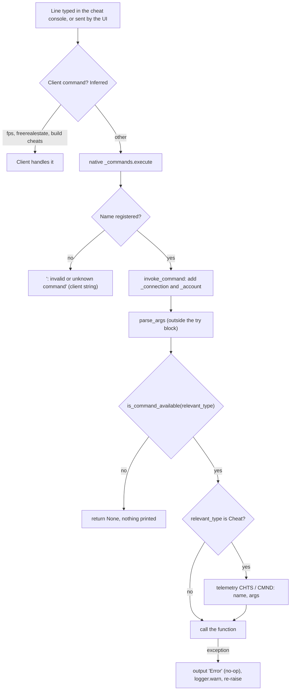

# 1.04 Debug tools, cheats and telemetry

*Game version 1.128.90.1030 (Steam, Linux/Proton). Installed packs EP04 (Cats & Dogs), EP06 (Get Famous), EP09 (Eco Lifestyle), EP12 (High School Years), GP04 (Vampires), GP12 (Werewolves), SP01 (Luxury Party) and SP42 (Grunge Revival). Commands, telemetry hooks and GSI handlers were counted from bytecode (every .pyc under core and simulation, including the modules that did not decompile); control flow the decompiler nested wrongly was read from disassembly. Tuning counts are the live tuning (the base delta build plus each installed pack's delta build); module tuning is named full or delta where the two differ. Native behaviour is read only from strings in Simulation_x64.dll and the game client. Checked 2026-10-12: 169 claims checked, 12 corrected, 1 relabelled, none removed.*

## In plain words

The game has a text console. Every command the script side understands is a Python function with a decorator that gives it a name and a type, and the type decides who may use it. "Live" commands work for everyone at any time; most of them are never typed by a player, because the game's own interface sends them when you click a button. "Cheat" commands work only after `testingcheats true`. "Automation" commands work only when the game was started in EA's test automation mode, which players do not reach. "DebugOnly" commands, and every command whose author did not name a type, are not part of the retail game at all.

Turning cheats on is itself a Live command. It sets one switch that the save remembers, and a second switch that never turns off again and is sent to the client with every achievement and aspiration update. The first switch unlocks the Cheat commands and the shift-click cheat menu on Sims and objects. The famous money cheats are an exception: `motherlode`, `kaching` and `rosebud` are Live on PC and need cheats only on consoles. Several commands that players think of as cheats are Live too, such as editing any Sim in Create a Sim or adding a trait, because the interface itself uses them.

EA's developers also built a web inspector into the game (GSI, the Game Server Inspector), debug drawing in the 3D world, test automation hooks and a profiler. The retail build ships the code for all of these and switches them off: the inspector's web server is never created, the event logs it reads start disabled, and the debug drawing commands are either unregistered or limited to automation mode.

The game also builds telemetry: small named events such as "a cheat command ran", "household funds changed" or "a situation ended". The Python side fills in each event, adds who and where (Sim, household, zone, game time), checks it against a tuned rule list and hands it to the engine. What the engine does with it after that cannot be seen from Python. A separate A/B experiment service receives the player's test group and can give different starting buffs, dream content or pivotal moments per group.

## Key facts

- 1847 command names (1815 decorators plus 32 aliases) in 178 modules, counted from bytecode: 547 Live, 86 Cheat, 453 Automation, 132 DebugOnly and 629 with no type, which means DebugOnly.
- Only Live, Cheat and Automation commands register in retail: 1086 names before pack gates, 1010 in this install. The 761 DebugOnly names never register, and their decorator replaces the Python function with `None`. No runtime switch decides this: the DebugOnly test in the shipped bytecode is unconditional.
- Cheat and Automation commands are registered in retail and checked on every call. A refused call returns without any message.
- The command type never reaches the native console: native `register` takes a name, a description, a usage line and a handler, nothing else.
- `testingcheats` is Live. It sets `cheats_enabled` and the sticky `cheats_ever_enabled`, both saved in the save's account data; the sticky flag is sent to the client as `cheats_used` with achievement and aspiration goal updates.
- `motherlode` (+50000), `kaching` and `rosebud` (+1000) are Live on PC and Cheat on consoles (`console_type`). `money N`, which sets funds to exactly N, is Cheat everywhere.
- In retail `sims4.commands.output` is an empty function. Only `CheatOutput` and automation output reach the console, so most command feedback is never shown.
- The shift-click cheat menu offers the 99 live interactions tuned `cheat` True (62 cheat only, 37 cheat and debug). The 390 interactions tuned only `debug` True never show in retail.
- Tuning runs 62 commands through `do_command` (123 record uses). Every one that an ordinary interaction calls is Live; the Cheat, Automation and DebugOnly ones are called only from cheat or debug interactions.
- GSI is compiled out (`SUPPORT_GSI = False`): no HTTP server and no command buffer exist, even in automation mode. Its 132 handlers still register at import, and every archiver starts disabled.
- Debug visualization has 83 `debugvis.*` commands; 19 are Automation and 64 have no type, so a player can reach none of them.
- 114 telemetry writers (82 group tags) feed 202 hook call sites. A Cheat command writes `CHTS`/`CMND`; a cheat interaction writes `CHTS`/`NTRC`.
- The live telemetry rule list (14 rules) drops interaction begin and end, route failure, situation and inventory hooks. Its `FUND` and `OBJC` rules carry module tags no Python writer uses, so they can never match.
- The experiment service knows 11 experiment names; 5 have live mappings (module tuning in the base delta only) and 10 live loots or rewards test a group.
- The "cheat sheet" is the controls hint overlay (13 live hint rows in `UiTuning.CHEAT_SHEET_TUNING`) and has nothing to do with cheats; the `CheatSheetItem` instance type has no live instances.

## How it works

### The command decorator

**Observed** (`core/sims4/commands.py`; bytecode of `Command`, `is_valid_command`, `named_command` and `register`).

- **Signature.** `Command(*aliases, command_type=DebugOnly, command_restrictions=UNRESTRICTED, pack=None, console_type=None)`. The first alias is the name used in messages; every alias is registered.
- **Which type counts.** The decorator works out two types when the module is imported:
  - `relevant_type` is `console_type` when one is given and `paths.IS_DESKTOP` is false; otherwise it is `command_type`. `IS_DESKTOP` is True at module level and `paths.init` never changes it. **Inferred**: the DLL names `IS_DESKTOP` among its strings next to `paths`, so native code probably sets it per platform, leaving it True on PC, where the `command_type` counts.
  - `most_limited_type` is `min(command_type, console_type)` when a console type is given.
- **Validity.** `is_valid_command` returns False when `relevant_type` is DebugOnly, and False when `pack` is set and `sims4.common.are_packs_available(pack)` fails. Otherwise it returns True.
- **What the decorator returns.** For an invalid command `named_command` returns `None`. The decorated module-level name is therefore bound to `None`, so a DebugOnly function cannot even be called from other Python code in retail.
- **What "retail" means here.** There is no runtime release flag. `is_valid_command` compares with DebugOnly without reading any switch, and automation mode does not change it. What separates retail from EA's development build is in the compiled scripts: debug branches are cut to a constant False (`SUPPORT_GSI = False` and `SUPPORT_RELOADING_SCRIPTS = False and ...` in `core_services.py`, `affordance.debug and False` in `_can_show_affordance`, `if False or cheats_enabled` in the pie menu code, `if False:` around nexus archiving), and `output` has an empty body. No core or simulation .pyc keeps a module docstring, yet 7 code objects still raise `AssertionError`, so this is not a plain `python -O` build. `paths.DEBUG_AVAILABLE` is unrelated: it is set only when the pydevd debugger can be imported, and no command code reads it.
- **When it runs.** The decorator runs when its module is imported, so a command exists only if its module is loaded. **Inferred**: the DLL's strings name `sims4.importer.utils`, `import_modules` and `import_modules_by_path`, so native code imports the script tree at start.
- **Registration.** For a valid command it builds `invoke_command`, sets the description to an empty string and the usage to the function's argument list, registers every alias, and returns the original function.
- **What native receives.** `register(name, restrictions, handler, description, usage, command_type)` calls native `_commands.register(name, description, usage, handler)` and nothing else. The type and the restrictions are dropped:
  - `add_command_type` and `add_command_restrictions` are empty functions;
  - `get_command_type` returns Live for every name;
  - `get_command_restrictions` returns UNRESTRICTED;
  - `get_command_info_gen` yields nothing.

**Observed** (Simulation_x64.dll strings). The native module documents `register(name, description, usage, callable) -> bool`, and also `unregister`, `execute`, `describe`, `output`, `automation_output` and `client_cheat`.

### Command types in retail

**Observed** (`CommandType` and `CommandRestrictionFlags` in `core/sims4/commands.py`; `is_command_available` in `server_commands/__init__.py`, read from bytecode because the decompile nests it wrongly).

| Type | Value | Registers in retail | A call runs when | Names |
|---|---|---|---|---|
| DebugOnly | 1 | never | never | 132 explicit + 629 untyped |
| Automation | 3 | yes | the game runs in automation mode | 453 |
| Cheat | 4 | yes | cheats are enabled, or automation mode | 86 |
| Live | 5 | yes | always | 547 |

`server_commands/__init__.py` replaces the core default (`lambda command_type: True`) with a check that runs in this order:

1. A type of Live or higher returns True.
2. A type of Cheat or higher returns True when `cheat_service.cheats_enabled` is set.
3. A type of Automation or higher returns True when `paths.AUTOMATION_MODE` is set.
4. Anything else returns False.

Because the comparisons are "or higher", a Cheat command also runs in automation mode without cheats.

`CommandRestrictionFlags` has UNRESTRICTED 0 and RESTRICT_SAVE_UNLOCKED 1. All 19 commands in `cas_commands.py` carry the flag, but retail drops restrictions at registration, so it has no effect there. **Observed**: `server/account_service.py: AccountService.check_command_permission(client_id, command_type)` returns `cheats_enabled` for Cheat commands and defers to the account for other types. No Python code calls it, and its name is not among the DLL's strings, which do hold native-to-Python callbacks such as `c_api_client_connect`. **Inferred**: nothing in the DLL calls it by name (see Limits).

### Running a command

**Observed** (bytecode of `invoke_command`, `parse_args` and `is_command_available`). **Inferred** where marked in the diagram: the client's own handling is native and not visible.

The order inside `invoke_command`:

1. The connection id and the account are passed in through the `_connection` and `_account` keyword arguments.
2. `parse_args` converts the words. It runs before the `try` block, so a bad argument raises straight to the native caller.
3. The availability check runs. A refusal returns `None` with no output and no log.
4. If the relevant type is Cheat, a `CHTS`/`CMND` telemetry hook records the command name (`name`) and `str(args)` (`args`).
5. The function runs. Any exception is passed to `output` (an empty function in retail) and to `logger.warn`, then raised again.

**Observed** (`output`, `cheat_output`, `CheatOutput` and `AutomationOutput` in `commands.py`). `sims4.commands.output` is `pass` in this build. `CheatOutput` and `cheat_output` call native `_commands.output`, or log through `logger.always` when the connection is `NO_CONTEXT` (2^64 - 1). `AutomationOutput` calls `_commands.automation_output`. So the messages that commands print through `output`, which is most of them, never reach a retail player; `cheat.status`, `resetsim`, `death.toggle` and the other users of `CheatOutput` do. Cheat-type commands are no exception: the scenario cheats `scenarios.get_all_phases`, `get_all_active_goals`, `reset_goal` and `start_phase` write only through `output`, so they print nothing in retail.

### Client commands and server commands

**Observed** (client strings in TS4_x64.exe, read as plain strings; native strings in Simulation_x64.dll; the command census).

- **Client help lines.** The client carries help lines for `fps { on / off }`, `fullscreen`, `headlineeffects { on / off }`, `resetsim <sim name>`, `testingcheats { true / false }`, `freerealestate { on / off }`, `casclockspeed { 0...10 } [IN CAS ONLY]`, `hovereffects { on / off }` and `matchspeedstereo { on / off }`.
- **Build mode help.** It also has help text for the build mode cheats: "MoveObjects cheat [<on/off>]", "Ignore Gameplay Unlocks cheat is %s", free build mode and showing hidden catalog objects.
- **Client-only names.** None of `fps`, `fullscreen`, `headlineeffects`, `freerealestate`, `casclockspeed`, `hovereffects` or `matchspeedstereo` is among the 1847 Python names. No .pyc contains `fulleditmode` or `moveobjects` either. These are handled by the client.
- **Names on both sides.** `resetsim` and `testingcheats` appear both as client help lines and as Python commands. **Inferred**: the client handles its own names and passes everything else to the server.
- **Feedback strings.** The client holds ": invalid or unknown command" and "Command failed". **Inferred**: these are the console's answers to an unknown name and to a raised error.
- **The server sending client commands.** `sims4.commands.client_cheat` sends one string to the client "to be executed as a client side cheat" (native doc string). For example, `sims.modify_in_cas` sends `sims.exit2cas <sim id> <household id> <active sim id>` this way.
- **Command scripts.** `command_script.run_script` reads a file under the app root, dropping anything after a `#`. A line starting with `|` goes to the server through `execute`; any other non-empty line goes to the client through `client_cheat`, or is logged as an error when there is no connection (bytecode; the decompile inverts the empty-line test). Zone spin-up runs such a file when the Python argument list contains `--on_startup_commands`. **Inferred**: whether a retail launch option reaches Python's argument list is not visible.
- **Game options.** The client's string table also pairs `testingcheats` with an option key `CheatsEnabled`, in a list that pairs server commands with option keys (`sims.set_aging_unplayed_sims` with `AutoAgeUnplayed`, `dust.set_dust_enabled` with `DustSystem`, and so on). **Inferred**: a game options toggle sends the same command. `dust.set_dust_enabled` is gated on SP22 (Bust The Dust), which is not installed here, so in this install that option has no registered command.

### testingcheats and the cheat state

**Observed** (`server_commands/cheat_commands.py`, `services/cheat_service.py`, `achievements/achievements.py`, `aspirations/aspirations.py`; live module tuning).

- **`testingcheats` (Live).** Its argument defaults to `enable: bool = False`.
  - On a desktop build it applies the change at once.
  - On a console it applies at once when cheats were ever enabled or when it is switching cheats off. Otherwise it first shows `CheatDialogTuning.CONFIRM_CHEAT_DIALOG`, an OK/Cancel dialog, and enables cheats only on OK.
- **Applying the change.** Enabling calls `enable_cheats`, which sets `cheats_enabled` and `cheats_ever_enabled`, and prints "Cheats are enabled." through `CheatOutput`. Disabling clears only `cheats_enabled` and prints "Cheats are disabled.". Either way the new state is sent to the client as `CheatStatusUpdate` (`MSG_SET_CHEAT_STATUS`).
- **Saving.** `CheatService.save` writes both flags into `gameplay_account_data` of the save's account record, and `load` reads them back. The fields are covered in [8.04 The save file format](8.04-save-file-format.md) and the save flow in [1.02 Saves and persistence](1.02-saves-persistence.md).
- **Reporting.** `cheats_ever_enabled` is copied into `cheats_used` on every achievement tracker update (`ACCT_ACHIEVEMENT_TRACKER_UPDATE`) and every aspiration goals update (`SIM_GOALS_STATUS_UPDATE`) that is sent. An empty achievement update is not sent, and goal updates skip NPCs. What the client does with it is native and not visible.
- **The other cheat commands.**
  - `AutomationTestingCheats` (Live) does the same as `testingcheats` with no dialog.
  - `cheat.status` (Live) prints one of four states.
  - `cheat.force_error` (Live) logs a test exception.
  - `cheat.override_enabled` and `cheat.override_ever_enabled` are DebugOnly; `cheat.list` has no type.
- **Live tuning.** The base delta sets the confirm dialog's title and text string keys. The full build still holds a stale class `CheatCommandTuning`, with an `ENABLE_CHEATS_DIALOG` and a `JOKES` list of three strings, which the current code does not read.

### Argument parsing

**Observed** (`parse_args` and `_parse_arg` in `commands.py`; `server_commands/argument_helpers.py`; bytecode of `get_tunable_instance`).

- **Which arguments are converted.** Only parameters with a type annotation are converted, and the `*args` tail only when it is annotated. Unannotated parameters stay strings.
- **bool.** Accepts `t, true, on, 1, yes, y, enable` and `f, false, off, 0, no, n, disable`, in any case. Any other word raises `ValueError`.
- **int.** Parsed with `int(word, base=0)`, so `0x1A2B` and `0b101` work.
- **Other types.** Any other annotation is called with the word. When it fails, the error text (plus the first ten names for an enum) goes to `output`, which is silent in retail, and the exception is raised again.
- **CustomParam.** A `CustomParam` subclass can eat several words through `get_arg_count_and_value`. `SimInfoParam`, for example, accepts a sim id, or a first and last name. It compares both names ignoring case. It returns at once on a Sim whose first and last names both match (two words used), or on a first-name match whose last name is empty (one word). Otherwise it settles for another Sim with that first name and uses only one word (the decompile of this fallback is mangled, so which Sim wins there is not certain).
- **OptionalTargetParam.** Takes an object id. An empty value means the client's active Sim, and -1, -2, -3 and -4 mean the active lot, the current region, the active street's civic policy provider and the active venue's provider. `OptionalSimInfoParam` and `OptionalHouseholdParam` resolve the empty value to the active Sim info and the active household.
- **TunableInstanceParam(type).** Tries the instance manager's own lookup first. Then it returns a class whose name equals the word, ignoring case. Then it collects every class whose name contains the word: one match is returned, none or several raise `ValueError` (several also list the names). `none` returns `None`.

### Pack gates

**Observed** (`core/sims4/common.py`; the census). `pack=` takes one pack or a tuple. `are_packs_available` passes when ANY listed pack is available, and it is checked once, when the module is imported. 127 names are gated, 105 of them with a type that registers in retail. In this install 29 of those 105 belong to installed packs (EP09 (Eco Lifestyle) 27, EP12 (High School Years) 1, GP12 (Werewolves) 1), so 76 gated names do not register here.

| Pack | Live | Cheat | Automation | DebugOnly | untyped |
|---|---|---|---|---|---|
| EP01 (Get To Work) | 10 | | 2 | | |
| EP02 (Get Together) | 1 | | | | |
| EP05 (Seasons) | 2 | 3 | 2 | | 8 |
| EP05 or EP10 (Snowy Escape) | 1 | 3 | | | |
| EP07 (Island Living) | | 4 | | | |
| EP08 (Discover University) | 8 | | 2 | | 7 |
| EP09 | 16 | 1 | 10 | 1 | |
| EP10 | 2 | 1 | | | |
| EP11 (Cottage Living) or EP14 (Horse Ranch) | 1 | | | | |
| EP12 | 1 | | | 1 | |
| EP13 (Growing Together) | 2 | 1 | | | |
| EP15 (For Rent) | 7 | | | 3 | |
| EP16 (Lovestruck) | 3 | | 2 | | |
| EP17 (Life & Death) | 2 | | | | |
| EP18 (Businesses & Hobbies) | 2 | | 4 | | |
| EP19 (Enchanted by Nature) | 3 | | | 2 | |
| EP21 (Royalty & Legacy) | 4 | | 2 | | |
| GP09 (Journey to Batuu) | 1 | | | | |
| GP12 | 1 | | | | |
| SP22 (Bust The Dust) | 1 | | | | |

Most pack features are not gated this way. The EP06 (Get Famous) fame cheats (`famepoints`, `fame.set_freeze_fame`), for example, carry no `pack=`; `famepoints` instead checks at run time that the fame perk bucks type is loaded.

### Unregistered and refused commands

**Observed** (bytecode of the decorator and of `invoke_command`), with the native side **Inferred**.

- **DebugOnly or untyped command.** The name is never registered. The console answers with the client's unknown-command text (Inferred), and the Python name is `None`.
- **Pack-gated command without its pack.** Treated the same as an unregistered command.
- **Cheat command with cheats off, or Automation command outside automation mode.** The name is registered. `invoke_command` returns `None` before the function runs: no output, no log and no telemetry.
- **Bad argument.** The conversion raises before the `try` block, so the Python side logs nothing. The console's "Command failed" text is the likely result (Inferred).

### The command census

**Observed** (a small stack machine over every .pyc, which reads each decorator call, its keywords and the function it wraps; repeated independently by the checker's own scan, with identical results). All 89 modules without decompiled source were included. Decorators that exist only in bytecode: `server_commands/sim_commands` (106 decorators), `statistic_commands` (46), `memory_commands` (23), `performance/performance_commands` (47) and `user_account_data/user_account_data_commands` (5). No two commands share a name.

| | Decorators | Names with aliases |
|---|---|---|
| Live | 544 | 547 |
| Cheat | 83 | 86 |
| Automation | 443 | 453 |
| DebugOnly, explicit | 130 | 132 |
| No type (DebugOnly) | 615 | 629 |
| Total | 1815 | 1847 |

- **`console_type`.** Set on four decorators carrying five names. `sims.spawnsimple` and `sims.spawn` are Automation with console DebugOnly. `rosebud` (alias `kaching`) and `motherlode` are Live with console Cheat.
- **Where the decorators sit.** 1814 decorators are at module level. The 1815th, `mem.set_object_categories_checkpoint`, is inside an untyped function and never runs.
- **Four calls that are not decorators.** In four places EA code calls `sims4.commands.Command("message", _connection)` where `output` was meant: three in `restaurant.comp_order_for_sim` and one in `vet.bill_owner_for_treatment`. Each call builds a decorator and throws it away, so nothing happens; the census excludes them. All four sit on error paths (no such Sim, the Sim is not on the lot, no business manager), so play reaches them only when the command fails, and the effect is the same as `output` in retail: silence.
- **Largest modules.** `server_commands/sim_commands` has 108 names, `object_commands` 92, `visualization_commands` 83, `business/business_commands` 74, `situation_commands` 71, and `statistic_commands` and `career_commands` 51 each.

The commands players actually use, with their effect read from the function body (the full list of 1,847 names is in the authors' working files, which are not published):

| Command | Type | Pack gate | Effect |
|---|---|---|---|
| `testingcheats true/false` | Live | | Enable or disable cheats; the argument defaults to false |
| `motherlode` | Live (console: Cheat) | | +50000 to the active Sim's household funds |
| `kaching`, `rosebud` | Live (console: Cheat) | | +1000 |
| `money N` | Cheat | | Set the Sim's household funds to exactly N |
| `resetsim First Last` | Live | | Reset the instanced Sim with that name, or print "Sim not found" |
| `sims.get_sim_id_by_name First Last` | Live | | Print the sim id |
| `traits.equip_trait T` | Live | | Add a trait; account reward traits must be granted |
| `traits.remove_trait T` | Live | | Remove a trait |
| `traits.clear_personality_traits` | Live | | Remove all personality traits |
| `sims.modify_in_cas` | Live | | Open Create a Sim for the Sim (client cheat `sims.exit2cas`) |
| `bucks.unlock_perk P true` | Live | | Unlock a perk; `true` makes it free |
| `stats.set_modifier`, `stats.solve_motive`, `stats.set_rank` | Live | | Add a statistic modifier, solve one motive, set a ranked statistic's rank |
| `interactions.push A` | Live | | Push any interaction by name or id on a Sim |
| `sims.remove_buff_from_all B` | Live | | Remove a buff from every instanced Sim |
| `cheat.status` | Live | | Print the cheat state |
| `stats.set_skill_level S N` | Cheat | | Set a skill level |
| `fillmotive M` | Cheat | | Fill one motive of the active Sim |
| `stats.fill_commodities_household` | Cheat | | Fill every commodity of the selectable Sims |
| `sims.fill_all_commodities` | Cheat | | Fill every commodity of every Sim |
| `households.disable_world_motive_decay` (and enable, household variants) | Cheat | | Stop or restart motive decay |
| `stats.set_stat S V` | Cheat | | Set any statistic on a Sim or the lot |
| `careers.promote`, `careers.demote` | Cheat | | Move a Sim one level in a career |
| `careers.add_career`, `careers.remove_career`, `careers.retire` | Cheat | | Join, leave or retire |
| `aspirations.complete_current_milestone` | Cheat | | Finish the next milestone of the primary aspiration |
| `sims.give_satisfaction_points N` | Cheat | | Add satisfaction points |
| `bucks.update_bucks_by_amount T N` | Cheat | | Add bucks of a type; refuses to go negative |
| `famepoints N`, `fame.set_freeze_fame` | Cheat | | Add fame perk points; freeze fame |
| `relationship.make_all_sims_friends` | Cheat | | Default relationship tracks (no romance) with every other Sim |
| `relationship.introduce_sim_to_all_others` | Cheat | | Introduce a Sim to everyone |
| `modifyrelationship A B N Track` | Cheat | | Add to a relationship track between two named Sims |
| `sims.add_to_family`, `sims.remove_from_family` | Cheat | | Move a Sim between households |
| `sims.remove_buff B` (alias `removeBuff`) | Cheat | | Remove a buff |
| `death.toggle`, `fire.toggle_enabled` | Cheat | | Turn death or fire off and on |
| `households.autopay_bills` | Cheat | | Toggle autopay for the active household: a bill delivered while it is on is settled without taking any money, and the flag is not saved (see [5.01](5.01-money-bills-rewards.md)) |
| `objects.consumables_infinite_toggle` | Cheat | | Toggle infinite contents for every consumable |
| `crafting.ingredients_required_toggle` | Cheat | | Craft without ingredients |
| `lifestyles.reset_all` | Cheat | | Reset a Sim's lifestyle statistics |
| `seasons.set_season`, `seasons.advance_season` | Cheat | EP05 | Change season |
| `weather.lightning_strike_here` | Cheat | EP05 or EP10 | Lightning at a point |
| `eco_footprint.set_eco_footprint_state` | Cheat | EP09 | Force the street's eco footprint |
| `clock.setspeed`, `volcanic_eruption`, `lunar_cycle.set_locked_phase` | Live | | Game speed, a volcanic eruption, a locked moon phase |

Automation commands players sometimes look for, such as `sims.add_buff`, `sims.modify_funds`, `households.modify_funds`, `sims.reset`, `sims.teleport` and `pyprofile.on`, are registered but always refused. `debug.eval`, `debug.exec` and `debug.god_mode` are untyped, so they do not exist in retail.

### Commands run from tuning

**Observed** (`DoCommand` in `interactions/utils/tunable.py`; live census).

The `do_command` basic extra calls `sims4.commands.execute(command + arguments, first client id)`, which goes through the native console and back into `invoke_command`. A tuned command therefore passes the same availability check as a typed one. Its tuning-time check (`_verify_tunable_callback`) asks `get_command_type`, which is a stub in retail, so it checks nothing there.

The live tuning runs 62 distinct commands from 123 (record, command) pairs. Sorted by type:

- **Live, 35 commands.** These are called from ordinary interactions (and `sims.modify_in_cas_with_householdId` also from `cheat_modify_in_cas`). One use sits in an object record: `object_drink_DraughtOfReconfiguration` runs `bucks.lock_all_perks_for_bucks_type`. Examples: `civic_policy.street.vote` (EP09), `sims.modify_in_cas_with_householdId`, `outfits.copy_outfit`, `careers.cancel_current_gig`, `bucks.lock_all_perks_for_bucks_type` and `vet.bill_owner_for_treatment`.
- **Cheat, 14 commands.** All are called from interactions tuned `cheat` or `debug`. Examples: `cheat_make_me_happy` runs `stats.fill_commodities`, and `debug_Reset` runs `objects.reset`.
- **Automation, 6, and untyped, 7.** These are called only from interactions tuned `debug` (`debug_ObjectDestroy`, `ageUp_IPCTYAE_Debug`, `debug_ForceException` and others), which never show in retail.

So no player-visible interaction is silently broken by a command type.

### The shift-click cheat menu

**Observed** (`ScriptObject._can_show_affordance` from bytecode; `should_generate_pie_menu` and `has_choices` in `server_commands/interaction_commands.py`; `aop.execute_interaction`; live tuning).

- **What the server decides.** When the player shift-clicks, `should_generate_pie_menu` returns `SHOW_DEBUG_PIE_MENU` only if `cheats_enabled` is set (the code reads `False or cheats_enabled`). This is tested before the queue, so the cheat menu opens even when the interaction queue is full. Otherwise the server builds the normal menu and forces `shift_held` to False. `has_choices` follows the same gate for the hover cursor.
- **Which affordances qualify.** `_can_show_affordance(shift_held, affordance)`:
  - With shift held, an affordance with `cheat` True is shown and every other one is left out, so the cheat menu holds only cheat interactions.
  - An affordance with `debug` True meets a stripped constant (`debug and False`) in that branch, so it is never shown.
  - Without shift, only affordances that are neither `cheat` nor `debug` are shown.
  - `cheat` is tested first, so an interaction tuned both `cheat` and `debug` does show in the cheat menu.
- **Live counts.** Of 13,983 live interactions, 62 are tuned `cheat` only, 37 `cheat` and `debug`, and 390 `debug` only (top-level fields, read through shared references). The 99 cheat interactions include:
  - the 12 utility adders (power and water, consumption and production, three sizes each);
  - 7 reputation setters;
  - 6 gardening state pickers;
  - 5 pond denizen cheats;
  - add to family and remove from family, make dirty and make clean, refill consumable, motive decay on and off, fill motives;
  - three fame cheats (freeze, rank up and rank down) and two fame quirk pickers;
  - `terrain-teleport` (teleport here);
  - `forceMarriageInteraction`.
- **Telemetry.** `aop.execute_interaction` writes a `CHTS`/`NTRC` hook (fields `name` and `trgt`) whenever an interaction tuned `cheat` runs.

**Observed** (`interactions/cheats/force_marriage_interaction.py`, bytecode of `_get_all_spouse_for_sim`; live record 147864 in the base delta). `ForceMarriageInteraction` is an immediate super interaction tuned `cheat` only.

- **Finding spouses.** For a Sim it counts as spouses that Sim's `spouse_sim_id`, every Sim whose `spouse_sim_id` is that Sim, and every Sim holding the marriage relationship bit with it in either direction.
- **Menu entries.** `potential_interactions` offers one entry for each spouse found this way on the clicked Sim, plus a "clear all" entry named by `clear_all_marriage_interaction_name`. It is a repair tool for inconsistent marriage data; it cannot marry two Sims who have no link yet.
- **What it does.** `enforce_marriage` removes the marriage bit, both ways, between the clicked Sim and every spouse found. For a spouse entry it does the same for the chosen spouse and then adds the bit in both directions between the two; "clear all" stops after the removal.

### The money cheats

**Observed** (per-function decompile and bytecode of `server_commands/sim_commands.pyc`, which failed as a whole; bytecode of `Funds._update_money`).

- **The commands.** `rosebud` and `motherlode` call `modify_fund_helper(1000)` and `modify_fund_helper(50000)` on the client's active Sim, with reason `TELEMETRY_MONEY_CHEAT`; `kaching` is a second name on `rosebud`'s decorator. `money N` computes N minus the current funds and passes the difference to the same helper. The helper adds a positive amount and calls `try_remove` for a negative one.
- **Telemetry.** Every non-zero funds change runs `_update_money`, which writes a `FUND`/`FMOD` hook with the amount (`amnt`), the reason (`resn`) and the new balance (`fund`). So each money cheat leaves a hook with the cheat reason. On PC no `CHTS`/`CMND` hook is written for these three, because their relevant type there is Live.

### GSI: the Game Server Inspector

**Observed** (`core/sims4/core_services.py`, with `SUPPORT_GSI = False` confirmed in bytecode; `sims4/gsi/dispatcher.py`, `http_service.py`, `command_buffer.py`, `schema.py`; the `command` handler in `gsi_handlers/command_handlers.py`).

- **What GSI is.** EA's inspector serves JSON over HTTP from inside the game.
  - `HttpService` answers GET requests on 127.0.0.1 (or the LAN address with `--gsi_use_lan`) on a port the system picks. It supports JSONP callbacks and sends a permissive CORS header.
  - Each path maps to a handler in `dispatch_table`. `handle_request` drops a request whose `zone_id` names an unknown zone.
  - The `directory` handler lists every schema. The `command` handler queues any console command through the `CommandBufferService`, which swaps `sims4.commands.output` for a capture while the command runs.
- **Whether it is active.** No. `start_services` creates `CommandBufferService` and `HttpService` only when `SUPPORT_GSI` is true, and it is False in this build. `http_service()` therefore returns `None`, and `start_http_server` does nothing. `command_buffer_service()` raises `RuntimeError` ("The CommandBufferService is not available") while the flag is False. `gsi.start` and `http_debug_server.start` (both Automation) hand their work to a callback that runs once the server is up, so it never runs: `gsi.start` would have sent `MSG_GSI_OPEN` with the server's address to the client from that callback.
- **How handlers register.** `@GsiHandler(path, schema)` wraps the function, parses query arguments against its signature, turns exceptions into an empty list, and adds the wrapper to `dispatch_table` at import. Retail does this too. The decorator itself returns `None` (bytecode of `_generate_handler`), so every decorated handler's module name is `None`, exactly like a DebugOnly command.
- **Schemas.** `GsiGridSchema` and the graph schemas declare fields, filters, linked sub-tables (`add_has_many`) and "view cheats": buttons that run a console command for the selected row. `add_cheat_schema` adds the global cheat panels `global_object_cheats` and `global_sim_cheats`.
- **The census** (from bytecode):
  - 132 `GsiHandler` registrations: 80 in `gsi_handlers` (17 of them in `sim_handlers.pyc`, which did not decompile) and 52 in 42 modules elsewhere (bucks, fame, relationships, sickness, restaurants, weather, the moon cycle and others). One of the 52 is the dynamic registration in `archive.register_archive_type`, one the dispatcher's `directory`.
  - 78 `GameplayArchiver` instances: 61 in `gsi_handlers` and 17 elsewhere. Two more archivers are built from subclasses: `situation_log` (`SituationDataArchiver`, a `GameplayArchiver`) and the timeline handle archiver (`TimelineHandleArchiver`), 80 in all.
  - Each `Archiver` adds two handler paths of its own when it is built: its `_toggleLog` switch and, through `register_archive_type`, its archive. The live dispatch table therefore holds more paths than the 132 decorators.
  - 2 cheat schemas.
- **What it exposes**, grouped by area (the File index names every module):
  - Sims: buffs and moods, skills, commodities, outfits, walkstyles, wants, aspirations, careers, milestones, culling and lifetime events, time lines.
  - Interactions: the interaction archive, autonomy scoring, content sets, pie menu generation, picker results, the posture graph and transition paths, animation and balloons.
  - Routing: planner, build, find-good-location, object and Sim route and goal archives, route events.
  - Society: social groups, ensembles, clubs, dynasties, relationship metrics and culling.
  - Situations and story: situations and bouncer, drama nodes, pivotal moments, story progression, zone directors, NPC services, Sim filters and the spawner.
  - Objects and world: objects, object definitions and removals, lost and found, inventories, state triggers, broadcasters, lots and lot levels, zones and zone modifiers, households, businesses, object games.
  - Engine: alarms, clock speed changes, timeline handles, distributor operations, the service manager, tuning tables (slot types, buffs, interactions, states, animation elements, traits) and performance metrics.

### Archivers and GSI dumps

**Observed** (bytecode of `sims4/gsi/archive.pyc`, rescued per function; `gsi_handlers/gameplay_archiver.py`, `gsi_dump_handlers.py`, `dump.py`; `server_commands/developer_commands.py`).

- **Records.** An archiver keeps a rolling list of records (zone id, object id, timestamp, game time, a unique id and zlib-compressed JSON). The list is trimmed to `ARCHIVE_MAX_RECORDS` (default 50, set by `gsi.set_max_gsi_log_entries`).
- **Off by default.** `BaseArchiver.__init__` sets `_archive_enabled = False` in both branches: the code that honoured `enable_archive_by_default` is stripped from the bytecode. An archiver turns on only through a GSI toggle (the path suffix `_toggleLog`), `set_archive_enabled` (called once per named archiver by `gsi.enable_archivers`, untyped), or `set_all_archivers_enabled` (`gsi.enable_all_logging`, Automation, which also turns dump-on-save on).
- **Start-up arguments** (`zone_spin_up_service.py`, `paths.py`). `--no_gsi_archiving` sets `paths.NO_GSI_ARCHIVING` and, in automation mode, switches every archiver off. `-UseNexus` would call `enable_nexus_archiving` (which turns on the interaction, outcome and buff archives), but that call sits behind `if False`.
- **Retail cost.** `archive()` returns at once when its archiver is disabled, and many callers test `archiver.enabled` before building a record at all.
- **GameplayArchiver.** Adds per-Sim filtering and keeps records of at most `MAX_DELETED_SIM_RECORDS` = 10 deleted Sims.
- **Dumps.** `gsi.dump` (Automation) writes every archive and the dumpable handler outputs to a compressed file under the app root (or a given folder) through `gsi_handlers.dump.save_dump_to_location`. It returns at once when `paths.NO_GSI_ARCHIVING` is set. Related commands dump on save and on an error.

### Debug visualization

**Observed** (`debugvis.py`; the `_debugvis` doc strings in Simulation_x64.dll; `server_commands/visualization_commands.py`; `visualization/*.py`; `objects/components/sim_visualizer_component.py`).

- **The native side.** `_debugvis` is "Interface to server debug visualization layers". A `Layer` is opened, cleared and committed ("send to registered clients"); between those calls it takes `add_segment`, `add_point`, `add_text_screen`, `add_text_world` and `add_text_object`. `get_layer(name)` returns a named layer.
- **The Python side.** `debugvis.py` wraps a layer in a `Context` with drawing helpers (circles, arrows, polygons, text) and falls back to a stub `Layer` when the native module is missing.
- **What the visualizers draw.** Each visualizer subscribes to game events and redraws its layer:
  - autonomy timers and moods as text over Sims;
  - broadcaster areas, put-down points and connectivity handles;
  - constraints and line of sight;
  - dynamic areas, ensemble centres, routing formations, jigs, locators;
  - path goals with their scores, portals, proximity, the quad tree, sectional sofa pieces;
  - Sim footprints, object routes, social group geometry, spawners and spawn points;
  - transition constraint history and transition path destinations.
- **Text over Sims.** `SimVisualizerComponent` shows name, situations, SI state, interaction queue, small business satisfaction and small business reviews as overhead text when its flags are set.
- **Whether retail can reach it.** Of the 83 `debugvis.*` commands:
  - 19 are Automation: waypoints, spawn points, spawner components, locators, dynamic areas, portals, ponds and sectional sofas start and stop, the selected-Sim constraint and social toggles, and `debugvis.dynamic_jigs.start`;
  - the other 64 have no type and do not exist in retail.

  The drawing paths I followed all start from these commands, so a retail player cannot turn any of it on. I did not trace every flag (see Limits).

### Automation and testing hooks

**Observed** (`core/paths.py`, with `paths.init` read from bytecode; `automation/*.py`; `core/sims4/testing/*.py`; `core/shared_commands/*.py`).

- **Automation mode.** `paths.init(..., automation_mode=False, ...)` is called from native code and sets `AUTOMATION_MODE` straight from its argument. **Inferred**: how a build is started in that mode is not visible; no matching launch flag appears among the native strings.
- **Automation events.** `automation_utils.automation_event(message, **fields)` writes "message; key: value" lines through `automation_output`, but only after `qa.automation.enable_events` (Automation) turns them on. Many Automation commands answer in the same "Name; Status:Begin/Data/End" line format.
- **QA constants.** `automation/constants.py` holds the ids EA's QA scripts use (interactions, object definitions, resource ids, strings, buffs and more), printed by `qa.automation.get_constants` (Automation). The live module tuning is the base delta with 463 entries in 12 groups; the full build has 153 entries in 5 groups.
- **Test commands.** `sims4/testing/unit.py` is a unittest runner behind `test.module` and `test.path` (untyped). `test_unifiedkeysdict.py` is a benchmark.
- **Shared commands.** All 13 in `shared_commands` have no type: `help` (through native `describe`), `hot.files.*` and `hot.reload`, the `telemetry.*` filter commands, and three crash tests (`diagnostic.stack_overflow`, `stack_overflow_property`, `infinite_loop`).
- **Soak and profiling.** Soak test situations (`soak.*`), the Python profiler (`pyprofile.on/off/flush`) and pack loading (`tuning.load_pack`, `tuning.unload_pack`) are Automation.

### The experiment service

**Observed** (`experiment_service/*.py`; bytecode of `ExperimentGroupTest.__call__` and `PivotalMomentsExperiment.on_group_id_set`; live module tuning `experiment_service.experiment_service` and `experiment_service.experiment_enums`, both in the base delta only; live instance census).

- **The handshake.** On client connect the service sends a `GetGroupsForExperiments` operation listing every `ExperimentName`. The Live commands `experiments.set_group_for_experiment name group` and `experiments.set_no_group_for_experiment name` store the answer. **Inferred**: the client sends them in reply; that side is native.
- **Group values.** `EXPERIMENT_GROUP_NONE` is -1 and `EXPERIMENT_GROUP_INVALID` is -2.
- **What a stored group does.** If the experiment has an entry in `ExperimentService.EXPERIMENTS`, storing a group runs the entry's hook at once, and `refresh_sims_experiments` runs it again whenever all households finish loading. There are two kinds of entry:
  - **`sim_experiment`.** Maps a group to loot actions applied to every Sim of the active household, on every load.
  - **`pivotal_moment_experiment`.** Maps a group to the set of pivotal moments the tutorial service offers. An unknown group, or one with an empty list, gets `control_group_pivotal_moments`.
- **ExperimentGroupTest** (`experiment_group` in event tests). The test fails when there is no service or the experiment has no group. It passes when the group is in `groups`. `negate` flips each result. An empty `groups` list never passes un-negated.

Live data:

| Experiment (value) | Live mapping | Live tests |
|---|---|---|
| CareerIncomeBoost (1) | none | none |
| N3_PivotalMomentRewards (2) | none | 4 household rewards (`reward_PivotalMoment_Money/Phone_N3_rewardsBoost_groupA/B`) |
| StarterNeeds (3) | group 1: `loot_motive_starterNeeds_groupA`, group 2: `..._groupB` (a reduced-decay buff A or B plus a hidden tracker trait) | none |
| StartingSimoleons (4), N3_DQ_Iteration (5), BusinessXPMultiplier (6), BurglarChanceMultiplier (7) | none | none |
| N5_DreamsV0 (8), N5_DreamsV0_DLC (9) | groups 1 and 2: `loot_PivotalMoment_dreamsV0_N5_trigger_choice` | that loot schedules the narrative selection drama node (440713) for N5_DreamsV0 group 1 and both DLC groups, and the general selection node (445500) for N5_DreamsV0 group 2; 5 dream reward loots (tiny to xlarge) test the DLC variant |
| BalanceSystemModifiers (10) | an empty `sim_experiment` | none |
| N7_SpruceItUp_DQ (11) | group 1: the six base pivotal moments plus `pivotalMoment_N7`; control: the six base ones | none |

Altogether 18 `experiment_group` test nodes sit in 10 live records. N3_PivotalMomentRewards shows that an experiment with no mapping still stores its group, and tests can read it.

### Telemetry: writers, hooks and common fields

**Observed** (`core/sims4/telemetry.py`, with `_check_filter`, `_get_key` and `_commit` read from bytecode; `simulation/telemetry_helper.py`, with `_write_common_data` and `_classify_sim` read from bytecode; the played flag in the bytecode of `sims/household.pyc`; `satisfaction/satisfaction_tracker.py`; `clock_telemetry_helper.py`; the checker's census).

- **Writing a hook.** A `TelemetryWriter(group, module="GAME")` hands out hooks with `begin_hook(hook_tag)`. Inside a `with` block the code writes typed fields: bool, int, float, string, enum, guid and localized string.
  - When the block ends normally, `_commit` skips a hook marked disabled, then asks `_check_filter`, then calls native `_telemetry.log_event(session id, module, group, hook, fields)`.
  - An `Exception` inside the block is logged and swallowed; any other `BaseException` propagates.
  - Without the native module a stub logs nothing.
- **Common fields** (bytecode of `telemetry_helper._write_common_data`). `telemetry_helper.begin_hook(writer, hook, sim=..., sim_info=..., household=..., record_position=...)` works out the values, then `sims4.telemetry._write_common_data` writes them:
  - With a Sim info: the sim id, the household (defaulting to the Sim's), the mood guid when the Sim has a buff component and a mood, and the occult types. The position is taken only when `record_position` is set and the Sim is instanced.
  - A hook about an NPC is disabled unless the caller passed `valid_for_npc`.
  - With a household: the household id and, when a Sim info is also given, the Sim classification. The household's account is used only to find the session id (the account's client in the current zone) when the caller gave none; otherwise the session id is 0.
  - Written every time: `zone` (when a zone is current), `simi`, `clss`, `hous`, `time` (absolute game seconds), `mood`, `aoct` and `coct`, as 0 when unknown. `posx`, `posy`, `posz` and the lot description id `ldid` are added only with a position.
  - `sims4.telemetry` also defines `acct` (`FIELD_ACCOUNT_ID`), but no Python code writes it.
- **Sim classification** (bytecode order of `_classify_sim`):
  1. A Sim outside a player household is NPC (4).
  2. A Sim in a household flagged played is PLAYED (3). The test does not exclude the active household.
  3. Otherwise the active Sim is ACTIVE (1), or ACTIVE_GHOST (5) when it is a ghost.
  4. Any other Sim is IN_ACTIVE_FAMILY (2), or GHOST_IN_ACTIVE_FAMILY (6).

  `Household` load sets both the player and the played flag for the active household (bytecode of `sims/household.pyc`), so the active Sim and its family come out PLAYED too. **Inferred**: values 1, 2, 5 and 6 need a player household without the played flag, which normal play does not seem to produce.
- **Periodic reports.** `HouseholdTelemetryTracker.initialize_alarms` runs on zone spin-up for the client's household and schedules one repeating alarm every `EMOTION_REL_ALARM_TIME` Sim minutes. The alarm writes `REPO`/`RELA` (one hook per relationship bit, with its count across the instanced household) and `REPO`/`FUND` (household funds). `buff_telemetry_report` (`REPO`/`EMOT`) exists, but no code schedules it, so `BUFF_ALARM_TIME` is unused.
- **Clock hooks.** The clock writes `CLCK`/`CHSR` on speed changes. `MCTS` (a tick spike) and `CGCB` (game clock behind) are each capped at 50 per process.
- **The census** (by the checker). 114 `TelemetryWriter` constructions: 109 at module level, 2 class attributes of `SatisfactionTracker` (`ASPI`, `SPCH`) and 3 built inside functions (`RENT` in `rental_unit_manager.make_rent_overdue`, and `BUSI` twice in `small_business_manager`). They use 82 group tags; `SPCH` has a writer but no hook. 202 `begin_hook` call sites. The authors' working files, which are not published, list the hooks.

**Inferred**: what native `_telemetry.log_event` does with an event (queueing, sending, consent) is not visible from Python, and I do not guess at it.

Hooks by family (group tag: hook tags):

| Family | Groups and hooks |
|---|---|
| Cheats | CHTS: CMND (cheat command), NTRC (cheat interaction) |
| Money and rewards | FUND: FMOD; BILL: BIGI; CRNC (bucks, hook passed in); PERK: GAIN RFND; UNLK: ITEM; BUSI: 15 hooks for businesses and rentals; RENT: LATE |
| Sim state | AGES; ASPI: ASPI SPAD SPRM (primary aspiration change, satisfaction points added and removed); SPCH (writer only); ASPR: AADD MILE; TRAT: TADD TRMV; SKIL: SKLU (+ passed in); STAT: CHNG; RKST: LEVE; COMO: RCHG (+ passed in: UPPP DOWN); EMOT; BUFF: UNLK (+ passed in); GENE; SERR; DEAD: OPTN SDIE; LUCK: OPTL; MILE: ENDD STRT; SCRT: ENDS LERN SCAN STRT SUCC; UNBU: GADD GCMP; WHIM: WEVT; LOOT: DECL; CASS: SRCE |
| Households and story | HOHO: ADSI; REPO: EMOT FUND RELA; STRY: CSAF CSBE CSBT FAME SIDC (+ passed in) |
| Relationships and groups | RSHP: COMP (+ passed in: BADD BREM); CLUB: 7 hooks; DYNA: ALLI EDIT HEIR RIVA STRT TRSF; MAMK: RFSH |
| Interactions and UI | INTR: CANC IEND QUEU RSLT (+ SIBE SIEN MIBE MIEN from the interaction log); PIEM; PINT: ACTV; OPIN: RSLT; DPCK; DRND: RESP; ADVN: RESP; HDLN; TTSE; ACHI: ACHA |
| Situations and events | SITU: 13 hooks in 21 places; EMER: EMFL EMSU; EVNT: STRT; LIVE: MFPH; PIVM: FONE; SCEN: ENDD GOAL PHAS; NRTV: NEND NSTA; CIVC: LBBY PRPS VOTE; NBHD: FOOT; LTRT: TADD TRMV; VENU: TMSP; MULE: EVSO; GAWY: SAVE; TGRP; ABTE: ABDG RSDR |
| Careers and school | CARE: BOTD CEND INHE (+ passed in); CZOD: CZOE CZOS; DETE: APBC (+ passed in); GIGS: PRGS; UNIV: 6 hooks |
| Objects and crafting | OBJC: CRBE OBJC SLOT; ODEB; CRAF: CEND STRT; CRFT: NOBJ; COLE: COCO PROG; INVT: INVF SELL; ANML: AADD |
| World and engine | ZONE: FAIL IOBJ LOAD; LOAD: APRT; AREA: EXIT; ASIM: ASCH; GCST: ZNSH; SAVE: FAIL; CLCK: CGCB CHSG CHSR MCTS; ROUT: RTFL; BDBY |

### Telemetry filter rules

**Observed** (`add_filter_rule`, `_get_key` and `_check_filter` in bytecode; `TelemetryTuning.filter_tunable_hooks`; `areaserver.c_api_client_connect`; `sims/funds.pyc`, `objects/object_telemetry.py` and `objects/components/state.py` for the two mis-keyed rules; live module tuning `telemetry_helper`).

- **Keys.** A rule is (priority, key, fields, action). The key is a prefix built in order: module, then group, then hook. Building stops at the first empty tag, so a rule can match a whole module or a whole group.
- **Matching.** The list is kept sorted. `_check_filter` returns `action == COLLECT` for the first rule whose key matches the hook (and whose fields match, when it has fields). With no matching rule the hook passes. `RuleAction` is DROP 0 and COLLECT 1, and the tunable `action` defaults to DROP.
- **Loading.** `filter_tunable_hooks` adds the tuned rules on every client connect. A second connect inserts the same rules again, which changes nothing.
- **The live rules.** `HOOK_ACTIONS` in the base delta has 14 rules, all at priority 0. The full build has the same 14 rules with no action, so all DROP.
  - **COLLECT:** GAME/COMO/UPPP, GAME/COMO/DOWN, GAME/RSHP/BADD, GAME/RSHP/BREM. These change nothing, because no broader DROP rule exists.
  - **DROP:** GAME/INTR/SIBE, SIEN, MIBE and MIEN (the begin and end of every super interaction and mixer, from `sims/sim_log.py`); GAME/ROUT/RTFL (route failure); GAME/SITU/SITU; GAME/INVT/IADD and IREM. Those last two constants are defined in `inventory.py`, but no code writes them.
  - **Two rules that never match:** module FMOD / group GAME / hook FUND, and module OBJC / group GAME / hook OBJC. Every Python writer uses module GAME, so these keys never match. The real hooks are GAME/FUND/FMOD and GAME/OBJC/OBJC, and both pass. Normal play writes both all the time: every funds change, and every object state change to a state value tuned `send_telemetry_on_state_change`. **Inferred**: the tuned fields look shifted by one place.
- **Console commands.** `telemetry.add_filter`, `remove_filter`, `clear_filters` and `list_filters` edit the list, but they have no type and do not exist in retail.

### The cheat sheet

**Observed** (`cheat_sheet/*.py`, `ui/ui_tuning.py`, `gameplay_options/misc_options_service.py`; live module tuning `ui.ui_tuning`; client strings).

- **What it is.** The cheat sheet is a controls hint overlay: icon keyframes such as `mouse_left`, `mouse_right` and `mouse_middle`, or short strings, next to a description, shown under conditions from `CheatSheetMode` (IN_LIVE_MODE 0, IN_BB_MODE 1, TS3_CAMERA_ACTIVE 2, TS4_CAMERA_ACTIVE 3).
- **Live data.** `UiTuning.CHEAT_SHEET_TUNING`, exported to the client, holds 13 rows in the base delta and none in the full build: 6 for build/buy, 3 for live mode, and 2 each for live mode with the TS4 camera and with the TS3 camera.
- **The unused instance type.** The `cheat_sheet` instance type (`CheatSheetItem`, resource type 380861306) has no records in the live tuning.
- **The option.** `misc_options_service` stores a `cheat_sheet_enabled` game option (default False) in the options message. No Python command sets it.
- **The client side.** The client has `GetCheatSheetTuning` and the `CheatSheetDefinition`, `CheatSheetControl` and `CheatSheetElement` messages.

## Numbers

| Name | Value | Unit | Where | Source |
|---|---|---|---|---|
| `CommandType` | DebugOnly 1, Automation 3, Cheat 4, Live 5 | enum | `sims4/commands.py` | code |
| `CommandRestrictionFlags` | UNRESTRICTED 0, RESTRICT_SAVE_UNLOCKED 1 | enum | `sims4/commands.py` | code (inert in retail) |
| `NO_CONTEXT` | 18446744073709551615 (2^64 - 1) | connection id | `sims4/commands.py` | code |
| `BOOL_TRUE` / `BOOL_FALSE` | t true on 1 yes y enable / f false off 0 no n disable | words | `sims4/commands.py` | code |
| command names | 1847 (Live 547, Cheat 86, Automation 453, DebugOnly 132, untyped 629) | names | all .pyc | bytecode census |
| decorators | 1815 | calls | all .pyc | bytecode census |
| names registered in retail | 1086 before pack gates; 1010 in this install | names | census | derived |
| pack-gated names | 127 (105 of a registering type) | names | census | bytecode census |
| `motherlode` | 50000 | simoleons | `sim_commands.pyc` | code |
| `rosebud`, `kaching` | 1000 | simoleons | `sim_commands.pyc` | code |
| cheat interactions | 99 (62 cheat, 37 cheat and debug) | records | interaction tuning | live |
| debug-only interactions | 390 of 13,983 | records | interaction tuning | live |
| `do_command` use | 62 commands, 123 record uses | | all instance tuning | live |
| `EMOTION_REL_ALARM_TIME` | 720 (code default 60) | Sim minutes | `telemetry_helper` module tuning | full and delta agree |
| `BUFF_ALARM_TIME` | 45 (code default 60); never scheduled | Sim minutes | `telemetry_helper` module tuning | full and delta agree |
| `HOOK_ACTIONS` | 14 rules: 4 COLLECT, 10 DROP | rules | `telemetry_helper` module tuning | delta (full: 14, all DROP) |
| `MAX_TELEMETRY_FOR_SPIKE`, `MAX_TELEMETRY_FOR_GAME_CLOCK_BEHIND` | 50 each | hooks per process | `clock_telemetry_helper.py` | code |
| telemetry writers | 114 (109 module-level, 2 class-level, 3 in functions); 82 group tags | | all .pyc | bytecode census |
| telemetry hook sites | 202 | `begin_hook` calls | all .pyc | bytecode census |
| `SUPPORT_GSI` | False | flag | `sims4/core_services.py` | bytecode |
| GSI registrations | 132 handler decorators, 78 gameplay archivers (80 archivers in all), 2 cheat schemas | | all .pyc | bytecode census |
| `ARCHIVE_DEFAULT_RECORDS` | 50 | records per archive | `sims4/gsi/archive.pyc` | bytecode |
| `MAX_DELETED_SIM_RECORDS` | 10 | Sims | `gsi_handlers/gameplay_archiver.py` | code |
| `HTTP_SERVER_TIMEOUT` | 0.001 | seconds | `sims4/gsi/http_service.py` | code (unused in retail) |
| `debugvis.*` commands | 83 (19 Automation, 64 untyped) | commands | `visualization_commands.py` | bytecode census |
| `EXPERIMENT_GROUP_NONE`, `EXPERIMENT_GROUP_INVALID` | -1, -2 | group id | `experiment_service.py` | code |
| `ExperimentName` | 11 values (1 to 11), DEFAULT 0 | enum | `experiment_service.experiment_enums` | delta only |
| `EXPERIMENTS` | 5 entries | experiments | `experiment_service.experiment_service` | delta only |
| `experiment_group` tests | 18 in 10 records | test nodes | instance tuning | live |
| `CHEAT_SHEET_TUNING` | 13 | hint rows | `ui.ui_tuning` | delta (full: none) |
| `CheatSheetItem` instances | 0 | records | `cheat_sheet` instance type | live |
| automation constants | 463 in 12 groups | constants | `automation.constants` | delta (full: 153 in 5) |
| `OptionalTargetParam` special ids | -1 lot, -2 region, -3 street, -4 venue | id | `argument_helpers.py` | code |
| `casclockspeed` | 0 to 10 | speed | client help string | native string |

## Data shapes

**A command** (one row of the authors' command table, built from bytecode):

| Field | Meaning |
|---|---|
| `name` | console name; aliases are rows of their own with `alias_of` set |
| `type` | Live, Cheat, Automation, DebugOnly or untyped |
| `pack` | pack gate, `A\|B` meaning either pack |
| `module` | module holding the decorator |
| `one_line` | effect; `basis` says whether it was read from the body (`read`) or only derived from the name (`name`) |
| `function`, `args` | Python function and its parameters with annotations (`TunableInstanceParam(TRAIT)`, `OptionalTargetParam`, `bool`) |
| `console_type`, `restrictions` | second type for consoles; restriction flag |

**A telemetry event** as handed to native `log_event`: `(session id, module "GAME", group tag, hook tag, data)`. The data is a list of (key, string) pairs: the common fields `zone`, `simi`, `clss`, `hous`, `time`, `mood`, `aoct`, `coct` and, when asked for, `posx`, `posy`, `posz` and `ldid`, then the hook's own fields (four-letter keys such as `amnt`, `resn`, `fund`). Values are written as text: ints as decimal, floats with two decimals, guids with a leading underscore, localized strings as their hex hash. `RESERVED_FIELDS` holds `hip_`.

**A filter rule:** `(priority: int, key: tuple of 0 to 3 tags, fields: frozendict, action: DROP or COLLECT)`. A tuned rule has `module_tag`, `group_tag`, `hook_tag`, `priority` (default 0) and `action` (default DROP).

**The cheat state on the wire:** `CheatStatusUpdate { cheats_enabled }` with `MSG_SET_CHEAT_STATUS`. In the save: `gameplay_account_data.cheats_enabled` and `cheats_ever_enabled`. With progress messages: `cheats_used`.

**A GSI archive record:** zone id, object id, timestamp, game time, a unique id, and the entry as zlib-compressed JSON. A schema is a dictionary of fields (name, label, type, visualizer, width, hidden or unique flags), filters, sub-schemas and view cheats (a command string with static, token or input parameters).

**An experiment entry** (module tuning `EXPERIMENTS`): key `ExperimentName`; value either `sim_experiment { loot_mapping: {group: [LootActions]} }` or `pivotal_moment_experiment { pivotal_moment_mapping: {group: [PivotalMoment snippets]}, control_group_pivotal_moments: [...] }`. The test: `experiment_group { experiment_name, groups: [int], negate }`.

**A cheat sheet row** (`CHEAT_SHEET_TUNING`): `control_elements` (each a keyframe string or a localized string), `item_description` (string key), `conditions` (list of `CheatSheetMode`).

## For modders

**Tuning.**

- **`cheat` True** on an interaction puts it in the shift-click menu, shown only while cheats are enabled, and removes it from the normal menu. **`debug` True** alone hides it from every retail player. With both set, `cheat` is tested first, so the interaction still shows in the cheat menu.
- **`do_command`** runs a console command, which still has to pass its type check at run time. Call a Live command from an ordinary interaction. A Cheat command called from an ordinary interaction does nothing while cheats are off, without any error.
- **`experiment_group`** tests depend on the client reporting a group, so they are not a general switch. With `groups` empty an un-negated test always fails.
- **Telemetry rules.** `TelemetryTuning.HOOK_ACTIONS` filters only Python-side telemetry. A rule key is a prefix (module, group, hook) that stops at the first empty tag. A rule with an empty `module_tag` gets an empty key, which matches every hook, so a DROP rule with only `group_tag` set drops all telemetry.

**Commands.**

- **Choose a type.** Always pass `command_type=sims4.commands.CommandType.Live` or `.Cheat`. The default is DebugOnly. Such a command does not register, and the decorator turns your function's name into `None`, which breaks any other code that calls it.
- **Printing.** Use `sims4.commands.CheatOutput(_connection)("text")`. `sims4.commands.output` prints nothing in retail.
- **Arguments.** Annotate them. `bool`, `int` (hex allowed), `float`, enums (a member name in exact case, or its number) and `TunableInstanceParam(Types.X)` are converted for you; anything unannotated arrives as a string. An `OptionalTargetParam` left empty means the active Sim.
- **Pack gates.** `pack=Pack.EPxx` is read once, at import. A tuple means any of the packs.
- **Calling from Python.** `sims4.commands.execute("name args", connection)` goes through the same type check. `client_cheat` sends a client command.

**Traps.**

- **Bare `testingcheats`.** The Python function switches cheats off when it gets no argument, because `enable` defaults to false. Type `testingcheats true` (Inferred: assuming the client passes a bare `testingcheats` through unchanged; its help line lists `{ true / false }`).
- **The sticky flag.** `cheats_ever_enabled` never clears once set, and it goes out with achievement and goal updates.
- **Live commands that act like cheats.** `traits.equip_trait`, `sims.modify_in_cas`, `bucks.unlock_perk <perk> true`, `interactions.push`, `stats.set_modifier` and `stats.solve_motive` work without cheats, because the interface needs them.
- **Silent refusal.** A refused command prints nothing. If a Cheat command "does nothing", check `cheat.status`.
- **GSI decorators.** A function decorated with `@GsiHandler` is also `None` afterwards.
- **No inspector in retail.** Only `core_services.start_services` creates the `HttpService`, behind `SUPPORT_GSI`, and nothing else in Python makes one, so the GSI handlers have no server to answer through.

## Limits

- **Native code.** The client's command routing, the console window, `_telemetry.log_event` and the automation-mode switch are native, so every statement about them is Inferred from strings. `TS4_x64.exe` is packed and was not decrypted. Its readable strings hold help text for MoveObjects, free build and showing hidden catalog objects (`BBShowHiddenObjects`), but not command names such as `bb.moveobjects` or `cas.fulleditmode`, so how the client spells and routes those is not visible.
- **Consoles.** Console builds (`IS_DESKTOP` false) were not observed. The console behaviour of `console_type`, the cheat confirmation dialog and `RESTRICT_SAVE_UNLOCKED` is read from code only.
- **Unrecovered functions.** Functions that did not come back even per function (their decorators were still counted):
  - `sim_commands.set_familial_relationship`;
  - `statistic_commands.randomize_motives`;
  - `memory_commands.garbage_collector_dump`;
  - `performance_commands.get_relationship_metrics`;
  - `user_account_data_commands.get_user_account_data`;
  - `archive.register_archive_type` and its inner `archive_handler`;
  - `sim_handlers.generate_sim_info_toolbar_data`.
- **One-liners.** In the authors' command table 173 lines were written from the function body (27 of them by the checker, for every name-only row this chapter mentions); the other 1674 are derived from the command name only (`basis` = `name`).
- **Not traced.** `account_service.check_command_permission` has no Python caller and its name is not in the DLL's strings; whether native code reaches it some other way cannot be seen. I did not trace every flag that could switch on a visualizer or an archiver outside the commands.
- **Pack gates.** Gates on uninstalled packs are read from code. Which of those commands would register depends on the pack being present.
- **Packs.** Instance tuning counts cover this install's packs. Experiments, cheat sheet rows and telemetry rules were read from the base build's module tuning.

## File index

| Module | What it holds | Depth |
|---|---|---|
| `core/sims4/commands.py` | `Command` decorator, `CommandType`, argument parsing, output channels, `invoke_command`, cheat telemetry | deep (bytecode) |
| `core/sims4/command_script.py` | `run_script`: command files, `\|` lines to the server, others to the client | deep (bytecode) |
| `core/sims4/console_colors.py` | colour helpers for console text | listed (no gameplay effect) |
| `core/sims4/telemetry.py` | `TelemetryWriter`, hook writer, filter rules, common fields, native `log_event` call | deep (bytecode) |
| `core/sims4/gsi/__init__.py` | package marker | listed (empty) |
| `core/sims4/gsi/dispatcher.py` | `GsiHandler`, `dispatch_table`, `handle_request`, JSON encoder, `directory` handler | deep (bytecode) |
| `core/sims4/gsi/http_service.py` | `HttpService` GET server, JSONP, CORS, LAN switch | deep (read) |
| `core/sims4/gsi/command_buffer.py` | `CommandBufferService`: queues GSI console commands and captures their output | skim (outline) |
| `core/sims4/gsi/schema.py` | GSI schema classes, fields, filters, view cheats, graph schemas | skim (outline) |
| `core/sims4/testing/__init__.py` | package marker | listed (empty) |
| `core/sims4/testing/unit.py` | unittest runner used by `test.module` and `test.path` | skim (outline) |
| `core/sims4/testing/test_unifiedkeysdict.py` | benchmark of the unified keys dictionary | listed (test code) |
| `core/shared_commands/__init__.py` | package marker | listed (empty) |
| `core/shared_commands/diagnostic_commands.py` | three crash tests, untyped | skim (census) |
| `core/shared_commands/help_command.py` | `help` through native `describe`, untyped | skim (read) |
| `core/shared_commands/reloader_commands.py` | `hot.files.*`, `hot.reload`, untyped | skim (census) |
| `core/shared_commands/telemetry_commands.py` | `telemetry.add_filter`, `remove_filter`, `clear_filters`, `list_filters`, untyped | skim (read) |
| `core/shared_commands/unittestcmd.py` | `test.module`, `test.path`, untyped | skim (census) |
| `simulation/server_commands/__init__.py` | `is_command_available`: the retail type gate | deep (bytecode) |
| `simulation/server_commands/argument_helpers.py` | `SimInfoParam`, vector and path params, `OptionalTargetParam`, `TunableInstanceParam` | deep (bytecode of `get_tunable_instance`) |
| `simulation/server_commands/cheat_commands.py` | `testingcheats`, `AutomationTestingCheats`, `cheat.*`, `CheatDialogTuning` | deep (read) |
| `simulation/server_commands/developer_commands.py` | `debug.god_mode`, `gsi.*`, `http_debug_server.*`, `services.*`, `commands.runfile` | deep (read in part, census) |
| `simulation/server_commands/visualization_commands.py` | the 83 `debugvis.*` commands | skim (census) |
| `simulation/server_commands/interaction_commands.py` | pie menu generation, shift-click gate, `interactions.push` and the other interaction commands (8 Live, 17 Automation, 4 DebugOnly, 18 untyped) | deep (pie menu path) |
| `simulation/server_commands/cas_commands.py` | `sims.modify_in_cas` and the other CAS entry points; 19 carry `RESTRICT_SAVE_UNLOCKED` | skim (census, two bodies) |
| `simulation/server_commands/household_commands.py` | household commands, motive decay and fill cheats, `households.modify_funds` | skim (cheat bodies read) |
| `simulation/server_commands/object_commands.py` | 92 object commands: reset, doors, set as head, infinite consumables | skim (cheat bodies read) |
| `simulation/server_commands/relationship_commands.py` | relationship cheats (`modifyrelationship`, make friends, introduce) | skim (cheat bodies read) |
| `simulation/server_commands/career_commands.py` | careers: Live UI commands and nine career cheats | skim (cheat bodies read) |
| `simulation/server_commands/aspiration_commands.py` | aspiration UI commands and three completion cheats | skim (cheat bodies read) |
| `simulation/server_commands/bill_commands.py` | bill dialogs, autopay cheat, delinquency debug commands | skim (census) |
| `simulation/server_commands/clock_commands.py` | pause, speed and clock commands (`clock.setspeed`) | skim (census) |
| `simulation/server_commands/situation_commands.py` | situation UI and debug commands (71 names) | listed (census) |
| `simulation/server_commands/scenario_commands.py` | scenario start, cancel and five phase or goal cheats | skim (cheat bodies read) |
| `simulation/server_commands/inventory_commands.py` | inventory UI commands, `inventory.purge` cheat | skim (census) |
| `simulation/server_commands/crafting_commands.py` | crafting automation commands, ingredients toggle cheat | skim (census) |
| `simulation/server_commands/death_commands.py` | `death.toggle` cheat, NPC kill debug commands | skim (read) |
| `simulation/server_commands/fire_commands.py` | `fire.toggle_enabled` cheat and fire debug commands | skim (read) |
| `simulation/server_commands/cache_commands.py` | constraint cache switches, `caches.status` cheat | skim (census) |
| `simulation/server_commands/service_npc_commands.py` | `service_npc.request_service` cheat and service debug commands | skim (census) |
| `simulation/server_commands/debug_commands.py` | `debug.eval`, `debug.exec`, forced errors and hangs (untyped), `debug.simulate_to_time` | skim (census) |
| `simulation/server_commands/achievement_commands.py` | achievement reset, list and complete commands | listed (census) |
| `simulation/server_commands/aging_commands.py` | age progress commands, aging options | listed (census) |
| `simulation/server_commands/animation_commands.py` | ASM and ARB debug commands, route animation callbacks | listed (census) |
| `simulation/server_commands/autonomy_commands.py` | autonomy debug and option commands (23 Automation) | listed (census) |
| `simulation/server_commands/broadcaster_commands.py` | broadcaster debug commands | listed (census) |
| `simulation/server_commands/buildbuy_commands.py` | build/buy state queries | listed (census) |
| `simulation/server_commands/calendar_commands.py` | calendar favourite entry | listed (census) |
| `simulation/server_commands/camera_commands.py` | camera focus and shake commands | listed (census) |
| `simulation/server_commands/career_automation_commands.py` | career automation helpers | listed (census) |
| `simulation/server_commands/drama_commands.py` | drama node run and schedule commands | listed (census) |
| `simulation/server_commands/dynamic_area_commands.py` | `debug.force_block_dynamic_area` | listed (census) |
| `simulation/server_commands/ensemble_commands.py` | ensemble debug commands | listed (census) |
| `simulation/server_commands/environment_score_commands.py` | environment score switches | listed (census) |
| `simulation/server_commands/genealogy_commands.py` | family tree and genealogy commands | listed (census) |
| `simulation/server_commands/lighting_commands.py` | light colour and editor commands | listed (census) |
| `simulation/server_commands/live_drag_commands.py` | live drag callbacks from the client | listed (census) |
| `simulation/server_commands/localization_commands.py` | string validation | listed (census) |
| `simulation/server_commands/loot_commands.py` | apply loot to a Sim (DebugOnly) | listed (census) |
| `simulation/server_commands/mtx_commands.py` | pack entitlement listing | listed (census) |
| `simulation/server_commands/outfit_commands.py` | outfit generation and sharing commands | listed (census) |
| `simulation/server_commands/perf_test_commands.py` | `profile_util.*` profiling | listed (census) |
| `simulation/server_commands/persistence_commands.py` | save game commands sent by the UI | listed (census) |
| `simulation/server_commands/photo_commands.py` | photo list | listed (census) |
| `simulation/server_commands/placement_commands.py` | placement debug commands | listed (census) |
| `simulation/server_commands/pregnancy_commands.py` | pregnancy debug commands | listed (census) |
| `simulation/server_commands/profanity_filter_commands.py` | text checks for the UI | listed (census) |
| `simulation/server_commands/profiler_commands.py` | `pyprofile.on/off/flush` (Automation) | listed (census) |
| `simulation/server_commands/role_commands.py` | role state debug commands | listed (census) |
| `simulation/server_commands/royalty_commands.py` | royalty payout debug command | listed (census) |
| `simulation/server_commands/sim_filter_commands.py` | `filter.*` Sim filter queries | listed (census) |
| `simulation/server_commands/sim_info_commands.py` | Sim info level-of-detail commands (Automation) | listed (census) |
| `simulation/server_commands/soak_commands.py` | soak test situations (Automation) | listed (census) |
| `simulation/server_commands/style_commands.py` | `style.clear_style` | listed (census) |
| `simulation/server_commands/timeline_commands.py` | timeline list and stop (Automation) | listed (census) |
| `simulation/server_commands/topic_commands.py` | conversation topic debug commands | listed (census) |
| `simulation/server_commands/travel_group_commands.py` | vacation and travel group commands | listed (census) |
| `simulation/server_commands/tuning_commands.py` | tuning inspect and reload (untyped), pack load and unload (Automation) | listed (census) |
| `simulation/server_commands/ui_commands.py` | dialog responses and phone commands from the UI | listed (census) |
| `simulation/server_commands/venue_commands.py` | venue debug commands | listed (census) |
| `simulation/server_commands/video_commands.py` | video clip debug commands | listed (census) |
| `simulation/server_commands/whim_commands.py` | wants commands | listed (census) |
| `simulation/server_commands/zone_commands.py` | zone queries and loading screen callback | listed (census) |
| `simulation/interactions/cheats/__init__.py` | package marker | listed (empty) |
| `simulation/interactions/cheats/force_marriage_interaction.py` | `ForceMarriageInteraction` | deep (bytecode) |
| `simulation/cheat_sheet/__init__.py` | package marker | listed (empty) |
| `simulation/cheat_sheet/cheat_sheet_enums.py` | `CheatSheetMode`, `CheatSheetElementType` | deep (read) |
| `simulation/cheat_sheet/cheat_sheet_item.py` | `CheatSheetItem` instance class (no live instances) | deep (read) |
| `simulation/experiment_service/__init__.py` | package marker | listed (empty) |
| `simulation/experiment_service/experiment_enums.py` | `ExperimentName` dynamic enum | deep (read) |
| `simulation/experiment_service/experiment_service.py` | `ExperimentService`: handshake, group storage, refresh | deep (read) |
| `simulation/experiment_service/experiment_types.py` | `SimExperiment`, `PivotalMomentsExperiment` | deep (bytecode) |
| `simulation/experiment_service/experiment_tests.py` | `ExperimentGroupTest` | deep (bytecode) |
| `simulation/experiment_service/experiment_commands.py` | two Live group commands and one DebugOnly query | deep (read) |
| `simulation/automation/__init__.py` | package marker | listed (empty) |
| `simulation/automation/automation_utils.py` | `automation_event` output | deep (read) |
| `simulation/automation/automation_commands.py` | `qa.automation.enable_events` | deep (read) |
| `simulation/automation/constants.py` | QA id constants, `qa.automation.get_constants` | skim (tuning counted) |
| `simulation/telemetry_helper.py` | common fields, Sim classification, `TelemetryTuning`, household reports | deep (bytecode) |
| `simulation/clock_telemetry_helper.py` | `CLCK` hooks and their caps | deep (read) |
| `simulation/debugvis.py` | `Context`, draw helpers, stub `Layer` | skim (outline) |
| `simulation/visualization/__init__.py` | package marker | listed (empty) |
| `simulation/visualization/autonomy_timer_visualizer.py` | autonomy timer text over Sims | skim (outline) |
| `simulation/visualization/broadcaster_visualizer.py` | broadcaster constraints, points and segments | skim (outline) |
| `simulation/visualization/carry_visualizer.py` | put-down events | skim (outline) |
| `simulation/visualization/connectivity_handles_visualizer.py` | connectivity handles | skim (outline) |
| `simulation/visualization/constraint_visualizer.py` | `SimLOSVisualizer`, `SimConstraintVisualizer`: constraints, contours, facing | skim (outline) |
| `simulation/visualization/dynamic_area_visualizer.py` | dynamic areas | skim (outline) |
| `simulation/visualization/ensemble_visualizer.py` | ensemble centre of mass | skim (outline) |
| `simulation/visualization/formation_visualizer.py` | routing formation constraints | skim (outline) |
| `simulation/visualization/jig_visualizer.py` | jig footprints | skim (outline) |
| `simulation/visualization/locator_visualizer.py` | locators | skim (outline) |
| `simulation/visualization/mood_visualizer.py` | mood text over Sims | skim (outline) |
| `simulation/visualization/path_goal_visualizer.py` | path goals with scores | skim (outline) |
| `simulation/visualization/portal_visualizer.py` | portal pairs | skim (outline) |
| `simulation/visualization/proximity_visualizer.py` | proximity components | skim (outline) |
| `simulation/visualization/quad_tree_visualizer.py` | objects in the Sim quad tree, coloured by query filter | skim (outline) |
| `simulation/visualization/sectional_sofa_visualizer.py` | sectional sofa pieces | skim (outline) |
| `simulation/visualization/sim_position_visualizer.py` | Sim footprint polygons | skim (outline) |
| `simulation/visualization/sim_route_visualizer.py` | object and Sim paths | skim (outline) |
| `simulation/visualization/social_group_visualizer.py` | social group geometry | skim (outline) |
| `simulation/visualization/spawner_visualizer.py` | spawner components | skim (outline) |
| `simulation/visualization/spawn_point_visualizer.py` | spawn points | skim (outline) |
| `simulation/visualization/transition_constraint_visualizer.py` | transition constraint history | skim (outline) |
| `simulation/visualization/transition_path_visualizer.py` | shortest transition path destinations | skim (outline) |
| `simulation/gsi_handlers/__init__.py` | package marker | listed (empty) |
| `simulation/gsi_handlers/gameplay_archiver.py` | `GameplayArchiver`: per-Sim archives, deleted Sim cap | deep (read) |
| `simulation/gsi_handlers/command_handlers.py` | `command`: run a console command over GSI | deep (read) |
| `simulation/gsi_handlers/gsi_dump_handlers.py` | dump log archiver, dump on save and on error | skim (read) |
| `simulation/gsi_handlers/dump.py` | `save_dump_to_location`, dump generator | skim (outline) |
| `simulation/gsi_handlers/gsi_utils.py` | name and enum formatting helpers | skim (outline) |
| `simulation/gsi_handlers/commodity_tracker_gsi_util.py` | shared schema and data for commodity trackers | skim (outline) |
| `simulation/gsi_handlers/test_handlers.py` | imports only, no handlers | listed (empty body) |
| `simulation/gsi_handlers/timeline_handlers.py` | `dotviz` graph helper for timelines | skim (outline) |

GSI handler modules, one row per area. The paths and archivers come from the bytecode census; each module was read only as far as its registrations (depth: listed, census).

| Area | Modules (handlers H, archivers A) |
|---|---|
| Sims | `gsi_handlers/sim_handlers_log.py` (A: skills, environment scores, pie menu generation, reservations), `gsi_handlers/buff_handlers.py` (A: buffs, moods), `gsi_handlers/outfit_handlers.py` (A), `gsi_handlers/walkstyle_handlers.py` (A), `gsi_handlers/sim_info_culling_handler.py` (A), `gsi_handlers/sim_info_lifetime_handlers.py` (A), `gsi_handlers/sim_timeline_handlers.py` (A), `gsi_handlers/statistic_metrics_handlers.py` (H), `gsi_handlers/statistics_removed_handlers.py` (A), `gsi_handlers/developmental_milestone_handlers.py` (H), `gsi_handlers/whim_handlers.py` (3 H), `gsi_handlers/achievement_handlers.py` (H, A), `gsi_handlers/aspiration_handlers.py` (H, A), `gsi_handlers/career_handlers.py` (H), `gsi_handlers/animal_preference_handlers.py` (H), `gsi_handlers/secret_handlers.py` (H), `gsi_handlers/reset_handlers.py` (A) |
| Interactions, animation, routing | `gsi_handlers/interaction_archive_handlers.py` (A: interactions, mixers), `gsi_handlers/autonomy_handlers.py` (A, 2 H), `gsi_handlers/content_set_handlers.py` (A), `gsi_handlers/posture_graph_handlers.py` (A: transition paths), `gsi_handlers/animation_archive_handlers.py` (2 A), `gsi_handlers/balloon_handlers.py` (A), `gsi_handlers/picker_handler.py` (A), `gsi_handlers/routing_handlers.py` (7 A: planner, build, FGL, routes, goals), `gsi_handlers/route_event_handlers.py` (A), `gsi_handlers/proximity_handlers.py` (H), `gsi_handlers/master_controller_handlers.py` (A), `gsi_handlers/greeting_handlers.py` (A), `gsi_handlers/live_drag_handlers.py` (A) |
| Relationships and groups | `gsi_handlers/group_handlers.py` (H, A), `gsi_handlers/ensemble_handlers.py` (H), `gsi_handlers/relationship_culling_handlers.py` (A), `gsi_handlers/relationship_metrics_handlers.py` (H), `gsi_handlers/club_handlers.py` (H), `gsi_handlers/club_bucks_archive_handlers.py` (A), `gsi_handlers/dynasty_handlers.py` (H) |
| Situations, drama, story | `gsi_handlers/situation_handlers.py` (3 H, A: bouncer), `gsi_handlers/drama_handlers.py` (2 H, 2 A), `gsi_handlers/pivotal_moment_handlers.py` (H), `gsi_handlers/story_progression_handlers.py` (2 A, H), `gsi_handlers/story_progression_rules_handlers.py` (H), `gsi_handlers/zone_director_handlers.py` (H, A), `gsi_handlers/ambient_handlers.py` (A), `gsi_handlers/npc_services_handlers.py` (H), `gsi_handlers/sim_filter_service_handlers.py` (A), `gsi_handlers/sim_spawner_service_handlers.py` (2 H), `gsi_handlers/sim_spawner_service_log.py` (A), `gsi_handlers/travel_group_handlers.py` (H), `gsi_handlers/rabbit_hole_handlers.py` (H), `gsi_handlers/event_system_handlers.py` (H), `gsi_handlers/global_policy_handlers.py` (H) |
| Objects, lots, households, businesses | `gsi_handlers/object_handlers.py` (2 H, A, global object cheats), `gsi_handlers/object_lost_and_found_service_handlers.py` (2 H), `gsi_handlers/inventory_handlers.py` (H), `gsi_handlers/state_handlers.py` (4 A: state triggers), `gsi_handlers/broadcaster_handlers.py` (H), `gsi_handlers/lot_handlers.py` (2 H), `gsi_handlers/lot_level_handlers.py` (H), `gsi_handlers/plex_handler.py` (H), `gsi_handlers/zone_handlers.py` (H), `gsi_handlers/zone_modifier_handlers.py` (H), `gsi_handlers/sectional_sofa_handlers.py` (H), `gsi_handlers/household_handlers.py` (H), `gsi_handlers/business_handlers.py` (H, A), `gsi_handlers/small_business_handlers.py` (H, A), `gsi_handlers/game_component_handlers.py` (H, A: object games and their log) |
| Engine | `gsi_handlers/alarm_handlers.py` (H), `gsi_handlers/clock_handlers.py` (A: speed changes), `gsi_handlers/elements_handlers.py` (2 H: timeline handles), `gsi_handlers/distributor_handlers.py` (2 A: distributor operations), `gsi_handlers/service_manager_handlers.py` (H), `gsi_handlers/tuning_handlers.py` (7 H: slot types, buffs, interactions, states, animation elements, traits), `gsi_handlers/performance_handlers.py` (A: performance metrics) |

Modules without decompiled source that this chapter read from bytecode: `server_commands/sim_commands.pyc`, `server_commands/statistic_commands.pyc`, `server_commands/memory_commands.pyc`, `gsi_handlers/sim_handlers.pyc` and `sims4/gsi/archive.pyc`, plus `performance/performance_commands.pyc` and `user_account_data/user_account_data_commands.pyc` for their decorators. Neighbouring chapters: [0.02 Architecture: the executable, the engine library and the Python](0.02-architecture.md) for the engine and Python split, [3.05 Interactions, postures and routing](3.05-interactions-postures-routing.md) for pie menus and interactions, [1.02 Saves and persistence](1.02-saves-persistence.md) for the account record, [4.05 Scenarios, pivotal moments and calls to action](4.05-scenarios-moments.md) for pivotal moments, [5.01 Money, bills, perks and rewards](5.01-money-bills-rewards.md) for funds, and [7.01 UI, dialogs, notifications and tutorials](7.01-ui-dialogs-tutorials.md) for dialogs.

Tuning used (the live merge; module tuning via the tuning indexer, for the full build and for the decoded delta): every interaction record's top-level `cheat` and `debug` fields; every `do_command` and `experiment_group` node in live instance tuning; `forceMarriageInteraction` (147864); `loot_motive_starterNeeds_groupA` (403509) and `_groupB` (403510); `loot_PivotalMoment_dreamsV0_N5_trigger_choice` (439726); the four `reward_PivotalMoment_*_N3_rewardsBoost_group*` rewards; modules `telemetry_helper`, `experiment_service.experiment_service`, `experiment_service.experiment_enums`, `server_commands.cheat_commands`, `automation.constants` and `ui.ui_tuning` (`CHEAT_SHEET_TUNING`).
