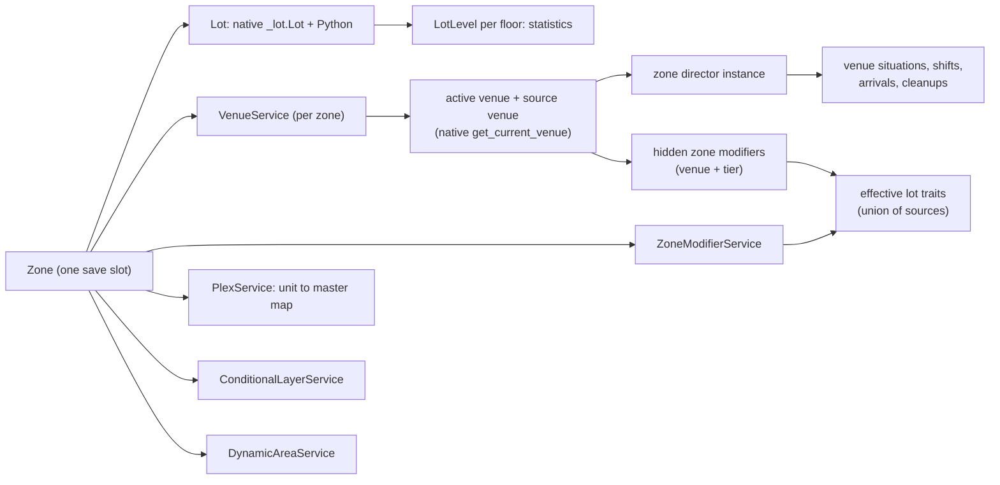
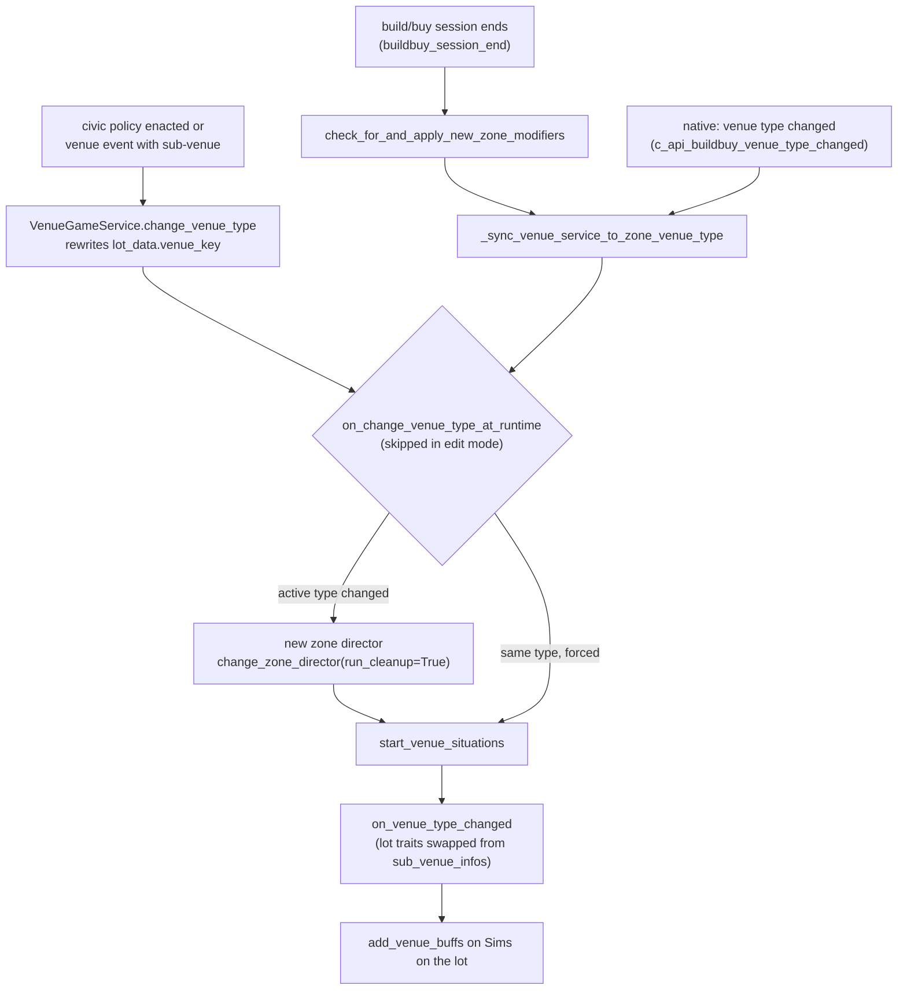
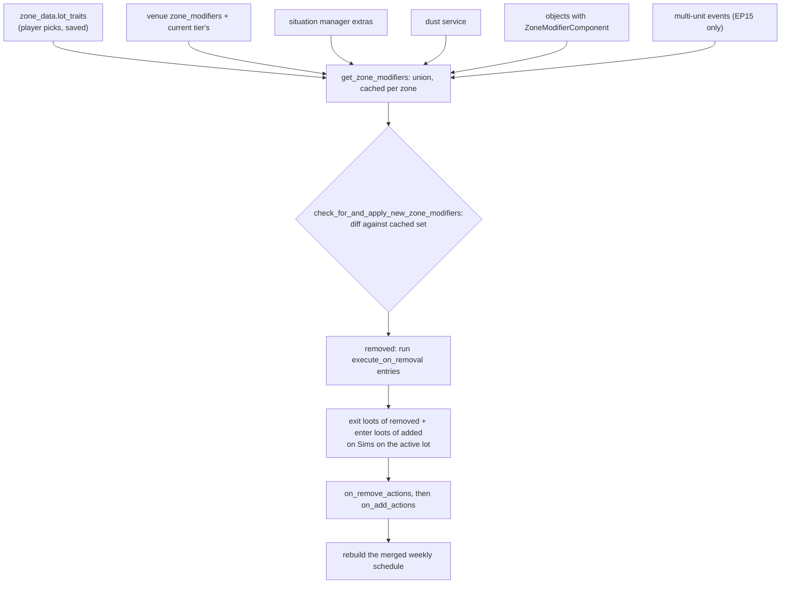

# 2.01 Lots, venues and rooms

*Game version 1.128.90.1030 (Steam, Linux/Proton). The numbers are base-game and installed-pack tuning, read from the live merge and the base delta, with EP04, EP06, EP09, EP12 High School Years, GP04, GP12, SP01 and SP42 installed. Written 2026-10-12. Checked 2026-10-12: 118 claims checked, 20 corrected, 2 relabelled, 1 removed.*

## In plain words

A lot is a zone: one saved slot in a world with its own objects, owner, statistics and settings. Three things in the tuning decide how a lot behaves. The **venue** says what kind of place it is (a house, a bar, a park, a vacation rental). The **zone director** that the venue names decides who turns up, which background crowds run and what gets tidied when you arrive. The **lot traits** (in the code, zone modifiers) hand out moodlets, schedules and statistic changes to the Sims on the lot. Which venue a lot counts as is decided in the game executable. The Python only supplies the tuning, asks "what is this lot now?", and reacts to the answer.

Some lots are several zones at once. An apartment building or a multi-unit rental is one physical lot cut into units (plexes). Each unit is its own zone with its own household, and they share a common area. Rooms are also mostly the executable's business. Python can ask for an integer room id, block id or plex id at a point, and whether a point has a roof over it. Gameplay code only ever compares those ids for equality ("is this light in the same room?").

A few things surprise people who read the code. On this install the venue's own requirement checker in Python is broken and never decides anything; the real check is native. In Python, the lot-trait limit of 3 appears only in a debug command that a retail game never registers. Any lot your household does not own gets its broken objects fixed, dirt cleaned and spoiled food binned on every visit once any time has passed, because the live tuning sets the "minutes since last visit" threshold to 0 (the code default is 720). And with EP03 (City Living) absent, apartment units appear to fall back to the plain house zone directors, because the house director's apartment slots point at EP03 records.

What is out of scope: the order in which a lot loads belongs to [1.01 Time, scheduling and lot loading](1.01-time-scheduling-loading.md); objects and their states to [2.02 Objects](2.02-objects-states-wear.md); placing things in build mode to [2.03 Build/Buy](2.03-build-buy-placement.md); worlds, streets and travel to [2.06](2.06-worlds-regions-travel.md); street civic policies, eco footprint and narratives to [2.07](2.07-neighbourhood-systems.md); situations as a system to [4.01 Situations](4.01-situations-npcs.md); businesses, including rental units as businesses, to [5.02 Businesses](5.02-businesses.md). This chapter covers the lot as a gameplay container.

## Key facts

- **30 venues load on this install:** 18 base-game venues and 12 from packs (EP12 (High School Years) 6, EP09 (Eco Lifestyle) 4, EP04 (Cats & Dogs) 1, EP06 (Get Famous) 1). The base full build also holds 12 `Venue` records under old 64-bit ids, each with a same-name twin in the delta. The delta's combined tuning replaces the full build's ([0.03](0.03-tuning-system.md)), so those 12 never load.
- **Venue eligibility is native.** `VenueService.on_client_connect` asks `build_buy.get_current_venue(zone_id)` for the active venue and `get_current_venue(zone_id, allow_ineligible=True)` for the raw one. The Python checker `Venue.lot_has_required_venue_objects` always returns `(True, None)` and its only caller is an unregistered, broken debug command.
- **A venue names a zone director, hidden lot traits, NPC rules and schedules.** `Venue` has 52 instance tunables. Of the 30 live venues, 27 are `STANDARD`, one each `RESIDENTIAL`, `RENTAL` and `VET_CLINIC`. Fire can only start on 3 of them (residential, the vacation rental and `venue_generic`).
- **The zone director is chosen by request priority.** Requests are sorted and the first wins: career event, social event, drama scheduler, ambient sub-venue, ambient venue. The venue always files the last or second-to-last.
- **Lot traits are a union of up to six sources**, cached per zone: the player's saved traits, the venue's and its tier's hidden modifiers, situation-provided modifiers, the dust service, objects that carry a `ZoneModifierComponent`, and EP15 (For Rent) multi-unit events.
- **36 zone modifiers load** (18 base, 18 from packs). The base game ships 85 `ZoneModifierDisplayInfo` records, 67 lot traits and 18 lot challenges, but only 32 of them point at a modifier that exists here.
- **Nearly every venue carries `ZoneModifiers_Hidden_BBGameplayEffects`.** It turns 67 kinds of tagged build pieces (columns, fences, floors, walls, roofs, pool surfaces, objects) into lot statistics for bills, eco footprint and environment score, only while the game option for building eco effects is on.
- **Lot traits apply on build/buy exit, not when you click them.** `c_api_buildbuy_lot_traits_changed` is an empty function; `buildbuy_session_end` runs `check_for_and_apply_new_zone_modifiers` after the objects, the posture graph and the exit callbacks, and just before the venue sync (see [2.03 Build/Buy](2.03-build-buy-placement.md) for the full exit order).
- **Variable venues switch through civic policies.** EP09's community lot (default, garden, maker space, market) and EP12's auditorium (career day, graduation, formal dance) are the 7 live `VenueCivicPolicy` records. Enacting one repeals the others and swaps the zone's venue and its saved lot traits.
- **A plex is one lot with many zones.** `PlexService` maps each unit zone to its master zone; plex id 300 is the shared common area. A unit's venue is the master's venue.
- **Apartment, landlord and rental services need packs that are not installed.** `LandlordService` needs EP03, `MultiUnitOwnershipService` and `MultiUnitEventService` need EP15; neither is registered here. `VenueGameService` (EP09 or EP12) runs.
- **Conditional layers are queued, paced and saved in the open street.** 230 `ConditionalLayer` records load (140 base, 90 from packs; 67 client-only). Situations, the narrative service, street civic policies and open street directors ask for them; the console commands are unregistered.
- **Most console commands in this area do nothing in retail.** All `venues.*`, `zone_director.*`, `plex.*`, `layers.*` and `zone_modifier.*` commands are untyped or `DebugOnly`. `volcanic_eruption` is `Live` but finds no tuning here. `civic_policy.venue.enact`, `repeal`, `vote` and `show_community_board` are `Live` (EP09).
- **Python's idea of a room is "same id".** Lights, object-state helpers and `lighting.auto_room_light_status` compare `build_buy.get_room_id` values. Inside versus outside is a native roof test (`is_location_outside`) or a native enclosure test (`is_location_in_building`).

## How it works

### The pieces of a lot



- **Observed** (`world/lot.py: Lot`): `Lot` subclasses the native `_lot.Lot` plus `ComponentContainer` and `HasStatisticComponent`. Python adds a `lot_levels` dict of `LotLevel`, inventories for `HIDDEN` and `MAILBOX` (shared between objects when the inventory type says so), random-point helpers, `get_default_position`, premade-status tracking and `send_lot_display_info`.
- **Observed** (`Lot.get_default_position`): the default spot is the front door; with no door, the corner nearest a given position; on a `COASTAL` building the first corner not under water; otherwise corner 0. It is then nudged toward the lot centre by `corner_towards_center_scale` (default 1.0). On a plex with a front door, it moves to whichever side of the door lies inside a unit. Automatic objects such as the mailbox are placed from this spot (`ZoneDirectorBase`).
- **Observed** (`Lot.get_lot_position`): `LotPositionStrategy` has DEFAULT 0, RANDOM 1 and RANDOM_ANY_FLOOR 2, but the lot only handles the first two; `RANDOM_ANY_FLOOR` is handled by `objects/placement/placement_helper.py` before it gets here.
- **Observed** (`Lot.send_lot_display_info`): the lot info panel gets the lot name, the owner household name, an icon for every `LOT_TRAIT` display info and the name of every `LOT_CHALLENGE` display info.
- **Observed** (`Lot.save`, `Lot.load`): the lot saves its commodity, statistic, skill and ranked-statistic trackers into `gameplay_zone_data`. When an instantiated lot is saved, `GlobalLotTuningAndCleanup.calculate_object_quantity_statistic_values` first sets the `SET_STATISTIC_TUNING` values and counts objects on the active lot into the `OBJECT_COUNT_TUNING` statistics.
- **Observed** (`world/lot_level.py: LotLevel`): one statistic container per floor, saved as `level_index` plus commodities. `world/lot_level_loot.py` has the loots that use it: `SetDustOverlayOp` (floor dust at the lot centre, dirtiness default 50 percent), `ApplyLootToLotLevel` and `ApplyLootToAllLotLevels` (loot on Sims or tagged objects on that floor) and `PlayAudioStingOnLotLevel` (only when that floor is the one on display).
- **Observed** (`world/premade_lot_status.py`, `Lot.flag_as_premade`): premade status is tracked only when the lot's `LotTuning.track_premade_status` is set. Once a lot is flagged not premade it never goes back. None of the 31 live `LotTuning` records sets it.
- **Observed** (`world/lot_geom_utils.py: get_random_points_on_floor`): uniform random points inside the block polygons of one floor of the active plex (or the whole lot), for spawning things on a floor.

### How a lot gets its venue

**Observed** (`venues/venue_service.py: VenueService.on_client_connect`, `_set_venue`; `build_buy.py: get_current_venue`; bytecode of `_set_venue`).

1. `build_buy.get_current_venue(zone_id, allow_ineligible)` first maps the zone to its plex master, then calls the native `_buildbuy.get_current_venue`. So a unit's venue is the building's venue.
2. `on_client_connect` reads the active venue and the raw venue (`allow_ineligible=True`). The raw one is passed through `get_variable_venue_source_venue`, which turns a sub-venue back into the venue that owns it.
3. `_set_venue(active_type, source_type)` returns early if neither changed. If the active type changed, it shuts the old venue down, cancels the special-event alarm, sends time-spent telemetry, then makes the new active instance (it reuses the source instance only when the source did not change and is the same class as the new active venue). If the source type changed it builds the source and calls the civic provider's `finalize_startup`. It returns whether the **active** venue changed, so a source-only change starts nothing.

**Observed** (`Venue._tuning_loaded_callback`, `valid_active_venue_type`, rescued bytecode): a venue's `sub_venue_types` are the `sub_venue` of every civic policy in its `variable_venues`, plus itself. `valid_active_venue_type(v)` is true for those.

**Inferred** (native strings `BBGetVenueRequirements`, `BBRefreshVenueRequirements`, `get_current_venue_config`): the executable reads `required_objects`, `forbidden_objects` and `venue_tiers` itself and decides eligibility; Python cannot see how ties or tiers combine.

**Observed** (`Venue.lot_has_required_venue_objects` bytecode): the Python checker loops over `required_objects` and compares a count with `.number`, but the branch that would add a failure message jumps straight back into the loop, so the function always returns `(True, None)`. The requirement rows (`TunableVenueObjectWithPair`) have `min_number`, not `number`, so on a venue with requirements the comparison would raise `AttributeError`. Its only caller, `venues.test_all_venues`, loops over the method object `venue_manager.types.values` (no call), which would raise `TypeError`, and it is untyped, so it is never registered.

### What a venue tunes

**Observed** (`venues/venue_tuning.pyc`, which did not decompile; names and defaults read from the bytecode constants in its disassembly).

`Venue` has 52 instance tunables. The ones gameplay reads, with code defaults:

| Tunable | Code default | What reads it |
|---|---|---|
| `venue_type` (`VenueTypes`) | STANDARD | `is_residential` (RESIDENTIAL or MULTI_UNIT), `is_rental`, `is_multi_unit`, `is_small_business` and others |
| `venue_flags` | none | WATER_LOT_RECOMMENDED 1, VACATION_TARGET 2 (`is_vacation_venue`), SUPPRESSES_LOT_INFO_PANEL 4 |
| `zone_director` | | `create_zone_director_instance` |
| `zone_modifiers`, `venue_tiers[].zone_modifiers` | | `VenueService.get_additional_zone_modifiers` |
| `required_objects`, `forbidden_objects`, `venue_tiers` | | native eligibility |
| `background_event_schedule`, `special_event_schedule`, `club_gathering_auto_spawn_schedule` | | venue situations (below) |
| `npc_summoning_behavior`, `zone_fixup`, `player_requires_visitation_rights` | | NPC arrival and greeting |
| `venue_buffs` | | `add_venue_buffs` on Sims on the lot |
| `allows_fire` | False | `FireService.is_fire_allowed` |
| `allow_super_speed_three` | True | the super speed 3 check in `interactions/utils/tunable.py` |
| `supports_welcome_wagon` | True | `NPCHostedSituationService` |
| `venue_requires_front_door` | NEVER | `requires_front_door` (NEVER, ALWAYS, OWNED_OR_RENTED) |
| `allow_rolestate_routing_on_navmesh` | False | `role/role_state.py` |
| `travel_group_limit` | on, 1 (minimum 1); "no_limit" when off | `TravelGroupManager.is_zone_rentable`: rentable while fewer played groups than the limit rent it (the bytecode counts only `group.played`; the decompile drops the filter); renting then destroys the zone's unplayed groups without returning their objects |
| `allowed_for_clubs` | False | club gatherings |
| `drama_node_events`, `drama_node_events_to_schedule` | empty, 1 | drama scheduler |
| `automatic_objects` | | `ZoneDirectorBase.on_startup` |
| `variable_venues` | off | civic policy sub-venues |

A requirement row (`venues/venue_object_test.py: TunableVenueObjectWithPair`) holds an object tag set counted by `NumberTaggedObjectsOwnedFactory`, `object_parent_pair_tests` (an object only counts when slotted to a parent with given tags, count default 1), `min_number` (default 0), `max_number` (default MAX_INT32), `is_optional` and `is_unit_specific` (both default False), `object_test_type` (INVALID 0, OBJECT 1 default, POOL 2, TILE 3) and `object_flags` (NO_FLAG 0, SMALL_BUSINESS 1).

**Observed** (live tuning, `venue_bar`, 16869): the bar needs 1 bar, 4 barstools, 4 dining chairs, 1 sink, 1 object tagged `Func_Bathroom`, 1 tagged `BuyCatPA_Disposable`, 2 dining or outdoor tables, 1 stereo and 1 TV. `venue_residential` (28614) lists two optional `SMALL_BUSINESS` rows (a ticket machine and one more) and an automatic object: tag `Func_Mailbox`, definition 17650.

**Observed** (live tuning): `ZoneModifiers_Hidden_BBGameplayEffects` is in the `zone_modifiers` of 28 of the 30 live venues; `venue_HiddenCave` and `venue_HiddenGlade` have an empty list. Each venue's `zone_director` is its own director except nine that use `zone_director_default`.

### The zone director

**Observed** (`venues/venue_service.py: make_venue_type_zone_director_request`, `_select_zone_director`, `_set_zone_director`; `venues/venue_constants.py: ZoneDirectorRequestType`).

- The venue files an `AMBIENT_VENUE` request when the active venue is the source venue, else `AMBIENT_SUB_VENUE`. Career events, social events and drama nodes file their own. `request_zone_director` keeps one request per type.
- `_select_zone_director` sorts the request tuples and takes the first. The enum is declared CAREER_EVENT, SOCIAL_EVENT, DRAMA_SCHEDULER, AMBIENT_SUB_VENUE, AMBIENT_VENUE with automatic values. **Inferred** (the values come from the enum metaclass): they count up from 0 in that order, so a career event beats everything and the plain venue loses to everything.
- The winning director receives the saved director proto. It restores its saved state (`was_loaded`) only when the request allowed `preserve_state` and the saved `resource_key` matches its own; otherwise it runs the saved cleanup actions (`ZoneDirectorBase.load`).
- `_set_zone_director` runs or hands over the old director's cleanup actions, moves the open street director over, shuts the old one down and starts the new one, and creates its situations if the zone is already running.

**Observed** (`zone_director.py: ZoneDirectorBase`) tunables and behaviour:

- `allow_venue_background_situations` (default True) gates the venue's background, special-event and club schedules.
- `lot_preparations` (tests, then `set_state`, `create_random_object_nearby` or `create_scorch_mark`, `number_of_changes` 1 to 5, `on_lot_only` True) run in `prepare_lot` only on a lot that was not loaded from a save. `objects_to_spawn` and `automatic_objects` are placed there too.
- `cleanup_zone_actions` and `exit_bb_zone_actions` are `ModifyAllLotItems`; `lot_load_loots` maps object tags to door-lock, remove-Sim-info or state-change loots.
- `init_actions` (`stop_saved_situations`, `send_saved_npcs_home`, both False) and spawn point overrides for players, NPCs and tested spawn tags; `disallow_pets`, `disallow_familiars`, `disallow_infants`.
- Saved Sims (bytecode of `_determine_zone_saved_sim_op`): CLEAR when the director did not restore saved state and sets `send_saved_npcs_home`, or when the lot owner changed; else REINITIATE when the active household changed or time passed; else MAINTAIN. Open street Sims: CLEAR in the same `send_saved_npcs_home` case or when time passed since the open street save, else MAINTAIN.
- `handle_active_lot_changing_edge_cases` calls the venue's `zone_fixup` (purpose ZONE_FIXUP) for non-resident NPCs who are in no situation, when time passed or the household changed.

**Observed** (`venues/scheduling_zone_director.py`, `situations/situation_shifts.py`): most venue directors are `SchedulingZoneDirector`, which runs `situation_shifts`: each shift has a time curve of desired Sim counts and a churn alarm (default 10 Sim minutes) that starts one situation when below the count and ends the longest-running one when above (unless the shift is tuned to overlap). Shift mechanics belong to [4.01](4.01-situations-npcs.md). A shift can list a zone modifier as an extra source (`situations/additional_situation_sources.py: ZoneModifierSituations`); while that modifier is active, its `additional_situations` join the shift's candidates.

**Observed** (live tuning, 60 `zone_director` records): 21 `ActingStudioZoneDirector` (EP06 career sets), 11 plain `SchedulingZoneDirector`, and one or a few each of the residential, rentable, apartment, bar, lounge, park, pool, gym, club, vet, open mic, weekly-schedule and career-event classes.

**Residential lots** (`venues/zone_director_residential.py`, bytecode of `get_residential_zone_director_type` and `should_auto_greeted`):

- **Observed**: `ZoneDirectorResidentialSwitch.__new__` uses the `player` set when the active household considers the zone its residence, or when the zone is a rental unit the active household owns and has not opened for business; otherwise the `npc` set. In a set, a penthouse director wins if tuned and the building type is `PENTHOUSE_PLEX`; an apartment director wins if tuned and the zone is any plex; otherwise the house director.
- **Observed** (live `zone_director_residential_switch`): `apartment_player` and `apartment_npc` reference ids 133714 and 133715, which no installed record has; `penthouse_*` point at `zone_director_penthouse_*` (base game). The base game's `zone_director_apartment_player` and `_npc` (228373, 228367) are referenced by nothing live. **Inferred** (pack-safe references resolve to None): on this install an apartment unit gets the plain house director, and a penthouse the base-game penthouse one.
- **Observed** (`ZoneDirectorResidentialBase.should_auto_greeted`, bytecode; the decompile nests it wrongly): visitors count as greeted when the lot has no front door and is a `BT_MULTI_UNIT` building, or when the lot's business is a small business, or when any travelling Sim spawned at a specific object.
- **Observed** (`_bring_home_resident_if_overdue`): a pet that is away comes home at once when no human child-or-older of its household is in the same zone; a resident with a `game_time_bring_home` comes home at that time, through an alarm per Sim. The rest of this function (region, travel group, active career event and hidden Sim checks) is mangled in the decompile, so its order is not given here.

### How a venue starts its background situations

**Observed** (`venue_service.py: start_venue_situations`, `initialize_venue_schedules`, `setup_special_event_alarm`; rescued `Venue._start_background_event`, `_try_start_special_event`, `_try_balance_club_gatherings`, `shut_down`).

- At spin-up, `create_situations_during_zone_spin_up` lets the director create its situations, then `initialize_venue_schedules` starts the background and club-gathering schedules (only if the director allows background situations). They fire immediately when there is no saved background situation or it is gone.
- The special-event schedule starts later: `setup_special_event_alarm` waits `SPECIAL_EVENT_SCHEDULE_DELAY` (code default 10, a `TunableSimMinute` passed to `interval_in_sim_minutes`, so 10 Sim minutes despite its description saying real seconds; no live override).
- A background event destroys the current background situation, then creates the new one with `user_facing=False` and `spawn_sims_during_zone_spin_up=True`. `venue_generic` runs `Situation_VenueGeneric` for 24 hours every day this way.
- A special event starts only if none is active. When the situation has a `venue_invitation_message`, no incompatible user-facing situation runs and the active Sim is free, the player gets an invitation; accepting makes it user facing with the Sim in `venue_situation_player_job`. Otherwise it runs non-user-facing.
- Club gatherings: the target is `int(random.triangular(0, maximum_club_gatherings, ideal))`, where `ideal` comes from a curve over the number of clubs whose hangout is this venue type or this lot, and `maximum_club_gatherings` defaults to 3. On a lot that a household owns, only clubs with a member in that household gather (bytecode; the decompile reads the other way round). Each club is also skipped outside its daily window (`Club.is_gathering_auto_spawning_available`: 06:00 or 18:00 for 12 hours, picked once per club with `random.Random(club_id)` from `ClubTunables.CLUB_GATHERING_AUTO_START_SCHEDULES`) and while its last gathering ended less than `CLUB_GATHERING_AUTO_START_COOLDOWN` (120 minutes, live; code 60) ago; a club that never gathered passes (`Venue._try_balance_club_gatherings`, bytecode offsets 130 to 222). All of this needs EP02 (Get Together), which this install lacks; see [4.03 Clubs, organizations, clans and factions](4.03-groups-factions.md).
- `shut_down` destroys the background and special schedules and their situations. **Inferred** (rescued body): the club gathering schedule is not destroyed there.
- On a runtime venue change, `start_venue_situations` calls the spin-up path (which schedules background and club events once) and then schedules background, special and club events again. **Inferred**: the first schedule objects are replaced without being destroyed; since each background event replaces the previous situation, the visible effect is at most an extra restart.

**Venue events from the drama scheduler** (`venues/venue_event_drama_node.py`, `drama_scheduler/drama_scheduler.py: _score_and_schedule_drama_nodes_gen`, bytecode of `_validate_venue_tuning`):

- **Observed**: on the days in the scheduler's `VENUE_BUCKET_DAYS` (live: Monday only) and never during zone spin-up, the drama scheduler walks every lot of every neighbourhood and, for venues with `drama_node_events`, scores and schedules up to `drama_node_events_to_schedule` of them for that zone.
- **Observed**: a `VenueEventDramaNode` runs only if the zone's venue lists its class in `drama_node_events`, or the venue already is the node's sub-venue. It sets a duration alarm, switches to its `subvenue` through `VenueGameService` if tuned, and on the active lot overrides the zone director and shows its notification. At the end it restores the venue's own director and, after `subvenue.delay` (default 1 hour), the venue type. `zone_modifier_requirements` must pass on scheduling and running.
- **Observed** (live): 10 venue event nodes. The lounge has five (EP06: open mic Friday and Saturday, award ceremony, meet a celebrity Monday and Wednesday), the thrift store four (EP12: fashion Monday and Friday, comedy and poetry open mics), and `graduationVenueEventDramaNode_Graduation` (EP12, 330 minutes, sub-venue graduation, `zoneDirector_HSGraduation`).
- **Observed** (`graduation_venue_event_drama_node.py`): if fewer graduates are waiting than the lower bound (default 1), graduation picks a total between the bounds (default 1 to 5) and ages up NPC teens from `graduating_npc_sim_filter` to fill the gap, then picks a valedictorian if there is none.

**NPC summoning and zone fixup** (`venues/npc_summoning.py`; bytecode of `Venue.summon_npcs` and `ResidentialLotArrivalBehavior.__call__`):

- **Observed**: `summon_npcs` tries the open street director first, then `npc_summoning_behavior[purpose]` with DEFAULT as fallback, then per species with HUMAN as fallback. Behaviours: create a situation, add to the background situation, notify the zone director, or the residential behaviour.
- **Observed**: the residential behaviour sorts NPC visitors (not living here) into three `CreateAndAddToSituation` slots: player's home, NPC home greeted, NPC home ungreeted. It passes the host as the second positional argument, which lands in `purpose`, so the created guest list always has host id 0.
- **Observed** (live `venue_constants` module tuning): `NPCSummoningPurpose` has DEFAULT 0, PLAYER_BECOMES_GREETED 1, BRING_PLAYER_SIM_TO_LOT 2 and ZONE_FIXUP 3 in code, and the tuning adds 4 to 13 (Invite_In, Invite_Over, Ask_To_Hang_Out, Voodoo_Summon, Stay_The_Night, Return_To_Lodging, Bring_Player_Sim_To_Lot, Invite_Over_Vampire, Invite_Over_Vampire_Initial, Invite_In_Self_Keyholder).

### Cleanup when you arrive

**Observed** (`VenueService.on_cleanup_zone_objects`; live module tuning `venues.venue_service`):

- When the playing household does not own the lot and the time since the zone was saved is more than `ELAPSED_TIME_SINCE_LAST_VISIT_FOR_CLEANUP` minutes, `VENUE_CLEANUP_ACTIONS` runs. The code default is 720; the live value is 0 (full build and delta agree), so any elapsed time triggers it.
- The live actions repair broken objects, clean dirty ones, and destroy spoiled or empty consumables, puddles, trash piles and similar, skipping objects tagged `Func_Venue_NotUnbrokenByCleanup` or `Func_Venue_NotDestroyableByCleanup`. Every action is blocked on lots with `zoneModifier_lotTrait_LandfillLot` (EP09) and on one venue type (id 341299) from a pack that is not installed.
- **Observed** (`world/lot_tuning.py: GlobalLotTuningAndCleanup.cleanup_objects`): separately, each load runs `OBJECT_CLEANUP_TUNING`, where each entry takes a count (all items, a lot statistic or a difference of two) and applies tested actions (`set_state`, `destroy_object`, `statistic_change`, `cleanup_vehicle`) to at most that many objects. The statistics come from `OBJECT_COUNT_TUNING` at save time.

### Changing the venue while you play



- **Observed** (`build_buy.py: buildbuy_session_end`): build/buy exit applies new zone modifiers (sixth in the exit order, after the objects, the posture graph, the exit callbacks and garbage collection; full order in [2.03](2.03-build-buy-placement.md)), then syncs the venue, then (if the sync succeeded) tells the director `on_exit_buildbuy`. `c_api_buildbuy_venue_type_changed` syncs with `from_bb_venue_changed=True` (which forces the situations to restart) and then lets `VenueGameService` re-finalize footprints.
- **Observed** (`VenueGameService.change_venue_type`, required packs EP09 or EP12): rewrites `lot_data.venue_key`, adds a new sub-venue to `sub_venue_infos` as ineligible, runs the runtime change if the zone is active, and sends `MSG_SET_SUB_VENUE` and a neighbourhood update. `restore_venue_type` uses a delay alarm and is saved.
- **Observed** (`zone_modifier_service.py: _handle_venue_type_changed`): when the venue changes, the zone's saved `lot_traits` are replaced with the `sub_venue_lot_traits` of the matching `sub_venue_info`, and `venue_eligible` is copied, so each sub-venue keeps its own lot traits.

### Lot traits: what a zone modifier is

**Observed** (`zone_modifier/zone_modifier.py: ZoneModifier`, `zone_modifier_actions.py`, `zone_modifier_household_actions.py`, `zone_modifier_from_objects_actions.py`).

| Hook | When it runs |
|---|---|
| `enter_lot_loot`, `exit_lot_loot` | a Sim enters or leaves the active lot (`SimActiveLotStatusChanged`) |
| `interaction_triggers` | a Sim on the active lot (or no Sim) runs a matching interaction; applies `on_interaction_loot` |
| `schedule` | weekly entries with actions, `chance` (default 100 percent), tests, `continuation_actions` (real-second delays) and `execute_on_removal` |
| `on_add_loot`, `cleanup_loot` | the modifier is added to or removed from the lot |
| `spin_up_lot_loot`, `zone_wide_loot` | every zone spin-up; `zone_wide_loot` also on every Sim spawn |
| `household_actions` | `shut_off_utilities`, or `lot_statistic_modifier` through an `AutonomyModifier` on the lot |
| `object_tag_to_actions` | per tagged object on the lot: `statistic_change`, `convergence_change` or `statistic_modifier`, value = multiplier x count; only with eco building effects on |
| `utility_supply_surplus_loot`, `_deficit_loot` | utility supply changes |

Constraints: `prohibited_situations`, `venue_requirements` (allowed or prohibited venue types), `conflicting_zone_modifiers`, `additional_situations`, `zone_modifier_locked` (default False), `ignore_route_events_during_zone_spin_up` (default False), `hide_screen_slam` (default False).

Schedule action variants (`zone_modifier_actions.py`): `loot` (to all Sims on the lot, the active Sim only, or one random Sim), `quake`, `modify_lot_items` (per-object `modification_chance`, default 100), `service_npc_request`, `play_sound` (default 5 real seconds), `spawn_objects` (up to 10 iterations, spawn delay in real seconds, a tag threshold). Each has a behaviour: ONCE 0, ONCE_IF_SIMS_EXIST 1, ONCE_IF_ACTIVE_SIM_ON_LOT 2.

**Observed** (`zone_modifier_display_info.py`): what the player sees is a separate `ZoneModifierDisplayInfo` record (manager `USER_INTERFACE_INFO`) with icon, name, description, `zone_modifier_reference` and `modifier_type` (LOT_TRAIT 0, the default, or LOT_CHALLENGE 1). The service finds it by scanning for the reference and skips modifiers with `hide_screen_slam`.

**Observed** (`zone_modifier_component.py`): an object can provide modifiers; one with no state criteria is always provided, others while the object has a given state value. A state change refreshes the set when the zone is running.

**Observed** (`zone_modifier_tuning.py`): `INITIAL_ZONE_MODIFIERS` maps a house description to modifiers but no Python reads it (it is exported). **Inferred**: the client or executable uses it to seed premade lots.

### Lot traits: how the effective set is built and applied



- **Observed** (`zone_modifier_service.py: check_for_and_apply_new_zone_modifiers`): it reads the cached set, refreshes, returns if the zone is not current, applies object actions for every modifier, returns if nothing changed, then runs the steps in the diagram in that order, with TRMV and TADD telemetry. Callers: build/buy exit, the object-finalize spin-up state (only when some object provides modifiers), the dust service, career event situations, object components, debug commands and multi-unit events.
- **Observed** (`ZoneModifierService.handle_event`, bytecode): enter and exit loots are skipped only when spin-up is not finished **and** the modifier sets `ignore_route_events_during_zone_spin_up`.
- **Observed** (`ZoneModifierService._on_scheduled_alarm`): a schedule entry rolls `random.random() >= chance` to skip, then runs its tests, actions and continuations.
- **Observed** (`apply_object_actions`): `STATISTIC_CHANGE` sets the lot statistic from the absolute count (the old contribution is reverted first); convergence and statistic-modifier actions apply the change in count. The eco option defaults to on (`_is_build_eco_effects_enabled = True`) and is saved in the options proto.
- **Observed** (`zone_modifier_commands.py`): `ZONE_MODIFIER_CAP = 3` appears only in `zone_modifier.add_zone_modifier`, which is `DebugOnly`. **Inferred** (native strings `BBSetLotTraits`, `BBGetAllUnlockedZoneModifiers`): the player-facing cap is enforced by the client.

### Lot traits in the live tuning

**Observed** (live merge, 36 `ZoneModifier` records: base delta 18, EP04 7, EP09 5, EP06 3, GP04 (Vampires) 3).

- **Homey** (`zoneModifier_lotTrait_Homey`, 144152): enter loot gives the hidden `buff_LotMods_BaseGame_Homey_hidden` (145493, humans only), an autonomy modifier of 1.5 on the Bartending, Cooking, Gardening and Handiness skill tags. Starting a super interaction with one of those skill tags gives `buff_LotMods_BaseGame_Homey_Visible` (145494: Happy, weight 1, `max_duration` 120); completing one runs a remove-all loot. Leaving the lot runs `loot_Buff_zoneMods_exitLot_RemoveAll`.
- **No Trespassing** (144159): no loots at all. It prohibits two ring-doorbell walkbys, one more situation id that is not installed, and every situation tagged `Situation_WelcomeWagon`, `Situation_Ring_Doorbell` or `Situation_CelebrityFan`.
- **Burglar Time** (431901): two daily entries, both `ONCE_IF_ACTIVE_SIM_ON_LOT`. One at 0:00 for 1 hour runs `loot_Burglar_LotTrait_PreBurglarNode` and one loot id that is not installed; one for 24 hours from a random start runs `modify_lot_items` with `modification_chance` 25 on objects tagged `Func_BurglarAlarm` that lack the `Upgrade_Generic_LockBrokenness_Completed` upgrade. It is allowed on `venue_residential` and four venue ids that are not installed.
- **Off the Grid** (206665): conflicts with High Speed Internet, runs an enter loot, add, cleanup and spin-up loots and both utility supply loots, and is allowed on six venue types.
- **`ZoneModifiers_Hidden_BBGameplayEffects`** (235291): locked, no screen slam, one spin-up loot for the active Sim, and 67 `object_tag_to_actions` keys over seven piece families (columns, fences, floor patterns, wall patterns, roof materials 10 each; objects 15; pool surfaces 2). Per piece: bills up or down 0.05, eco footprint +0.08 (Minus1) or +0.32 (Minus2) and -0.08 or -0.32 for the Plus tiers, applied as both a statistic change and a convergence change; environment score -0.05, -0.5, +0.05, +0.5.
- `zoneModifier_lotTrait_VolcanicActivity` does not exist here, so the `Live` `volcanic_eruption` command returns at once.

### Civic policies on venues

**Observed** (`venues/civic_policies/venue_civic_policy.py`, `venue_civic_policy_provider.py`, `venue_civic_policy_tests.py`, `venue_civic_policy_commands.py`; bytecode of `civic_policies/base_civic_policy_provider.pyc`).

- A `VenueCivicPolicy` names a `sub_venue`. Enacting it repeals every other enacted policy and requests that sub-venue; repealing requests the default.
- `VenueCivicPolicyProvider`: at most 1 enacted, all policies on the ballot, 1 repealable. Voters are Sims whose household's home world is the lot's world; the open and close voting loots resolve on the lot owner's household. `finalize_startup` enacts the policy that matches the active venue when none is enacted, and a later change calls `venue_game_service.change_provider_venue_type`.
- The base provider (`civic_policies/base_civic_policy_provider.pyc`, bytecode) listens for the test events `CivicPolicyOpenVoting`, `CivicPolicyCloseVoting` and `CivicPolicyDailyRandomVoting`; the street side that drives voting belongs to [2.07](2.07-neighbourhood-systems.md).
- `VenueCivicPolicyTest` reads the zone from the current zone, the pick, picked zone ids or a participant's home zone.
- Live: 7 records. EP09: `venueCivicPolicy_CommunityLot_Default` (to `venue_CommunityLot`), `_Garden`, `_MakerSpace`, `_Market`. EP12: `venueCivicPolicy_Auditorium_CareerDay`, `venueCivicPolicy_HSGraduation`, `venueCivicPolicy_HSProm` (to `subVenue_Auditorium_FormalDance`). `venue_Auditorium` has `enable_civic_policy_support`; `venue_CommunityLot` does not.

### Plexes: one lot, many zones

**Observed** (`plex/plex_service.py`, `plex_enums.py`, `plex_constraint.py`; bytecode of `get_plex_zones_in_group`).

- `PlexBuildingType` (read through native `services.get_building_type(house_description_id)`): DEFAULT 0, FULLY_CONTAINED_PLEX 1, PENTHOUSE_PLEX 2, INVALID 3, EXPLORABLE 4, COASTAL 5, BT_MULTI_UNIT 6, BT_PENTHOUSE_RENTAL 7. `INVALID_PLEX_ID = 0`.
- `_zone_to_master_map` holds every zone whose `master_zone_object_data_id` is non-zero and whose plex is not the shared plex 300, as (master, plex id). `is_zone_a_plex` is membership in that map; `get_master_zone_id` falls back to the zone itself.
- `get_plex_zones_in_group(zone, condition_func)` returns the zones with the same master that pass the filter (the decompile drops the filter). **Inferred**: `get_shared_plex_zones_in_group` is always empty, since shared-plex zones never enter the map.
- `is_zone_an_apartment` counts FULLY_CONTAINED_PLEX, plus penthouses (PENTHOUSE_PLEX, BT_PENTHOUSE_RENTAL) and multi-unit types (BT_MULTI_UNIT, BT_PENTHOUSE_RENTAL) unless told not to. `is_zone_a_multi_unit` is BT_MULTI_UNIT or BT_PENTHOUSE_RENTAL.
- `get_plex_zone_at_position` maps the native plex id at a point to the unit zone, or None for the common area; `is_position_in_common_area_or_active_plex` also requires the point to be on the lot. `get_plex_polygons` assumes units have no cutouts. `PlexConstraint` keeps a Sim inside the active plex; for a non-plex zone it is anywhere (default) or nowhere.
- **Observed** (`objects/doors/door_service.py`, `objects/doors/door.py`, `apartments/inactive_apartment_door_lock.py`): on a FULLY_CONTAINED_PLEX lot, the doors of other units become inactive apartment doors: portal cost 9999 and a `SYSTEM_LOCK` on the front side that lets only the door's owning household through. Door handling belongs to [2.02](2.02-objects-states-wear.md).

### Apartments and penthouses (EP03 code)

- **Observed** (`apartments/landlord_service.py`): `LandlordService` needs EP03 and is not registered here. Where it runs, it finds or creates a landlord from `LANDLORD_FILTER`, gives the landlord and tenant rel bits to households living in a plex and removes them otherwise, and shows a first-play rent reminder in a fully contained apartment (not a penthouse, not multi-unit). The live module tuning (`apartments.landlord_tuning`) points at ids 151546 (filter), 135305, 148657 and 133800 (trait).
- **Observed** (`apartments/apartment_zone_director.py`, bytecode of `on_cleanup_zone_objects` and `on_zone_director_aspiration_completed`): `ApartmentZoneDirectorMixin` runs `COMMON_AREA_CLEANUP` every day at 4:00 (code default; the live record does not set the hour) on objects outside every unit. On load it takes the newest saved game time across the plex group and runs the cleanup if the next 4:00 after it has passed, and runs `NEW_TENANT_CLEANUP` when the owning household has never played this home. The player version registers `neighbor_reaction_events` aspirations on the household; a completion starts the paired situation unless it fired within its timeout (default 60 Sim minutes).
- **Observed** (`apartments/situations/neighbor_loud_common.py`): `LoudNeighborSituation` picks an at-home neighbour (not in the active household, not instanced), sets the loud state on their door, applies tuned loots to Sims on the lot after a delay, and keeps the neighbour off auto-fill. Banging on the door starts `NeighborResponseSituation` and can turn the loud state off. The other neighbour situations (chat, hangout, group hangout, react to you, mailbox, trash chute) are walkby or visit situations on the same pattern.
- **Observed** (`apartments/apartment_picker_interaction.py`): the travel picker lists every zone in the picked lot's plex group and tests that the picked zone is an apartment, with penthouses excluded (fully contained or multi-unit buildings pass).
- **Observed** (live): `zone_director_penthouse_player` and `_npc` are `ApartmentZoneDirector` classes in the base game, so penthouses get the 4:00 common-area cleanup even without EP03.

### Multi-unit rentals (EP15 code)

EP15 is not installed, so none of this runs here; the base delta still carries its module tuning. Rental units as businesses belong to [5.02](5.02-businesses.md).

- **Observed** (`multi_unit/rental_unit_manager.py`): max rent is `tile count x simolean_cost_per_tile x cost_modifiers`; the tile count is at least `min_tile_count` (default 1). Initial rent is `floor(max_rent x initial_rent_percentage)`. A bill is rent x 7 days (`MAX_BILLED_RENT_DAYS`), except the first, which is rent x the days the unit has been open.
- **Observed** (live `multi_unit.multi_unit_tuning`): `simolean_cost_per_tile` 2 (code 1), `cost_modifiers` base value 4, `initial_rent_percentage` 50, `TAXES_PER_UNIT` 350 (code 100), grace period from 9:00 for 1 day. `DEFAULT_SIGNED_LEASE_LENGTH` is not in the delta (code default 7, exported to the client).
- **Observed** (live `multi_unit.multi_unit_event_service`): property-owner events every 24 to 30 Sim hours (code 3 to 5) and tenant events every 56 to 72 (code 23 to 25). `MultiUnitEventType` lists 23 event types, ALGAE through WATERLEAK plus three `_COMMON` variants. Active events and `TESTED_UNIT_LOT_TRAITS` add zone modifiers to a unit while they last.
- **Observed** (`multi_unit_commands.py`): the `Live` commands (`multi_unit.enable_events`, `evict`, `select_tenant` and others) carry `pack=Pack.EP15`, so they are not registered here.

### Rooms, blocks and inside or outside

**Observed** (`build_buy.py`; callers in `objects/lighting/lighting_utils.py`, `objects/object_state_utils.py`, `server_commands/lighting_commands.py`, `world/world_tests.py`).

- `get_room_id`, `get_block_id` and `get_location_plex_id` are native. Python never gets a room size or a list of rooms; it compares ids. `lights_in_target_room_gen` and `objects_in_target_room_gen` select by equal room id.
- `lighting.auto_room_light_status(room_id, on)` is `Live`: the client passes a room id and the command flips the automation-dimmer lights in it.
- `all_lights_gen` skips lights tagged as manual lights and, in a plex, common-area lights unless `include_common_area` is set (default False). The common-area branch is mangled in the decompile; this is its only consistent reading.
- `is_location_outside(pos, level)` is the native roof test for the current zone; `is_location_in_building` is the native `_pathing.is_3d_point_indoors`. `world_tests` exposes them as separate options.
- Block ids are also used by dynamic areas, portals, walk styles (a node counts as outside at portal 0 and block 0) and pools (block one level below the surface).

### Dynamic areas

**Observed** (`dynamic_areas/dynamic_area.py`, `dynamic_area_enums.py`, `build_buy.c_api_buildbuy_dynamic_areas_changed`; bytecode of `can_object_be_used_by_autonomy`; live module tuning).

- `DynamicAreaType`: INVALID -1, BUSINESS_RESIDENTIAL 0, BUSINESS_PUBLIC 1, BUSINESS_EMPLOYEES_ONLY 2, COUNT 3. The executable sends (type, blocks, objects) lists; Python clears all areas, rebuilds them and re-tags objects. A `DynamicAreaChanged` event fires when any area other than BUSINESS_PUBLIC exists.
- Objects that count: interactable, not a prop, part or Sim, on the active lot with tolerance 0 (or parented to such an object). They get the area's tag (`AREA_TYPE_OBJECT_TAG`, live `DynamicArea_Business_*`) and are re-evaluated when moved outside build mode.
- `can_object_be_used_by_autonomy`: false when the autonomy rule forbids the object's area; true when the object is in another area; **false when it is in no area**. It is called only for the off-lot rules BUSINESS_EMPLOYEE and BUSINESS_CUSTOMER (`autonomy/autonomy_component.py`) and by the small business manager. Live restrictions: customers stay out of residential and employees-only areas; employees out of residential areas.
- `EXTERIOR_AREA_TYPE` (live BUSINESS_PUBLIC) is defined but read by no Python.

### Conditional layers

**Observed** (`world/conditional_layer.py`, `conditional_layers/conditional_layer_service.py`, `conditional_layer_enums.py`, `conditional_layer_tests.py`; bytecode of `save` and `is_layer_loaded`; live module tuning).

- A `ConditionalLayer` names a world-builder layer (`layer_name`, Hash32) and may be `client_only` (decorative, default False). Optional `fade_data`: duration 10.0, delay 10.0 to 20.0 Sim minutes. Live: 230 layers, 67 client-only, 73 with fade data.
- The service runs one request at a time from a queue. A request of the same type as the layer's last request is skipped and only calls back. Loading is immediate (all objects) or gradual (an alarm every `timer_interval` minutes loading `timer_object_count`). Client-only layers go through `set_client_conditional_layer_active` instead.
- Household-owned objects in the way of a loading layer: crafted ones and ones with servings are destroyed; the rest move to the household inventory, with a notification when they belong to the active household.
- Destroying gradually cancels interactions on objects in use and force-destroys them after `DESTRUCTION_TIMEOUT` (10 Sim minutes, live and code). On zone shutdown destruction is immediate.
- Who asks: `SituationManager.request_conditional_layer` (immediate during spin-up, gradual when the zone is running, at the open street director's live pace of 5 objects per 1 Sim minute; destroyed when no requesting situation remains), the narrative service (load 5, destroy 2, every 1 Sim minute, live), street civic policies and open street directors.
- `STREET_LAYER_OBJECTS_TO_DESTROY` and `STREET_LAYER_OBJECTS_ALARM_TIME` (live 5 and 1, code 1 and 5) are defined on the service but read by no Python.
- Save: into the open street data, one entry (layer guid plus object ids) per layer with loaded objects, and per client-only layer whose last request was a load. Client-only layers are switched on again at zone load and off at unload.
- `is_layer_loaded(consider_queued_requests=True)` checks queued requests from newest to oldest but its range stops before the oldest one, then the running request, then the layer's last request.

### Lot tuning

**Observed** (`world/lot_tuning.py`, `world/lot_utils.py`, `world/rentable_lot_tuning.py`; live merge).

- `LotTuning` (walkby, walkby schedule, audio stings, `track_premade_status`) is found by lot description id, then street, then region (`LotTuningMaps.get_lot_tuning`). Live: 31 records. The base full build holds 6 more under old ids, which never load.
- `play_lot_entry_audio_sting` plays the lot's travel sting after a travel, else its plain sting, else the new-game sting; the narrative service can suppress it.
- `RentableZoneTuning` (exported to the client): live `PRICE_MODIFIERS` add -2.561, multiply 0.009695; `GETAWAY_MODIFIERS` rent multiply 0.002, profit multiply 0.0036, household Sim count 0.75, NPC Sim count 0.03, Sim count 0.1. **Inferred**: the client computes rental prices with them.

### Venue-specific zone directors

**Observed** (the per-venue packages; live classes in brackets where they exist).

- Bar, pool and karaoke directors start a weekly special-event schedule after the loading screen; each entry starts its situation if it meets its starting requirements and is not already running (bar entries can also carry tests). [`BarZoneDirector`, `PoolVenueZoneDirector`]
- The cafe director keeps one `CafeGenericBackgroundSituation` running and drops summoned Sims into it. Not live here.
- `VisitorSituationOnArrivalZoneDirectorMixin` (park, gym, pool, relaxation centre, chalet garden) puts arriving player Sims, and optionally their companions, into an arrival situation. [`ParkZoneDirector`, `GymZoneDirector`]
- `AttractorCreationDirectorMixin` places invisible attractor objects at sampled good locations on startup and after build mode (default 3 per entry, 4 samples per axis). [`zoneDirector_Beach` tunes one entry]
- `OpenMicNightZoneDirector` (EP06 lounge, EP12 thrift store events), `SecretLabZoneDirector` (unlocks plex sections behind doors; its commands are `Automation`), `WeeklyScheduleZoneDirector` (live only in EP12: the high school day and graduation).

## Numbers

| Name | Value | Unit | Where | Source |
|---|---|---|---|---|
| Venue records in the live set | 30 (the base full build holds 12 more that never load) | records | live merge, class `Venue` | delta |
| Venues by source (loading) | base 18, EP12 6, EP09 4, EP04 1, EP06 1 | records | same | delta |
| `VenueTypes` values | 11 (STANDARD 0 to CUSTOM_VENUE 10) | | `venues/venue_enums.py` | code |
| `Venue` instance tunables | 52 | | `venue_tuning.pyc` | code |
| Venues that allow fire | 3 of 30 | | `allows_fire` | delta |
| `SPECIAL_EVENT_SCHEDULE_DELAY` | 10 | Sim minutes | `VenueService` | code (no override) |
| `ELAPSED_TIME_SINCE_LAST_VISIT_FOR_CLEANUP` | 0 (code 720) | Sim minutes | `VenueService` | full and delta |
| `maximum_club_gatherings` | 3 | gatherings | `Venue` club schedule | code |
| `drama_node_events_to_schedule` | 1 (thrift store 4) | nodes | `Venue` | code / delta |
| `travel_group_limit` | 1 (no live venue changes it) | travel groups per zone | `Venue` | code |
| `VENUE_BUCKET_DAYS` | Monday only | days | `DramaScheduleService` | delta |
| Zone director records | 60 | records | live merge | delta |
| Shift churn alarm | 10 | Sim minutes | `SituationShifts` | code |
| `lot_preparations.number_of_changes` | 1 to 5 | changes | `ZoneDirectorBase` | code |
| Zone modifier records | 36 | records | live merge | delta |
| Zone modifier display infos | 85 (67 traits, 18 challenges; 32 resolve) | records | live merge | delta |
| `ZONE_MODIFIER_CAP` | 3 (debug command only) | traits | `zone_modifier_commands.py` | code |
| Homey autonomy multiplier | 1.5 on 4 skill tags | multiplier | `buff_LotMods_BaseGame_Homey_hidden` | delta |
| Homey visible buff | Happy, weight 1, max 120 | Sim minutes | `buff_LotMods_BaseGame_Homey_Visible` | delta |
| Burglar Time lot item chance | 25 | percent | `zoneModifier_lotTrait_BurglarTime` | delta |
| BB effects keys | 67 | tags | `ZoneModifiers_Hidden_BBGameplayEffects` | delta |
| BB effects per piece | bills 0.05; eco 0.08 / 0.32; environment 0.05 / 0.5 | statistic points | same | delta |
| Zone modifier action `chance` | 100 | percent | `zone_modifier_actions.py` | code |
| `play_sound` duration | 5 | real seconds | same | code |
| `spawn_objects` iterations | at most 10 | | same | code |
| Venue civic policies | 7 | records | live merge | delta |
| Civic provider limits | 1 enacted, 1 repealable | policies | `VenueCivicPolicyProvider` | code |
| Venue event drama nodes | 10 | records | live merge | delta |
| Graduation size | 1 to 5 | Sims | `GraduationVenueEventDramaNode` | code |
| Sub-venue restore delay | 1 | Sim hours | `VenueEventDramaNode.subvenue.delay` | code |
| Shared plex id | 300 | | `PlexService.is_shared_plex` | code |
| Inactive apartment door portal cost | 9999 | | `Door.INACTIVE_APARTMENT_DOOR_PORTAL_COST` | code |
| Apartment common area cleanup | 4:00 daily | hour | `ApartmentZoneDirectorMixin` | code |
| Neighbour reaction timeout | 60 | Sim minutes | `ApartmentZoneDirectorPlayer` | code |
| Rent per tile | 2 (code 1) | simoleons | `MultiUnitTuning.MAX_RENT` | delta |
| Max rent base multiplier | 4 | | `MAX_RENT.cost_modifiers` | delta |
| Initial rent | 50 | percent of max | same | delta |
| Billed rent days | 7 | days | `MAX_BILLED_RENT_DAYS` | code |
| Taxes per unit | 350 (code 100) | simoleons | `MultiUnitTuning.TAXES_PER_UNIT` | delta |
| Property owner event interval | 24 to 30 (code 3 to 5) | Sim hours | `MultiUnitEventService` | delta |
| Tenant event interval | 56 to 72 (code 23 to 25) | Sim hours | same | delta |
| Conditional layers | 230 (67 client-only, 73 fade) | records | live merge | delta |
| Layer fade defaults | 10.0; delay 10.0 to 20.0 | Sim minutes | `ConditionalLayer.fade_data` | code |
| `DESTRUCTION_TIMEOUT` | 10 | Sim minutes | `DestroyConditionalLayerRequest` | delta = code |
| Open street layer pace | 5 objects per 1 minute load, 2 destroy | objects, Sim minutes | `open_street_director` module | delta |
| Narrative layer pace | 5 load, 2 destroy, every 1 | objects, Sim minutes | `NarrativeService` | delta |
| Lot tuning records | 31 (the base full build holds 6 more that never load) | records | live merge | delta |
| Attractors per entry | 3 | objects | `AttractorCreationDirectorMixin` | code |

## Data shapes

What a zone saves about its venue and traits (field names from `venue_service.py` and `zone_modifier_service.py`):

```
zone_data
  lot_traits[]                       guid64 of player-chosen ZoneModifiers
  gameplay_zone_data.venue_data
    background_situation_id, special_event_id
    zone_director (proto: resource_key, cleanup actions, custom_data)
    civic_provider_data                VenueCivicPolicyProvider state
open_street_data.open_street_director  (proto)
neighbourhood lot_data
  venue_key, venue_eligible
  sub_venue_infos[]: sub_venue_key, sub_venue_eligible, sub_venue_lot_traits[]
```

A venue record, reduced to its gameplay fields (shape of `venue_bar` as the delta has it):

```
<I c="Venue" n="venue_bar" s="16869">
  required_objects: [{object.tag_set, min_number, max_number, is_optional, object_flags}...]
  zone_director: zoneDirector_Bar        zone_modifiers: [ZoneModifiers_Hidden_BBGameplayEffects]
  venue_buffs: [{buff_type, buff_reason}]  npc_summoning_behavior: {purpose: {species: behaviour}}
  zone_fixup: add_to_background_situation  club_gathering_auto_spawn_schedule: {schedule_entries}
  small_business_seed: 436513             allowed_for_clubs: True
```

A zone modifier (fields at their defaults are omitted, as in the tuning):

```
ZoneModifier
  enter_lot_loot[], exit_lot_loot[], interaction_triggers[{trigger_conditions, on_interaction_loot}]
  schedule.schedule_entries[{days_available, start_time, duration, random_start, actions, chance, tests}]
  on_add_loot, cleanup_loot, spin_up_lot_loot, zone_wide_loot, household_actions
  object_tag_to_actions{tag: [statistic_change | convergence_change | statistic_modifier]}
  prohibited_situations, venue_requirements, conflicting_zone_modifiers, additional_situations
  zone_modifier_locked, hide_screen_slam, ignore_route_events_during_zone_spin_up
ZoneModifierDisplayInfo: icon, name, description, zone_modifier_reference, modifier_type
```

Runtime maps:

- `PlexService._zone_to_master_map`: `{zone_id: (master_zone_id, plex_id)}`.
- `ConditionalLayerService._layer_infos`: `{layer: (objects_loaded, last_request_type)}`, saved as `open_street_data.conditional_layer_service.layer_infos[{conditional_layer, object_ids}]`.
- `DynamicAreaService`: one area per type with its block ids and object ids.

## For modders

**Tweaks that work with tuning alone:**

- *A new lot trait*: a `ZoneModifier` plus a `ZoneModifierDisplayInfo` whose `zone_modifier_reference` points at it (without the display info it never shows). Restrict it with `venue_requirements` and `conflicting_zone_modifiers`. Visible-on-action buffs follow Homey: a hidden buff from `enter_lot_loot`, a visible one from an `interaction_triggers` entry, and a remove-all loot in `exit_lot_loot`.
- *A trait that every lot of a venue has*: add it to the venue's `zone_modifiers` (or a tier's). It joins the effective set but stays out of the trait panel.
- *A venue event*: a `VenueEventDramaNode` plus its class in the venue's `drama_node_events`, and raise `drama_node_events_to_schedule` if the venue already has events.
- *Community lot cleanup*: `VenueService.ELAPSED_TIME_SINCE_LAST_VISIT_FOR_CLEANUP` (module tuning) sets how long a non-owner must be away before the cleanup runs; live 0.

**Commands** (types from `core/sims4/commands.py`; untyped means `DebugOnly`, which a retail game never registers):

| Command | Type | Notes |
|---|---|---|
| `venues.set_venue`, `get_venue`, `test_all_venues`, `print_venues`, `change_zone_director`, `print_zone_director`, `clean_lot` | DebugOnly | not registered |
| `zone_director.print_situation_shifts` | DebugOnly | not registered |
| `zone_modifier.add_zone_modifier`, `remove_zone_modifier`, `remove_all_zone_modifiers`, `run_schedule_entry` | DebugOnly | the only place the cap of 3 lives |
| `volcanic_eruption large/small` | Live | needs `zoneModifier_lotTrait_VolcanicActivity`, absent here |
| `layers.load_layer`, `destroy_layer`, `reload_layer`, `active_layers` | DebugOnly | not registered |
| `plex.*` | DebugOnly | not registered |
| `civic_policy.venue.enact`, `repeal`, `vote`, `show_community_board` | Live, pack EP09 | work on this install |
| `civic_policy.venue.force_end_voting`, `policy_list`, `vote_count` | Automation | automation mode only |
| `multi_unit.enable_events`, `evict`, `select_tenant` and other Live ones | Live, pack EP15 | not registered without EP15 |
| `secret_lab.reveal_next_section`, `reveal_all_sections`, `reset_lab` | Automation | |
| `lighting.auto_room_light_status room_id on` | Live | |
| `debug.force_block_dynamic_area` | DebugOnly | |

**Traps:**

- Count only the delta builds: the base full build's 12 venue and 6 lot tuning records with old ids have same-name twins in the delta, so a merge that also reads the full build counts them twice.
- Do not trust `Venue.lot_has_required_venue_objects`; eligibility is native.
- Setting `zone_data.lot_traits` from script does nothing until `check_for_and_apply_new_zone_modifiers(zone_id)` runs; the native "lot traits changed" callback is empty.
- `object_tag_to_actions` is silent while the game option for building eco effects is off (`ZoneModifierService.set_build_eco_effects_enabled`, saved with the options).
- `ResidentialLotArrivalBehavior` loses the host Sim (it reaches `CreateAndAddToSituation` as `purpose`).
- An apartment director in `zone_director_residential_switch` needs EP03 ids; without them the plain house directors run.
- `is_layer_loaded` does not see the oldest queued request.
- The decompiles mangle nested `if`s in this area: `should_auto_greeted`, `get_residential_zone_director_type`, `summon_npcs`, `_validate_venue_tuning` and the attractor id filter all read differently in bytecode. Check bytecode before relying on a nested condition.
- `SPECIAL_EVENT_SCHEDULE_DELAY` says "real seconds" in its description and is Sim minutes in code.

## Limits

- `venues/venue_tuning.py` did not decompile. Its method bodies come from the earlier per-function rescue and its tunables and defaults from bytecode, in its disassembly. Where the rescue is mangled (club gatherings, `summon_npcs`), only bytecode-checked claims are given.
- Venue eligibility, tier choice, room and block computation, the lot-trait cap and lot size classes are executable logic; only native strings were read.
- `open_street_director/open_street_director.py`, `civic_policies/base_civic_policy_provider.py` and `business/small_business_zone_director_mixin.py` have no source; their behaviour here comes from bytecode or callers.
- EP03 and EP15 are not installed, so apartments, landlords and multi-unit rentals are described from code and the base delta's module tuning only; their instance tuning (problems, events, apartment venues) is absent.
- The per-venue situations (bar, cafe, karaoke, pool, club, chalet garden) were listed, not read in depth; situation mechanics are in [4.01](4.01-situations-npcs.md).
- `multi_unit_ownership_service.py` and `multi_unit_commands.py` were read for structure and gating, not line by line.
- That the 12 full-build venue copies never load rests on [0.03](0.03-tuning-system.md)'s finding that the delta's combined tuning replaces the full build's.

## File index

| Module | What it holds | Depth |
|---|---|---|
| `simulation/apartments/__init__.py` | empty package marker | skim |
| `simulation/apartments/apartment_picker_interaction.py` | `ApartmentPickerInteraction`: travel picker over a plex group's zones | skim |
| `simulation/apartments/apartment_zone_director.py` | `ApartmentZoneDirectorMixin` (4:00 common-area cleanup, new tenant cleanup), player and NPC directors, neighbour reaction aspirations | deep |
| `simulation/apartments/inactive_apartment_door_lock.py` | `InactiveApartmentDoorLockData`: system lock for other units' doors | deep |
| `simulation/apartments/landlord_service.py` | `LandlordService` (EP03): landlord pick, rel bits, rent reminder | deep |
| `simulation/apartments/landlord_situation.py` | `LandlordSituation`, `LandlordWalkbyRingDoorBellSituation` | skim |
| `simulation/apartments/landlord_tuning.py` | `LandlordTuning` module tunables | deep |
| `simulation/apartments/situations/__init__.py` | empty package marker | skim |
| `simulation/apartments/situations/neighbor_chat_situation.py` | `NeighborChatSituation`: neighbour answers the door to chat | skim |
| `simulation/apartments/situations/neighbor_complaint_response.py` | `NeighborResponseSituation`: loud neighbour answers banging | skim |
| `simulation/apartments/situations/neighbor_group_hangout.py` | `NeighborGroupHangoutSituation` (`number_of_neighbors` default 1) | skim |
| `simulation/apartments/situations/neighbor_hangout_situation.py` | `NeighborHangoutSituation`: ring, wait to be greeted, hang out | skim |
| `simulation/apartments/situations/neighbor_loud_common.py` | `LoudNeighborSituation`: loud door state, delayed loots, complain state | deep |
| `simulation/apartments/situations/neighbor_mailbox.py` | `NeighborMailboxSituation` walkby | skim |
| `simulation/apartments/situations/neighbor_react_to_you_situation.py` | `NeighborReactToYouSituation`: knock, wait, hang out, early exit loot | skim |
| `simulation/apartments/situations/neighbor_trash_chute.py` | `NeighborTrashChuteSituation` walkby with trash objects | skim |
| `simulation/conditional_layers/__init__.py` | empty package marker | skim |
| `simulation/conditional_layers/conditional_layer_commands.py` | `layers.*` commands (unregistered) | deep |
| `simulation/conditional_layers/conditional_layer_enums.py` | request speed and request type enums | deep |
| `simulation/conditional_layers/conditional_layer_handlers.py` | GSI views of layers and the request archive | skim |
| `simulation/conditional_layers/conditional_layer_service.py` | `ConditionalLayerService`: queue, gradual load and destroy, blockers, save | deep |
| `simulation/conditional_layers/conditional_layer_tests.py` | `ConditionalLayerLoadedTest` | deep |
| `simulation/dynamic_areas/__init__.py` | empty package marker | skim |
| `simulation/dynamic_areas/dynamic_area.py` | `DynamicAreaService`: areas from blocks, object tags, autonomy and portal rules | deep |
| `simulation/dynamic_areas/dynamic_area_enums.py` | `DynamicAreaType` | deep |
| `simulation/multi_unit/__init__.py` | empty package marker | skim |
| `simulation/multi_unit/multi_unit_commands.py` | `multi_unit.*` commands, EP15-gated | skim |
| `simulation/multi_unit/multi_unit_event_service.py` | `MultiUnitEventService` (EP15): event alarms, event zone modifiers | deep |
| `simulation/multi_unit/multi_unit_handler.py` | GSI views of rental units, events, evictions | skim |
| `simulation/multi_unit/multi_unit_loot_ops.py` | `SetMultiUnitEventOutcomeLoot`, `EvictionLootOp` | skim |
| `simulation/multi_unit/multi_unit_ownership_service.py` | `MultiUnitOwnershipService` (EP15): owners, tenants, eviction | skim |
| `simulation/multi_unit/multi_unit_tests.py` | `MultiUnitRoleTest` (tenant or property owner) | skim |
| `simulation/multi_unit/multi_unit_tuning.py` | `MultiUnitTuning`, `PropertyOwnerTuning`, `MultiUnitEventType` | deep |
| `simulation/multi_unit/rental_unit_manager.py` | `RentalUnitManager`: max rent, initial rent, billing, lease | deep |
| `simulation/plex/__init__.py` | empty package marker | skim |
| `simulation/plex/plex_commands.py` | `plex.*` debug commands | skim |
| `simulation/plex/plex_constraint.py` | `PlexConstraint` | deep |
| `simulation/plex/plex_enums.py` | `PlexBuildingType`, `INVALID_PLEX_ID` | deep |
| `simulation/plex/plex_service.py` | `PlexService`: unit to master map, building types, common area | deep |
| `simulation/venues/__init__.py` | empty package marker | skim |
| `simulation/venues/attractor_creation_director_mixin.py` | `AttractorCreationDirectorMixin`: invisible attractor objects | deep |
| `simulation/venues/bar_venue/__init__.py` | empty package marker | skim |
| `simulation/venues/bar_venue/bar_special_night_situation.py` | `BarSpecialNightSituation` | listed |
| `simulation/venues/bar_venue/bar_zone_director.py` | `BarZoneDirector`, tested special-event schedule | skim |
| `simulation/venues/bar_venue/barfly_situation.py` | `BarflySituation` | listed |
| `simulation/venues/bar_venue/bartender_situation.py` | `BartenderSituation`, `BartenderSpecificSimSituation` | listed |
| `simulation/venues/cafe_venue/__init__.py` | empty package marker | skim |
| `simulation/venues/cafe_venue/barista_situation.py` | `BaristaSituation` | listed |
| `simulation/venues/cafe_venue/cafe_business_partner_situation.py` | `CafeBusinessPartnerSituation` | listed |
| `simulation/venues/cafe_venue/cafe_ensemble_situations.py` | `CafeBusinessMeetingSituation`, `CafeFriendGroupSituation` | listed |
| `simulation/venues/cafe_venue/cafe_friend_sim_situation.py` | `CafeFriendSimSituation` | listed |
| `simulation/venues/cafe_venue/cafe_generic_situation.py` | `CafeGenericCustomerSituation`, `CafeGenericBackgroundSituation` | listed |
| `simulation/venues/cafe_venue/cafe_media_addict_situation.py` | `CafeMediaAddictSituation` | listed |
| `simulation/venues/cafe_venue/cafe_reader_situation.py` | `CafeReaderSituation` | listed |
| `simulation/venues/cafe_venue/cafe_situations_common.py` | shared order-coffee states | listed |
| `simulation/venues/cafe_venue/cafe_to_go_customer_situation.py` | `CafeToGoCustomerSituation` | listed |
| `simulation/venues/cafe_venue/cafe_zone_director.py` | `CafeZoneDirector`: one generic background situation | skim |
| `simulation/venues/center_park_venue/__init__.py` | empty package marker | skim |
| `simulation/venues/chalet_garden/__init__.py` | empty package marker | skim |
| `simulation/venues/chalet_garden/chalet_garden_situation.py` | `ChaletGardenSituation` | listed |
| `simulation/venues/chalet_garden/chalet_garden_zone_director.py` | `ChaletGardenZoneDirector` with arrival situations | skim |
| `simulation/venues/civic_policies/__init__.py` | empty package marker | skim |
| `simulation/venues/civic_policies/venue_civic_policy.py` | `VenueCivicPolicy`: sub-venue, enact and repeal | deep |
| `simulation/venues/civic_policies/venue_civic_policy_commands.py` | `civic_policy.venue.*` commands (Live and Automation, EP09) | deep |
| `simulation/venues/civic_policies/venue_civic_policy_handlers.py` | GSI view of `VenueGameService` | skim |
| `simulation/venues/civic_policies/venue_civic_policy_provider.py` | `VenueCivicPolicyProvider`: limits, voters, startup enact | deep |
| `simulation/venues/civic_policies/venue_civic_policy_tests.py` | `VenueCivicPolicyTest` | deep |
| `simulation/venues/club_venue/__init__.py` | empty package marker | skim |
| `simulation/venues/club_venue/club_dj_situation.py` | `DJSituation` | listed |
| `simulation/venues/dance_club_venue_zone_director.py` | `DanceClubZoneDirector` | skim |
| `simulation/venues/graduation_venue_event_drama_node.py` | `GraduationVenueEventDramaNode`: fill graduates, valedictorian | deep |
| `simulation/venues/gym_zone_director.py` | `GymZoneDirector` with arrival situations | skim |
| `simulation/venues/karaoke_venue/__init__.py` | empty package marker | skim |
| `simulation/venues/karaoke_venue/karaoke_contest_situation.py` | `KaraokeContestSituation` | listed |
| `simulation/venues/karaoke_venue/karaoke_duet_individualsim_situation.py` | `KaraokeDuetSimSituation` | listed |
| `simulation/venues/karaoke_venue/karaoke_duet_situation.py` | `KaraokeDuetSituation` | listed |
| `simulation/venues/karaoke_venue/karaoke_zone_director.py` | `KaraokeZoneDirector`, special-event schedule | skim |
| `simulation/venues/lounge_venue/__init__.py` | empty package marker | skim |
| `simulation/venues/lounge_venue/open_mic_night_zone_director.py` | `OpenMicNightZoneDirector`, contestant and player controller situations | skim |
| `simulation/venues/lounge_zone_director.py` | `LoungeZoneDirector` | skim |
| `simulation/venues/npc_summoning.py` | summoning behaviours, residential arrival behaviour | deep |
| `simulation/venues/park_zone_director.py` | `ParkZoneDirector` with arrival situations | skim |
| `simulation/venues/pool_venue/__init__.py` | empty package marker | skim |
| `simulation/venues/pool_venue/lounger_situation.py` | `PoolVenueLoungerSituation` | listed |
| `simulation/venues/pool_venue/pool_venue_zone_director.py` | `PoolVenueZoneDirector`, special pool schedule | skim |
| `simulation/venues/pool_venue/swimmer_situation.py` | `PoolVenueSwimmerSituation` | listed |
| `simulation/venues/relaxation_center_zone_director.py` | `RelaxationCenterZoneDirector` with arrival situations | skim |
| `simulation/venues/scheduling_zone_director.py` | `SchedulingZoneDirectorMixin`, `SchedulingZoneDirector` | deep |
| `simulation/venues/secret_lab_venue/__init__.py` | empty package marker | skim |
| `simulation/venues/secret_lab_venue/secret_lab_commands.py` | `secret_lab.*` Automation commands | skim |
| `simulation/venues/secret_lab_venue/secret_lab_zone_director.py` | `SecretLabZoneDirector`: plex sections behind doors | skim |
| `simulation/venues/venue_constants.py` | `ZoneDirectorRequestType`, `NPCSummoningPurpose` | deep |
| `simulation/venues/venue_enums.py` | `VenueTypes`, `VenueFlags`, `TierBannerAppearanceState` | deep |
| `simulation/venues/venue_event_drama_node.py` | `VenueEventDramaNode`, `OrganizationEventDramaNode` | deep |
| `simulation/venues/venue_object_test.py` | `TunableVenueObjectWithPair`, `TunableVenueObject`, test type and flag enums | deep |
| `simulation/venues/venue_service.py` | `VenueService` (per zone) and `VenueGameService` (save-wide) | deep |
| `simulation/venues/visitor_situation_on_arrival_zone_director_mixin.py` | arrival situations for player Sims and companions | skim |
| `simulation/venues/weekly_schedule_zone_director.py` | `WeeklyScheduleZoneDirector`: situation sets per weekday and hour (live only in EP12 high school and graduation) | skim |
| `simulation/venues/zone_director_commands.py` | `zone_director.print_situation_shifts` | deep |
| `simulation/venues/zone_director_residential.py` | residential switch, base, player, NPC and rentable directors | deep |
| `simulation/world/conditional_layer.py` | `ConditionalLayer` tuning class | deep |
| `simulation/world/lot.py` | `Lot`: levels, inventories, default position, display info, save | deep |
| `simulation/world/lot_enums.py` | `LotPositionStrategy` | deep |
| `simulation/world/lot_geom_utils.py` | random points on a floor's block polygons | deep |
| `simulation/world/lot_level.py` | `LotLevel` per-floor statistics | deep |
| `simulation/world/lot_level_loot.py` | dust overlay, per-level loots, per-level audio sting | deep |
| `simulation/world/lot_tuning.py` | `LotTuning`, `LotTuningMaps`, `GlobalLotTuningAndCleanup` | deep |
| `simulation/world/lot_utils.py` | `play_lot_entry_audio_sting` | deep |
| `simulation/world/premade_lot_status.py` | `PremadeLotStatus` | deep |
| `simulation/world/rentable_lot_tuning.py` | `RentableZoneTuning` price modifiers | deep |
| `simulation/zone_director.py` | `ZoneDirectorBase`: preparations, cleanup actions, saved-Sim ops, spawn overrides | deep |
| `simulation/zone_modifier/__init__.py` | empty package marker | skim |
| `simulation/zone_modifier/zone_modifier.py` | `ZoneModifier` tunables and lifecycle actions | deep |
| `simulation/zone_modifier/zone_modifier_actions.py` | schedule actions, behaviours, weekly schedule entries, triggers | deep |
| `simulation/zone_modifier/zone_modifier_commands.py` | debug trait commands, `ZONE_MODIFIER_CAP`, `volcanic_eruption` | deep |
| `simulation/zone_modifier/zone_modifier_component.py` | `ZoneModifierComponent`: modifiers from objects | deep |
| `simulation/zone_modifier/zone_modifier_display_info.py` | `ZoneModifierDisplayInfo`, `ZoneModifierType` | deep |
| `simulation/zone_modifier/zone_modifier_from_objects_actions.py` | per-object statistic, convergence and modifier actions | deep |
| `simulation/zone_modifier/zone_modifier_household_actions.py` | utility shut-off and lot statistic modifier | deep |
| `simulation/zone_modifier/zone_modifier_service.py` | `ZoneModifierService`: effective set, diff and apply, schedules, venue swap | deep |
| `simulation/zone_modifier/zone_modifier_tuning.py` | `INITIAL_ZONE_MODIFIERS` (unread by Python) | deep |

Other modules used: `venues/venue_tuning.pyc` (bytecode), `build_buy.py`, `zone_spin_up_service.py`, `server_commands/venue_commands.py`, `server_commands/lighting_commands.py`, `server_commands/__init__.py`, `core/sims4/commands.py`, `core/sims4/service_manager.py`, `situations/situation_shifts.py`, `situations/additional_situation_sources.py`, `situations/situation_manager.py`, `drama_scheduler/drama_scheduler.py`, `objects/doors/door.py`, `objects/doors/door_service.py`, `objects/lighting/lighting_utils.py`, `objects/object_state_utils.py`, `objects/placement/placement_helper.py`, `services/fire_service.py`, `situations/npc_hosted_situations.py`, `travel_group/travel_group_manager.py`, `autonomy/autonomy_component.py`, `narrative/narrative_service.py`, `civic_policies/street_civic_policy_provider.py`, bytecode of `civic_policies/base_civic_policy_provider.pyc`.

Tuning used (the live merge, module tuning via the tuning indexer over the decoded delta and the full build): every `Venue`, `ZoneModifier`, `ZoneModifierDisplayInfo`, `ZoneDirector*`, `ConditionalLayer`, `LotTuning`, `VenueCivicPolicy` and venue event drama node record; in detail `venue_bar`, `venue_residential`, `venue_generic`, `zone_director_residential_switch`, `zone_director_default`, `zoneDirector_Bar`, `zoneModifier_lotTrait_Homey`, `_NoTrespassing`, `_BurglarTime`, `_OffTheGrid`, `ZoneModifiers_Hidden_BBGameplayEffects`, `buff_LotMods_BaseGame_Homey_hidden`, `buff_LotMods_BaseGame_Homey_Visible`; modules `venues.venue_service`, `venues.venue_tuning`, `venues.venue_constants`, `conditional_layers.conditional_layer_service`, `dynamic_areas.dynamic_area`, `apartments.apartment_zone_director`, `apartments.landlord_tuning`, `multi_unit.multi_unit_tuning`, `multi_unit.multi_unit_event_service`, `world.rentable_lot_tuning`, `zone_modifier.zone_modifier_tuning`, `open_street_director.open_street_director`, `narrative.narrative_service`.
