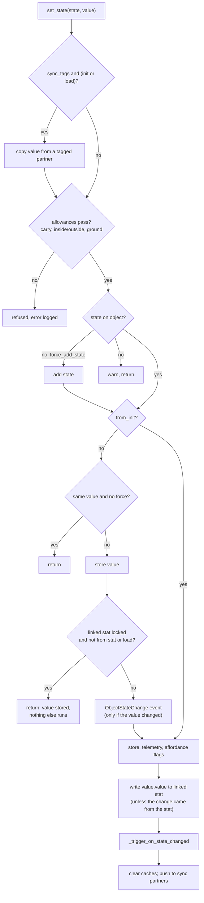
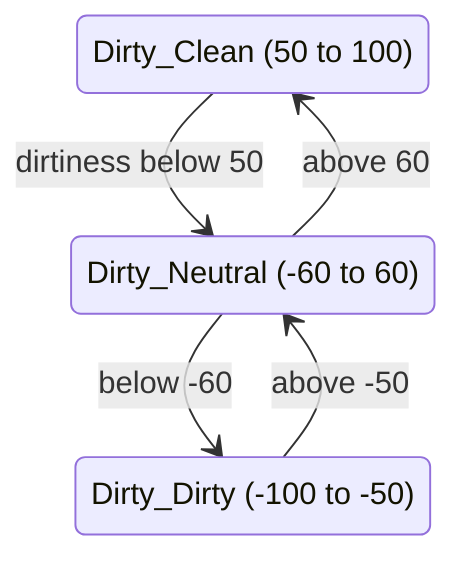
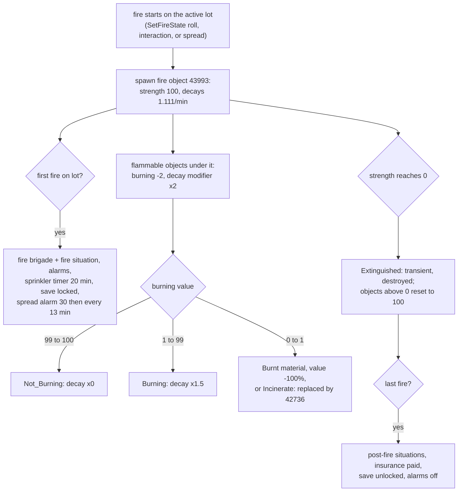

# 2.02 Objects: components, states and wear

*Game version 1.128.90.1030 (Steam, Linux/Proton). The numbers are base-game tuning, read from the live tuning, the base delta build plus each installed pack's delta build (EP04, EP06, EP09, EP12 High School Years, GP04, GP12, SP01; SP42 is installed but ships no combined tuning), with the full build quoted where it differs. Written 2026-10-12. Checked 2026-10-12: 156 claims checked, 32 corrected, 2 relabelled, 4 removed.*

## In plain words

Every object in a lot, from a toilet to a lamp, is the same kind of thing underneath: a catalog entry that points at one tuning record, plus a bag of optional parts called components. A part gives the object one ability: holding states, burning, lighting up, sitting in an inventory, being carried, making puddles. Almost every object has the state part, and most of what you see an object "be" (dirty, broken, burnt, switched on, full of water) is a state.

States come in two kinds. Some are plain switches set by an action. Others follow a hidden number on the object: brokenness from 0 to 100, dirtiness from -100 to 100, a fire counter, a light level. The number moves, and when it crosses a band edge the state changes, which then swaps the material, plays effects, adds a puddle maker or cuts the object's value. Dirtiness bands overlap on purpose, so an object that has just turned dirty stays dirty until it is cleaned well past the line.

Things that would surprise a player: wear only happens through use. A toilet loses about 6.4 points of its 100 on two thirds of uses and breaks below 30, about 16 uses from new; an object never wears out by sitting still. A broken object is worth half its value and a burnt one nothing, and the only time-based value loss in the game is a single 20 percent cut when you buy something. Fire is a commodity countdown: one flame burns a normal object out in about 11 Sim minutes, a fire object burns itself out after about 90, and fire insurance pays half of what burned only while you own the lot and only when the last flame dies. Some timed object states are tuned in units that the code reads as two thirds of a Sim minute, so an electric kettle goes cold 200 Sim minutes after it boils.

## Key facts

- An object is an OBJD catalog entry plus one tuning class. `DefinitionManager` reads the OBJD's `TuningId`; 0 or a failed lookup falls back to the prototype tuning 15013.
- Components come from three places: native ids in the OBJD (only Footprint, LiveDrag, Slot and Video have a server side, and only Slot and Video are tunable per object), the 70-entry `_components` tuple of the tuning, and two implicit ones (environment score, utilities). `types.py` defines 110 component slots; 115 Python classes implement 106 of them; 25 classes may be added after creation.
- Live tuning has 2,665 object records. The focus component is on 2,663 and the state component on 2,485 (93 percent); tooltip 2,105, retail 1,857, inventory item 1,331. Lighting is on 91 and flowing puddle on 97.
- Saved components load in priority order: flowing puddle 25, state 20, statistic 10, retail 5, everything else 0.
- `set_state` order: sync-tag copy (init or load only), allowances, add or refuse a missing state, the locked-stat early return, the `ObjectStateChange` event, telemetry, affordance flags, write the linked stat, `_trigger_on_state_changed`, clear caches, push to sync partners.
- A state set while the object is not yet in its manager (all initial states at creation, except `from_creation` sets) runs its client state, its stat listeners and the components' `on_state_changed`, but no state callbacks and no state triggers.
- A stat-backed state reads its value in tuning order, `lower <= v < upper`. Its listener path prefers the neighbouring value, which makes overlapping bands into hysteresis: Dirty turns Neutral below 50, back to Clean only above 60.
- `StateTrigger` re-runs its statistic operations, loots and child sets every time it passes; only its random state is skipped when the trigger state is re-entered.
- `TimedStateChange` alarms use `clock.interval_in_real_seconds`, so one tuned unit is 1,000 ticks, 40 Sim seconds. 305 live objects use timed triggers.
- Brokenness (0 to 100, no decay, new objects start at a random 90 to 100) falls only through per-use loots: toilet -6.4, shower -6.7, bath -6, stove and microwave -5, sink -4, fridge -2, each at 67 percent. Broken is 0 to 30.
- The werewolf trait of GP12 (Werewolves) adds a 5 percent chance of -100 to most breakage loots.
- `current_value = max(round((base + statistic bonus) x state_based_value_mod), 0)`. Broken subtracts 0.5 from the modifier and burnt 1.0; the only depreciation is one 20 percent cut after purchase.
- Fire: an object's `commodity_object_burning` starts at 100, drops 2 per new fire and decays at 3 x 1.5 x 2^fires per Sim minute while burning; a fire object's strength decays at 1.111 per minute (90 minutes), times 20 under a sprinkler. Spread is tried every 13 Sim minutes after the first 30.
- Fire insurance adds 50 percent of each covered value loss while a fire burns on the active household's lot, paid when the last fire ends.
- Light dimmer runs 0 to 1, with -1 meaning automatic; the light statistic mirrors it times 100, and power loss forces 0 while remembering the setting.

## How it works

### From catalog entry to live object

- **Observed** (`objects/definition_manager.py: DefinitionManager`, `objects/definition.py: Definition`). A `Definition` is a slotted record built from OBJD properties: `Components` (a uint32 array of native component ids), `Icon`, `Model`, `MaterialVariant`, `ThumbnailGeometryState`, `Rig`, `Footprint`, `TuningId`, `Slot`, `SimoleonPrice` (default 100), environment-score mood tags and scores, and positive and negative environment score. `get_object_can_depreciate` is a native call.
- **Observed** (`DefinitionManager`). The loader takes `TuningId` and fetches that class from the OBJECT instance manager. A `TuningId` of 0 maps to `PROTOTYPE_INSTANCE_ID` 15013 (the record named `prototype`), and a failed lookup falls back to the prototype as well; the log text calls that valid for SP14 (My First Pet) objects that mimic EP04 (Cats & Dogs) ones. Then `get_class_for_obj_state` applies the class's `_object_state_remaps`, `set_class` binds the class, the result is cached under the definition id (or the pair of id and `obj_state` when a state is given) and build/buy tags are assigned.
- **Observed** (`objects/system.py: create_object`, bytecode checked). Creation runs in this order: the native `get_vetted_object_defn_guid` may swap the definition for a fallback; the class is instantiated (which builds the components, below); the caller's `init` callback runs; world-file and conditional-layer objects get persistence group IN_OPEN_STREET; location, id and content source are set; commodity callback alarms may be suppressed; the object is added to the object manager (on lot, world file, open street, household inventory, conditional layer) or the inventory manager (Sim or object inventory); the `post_add` callback runs.
- **Observed** (`indexed_manager.py: IndexedManager.add`). Adding calls every component's `pre_add` before the object is stored in the manager, then sets the id and calls `on_add`. That gap matters for states (see "How a state changes").
- **Observed** (tuning, live). The 2,665 object records split by class into `GameObject` 2,537, `Fish` 26, `Door` 25, `Jig` 20, `PrototypeObject` 17, `Puddle` 9, `SectionalSofaPiece` 8, `Rug` 5, `Sim` 4, `FishBowl` 3 and single records of `Fire`, `FireSprinklerHead`, `Terrain`, `Ocean` and seven more classes. The 28 `Seating` records and the `Television` and `Placeholder` records exist only in the base full build, which the game does not load.

### The component container

- **Observed** (`objects/components/__init__.py`). A component class declares `component_name` (a `component_definition(class_attr, instance_attr)` pair from `types.py`), and optionally `key` (native id), `persistence_key`, `persistence_priority` and `allow_dynamic`. The metaclass fills five registries: `native_component_id_to_class`, `component_name_to_classes`, `component_inames`, `component_definition_set` and `persistence_key_map`.
- **Observed** (`ComponentPriority`). PRIORITY_DEFAULT 0, PRIORITY_RETAIL 5, PRIORITY_STATISTIC 10, PRIORITY_STATE 20, PRIORITY_FLOWING_PUDDLE 25. `components_sorted_gen` visits components by descending priority, then name. `forward_to_components_gen` uses insertion order instead.
- **Observed** (`ComponentContainer.add_component`). Adding raises if the component is already there, then requires `can_add_component`, `is_valid_pack` (the class's `required_packs`, default base game) and `is_valid_to_add`, then sets the attribute named by the INAME and re-sorts. A component whose pack is missing is simply not added. `add_dynamic_component` also requires exactly one class under the name, `allow_dynamic` and `can_be_added_dynamically`.
- **Observed** (`BaseObject.add_component`, `remove_component`). When the object already has an id (it is live), the object-level wrapper calls the new component's `pre_add` and `on_add`; during construction neither runs, and the manager add calls them later. Removal from a live object calls `on_remove_from_client`, `on_remove` and `post_remove`.
- **Observed** (`componentmethod`, `componentmethod_with_fallback`, `ored_forward_to_components`). `@componentmethod` copies a method onto the owner class the first time a component is built, but only where the owner's attribute is still the container's fallback. `componentmethod_with_fallback` installs a default on `ComponentContainer`. The "ored" forwarder returns true if any component does. `ComponentContainer.__getattr__` returns None for any component INAME, so `obj.state_component` is None on an object without one.
- **Observed** (`objects/components/types.py`). 110 `component_definition` lines name 109 distinct slots (ROUTING_COMPONENT appears twice). Eight are client-only native components with fixed keys (Position, Render, Animation, Routing, Sim, Audio, Effects, Gameplay); four native components have server classes (Footprint, LiveDrag, Slot, Video). CHANNEL, OBJECT_LOCKING and PORTAL_LOCKING have definitions but no decompiled class (the locking classes live in `locking_components.pyc`, see Limits). 115 classes implement 106 names; 45 classes carry a persistence key (38 distinct, eight gardening classes share one).
- **Observed** (`allow_dynamic=True`). The 25 classes that may be added after creation: EnvironmentScore, StageMark, BrandingIcon, Crafting, Heirloom, Jewelry, LineOfSight, LinkedObject, NewObject, ObjectClaim, ObjectFashionMarketplace, ObjectMarketplace, ParentToSimHead, Proximity, SituationScheduler, State, Statistic, Stolen, StoredActorLocation, StoredInfo, StoredObjectInfo, StoredSimInfo, Utilities, WaitingLine, SpawnPoint.
- **Observed** (`BaseObject.__init__`, `ScriptObject.__init__`). A live object gets its components in this order: native ids from the OBJD whose class `has_server_component()`, built from `_components_native` (Slot, Video) or `create_component`; the parts; every enabled `_components` factory, with `get_subcomponents_gen()` children; the persistence group (NONE if `_persistence` is NONE, else OBJECT); a dynamic ENVIRONMENT_SCORE component when the OBJD has a non-zero environment score, mood tags or trait modifiers; a dynamic UTILITIES component when any of the class's super affordances declares a utility (`_setup_used_utilities` collects them into `_used_utilities` at tuning load). `ScriptObject` mixes in `HasStatisticComponent`, which adds the statistic component on the first `get_tracker`.
- **Observed** (`ScriptObject.load`). Saved component records are sorted by priority, highest first. Each is added dynamically if missing; a component that cannot be added goes to `on_failed_to_load_component`.

### Which objects carry which components

**Observed** (live tuning through the live merge; an entry counts when its `_components` variant is anything but disabled). The one-line roles are **Inferred** from names and tunables except where a later section reads the code.

| Component (tuning key) | Objects | Role |
|---|---|---|
| focus | 2,663 | how much a Sim's attention goes to it |
| state | 2,485 | named states, triggers, client-state operations |
| tooltip_component | 2,105 | hover-tip fields |
| retail_component | 1,857 | sellable in a store ([5.02 Businesses](5.02-businesses.md)) |
| inventory_item | 1,331 | may live in an inventory |
| affordance_tuning | 852 | per-object test additions to interactions |
| carryable | 809 | can be picked up ([3.05 Interactions, postures and routing](3.05-interactions-postures-routing.md)) |
| line_of_sight | 479 | sight-line constraint |
| weather_aware_component | 478 | rain and snow reactions ([2.04 Weather, seasons and the ground](2.04-weather-seasons-ground.md)) |
| name | 449 | player-given name and description |
| object_age | 403 | age counter in ticks |
| consumable | 377 | food and drink |
| collectable | 258 | collection items ([6.02 Gardening, fishing and collecting](6.02-gardening-fishing-collecting.md)) |
| portal | 252 | doors, stairs and other routing portals |
| object_relationships | 244 | Sim-to-object relationships |
| time_of_day_component, spawner_component | 151, 148 | clock-driven states, spawning |
| gardening, crafting_station | 134, 132 | plant 85, fruit 47, fruitless plant 1, shoot 1; crafting surfaces |
| inventory | 107 | holds objects |
| flowing_puddle | 97 | makes puddles while enabled |
| season_aware_component | 92 | season reactions |
| live_drag_target, lighting | 91 each | accepts dragged objects; light dimmer and colour |
| ownable_component | 78 | Sim ownership |
| fishing_location | 59 | fish source |
| idle_component, mannequin, object_fashion_marketplace_component | 41, 40, 40 | idle animations, mannequins, EP12 (High School Years) resale listing |
| situation_scheduler_component, stereo, object_marketplace_component | 38, 35, 31 | weekly situations, radios, SP17 (Nifty Knitting) listing |
| canvas, object_locking_component, simocoin_farming_component | 24, 22, 22 | paintings, object locks, EP18 (Businesses & Hobbies) farming |
| routing_component, game, spawn_point | 17, 15, 14 | self-routing objects, games, spawn points |

Fewer than ten each: proximity 8, unique_object 7, travel_destination 7, censor_grid 6, vehicle 5, autonomy 4, procedural_animation 4, zone_modifier 3, linked_object 3, autonomy_marker 2, stored_audio 2, lunar_phase_aware 2, and one each of stolen, light_retail_surface and small_business_attendance_tooltip. No live record carries a `gardening_component` entry: the seven that do (base full 3, GP04 full 4) are full-build records, which the game does not load, and the key is not in the current 70-entry `_components` tuple anyway. **Observed** (`required_packs`): the marketplace (SP17), SimoCoin farming and small business tooltip (EP18), animal home and animal object (EP11 (Cottage Living) or EP14 (Horse Ranch); any listed pack is enough), heirloom (EP17 (Life & Death)) and jewelry (SP49 (Crystal Creations)) components need packs that are not installed, so the objects that enable them in base tuning do not get them here; the fashion marketplace needs EP12, which is installed.

### The state component: states and values

- **Observed** (`state.py: ObjectState`). A state is a track: `_values` (references), `overridden_by`, `persists_across_gallery`, `sync_tags`, `failed_to_load_state_value`. `values` is sorted by each value's `value` field unless any value is unordered (None).
- **Observed** (`state.py: ObjectStateValue`). A value has `value` (bool, int, float or unordered), `new_client_state` (a `StateChangeOperation`), `tested_client_state_overrides`, `allowances` (in carry, out of carry, inside, outside, on and off natural ground, all default True), `buff_weight_multipliers`, `remove_from_crafting_cache`, `crafting_types`, `force_add_state`, `send_telemetry_on_state_change` and `visual_icon_state`. `calculate_autonomy_weight` multiplies the weights of the buffs the Sim has, starting at 1.
- **Observed** (`CommodityBasedObjectState`, `CommodityBasedObjectStateValue._tuning_loaded_callback`). A stat-backed state adds `linked_stat` and `lot_based` (read the stat on the active lot). Its values add `range` and an optional `default_value`. At load the value's `value` becomes `default_value`, else the range midpoint; `low_value` and `high_value` sit 45 percent of the range width either side of the midpoint. `get_value(stat)` walks `_values` in tuning order and returns the first value with `lower <= v < upper`, taking the upper bound as inclusive at the stat's maximum.
- **Observed** (live tuning). 4,807 `object_state` records: `ObjectStateValue` 2,675, `CommodityBasedObjectStateValue` 985, `ObjectState` 713, `CommodityBasedObjectState` 283, `VideoChannel` 79, `AudioChannel` 72. The states on the most objects: `Klepto_Stolen_Object` 1,518, `MaterialisticAdmired` 1,057, `Fire_Object_Burn_Incinerate` 863, `Fire_Object_Burn_material_change` 763, `Quality` 526, `BrokenState` 216, `Broken` 211, `Dirty` 178, `DirtyState` 160.
- **Observed** (`TunableStateComponent`). One object lists `states` (each with `default_value` as a reference or a weighted random list, `client_states`, `client_states_overrides`, `reset_to_default`, `reset_on_load_if_time_passes` and five `tested_states_on_*` hooks), `state_triggers`, `unique_state_changes`, `delinquency_state_changes`, `timed_state_triggers` and `overlapping_slot_states`. Live counts: 1,514 objects tune state triggers, 305 timed triggers, 168 delinquency changes; 39 state entries use a random default.
- **Observed** (`StateComponent.pre_add`). For each stat-backed state the linked statistic is fetched or added (`added_by_default`). If the statistic's `initial_tuning._use_stat_value_on_init` is set, the state is set from the stat value with the tuned default as the preferred value. Every other state, plain or stat-backed, is set to its default with `from_init=True` (bytecode checked: the decompiled source nests that call under the linked-stat test, which would skip plain states). Brokenness and dirtiness both use the stat value.

### How a state changes

**Observed** (`state.py: StateComponent.set_state`, bytecode lines 3248 to 3329; `_trigger_on_state_changed`, lines 3354 to 3428).

- **Observed** (`_check_allowances`). The value's allowances are checked against carry, inside or outside, and natural ground (the ground check is skipped on load). A disallowed value is refused with an error. `force_add_state` only lets `set_state` add a state the object lacks; it does not relax allowances.
- **Observed** (`_trigger_on_state_changed`). In order: apply the client state (return if that fails); add the stat listeners; `owner.on_state_changed`, which forwards to the components; part disabling states. Then, if the owner id is not in its manager and the call is not `from_creation`, only `trigger_on_load` timed triggers start and the function returns. Otherwise: the `_on_state_changed` callbacks, stop the old value's timed trigger, start the new value's, and run every `StateTrigger` while the state component still exists.
- **Inferred** (from `IndexedManager.add` calling `pre_add` before storing the object). Initial states chosen at creation never run state triggers or callbacks. `object_creation.py` sets its tuned `initial_states` with `from_creation=True`, and festival objects do the same, so those do run them.
- **Observed** (`_add_stat_listener`, `get_state_from_stat_value`, bytecode). A stat-backed value installs two listeners on the linked stat: below its range's lower bound (preferring the next lower value in sorted order) and above its upper bound (preferring the next higher). When one fires, the new value is chosen among the values whose closed range contains the number: the preferred one if it qualifies, else the one with the closest `value`; if none contains it, the closest overall, with a warning. A stat with `remove_on_convergence` gets seed listeners for its removal.

- **Inferred** (the listener rule applied to the live `Dirty` ranges). The overlap gives 10-point dead bands: a toilet that just turned Neutral at 49 must be scrubbed past 60 to read Clean again. `get_value`, used when nothing is preferred, returns the first matching value in tuning order (Clean, Neutral, Dirty), so a fresh read of 55 says Clean.
- **Observed** (`StateTrigger`). Fields: `set_states`, `at_states`, `set_random_state` (weighted, tested), `prohibited_states`, `loot_actions` (LockDoor or UnlockDoor only), `statistic_operations`, `set_on_children`, `trigger_operation` (AND 0, OR 1, NONE 2; default AND) and `trigger_chance` (percent, default 100). `_check_triggerable` rolls the chance, then the prohibited states, then the operation: AND needs the changed state in `at_states` and all of them active, OR needs it in the list, NONE needs it absent and none active.
- **Observed** (`StateTrigger.trigger_state`, bytecode). The trigger sets `set_states` (skipping values already active), then the random state only when the old value was not the trigger state, then statistic operations, loots and child sets on every pass.
- **Observed** (`TimedStateChange._schedule_trigger_alarm`, bytecode). Each op's time is `trigger_time + uniform(0, trigger_time_random_offset)`, counted from entering the state: the alarm delay is this time minus the previous op's. The alarm is `clock.interval_in_real_seconds(delay)`, 1,000 ticks per unit, while a Sim minute is 1,500 ticks (`REAL_MILLISECONDS_PER_SIM_SECOND` 25 x 60). The tunable is a `TunableSimMinute`, which is a plain `TunableRange` and converts nothing. So one unit is 40 Sim seconds. The verify callback logs an error when a time is not later than the previous op's time plus its offset.
- **Observed** (`TimedStateChange._timed_trigger_callback`). Failed `trigger_tests` either re-arm the same op (`reschedule_on_failure`) or skip it. Otherwise `states_to_trigger` are set, then one weighted random value among the entries whose tests pass; the loot list runs only if a state was set. The next op is scheduled only while this trigger is still the active one, so any change of that state cancels the rest. `SetStaggeredStateElement` and `set_dynamic_timed_state` add one-op timed triggers at run time. **Inferred** (the save writes only state pairs): no timed trigger is saved, so after a load a `trigger_on_load` trigger restarts from its first op.
- **Observed example** (tuning `object_ElectricKettle`, base delta). `electricKettle_Values_ControlStates_HeatingUp` moves to `WaterReady` after 20 units and `WaterReady` to `Cold` after 300. **Inferred, by arithmetic:** 13.3 Sim minutes to boil and 200 Sim minutes to cool.
- **Observed** (`time_of_day_component.py: TimeOfDayComponent`, 151 objects). A second clock path: per state, a list of hour marks (0 to 24) with a value, loots, a chance and tests. All objects share one alarm per hour mark on the time service; the handler time-slices at 1/30 of a real second per loop and re-arms for the next day. On add or load the component applies the most recent past mark, rolled like any other.
- **Observed** (`delinquency`, `utilities_component.py`). When a utility is cut, `apply_delinquent_states` sets the tuned values for that utility and remembers the previous ones in `states_before_delinquency_dict` (saved); `clear_delinquent_states` puts them back. The utilities component tracks per-utility permission (`allow_utility_usage_dict`), cancels interactions that use a utility the object may no longer use, and offers the off-the-grid toggles 237843 and 237845. Bills themselves are [5.01 Money, bills, perks and rewards](5.01-money-bills-rewards.md).
- **Observed** (`_save_state_data`, `load`, `_load_state_and_value`). Each state saves as a pair of guid64s. `reset_on_load_if_time_passes` saves the default instead of the current value, and `tested_states_on_save` can override it with the first passing test. Load calls `set_state(from_load=True)`. An unknown value uses `failed_to_load_state_value`, else the state keeps its default. A gallery download skips states without `persists_across_gallery`.

### What a state change does to the object

- **Observed** (`state.py: StateChangeOperation`, `state_change.py: StateChange`). Each value's `new_client_state` is an operation with 55 optional fields. 28 are custom distributables with a start and a stop: audio_effect_state, audio_state, autonomy_modifiers, awareness, broadcaster, environment_score, replace_object, toggle_footprint, ui_metadata, vfx_state, vfx_state_state, lot_statistic_modifiers, change_value, geometry_state_override, model_suite_state_index, utility_modifiers, painting_state, live_drag_state, walkstyle, periodic_loot, glow, situation, tan_level, route_event, set_fire, scale, voice_actor, slots. The other 27 set one attribute: tint, opacity, visibility, visibility_flags, geometry_state, material_state, model, material_variant, pregnancy_progress, multicolor, painting_reveal_level, flowing_puddle_enabled, video_playlist, video_playlist_looping, transient, light_dimmer, light_material_states, light_haunted_state, singed, wind_speed_level, grubby, dyed, messy_face, scratched, mannequin_pose, focus_score, hsv_color_shift.
- **Observed** (`USE_COMPONENT_FOR`). Some attributes go to a component instead of the object: painting reveal to canvas, flowing_puddle_enabled to the flowing puddle component, video playlists to video, the three light fields to lighting, mannequin pose to mannequin, focus score to focus.
- **Observed** (`StateChangeOperation.apply`, `StateComponentManagedDistributables.apply`, bytecode). Distributables are keyed by `(attribute, state.overridden_by or state)`, and a new apply stops the previous one under that key first. After a load only the 13 `POST_LOAD_ENABLED_DISTRIBUTABLES` are re-applied (audio effect, audio, replace object, toggle footprint, vfx, vfx state, geometry override, model suite index, painting state, glow, scale, voice actor, slots); plain attributes are always set. Inside an inventory, audio, audio effect, vfx and glow run only when forwarded to the inventory owner. A falsy result from a distributable aborts the rest.
- **Observed** (`_client_states_gen`). A value's own operation can be replaced by a passing `tested_client_state_overrides` entry. Then the object's own `client_states_overrides` (tested), else its `client_states` entry for that value, also applies. So one shared value (`BrokenState_Broken`) does one thing on a toilet and another on a fridge.
- **Observed** (`ObjectReplacementOperation`). With no new object the old one is destroyed (with `destroy_original_object`), or made transient while in use. Otherwise a new object is created in the old one's slot when it fits there, else at a free placement nearby; the household owner is copied, optionally the Sim owner, and optionally the new object joins the collection tracker; an original that sat in an inventory is replaced inside that inventory; `on_object_replaced` runs, and the original is destroyed, or made transient while in use. The operation then returns a failing result on purpose, which stops the rest of that client-state operation.

### Breakage and repair

- **Observed** (tuning `commodity_Object_Brokenness` 16633, live). Range 0 to 100, `decay_rate` 0, convergence 0. `initial_tuning` draws a random start between 90 and 100, with `_use_stat_value_on_init` set, so a new object starts Unbroken at that number. Nothing moves it except tuned operations.
- **Observed** (states `Broken` 15075 and `BrokenState` 15079, live). The stat-backed `Broken` lists `Brokenness_Broken` 0 to 30 (default the midpoint 15), `Brokenness_Neutral` 31 to 70, `Brokenness_Unbroken` 70 to 100 (default 100) and `Brokenness_Broken_Sabotage` 30 to 31. The plain `BrokenState` holds `BrokenState_Unbroken` (integral value left at its default), `BrokenState_Broken` (1), `BrokenState_Broken_Fridge` (2) and `BrokenState_Repairing` (3). `Brokenness_Broken` plays a sting, starts a broadcaster and cuts the value by 50 percent. `BrokenState_Broken` multiplies the object's seven positive mood scores by 0.001 and adds 5 negative environment score, with a Slob trait override.
- **Observed** (tuning `object_toilet`). Per-object state triggers link the two: `Brokenness_Broken` sets `BrokenState_Broken`; `Brokenness_Unbroken` sets `BrokenState_Unbroken` and `utilities_Water_Consumption_Off` and sets statistic 208412 to its minimum. The toilet's own client state for `BrokenState_Broken` turns `flowing_puddle_enabled` on, adds a lot water statistic modifier and plays `Obj_toilet_break`. While the water utility is cut off, `delinquency_state_changes` sets `BrokenState_Unbroken`, which stops the leak; the old value comes back when water returns.
- **Observed** (breakage loots, live, all base delta except the dew collector). Each is one statistic change on the object per use:

| Loot | Change | Chance |
|---|---|---|
| `loot_Statistic_Breakage_Shower` | -6.7 | 67 % |
| `loot_Statistic_Breakage_Toilet` | -6.4 | 67 % |
| `loot_Statistic_Breakage_Bath` | -6 | 67 % |
| `loot_Statistic_Breakage_Stove` (tested) | -5 | 67 % |
| `loot_Statistic_Breakage_Microwave` | -5 | 67 % |
| `loot_Statistic_Breakage_Sink` | -4 | 67 % |
| `loot_Statistic_Breakage_Sink_DishFood` (tested) | -3 | 100 % |
| `loot_Statistic_Breakage_Dishwasher` (tested) | -3 | 67 % |
| `loot_Statistic_Breakage_Fridge` (tested) | -2 | 67 % |
| `loot_Statistic_Breakage_ElectricKettle` | -2 | 50 % |
| `loot_Statistic_Breakage_Microscope` | -0.1 | 67 % |
| `loot_Statistic_Breakage_Telescope` | -0.1 | 23 % |
| `loot_Statistic_Breakage_MotionGame` | -0.07 | 67 % |
| `loot_Statistic_Breakage_DewCollector` (EP09 (Eco Lifestyle), tested) | -0.15 | 100 % |

- **Observed** (same loots). All but the kettle carry a tested 5 percent entry of -100 for a Sim with trait 289780, which is GP12's `trait_OccultWerewolf` (the motion game's version is +25 instead). All but the kettle and the dew collector also carry a 5 percent `statistic_set_min` for Sims with buffs 345177 or 345176, which no installed tuning defines; the dew collector has a second tested -0.075 entry in its place. Another entry gives the werewolf the GP12 buff `buff_Werewolf_StrongerThanIThought` when the object is now `Brokenness_Broken`. The toilet, bath and sink share the identical nodes.
- **Observed** (other loots). `Loot_Break_Object` and `loot_Break_Object_Hottub` set the stat to its minimum (tested); `Loot_Break_Object_basic_tiny` applies -1. `Loot_Break_ObjectVariant_High / Med / Low` (-2, -5 and -8) and `Loot_Break_Object_low` (-5) exist only in the base full build, so the game does not load them. Repair: `Loot_Fix_Object` sets the maximum, `Loot_Repair_ScaledByHandiness` adds 14 plus a skill-tested 36.
- **Observed** (upgrades). `Upgrade_Generic_LowerBrokenness_Completed` (stat 99 to 100 on `statistic_Object_Upgrade_GenericLowerBrokenness`) applies a `stat_use_multiplier` of 0.5 on brokenness in the decrease direction; loot additions are multiplied by it ([3.03 Needs, statistics and commodities](3.03-needs-statistics.md)), so use damage halves. `Upgrade_Generic_LockBrokenness_Completed` locks brokenness, so breakage loots do nothing. The dirtiness pair (`LowerDirtiness`, `LockDirtiness`) mirrors them.
- **Inferred, by arithmetic** (start at the 95 mean, count the uses until the mean is below 30, mean loss per use = chance x change): toilet 4.29 per use, about 16 uses; shower 4.49, about 15; bath 4.02, about 17; sink 2.68, about 25; fridge 1.34, about 49; kettle 1.0, about 66. The upgrade doubles these.
- **Inferred** (from `get_state_from_stat_value` with the live ranges). A value landing in 30 to 31 after a fall from Neutral reads as `Brokenness_Broken_Sabotage`, since that is the preferred lower neighbour and its closed range contains the number.
- **Observed** (`StateComponent.BROKEN_STATE_SET`, live = full). `FireState_Burn_Material_Change`, `FireState_Burn_Material_Change_Burning`, `FireState_Burn_Incinerate_Burning`, `FireState_Burn_Incinerate` and `BrokenState_Broken`. `is_object_usable` returns False while one is active. Its only reader in the Python is `crafting/crafting_process.py` ([6.01 Crafting, cooking and making things](6.01-crafting-cooking.md)); interactions hide themselves through their own state tests ([0.04 Tests, loot and effects](0.04-tests-loot-effects.md)).

### Dirtiness

- **Observed** (tuning `commodity_dirtiness` 16575, live). Range -100 to 100, start 100, `decay_rate` 0, `_use_stat_value_on_init` set.
- **Observed** (state `Dirty` 15128). `_values` lists exactly three: `Dirty_Clean` 50 to 100, `Dirty_Neutral` -60 to 60, `Dirty_Dirty` -100 to -50. A fourth record `Dirty_VeryDirty` (-100 to -25) exists but is not in the list, in either build, so the stat never reaches it. The plain `DirtyState` holds Clean 0, Neutral 1 and Dirty 2; the toilet maps each `Dirty_*` to its `DirtyState_*` by state trigger.
- **Observed** (tuning `bathtub_TakeBath`, `bathtub_Clean`). Bathing applies -0.35 to the tub's dirtiness through `periodic_stat_change`, a per-Sim-minute rate ([3.03 Needs, statistics and commodities](3.03-needs-statistics.md)), next to +2.22 Hygiene per minute for the Sim. Cleaning applies +6.67 per minute, scaled by a value curve, and exits when dirtiness reaches 100. `loot_Cheat_MakeDirty` sets the stat.
- **Inferred, by arithmetic.** From 100, a tub turns Neutral after about 143 Sim minutes of bathing and Dirty after about 457 (160 / 0.35, below -60); a cleaning pass at the base +6.67 rate takes it from -60 back to 100 in about 24 minutes.

### Object value and depreciation

- **Observed** (`client_object_mixin.py: ClientObjectMixin.current_value`). With a state component, `current_value = max(round((base_value + get_added_monetary_value()) x state_based_value_mod), 0)`; without one, `max(base_value + bonus, 0)`. Setting it writes `base_value = value / mod`. `base_value` starts at the definition price and is rounded and clamped at 0. `get_added_monetary_value` sums the object's monetary-value statistics.
- **Observed** (`ObjectValueChangeOperation`, `ValueDecreaseFactory`, `ValueIncreaseFactory`). `change_value` takes `change_percentage` (a TunablePercent, default 100) and a type, decrease by default. A decrease subtracts the fraction from `state_based_value_mod` (which starts at 1.0) and, when `covered_by_insurance` (default True), reports the drop in `current_value` to the fire service; restoring adds it back and reports the (negative) change. The modifier is additive across states and the value is clamped at 0.
- **Observed** (tuning). `Brokenness_Broken` decreases by 50 percent; `FireState_Burn_Material_Change` and `FireState_Burn_Incinerate` by the default 100 percent; `FireState_Burn_Material_Change_Replace` increases by 0 percent with `apply_depreciation` True. No Python reads `apply_depreciation`.
- **Observed** (`_on_try_depreciation`, `try_post_bb_fixup`). `INITIAL_DEPRECIATION` is 20 percent (both builds and the code default). The cut applies once, at the post-build/buy fixup, and only when the object's household owner is the active household and the native `get_can_depreciate` allows it: `base_value = floor(base_value x 0.8)`. Objects created in build/buy are flagged by `set_post_bb_fixup_needed` and fixed up when build/buy ends. `depreciated_value` reports catalog x 0.8 for display.
- **Observed** (`object_age.py: ObjectAgeComponent`, 403 objects). The age counter is in ticks. Load sets the age to the saved age plus the ticks since the save, and also sets `_loaded_tick` to the saved tick, so `get_current_age` adds the same gap a second time. **Inferred:** the time between a save and its load is counted twice. Its one reader is `crafting/serving_interactions.py` (oldest serving). No value or state rule reads it.
- **Observed** (`spoilable_object_mixin.py`). Spoilage is a stat-backed state: the mixin listens on the spoil timer value's upper bound (operator `lt` by default; a hovertip override can swap the value and the operator) and turns the alarm time into the `spoiled_time` tooltip field (0 when there is none). On add, a lock-freshness value only re-runs the quality tooltip update. Food is [6.01 Crafting, cooking and making things](6.01-crafting-cooking.md).

### Fire

**Observed** unless marked (`services/fire_service.py: FireService`, a 0.02 module read for this chapter; `fire/*`, `objects/fire/*`; tuning `services.fire_service`, `commodity_object_burning`, `commodity_object_fire_strength`, `FireState_*`).

- **Allowed at all** (`is_fire_allowed`): the global switch (`fire.toggle_enabled`), the active lot only, and the venue's `allows_fire` ([2.01 Lots, venues and rooms](2.01-lots-venues-rooms.md)). `SetFireState` (the `set_fire` client-state op) starts a fire at the object when `random() < chance` (default 100 percent).
- **Flammable objects.** An object burns when it has `commodity_object_burning` 39470 (`is_object_flammable`). Both burn states link to that commodity (`Fire_Object_Burn_material_change` on 1,057 objects, `Fire_Object_Burn_Incinerate` on 993), and `pre_add` adds a state's linked stat, so these are the flammable objects (**Inferred** chain from Observed parts). Every fire-related object (flammable or `fire_retardant`) is tagged `Fire_Flammable_AutoAdded` and put in the flammable quadtree with its `flammable_area`: a circle of the object radius, plus 0.2 for retardant objects, or the bounding box of the placement footprint's polygon.
- **Burning** (`start_objects_burning`, `set_object_burning`). A new fire burns the flammable objects it overlaps on the same routing surface, skipping ceiling items that are not wall-graph placed. Each one loses `FLAMMABLE_COMMODITY_DECAY_PER_FIRE` 2 and gets a decay modifier of the same 2. Decay modifiers multiply ([3.03 Needs, statistics and commodities](3.03-needs-statistics.md)). The burn commodity decays at 3 per Sim minute toward 0; `Not_Burning` (99 to 100) freezes it (modifier 0) and `Burning` (1 to 99) multiplies by 1.5.
- **Inferred, by arithmetic.** Under one fire an object loses 3 x 1.5 x 2 = 9 per minute and goes from 98 to burnt in about 11 Sim minutes; under two fires 18 per minute, about 5.5 minutes.
- **Outcome.** `FireState_Burn_Material_Change` (0 to 1) sets material state Burnt, cuts the value 100 percent, freezes dirtiness and brokenness decay, and limits the object to a whitelist of interactions led by `fire_ReplaceBurntObject`. `FireState_Burn_Incinerate` (-1 to 1) replaces the object with definition 42736 and cuts the value. When a fire is removed, `_stop_object_burning` drops its modifier and sets any object still above 0 back to 100, so a scorched survivor is fully restored.
- **The fire object** (`Fire_Fire` 38913 on `commodity_object_fire_strength` 39323). `FireState_FireObject_Burning` (1 to 100, default 100) plays `s40_fire` and broadcasters; `FireState_FireObject_Extinguished` (0 to 1) makes it transient, and the service destroys it when unused. Strength decays at 1.111111 per Sim minute. **Inferred, by arithmetic:** an untouched fire lasts about 90 Sim minutes, about 4.5 under a sprinkler (modifier 20). Fires are never saved (`Fire.persistence_group` NONE) and the save is locked while one burns. A fire that burned out by itself stays in the fire quadtree while other fires burn, so spread cannot land on that spot; an extinguished one (`commodity_object_fire_BeenExtinguished` above 0) is taken out. The whole quadtree is dropped when the last fire ends.
- **Spread** (`_spread_fire`, `spread_fire`, bytecode). The spread alarm starts with the first fire, after `FIRE_SPREAD_INTIAL_TIME_IN_SIM_MINUTES` 30, then repeats every 13. Each tick passes when `uniform(0, 1) <= FIRE_SPREAD_CHANCE` (1 live, 0.75 full build). Then up to `MAX_NUM_ATTEMPTS_TO_PLACE_FIRE` 10 attempts: pick a random fire, roll `FIRE_OBJECT_SPREAD_CHANCE` against the floor under that source fire (base 1, x0.5 when the floor tile is not grass, carpet or hardwood, x0 on metal or stone), go `FIRE_PLACEMENT_RANGE` 2 to 3 times `FIRE_QUADTREE_RADIUS` 0.4 (0.8 to 1.2 m) along the fire's facing, turn the source fire to a random facing (so the next attempt aims elsewhere), run the placement tests, spawn on the first success.
- **Placement tests** (`_placement_tests`). A floor that is not a pool, zero water depth, a height step within `FIRE_SPREAD_HEIGHT_THRESHOLD` (code 0.5), plex rules, no overlapping fire, any Sim there passing `FIRE_CAN_SPREAD_TO_SIM_TESTS`, no fire-retardant object.
- **Sims** (`_burn_sim`, `check_for_catching_on_fire`). A Sim at a fire's spot catches fire at `FIRE_SIM_ON_FIRE_CHANCE`: base 100 percent (code default), x0.9 for a Sim in the bathing outfit who also has one of the two clothing-optional lot buffs (one test list, so both must pass), x0.01 with `buff_Fire_WearingFirefighterOutfit`; that pushes `fire_OnFire` 40870 at Critical priority. A routing Sim is checked against fires within `ROUTING_FIRE_CHECK_RADIUS` 0.2 whose strength is above its minimum.
- **Every new fire** (`_spawn_fire`) burns the objects under it, scorches the floor, removes leaf floor features and derails Sims whose path crosses it. **The first fire on the lot** also starts the fire brigade (`situation_Firefighter` at 100 percent with region and object tests, else `situation_IslanderCulture_FireBrigade` at 75 percent with a region test, both delta; the first one that rolls wins), `situation_fire` for the Sims, the fire alarms, the sprinklers, a notification, the save lock, the insurance multiplier and the spread alarm.
- **Alarms and sprinklers.** Alarms (definition 42827) check every `FIRE_ALARM_CYCLE_TIME` 10 Sim minutes for a fire within `FIRE_ALARM_ACTIVATION_RADIUS` 10; once one sounds, the brigade is called if it is not already there and every Sim on the lot outside the brigade is pushed to react. Sprinklers need `Func_Sprinkler` objects (or `Func_Sprinkler_Floor`, delta only); they start after `SPRINKLER_ACTIVATION_TIME` 20 and repeat every `SPRINKLER_RUN_TIME` 5 (20 in the full build). A head spawns at the ceiling over each unsuppressed fire only if level+1 has a floor; heads suppress within 3 m, floor sprinklers within 1.5 m (code defaults). Suppression adds decay modifier 20 to the fire's strength (100 when immediate), marks it extinguished, and sets any Sim's burning stat there to its maximum. `SPRINKLER_PUDDLE_CHANCE` 30 is tuned but no Python reads it.
- **Insurance** (`increment_insurance_claim`, `_award_insurance_money`). Only while a fire is active, on the active household's home or owned zone with a zone director. Each covered value drop adds the loss x `FIRE_INSURANCE_CLAIM_PERCENTAGE` 50 percent (code 60), or instead the object's full catalog value x the multiplier when `FIRE_INSURANCE_CLAIM_MULTIPLIERS` comes out above 1 (delta: 1.3 for a Sim with bucks perk 399821, which no installed tuning defines). The total is paid into the active household's funds when the last fire ends.
- **Scorch cleanup.** Daily at `SCORCH_TERRAIN_CLEANUP_HOUR` 4, burnt floor features on natural ground are removed if no fire is active. `SCORCH_TERRAIN_CLEANUP_RADIUS` is tuned and unread.

### Lighting

- **Observed** (`lighting_component.py: LightingComponent`, module tuning live). `LIGHT_STATE_STAT` is `statistic_object_light` 99424 (min -1); `MANUAL_LIGHT_TAG` `Func_Light_NoAuto_Lights`; `NON_ELECTRIC_LIGHT_TAG` `Func_Light_NonElectric`. Constants: automation -1, stat multiplier 100, off 0.0, max 1.0. Factory tunables: interactions, `default_dimmer_value` (default 1.0), `material_state_on` "lightson", `material_state_off` "lightsoff", a `visual_effect`, optional `light_states` (on and off values) and `disabling_state_values`.
- **Observed** (`set_light_dimmer_value`). A new dimmer passes through `get_overridden_dimmer_value` (a player intensity override replaces any value other than -1 and 0, clamped to 0 to 1), restarts the visual effect (automatic flavour at -1, none at 0), sets the `light_states` on or off value unless the dimmer is -1, writes the light stat as dimmer x 100 and sends the dimmer to the client (an automated light with an override sends the negative override).
- **Observed** (`Lights_OnOff_States` 77851). Stat-backed on the light stat: `Lights_On` 1 to 100 (client state dimmer 1), `Lights_Off` 0 to 1, `Lights_Auto` -1 to -1. An automated light writes -100, which **Inferred** the stat's minimum of -1 clamps.
- **Observed** (`is_power_off`, `update_lighting_enabled_state`, `on_add`). The `light_dimmer` attribute setter (the path a state change's `light_dimmer` takes) forces 0 while the power utility is off for an affected object without the non-electric tag. A light disabled by power, a disabling state or a sale stores its setting in `_pending_dimmer_value` and gets it back when the block lifts. Off the active lot, lights are set to automatic on add. **Inferred:** the client decides when an automatic light is on, since the server only sends -1.
- **Observed** (`objects/lighting/lighting_utils.py`). Light targets: this light, all lights (manual-tagged lights excluded, optional plex common areas), room lights, or tagged lights. Dimmer choices: previous setting, automated by client (default), a specified value (optionally storing the previous), unchanged. Colour choices likewise. `LightColorTuning.LIGHT_COLOR_VARIATION_TUNING` lists named colour presets.

### Doors and front doors

- **Observed** (`objects/doors/door.py: Door`, `door_service.py: DoorService`, module tuning live). `Door` is a `GameObject` with `is_door_portal` (False for arches and gates). The service picks the front door at each fix-up: it estimates paths from the lot arrival spawn point to both sides of every door with every door's portals locked and the portal key mask `FRONT_DOOR_ALLOWED_PORTAL_FLAGS` (long and short stairs, `DoorHuman`, `SPECIES_HUMAN`). A door counts as exterior when a side is reachable that way; if only its back side is, it is flipped (`swap_there_and_back`). Doors not reached are interior.
- **Observed** (`_choose_front_door`, `_zone_requires_front_door`). The venue's `venue_requires_front_door` decides: NEVER, ALWAYS, or OWNED_OR_RENTED (rented or with an owner household). Exterior doors get `FrontDoor_Enabled` or `FrontDoor_Disabled` availability, interior doors Disabled. The front door is the previous one if still exterior (unless forced), else the exterior door with the shortest estimated path, marked `FrontDoor_IsFrontDoor`; the id is saved with the zone.
- **Observed** (`_fix_up_for_apartments`, `_fix_up_for_multi_unit`). In plex buildings doors are sorted by which plex zone lies on each side. Doors of other units become `InactiveApartmentDoor_Enabled`, get the other unit's household as owner, a cost of 9999 on each portal's forward direction, a system lock (`InactiveApartmentDoorLockData`) and, for real door portals that need one, a back spawn point. Apartment buildings add `Elevator` to the portal flags.
- **Observed** (`portal_lock_data.py`, `portal_locking_enums.py`; `locking_components.pyc` disassembled). Lock data types: by Sim info, all except listed Sims, situation jobs, clubs, genus, buffs, ranked statistic thresholds, individual Sim, creature, inactive apartment door, and unlock-for-buff. Each has a priority (player 0, system 1, override player 2, default system) and sides (front, back, both). `BaseLockingComponent.test_lock` keeps the strongest result per priority: among player locks an unlocking result wins, among others a locking one, and both-sides beats one side. A system lock decides, unless a player lock also locks both sides; else an override result; else the player result.

### Laundry and dust

- **Observed** (`laundry/laundry_service.py`, `household_laundry_tracker.py`; module tuning `laundry.laundry_tuning` in the base delta). The service requires SP13 (Laundry Day), which is not installed, so none of this runs here. It tracks hampers (`Func_Laundry_Hamper`) and hero objects (`Func_Laundry_Hero_Object`) for the active household on its home lot. Sims are eligible when a hero object exists, they are not pets and they belong to that household.
- **Observed** (`on_spin_outfit_change`, bytecode). On an outfit spin a pile is made when the current outfit is neither a no-pile outfit (COLDWEATHER, HOTWEATHER) nor naked (BATHING) and the target is not a no-pile outfit; interactions tagged `Interaction_Laundry_GenerateNoPile` make none. Separately, whenever the target outfit is not BATHING, the laundry effect runs. A pile goes into the closest hamper that is not in `full_hamper_state` 175578 (a temporary pile 182560 gets initial states, loot 176314 moves it into the hamper, the pile is destroyed); Lazy and Slob Sims fail the hamper test, and then loot 176069 makes a pile on the ground.
- **Observed** (`HouseholdLaundryTracker.apply_laundry_effect`). If nobody unloaded laundry for `NOT_DOING_LAUNDRY_PUNISHMENT.timeout` 5,760 Sim minutes (4 days; code 2,880), loot 176413 applies and the stored conditions are cleared. Otherwise one stored condition, kept for `laundry_condition_timeout` 4,320 minutes (3 days; code 1,440), is drawn at random and its reward loot applies (11 condition-to-loot pairs over condition states 175401, 175429 and 175435, excluding 175433).
- **Observed** (`dust/dust_service.py`, module tuning `dust.dust_service`). The dust service requires SP22 (Bust The Dust), not installed. It is a game-option switch (`dust.set_dust_enabled`, Live) that adds the dust commodity 254463 to lot levels whose block area exceeds `MIN_AREA_REQUIRED_TO_ADD_DUST_COMMODITY` (code 0.0), applies zone modifier 255618 (297672 when disabled) and claims or destroys objects tagged `Func_DustPile`, `Func_DustFriend`, `Func_DustBunny`, `Func_FilthFiend`. Dust is a property of a floor, not of objects.

### Electronics, puddle makers and other components

- **Observed** (`objects/electronics/*`, `stereo_component.py`, `video.py`, `state.py: VideoChannel, AudioChannel`). TV and radio channels are state values. A `VideoChannel` names the affordance to push when activated; an `AudioChannel` sets the stereo's channel state with its immediate and active-Sim-only flags and pushes the stereo's first listen affordance that passes. `PickChannelAutonomouslySuperInteraction` picks among channels with `show_in_picker` that test true, weighted by `calculate_autonomy_weight`. `WatchSuperInteraction` and `ListenSuperInteraction` cancel and continue when the channel changes; the TV places a 0.4 m-wide route discouragement in front of a viewer (code default). The video component (native key, server side) builds playlists and mutes or distorts above tuned clock speeds.
- **Observed** (`flowing_puddle_component.py: FlowingPuddleComponent`). While `flowing_puddle_enabled` is on, a repeating alarm every `spawn_rate` Sim minutes counts the component's puddles within `max_distance` (farther ones are forgotten), starts their evaporation, stops at `max_num_puddles` (sizes summed), grows an existing puddle if one is free, else places a new small one. If a tracked puddle is in use, nothing happens that tick. Code defaults: 20 minutes, 2.5 m, 3, water. Live, every user printed (the dishwasher, showers and toilets) tunes 60 minutes and 3 puddles, and toilets also 2 m; the rest of the 97 were counted, not printed. Puddles themselves are [2.04 Weather, seasons and the ground](2.04-weather-seasons-ground.md).
- **Observed** (`unique_object/*`). The unique-object component has one behaviour, the death object: an object that stores a Sim's info (an urn or a grave) becomes that Sim's one death object, and a second object claiming the same Sim is destroyed, or removed from the household inventory. `UniqueObjectService` runs the check over the household inventory and the zone (7 live objects carry the component).
- **Observed** (inventory modules, names and tunables read). `InventoryItemComponent` (1,331 objects) holds the stack scheme, whether the item may also sit in the world, client states and affordances forwarded to the inventory owner, and states and loots on entering or leaving an inventory; `ObjectInventoryComponent`, `SimInventoryComponent` and `SharedInventoryComponent` hold contents, with `InventoryStorage` underneath and `InventoryTypeTuning` for per-type limits and decay modifiers for stored items.

## Numbers

| Name | Value | Unit | Where | Source |
|---|---|---|---|---|
| `PROTOTYPE_INSTANCE_ID` | 15013 | tuning id | `definition_manager.py` | code |
| `SimoleonPrice` default | 100 | Simoleons | `Definition` | code |
| `ComponentPriority` | DEFAULT 0, RETAIL 5, STATISTIC 10, STATE 20, FLOWING_PUDDLE 25 | rank | `components/__init__.py` | code |
| Component slots / classes / names | 110 lines (109 distinct) / 115 / 106 | count | `types.py` | code |
| Dynamic-capable classes | 25 | count | `allow_dynamic=True` | code |
| `_components` entries | 70 | count | `ScriptObject` | code |
| Object records | 2,665 | count | `object` instances | live |
| Objects with state / focus / tooltip / retail | 2,485 / 2,663 / 2,105 / 1,857 | count | `_components` | live |
| Objects with lighting / flowing puddle / gardening | 91 / 97 / 134 | count | `_components` | live |
| `object_state` records | 4,807 | count | by class above | live |
| Objects with state triggers / timed triggers / delinquency | 1,514 / 305 / 168 | count | state component | live |
| Ticks per real second, per Sim second | 1,000, 25 | ticks | `date_and_time.py` | code |
| Timed trigger unit | 1,000 ticks = 40 Sim s | per unit | `TimedStateChange` | code |
| `trigger_time` default | 10 | units | `TimedStateChange` | code |
| Kettle timed triggers | 20 then 300 | units | `object_ElectricKettle` | delta |
| `TimeOfDayComponent.MAX_SECONDS_PER_LOOP` | 1/30 | real s | `time_of_day_component.py` | code |
| `commodity_Object_Brokenness` | 0 to 100, decay 0, start 90 to 100 | points | 16633 | delta |
| Brokenness bands | Broken 0-30, Sabotage 30-31, Neutral 31-70, Unbroken 70-100 | points | `Broken` 15075 | delta |
| Broken value cut | 50 | percent | `Brokenness_Broken` | delta |
| Breakage per use | see the table above | points, percent | `loot_Statistic_Breakage_*` | delta (EP09 for dew collector) |
| Werewolf instant break | -100 at 5 | points, percent | same loots, trait 289780 (GP12) | delta, GP12 |
| `Loot_Break_ObjectVariant_*` | High -2, Med -5, Low -8 | points | 27366, 27365, 27369 | base full build only, not loaded |
| `Loot_Repair_ScaledByHandiness` | +14, +36 tested | points | 10944 | delta |
| Upgrade use multiplier | 0.5, decrease | factor | `Upgrade_Generic_LowerBrokenness_Completed` | delta |
| `commodity_dirtiness` | -100 to 100, start 100, decay 0 | points | 16575 | delta |
| Dirty bands | Clean 50-100, Neutral -60-60, Dirty -100 to -50 | points | `Dirty` 15128 | both |
| Bath soil / clean rate | -0.35 / +6.67 | per Sim min | `bathtub_TakeBath`, `bathtub_Clean` | delta |
| `INITIAL_DEPRECIATION` | 20 | percent | `objects.client_object_mixin` | both, code 20 |
| `FADE_DURATION` | 1.2 | Sim min | `ClientObjectMixin` | code |
| `commodity_object_burning` | 100 to -1, start 100, decay 3 | per Sim min | 39470 | delta |
| Burn-state decay modifiers | Not_Burning 0, Burning 1.5 | factor | `FireState_Burn_*` | delta |
| Burn bands | Not burning 99-100, burning 1-99, burnt 0-1, incinerate -1-1 | points | 39610, 39468 | delta |
| `FLAMMABLE_COMMODITY_DECAY_PER_FIRE` | 2 (code 5) | points, and modifier | `services.fire_service` | both |
| `commodity_object_fire_strength` | 0 to 100, decay 1.111111 | per Sim min | 39323 | delta |
| `FIRE_STRENGTH_COMMODITY_SUPRESSION_DECAY` | 20 (code 15) | factor | fire service | both |
| `IMMEDIATE_SUPPRESSION_RATE` | 100.0 | factor | fire service | code |
| `FIRE_SPREAD_INTIAL_TIME_IN_SIM_MINUTES` | 30 (code 15) | Sim min | fire service | both |
| `FIRE_SPREAD_REPEATING_TIME_IN_SIM_MINUTES` | 13 (code 15) | Sim min | fire service | both |
| `FIRE_SPREAD_CHANCE` | 1 (full 0.75, code 0.9) | probability | fire service | delta |
| `FIRE_OBJECT_SPREAD_CHANCE` | 1, x0.5 off grass/carpet/hardwood, x0 on metal/stone | probability | fire service | delta |
| `FIRE_PLACEMENT_RANGE` x `FIRE_QUADTREE_RADIUS` | 2 to 3 x 0.4 (code 1.0) | m | fire service | delta |
| `MAX_NUM_ATTEMPTS_TO_PLACE_FIRE` | 10 | attempts | fire service | both |
| `FIRE_SPREAD_HEIGHT_THRESHOLD` | 0.5 | m | fire service | code |
| `FIRE_RETARDANT_EXTRA_OBJECT_RADIUS` | 0.2 | m | fire service | both |
| `ROUTING_FIRE_CHECK_RADIUS` | 0.2 (code 0.4) | m | fire service | both |
| `FIRE_SIM_ON_FIRE_CHANCE` | 100 base, x0.9 bathing outfit with a clothing-optional buff, x0.01 firefighter outfit | percent | fire service | code base, delta multipliers |
| `FIRE_ALARM_CYCLE_TIME`, `FIRE_ALARM_ACTIVATION_RADIUS` | 10 (code 15), 10 (code 5) | Sim min, m | fire service | both |
| `SPRINKLER_ACTIVATION_TIME` | 20 (code 30) | Sim min | fire service | both |
| `SPRINKLER_RUN_TIME` | 5 (full 20, code 15) | Sim min | fire service | delta |
| Sprinkler suppression radius | head 3, floor 1.5 | m | fire service | code |
| `SPRINKLER_PUDDLE_CHANCE` | 30 (unread) | percent | fire service | both |
| `FIRE_INSURANCE_CLAIM_PERCENTAGE` | 50 (code 60) | percent | fire service | both |
| `FIRE_INSURANCE_CLAIM_MULTIPLIERS` | 1.3 with bucks perk 399821 | factor | fire service | delta |
| `SCORCH_TERRAIN_CLEANUP_HOUR` | 4 (code 3) | hour | fire service | both |
| Fire brigade chances | Firefighter 100, IslanderCulture 75 | percent | `FIRE_BRIGADE_SITUATION` | delta |
| `SetFireState.chance` default | 100 | percent | `set_fire_state.py` | code |
| Light dimmer | 0 to 1, -1 auto, stat x100 | fraction | `lighting_component.py` | code |
| Light bands | Off 0-1, On 1-100, Auto -1 | stat | `Lights_OnOff_States` 77851 | delta |
| `INACTIVE_APARTMENT_DOOR_PORTAL_COST` | 9999 | cost | `door.py` | code |
| Flowing puddle defaults | 20 min, 2.5 m, 3 puddles | as named | `FlowingPuddleComponent` | code |
| Flowing puddle live | 60 min, 3 puddles (toilets 2 m) | as named | dishwasher, showers, toilets | delta |
| Laundry punishment timeout | 5,760 (code 2,880) | Sim min | `laundry.laundry_tuning` | delta, SP13 not installed |
| Laundry condition timeout | 4,320 (code 1,440) | Sim min | same | delta, SP13 not installed |
| Hamper chance | 100 | percent | `PUT_CLOTHING_PILE_ON_HAMPER` | code |
| `StatisticComponentGlobalTuning` | autonomy: off-lot object radius 25 (code 20), on-lot tolerance 7.5 (code 5) | m | `objects.components.statistic_types` | delta |

## Data shapes

- **Definition**: native component ids, model, rig, footprint, slot, tuning id, price, environment-score tags and values. One per catalog entry.
- **Object tuning** (`ScriptObject`, `GameObject`): `_super_affordances`, `_components` (70 optional factories), `_components_native` (Slot, Video), `_persistence` (FULL, BUILDBUY, NONE), `_object_state_remaps`, `fire_retardant`, `flammable_area`; `_used_utilities` is derived from the super affordances, not tuned.
- **Component class**: `component_name`, `key`, `persistence_key`, `persistence_priority`, `allow_dynamic`, `required_packs`; hooks `pre_add`, `on_add`, `on_remove`, `save`, `load`, `on_finalize_load`, `component_reset`, `on_state_changed`.
- **ObjectState**: `_values`, `overridden_by`, `sync_tags`, `persists_across_gallery`, `failed_to_load_state_value`; stat-backed adds `linked_stat`, `lot_based`.
- **ObjectStateValue**: `value`, `new_client_state`, `tested_client_state_overrides`, `allowances` (6 flags), `force_add_state`, `buff_weight_multipliers`, `super_affordances`; stat-backed adds `range`, `default_value`; channel values add `show_in_picker` (and `affordance` for video).
- **State component entry**: `default_value` (reference or weighted list), `client_states` (value to operation), `client_states_overrides`, `reset_to_default`, `reset_on_load_if_time_passes`, `tested_states_on_add / post_load / location_changed / reset / save`.
- **StateTrigger**: `at_states`, `trigger_operation`, `trigger_chance`, `prohibited_states`, `set_states`, `set_random_state`, `statistic_operations`, `loot_actions`, `set_on_children`.
- **Timed trigger**: key state value to `{trigger_on_load, ops: [{trigger_time, trigger_time_random_offset, states_to_trigger, random_states_to_trigger, loot_list, trigger_tests {tests, reschedule_on_failure}}]}`.
- **StateChangeOperation**: 55 optional fields, 28 start/stop distributables and 27 attributes (listed above).
- **Saved state component**: `states` and `states_before_delinquency`, each a list of (state guid64, value guid64).
- **Lighting save**: dimmer, previous dimmer, colour, previous colour, pending dimmer, user intensity.
- **Lock data**: `lock_type`, `lock_priority`, `lock_sides`, `should_persist`, plus the type's own fields (household exception, ranks, genders, buffs).

## For modders

**Tuning to change.**

- *How fast something breaks*: the object's breakage loot (`loot_Statistic_Breakage_*`): `amount` and `chance.base_chance`. The ranges on `Brokenness_*` decide where Broken starts. The upgrade states are the per-object way to halve wear (`stat_use_multiplier`) or stop it (`locked_stats`).
- *What a broken or dirty object does*: the object's own `client_states` entry for `BrokenState_Broken` or `DirtyState_Dirty` (puddles, effects, utility drain). Editing the shared value's `new_client_state` changes every object that does not override it.
- *Value loss*: `change_value` on the state value; `covered_by_insurance` controls whether it feeds a fire claim.
- *Fire*: module tuning `services.fire_service` (spread timing, chance, insurance, sprinklers); per object `fire_retardant` and `flammable_area`; the burn commodity's decay and the burn states' decay modifiers set how fast things burn.
- *Timed states*: `timed_state_triggers` times are in 40-second units, so multiply Sim minutes by 1.5.
- *Front doors*: the venue's `venue_requires_front_door`; module tuning `objects.doors.door_service` for which portal types count.
- *Lights*: `default_dimmer_value`, `light_states` and the `Func_Light_NoAuto_Lights` and `Func_Light_NonElectric` tags.

**Commands** (untyped means DebugOnly, which a retail game never registers; see [1.04 Debug tools, cheats and telemetry](1.04-debug-cheats-telemetry.md)):

| Command | Type | What it does |
|---|---|---|
| `fire.toggle_enabled` | Cheat | turns fire on or off globally |
| `fire.kill`, `fire.spawn_at_object`, `fire.alert_all_sims`, `fire.singe_sim` | untyped | debug fire control |
| `objects.reset`, `objects.set_as_head` | Cheat | reset an object; put it on a Sim's head |
| `objects.set_light_dimmer`, `objects.set_tint`, `objects.set_material_state`, `objects.current_value` and other `objects.*` setters | untyped | debug object edits |
| `lighting.set_color_and_intensity`, `lighting.auto_room_light_status` | Live | client light editor hooks |
| `door.recalculate_front_door`, `door.set_front_door`, `door.validate_front_door` | untyped | front door debug |
| `dust.set_dust_enabled` | Live, SP22 | dust game option |
| `spawners.force_spawn_objects`, `spawners.slot_spawn` | untyped | spawner debug |
| `inventory.clone_obj_to_inv` | Automation | test tool |

**Traps.**

- A component that names a missing pack in `required_packs` is silently skipped, even when the object's tuning enables it.
- `force_add_state` does not bypass allowances; a disallowed value still fails.
- A state set on a locked statistic is stored but runs nothing: no event, no client state, no triggers.
- State triggers' stat operations and loots fire on every pass, including re-entering the same value; guard them with `prohibited_states` if they must run once.
- States chosen at creation run no state triggers. Use the creation op's `initial_states` (which passes `from_creation`) or `tested_states_on_add` when a trigger must fire.
- `apply_depreciation` and `SPRINKLER_PUDDLE_CHANCE` look meaningful and are read by nothing in the Python.
- `Dirty_VeryDirty` exists but is not in the `Dirty` state's list.
- Saving with a fire burning is blocked, and fires are never saved.
- The decompiled `state.py` and `fire_service.py` nest several blocks wrongly (`pre_add`, `trigger_state`, `_client_states_gen`, `_trigger_on_state_changed`, `remove_fire_object`, `start_objects_burning`). Every order of operations in this chapter was read from the bytecode; read the bytecode before trusting an indented block in those files.
- `TimedStateChange.trigger_time` says Sim minutes in its description, and the code feeds it to `interval_in_real_seconds`.

## Limits

- `objects/components/locking_components.pyc` (PortalLockingComponent, ObjectLockingComponent) has no decompiled source, so it is not in the module list; the lock resolution above comes from its disassembly only.
- `state_change.set_ending_or_on_xevt_target_refs_states` and `transience_change.set_ending` in `state.py` did not decompile; everything else in that module was recovered per function.
- Laundry (SP13) and dust (SP22) are not installed: their object tunings, condition states, rates and visuals cannot be read. Their module tuning ships in the base delta and is quoted as such.
- Buffs 345177 and 345176 (the second instant-break gate), bucks perk 399821 (the insurance multiplier) and `NON_SELLABLE_STATES` value 478568 are not defined in any installed tuning.
- Of the 97 flowing-puddle objects, only the dishwasher, shower and toilet records were printed; the others' rates were not read.
- The automatic light schedule, material swaps, floor features (scorch, leaves, dust) and the definition vetting are native.
- The counts are of tuning records; how many of those objects ever appear in a save was not measured.

## File index

| Module | What it holds | Depth |
|---|---|---|
| `simulation/delivery/delivery_tracker.py` | household tracker of pending deliveries (recipes, loot, mail) with an alarm per delivery and catch-up of past-due ones | skim |
| `simulation/delivery/__init__.py` | package marker | listed: empty package marker (`pass`) |
| `simulation/delivery/scheduled_delivery_loot_op.py` | loot that books a delivery a set time from now | skim |
| `simulation/dust/dust_commands.py` | `dust.set_dust_enabled` (Live, SP22) | skim |
| `simulation/dust/dust_service.py` | SP22 dust service: lot-level dust commodity, zone modifiers, reclaim tags, game option | deep |
| `simulation/dust/__init__.py` | package marker | listed: empty package marker (`pass`) |
| `simulation/fire/fire_tuning.py` | `FLAMMABLE_TAG` added to fire-related objects | deep |
| `simulation/fire/flammability.py` | flammable area variants: object radius (plus retardant margin) or placement footprint | skim |
| `simulation/fire/__init__.py` | package marker | listed: empty package marker (`pass`) |
| `simulation/laundry/household_laundry_tracker.py` | per-household last unload time, finished-laundry conditions, punishment and reward | deep |
| `simulation/laundry/__init__.py` | package marker | listed: empty package marker (`pass`) |
| `simulation/laundry/laundry_handlers.py` | GSI debug view of the laundry service | skim |
| `simulation/laundry/laundry_loots.py` | `GenerateClothingPile` loot (pile on the ground with states) | skim |
| `simulation/laundry/laundry_service.py` | SP13 laundry service: hampers, hero objects, piles on outfit change | deep |
| `simulation/laundry/laundry_tests.py` | `LaundryHeroObjectTest` (hero object present, invertible) | skim |
| `simulation/laundry/laundry_tuning.py` | laundry module tuning: pile loot, outfit categories, timeouts, hamper rules | deep |
| `simulation/objects/attractors/attractor_manager_mixin.py` | zone mixin creating attractor points from tagged objects and spawn points | skim |
| `simulation/objects/attractors/__init__.py` | package marker | listed: empty package marker (`pass`) |
| `simulation/objects/auto_pick.py` | auto-pick variants for pickers: nearest, random, best object relationship | skim |
| `simulation/objects/base_object.py` | `BaseObject`: native component build from the OBJD, add/remove component wrappers | deep |
| `simulation/objects/client_object_mixin.py` | value (`current_value`, `base_value`, 20 percent depreciation), fades, ui metadata, client fields | deep |
| `simulation/objects/color/__init__.py` | package marker | listed: empty package marker (`pass`) |
| `simulation/objects/color/object_color_dialog.py` | colour picker dialog message | skim |
| `simulation/objects/color/object_color_enums.py` | colour picker palette and style enums | skim |
| `simulation/objects/color/object_color_interactions.py` | immediate interaction that opens the colour picker and applies the choice | skim |
| `simulation/objects/color/object_color_tuning.py` | `OBJECT_COLOR_PALETTE` and colour tuple tunables | skim |
| `simulation/objects/components/affordance_tuning.py` | per-object additions to interaction tuning (loots, false ads, outcomes) | skim |
| `simulation/objects/components/animal_home_component.py` | animal home: occupancy, populate rules (needs EP11 or EP14) | listed: neither pack installed |
| `simulation/objects/components/animal_object_component.py` | animal object: home assignment, death handling (needs EP11 or EP14) | listed: neither pack installed |
| `simulation/objects/components/animal_object_enums.py` | animal type variants (rabbit, chicken, ranch, pen) for the animal components | listed: their packs are not installed |
| `simulation/objects/components/animal_preference_component.py` | animal preferences and the household's knowledge of them | skim |
| `simulation/objects/components/autonomy_marker_component.py` | autonomy area marker; clears the zone autonomy area on removal | skim |
| `simulation/objects/components/autonomy.py` | parameterized autonomy tunable used by object components | skim |
| `simulation/objects/components/branding_icon_component.py` | saved branding icon on an object (dynamic) | skim |
| `simulation/objects/components/buff_component.py` | the buff component Sims carry (buffs and moods are [3.03](3.03-needs-statistics.md)) | listed: Sim-side, owned here by path only |
| `simulation/objects/components/camera_view_component.py` | camera position offset and distance for an object | skim |
| `simulation/objects/components/canvas_component_enums.py` | canvas dedication type enum | skim |
| `simulation/objects/components/canvas_component.py` | paintings and portraits: canvas type, painting state, reveal level | skim |
| `simulation/objects/components/carryable_component.py` | carry rules and default carry affordances ([3.05](3.05-interactions-postures-routing.md)) | skim |
| `simulation/objects/components/censor_grid_component.py` | censor grid on or off by registered censors | skim |
| `simulation/objects/components/chargeable_component.py` | battery charge: charging and draining timers, decay modifiers | skim |
| `simulation/objects/components/charge_station_component.py` | charging station that refreshes children's charge states | skim |
| `simulation/objects/components/consumable_component.py` | food and drink consumption, calories and fat or fit effects | skim |
| `simulation/objects/components/crafting_component.py` | crafted-object record: recipe, crafter, servings, hovertip (dynamic; [6.01](6.01-crafting-cooking.md)) | skim |
| `simulation/objects/components/crafting_station_component.py` | crafting station types and the crafting cache | skim |
| `simulation/objects/components/display_component.py` | display state when parented to a display parent | skim |
| `simulation/objects/components/example.py` | example component template | skim |
| `simulation/objects/components/fishing_location_component.py` | fishing spots, bait modifiers, fish data ([6.02](6.02-gardening-fishing-collecting.md)) | skim |
| `simulation/objects/components/flowing_puddle_component.py` | puddle maker: spawn rate, distance, cap, growth | deep |
| `simulation/objects/components/footprint_component.py` | native footprint component with a server side: polygons, routing contexts, toggles | skim |
| `simulation/objects/components/game_component.py` | games on objects: teams, turns, rounds, scores, winners | skim |
| `simulation/objects/components/game/game_ante_up_behavior.py` | game behaviour that takes and pays an ante | skim |
| `simulation/objects/components/game/game_behavior_base.py` | base class for game behaviours | skim |
| `simulation/objects/components/game/game_card_battle_behavior.py` | card battle game behaviour with level statistics | skim |
| `simulation/objects/components/game/game_challenge_liability.py` | liability linking challenged Sims to a game | skim |
| `simulation/objects/components/game/game_create_object_behavior.py` | game behaviour that creates and cleans up objects | skim |
| `simulation/objects/components/game/game_element_join.py` | element that joins a Sim to a running game | skim |
| `simulation/objects/components/game/game_team_autobalanced.py` | auto-balanced teams | skim |
| `simulation/objects/components/game/game_team_partdriven.py` | teams decided by object part | skim |
| `simulation/objects/components/game/game_team.py` | plain game team | skim |
| `simulation/objects/components/game/game_transition_liability.py` | keeps game interactions valid across posture transitions | skim |
| `simulation/objects/components/game/__init__.py` | package marker | listed: empty package marker (`pass`) |
| `simulation/objects/components/get_put_component_mixin.py` | get/put animations and access constraints for inventories and slots | skim |
| `simulation/objects/components/heirloom_component.py` | EP17 heirloom data and loots | listed: EP17 not installed |
| `simulation/objects/components/hidden_inventory_tuning.py` | loots moving objects into and out of hidden inventory | skim |
| `simulation/objects/components/idle_component.py` | object idle animations keyed by state | skim |
| `simulation/objects/components/imaginary_friend_component.py` | imaginary friend doll cleanup on removal | skim |
| `simulation/objects/components/__init__.py` | component machinery: `ComponentContainer`, metaclass registries, priorities, forwarding decorators | deep |
| `simulation/objects/components/inventory_availability_tuning.py` | zone rules for which inventory items are available | skim |
| `simulation/objects/components/inventory_elements.py` | inventory transfer elements, mail and bill delivery | skim |
| `simulation/objects/components/inventory_enums.py` | inventory type, stack scheme, shareability, claim status | skim |
| `simulation/objects/components/inventory_item.py` | inventory item: stack scheme, world placement, forwarding to the owner, enter/exit states and loots | skim |
| `simulation/objects/components/inventory_item_trigger.py` | sets the owner's state from the states of its contents | skim |
| `simulation/objects/components/inventory_owner_tuning.py` | states that block inventory access | skim |
| `simulation/objects/components/inventory.py` | base `InventoryComponent`: storage access, visibility, ownership | skim |
| `simulation/objects/components/inventory_storage.py` | inventory storage: insert, stacks, UI sort and filter | skim |
| `simulation/objects/components/inventory_type_tuning.py` | per inventory type: size limit, sharing, decay and gameplay modifiers | skim |
| `simulation/objects/components/jewelry_component.py` | SP49 jewelry wear and buffs | listed: SP49 not installed |
| `simulation/objects/components/lighting_component.py` | lights: dimmer, colour, power and disabling states, light statistic | deep |
| `simulation/objects/components/line_of_sight_component.py` | line-of-sight constraint generation | skim |
| `simulation/objects/components/linked_object_component.py` | links objects to nearby objects and relinks on moves (dynamic) | skim |
| `simulation/objects/components/live_drag_component.py` | native live drag component with a server side: drag permission and state | skim |
| `simulation/objects/components/live_drag_target_component.py` | accepts dragged objects: tests and drop actions | skim |
| `simulation/objects/components/mannequin_component.py` | mannequin outfits and group sharing | skim |
| `simulation/objects/components/name_component.py` | custom names and descriptions, name loots | skim |
| `simulation/objects/components/needs_state_value.py` | mixin for distributables that need their state value | skim |
| `simulation/objects/components/new_object_component.py` | new-object commodity and affordances until it expires (dynamic) | skim |
| `simulation/objects/components/object_age.py` | age in ticks, last used time | deep |
| `simulation/objects/components/object_claim_component.py` | whether an object must be claimed after a load (dynamic) | skim |
| `simulation/objects/components/object_fashion_marketplace_component.py` | EP12 resale listing states and pricing | skim |
| `simulation/objects/components/object_inventory_component.py` | object inventories with tested conditional objects | skim |
| `simulation/objects/components/object_marketplace_component.py` | SP17 marketplace listing states | listed: SP17 not installed |
| `simulation/objects/components/object_relationship_component.py` | Sim-to-object relationship tracks and their states | skim |
| `simulation/objects/components/object_relationship_social.py` | social triggers on object relationships | skim |
| `simulation/objects/components/object_teleportation_component.py` | weighted teleport of an object with state changes | skim |
| `simulation/objects/components/ownable_component.py` | Sim ownership and its loot | skim |
| `simulation/objects/components/owning_household_component.py` | adds commodities to the owning household's Sims | skim |
| `simulation/objects/components/parent_to_sim_head_component.py` | keeps an object parented to a Sim's head (dynamic) | skim |
| `simulation/objects/components/portal_lock_data.py` | lock data types, priorities and sides for portal and object locks | deep |
| `simulation/objects/components/portal_locking_enums.py` | `LockPriority`, `LockSide`, `LockType`, `ClearLock` | deep |
| `simulation/objects/components/privacy_component.py` | starts a privacy region from the object | skim |
| `simulation/objects/components/procedural_animation_component.py` | client-driven animated controls | skim |
| `simulation/objects/components/proximity_component.py` | proximity buffs and callbacks on a pulse (dynamic) | skim |
| `simulation/objects/components/shared_inventory_component.py` | inventories shared between objects | skim |
| `simulation/objects/components/sim_inventory_component.py` | the Sim inventory | skim |
| `simulation/objects/components/simocoin_farming_component.py` | EP18 SimoCoin farming timer | listed: EP18 not installed |
| `simulation/objects/components/sim_visualizer_component.py` | debug overhead visualizers for Sims and situations | skim |
| `simulation/objects/components/sim_visualizer_enum.py` | visualizer flags | skim |
| `simulation/objects/components/situation_scheduler_component.py` | weekly situations scheduled by tagged objects (dynamic) | skim |
| `simulation/objects/components/slot_component.py` | native slot component with a server side: slotting and slot states | skim |
| `simulation/objects/components/small_business_attendance_tooltip_component.py` | EP18 small business attendance tooltip | listed: EP18 not installed |
| `simulation/objects/components/spawner_component_enums.py` | spawner type, location and result enums | skim |
| `simulation/objects/components/spawner_component.py` | spawners: spawn chance, location, firemeter caps, slot spawns | skim |
| `simulation/objects/components/spoilable_object_mixin.py` | spoil listener and spoiled-time tooltip | deep |
| `simulation/objects/components/state_change.py` | `StateChange` attribute names for client-state operations | deep |
| `simulation/objects/components/state.py` | state machinery: states, values, triggers, timed triggers, client-state operations, value change, save | deep |
| `simulation/objects/components/state_references.py` | state and state value reference tunables (pack-safe variants) | skim |
| `simulation/objects/components/statistic_component.py` | object statistic trackers, locks, monetary value statistics | skim |
| `simulation/objects/components/statistic_types.py` | autonomy off-lot object radius and on-lot tolerance | deep |
| `simulation/objects/components/stereo_component.py` | stereo channel state, off state, listen affordances | skim |
| `simulation/objects/components/stolen_component.py` | stolen-from data and loots (dynamic) | skim |
| `simulation/objects/components/stored_actor_location_component.py` | stored location and a go-there interaction (dynamic) | skim |
| `simulation/objects/components/stored_audio_component.py` | stored sound or music track on an object | skim |
| `simulation/objects/components/stored_info_component.py` | stored keyed info and CAS parts (dynamic) | skim |
| `simulation/objects/components/stored_object_info_component.py` | stored object data and loots (dynamic) | skim |
| `simulation/objects/components/stored_object_info_tuning.py` | object generator from stored object data | skim |
| `simulation/objects/components/stored_sim_info_component.py` | stored Sim info on objects (urns, dolls) and loots (dynamic) | skim |
| `simulation/objects/components/time_of_day_component.py` | states set at hours of the day with shared alarms | deep |
| `simulation/objects/components/tooltip_component.py` | custom tooltips and tooltip fields | skim |
| `simulation/objects/components/topic_component.py` | conversation topics on a Sim | skim |
| `simulation/objects/components/transfer_painting_state.py` | loot copying a painting state | skim |
| `simulation/objects/components/travel_destination_component.py` | travel destination zone for apartment objects | skim |
| `simulation/objects/components/types.py` | the 110 component definitions and the native component classes | deep |
| `simulation/objects/components/utilities_component.py` | per-object utility permission, shut-off states, off-the-grid toggles (dynamic) | deep |
| `simulation/objects/components/utils/enchantment_component.py` | enchantment timer and hovertip | skim |
| `simulation/objects/components/utils/footprint_toggle_mixin.py` | toggles footprints when routes start and end | skim |
| `simulation/objects/components/utils/__init__.py` | package marker | listed: empty package marker (`pass`) |
| `simulation/objects/components/utils/inventory_helpers.py` | helpers to find owner and lot inventories | skim |
| `simulation/objects/components/utils/lost_and_found_op.py` | loots registering objects with lost and found | skim |
| `simulation/objects/components/utils/stored_actor_location_helpers.py` | go-to-stored-location super interaction | skim |
| `simulation/objects/components/vehicle_component.py` | vehicles: driver, deploy and retrieve affordances | skim |
| `simulation/objects/components/video.py` | native video component with a server side: playlists, mute and distortion speeds | skim |
| `simulation/objects/components/waiting_line_component.py` | waiting lines for objects (dynamic) | skim |
| `simulation/objects/decorative/blanket.py` | `Blanket` object class | skim |
| `simulation/objects/decorative/__init__.py` | package marker | listed: empty package marker (`pass`) |
| `simulation/objects/decorative/rug.py` | `Rug` object class with a sort order | skim |
| `simulation/objects/definition_manager.py` | definition loading, tuning lookup with prototype fallback, cache | deep |
| `simulation/objects/definition_picker_interaction.py` | pickers that choose an object definition and create it | skim |
| `simulation/objects/definition.py` | `Definition`: OBJD properties (components, model, footprint, tuning id, price) | deep |
| `simulation/objects/doors/door_commands.py` | `door.*` commands (untyped) | skim |
| `simulation/objects/doors/door_dynamic_spawn_point.py` | spawn point behind an inactive apartment door | skim |
| `simulation/objects/doors/door_enums.py` | `VenueFrontdoorRequirement` | deep |
| `simulation/objects/doors/door.py` | `Door`: front door status, inactive apartment door setup | deep |
| `simulation/objects/doors/door_selection.py` | participant selectors: front door, apartment door | skim |
| `simulation/objects/doors/door_service.py` | front door choice by path estimates, door flipping, plex doors | deep |
| `simulation/objects/doors/door_tuning.py` | front door, availability and inactive apartment door states | deep |
| `simulation/objects/doors/__init__.py` | package marker | listed: empty package marker (`pass`) |
| `simulation/objects/electronics/__init__.py` | package marker | listed: empty package marker (`pass`) |
| `simulation/objects/electronics/pick_channel.py` | autonomous channel pick weighted by buffs | skim |
| `simulation/objects/electronics/stereo.py` | listen and stereo interactions that react to channel changes | skim |
| `simulation/objects/electronics/television.py` | watch interaction with a route discouragement in front of the viewer | skim |
| `simulation/objects/fashion_interactions.py` | sets a listed outfit's price (EP12) | skim |
| `simulation/objects/fire/fire.py` | `Fire` object: never persisted, removal hook | deep |
| `simulation/objects/fire/fire_sprinkler_head.py` | sprinkler head object class | skim |
| `simulation/objects/fire/__init__.py` | package marker | listed: empty package marker (`pass`) |
| `simulation/objects/fire/set_fire_state.py` | `set_fire` client-state op with a chance | deep |
| `simulation/objects/game_object_properties.py` | object property enum and a line-of-sight flag | skim |
| `simulation/objects/game_object.py` | `GameObject`: tags, work locks, fire-related flag, build/buy ownership and fixup flag | skim |
| `simulation/objects/glow.py` | glow distributable | skim |
| `simulation/objects/helpers/create_object_helper.py` | create-and-claim helper used by elements | skim |
| `simulation/objects/helpers/__init__.py` | package marker | listed: empty package marker (`pass`) |
| `simulation/objects/helpers/user_footprint_helper.py` | pushes Sims out of a footprint being used | skim |
| `simulation/objects/household_inventory_management.py` | send objects to household or mailbox inventory | skim |
| `simulation/objects/hovertip.py` | hovertip styles and tooltip field enums | skim |
| `simulation/objects/__init__.py` | object enums and helpers: hidden reasons, visibility, material, painting and puzzle state | skim |
| `simulation/objects/inventory_interactions.py` | `inventory.clone_obj_to_inv` (Automation) | skim |
| `simulation/objects/lighting/__init__.py` | package marker | listed: empty package marker (`pass`) |
| `simulation/objects/lighting/lighting_interactions.py` | light switch interaction and colour presets | skim |
| `simulation/objects/lighting/lighting_object_interactions.py` | switch light and set a state in one interaction | skim |
| `simulation/objects/lighting/lighting_utils.py` | light targets and dimmer and colour choices | deep |
| `simulation/objects/locators/__init__.py` | package marker | listed: empty package marker (`pass`) |
| `simulation/objects/locators/locator_manager.py` | zone locator registry | skim |
| `simulation/objects/locators/locator.py` | locator objects with position and tags | skim |
| `simulation/objects/locators/locator_tuning.py` | target locator statistic | skim |
| `simulation/objects/mixins.py` | lockouts, in-use errors, affordance caches | skim |
| `simulation/objects/object_creation.py` | tuned object creation: definition, initial states (`from_creation`), placement | skim |
| `simulation/objects/object_creation_utils.py` | tags forbidding creation or purchase | skim |
| `simulation/objects/object_enums.py` | reset reason, item location, persistence type, claim status | skim |
| `simulation/objects/object_factories.py` | object type and tag factories for tests | skim |
| `simulation/objects/object_manager.py` | object, inventory, prop and party managers; bed tags; firemeter caps | skim |
| `simulation/objects/object_state_utils.py` | set states on all objects or a room's objects | skim |
| `simulation/objects/object_tag_tuning.py` | loot applying tags to objects | skim |
| `simulation/objects/object_telemetry.py` | state change and object creation telemetry | skim |
| `simulation/objects/object_tests.py` | object tests (state, criteria, inventory, environment score and others; [0.04](0.04-tests-loot-effects.md)) | skim |
| `simulation/objects/parenting_utils.py` | set or unset an object as a Sim's head | skim |
| `simulation/objects/persistence_groups.py` | persistence group enum | skim |
| `simulation/objects/prop_object.py` | prop objects and `PrototypeObject` | skim |
| `simulation/objects/props/__init__.py` | package marker | listed: empty package marker (`pass`) |
| `simulation/objects/props/prop_manager.py` | shared prop creation | skim |
| `simulation/objects/props/prop_share_override.py` | prop share key override | skim |
| `simulation/objects/proxy.py` | weak proxy objects | skim |
| `simulation/objects/report_telemetry.py` | carry and transition debug telemetry | skim |
| `simulation/objects/script_object.py` | `ScriptObject`: tuned components, implicit components, load order by priority | deep |
| `simulation/objects/set_location_element.py` | element that moves an object to a tuned transform | skim |
| `simulation/objects/spawner_commands.py` | `spawners.*` commands (untyped) | skim |
| `simulation/objects/system.py` | `create_object` and the native object creation callbacks | deep |
| `simulation/objects/visibility/__init__.py` | package marker | listed: empty package marker (`pass`) |
| `simulation/objects/visibility/visibility_enums.py` | visibility flags | skim |
| `simulation/unique_object/__init__.py` | package marker | listed: empty package marker (`pass`) |
| `simulation/unique_object/unique_object_component.py` | death-object uniqueness: one object per stored Sim, duplicates removed | deep |
| `simulation/unique_object/unique_object_service.py` | enforces uniqueness on household inventory and zone objects | skim |

Other modules used (read for this chapter, owned elsewhere): `services/fire_service.py` (0.02, deep, bytecode for spread and burning), `statistics/continuous_statistic.py` and `statistics/commodity.py` (decay modifiers, initial values), `clock.py` and `date_and_time.py` (tick units), `indexed_manager.py` (add order), `crafting/crafting_process.py` (the only `is_object_usable` reader), `crafting/serving_interactions.py` (the only age reader), `objects/object_creation.py` (`from_creation`), `zone.py` and `objects/game_object.py` (post-build/buy fixup), `statistics/tunable.py` (decay modifier default 0), `core/sims4/tuning/tunable.pyc` (`TunableSimMinute`), `objects/components/locking_components.pyc` (disassembled).

Tuning used (live through the live merge, delta and full through the tuning indexer): modules `services.fire_service`, `fire.fire_tuning`, `objects.client_object_mixin`, `objects.components.lighting_component`, `objects.components.statistic_types`, `objects.components.utilities_component`, `objects.doors.door_service`, `objects.doors.door_tuning`, `objects.doors.door_dynamic_spawn_point`, `objects.lighting.lighting_interactions`, `laundry.laundry_tuning`, `dust.dust_service`; statistics `commodity_Object_Brokenness`, `commodity_dirtiness`, `commodity_object_burning`, `commodity_object_fire_strength`, `statistic_object_light`; states `Broken`, `BrokenState`, `Dirty`, `DirtyState`, `Fire_Fire`, `Fire_Object_Burn_material_change`, `Fire_Object_Burn_Incinerate`, `Lights_OnOff_States`, `Upgrade_Generic_LowerBrokenness`, `Upgrade_Generic_LockBrokenness`, `Upgrade_Generic_LockDirtiness`, `Upgrade_Generic_LowerDirtiness` and their values; loots `loot_Statistic_Breakage_*`, `Loot_Break_*`, `Loot_Fix_Object`, `Loot_Repair_ScaledByHandiness`; objects `object_toilet`, `object_ElectricKettle`, the 121 flowing-puddle objects; interactions `bathtub_TakeBath`, `bathtub_Clean`; GP12 `trait_OccultWerewolf`, `buff_Werewolf_StrongerThanIThought`; every `object` and `object_state` record for the counts.
