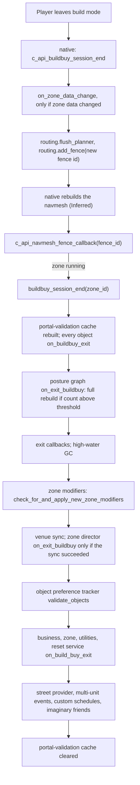
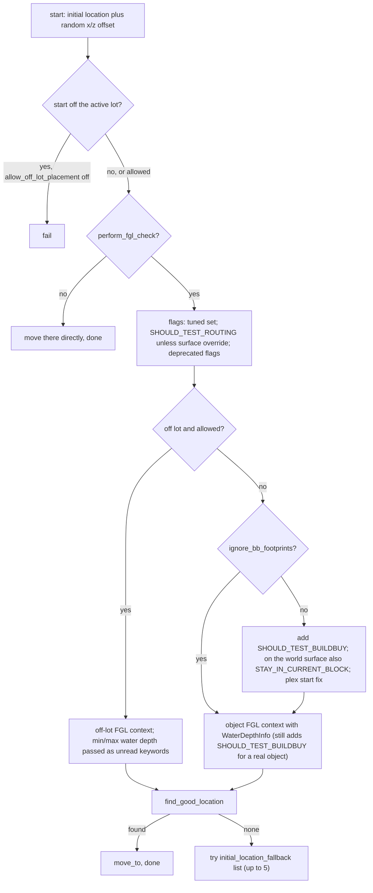

# 2.03 Build/Buy, placement and slots

*The Sims 4 1.128.90.1030 (Steam, Linux/Proton). Numbers come from the live tuning (the base delta build plus each installed pack's delta build) and the client packages of the base game and the installed packs EP04, EP06, EP09, EP12, GP04, GP12, SP01 and SP42. Written 2026-10-12. Checked 2026-10-12: 111 claims checked, 26 corrected, 2 relabelled, 1 removed. Checked again 2026-10-13: 178 claims checked, 24 corrected, 0 relabelled, 0 removed. Cross-chapter edits 2026-10-13: 1 applied.*

This chapter covers what happens when you enter and leave build mode, how the game finds a free spot for an object it creates, how objects sit on other objects (slots), footprints and placement legality as far as the Python and the data show, pools, ponds and the ocean as placed objects, modular sofas, walls, and what the catalog stores about price. Lots, rooms and venues belong to [2.01 Lots, venues and rooms](2.01-lots-venues-rooms.md); an object's own components and states to [2.02 Objects](2.02-objects-states-wear.md); routing and the posture graph to [3.05 Interactions, postures and routing](3.05-interactions-postures-routing.md); money to [5.01 Money, bills, perks and rewards](5.01-money-bills-rewards.md); console commands in general to [1.04 Debug tools, cheats and telemetry](1.04-debug-cheats-telemetry.md); the package format to [8.01 Package files and resource types](8.01-package-files.md).

## In plain words

Build mode itself, the grid, walls, roofs and the "can I put this here" check, runs in the game's native engine. The gameplay scripts are only told when you go in and when you come out. On the way in they pause some bookkeeping and send the engine the list of items your household has unlocked. On the way out they wait until the engine has rebuilt the walkable map of the lot, and only then let objects, lot traits, the venue and businesses catch up with what you changed. That is why lot traits and venue changes "land" a moment after you leave build mode.

When the game itself creates an object (a dropped plate, a pile of trash, a gravestone), it runs a "find good location" search: start at a point, try spots further and further out in small steps, and take the first spot where the object's footprint fits and a Sim can reach it. In the live game that search gives up after 20 metres unless the caller sets its own limit. Objects you buy are worth 20 percent less once you leave build mode, but only when they belong to the household you are playing.

Objects sit on other objects through slots: named points on the parent's skeleton. A vase on a table is attached to the table's bone, so it moves when the table moves. Gameplay slots match by type (a chair seat, a stove burner); decorations match by size (small, medium, large). The live game ships 234 slot types and 483 slot type sets, about six times what the game's full data build had. Some placement rules surprise: a script that creates an object outside the lot simply fails unless it was told off-lot placement is allowed, and a slot test aimed at a slot name the object does not have can pass (or, if it asks for a used slot, can never pass).

## Key facts

- Leaving build mode is a two-step handshake: the engine calls `c_api_buildbuy_session_end`, which adds a navmesh fence; the gameplay exit hooks (`buildbuy_session_end`) run only when a fence comes back through `c_api_navmesh_fence_callback` while the zone is running.
- The exit hooks run in a fixed order: objects, posture graph, exit callbacks, zone modifiers (lot traits), venue sync, object preferences, then businesses and the zone's own fixups (rebates, the 20 percent depreciation, lot levels). `is_in_build_buy` stays true until the zone's own fixups.
- The live `INCREMENTAL_REBUILD_THRESHOLD` is 0 (code default 10), so any posture-relevant object added or removed in build mode makes the posture graph do a full rebuild on exit.
- On entry the engine receives the unlock keys of the lot owner's household, or of the active household while a career event runs.
- Build mode spending is charged to the first that applies: a business's funds (except rental units and small businesses), a decorator gig's budget, the household.
- Find good location: live `MAX_FGL_DISTANCE` 20 m (code 100) when the caller gives no distance, step 0.3 m, rotation step pi/8 (22.5 degrees), `max_steps` 1 and `max_results` 0 by default.
- `PlacementHelper` location strategy: an off-lot start fails outright unless `allow_off_lot_placement` is set (163 values in 63 live records set it True); its fallback that moves an off-lot start onto the lot can never run; on the off-lot path the water-depth limits are silently dropped (two live records set a depth that this path drops).
- Slots: 234 `SlotType` and 483 `SlotTypeSet` live records, all in the base game's delta build; 2,501 live slot resources (RSLT) hold 8,575 containment slots, 4,262 of them naming one of 190 slot type sets.
- The live decorative ladder has 17 entries (the full build had 4); slot resources only use decorative sizes 1 to 3.
- A `slot_test` by slot name always passes "has slot type" (no live test uses that), passes "empty" for a slot the object does not have, and never passes "used" for one. Live, 19 "used" tests in four banquet-table records name `_cntm_sml_plate_N`, a slot no live slot resource has (the other plate tests and the slots themselves use `_ctnm_`).
- The catalog price is stored twice and agrees: the OBJD `SimoleonPrice` equals the COBJ price in all 30,140 live pairs; 5,323 of 30,424 live object definitions cost 0; the most expensive costs 15,000.
- Native build/buy tuning (`NativeBuildBuy`, live): `FireCodeMannequin` 10 and `FireCodeElevator` 1 (fire-code limits, going by the names), 225 custom images, roof height 6.5, roof pitch 1.75, `ObjectPriceDepreciation` 10.
- The simulation library holds 351 build/buy result codes, from `UnknownFailure` to `WarnGameplayAffected`, including two fire-code limits and nine slot refusals.
- The free-build, move-objects, show-hidden-objects and ignore-unlocks cheats are client commands: no Python registers them, and their help texts sit in the client executable's strings.
- `copy_objectdata_to_household_inventory` reads `_component.consumable`, a misspelling of `_components`, for every object whose class has a consumable component.

## How it works

### Entering build mode

**Observed** (`build_buy.py: c_api_buildbuy_session_begin`). The engine calls this when a player opens build mode. In order:

1. `posture_graph_service.on_enter_buildbuy()` resets the posture graph's incremental update counter to 0 (`postures/posture_graph.pyc: PostureGraphService.on_enter_buildbuy`, bytecode; the module has no decompiled source).
2. `zone.on_build_buy_enter()` sets `is_in_build_buy` and notifies the laundry service (`zone.py`).
3. The object-leak tracker gets the disable reason `"in build buy"` (`BUILD_BUY_OBJECT_LEAK_DISABLED`).
4. The household is the active household if a career event situation is running, otherwise the active lot's owner household. Its `build_buy_unlocks` keys go to the native `update_gameplay_unlocked_products(keys, zone_id, account_id)`.
5. The business service, the reset-and-delete service, the utilities manager and the unique-object service each get `on_build_buy_enter()`.
6. `object_manager.cleanup_build_buy_transient_objects()` removes every object tagged `Func_HouseholdInventoryObjectProxy` (live `HOUSEHOLD_INVENTORY_OBJECT_TAGS`, `objects/object_manager.py`).
7. Registered enter callbacks run (`_build_buy_enter_callbacks`).

**Observed** (`objects/game_object.py: GameObject.__init__`, `zone.py`). While a user is in build mode (`build_buy.get_user_in_build_buy(zone_id)` returns an account), every new object gets the zone owner's household as owner, is marked `set_post_bb_fixup_needed()`, and is queued with `zone.set_to_fixup_on_build_buy_exit`. The fixup runs at exit (below).

### Leaving build mode

**Observed** (`build_buy.py: c_api_buildbuy_session_end`, `buildbuy_session_end`; `routing/__init__.py: c_api_navmesh_fence_callback`; bytecode of `buildbuy_session_end`, whose decompile has wrong indentation). The engine's end call does only four things: run `on_zone_data_change()` if the zone data changed, take the next fence id from the zone, flush the path planner and add the fence, and lift the leak-tracker reason. The gameplay hooks run from the fence callback, and only when `zone.is_zone_running`. The callback does not compare the returned fence id with the one build mode added, and on every fence it also runs the spawner's post-navmesh hook. Python adds fences in two places only: here, and in the zone spin-up state `_WaitForNavmeshState` (`zone_spin_up_service.py`), which waits until `routing.get_last_fence()` reaches its fence id. **Inferred** from that state's name and from the zone not being RUNNING during spin-up: a fence comes back once the navmesh rebuild has caught up, so every exit hook sees the new walkable map, and the spin-up fence does not trigger the exit hooks.

In `buildbuy_session_end` only the zone director call depends on a result (`_sync_venue_service_to_zone_venue_type` returning True); the other steps always run, except that the object preference tracker, the street provider, the multi-unit event, custom schedule and imaginary friend services are skipped when they do not exist. Lot traits are applied by the zone modifier step; [2.01](2.01-lots-venues-rooms.md) covers what that step does, including the per-piece build/buy gameplay effects (bills, eco footprint, environment score, power and water) of the hidden zone modifier `ZoneModifiers_Hidden_BBGameplayEffects`, whose values differ by piece family and which apply only while the build eco effects option is on ([2.01, Lot traits in the live tuning](2.01-lots-venues-rooms.md#lot-traits-in-the-live-tuning)).

**Observed** (`postures/posture_graph.pyc: PostureGraphService.on_exit_buildbuy`, `_on_object_added`, bytecode; live module tuning `postures.posture_graph`). While in build mode each added or deleted object that matters to the posture graph increments `_incremental_update_count`; once the count passes `INCREMENTAL_REBUILD_THRESHOLD` the incremental updates stop and the exit does a full `rebuild()`. The code default is 10; the base-game delta tuning sets 0, so the first such change already commits the graph to a full rebuild on exit. [3.05](3.05-interactions-postures-routing.md) explains the graph itself.

**Observed** (`zone.py: on_build_buy_exit`). The zone's own exit, called in step N above: clear the lot's cached level range, update the navmesh id, set `is_in_build_buy` to False, `_add_expenditures_and_do_post_bb_fixup` (for each queued object the lot household's rebate manager, if the lot has a household, records a `BUILD_BUY` rebate, then `obj.try_post_bb_fixup(active_household_id)`), clear the lot's premade flag, fire `OnExitBuildBuy` (household-scoped when the lot has an owner), defer the front-door check, notify laundry, add or remove lot-level instances, then the dust and animal services. So zone modifiers, the venue and the director all run while `is_in_build_buy` is still true.

**Observed** (`objects/game_object.py: GameObject.on_buildbuy_exit`). Each object forwards the exit to its components and refreshes its inside/outside, natural-ground and surface callbacks.

### Money, depreciation and unlocks

**Observed** (`build_buy.py: c_api_modify_household_funds`, bytecode). The engine charges or refunds build-mode purchases through this one hook, `(amount, household_id, reason, zone_id)`:

1. If the zone has a business manager whose type is neither `RENTAL_UNIT` nor `SMALL_BUSINESS`, the business pays: `business_manager.modify_funds(amount, from_item_sold=False)`. Done.
2. If the household does not exist, the amount is parked with `try_add_pending_household_funds`; if that fails the call returns False (it also calls `logger.error`, which has an empty body in the retail build, so nothing is written).
3. For the active household, if an instanced Sim has a career whose current gig has this zone as its customer lot and implements `update_budget_spent` (only `careers/decorator_career_gig.py` does), the gig budget is charged instead. Done.
4. Otherwise a positive amount goes to `funds.add(amount, reason, count_as_earnings=False)` and fires the `SimoleonsEarnedBB` event; a negative amount goes to `funds.try_remove(-amount)`.

**Observed** (`objects/client_object_mixin.py: try_post_bb_fixup`, `_on_try_depreciation`). The post-build-mode fixup depreciates an object once: only if its owning household is the active household and the native `get_object_can_depreciate(definition id)` allows it, `base_value = floor(base_value x (1 - INITIAL_DEPRECIATION))` with `INITIAL_DEPRECIATION` 20 percent ([2.02](2.02-objects-states-wear.md#object-value-and-depreciation)). Then `on_post_bb_fixup` fires the `ObjectAdd` event.

**Observed** (live `NativeBuildBuy`, full and delta). The native side has its own `ObjectPriceDepreciation` of 10. No Python module reads it and its unit is not stated, so what it does, and how it relates to the 20 percent above, cannot be told from the scripts or the data.

**Observed** (`rewards/reward_tuning.py`, `objects/collection_manager.py`, `sims/household.pyc` bytecode). An unlock is a resource key: `TunableBuildBuyObjectDefinitionUnlock` gives an `OBJCATALOG` key with the definition id, `TunableBuildBuyMagazineCollectionUnlock` a `MAGAZINECOLLECTION` key. With destination SIM the key goes to that Sim's info; with HOUSEHOLD it goes to every Sim in the household. The household set (`household._build_buy_unlocks`) always gets it. Completing a collection also adds an `OBJCATALOG` unlock for the award object to the household. Unlocks are saved per Sim in `gameplay_data.build_buy_unlock_list`.

**Observed** (`objects/definition.py: Definition.__init__`; client packages). Python reads the catalog price from the OBJD property `SimoleonPrice` with a default of 100. Every one of the 30,424 live OBJD records carries the property, so the default never applies. 5,323 cost 0, the median is 130, the 90th percentile 730, the maximum 15,000. The catalog record (COBJ) stores the same number: in all 30,140 OBJD/COBJ pairs the two prices are equal. The client-package counts in this chapter are over the live set: per pack the delta copy replaces the full copy under the same key, a deletion marker hides only its own pack's copies, and across packs the mount priority decides ([8.01](8.01-package-files.md#packs-their-delta-folders-and-the-base-game)). So the 19 object definitions (and their 19 catalog records) that SP01 (Luxury Party)'s delta marks deleted stay live through the base delta copy.

### The native placement check

**Observed** (`build_buy.py`). Every legality question goes to the native `_buildbuy` module: `test_location_for_object(obj, definition_id, location, ignore_ids)`, `get_object_placement_flags`, `get_object_slotset`, `get_object_decosize`, `get_object_buy_category_flags`, `get_object_is_deletable`, `has_floor_at_location`, `is_location_outside`, `is_location_natural_ground`, `is_location_pool`, `get_pool_edges`, `get_pond_edges`, `get_wall_contours`, `get_room_id`, `get_block_id`, `get_stair_count`, `get_furnished_lot_value`, `get_replacement_object` and more. The module has a stub fallback for tools; its values (for example lowest level -2 and highest 4) are stub returns, not game rules.

**Observed** (strings of `Simulation_x64.dll`). One contiguous list of 351 names runs from `UnknownFailure` to `WarnGameplayAffected`. **Inferred**: it is the build/buy result enum. It covers funds (`InsufficientFunds`, `CantAfford`), surfaces (`TerrainRequiredForPlacement`, `ObjectOnSlopeTooSteep`, `CantPlaceOnSlope`, `MustPlaceInPond`, `MustPlaceInShallowOcean`, `CantPlaceInPool`), walls (`MustBeAgainstWall`, `InsufficientWallHeight`, `MustBeCompletelySupportedByWall`), intersections (`CantIntersectOtherObjects` and twelve siblings), slots (`SlotOccupied`, `SlotGroupTooLarge`, `CantFindSlot`, `IncompatibleSlotType`, `ObjectPositionDoesntMatchSlot`, `ObjectOrientationDoesntMatchSlot`, `SlotInvalidOnSlope`, `RequiresSlotForPlacement`, `MissingSlotResource`), pools and ponds (`CantPlacePoolUnderWall`, `PondsPondAtMaxHeight`), stairs and ladders, plexes (`OutsideOfActivePlex`), unlocks (`ProductIsGameplayLocked`), decorator restrictions (`DecoratorModeTileLimit`), and two fire-code limits (`FireCodeTooManyObjectsOnLot`, `FireCodeTooManyObjectsOwnedByHousehold`).

**Observed** (live `NativeBuildBuy`, delta; the same names follow `NativeBuildBuy` in the strings of `Simulation_x64.dll` and also appear in the client executable's strings). The engine's settings record holds `ObjectPriceDepreciation`, `FireCodeLotObjects`, `FireCodeHouseholdInventory`, `FireCodeMannequin`, `FireCodeElevator`, `MaxRoofPitch`, `MaxRoofHeight`, `RoutingFootprintSimHeight`, `RoofSlopeSnap`, `WallObjectVerticalSnapInterval`, `UploadLimitCustomImages`, `SlopeFlatnessTolerance`, `MaxDoorHeightOffset` and `MaxGameplaySupportedOffset`. The live record sets nine of them (Numbers). `FireCodeLotObjects` and `FireCodeHouseholdInventory` are not tuned, so their values live in the engine. **Inferred** from the names: the four `FireCode*` fields are the object-count limits behind the two fire-code result codes.

### Placement flags and footprints

**Observed** (`build_buy.py: PlacementFlags`). Each object definition carries a 32-bit flag word, read through the native `get_object_placement_flags`. The bits: CENTER_ON_WALL 1, EDGE_AGAINST_WALL 2, ADJUST_HEIGHT_ON_WALL 4, CEILING 8, IMMOVABLE_BY_USER 16, DIAGONAL 32, ROOF 64, REQUIRES_FENCE 128, SHOW_OBJ_IF_WALL_DOWN 256, SLOTTED_TO_FENCE 512, REQUIRES_SLOT 1024, ALLOWED_ON_SLOPE 2048, REPEAT_PLACEMENT 4096, NON_DELETEABLE 8192, NON_INVENTORYABLE 16384, NON_ABANDONABLE 32768, REQUIRES_TERRAIN 65536, ENCOURAGE_INDOOR 131072, ENCOURAGE_OUTDOOR 262144, NON_DELETABLE_BY_USER 524288, NON_INVENTORYABLE_BY_USER 1048576, REQUIRES_WATER_SURFACE 2097152, ALLOWED_IN_FOUNTAIN 4194304, GROUNDED_AGAINST_WALL 8388608, NOT_BLUEPRINTABLE 16777216, IS_HUMAN 33554432, ALLOWED_ON_WATER_SURFACE 67108864, ALLOWED_IN_POOL 134217728, ON_WALL_TOP 268435456, FORCE_DESIGNABLE 536870912, ALWAYS_BLUEPRINTABLE 1073741824, WALL_OPTIONAL 2^31. Composites: `REQUIRES_WALL` = CENTER_ON_WALL | EDGE_AGAINST_WALL; `WALL_GRAPH_PLACEMENT` = REQUIRES_WALL | REQUIRES_FENCE; `SNAP_TO_WALL` = REQUIRES_WALL | ADJUST_HEIGHT_ON_WALL. The OBJD property table holds no flag word (see Data shapes), so **Inferred**: the engine reads it from catalog data.

**Observed** (Python users). `objects/base_object.py` and `client_object_mixin.py` set `wall_or_fence_placement` from `WALL_GRAPH_PLACEMENT`, and `base_object.py` also reads CEILING, NON_DELETEABLE and NON_DELETABLE_BY_USER; `objects/game_object.py` reads REQUIRES_WATER_SURFACE; `services/fire_service.py` reads CEILING and WALL_GRAPH_PLACEMENT when deciding what a fire overlaps; `world/mailbox_owner_helper.py` and `ScriptObject` offset EDGE_AGAINST_WALL objects forward by `WALL_OBJECT_POSITION_PADDING` (0.25 m) for connectivity tests; `move_object_to_household_inventory` destroys NON_INVENTORYABLE objects instead of storing them, and `copy_objectdata_to_household_inventory`, `carry/carry_postures.py`, `objects/object_manager.py` and `situations/complex/burglar_situation.py` also check NON_INVENTORYABLE (carry also NON_DELETEABLE).

**Observed** (`placement.py`). Footprints are native polygons: `get_placement_footprint_polygon`, `get_accurate_placement_footprint_polygon`, `get_placement_footprint_compound_polygon`, `add_placement_footprint` and `remove_placement_footprint`. `objects/footprint_tests.py: InFootprintTest` checks whether the actor Sim stands inside a target's `footprint_polygon` or inside named footprint areas (hash32 names), with the target found by participant or by tag (any match) and an `invert` switch. Two live interactions use it (`lighthouse_GoUpstairs_si`, `lighthouse_GoDownstairs_si`).

**Observed** (client packages, live set as above). 11,595 live footprint resources (FTPT, 0xD382BF57) exist, all of chunk version 12; 2,330 start with the key of another footprint. **Inferred**: those reuse a shared template. 6,088 of the 6,213 distinct footprint keys named by object definitions resolve to a live FTPT in the client packages. The polygon layout itself was not decoded (Limits).

### Find good location (FGL)

FGL is the native search that script-side placement uses to put an object down, choose a spot for a jig, drop a carried object or place a Sim.

**Observed** (`placement.py: FindGoodLocationContext.__init__`). A context wraps `_placement.FGLSearch` with a routing search strategy from the start location and the default result strategy. Its defaults: `max_results` 0, `max_steps` 1, `max_distance` = `FGLTuning.MAX_FGL_DISTANCE` when not given (callers such as the carry put-down pass their own), position increment `FGL_DEFAULT_POSITION_INCREMENT` 0.3 m, rotation increment `PlacementConstants.rotation_increment` pi/8, `min_head_room` from the routing context's `get_required_height_clearance()`. It also takes footprints (compound polygons from the engine), restrictions, scoring functions (`ScoringFunctionLinear`, `Radial`, `Angular`, `Polygon`), terrain tags, raytest info, water-depth info and offset info. The trailing `**kwargs` are accepted and never read (bytecode), so a misspelled keyword is dropped without an error.

**Observed** (`placement.py: FGLSearchFlag`). 22 flag bits steer the search: USE_RANDOM_WEIGHTING 1, USE_RANDOM_ORIENTATION 2, CONTAINS_NOWHERE_CONSTRAINT 4, CONTAINS_ANYWHERE_CONSTRAINT 8, ALLOW_TOO_CLOSE_TO_OBSTACLE 16, ALLOW_GOALS_IN_SIM_POSITIONS 32, ALLOW_GOALS_IN_SIM_INTENDED_POSITIONS 64, SHOULD_TEST_ROUTING 128, SHOULD_TEST_BUILDBUY 256, USE_SIM_FOOTPRINT 512, STAY_IN_SAME_CONNECTIVITY_GROUP 1024, STAY_IN_CONNECTED_CONNECTIVITY_GROUP 2048, STAY_IN_CURRENT_BLOCK 4096, STAY_OUTSIDE 8192, ALLOW_INACTIVE_PLEX 16384, SHOULD_RAYTEST 32768, SPIRAL_INWARDS 65536, STAY_IN_LOT 131072, ENCLOSED_ROOM_ONLY 262144, LOT_TERRAIN_ONLY 524288, CALCULATE_RESULT_TERRAIN_HEIGHTS 1048576, DONE_ON_MAX_RESULTS 2097152. The default set is STAY_IN_CONNECTED_CONNECTIVITY_GROUP | SHOULD_TEST_ROUTING | CALCULATE_RESULT_TERRAIN_HEIGHTS | DONE_ON_MAX_RESULTS; the "for object" set adds SHOULD_TEST_BUILDBUY, the "for Sim" set adds USE_SIM_FOOTPRINT. **Inferred** from the names: SPIRAL_INWARDS implies the normal search spirals outwards from the start.

**Observed** (`placement.py`, bytecode where noted).
- `set_object_id_info` calls `logger.warn` when object ids are passed without SHOULD_TEST_BUILDBUY (an empty body in the retail build, so nothing is written) and stores them anyway (bytecode).
- `create_fgl_context_for_object` adds SHOULD_TEST_BUILDBUY when the object is a real object (not a bare definition).
- `create_fgl_context_for_sim` passes the Sim's object id only together with SHOULD_TEST_BUILDBUY, uses the Sim's routing context, and sets `WaterDepthInfo(max_water_depth=0.0)` for a Sim that cannot swim (bytecode).
- `create_fgl_context_for_object_off_lot` uses the accurate footprint polygon.
- `find_good_location` runs the search. On SUCCESS it returns the first result; if heights were not calculated it fills y from the terrain. On failure it calls `logger.debug` (`FAIL_NO_GOALS_FOUND`) or `logger.warn` (other results); both have empty bodies in the retail build, so a failed search leaves no trace beyond its return value. It returns `(position, orientation, message)`.

**Observed** (live module tuning `placement`). `MAX_FGL_DISTANCE` is 20 m in the delta build, absent from the full build, 100 in code. `SOCIAL_FGL_HEIGHT_TOLERANCE` is 0.85 in the delta, 0.07 in the full build, 0.1 in code; `interactions/utils/routing.py` uses it for social jig placement and clamps jig search distances to `MAX_FGL_DISTANCE`. The carry put-down search uses `MAX_PUTDOWN_STEPS` 8 and `MAX_PUTDOWN_DISTANCE` 10 m (code; not tuned). The full build also sets a `PlacementConstants.avoid_sims_radius` of 0.35 that the code no longer has.

### Placement strategies (PlacementHelper)

**Observed** (`objects/placement/placement_helper.py: PlacementHelper`). A tuned `PlacementHelper` holds `placement_strategy_groups`. Groups run in order; inside a group the strategies are drawn by weight (`pop_weighted`, `TunableMultiplier` weights) until one succeeds. The strategies are `inventory` (always returns True), `location`, `slot` and `household_inventory`. Users include the culling service's off-lot urnstone placement, the lost-and-found service and the customize-object picker; `_PlacementStrategyLocation` and `_PlacementStrategySlot` are also used directly by object creation, the slot component, animal homes, familiars and two situations.

A location strategy starts from an initial location: `from_participant` (default), `from_tags`, `from_lot` (DEFAULT, RANDOM, RANDOM_ANY_FLOOR), `from_joint` (default joint `_FX_`), `front_door_object`, `from_floor`, `from_swimming_pool` (finds `SWIMMING_POOL_OBJECT_DEF` 65956 objects, optionally filtered by a `PoolSizeTest`) and `from_sim_filter`. Live use, counting explicit values in location strategies: `from_participant` 106 values in 63 records, `from_lot` 2 in 1 record (`situation_EcoFootprint_SunRays`); as fallbacks, `from_floor` and `from_lot` once each in the 5 pet-crate records; `from_tags`, `from_joint`, `from_swimming_pool`, `front_door_object` and `from_sim_filter` 0 (other tunables named `from_tags`, such as broadcaster targets, are not location strategies).

**Observed** (`_PlacementStrategyLocation._try_place_object_internal`, bytecode read in the disassembly). The steps:

1. The object must exist in the object manager.
2. A random offset within the tuned x/z ranges is applied to the start.
3. The orientation is random or the target's.
4. With `remove_from_parent_slot` set, a slotted object is unparented first.
5. If the start is off the active lot and `allow_off_lot_placement` is off, the strategy returns False at once. The tunable's own description promises to "always attempt to place created objects on the active lot"; no code moves the start there.
6. With `perform_fgl_check` off the object is moved straight to the start (4 live records do this).
7. The tuned search flags are OR-ed together. A `surface_type_override` replaces the surface type; without one SHOULD_TEST_ROUTING is added. `ignore_sim_positions` adds both ALLOW_GOALS flags. The deprecated `in_same_room`, `stay_in_connected_connectivity_group`, `stay_outside_placement`, `enclosed_room_only` and `lot_terrain_only` still add their flags; live, `in_same_room` is set in 17 records and `stay_outside_placement` in 3.
8. A raytest, a facing restriction (`RelativeFacingRange`, angle with a code default of 0.5 x pi) and polygon scoring functions from `placement_constraints` are added when tuned.
9. Off-lot branch (allowed and off lot): `create_fgl_context_for_object_off_lot(... min_water_depth=..., max_water_depth=...)`. Those two keywords land in the context's unread `**kwargs`, so water-depth limits do not apply off the lot. Two live records allow off-lot placement and set a depth (`terrain-gohere_Sandplay_Smiley` and `_Star`, maximum depth 0); **Inferred**: off the lot their placement is not kept out of the water.
10. Otherwise, when `ignore_bb_footprints` is off (92 explicit False values live, against a code default of True), SHOULD_TEST_BUILDBUY is added, plus STAY_IN_CURRENT_BLOCK on the world surface. When it is on, this step is skipped whole, the plex fix below included. A following `if start_position_is_off_lot: start_position = active_lot.get_default_position(...)` can never be reached, because an off-lot start has already either failed (step 5) or taken the off-lot branch. Unless `skip_plex_starting_position_validation` (31 records) is set, the start is moved inside the active plex.
11. `create_fgl_context_for_object` with a 0.5 m position increment (`POSITION_INCREMENT`) and `WaterDepthInfo`; `find_good_location`; on success `move_to`, otherwise each `initial_location_fallback` in turn. The strategy calls that factory with its default `test_buildbuy_allowed=True`, and the factory adds SHOULD_TEST_BUILDBUY whenever the object is a real object (`obj.definition is not obj`, `placement.pyc` bytecode offsets 8 to 34). So for a created object the build/buy test runs whatever `ignore_bb_footprints` says; the setting only decides STAY_IN_CURRENT_BLOCK and the plex start fix. **Inferred**: setting it True does not let an object overlap other objects' footprints.

**Observed** (`_PlacementStrategyLocation.try_place_object`, bytecode). The location strategy's `try_place_object` passes only `location` on to the base class and drops every other keyword. Object creation passes `ignored_object_ids` this way (`objects/object_creation.py: _place_object_no_fallback`), so those ids never reach a location strategy's FGL context; the one subclass that fills them, `DeathElement` (`interactions/utils/death_interactions.py`, the jig and the dying Sim), loses them when its location is a location strategy. **Inferred**: the death object's search can be refused spots taken by the very jig or Sim it was meant to ignore.

**Observed** (`_PlacementStrategySlot._try_place_object_internal`, bytecode). The slot strategy optionally uses the target's part owner; `by_name` calls `parent_object(obj, target, bone_name_hash=hash32(name))`, `by_reference` calls `target.slot_object(parent_slot, slotting_object=obj)`.

### Slots: types, sets and parenting

**Observed** (`objects/slots.py`, `objects/components/slot_component.py`, `objects/client_object_mixin.py`). A slot is a bone on the parent's rig. The model's slot resource (RSLT) lists containment slots; for each, the slot component reads the slot hash, a slot type set key and a decorative size, checks that the bone exists in the rig, and builds the slot's type set as the set's `slot_types` plus `DecorativeSlotTuning.get_slot_types_for_slot(deco_size)`. Decorative slots of a multi-part object go to the nearest part. The child side comes from the native catalog: `slot_type_set` = `get_object_slotset(definition id)` and `deco_slot_size` = `get_object_decosize(definition id)`. A child fits a slot when the two type sets intersect; the final word is the native `test_location_for_object`.

**Observed** (`objects/slots.py: RuntimeSlot`). A runtime slot is `(owner, slot_name_hash, slot_types, send_telemetry)`. Its children are the owner's children whose `location.slot_hash` (or `joint_name_hash`) equals the slot hash; its location is the joint transform from the rig with `parent=owner` and that slot hash. `add_child` calls `child.set_parent(owner, transform, slot_hash=...)` (Sims attach by joint). `is_enabled` checks the owner's disabled slot hashes; `is_deco_slot` is true when every type is decorative. **Inferred**: because a child's location is relative to the parent bone, moving the parent moves its children with no extra work.

**Observed** (`build_buy.py: c_api_set_object_location_ex`). When the engine moves an object it passes the parent, transform, slot hash and routing surface, and Python calls `set_parent(parent, transform, slot_hash, routing_surface)` with `parent_type_info` set.

**Observed** (`objects/slots.py: SlotType`, `SlotTypeSet`). `SlotType` fields: `bone_name_hash` (optional), `implies_owner_object_is_surface` (default True), `implies_slotted_object_has_surface` (True), `implies_owner_object_is_routable_terrain` (False), `shared_slot_object_tags`, `use_as_joint` (False). `SlotTypeSet` fields, all exported to the client: `slot_types`, `search_radius` (0.5 m, "co-located slots with different orientations"), `user_facing` (True), `prevent_sibling_intersection`, `allow_distant_relative_intersection`, `custom_error_text`, `parent_snaps_to_child`, `dont_propagate_ops`, `force_full_footprint_checks`, `client_only_parenting` (all False). Python reads only `slot_types`: no module reads `search_radius`, `user_facing`, `prevent_sibling_intersection`, `allow_distant_relative_intersection`, `custom_error_text`, `parent_snaps_to_child`, `dont_propagate_ops`, `force_full_footprint_checks` or `client_only_parenting` (searched every module). **Inferred**: they steer the client and native placement only.

**Observed** (live census). All 234 `SlotType` and 483 `SlotTypeSet` records come from the base game's delta build; the full build had 38 and 74. Set sizes: 317 sets hold one type, the largest holds 20, seven hold none (five never set the field). Explicit settings:

| SlotTypeSet field | Records | Examples |
|---|---|---|
| `user_facing` False | 36 | chicken coop nests, bar serving bot, blender, microwave, grill, spawn point |
| `force_full_footprint_checks` True | 41 | the `*Snap*` sets (bookcase, shelf, desk, floor and wall snaps), modular playground |
| `client_only_parenting` True | 37 | the same snap sets |
| `prevent_sibling_intersection` True | 13 | easel, photo collage frames, embedded appliances, wall planters |
| `parent_snaps_to_child` True | 10 | pet feeder (two sets), bookshelves, booth, booth corner, camera tripod, washing machine, three chair sets |
| `allow_distant_relative_intersection` True | 2 | `slotSet_SitChair`, `slotSet_SitChairLrg` |
| `dont_propagate_ops` True | 2 | `slotSet_Booth`, `slotSet_BoothCorner` |
| `search_radius` 1 | 1 | |
| `custom_error_text` | 1 | |

On slot types, `implies_owner_object_is_surface` is set False on 58 and True on 13; `implies_slotted_object_has_surface` False on 26; `bone_name_hash` on 55.

**Observed** (client packages). 2,501 live non-empty RSLT resources (0xD3044521, chunk version 10). 974 hold containment slots, 8,575 in all. In those without routing slots (8,569 slots), every slot type set id resolves to a live `SlotTypeSet`: 4,262 slots name one of 190 sets, the rest name none. The most used sets are `customSet_Curtain` (1,225 slots), `slotSet_SpawnPoint` (318), `customSet_BarServe` (273), `slotSet_SitDrink` (217), `slotSet_SitEat` (211) and `slotSet_SitIndividual` (202). The slot name equals its bone name in 8,550 of 8,569. 1,732 of the 1,838 distinct slot keys that object definitions name resolve to a live RSLT; an OBJD can name several (1,347 do), and `Definition` accepts a tuple.

**Observed** (`objects/set_slots_state.py: SetSlotsState`). An object state can enable and disable slot hashes on start and reverse both on stop. No live record sets either list (a count over the live tuning). Removal, reslotting on model change and slot states belong to the slot component ([2.02](2.02-objects-states-wear.md)).

### Decorative slots: the size ladder

**Observed** (`objects/slots.py: DecorativeSlotTuning`). With `_SIZE_GROUP` 8 and the list `DECORATIVE_SLOT_TYPES` (call it T):
- an object of decorative size n (n > 0) gets `T[n-1:8]` when n ≤ 8, else `T[n-1:]`;
- a slot of size m gets `T[:m]` when m ≤ 8, else `T[8:m]`;
- size 0 means no decorative types.

**Observed** (module tuning `objects.slots`). The full build's list has four entries: Deco_Small, Deco_Medium, Deco_Large, `slot_2x1ObjectSurface`. The base-game delta list has 17: indices 0 to 3 as before, 4 to 8 `Deco_Large`, 9 `slotType_Hang_sml`, 10 `slotType_Hang_med`, 11 to 16 `slotType_Hang_lrg`.

**Inferred** (arithmetic on the live list). In the first group a small object (n = 1) fits slots of size 1 and up, a medium one (n = 2) sizes 2 and up, and objects of sizes 3 to 8 all behave as "large": they fit slots of size 3 and up, because the padding entries are all `Deco_Large`. Index 8 is also `Deco_Large`, so the two groups touch: an object of size 9 carries `Deco_Large` and fits any slot of size 3 or more in either group, and every group-two slot (size 9 and up) offers `Deco_Large`, so it accepts any group-one object (every size from 1 to 8 includes `Deco_Large`). The seed note's "two groups never mix" holds for the full build only. **Observed**: no live RSLT container slot uses a decorative size above 3 (2,886 slots of size 1, 1,049 of size 2, 313 of size 3 among the 8,569 parsed; the 6 slots in RSLTs that also hold routing slots were not parsed, since their layout is unknown), so on the slot side the mixing never happens; it can show only through objects whose own decorative size is 9 or more, and object decorative sizes were not decoded.

### Slot and footprint tests

**Observed** (`objects/slot_tests.py: SlotTest`; test key `slot_test`, 324 live records). Test types EMPTY 1, USED 2, HAS_SLOT_TYPE 3; the slot is given by name or by reference; `slot_count_required` 1; `check_part_owner`; Sims are skipped as targets. A test by name builds `RuntimeSlot(target, hash32(name), EMPTY_SET, False)`, which always exists. **Observed consequence** (bytecode of `SlotTest.__call__`): HAS_SLOT_TYPE by name always passes, EMPTY by a name the object does not have passes (no children carry that hash), and USED by such a name never passes.

**Observed** (live tuning; slot-name hashes searched in every live RSLT; `hash32` is FNV-1 32-bit of the lower-cased name, the only variant that matches). By-name tests live: HAS_SLOT_TYPE 0, EMPTY 462 tests in 28 records, USED 146 in 23. `_ctnm_sml_plate_0` to `_4` sit in 6 slot resources, `_5` and `_6` in only 2 of them, so the 15 records that test EMPTY on plates 5 and 6 pass on any object that uses one of the other four. Four banquet-table records (`banquetTable_FillTable`, `banquetTable_FillTable_Random`, `BanquetTable_FillTable_Random_HSProm`, `object_BanquetTable_3x1`) hold 19 USED tests on `_cntm_sml_plate_N`, a name no live slot resource has; those tests can never pass. **Inferred**: `_cntm_` is a typo of `_ctnm_`; what each failing or passing test changes for the player depends on how its record combines it and was not traced.

**Observed** (`RelatedSlotsTest`, key `slot_test_related`, 0 live records). Per part, every listed slot test must pass, and `parts_required` (1) parts must qualify. With a part as the target and `parts_required` above 1 it always fails, since only that part is checked.

### Terrain and the ground

**Observed** (`terrain.py`). Thin wrappers over native `_terrain`: `get_terrain_height`, `get_lot_level_height`, `get_water_depth`, `adjust_locations_for_target_water_depth`, `adjust_locations_for_coastline`, `is_position_in_bounds`, `is_position_in_street` (a markup region), `get_snowmask_value` and `is_terrain_tag_at_position(..., required_strength, test_floor_tiles)` with `TERRAIN_TAG_REQUIRED_STRENGTH` 0.75. `world/terrain_enums.py: TerrainTag` lists 17 ground materials as hash32 values (brick, carpet, cement, deepsnow, dirt, grass, gravel, hardwood, leaves, linoleum, marble, metal, puddle, sand, snow, stone, "wood deck") plus INVALID 0. A location strategy's `terrain_tags` require at least one tag under each footprint vertex (the field name is shared with pick tests and object routing, so it was not counted).

**Observed** (`objects/terrain.py`). The `Terrain` object (persistence NONE) raycasts with the human footprint and answers height queries. `_LocationPoint` proxies a picked spot: `TerrainPoint`, `OceanPoint`, `PoolPoint`. `TerrainSuperInteraction` adds `fgl_height_tolerance` (0.035, the stated engine default; 0.07 in four live records: `terrain-teleport` and three teleport styles). `TravelSuperInteraction` needs a pick off the zone, inside the street and not routable. `GoHereSuperInteraction` (70 live records) teleports the active Sim early when the destination is unreachable and the Sim has a teleport style, and restores a saved go-here as a pool pick when `is_location_pool`. `DebugSetupLotInteraction`'s `contained_in_lot` always returns True. `Terrain._get_ungreeted_overrides` forwards front-door interactions to a terrain click while the player waits to be greeted.

**Observed** (`world/floor_feature_loot.py`, `world/floor_feature_test.py`, `build_buy.py: FloorFeatureType`). Floor features are BURNT 0, LEAF 1, DUST 2, stored natively. `FloorFeatureRemoveOp` (loot key `fire_clean_scorch`, read from the bytecode of `interactions/utils/loot.pyc`, which did not decompile) clears features of one type within `removal_radius` (2.5 m) of the point one metre in front of the Sim, on the Sim's level; one live loot uses it (`Loot_Fire_Clean_Scorch_Mark`). `NearbyFloorFeatureTest` (key `nearby_floor_feature`, 0 live records) passes when a feature lies within the squared radius (default 5 m) of the actor.

### Pools

**Observed** (`objects/pools/pool.py`, `swimming_mixin.py`, `pool_utils.py`, `pool_seat.py`). `SwimmingPool` (live `object_swimmingPool`, 103231) removes its FOOTPRINT component, provides a `SURFACETYPE_POOL` routing surface, and is kept in `pool_utils.cached_pool_objects`, where `get_pool_by_block_id` finds it. Its edges come from the native `get_pool_edges()[(block_id, level)]`; its block id is the native `get_block_id` at the pool's position on level (provided surface's secondary id minus 1); `get_edge_constraint` builds a 1.0 m band along every edge (bytecode): by default (`inward_dir` False) on the side the code does not call inward, on the world surface with a stand constraint, and with `inward_dir` on the inward side, on the pool's own surface with a swim constraint; **Inferred** from the names and surfaces: outside the pool by default and inside it on request. Line of sight is always clear. `POOL_LANDING_SURFACE` is `"Water"`. `PoolSeat` (`object_swimmingPoolSeat`, 103233) is a part of the pool with a ±0.5 m box, swim-surface overrides and posture locations from single portal locations.

**Observed** (`world/pool_size_test.py`; key `pool_size_test`, 4 live records). The test reads `get_pool_size_at_location` in half tiles and passes when the size lies in `[lower, upper)`. A target in no pool passes if the water depth there is above 0 (the ocean) and fails otherwise.

### Ponds

**Observed** (`objects/pools/pond.py`, `pond_utils.py`; live `object_Ponds_PondObject`, 259918). A pond takes its edges from the native `get_pond_edges`, sorts them into loops and caches the loop with the largest area as the outer edge (a loop that is not a valid polygon is measured by its convex hull). The call that fills that cache returns the last loop built instead of the cached one (bytecode of `Pond.edges`, offset 434); the two differ only for a pond whose edges form more than one loop. **Inferred**: on such a pond the first outer-edge request after load or build mode (a `PondConstraintSuperInteraction` constraint, or the debug visualizer) can get the wrong outline. Wading constraints come from `get_pond_contours_for_wading_depth`, grouped when centroids lie within `contour_grouping_max_distance` (5 m). Fishing targets sit `distance_from_edge_to_fishing_target` (3 m) inside an edge midpoint and need water at least `target_min_water_depth` deep plus a clear raycast. Objects tagged `Func_Pond_FishSign` supply fishing data. `on_buildbuy_exit` clears every cached edge, id, contour and constraint. `PondConstraintSuperInteraction` (5 live records) keeps the Sim inside the pond, by default between 0.1 and 0.7 m deep. Live fishing values differ from code (Numbers): constraint angle 1 degree against pi/12, slope tolerance 0.1 against 0.08, minimum target depth 0.2 against 1.0.

**Observed** (`objects/pools/pond_visualizer.py`). The debug visualizer registers a build/buy exit callback to redraw and never unregisters it in `stop()`.

### Ocean

**Observed** (`objects/pools/ocean.py`; `world/ocean_tuning.pyc` did not decompile, its live module tuning was read instead). The `Ocean` object (live 197984) collects beach locators tagged `Func_Locator_BeachPortal` and the street's beaches at load. For each species and age in `OceanTuning.OCEAN_DATA` whose pack is available it stores WET, WADE and SWIM start transforms and adds beach portals; a portal is kept only when its land end is natural ground (bytecode). Coastal plex lots get portals from the lot's front side, rebuilt on build/buy exit. `EDGE_PORTAL_BACKSET` -0.25 m and `EDGE_TEST_POINT_OFFSET` 0.05 m set the portal geometry. Portals are added only for an entry whose `beach_portal_data` is set. Live wading intervals: human teen to elder 0.4 to 1.27 m, child 0.274 to 0.87 m, toddler 0.06 to 0.22 m; dog adult (with teen, young adult and elder) 0.15 to 0.35 m, child 0.01 to 0.05 m; small dog adult 0.05 to 0.157 m, child 0.01 to 0.05 m. The horse entry (adult and elder) is present with no `ocean_data`, so it would take the code defaults: wading 0.1 to 1.0 m, `water_depth_error` 0.05, `swimwear_change_water_depth` 0.1, no beach portal and no outfit change (**Inferred**: module tuning read from the live record, defaults from the bytecode of `world/ocean_tuning.pyc`). `ocean.py` never reaches it in this install: it skips a species whose `SpeciesExtended.get_required_pack` is not available (bytecode offsets 100 to 124), and horses need EP14 (Horse Ranch), which is not installed. [2.06](2.06-worlds-regions-travel.md#ocean-wading-and-swimwear) covers ocean wading and swimwear.

**Observed** (`objects/water_terrain_objects.py`). A click on water is matched to the nearest object tagged `Func_FishingLocation_Hole` or `Func_FishingLocation_Spot` when its squared 2D distance is at most 50 (live), about 7.1 m. Untuned, the threshold would be its own default "at most 0" (the value field alone defaults to 100). The `check_distance` argument is never read.

### Modular objects: sectional sofas

**Observed** (`objects/modular/*`, `objects/system.py: c_api_set_modular_pieces`). The engine reports a sectional's pieces through `c_api_set_modular_pieces`, checked against `SECTIONAL_SOFA_OBJECT_DEF` (265272, an OBJD id). `SectionalSofa.set_modular_pieces` chains the pieces (each piece's LEFT is the previous, the previous's RIGHT is this one); the same piece may appear twice only at both ends, which closes a loop. Each piece generates its parts: a part is skipped when it has `required_adjacencies` and none is present, or when it has `disabling_adjacencies`, the piece has neighbours, and some disabling set is fully present (bytecode of `generate_parts`). Part ids are `{key}_{index}`. The posture graph is told the object moved. `ModularObjectComponent` persists the piece ids and adds piece-provided affordances. Live: one `SectionalSofa` (`sectionalSofa`, 254964) and eight `SectionalSofaPiece` records (piece, outCorner, single, inCorner, endEast, inCornerLarge, flat, endWest); `endWest` has a nap part that needs a RIGHT neighbour.

### Walls and wall objects

**Observed** (`objects/walls/half_walls.py`). `HalfWall` (live `object_Half_Wall`, 120060) is a game object with two posture locations, 0.25 m in front of and behind its origin (`LOCATION_OFFSET`); it is not valid for height checks and caches its locations until told to update. Walls themselves are native: Python reaches them through placement flags, `get_wall_contours` (used by the line-of-sight component) and the wall result codes above.

**Observed** (`objects/script_object.py`). A wall object's forward padding is `wall_object_padding or WALL_OBJECT_POSITION_PADDING`, so a padding tuned to 0 falls back to 0.25 m.

### Household inventory hooks

**Observed** (`build_buy.py`). `move_object_to_household_inventory` destroys NON_INVENTORYABLE objects; an object with no owner is given to the active household with FORCE_OWNERSHIP or destroyed with DESTROY_OBJECT; a stacked object's stack is set to one and its count is passed to the native add. `c_api_house_inv_obj_added` notifies the collection tracker and the animal service; `c_api_house_inv_obj_removed` notifies only the animal service. `c_api_reset_sims_to_landing_strip` and `c_api_on_apply_blueprint_lot_begin` send Sims to the landing strip with `fgl_reset_to_landing_strip()`; blueprint apply switches mannequin outfit sharing to ACCEPT_THEIRS and back to ACCEPT_MERGED. `copy_objectdata_to_household_inventory` checks `definition.cls._components.consumable is not None` and then reads `definition.cls._component.consumable` (bytecode offsets 104 and 118); the class attribute is `_components`, and no module or native string defines `_component`. So the misspelled read runs for every object whose class has a consumable component, unless an earlier check already returned False (a NON_INVENTORYABLE flag, or an inventory item tuned `always_destroy_on_inventory_transfer`). Its callers are `interactions/utils/death.py` (keeping a dead Sim's inventory, in a loop with no exception handling), `sim_inventory_component.py` and `wills/will.py`. **Inferred**: copying a food or drink this way raises AttributeError, and on the death path the remaining items are not copied either.

## Numbers

| Name | Value | Unit | Where | Build |
|---|---|---|---|---|
| `MAX_FGL_DISTANCE` | 20 | m | `placement.FGLTuning` | delta; not in full; code 100 |
| `SOCIAL_FGL_HEIGHT_TOLERANCE` | 0.85 | m | `placement.FGLTuning` | delta; full 0.07; code 0.1 |
| `MAX_PUTDOWN_STEPS` | 8 | steps | `placement.FGLTuning` | code |
| `MAX_PUTDOWN_DISTANCE` | 10 | m | `placement.FGLTuning` | code |
| `avoid_sims_radius` | 0.35 | m | `placement.PlacementConstants` | full only, no code field |
| `rotation_increment` | pi/8 | rad | `placement.PlacementConstants` | code |
| `FGL_DEFAULT_POSITION_INCREMENT` | 0.3 | m | `placement.py` | code |
| `FGL_FOOTPRINT_POSITION_INCREMENT_MULTIPLIER` | 0.5 | ratio | `placement.py` | code |
| `DEFAULT_RAY_RADIUS` | 0.001 | m | `placement.py` | code |
| `_PlacementStrategyLocation.POSITION_INCREMENT` | 0.5 | m | `placement_helper.py` | code |
| location strategy facing angle | 0.5 x pi | rad | `placement_helper.py` | code default |
| raytest radius / start / end offset | 0.1 / 1.5 / 1.5 | m | `placement_helper.py` | code defaults |
| min / max water depth when enabled | -1.0 / 1000.0 | m | `placement_helper.py` | code defaults |
| `allow_off_lot_placement` True | 163 values in 63 records | count | live tuning | live |
| `ignore_bb_footprints` False / True | 92 / 20 values | count | live tuning | live; code True |
| `perform_fgl_check` False | 4 | records | live tuning | live |
| `SWIMMING_POOL_OBJECT_DEF` | 65956 | OBJD id | `placement_helper.py` | delta |
| `INCREMENTAL_REBUILD_THRESHOLD` | 0 | changes | `postures.posture_graph` | delta; not in full; code 10 |
| `INITIAL_DEPRECIATION` | 20 | percent | `objects.client_object_mixin` | full and delta; see [2.02](2.02-objects-states-wear.md) |
| `ObjectPriceDepreciation` | 10 | unstated | `NativeBuildBuy` | full and delta; read by no Python |
| `MaxRoofPitch` | 1.75 | unstated | `NativeBuildBuy` | full and delta |
| `MaxRoofHeight` | 6.5 | unstated | `NativeBuildBuy` | full and delta |
| `RoutingFootprintSimHeight` | 2 | unstated | `NativeBuildBuy` | full and delta |
| `RoofSlopeSnap` | 0.05 | unstated | `NativeBuildBuy` | full and delta |
| `FireCodeMannequin` | 10 | objects | `NativeBuildBuy` | delta only |
| `FireCodeElevator` | 1 | objects | `NativeBuildBuy` | delta only |
| `UploadLimitCustomImages` | 225 | images | `NativeBuildBuy` | delta only |
| `SlopeFlatnessTolerance` | 0.05 | unstated | `NativeBuildBuy` | delta only |
| `WALL_OBJECT_POSITION_PADDING` | 0.25 | m | `build_buy.py` | code |
| `HalfWall.LOCATION_OFFSET` | 0.25 | m | `half_walls.py` | code |
| `TERRAIN_TAG_REQUIRED_STRENGTH` | 0.75 | ratio | `terrain.py` | code |
| `fgl_height_tolerance` | 0.035 (0.07 in 4 records) | m | `objects/terrain.py` | code; live overrides |
| `SlotTypeSet.search_radius` | 0.5 (1 in one record) | m | `objects/slots.py` | code; live |
| `_SIZE_GROUP` | 8 | sizes | `objects/slots.py` | code |
| `DECORATIVE_SLOT_TYPES` | 17 entries | list | `objects.slots` | delta; full 4 |
| `PlacementHeight.RANGES` | floor 0.4, low 0.8, mid 1.3, high 1.7, highPlus 100 | m | `objects.slots` | delta; not in full |
| `SlotHeight.RANGES` | low 0.5, high 1.5, highPlus 100 | m | `objects.slots` | delta; full low 0.5, high 100 |
| `SIT_EAT_SLOT` | `slot_SitEat` | ref | `objects.slots` | full and delta |
| `SECTIONAL_SOFA_OBJECT_DEF` | 265272 | OBJD id | `sectional_sofa_tuning.py` | delta |
| `removal_radius` (floor features) | 2.5 | m | `floor_feature_loot.py` | code |
| `NearbyFloorFeatureTest.radius` | 5 (squared to 25) | m | `floor_feature_test.py` | code |
| pool edge constraint width | 1.0 (outside the edge by default, inside with `inward_dir`) | m | `pool.py` | code default |
| pool seat box | ±0.5 | m | `pool_seat.py` | code |
| pond inside depth | 0.1 to 0.7 | m | `pond.py: PondConstraintSuperInteraction` | code |
| `contour_grouping_max_distance` / clusters / area | 5.0 / 5 / 100 | m / count / m² | `pond_utils.POND_CONSTRAINT_DATA` | code (not tuned) |
| `target_min_water_depth` | 0.2 | m | `pond_utils.FISHING_CONSTRAINT_DATA` | delta; code 1.0 |
| `slope_eval_distance` | 0.6 | m | same | delta; code 0.75 |
| `slope_tolerance` | 0.1 | ratio | same | delta; code 0.08 |
| `max_distance_from_sim_to_edge` | 4.8 | m | same | delta; code 5 |
| `constraint_angle` | 1 | degree | same | delta; code pi/12 |
| `distance_from_edge_to_fishing_target` | 3 | m | same | code |
| `facing_range` | pi/8 | rad | same | code |
| `edges_per_constraint` / `minimum_constraints_per_pond` | 5 / 10 | count | same | code |
| `near_in_use_target_scoring_penalty` / max distance | 30 / 1.3 (squared) | score / m | same | code |
| `INVISIBLE_FISHING_TARGET` | 271179 | OBJD id | `pond_utils` | delta |
| wading depth: human adult, teen, young adult, elder | 0.5 | m | `WADING_WALKSTYLE_WATER_DEPTHS` | delta; code 1.0 |
| wading depth: human child | 0.15 | m | same | delta |
| wading depth: dog adult | 0.15 | m | same | delta |
| wading depth: horse adult, elder | 0.65 | m | same | delta |
| ocean wading: human teen to elder / child / toddler | 0.4 to 1.27 / 0.274 to 0.87 / 0.06 to 0.22 | m | `world.ocean_tuning` | delta |
| ocean wading: dog adult / child | 0.15 to 0.35 / 0.01 to 0.05 | m | `world.ocean_tuning` | delta |
| ocean wading: small dog adult / child | 0.05 to 0.157 / 0.01 to 0.05 | m | `world.ocean_tuning` | delta |
| `EDGE_PORTAL_BACKSET` / `EDGE_TEST_POINT_OFFSET` | -0.25 / 0.05 | m | `ocean.py` | code |
| `OBJECT_SQ_DISTANCE_THRESHOLD` | ≤ 50 | m² | `objects.water_terrain_objects` | delta; untuned default ≤ 0 (value field default 100) |
| OBJD records (live) | 30,424 | count | client packages | live set (19 SP01 delta markers leave the base copy live) |
| OBJD price: zero / median / p90 / max | 5,323 / 130 / 730 / 15,000 | simoleons | OBJD `SimoleonPrice` | live |
| RSLT / containment slots | 2,501 / 8,575 | count | client packages | live |
| FTPT (live) | 11,595 | count | client packages | live set |
| `SlotType` / `SlotTypeSet` records | 234 / 483 | count | live tuning | live; full 38 / 74 |
| build/buy result names | 351 | count | `Simulation_x64.dll` strings | native |

## Data shapes

**OBJD, object definition (0xC0DB5AE7).** Observed layout: u16 version (2 in all 30,424 live records), u32 offset of a property table; the table is a u16 count then (u32 key, u32 offset) pairs. 25 keys occur. Eleven match the property names Python reads, by value type and resource type: `0xE7F07786` Name (u32 length, text), `0x790FA4BC` Tuning (text), `0xB994039B` TuningId (u64), `0xCADED888` Icon, `0xE206AE4F` Rig, `0x8A85AFF3` Slot, `0x8D20ACC6` Model, `0x6C737AD8` Footprint (each a u32 word count, then 16-byte keys: instance high word, instance low word, type, group), `0xE6E421FB` Components (u32 array), `0xECD5A95F` MaterialVariant (text), `0xE4F4FAA4` SimoleonPrice (u32). By value type and co-occurrence (Inferred): `0x7236BEEA` PositiveEnvironmentScore (float, 5,653 records), `0x44FC7512` NegativeEnvironmentScore (float, 39), `0x4233F8A0` ThumbnailGeometryState (u32), `0x2143974C` EnvironmentScoreEmotionTags_32 and `0xDCD08394` EnvironmentScores (paired arrays, 577 each). Nine more keys are unexplained, among them `0x6ED6C8E9`, present in every record: 0 in 30,378, and in the other 46 the bit patterns of the floats -1.0 (42) and -2.0 (4), so **Inferred** a float. The keys do not match FNV-1 or FNV-1a of the property names in either letter case; how they are derived is unknown. Every non-null Footprint reference has type FTPT, every Model reference MODL, every Rig reference RIG, every Slot reference RSLT; null references (all zero, type 0) also occur.

**COBJ, catalog object (0x319E4F1D).** Observed: u32 version 26, then a common block with u32 version 11, name hash, description hash and u32 price. Only these fields were decoded.

**RSLT, slot resource (0xD3044521).** An RCOL container (version 3, one chunk) wrapping chunk `RSLT`, version 10 in every live record (the full-build samples I dumped were version 8). Five u32 counts follow; the second counts containment slots (confirmed by their slot type set ids; community tools call the others routing slots, effect slots, IK targets and cones, Inferred). Containment slots are stored column by column: n slot-name hashes, n bone-name hashes, n bytes of decorative size (**Inferred**: the value the native `get_containment_slot_deco_size` returns; it is never non-zero where a set is named), n u64 slot type set ids, three columns of n bytes each, n u32 values (unknown), then n 3x4 float matrices: 16 bytes per slot before the matrix. Of the three byte columns, the first is 0 or 1 (1 in 2,900 slots, 2,899 of them slots that name a set), the second is 1 in 8,562 of 8,569 slots, the third is 1 in 49; their meaning is unknown. All 8,569 matrices have a unit-length first row, a check that the columns line up. A slot has either a slot type set (decorative byte 0) or a decorative size 1 to 3 and no set: 4,262 and 4,248 of the 8,569 parsed; 59 have neither and none has both.

**FTPT, footprint (0xD382BF57).** RCOL chunk `FTPT`, version 12, followed by a 16-byte key (instance, type, group) that is zero or names another FTPT. Polygon areas follow and were not decoded.

**Other build resource types** (ids from `core/sims4/resources.py`, not decoded): MODEL 0x01661233, RIG 0x8EAF13DE, WALL 0x9151E6BC, WALL_PATTERN 0xD5F0F921, FLOOR_PATTERN 0xB4F762C9, FLOOR_TRIM 0x84C23219, FENCE 0x0418FE2A, RAILING 0x1C1CF1F7, CEILING_RAILING 0x3F0C529A, STAIRS 0x9A20CD1C, ROOF 0x91EDBD3E, ROOF_PATTERN 0xF1EDBD86, ROOF_TRIM 0xB0311D0F, FRIEZE 0xA057811C, BLOCK 0x07936CE0, POOL_TRIM 0xA5DFFCF3, HALFWALL_TRIM 0xA9FADC5D, DECOTRIM 0x13CF0ED2, STYLE 0x9F5CFF10, LOCATOR 0x48C28979, BUILD_LADDER 0xCC09004D, MAGAZINECOLLECTION 0x74050B1F, OBJDEF 0xD81BDDC9. Tuning types used here: SLOT_TYPE 0x69A5DAA4, SLOT_TYPE_SET 0x3F163505, OBJECT 0xB61DE6B4 (its manager is the definition manager, so `Types.OBJECT` references such as `SWIMMING_POOL_OBJECT_DEF` are OBJD ids), combined tuning 0x62E94D38.

**Python records.**
- `FindGoodLocationContext`: start location, object id or definition id and state, footprints, polygons, routing context, ignored ids, min and max distance, position increment info, avoid-Sim radius, restrictions, scoring functions, offset info, random weighting, max results, max steps, height tolerance, terrain tags, raytest info, search flags, water depth info, connectivity override point, minimum head room.
- `PlacementHelper`: `placement_strategy_groups`, a list of weighted strategy lists. `_PlacementStrategyLocation`: initial location (variant) and fallbacks (up to 5), x/z offset ranges, `search_flag_set`, `facing`, `placement_constraints`, `perform_fgl_check`, `ignore_bb_footprints`, `allow_off_lot_placement`, `skip_plex_starting_position_validation`, `terrain_tags`, `surface_type_override`, `min_water_depth`, `max_water_depth`, `raytest`, `randomize_orientation`, `remove_from_parent_slot`, and the deprecated flags.
- `SlotType`, `SlotTypeSet`: as in How it works. `RuntimeSlot(owner, slot_name_hash, slot_types, send_telemetry)`.
- `SlotTest`: `test_type`, `child_slot` (name or reference), `slot_count_required`, `check_part_owner`, participant. `RelatedSlotsTest`: per-part slot tests, `parts_required`. `InFootprintTest`: target, footprint names, `invert`.
- `NativeBuildBuy` (tuning record of module `buildbuy`; its field names are strings of `Simulation_x64.dll` and of the client executable, so the engine reads it): the fields listed in Numbers. `BuildBuy` (same module; its field names are in the client executable's strings): build-mode VFX names, error-repeat counts, highlight tints and outlines.

## For modders

**Common tweaks.**
- How far scripted placement searches: module tuning `placement`, `FGLTuning.MAX_FGL_DISTANCE` (live 20). Jig height tolerance for socials: `SOCIAL_FGL_HEIGHT_TOLERANCE`.
- Where a created object goes: the `placement` (`PlacementHelper`) or `location` strategy on the creating loot or interaction. `ignore_bb_footprints` False adds STAY_IN_CURRENT_BLOCK on the world surface and the plex start fix; the build/buy test runs either way (see the trap below). To let a strategy work from off the lot, set `allow_off_lot_placement`; leaving it off makes an off-lot start fail.
- Decor fitting: module tuning `objects.slots`, `DECORATIVE_SLOT_TYPES`. Keep the group-two entries in mind; index 8 joins the groups.
- Slot behaviour: `SlotTypeSet` instances. Of their fields, Python reads only `slot_types`; the nine others are read by no Python module and go to the client and engine.
- Pond fishing and wading: `objects.pools.pond_utils` (`FISHING_CONSTRAINT_DATA`, `WADING_WALKSTYLE_WATER_DEPTHS`); ocean wading: `world.ocean_tuning`.
- Fire-code counts for mannequins and elevators (limits, going by the names): `NativeBuildBuy`.

**Commands.** Types read from each `@sims4.commands.Command` decorator; an untyped command is DebugOnly and is not registered in a retail build.

| Command | Type | What it does |
|---|---|---|
| `bb.getuserinbuildbuy`, `bb.initforceexit`, `bb.forceexit` | untyped (DebugOnly) | report or force the build-mode session |
| `qa.is_in_build_buy` | Automation | report whether the zone is in build mode |
| `bb.set_build_eco_effects_enabled` | Live, pack EP09 (Eco Lifestyle) | switch build eco effects in the zone modifier service |
| `placement.in_navmesh`, `output_slot_set`, `category_flags`, `test_placement`, `test_current_placement`, `has_floor`; `carry.get_carried_objects` | untyped (DebugOnly) | placement and slot diagnostics |
| `objects.toggle_slot` | Automation | enable or disable a slot on an object |
| `objects.set_modular_pieces`, `objects.place_object_in_slotted_storage` | untyped (DebugOnly) | modular and slotted-storage debug |
| `caches.clear_required_slot_cache` | untyped (DebugOnly) | clear the required-slot cache |
| `qa.objects.fglcreate` | Automation | create an object at an FGL-found spot |
| `debugvis.pond.start` / `.stop`, `debugvis.sectional_sofas.start` / `.stop` | Automation | draw pond edges, fishing targets and contours, or sofa parts |
| `ocean.portals.stats` | DebugOnly | ocean portal stats; it also reads attributes that do not exist |
| `debug.common_cheats` (alias of `debug.god_mode`) | untyped (DebugOnly) | among others sends `bb.showwipobjects` to the client with `client_cheat` |

The free-build, move-objects, show-hidden-objects, ignore-gameplay-unlocks and show-live-edit-objects cheats are client commands. No Python module registers them; the client executable's strings hold their help texts ("Enables access to free build mode on this lot.", "MoveObjects cheat [<on/off>]...", and others) but not the command names, so the names players type were not confirmed here.

**Traps.**
- Off-lot placement fails unless explicitly allowed; the code that looks like an on-lot fallback never runs.
- `min_water_depth` and `max_water_depth` do nothing on the off-lot path, and any unknown keyword to an FGL context is swallowed.
- `ignore_bb_footprints` True does not switch the build/buy test off for a created object: `create_fgl_context_for_object` adds SHOULD_TEST_BUILDBUY for any real object.
- A location strategy drops every keyword except `location`, so `ignored_object_ids` passed by object creation never reach its search.
- A `slot_test` by slot name: HAS_SLOT_TYPE always passes; EMPTY passes and USED fails for a slot the object lacks, so a misspelled name (the live `_cntm_` tests) fails or passes silently. Use a slot reference, and check the name against the object's slot resource.
- `RelatedSlotsTest` with a part target and `parts_required` above 1 always fails.
- `wall_object_padding` of 0 is treated as unset (0.25 m).
- Most `SlotTypeSet` fields, `search_radius` and `parent_snaps_to_child` among them, are client and engine data; changing them changes nothing in Python, and their effect cannot be checked from the scripts.
- The full build's slot data (38 types, 74 sets, a 4-entry decor list) is overridden by the delta; read the live tuning.
- Placement flags, an object's slot set and its decorative size come from the engine by definition id; they are not in object tuning.
- Build-mode purchases on a business lot charge the business (except rental units and small businesses, which fall through to the gig budget or the household), and during a decorator gig they charge the gig budget.

## Limits

- The legality check (`test_location_for_object`), FGL's search loop, walls, roofs, stairs, terrain editing and the navmesh rebuild are native. Their behaviour here is read from the Python calls, the result-code strings and the `NativeBuildBuy` record; anything beyond that is labelled Inferred.
- `interactions/utils/loot.pyc`, `world/ocean_tuning.pyc`, `postures/posture_graph.pyc` and `sims/household.pyc` failed to decompile (only `loot.pyc` is listed in the decompiler's failure list), so none has source; the parts used here were read from bytecode or live tuning.
- FTPT polygon areas, most of COBJ (styles, tags, flags, the catalog fields that probably hold the placement flags and decorative size), RSLT routing, effect and IK entries, and the meaning of the three RSLT byte columns and the u32 column were not decoded. Fourteen OBJD keys are named by value type only or not at all.
- Pack-only data for packs that are not installed was not counted. Horses (EP14, not installed) appear in the pond tuning (wading depth 0.65 m) and as an empty ocean entry that `ocean.py` skips here.
- The unit of several `NativeBuildBuy` values is not stated anywhere I could read.
- The client-side cheat names were not found as strings; only their help texts were.

## File index

| Module | What it holds | Depth |
|---|---|---|
| `simulation/build_buy.py` | native build/buy wrappers, enums (placement flags, buy categories, floor features, origins), session begin and end, funds hook, venue and zone change hooks, household inventory moves | deep |
| `simulation/placement.py` | FGL context, search flags, tuning, context factories, footprint polygon helpers | deep |
| `simulation/terrain.py` | terrain height, water depth, coastline, street and terrain-tag wrappers | deep |
| `simulation/objects/placement/__init__.py` | empty package marker | skim |
| `simulation/objects/placement/placement_helper.py` | `PlacementHelper`, location, slot, inventory and household-inventory strategies, initial location variants | deep |
| `simulation/objects/slots.py` | `SlotType`, `SlotTypeSet`, `RuntimeSlot`, decorative ladder, height ranges | deep |
| `simulation/objects/slot_tests.py` | `SlotTest`, `RelatedSlotsTest` | deep |
| `simulation/objects/set_slots_state.py` | state change that enables or disables slot hashes | deep |
| `simulation/objects/footprint_tests.py` | `InFootprintTest` | deep |
| `simulation/objects/terrain.py` | `Terrain` object, terrain, travel and go-here interactions, location point proxies, debug lot setup | deep |
| `simulation/objects/water_terrain_objects.py` | cache matching a water click to the nearest fishing-location object | deep |
| `simulation/objects/walls/__init__.py` | empty package marker | skim |
| `simulation/objects/walls/half_walls.py` | `HalfWall` posture locations | deep |
| `simulation/objects/pools/__init__.py` | empty package marker | skim |
| `simulation/objects/pools/pool.py` | `SwimmingPool`: edges, constraints, block id | deep |
| `simulation/objects/pools/pool_seat.py` | `PoolSeat` part of a pool | deep |
| `simulation/objects/pools/pool_utils.py` | pool cache and landing surface name | deep |
| `simulation/objects/pools/swimming_mixin.py` | pool routing surface provider | deep |
| `simulation/objects/pools/pond.py` | `Pond`: edges, wading contours, fishing targets, pond constraint interaction | deep |
| `simulation/objects/pools/pond_utils.py` | pond and fishing tuning, wading depths | deep |
| `simulation/objects/pools/pond_visualizer.py` | debug drawing of ponds | skim |
| `simulation/objects/pools/ocean.py` | `Ocean`: beach portals, coastal lot portals, portal stats command | deep |
| `simulation/objects/modular/__init__.py` | empty package marker | skim |
| `simulation/objects/modular/modular_object_component.py` | persisted piece ids and piece affordances | deep |
| `simulation/objects/modular/sectional_sofa.py` | `SectionalSofa` piece chaining and parts | deep |
| `simulation/objects/modular/sectional_sofa_piece.py` | `SectionalSofaPiece` part generation by adjacency | deep |
| `simulation/objects/modular/sectional_sofa_tuning.py` | `SECTIONAL_SOFA_OBJECT_DEF` | deep |
| `simulation/world/floor_feature_loot.py` | `FloorFeatureRemoveOp` (loot key `fire_clean_scorch`) | deep |
| `simulation/world/floor_feature_test.py` | `NearbyFloorFeatureTest` | deep |
| `simulation/world/pool_size_test.py` | `PoolSizeTest` | deep |
| `simulation/world/terrain_enums.py` | `TerrainTag` hashes | deep |

Package resource types decoded: OBJD 0xC0DB5AE7 (property table, references, price), COBJ 0x319E4F1D (header and price), RSLT 0xD3044521 (counts and containment slots), FTPT 0xD382BF57 (version and template key).

Other modules used: `zone.py`, `zone_spin_up_service.py`, `routing/__init__.py`, `objects/game_object.py`, `objects/client_object_mixin.py`, `objects/script_object.py`, `objects/base_object.py`, `objects/definition.py`, `objects/object_manager.py`, `objects/components/slot_component.py`, `objects/collection_manager.py`, `objects/system.py`, `rewards/reward_tuning.py`, `careers/decorator_career_gig.py`, `world/mailbox_owner_helper.py`, `services/fire_service.py`, `interactions/utils/routing.py`, `server_commands/buildbuy_commands.py`, `server_commands/placement_commands.py`, `server_commands/object_commands.py`, `server_commands/visualization_commands.py`, `server_commands/cache_commands.py`, `server_commands/developer_commands.py`, `event_testing/tests.py`, `core/sims4/commands.py`, `core/sims4/resources.py`, `carry/carry_postures.py`, `situations/complex/burglar_situation.py`, `interactions/utils/death.py`, `wills/will.py`, `objects/components/sim_inventory_component.py`, `sims/sim_info.py`, `objects/object_creation.py`, `interactions/utils/death_interactions.py`; bytecode of `postures/posture_graph.pyc`, `interactions/utils/loot.pyc`, `sims/household.pyc`, `world/ocean_tuning.pyc`.

Tuning used: module `placement`, `objects.slots`, `postures.posture_graph`, `objects.object_manager`, `objects.pools.pond_utils`, `objects.water_terrain_objects`, `world.ocean_tuning`, `objects.modular.sectional_sofa_tuning`, `objects.placement.placement_helper`; instances `NativeBuildBuy`, `BuildBuy`, every `SlotType` and `SlotTypeSet`, `object_swimmingPool`, `object_swimmingPoolSeat`, `object_Ponds_PondObject`, `object_Ocean`, `object_Half_Wall`, `sectionalSofa` and its eight pieces, `Loot_Fire_Clean_Scorch_Mark`, `terrain-teleport`, `lighthouse_GoUpstairs_si`, `lighthouse_GoDownstairs_si`.
