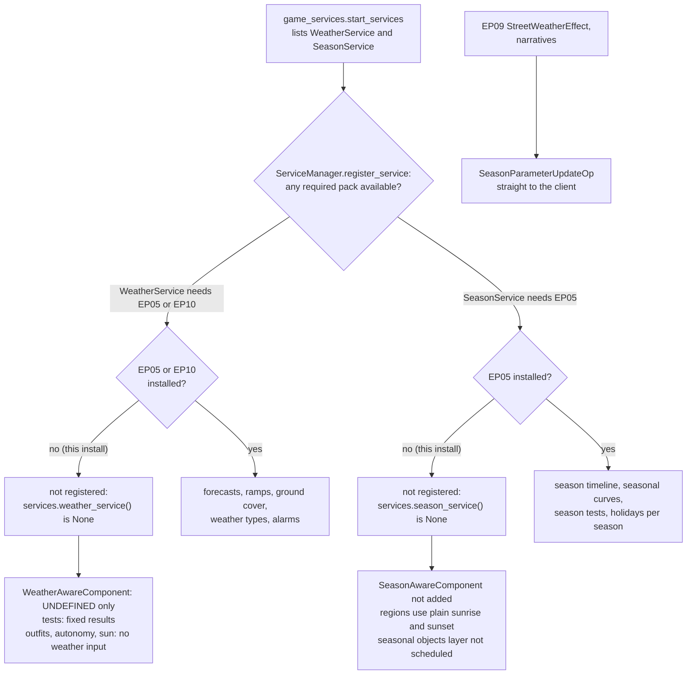
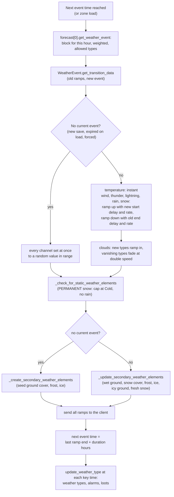

# 2.04 Weather, seasons and the ground

*Game version 1.128.90.1030 (Steam, Linux/Proton). Live numbers are the live tuning (the base delta build plus each installed pack's delta build), with EP04, EP06, EP09, EP12 (High School Years), GP04, GP12, SP01 and SP42 installed. Numbers marked "patch data, pack not installed" come from the `Delta/EP05` and `Delta/EP10` folders of EP05 (Seasons) and EP10 (Snowy Escape), which this install does not load. Written 2026-10-12. Checked 2026-10-12: 136 claims checked, 28 corrected, 1 relabelled, 1 removed. Deepened 2026-10-13: 0 modules newly explained, 1 failed decompile read. Checked again 2026-10-13: 196 claims checked, 22 corrected, 1 relabelled, 1 removed. Cross-chapter edits 2026-10-13: 4 applied.*

## In plain words

The game's scripts hold a complete weather and calendar system: a forecast for every day, rain and snow that soak or cover the ground and then dry or melt, ponds that freeze, frosted windows, lightning, rainbows, four seasons with their own holidays, and trees that change colour and drop leaves. All of it belongs to two expansion packs, Seasons and Snowy Escape. When neither is installed, as here, the game never starts the weather or the calendar. There is no rain, no snow, no temperature and no forecast. The sky stays at its default and every check that asks "is it raining?" gets a fixed answer.

A few weather-like things still happen without those packs. Puddles from showers, broken appliances, accidents, drinks and pets appear and dry up, and a puddle indoors takes five times as long to dry as one outdoors. The eco-footprint pack (EP09 (Eco Lifestyle)) tints a street's sky and air (green, industrial smog, acid rain) with no weather system behind it, and its wind turbines turn at a steady normal speed (or stop while broken) because no wind or lightning ever comes to speed them up.

Two things surprise most readers. First, much of the winter content (snow storms, freezing forecasts, how fast snow piles up and melts, Willow Creek's leaf and bloom curves) ships inside the base game's own patch data, because Snowy Escape needs winter even for players without Seasons. It is loaded here and never used. Second, Seasons' rain, warm weather and calendar are on disk too, as patch files for the missing pack, so their numbers can be read even though they never run.

With Seasons installed, each day draws one forecast from the world's list for the current season and the part of the season (early, middle or late). A forecast is a menu of weather by time of day, and each change of weather fades rain, cloud and wind in over about half an hour while the temperature changes at once. A season lasts one, two or four weeks, in the order summer, fall, winter, spring.

## Key facts

- **No pack, no weather.** `WeatherService` is registered only when EP05 (Seasons) or EP10 (Snowy Escape) is available and `SeasonService` only with EP05. Here `services.weather_service()` and `services.season_service()` return None, and every gameplay caller checks for None. Two console commands do not: `weather.request_forecast` raises an error if typed here, and `weather.start_weather_event` would too, but it is an Automation command, so outside automation mode its body never runs.
- **One weather type exists here: UNDEFINED.** The weather-aware component is tuned on 478 live records, and with no service it treats every place as UNDEFINED. Only the 9 live puddle records list UNDEFINED. Indoors their drying runs at 0.2 times the normal rate, outdoors at 1.0.
- **Tests give fixed answers.** A weather-type test passes only if its list holds UNDEFINED (none of the 125 live ones does) or if it is inverted (33 are). A weather test sees temperature Warm and every amount at 0. A season test fails unless `requires_seasons_pack` is off (42 of 357 live ones).
- **Puddles are base game and live.** 48 live `create_puddles` operations in 37 loot actions create puddles. Water puddles dry in 60 to 120 (small), 90 to 150 (medium) or 120 to 180 (large) Sim minutes outdoors and five times as long indoors. A drying puddle on natural ground never leaves weeds or a plant, because both definition lists are empty.
- **EP09 drives the sky directly.** Street civic-policy effects send ECO_FOOTPRINT 2 (green) or 3 (industrial) at once, ACID_RAIN 1.0 and the industrial smog skybox at 0.85 over 15 Sim minutes, through the same client message the weather system uses.
- **Wind turbines** (EP09) have three spin states, OFF 0, NORMAL 3 and FAST 8. They start at NORMAL and drop to OFF while broken. Only the Windy weather type or a lightning strike, neither of which occurs here, switches them to FAST.
- **Dormant base data.** The base delta holds 14 weather events (13 cold or snowy, plus the default partly cloudy one), 12 forecasts, all of the `weather.weather_service` and `weather.lightning_tuning` module tuning, and every region's winter snow rule. The 32 other events (rain, sun showers, sun, cloud, wind and heatwave, mostly Cool to Burning, plus one freezing partly cloudy event, a snow test event and a debug rain), 38 forecasts, 366 forecast lists and 140 seasonal forecast tables are EP05 patch data, pack not installed.
- **A weather change is a set of ramps.** Each channel waits 1 Sim minute, then ramps toward a random target in the new event's range at 0.033 per Sim minute (code defaults that almost no event changes), so 0 to 1 takes about 30 Sim minutes. Temperature switches at once.
- **One forecast per day,** drawn by weight from the street's or region's list for (season, early/mid/late). In normal play a snow-flagged forecast never follows a rain-flagged day, nor rain a snowy one. When an event ends, the forecast's time block for the current hour supplies the next event, which lasts its tuned 1 to 4 hours (default) after its ramps finish.
- **Ground cover rates (dormant base delta).** Snow settles at 0.016 times the snow amount per Sim minute, and only at Freezing. It melts at 0.03 (Burning) down to 0.0014 (Cool) per minute and not at all at Cold. Wet ground builds at 0.03 times the rain amount and dries at 0.01 (Cold) to 0.1 (Burning and Freezing) per minute. Water freezes at 0.000463 per minute, 36 Sim hours to full.
- **Seasons (patch data, pack not installed).** NORMAL is 7 days, LONG 14, VERY_LONG 28. The early and late parts last 2, 4 or 8 days. The order is summer, fall, winter, spring. Harvestfest falls on a Thursday in fall, Winterfest on a Wednesday and New Year's on a Saturday in winter, Love Day on a Friday in spring, and summer has none.
- **Rain keeps Sims indoors.** Autonomy scores outdoor objects at 1 minus the penalty: 0.9 in light rain, 0.15 in heavy rain, 0.01 in a storm. Loves Outdoors multiplies the penalty by 0.75.
- **Lightning** chooses the terrain, an object or a Sim with weights 90, 40 and 27. A terrain strike scorches the ground after 1 real second if it lands on the active lot, and leaves an object 70 percent of the time wherever it lands.
- **Commands.** Every other weather and season cheat is tied to EP05 or EP10 and is not registered here. The two with no pack are registered: `weather.request_forecast` (Live) calls the missing service and raises an AttributeError; `weather.start_weather_event` (Automation) does the same only in automation mode, and anywhere else the availability gate (`server_commands/__init__.py: is_command_available`) returns before its body runs.

## How it works

### Which services start: the pack gate

**Observed** (`sims4/service_manager.py: ServiceManager.register_service`, `sims4/common.py: is_available_pack`). A service is skipped unless one of its `required_packs` is available, and `is_available_pack` asks the native `_zone.is_available_pack` and subtracts any pack the player has unloaded. `WeatherService.required_packs` is `(EP05, EP10)` (read from the per-function rescue of `weather_service.py`) and `SeasonService.required_packs` is `(EP05,)`. Both are in the `game_services.py: start_services` list, so on an install with EP05 or EP10 they start when the first zone loads (`areaserver.py: c_api_zone_init`) and, like the other game services, stay up across travel.

**Observed** (`services/__init__.py: weather_service`, `season_service`). Both accessors return None when the service was not registered. Every caller found (`zone.py: Zone.update`, `time_service.py: TimeService.is_sun_out`, `zone_spin_up_service.py`, `zone_director.py`, `situations/base_situation.py`, `sims/outfits/outfit_tracker.py`, `objects/components/statistic_component.py`, `objects/components/buff_component.py`, `narrative/narrative_service.py`, `drama_scheduler/tutorial_drama_node.py`, `world/region.py`, `open_street_director/scheduling_open_street_director.py`, the gardening modules) checks for None first; so do the bytecode of `interaction.pyc` and `interaction_picker.pyc`, which failed to decompile. The only unguarded calls are in code that only the two services themselves run and in two console commands: `weather.start_weather_event` and `weather.request_forecast` call a method on None (the first only in automation mode, since `invoke_command` asks `server_commands/__init__.py: is_command_available` first and an Automation command is refused anywhere else), and `sims4/commands.py: invoke_command` writes "Error: ..." through `output`, whose body is empty in retail, and re-raises it, so nothing from Python reaches the console (see For modders and [1.04 Debug tools, cheats and telemetry](1.04-debug-cheats-telemetry.md)).

**Observed** (`objects/components/__init__.py: is_valid_pack`, `seasons/season_aware_component.py: SeasonAwareComponent.required_packs`). Components carry `required_packs` too. `SeasonAwareComponent` needs EP05, so the 92 live records that tune it (base delta 76, EP04 (Cats & Dogs) 8, GP04 (Vampires) 6, EP09 2; gardening plants and fishing spots) never get the component. `WeatherAwareComponent` keeps the base-game default and is added.

### What still happens with no weather service

**Observed** (`weather/weather_aware_component.py: WeatherAwareComponent._update_location`). The component keeps three maps from weather type to start and end loot: `inside_loot`, `outside_loot`, `anywhere_loot`. With no service the current weather types are the set `{UNDEFINED}`, so only map entries keyed UNDEFINED ever fire. Location is re-checked when the component is added, when the object moves, when loading finishes, on autonomy preroll, when build mode closes and on inventory moves, and an object reacts to inside versus outside only if its inside or outside map is non-empty. When the type set changes, end loots run anywhere first then the side map, and start loots run the side map first then anywhere.

**Observed** (live tuning count). 478 live records tune the component: base delta 402, EP04 delta 23, EP09 delta 21, EP06 (Get Famous) delta 13, GP04 delta 9, EP12 (High School Years) delta 8, GP12 (Werewolves) delta 1, SP01 (Luxury Party) delta 1. By class: 463 GameObject, 9 Puddle, 4 Sim, 1 Baby, 1 Fire. The most common keys are AnyRain outside (285), Rain_Light anywhere (168), Freezing (135), Burning (131) and Rain_Storm (85). Only the 9 puddles list UNDEFINED, so on this install the component does real work for puddles alone. `object_sim` lists the six temperatures, Rain_Light, Rain_Heavy, Rain_Storm, Snow_Heavy, Snow_Storm (no Snow_Light), AnyRain, AnySnow, Med and High_Snow_Accumulation, Thunder, Thundersnow, Windy, Sunny, Cloudy_Partial, Cloudy_Full, Icy and Frozen_Water, but no UNDEFINED. Its temperature loots are EP05 records (for example `loot_GlobalTemperature_Outside_Burning`, patch data, pack not installed); a few others are live (`loot_Infant_BadWeather_Outside`, the snow-on-ground, temperature-immunity and frozen-pond loots).

**Observed** (`weather/weather_tests.py: WeatherTest.__call__`, `WeatherTypeTest.__call__`; nesting checked in the bytecode). With no service:
- `WeatherTypeTest` passes when UNDEFINED is in its set and it is not inverted, or when UNDEFINED is absent and it is inverted. None of the 125 live weather-type tests lists UNDEFINED; 33 are inverted (for example "not Rain_Storm", 10 uses) and pass, and the other 92 fail.
- `WeatherTest` reads temperature as WARM, cloud state as PARTLY_CLOUDY (it passes when its whitelist is empty or holds PARTLY_CLOUDY, and PARTLY_CLOUDY is not blacklisted), and precipitation, lightning, icy, thunder, frozen water, wind and ground cover as 0. 176 live weather tests exist; 124 of them test temperature. Evaluated against these fixed values, 85 of the 176 pass here. Two branch tests (`exclusiveWeatherNoRainNoSnow`, `exclusiveWeatherRain`) hold a cloud-blacklist entry that the tuning decoder writes as blank (a childless element); if it is PARTLY_CLOUDY, 83 pass.
- `WeatherForecastOverrideTest` sees no override.

**Observed** (`seasons/season_tests.py: SeasonTest.__call__`). With no season service a season test fails when `requires_seasons_pack` is True (the default) and passes when it is False. 357 live season tests: 315 fail and 42 pass.

**Observed** (`objects/components/statistic_component.py: get_outside_object_score_modification`). The rain and snow penalty on outdoor objects in autonomy is skipped (multiplier 1.0). Weather outfits are skipped (`outfit_tracker.py`, `zone_director.py`, `base_situation.py: _get_weather_uniform`), and the temperature-option buff is never added (`buff_component.py`).

**Observed** (`time_service.py: TimeService.is_sun_out`, bytecode). The sun is out when the region provides sunlight and it is day time; with a weather service, shady weather (`COUNTS_AS_SHADE`, `Vampire_Safe_CloudLevel`) also returns False. Here only the region and the clock decide. Sunrise and sunset fall back to the region's fixed `sunrise_time` and `sunset_time` without a season service (`world/region.py`). Both belong to [2.05 The sky and the moon](2.05-sky-and-moon.md).

**Observed** (`civic_policies/street_civic_policy_effect.py: StreetWeatherEffect`). EP09's street effects send `SeasonParameterUpdateOp` messages straight to the client when a policy is enacted, repealed or loaded, with no weather service involved. Each names either a weather-effect channel (default ECO_FOOTPRINT) or a cloud type (default SKYBOX_INDUSTRIAL), a value (default 1.0) and a ramp time (default 15 Sim minutes). The 4 live records, all EP09 delta:

| Record | Channel | Enact | Repeal |
|---|---|---|---|
| `streetWeatherEffect_EcoFootprint_Green` | ECO_FOOTPRINT | 2, instant | 0 |
| `streetWeatherEffect_EcoFootprint_Industrial` | ECO_FOOTPRINT | 3, instant | 0 |
| `streetWeatherEffect_EcoFootprint_AcidRain` | ACID_RAIN | 1.0 over 15 Sim min | 0 |
| `streetWeatherEffect_EcoFootprint_Smog` | SKYBOX_INDUSTRIAL | 0.85 over 15 Sim min | 0 |

**Observed** (`narrative/narrative_service.py: NarrativeService._setup_environment_settings`). Narratives send their `narrative_environment_params` the same way, with or without the weather service; the forecast override part of a narrative needs both services. The eco footprint and narratives themselves are in [2.07 Neighbourhood systems: civic policies, eco footprint, narratives](2.07-neighbourhood-systems.md).

**Inferred**: SP01 adds no weather or season system. No weather, season or puddle class appears among SP01's live records, and SP01's only weather-aware record is one object (SP01 delta).

### Puddles and wet floors

**Observed** (`objects/puddles/puddle_loot_op.py: CreatePuddlesLootOp._apply_to_subject_and_target`). The `create_puddles` loot picks a size by weight from a factory (code defaults none 5, small 5, medium 0, large 0, liquid WATER); a trait-based factory replaces it when the subject has the trait. It places the puddle within `max_distance` (default 2.5 m) of the target, with per species, age and gender offsets for Sims. 48 live `create_puddles` operations in 37 loot actions use it: showers and tubs, a slob's workout, broken objects, spreading puddles, gardening, drinks, a stomp, bladder failure, toddler and infant changes and baths, an infant playing in a mess, the diving board, ghost drowning, the Grim Reaper's purgatory, a debug create-puddle interaction, potty accidents, EP04 pets (drool, pee, bath shake-off, drinking), EP06's denizen pond, EP12's janitor and GP12's werewolves.

**Observed** (`objects/puddles/__init__.py: create_puddle`, `PuddleChoices`). `PUDDLE_DEFINITIONS` (24 definitions in the base delta) is turned into a lookup by (liquid, size). `create_puddle` takes a random definition from that lookup and starts it invisible (opacity 0) until it is placed.

**Observed** (`objects/puddles/puddle.py: Puddle`). Placement searches outward from the front of the target (`place_puddle`, flags keep it in the same connectivity group, test build-buy on the active lot and routing elsewhere). Once placed, `start_evaporation` sets the evaporation commodity to a random `initial_value` and listens for it to reach 0 or less. At 0, a puddle in use restarts the countdown; otherwise a puddle on natural ground rolls nothing, weeds or plant by `evaporation_outcome` and then fades out. `WEED_DEFINITIONS` and `PLANT_DEFINITIONS` are empty in both builds, so the weeds and plant outcomes produce nothing. The `indoor_evaporation_time` and `outdoor_evaporation_time` fields are still tuned but the code no longer reads them.

**Observed** (`Puddle.try_grow_puddle`). A small or medium puddle may grow by `puddle_grow_chance` (base 1, times 0.5 or 0 on two terrain tags) into the next size, placed within 1 m; the old one is destroyed. Large never grows. The caller is the flowing-puddle component of leaking objects ([2.02 Objects: components, states and wear](2.02-objects-states-wear.md)): every `spawn_rate` Sim minutes it restarts the evaporation of its puddles within `max_distance`, stops once they reach `max_num_puddles` (medium counts 2, large 3), and otherwise grows one or places a new small one (code defaults 20 minutes, 2.5 m, 3, water). Live, 94 of the 97 users tune 60 minutes: 68 of them (showers, tubs, sinks and the like) also tune 3 puddles, the 16 toilets 3 puddles and 2 m, and 10 fridges only the 60 minutes; the water heater and two dew collectors keep every default (live merge, grouped by tuned fields).

**Observed** (live tuning). The 9 live puddle definitions all use `commodity_Object_Puddle_Evaporation` (decay 1 per Sim minute, range -100 to 1000) and carry weather-aware UNDEFINED start loots: inside `Loot_Object_Puddle_Indoor_BG` sets `puddle_Temperature_Values_Indoor_BG` (decay modifier 0.2 on the evaporation commodity), outside `loot_Object_Puddle_Outdoor_BG` sets `puddle_Temperature_Values_Outdoor_BG` (modifier 1, also the state's default). So drying time indoors is the outdoor time divided by 0.2:

| Puddle | Pack | Liquid, size | Countdown (outdoor) | Indoor | Mop stat start |
|---|---|---|---|---|---|
| `Puddle_Small` | base | water, small | 60 to 120 min | 300 to 600 min | -20 (default) |
| `Puddle_Medium` | base | water, medium | 90 to 150 min | 450 to 750 min | -50 |
| `Puddle_Large` | base | water, large | 120 to 180 min | 600 to 900 min | -80 |
| `puddle_Black_Small` | base | Dark Matter, small | 15 to 30 min | 75 to 150 min | -50 |
| `puddle_Small/Medium/Large_GreenGoo` | base | GreenGoo | 30 to 60 min | 150 to 300 min | default |
| `Puddle_Small_Vomit` | EP04 | Vomit, small | 30 to 60 min | 150 to 300 min | default |
| `puddle_EcoFootprint_AcidPuddle` | EP09 | Acid, large | 30 to 60 min | 150 to 300 min | default |

The mop stat (`statistic_Object_Puddle-Water`, min -100) is what mopping works on.

**Observed** (live tuning, ids named against the EP05 patch data). All 9 puddles key both maps on UNDEFINED, Freezing, Hot, Warm, Heatwave, Rain_Light, Rain_Heavy and Rain_Storm. Inside, every key also runs `Loot_Object_Puddle_Temperature_Undefined`; outside, the temperature keys run `Loot_Object_Puddle_Temperature_Freezing`, `_Hot`, `_Warm` and `_Burning` (for Heatwave) and the rain keys `Weather_RainedOn` or `Weather_NotRainedOn`, each beside the live Indoor or Outdoor BG loot. Those EP05 loots are patch data, pack not installed, so here only the BG loots act. **Inferred**: the 0.2 indoor rate is the stand-in for the temperature-driven drying that the EP05 loots apply when the weather service runs.

**Observed** (`weather_service.py: WeatherService._create_puddle`, dormant). With the weather service running, rain also spawns puddles at random outdoor spots on the active lot. The service first makes a puddle from `PUDDLES.natural_terrain_definitions` and looks for a spot; a puddle that lands on sand is destroyed at once, and one on unnatural ground is swapped for a definition from `unnatural_terrain_definitions`. Each list is a set of (tests, definitions) entries filtered by a global resolver (`_find_puddle_options`); the live tuning keeps one natural list for ordinary streets and another for streets in the industrial eco-footprint state. The live metrics are listed under lightning and spawns below.

### Wind

**Observed** (`objects/wind/wind_tuning.py: WindSpeedEffect`, `objects/components/state.py`, `objects/client_object_mixin.py: wind_speed_level`). Wind on an object is a client state change: a state value can set `wind_speed` with `spin_speed` OFF 0.0, NORMAL 3.0 or FAST 8.0 and a `transition_speed` (default 1.0), sent as `SetWindSpeedEffect`. It is cosmetic; the script never reads it back.

**Observed** (live tuning, EP09). The wind turbines `utilities_Power_Production_WindTurbine_Ground` and `_Roof` use the state `windTurbine_PowerProduction_States` (235340, base delta) with the values `windTurbine_PowerProduction_Off` (spin left at the OFF default, transition 2), `windTurbine_PowerProduction_Default` (NORMAL, transition 5) and `windTurbine_PowerProduction_High` (FAST, transition 5). The turbine's state component starts at `_Default` (EP09 delta). Their weather-aware map has one key, Windy anywhere: start loot `loot_WindTurbine_SetWindy` sets `windTurbine_Weather_Windy` and, if the turbine is not broken, `_High`; end loot `loot_WindTurbine_SetNotWindy` sets `windTurbine_Weather_NotWindy` and, if not broken, `_Default`. The turbine's state triggers do the rest: broken sets `_Off`, unbroken with NotWindy sets `_Default`, unbroken with Windy sets `_High`, and `windTurbine_StruckByLightning_Struck` on an unbroken turbine sets `_High`. Here neither Windy nor lightning happens, so a turbine runs at NORMAL and stops only while broken. Lightning on a turbine plays `ep05_lightning` on its rotor slot. Power output is in [2.07 Neighbourhood systems: civic policies, eco footprint, narratives](2.07-neighbourhood-systems.md).

**Observed** (`weather/weather_enums.py: WeatherEffectType.WIND`, `weather_event.py`). The weather system's own wind is a separate channel (1006) that each event ramps like rain. It is sent to the client and feeds the Windy weather type: the exclusive-test branch `exclusiveWeatherNoRainNoSnowClearNotBurning` (live base delta; by its name, the branch for a clear, dry sky that is not Burning) gives Windy when wind is at least 0.2 and Sunny otherwise. **Inferred**: the client uses the channel to sway trees and effects.

### The weather model: channels and ramps (dormant here)

Everything from here to the seasons runs only when EP05 or EP10 is installed. The base-delta numbers are loaded on this install but never read.

**Observed** (`weather/weather_ops.py: WeatherEventOp.populate_op`, `weather_service.py: WeatherService._send_weather_event_op`). The weather is a set of channels, each stored as a `WeatherElementTuple(start_value, start_time, end_value, end_time)`: a straight ramp in absolute game time. The server sends every channel's ramp in one `SEASON_WEATHER_INTERPOLATIONS` message and the client interpolates between the two points. A channel resting at 0 is sent once and then dropped from the stored set. The channel ids are `PrecipitationType` RAIN 1000 and SNOW 1001, `GroundCoverType` RAIN_ACCUMULATION 1002 and SNOW_ACCUMULATION 1003, `WeatherEffectType` 1004 to 1016 (WINDOW_FROST, WATER_FROZEN, WIND, TEMPERATURE, THUNDER, LIGHTNING, SNOW_FRESHNESS, STRANGERVILLE_ACT, ECO_FOOTPRINT, ACID_RAIN, STARWARS_RESISTANCE, STARWARS_FIRST_ORDER, SNOW_ICINESS) and `CloudType` 2000 to 2010 (PARTLY_CLOUDY, CLEAR, LIGHT_RAINCLOUDS, DARK_RAINCLOUDS, LIGHT_SNOWCLOUDS, DARK_SNOWCLOUDS, CLOUDY, HEATWAVE, STRANGE, VERY_STRANGE, SKYBOX_INDUSTRIAL). The client message's own enum names (RAINFALL, SNOW_ACCUMULATION, SKYBOX_DARKRAINCLOUDS and so on) are readable in the native strings.

**Observed** (`weather_service.py: WeatherService._get_element_interpolation`). A ramp from a start value to a target at a rate lasts `|start - target| / rate` Sim minutes; rate 0 holds the value.

**Observed** (`weather_service.py: WeatherService.update`, `zone.py: Zone.update`). The zone calls `update` every tick while the service exists. It sends pending weather-aware messages (sliced to 0.1 real seconds), moves the forecast list on at each new day and tops it up to one day, starts the next event when its time has passed, and re-evaluates the weather types when the next key time passes. Nothing polls in between.

**Observed** (`weather_service.py: get_street_or_region_id_with_weather_tuning`, a module-level function; bytecode). Weather state is kept per place. The place is the current street if its `weather` mapping is non-empty, otherwise the region. Each place stores its forecasts, current event, last ramps, next event time and forecast override (`RegionWeatherInfo`), and all of it is saved per place (`PersistableWeatherService.region_weathers`). On load, if any saved forecast fails to resolve, the whole saved forecast list for that place is dropped.

### Forecasts: one per day

**Observed** (`weather_service.py: WeatherService.get_forecast`, `populate_forecasts`; `weather_tuning_mixin.py: WeatherTuningMixin`).
- With a season service: the forecast list comes from a forecast override if one is set (itself a seasonal-forecasts snippet), else from the place's `weather[season][segment]` (a seasonal-forecasts snippet keyed EARLY, MID, LATE, each pointing at a forecast list). A season missing from `weather` gives no list.
- Without a season service (EP10 alone): the list is the place's `weather_no_seasons`, and each call adds only one day.
- The pick is a weighted draw among forecasts whose `prescribed_weather_type` is allowed. If every allowed forecast has weight 0, a uniform pick among them. If no forecast in the list is allowed, the uniform pick runs on an empty list and raises an IndexError (`sims4.random.random.choice`), so the fallback is never reached. Only when there is no list at all does the game use `FALLBACK_FORECAST` (live base delta: `forecast_Default`, a single time block keyed at hour 1 that covers the whole day by wrapping, holding `weather_PartlyCloudy_Warm_Default` for exactly 24 hours).
- Rain and snow do not follow each other: when the list is topped up, the new days are `snow_safe` only if the last existing forecast is not rainy (rain or storm flag), and `rain_safe` only if it is not snowy (snow or blizzard flag). With no forecast left, a stored rain or wet-ground ramp blocks snow and a stored snow or snow-cover ramp blocks rain; with no current event both are allowed. The flags are computed once per call, so the rule holds for the one day the game adds at a time, and not between the days of a multi-day `weather.request_forecast N`.

**Observed** (`weather_forecast.py: is_prescribed_weather_supported`, bytecode). A forecast or event flagged rain needs rain safe and rain not disabled; storm needs rain safe and rain not set to "no storms"; snow and blizzard the same with snow; `thunder_snow_storms` needs snow safe and the thundersnow option on. The player options are per precipitation type: enabled, disable storms, or disabled (`WeatherOption` 0, 1, 2).

**Observed** (`weather_forecast.py: WeatherForecast.get_weather_event`). A forecast's `weather_event_time_blocks` maps a start hour to a weighted list of events, each with a `duration` (default 1 to 4 hours). When an event is needed, the block in force is the last one whose hour is at or before the current hour, wrapping to the day's last block before the first. Events whose prescribed type is disallowed are removed; if that empties the block, all its events come back (the `logger.error` call there writes nothing in the retail build, see [0.02](0.02-architecture.md)). A forecast is therefore a menu by time of day, drawn each time an event ends, not a fixed timetable.

**Observed** (live base delta, dormant). The 12 live forecasts are 11 cold ones and the warm fallback: `forecast_Snow_Freezing` (snow flag; the blocks at hours 0, 6 and 12 offer `weather_Cloudy_Freezing` 2 to 3 h, `weather_Snow_Light_Freezing` 3 to 4 h and `weather_Snow_Heavy_Freezing` 3 to 4 h with weights that change by block, and the 18:00 block offers light snow 1 to 4 h or heavy snow 4 to 6 h at weight 3), `forecast_Snow_Blizzard_Freezing`, `forecast_ChanceOfSnow_*` (3), `forecast_Cloudy_Cold`, `forecast_PartlyCloudy_Cold`, `forecast_Sunny_Cold`, `forecast_Windy_Cold`, `forecast_Freezing_Winter`, `forecast_Thundersnow` and `forecast_Default`. The 14 live events are the matching cold, freezing, snow, thundersnow and sun-snow events plus `weather_PartlyCloudy_Warm_Default`. No rain event is live. `forecast_Thundersnow` has no `prescribed_weather_type`, so the options never remove it as a whole. `weather_Snow_Storm` and `weather_Snow_Thundersnow` are flagged snow and storm, and storm is the rain flag: the rain option "no storms" removes them, while the snow option "no storms" only removes blizzard-flagged forecasts.

**Observed** (live regions). All 16 live regions tune `snow_behavior` WINTER = ACCUMULATE, and every residential one (Willow Creek, Oasis Springs, Newcrest, and the EP04, EP06, EP09, EP12, GP04 and GP12 worlds) a `weather` table per season that points at seasonal forecast snippets which are not live (EP05 patch data). None tunes `weather_no_seasons` or `snow_behavior_no_seasons`, and none of the 30 live streets tunes weather at all.

### A weather event: from old to new

**Observed** (`weather/weather_event.py: WeatherEvent.get_transition_data`; nesting checked in the bytecode). An event tunes `precipitation` (with `precipitation_type` RAIN or SNOW), `cloud_states` (a map from cloud type to a ramp), `wind`, `thunder`, `lightning`, a `temperature` word (default WARM) and a `prescribed_weather_type`. Each element has `start_delay` and `end_delay` (default 1 Sim minute), `start_rate` and `end_rate` (default 3.3, read as 0.033 per Sim minute), and a `range` (default 0.40 to 0.60; clouds 1.0 to 1.0). The steps:
- **No current event:** every channel is set at once to a random value in its range. This happens on a new save, when the saved event has already run out by the time the zone loads, and after `WeatherService.force_start_weather_event`, which zeroes every ramp and drops the current event first; its only caller is the tutorial drama node. The `weather.start_weather_event` command (Automation) and the `weather_start_event` loot call `start_weather_event` instead, which ramps from the current event like any other change. A save loaded mid-event keeps its saved ramps.
- **Temperature:** always switches at once.
- **Wind, thunder, lightning, then rain and snow:** a rising channel uses the new event's start delay and rate, a falling one the old event's end delay and rate. If both values are 0 nothing is sent. Rate 0 keeps the old value, or uses a 30 Sim minute fallback (`FALLBACK_TRANSITION_TIME`).
- **Icy ground:** kept while active.
- **Clouds:** new cloud types, or any element that ramped with the new delay, use the new start delay and rate; otherwise the old end delay and rate. When old cloud types disappear, durations are halved and the vanishing clouds fade from the end of the latest new cloud ramp at double speed.
- **Next event:** due at the end of the latest ramp plus the duration drawn from the forecast block. A duration of None or 0 means the event never ends on its own.

**Observed** (EP05 and live data). Among the 14 live events and the 32 EP05 patch events, only two tune delays or rates at all, both EP05 patch data, pack not installed. `weather_Rain_Storm_Warm_monsoonEP07` tunes them on every channel: dark clouds start after 3 Sim minutes at 0.05 and end after 2 at 0.04, rain starts after 2 at 0.04 and ends after 2 at 0.03, wind starts after 2 at 0.05 and ends after 3 at 0.03, light clouds start at 0.06 and end after 3 at 0.03, and lightning and thunder start after 4 and 5 minutes and end at 0.04. `weather_debug_fastrain` uses delay 0 and rate 1.0 (rain 0.75, Hot). Every other event uses the code defaults, so a channel going from 0 to 0.9 takes 1 + 27 Sim minutes.

**Observed** (EP05 patch data, pack not installed). Event ranges, written as fractions:

| Event family | Rain or snow | Clouds | Lightning | Wind | Temperatures |
|---|---|---|---|---|---|
| `weather_Rain_Light_*` | rain 0.02 to 0.03 | light rain clouds 0.75 to 0.80 | none | none | Cold, Cool, Warm |
| `weather_Rain_Heavy_*` | rain 0.20 to 0.40 | dark 0.45 to 0.50, light 0.70 to 0.75 | disabled | none | Cold, Cool, Warm |
| `weather_Rain_Storm_*` | rain 0.80 to 1.00 (storm flag) | dark 1.0 (default), light 0.80 to 0.90 | 0.60 to 0.70, thunder | 0.80 to 1.00 | Cold, Cool, Warm |
| `weather_SunShower_*` | rain 0.02 to 0.03 | clear | none | none | Cool, Warm, Hot |
| `weather_Windy_*` | none | clear | none | 0.60 to 1.00 | Cool, Warm, Hot, Burning |
| `Weather_Heatwave` | none | heatwave | none | none | Burning |
| `weather_Cloudy_DryLightning` | none | cloudy | default, thunder | none | Warm |

The live base-delta snow events follow the same pattern: `weather_Snow_Light_Freezing` snow 0.05 to 0.10, `weather_Snow_Heavy_Freezing` 0.50 to 0.60, `weather_Snow_Storm` 0.80 to 1.00 with wind 0.80 to 1.00, `weather_Snow_Thundersnow` 0.50 to 0.60 with default lightning, thunder and wind, and the sun-snow events 0.05 to 0.10 under partly cloudy skies.

### The ground: wet ground, snow, frost and ice

**Observed** (`weather_service.py: WeatherService._update_secondary_weather_elements`, `_add_secondary_element_decay`, `_add_precipitation_accumulation`, `_add_snow_accumulation_decay`). After each event the service derives the slow channels from the fast ones. A rate tuned per temperature (`TunableTemperatureTuple`, six `Tunable100ConvertRange` fields, so tuned numbers are divided by 100) means "decay toward 0" when positive, "build toward 1" when negative, and "hold" at 0. In order:
1. **Frozen water** (`WATER_THAW_RATE`), then **window frost** (`FROST_WINDOW_MELT_RATE`), by the new temperature.
2. **Wet ground**: while it rains, builds at `WATER_ACCUMULATION_RATE` (0.03, code default) times the rain amount; otherwise dries at `WATER_EVAPORATION_RATE` for the temperature. Rain melts any snow cover by the time the rain starts.
3. **Snow cover**: builds only at Freezing and where the place's snow behaviour is not NO_SNOW, at `SNOW_ACCUMULATION_RATE` (0.016 live) times the snow amount. Otherwise it decays at `SNOW_MELT_RATE`. At Freezing with no snow falling it creeps up to `FROST_GROUND_ACCUMULATION_MAX` (0.1), which is what ground frost is. Leaving Freezing flips a full cover from 1 to -1 and ramps it back to 0; the sign marks melting and tests use the size. Falling snow clears wet ground.
4. **Icy ground** (EP10): starts `start_in` 30 Sim minutes after snow ends, reaches full in `time_to_icy` 3 minutes, holds `duration` 4320 minutes (3 Sim days) and fades over `time_to_icy_decay` 10 minutes (code). The update starts it only when the new event's snow ramp ends at 0 (snow is stopping), the icy option is on, the temperature is whitelisted (Freezing or Cold) and the region has `is_summit_weather_enabled` (default False; no live region sets it, EP10's `region_Residential_MountainWorld` does in patch data). The cheat `weather.start_icy_conditions` checks for snow on the ground instead.
5. **Fresh snow**: changes at snow amount times `SNOW_FRESHNESS_ACCUMULATION_RATE` (0.2) minus `SNOW_FRESHNESS_DECAY_RATE` (0.02) per minute, where the region's `weather_supports_fresh_snow` (default True; the EP04 and EP06 worlds turn it off) allows it. It fills during any snow above 0.1 and fades over 50 Sim minutes once snow stops.

**Observed** (live base delta and code defaults). Per Sim minute, positive = melts or dries, negative = builds:

| Channel | Burning | Hot | Warm | Cool | Cold | Freezing | Source |
|---|---|---|---|---|---|---|---|
| Snow cover (`SNOW_MELT_RATE`) | 0.03 | 0.0167 | 0.0028 | 0.0014 | 0 | -0.00016 (frost) | delta |
| Frozen water (`WATER_THAW_RATE`) | 0.03 | 0.0167 | 0.0028 | 0.0014 | 0 | -0.000463 | delta |
| Window frost (`FROST_WINDOW_MELT_RATE`) | 0.1 | 0.09 | 0.05 | 0.03 | 0.01 | -0.001 | code |
| Wet ground (`WATER_EVAPORATION_RATE`) | 0.1 | 0.09 | 0.05 | 0.03 | 0.01 | 0.1 | Freezing delta, rest code |

Examples: a full snow cover clears in 357 Sim minutes at Warm and 714 at Cool, and stays forever at Cold. Water passes the 0.002 that counts as Frozen_Water about 4.3 Sim minutes into Freezing and is fully frozen after 2,160. A storm (snow 0.8 to 1.0) covers the ground in 62 to 78 minutes; light snow takes 625 to 1,250.

**Observed** (`WeatherService._create_secondary_weather_elements`, bytecode; `_fake_snow_accumulation_for_snow`). With no current event the service seeds the slow channels instead of ramping them. If the event has rain, wet ground is set to full and nothing else is seeded. At Freezing where the place can snow, frozen water and window frost start full; where it cannot (NO_SNOW), they start at a random value and build. At Freezing with snow allowed, falling snow fakes an accumulation, in this order: snow heavy enough to make fresh snow (above 0.1, where fresh snow is allowed) sets cover and freshness full; PERMANENT sets cover full; with no season service the cover is left alone; past the early segment of a season the cover is full; early in a season it starts at a random value (on a first visit in this season), at 0.1 plus up to 0.45 (when the saved cover is empty) or at 1.0, and then builds. With no snow falling, PERMANENT places start full; with no season service the cover starts at the 0.1 ground-frost floor; otherwise it depends on the saved cover and on whether a forecast drawn for the current part of the season is snowy, and never starts below that floor. At Cold, PERMANENT places pin snow cover, frozen water and window frost at 1, and an ACCUMULATE place with a season service turns a saved cover from the same season (above 0, or at -1) into a full cover.

**Observed** (`weather_service.py: get_snow_behavior`, a module-level function; `WeatherService._check_for_static_weather_elements`). `SnowBehavior` is NO_SNOW 0, ACCUMULATE 1 or PERMANENT 2, per season (default NO_SNOW), with `snow_behavior_no_seasons` used when there is no season service. PERMANENT caps the temperature at Cold and deletes rain. In EP10's patch data, pack not installed, the summit streets (`streets_EP10_Summit_BaseCamp1` to `3`, `_MountainSide`) are PERMANENT in all four seasons and in `snow_behavior_no_seasons`, and each tunes its own `weather_no_seasons` list. They also fill `weather` for all four seasons, which is what makes the service use the street rather than the region.

**Inferred** (EP10 patch data). The town streets of EP10's world tune no weather, and its region tunes no `weather_no_seasons`, so with EP10 alone those streets would fall back to `forecast_Default`.

### Weather types: what objects and Sims react to

**Observed** (`weather/weather_enums.py: WeatherType`). Weather types are a locked dynamic enum. Code entries: the six temperatures (Freezing -3 to Burning 2), UNDEFINED 10, AnySnow 11, AnyRain 12, Max_Snow_Accumulation 13, Max_Rain_Accumulation 14, AnyLightning 15, StruckByLightning 16. The base delta adds 27 more (64 to 90): Rain_Light, Rain_Heavy, Rain_Storm, Snow_Light, Snow_Heavy, Snow_Storm, Cloudy_Partial, Cloudy_Full, Windy, Sun_Shower, Sunny, Heatwave, Thunder, Min/Med/High_Snow_Accumulation, Vampire_Safe_CloudLevel, Clear_Skies, Thundersnow, Sunsnow, Dry_Lightning, Windy_Hot, Cloudy_Warm, StrangeWeather, Sunbathing_Weather, Icy, Frozen_Water.

**Observed** (`WeatherService.update_weather_type`, `_update_keytimes`, `_populate_weather_type_thresholds`). The current set is: the result of `WEATHER_TYPE_EXCLUSIVE_TEST` (one branching snippet, `exclusiveWeather`, that splits on precipitation into `exclusiveWeatherRain` and `exclusiveWeatherNoRain` and ends in exactly one weather word; 15 live branch records), every key of `WEATHER_TYPE_MULTIPLE_TEST` whose test passes (Icy comes only from here), the temperature, AnyRain and Max_Rain_Accumulation, AnySnow and Max_Snow_Accumulation, and AnyLightning. The same pass starts or stops the spawner alarms below and calls `stop_icy_conditions` once icy ground is full (with the `duration` delay) or at once if the temperature leaves the whitelist or snow returns. The service compares it with the previous set and sends start or end loots to the registered objects. Key times are the starts and ends of all ramps plus the moments a ground-cover ramp crosses a threshold used by `WEATHER_TYPE_MULTIPLE_TEST`, so re-tests happen exactly when something can change.

**Observed** (live base delta, `WEATHER_TYPE_MULTIPLE_TEST`). Snow levels by cover value, each with its melting (negative) twin: Min_Snow_Accumulation -0.1 to 0.1 (zero counts), Med 0.1 to 0.5 and -0.5 to -0.1, High 0.5 to 1 and -1 to -0.5; Max_Snow_Accumulation is set in code when the cover is at full size. Frozen_Water is water frozen 0.002 or more: the test field is a `Tunable100ConvertRange`, so the tuned 0.2 is a percent. Vampire_Safe_CloudLevel uses a cloud threshold of 0.3 (tuned 30). Clear_Skies, Icy, Sunbathing_Weather and Thunder are keyed there too.

**Observed** (`WeatherService._on_ending_weather_types`, live `WEATHER_ENDING_EVENT`). When AnyRain ends, `spawn_rainbow` fires with chance 100 (code default 10). `weather/rainbow.py: SpawnRainbow` picks a random `Func_Spawner` object, tests it, and places rainbow definition 196504 within `spawn_max_radius` (default 3 m) of it, off the lot; with no spawner, or no spot, there is no rainbow.

### Lightning, rain puddles and snow drifts

**Observed** (`WeatherService._create_tuning_based_alarm`, `_test_weather_object_creation`). Puddles, snow drifts and active lightning each run an alarm. The alarm picks the metric whose `value_range` holds the current amount, waits a random interval in its range and rolls its chance; puddles and drifts also need fewer than `max` objects with the tag, counted among the weather-aware objects the service holds for `WeatherType.Hot` (a set every temperature registration shares, so only objects that react to a temperature count). Code defaults for all three: `max` 10, interval 10 to 20 Sim minutes, chance 10 percent. Live base delta values:

| Spawner | Amount (rain, snow, lightning) | Chance | Every (Sim min) | Max |
|---|---|---|---|---|
| Rain puddles (needs AnyRain and full wet ground) | 0.02 to 0.19 / 0.20 to 0.40 / 0.41 to 1.00 | 10 / 60 / 85 % | 90 to 180 / 45 to 90 / 30 to 60 | 8 |
| Snow drifts (needs AnySnow and full cover) | to 0.30 / 0.30 to 0.50 / 0.50 to 0.80 / 0.80 up | 20 / 30 / 60 / 80 % | 30 to 45 / 15 to 30 / 10 to 20 / 10 to 20 | 8 |
| Active lightning | 0.59 up | 30 % | 10 to 12 | none |

**Observed** (`weather/lightning.py: LightningStrike.perform_active_lightning_strike`, live `weather.lightning_tuning`). A strike chooses terrain, an object or a Sim with weights 90, 40 and 27 (code defaults 1 each).
- **Terrain:** a random point inside the disc out to the farthest spawn point, with 20 tries to find an outdoor point. On the active lot it plays `ep05_lightning` and adds a scorch mark after 1 real second; off the lot it plays `ep05_lightning_offlot`. Every terrain strike runs `broadcaster_LightningStrike`, and with chance 70 (code 10) a weather-service alarm places one of 9 object definitions (weights 20 to 30) near the strike 1 real second later (`LightningStrike.strike_terrain`, `create_collectible_from_lightning_strike`).
- **Object:** outdoor objects tagged `Func_Lightning_CanStrike` or `Func_WindTurbine_UpgradedLightningRod`, weighted by their weather-aware `lightning_strike_multiplier`, run `loot_Lightning_Object`; an object on the active lot also gets a scorch mark after the same delay. No live record and no EP05 or EP10 patch record tunes the multiplier, so every object has the same weight. With no object it strikes the terrain.
- **Sim:** pushes `weather_Outside_Interaction_Lightning_Chooser` (critical priority, first in queue) on a Sim outdoors; if there is none, or the push fails, it strikes an object instead.

The cheats `weather.lightning_strike_*` call the same code (EP05 or EP10 only).

### Sims and the weather

**Observed** (`WeatherService._get_precipitation_autonomy_multiplier`, base-game delta `OUTDOOR_AUTONOMY_*`). For autonomy, an outdoor object's score is multiplied by `1 - penalty x reduction`, where the penalty is chosen by the rain amount for rain and by the snow amount for snow, and the reductions multiply for each listed trait the Sim has. An amount in no listed range (between two ranges) gives 1.0. Rain is checked first; snow only when rain gives 1.0.

| Amount | Rain penalty | Snow penalty |
|---|---|---|
| up to 0.01 (rain), up to 0.04 (snow) | 0 | 0 |
| 0.02 to 0.19 (rain), 0.05 to 0.10 (snow) | 0.1 | 0.1 |
| 0.20 to 0.40 (rain), 0.11 to 0.60 (snow) | 0.85 | 0.25 |
| 0.41 up (rain), 0.61 up (snow) | 0.99 | 0.75 |

Reductions: `trait_LovesOutdoors` 0.75 for both; `trait_Hidden_Weather_Rain_Love` 0.5 and `trait_Waterproof` 0 for rain, `trait_Hidden_Weather_Snow_Love` 0.5 for snow (those three are EP05, patch data, pack not installed); for snow, large dogs 0 and small dogs 0.5 (EP04, live). A Sim who loves the outdoors in a storm scores outdoor objects at 1 - 0.99 x 0.75 = 0.26. Autonomy scoring is in [3.04 Autonomy](3.04-autonomy.md).

**Observed** (`WeatherService.get_weather_outfit_change`, live `WEATHER_OUTFIT_TESTS`). Sims change into the COLDWEATHER outfit category when the temperature is Cold or Freezing and into HOTWEATHER when it is Hot or Burning (ages toddler to elder, not when they wear a situation or career outfit, not with `buff_Temperature_Immune_To_Temperature`, `buff_Temperature_ForceComfortable` or four other listed buffs, plus a fifth for hot weather (`buff_LotMods_BaseGame_ClothingOptional_GetNude_Hidden`), and for hot weather not while swimming). After a shower, hot tub, pool or hot springs a second, looser test set applies. A Sim already in the right category or in special fashion keeps the outfit. 20 outfit-change reasons are ignored (swimwear, bathing, sleep, formal, work, hot tub, ocean and others).

**Observed** (`WeatherService.apply_weather_option_buffs`, `buff_component.py`). With the "temperature effects" option off, every Sim gets `buff_Temperature_ForceComfortable`, whose loot `loot_Temperature_Immune_To_Temperature_Set` applies `buff_Temperature_Immune_To_Temperature`. That buff puts a floor and a ceiling on `statistic_sim_EffectiveTemperature` and sets the decay of `commodity_sim_BodyTemperature` to 0. **Inferred**: the warming, cooling, overheating and freezing of Sims is EP05 content run by those statistics and `object_sim`'s temperature loots; it is in [3.13 Sickness, luck, fame and other Sim states](3.13-health-luck-fame.md).

### The rest of the service: loading, reading, the client (dormant here)

**Observed** (`weather/weather_service.pyc`, which has no decompiled source: per-function decompile, with `on_zone_load` and `_validate_event_end_time_for_snow` checked in the bytecode). The parts of `WeatherService` the sections above do not cover; all of it runs only with EP05 or EP10.

- **Zone load.** The service re-reads its place (street or region, as above) and clears the weather types. A saved event whose next-event time is unset or already past is dropped. Then one forecast is removed for each whole day that passed since the list's first day, while any are left. With no event it draws a new one from the first forecast (`_send_new_weather_event`); with one it re-sends the saved client message and rebuilds its ramps from that message, so a save loaded mid-event resumes the same curves. The weather types are then re-tested. **Zone unload** clears the types, the registered objects, the queued loot messages and key times, and cancels the puddle and snow drift alarms and any pending lightning collectible.
- **Build mode** (`edit_mode_setup`). In a place with PERMANENT snow, snow cover, frozen water and window frost are pinned at 1.0 and sent, so the lot looks snowed in while you build.
- **Reading a channel** (`get_weather_element_value`). Linear interpolation in game ticks between the ramp's start and end; before the start it returns the start value, after the end the end value, and for a channel with no ramp the caller's default. Every weather test and the autonomy penalty read channels this way.
- **Snowfall stretches the event.** `_validate_event_end_time_for_snow` (bytecode), called by the update step and, in the create step, through `_fake_snow_accumulation_for_snow`, moves a non-zero next-event time out to the end of the snow-cover ramp when that ramp ends later, so a new event never starts while snow is still building.
- **Options.** The temperature-effects, icy-conditions and thundersnow switches and the rain and snow `WeatherOption` values are stored in the save's options block. Changing the rain or snow option, icy conditions or thundersnow calls `reset_forecasts`, whose `all_regions` defaults to True (bytecode): every place's saved weather (forecasts and next-event time) is cleared and a new event is drawn at once. The season service, the season cheats and the tutorial drama node call it the same way. Only the `weather_set_override_forecast` loot passes `all_regions=False`, which clears the current place's forecasts alone.
- **Forecast overrides** last only for the season they were set in. Each time forecasts are topped up (`populate_forecasts` calls `_validate_override_forecasts`), an override from another season is dropped, unless it is marked `cross_season_override`, which re-stamps it to the new season.
- **Weather-aware objects** register under each weather type they care about. When the type set changes, the service queues start and end loots per object and hands them out in 0.1 real-second slices; an object that re-checks its location before its slice comes (`WeatherAwareComponent._update_location`) takes its pending end loots, then its start loots, at once.
- **The client.** `WeatherUpdateOp` carries the current weather types. When the first forecast has a `weather_ui_override`, every current type whose UI group (`WEATHER_TYPE_UI_INFO.weather_group_type`) is overridden is replaced by the override's type. `WeatherForecastOp` carries the forecast list.
- **Shade.** `is_shady` is True when any current type is in `COUNTS_AS_SHADE` (`Vampire_Safe_CloudLevel`); `time_service.py` uses it to decide whether the sun is out ([2.05](2.05-sky-and-moon.md)).
- **Lightning loot.** At most one lightning collectible is pending: while its alarm waits, a second terrain strike that wins the roll places nothing.
- **Where puddles and drifts land** (`_find_good_weather_object_location`, used by both spawners). A random point of the active lot, then a placement search that stays outdoors and on the lot, with random weighting.
- **The exclusive test tree.** A branch runs its test and follows the true or false result; a missing result gives UNDEFINED, which is also what the empty install sees ([What still happens with no weather service](#what-still-happens-with-no-weather-service)).
- **Save errors** use code 406, `SERVICE_SAVE_FAILED_WEATHER_SERVICE` (`persistence_error_types.py`). Three tuning checks cover four mistakes (a type in both the UI map and the multiple-test map, an exclusive-test result missing from the UI map, a puddle definition that is not a puddle, an outfit-change reason listed twice). All three are passed as `verify_tunable_callback` (class-body bytecode), a hook the retail load never runs ([0.03](0.03-tuning-system.md#callbacks-and-verify-checks-that-only-run-on-hot-load)), and their only action is `logger.error`, which is empty in retail, so bad tuning loads silently.

### Seasons (patch data, pack not installed)

**Observed** (`seasons/season_service.py: SeasonService`, `seasons/seasons_tuning.py: SeasonsTuning`, `seasons/season.py: Season`). The season service runs its own timeline and simulates it each update (time slices of up to `MAX_TIME_SLICE_MILLISECONDS` 50 ms).
- **Order:** `SeasonType` SUMMER 0, FALL 1, WINTER 2, SPRING 3; the next season is value + 1 modulo 4.
- **First season:** `STARTING_SEASON.default_season` (code FALL). If the length option is NORMAL and the current time is past `alternate_season.threshold` (code: Wednesday) it uses `alternate_season` (SUMMER). A new season always starts at the start of a week.
- **Length:** `SEASON_LENGTH_OPTIONS` NORMAL 7 days (code default), LONG 14, VERY_LONG 28 (live base delta).
- **Segments:** a season is EARLY before start + `early_season_length`, LATE from end - `late_season_length`, MID in between. The midpoint is at half the length.
- **Change:** a progression timer advances the season at its end time (`SeasonSetSource.PROGRESSION`). Every change tells the holiday service (`holiday_service.on_season_content_changed`), sends the season ramp, schedules the next change and fires `SeasonChangedNoSim` and `SeasonChanged`. A natural change keeps the running regional seasonal curves and does not touch the forecasts, and its screen slam waits for `trigger_time` (code 06:00); a cheat or loot change shows the slam at once and rebuilds the regional curves. A cheat or loot change can blend over `interp_time` (the loot default 20 Sim minutes): snow that is not permanent then melts over half that time (`WeatherService.adjust_weather_for_set_season`), and the forecasts are reset when the blend ends. The cheats reset the forecasts themselves (`season_commands.py`): `seasons.set_season` only when given no blend time, the other three always. Each reset clears every place (see the options bullet above).
- **Saved:** the current season and its start time; the season length and the initial-season choice are game options.

**Observed** (`SEASON_TYPE_MAPPING`, live base delta; the four `Season` records, EP05 patch data, pack not installed). Summer 181664, fall 183765, winter 183768 and spring 183748. Each record sets early and late segments of 2 days (NORMAL), 4 (LONG) or 8 (VERY_LONG), a season icon and an audio screen slam. Holidays per season, weeks counted from 0 ([4.04 Holidays, festivals, live events and competitions](4.04-events-holidays-festivals.md)):

| Season | Holiday | NORMAL | LONG | VERY_LONG |
|---|---|---|---|---|
| Fall | `premadeHolidays_Harvestfest` | week 0, Thursday | week 1, Thursday | week 3, Thursday |
| Winter | `premadeHolidays_Winterfest` | week 0, Wednesday | week 1, Wednesday | week 2, Wednesday |
| Winter | `premadeHolidays_NewYears` | week 0, Saturday | week 1, Saturday | week 3, Saturday |
| Spring | `premadeHolidays_LoveDay` | week 0, Friday | week 1, Friday | week 2, Friday |
| Summer | none | | | |

Every calendar holiday, premade or custom, is scheduled as `customHolidayDramaNode` 187999 with the holiday's id (`holiday_service.py: HolidayService._schedule_all_holidays`); the four `holidayDramaNode_MainHolidays_*` records are never scheduled by the holiday service (EP05 patch data, pack not installed). The timing is in [4.04 Holidays, festivals, live events and competitions](4.04-events-holidays-festivals.md).

**Observed** (`seasons/season_ops.py`). The client's SEASON channel runs on a 0 to 4 loop. A season op ramps `START_SEASON_VALUES` (summer 3.5, fall 0.5, winter 1.5, spring 2.5) up by 1 over the season, and the mid-season op ramps the season's own value up by 1 from the midpoint over one season length. So whole numbers mark mid-seasons (0 mid-summer, 1 mid-fall, 2 mid-winter, 3 mid-spring), with wraparound at 4. A cross-season blend (`CrossSeasonInterpolationOp`) notes whether it crosses more than half the loop.

**Observed** (`seasons/seasonal_parameters_mixin.py`, `SeasonService._get_regional_season_change_values`). A region or street can tune `seasonal_parameters`: for LEAF_ACCUMULATION, FLOWER_GROWTH, FOLIAGE_REDUCTION and FOLIAGE_COLORSHIFT, a list of keyframes (season, `time_in_season` 0 to 1, value). A check of the order is attached as `verify_tunable_callback`, which the retail load never runs ([0.03](0.03-tuning-system.md#callbacks-and-verify-checks-that-only-run-on-hot-load)), and its only action is `logger.error`, empty in retail, so a list out of order loads silently. The service turns the keyframes into client ramps; FOLIAGE_REDUCTION and FOLIAGE_COLORSHIFT wrap between -1 and 1. LEAF_ACCUMULATION also goes to `build_buy.request_season_weather_interpolation`. **Inferred**: the build-buy call lets raked or fallen leaves react on the lot.

**Observed** (live base delta, dormant). Willow Creek's keyframes (time in season: value):
- FLOWER_GROWTH: spring 0: 0, 0.15: 0.35, 0.45: 1, 0.9: 1; summer 0.15: 0.
- FOLIAGE_COLORSHIFT: spring 0: -1, 0.25: -0.9, 0.5: -0.8, 0.8: -0.6, 1: 0; summer 0: 0; fall 0: 0, 0.25: 0.7, 0.5: 0.9, 0.8: 1, 1: 1.
- FOLIAGE_REDUCTION: spring 0: -1, 0.25: -0.4, 0.5: -0.1, 0.75 and 1: 0; summer 0: 0; fall 0 and 0.18: 0, 0.5: 0.3, 0.75: 0.7, 1: 1.
- LEAF_ACCUMULATION: fall 0: 0, 0.18: 0.1, 0.55: 0.55, 0.85 and 1: 1; winter 0.01: 1, 0.6: 0.

**Observed** (`Native_SeasonsWeather`, live base delta). An engine tuning record holds the leaf-drop table by tree tag, with fields `BaseDropDistanceMax` and `DropAmount`: small trees 5 and 40, medium 9 and 100, large 16 and 220, extra large 18 and 320, plus two EP10 maple entries. It is read by native code, not Python. **Inferred**: the units are metres and leaves.

**Observed** (EP05 patch data, pack not installed). Willow Creek's seasonal forecast lists, by weight (default 1):
- Summer mid: `forecast_Burning` 9, `forecast_Rain_Storm_Warm_all` 6, plus hot cloudy, partly cloudy and sunny forecasts at 1; nine more entries (warm rain and cool-to-warm forecasts, some listed twice) are tuned at weight 0.
- Winter early: `forecast_ChanceOfSnow_Snow_Freezing` 5, `forecast_Snow_Freezing` 4, cold sunny, cloudy, partly cloudy, windy and `forecast_Freezing_Winter` at 1.
- Winter mid: `forecast_Snow_Freezing` 3, `forecast_Snow_Blizzard_Freezing` 3, `forecast_ChanceOfSnow_Snow_Freezing` 1.
- Fall late: `forecast_ChanceOfSnow_Snow_Freezing` 6, `forecast_Rain_Cold` 3, cold cloudy, partly cloudy and sunny at 3, `forecast_Random` 2, six cold and cool forecasts at 1 and seven others at 0.

The snow and freezing forecasts in these lists are the live base-delta records; the rain and warm ones are EP05 records.

**Observed** (`seasons/season_aware_component.py`). With EP05, objects can map each season to a state value (`seasonal_state_mapping`) and are updated by the season timeline. **Observed** (`open_street_director/scheduling_open_street_director.py`). Open street directors schedule a seasonal object layer only when the season service exists. Gardening's seasonal behaviour is in [6.02 Gardening, fishing and collecting](6.02-gardening-fishing-collecting.md).

### Live, dormant and patch data: what earlier notes mixed

**Observed** (live tuning, Delta folders, rescue). Earlier teardowns described this system as if it ran here, or mixed its three sources:
- **Live and running:** puddles and their indoor and outdoor drying, the weather-aware component at UNDEFINED, the fixed test results, EP09's street sky effects and turbine spin states, narrative environment settings.
- **Live but dormant** (base delta, loaded and never read without EP05 or EP10): the 14 events (13 of them cold), 12 forecasts, the `weather.weather_service`, `weather.lightning_tuning` and `seasons.seasons_tuning` module tuning, region snow rules and seasonal curves, `Native_SeasonsWeather`. Teardown 4's rates, snow levels and lightning weights come from here. They are real values, but they only apply when a pack is installed.
- **Patch data, pack not installed:** rain events, warm forecasts, seasonal forecast lists, the four Season records, holidays, the rain-loving traits, EP05's temperature loots, EP10's summit streets. Teardown 4 said EP05 and EP10 tuning "is not on disk". The patch copies are, and they decode with the package reader and the binary tuning decoder.
- **Corrections:** teardown 1 said `weather_service.py` did not decompile; it rescues function by function, except the class body and `_create_secondary_weather_elements`, which were read from the bytecode. Teardown 3's "evaporate after 30 to 60 sim minutes" is the code default; live water puddles take 60 to 180 minutes outdoors and five times that indoors, and the weeds a dried puddle "may grow" never appear. Teardown 4's "332 objects" with weather loots is 478 live records. The per-object lightning multipliers it placed in Seasons' tuning are tuned nowhere in the live data or the patch data. Its Frozen_Water threshold of 0.2, reached "in 432 sim minutes", misreads a percent field: the threshold is 0.002, passed about 4.3 minutes into Freezing.

## Numbers

**Live and running on this install:**

| Name | Value | Unit | Where | Source |
|---|---|---|---|---|
| Puddle `initial_value` (small, medium, large water) | 60-120, 90-150, 120-180 (code 30-60) | Sim min at decay 1 | `Puddle_Small`, `_Medium`, `_Large` | base delta |
| Puddle `initial_value` (Dark Matter; GreenGoo, vomit, acid) | 15-30; 30-60 | Sim min | `puddle_Black_Small`; GreenGoo, EP04, EP09 records | base delta, EP04/EP09 delta |
| `evaporation_outcome` nothing, weeds, plant | large 3/2/1, medium 4/2/1, small and others 5/2/1 (code), black 1/0/0 | weight | `Puddle` records | base delta, code |
| `WEED_DEFINITIONS`, `PLANT_DEFINITIONS` | empty | list | `objects.puddles.puddle` | both builds |
| `intial_stat_value` | large -80, medium -50, black -50, others -20 (code) | stat | `Puddle` records | base delta, code |
| Indoor decay modifier on evaporation | 0.2 | multiplier | `puddle_Temperature_Values_Indoor_BG` | base delta |
| Outdoor decay modifier | 1 | multiplier | `puddle_Temperature_Values_Outdoor_BG` | base delta |
| `commodity_Object_Puddle_Evaporation` decay, min, max | 1, -100, 1000 | per Sim min | commodity 183781 | base delta |
| `puddle_grow_chance` base, terrain multipliers | 1; 0.5 and 0 | chance | every live puddle except the EP09 acid puddle | base delta, EP04 delta |
| Grow placement distance | 1 | m | `Puddle.try_grow_puddle` | code |
| `CreatePuddlesLootOp` factory none, small, medium, large | 5, 5, 0, 0 | weight | `puddle_loot_op.py` | code default |
| `CreatePuddlesLootOp.max_distance` | 2.5 | m | `puddle_loot_op.py` | code default |
| `create_puddles` operations, loot actions | 48, 37 | count | live tuning | count |
| `PUDDLE_DEFINITIONS` | 24 | definitions | `objects.puddles` | base delta |
| Flowing puddle `spawn_rate`, `max_distance`, `max_num_puddles` | 20, 2.5, 3 (code); live 60 min on 94 of 97 users, 2 m on the 16 toilets | Sim min, m, puddle units | `FlowingPuddleComponent` | code default, live merge |
| `StreetWeatherEffect` defaults | 1.0 over 15 | value, Sim min | `street_civic_policy_effect.py` | code default |
| Eco Green, Industrial enact | 2, 3 | ECO_FOOTPRINT | `streetWeatherEffect_EcoFootprint_*` | EP09 delta |
| Acid rain, smog enact | 1.0, 0.85 over 15 | value, Sim min | `streetWeatherEffect_EcoFootprint_*` | EP09 delta |
| `spin_speed` OFF, NORMAL, FAST | 0, 3, 8 | client spin | `wind_tuning.py` | code (locked) |
| `transition_speed` | 1.0 (turbine off 2, on 5) | client | `WindSpeedEffect`, `windTurbine_PowerProduction_*` | code, base delta |
| Weather-aware records | 478 | records | live tuning | count |
| Weather-type tests, inverted | 125, 33 | tests | live tuning | count |
| Season tests, `requires_seasons_pack` False | 357, 42 | tests | live tuning | count |
| `WEATHER_AWARE_TIME_SLICE_SECONDS` | 0.1 | real s | `weather_service.py` | code |
| Weather service save error | 406 | code | `SERVICE_SAVE_FAILED_WEATHER_SERVICE` | code constant |
| Pending lightning collectibles | at most 1 | alarm | `WeatherService.create_lightning_collectible_alarm` | code |

**Live in the base delta but dormant (the service never starts here):**

| Name | Value | Unit | Where | Source |
|---|---|---|---|---|
| `start_delay`, `end_delay` | 1 | Sim min | `WeatherEvent` elements | code default |
| `start_rate`, `end_rate` | 3.3 (0.033) | per Sim min | `WeatherEvent` elements | code default |
| `range` | 40-60 (clouds 100-100) | percent | `WeatherEvent` elements | code default |
| `FALLBACK_TRANSITION_TIME` | 30 | Sim min | `weather_event.py` | code |
| Forecast block `duration` | 1-4 | Sim hours | `WeatherForecast` | code default |
| `FALLBACK_FORECAST` | `forecast_Default` (one block keyed at hour 1, 24 h partly cloudy warm) | forecast | `weather.weather_service` | base delta |
| `WATER_ACCUMULATION_RATE` | 0.03 | per Sim min x rain | `weather.weather_service` | code default |
| `WATER_EVAPORATION_RATE` | Freezing 10 (code 1); Burning 10, Hot 9, Warm 5, Cool 3, Cold 1 (code) | percent per Sim min | `weather.weather_service` | base delta, code |
| `SNOW_ACCUMULATION_RATE` | 0.016 (code 0.03) | per Sim min x snow | `weather.weather_service` | base delta |
| `SNOW_MELT_RATE` | Burning 3, Hot 1.67, Warm 0.28, Cool 0.14, Cold 0, Freezing -0.016 (code: Freezing -0.03, others 10, 9, 5, 3, 1) | percent per Sim min | `weather.weather_service` | base delta |
| `WATER_THAW_RATE` | Burning 3, Hot 1.67, Warm 0.28, Cool 0.14, Cold 0, Freezing -0.0463 (code: Freezing -0.1, others 10, 9, 5, 3, 1) | percent per Sim min | `weather.weather_service` | base delta |
| `FROST_WINDOW_MELT_RATE` | Burning 10, Hot 9, Warm 5, Cool 3, Cold 1, Freezing -0.1 | percent per Sim min | `weather.weather_service` | code default |
| `FROST_GROUND_ACCUMULATION_MAX` | 10 | percent | `weather.weather_service` | code default |
| `SNOW_FRESHNESS_ACCUMULATION_RATE` | 0.2 (code 0.02) | per Sim min x snow | `weather.weather_service` | base delta |
| `SNOW_FRESHNESS_DECAY_RATE` | 2 (code 1) | percent per Sim min | `weather.weather_service` | base delta |
| `ICY_CONDITIONS` start_in, time_to_icy, duration, time_to_icy_decay | 30, 3, 4320, 10 (code 60, 10, 60, 10) | Sim min | `weather.weather_service` | base delta, code |
| `ICY_CONDITIONS.whitelisted_temperatures` | Freezing, Cold | | `weather.weather_service` | base delta |
| `PUDDLES` metrics | see the spawner table | | `weather.weather_service` | base delta |
| `PUDDLES.max`, `SNOW_DRIFT.max` | 8, 8 (code 10) | objects | `weather.weather_service` | base delta |
| Spawner metric code defaults | interval 10-20, chance 10 | Sim min, percent | `weather_service.py` class body | code default |
| `SNOW_DRIFT` metrics | see the spawner table | | `weather.weather_service` | base delta |
| `ACTIVE_LIGHTNING` | 30 % every 10-12 at lightning 0.59 up (code 10 %, 10-20) | chance, Sim min | `weather.weather_service` | base delta |
| `WEATHER_ENDING_EVENT.trigger_chance` | 100 (code 10) | percent | `weather.weather_service` | base delta |
| `spawn_max_radius` | 3 | m | `rainbow.py` | code default |
| `OUTDOOR_AUTONOMY_RAIN_PENALTIES` | 0, 0.1, 0.85, 0.99 | penalty | `weather.weather_service` | base delta |
| `OUTDOOR_AUTONOMY_SNOW_PENALTIES` | 0, 0.1, 0.25, 0.75 | penalty | `weather.weather_service` | base delta |
| Penalty reductions | Loves Outdoors 0.75; large dogs 0, small dogs 0.5 (snow) | multiplier | `weather.weather_service` | base delta, EP04 |
| `COUNTS_AS_SHADE` | Vampire_Safe_CloudLevel | weather type | `weather.weather_service` | base delta |
| `EXTREME_HEAT`, `EXTREME_COLD` | Burning, Freezing | weather type | `weather.weather_service` | base delta |
| Lightning weights terrain, object, Sim | 90, 40, 27 (code 1, 1, 1) | weight | `weather.lightning_tuning` | base delta |
| Lightning object chance | 70 (code 10) | percent | `weather.lightning_tuning` | base delta |
| Scorch mark delay | 1 | real s | `weather.lightning_tuning` | base delta |
| Terrain point retries | 20 | tries | `lightning.py` | code |
| Snow levels Min, Med, High | -10 to 10; 10 to 50 and -50 to -10; 50 to 100 and -100 to -50 | percent cover | `WEATHER_TYPE_MULTIPLE_TEST` | base delta |
| Frozen_Water threshold | 0.2 (= 0.002) | percent | `WEATHER_TYPE_MULTIPLE_TEST` | base delta |
| `SEASON_LENGTH_OPTIONS` | NORMAL 7 (code), LONG 14, VERY_LONG 28 | days | `seasons.seasons_tuning` | base delta, code |
| `STARTING_SEASON` | FALL, or SUMMER past Wednesday | season | `seasons_tuning.py` | code default |
| `MAX_TIME_SLICE_MILLISECONDS` | 50 | real ms | `season_service.py` | code default |
| `START_SEASON_VALUES` | summer 3.5, fall 0.5, winter 1.5, spring 2.5 | loop value | `season_ops.py` | code |
| Screen slam `trigger_time` | 06:00 | time of day | `season.py` | code default |
| `WeatherSetSeasonLootOp.interpolation_time` | 20 | Sim min | `weather_loot_ops.py` | code default |
| `WeatherStartEventLootOp` duration | 1-2 | Sim hours | `weather_loot_ops.py` | code default |
| Leaf drop base distance small, medium, large, XL | 5, 9, 16, 18 | m (inferred) | `Native_SeasonsWeather` | base delta |

**Patch data, pack not installed (EP05 unless marked):**

| Name | Value | Unit | Where |
|---|---|---|---|
| Rain amounts light, heavy, storm | 2-3, 20-40, 80-100 | percent | `weather_Rain_*` |
| Storm lightning, wind | 60-70, 80-100 | percent | `weather_Rain_Storm_*` |
| Windy wind | 60-100 | percent | `weather_Windy_*` |
| Monsoon delays and rates | dark clouds start 3 at 5, end 2 at 4; rain start 2 at 4, end 2 at 3; wind start 2 at 5, end 3 at 3 | Sim min, percent per min | `weather_Rain_Storm_Warm_monsoonEP07` |
| Early and late segment | NORMAL 2, LONG 4, VERY_LONG 8 | days | `Season_*` |
| Rain-penalty reductions | Rain_Love 0.5, Waterproof 0, Snow_Love 0.5 | multiplier | `trait_Hidden_Weather_*`, `trait_Waterproof` |
| Summit snow behaviour | PERMANENT in every season and with no seasons | | EP10 `streets_EP10_Summit_*` |
| `is_summit_weather_enabled` | True | | EP10 `region_Residential_MountainWorld` |

## Data shapes

- **Weather options** (`WeatherService.save_options`): `temperature_effects_enabled`, `icy_conditions_enabled`, `thunder_snow_storms_enabled`, `rain_options`, `snow_options` (a `WeatherOption` each) in the save's options block.
- **`WeatherElementTuple`** (`weather_service.py`): `start_value`, `start_time`, `end_value`, `end_time`; a linear ramp in absolute game time, one per channel id.
- **`WeatherService.RegionWeatherInfo`**: `_forecasts` (list of forecast classes), `_current_event`, `_last_op` (the last interpolation message), `_next_weather_event_time`, `_forecast_time`, `_override_forecast`, `_override_forecast_season`, `_cross_season_override`. Saved in `PersistableWeatherService.region_weathers` as region id, weather ramps, event guid, forecast time, next event time, forecast guids, override and override season.
- **`WeatherEvent`** (instance type `weather_event`): `precipitation` (`precipitation_type`, element), `cloud_states` (cloud type to element), `wind`, `thunder`, `lightning`, `temperature` (`Temperature` FREEZING -3, COLD -2, COOL -1, WARM 0, HOT 1, BURNING 2), `prescribed_weather_type`. An element is `start_delay`, `start_rate`, `end_delay`, `end_rate`, `range`.
- **`WeatherForecast`** (instance type `weather_forecast`): `forecast_name`, `forecast_description`, calendar icons and mascot, `prescribed_weather_type`, `weather_event_time_blocks` (start hour to list of `weather_event`, `weight`, `duration`).
- **`TuningPrescribedWeatherType`** (`weather_tuning.py`): booleans `rain`, `storm`, `snow`, `blizzard`, `thunder_snow_storms`.
- **Snippets:** `weather_forcast_list` (list of `forecast`, `weight`) and `weather_seasonal_forecasts` (`SeasonSegment` EARLY 0, MID 1, LATE 2 to a forecast list).
- **`WeatherTuningMixin`** (on `Region` and `Street`): `weather` (season to seasonal forecasts), `weather_no_seasons`, `snow_behavior` (season to `SnowBehavior`), `snow_behavior_no_seasons`. Regions add `seasonal_parameters`, `weather_supports_fresh_snow`, `is_summit_weather_enabled`, `sunrise_time`, `sunset_time`.
- **`WeatherAwareComponent`**: `inside_loot`, `outside_loot`, `anywhere_loot` (weather type to `start_loot`, `end_loot`), disable and enable loots, `lightning_strike_loot`, `umbrella_route_events`, `lightning_strike_multiplier`, `lightning_effect_override`.
- **`Season`** (instance type `season`): `season_name`, `season_icon`, `screen_slam` (slam, `trigger_time`), `season_length_content` (length option to `holidays` (holiday to list of `week_of_season`, `day_of_week`) and `segments` (`early_season_length`, `late_season_length`)), `whim_set`.
- **`SeasonalParametersMixin`**: `seasonal_parameters`, `SeasonParameters` (LEAF_ACCUMULATION 1, FLOWER_GROWTH 2, FOLIAGE_REDUCTION 3, FOLIAGE_COLORSHIFT 4) to a list of (`season`, `time_in_season`, `value`).
- **Season enums** (`seasons_enums.py`): `SeasonType`, `SeasonLength` NORMAL 0, LONG 1, VERY_LONG 2, `SeasonSegment`, `SeasonParameters`, `SeasonSetSource` (PROGRESSION, CHEAT, LOOT).
- **Weather enums** (`weather_enums.py`): `WeatherType`, `WeatherTypeGroup` (UNGROUPED 0, WEATHER 1, TEMPERATURE 2), `PrecipitationType`, `GroundCoverType`, `WeatherEffectType`, `CloudType`, `WeatherOption` (WEATHER_ENABLED 0, DISABLE_STORMS 1, WEATHER_DISABLED 2), `SnowBehavior`.
- **`Puddle`** (an object class): `puddle_size` (`PuddleSize` NoPuddle 0, Small 1, Medium 2, Large 3), `puddle_liquid` (`PuddleLiquid` INVALID -1, WATER 0, plus tuned Dark Matter 1, GreenGoo 2, Vomit 57345, Mud 59393, Acid 67585), `evaporation_data` (`commodity`, `initial_value`), `evaporation_outcome` (`nothing`, `weeds`, `plant`), `intial_stat_value` (`stat`, `value`), `puddle_grow_chance`, and the unused `indoor_evaporation_time` and `outdoor_evaporation_time`.
- **`CreatePuddlesLootOp`** (`create_puddles`): `default_puddle_factory` (`none`, `small`, `medium`, `large`, `liquid`), `trait_based_puddle_factory`, `max_distance`, `sim_puddle_offsets` (species, age, gender, offset).
- **`WindSpeedEffect`**: `wind_speed` (`spin_speed`, `transition_speed`).
- **`StreetWeatherEffect`**: the parameter (weather effect type or cloud type), `enact` and `repeal` data (`new_value`, `interpolation_time`).
- **Weather loots** (`weather_loot_ops.py`): `weather_start_event` (event, duration), `weather_set_override_forecast` (a seasonal-forecasts snippet, or reset), `weather_set_season` (season, `interpolation_time`).

## For modders

**Common tweaks, and the tuning to change:**
- *Puddles dry faster or slower:* each `Puddle` record's `evaporation_data.initial_value`, or the decay modifiers on `puddle_Temperature_Values_Indoor_BG` and `_Outdoor_BG`. The `indoor_evaporation_time` and `outdoor_evaporation_time` fields do nothing.
- *Fewer or bigger puddles from an action:* that action's `create_puddles` loot (factory weights, liquid, `max_distance`).
- *Puddles leave weeds or flowers:* fill `objects.puddles.puddle` `WEED_DEFINITIONS` or `PLANT_DEFINITIONS` (both empty) and give the puddle a weeds or plant weight.
- *React to the eco footprint:* `StreetWeatherEffect` records on civic policies; these work without any weather pack.
- *An object that reacts here, without a weather pack:* key its weather-aware loots on UNDEFINED, inside and outside, as the base-game puddles do. Tests that should pass here need UNDEFINED in their set, or `invert`, or `requires_seasons_pack` False for season tests.
- *With EP05 or EP10:* weather per world in the region's or street's `weather` and `weather_no_seasons`; how fast weather fades in on each `WeatherEvent` element (`start_rate`, `end_rate`, delays); the ground rates in the `weather.weather_service` module tuning (delta copy); lightning weights in `weather.lightning_tuning`; season lengths in `seasons.seasons_tuning`; seasonal curves in `seasonal_parameters`.
- *A street with its own weather:* give the street a non-empty `weather` mapping even for no-seasons play, because the service only uses a street when `weather` is filled.

**Commands this system registers** ([1.04 Debug tools, cheats and telemetry](1.04-debug-cheats-telemetry.md); `sims4/commands.py: Command`, `is_valid_command`). A command with a `pack` argument is registered only when that pack is available, and untyped commands are DebugOnly and never registered in retail.

| Command | Type | Pack | Does |
|---|---|---|---|
| `weather.set_weather_option <type> <option>` | Live | EP05, EP10 | set rain or snow to enabled, no storms, or disabled; resets forecasts |
| `weather.set_temperature_effects_enabled <bool>` | Live | EP05 | temperature on Sims on or off (off adds `buff_Temperature_ForceComfortable`) |
| `weather.set_icy_conditions_enabled <bool>`, `weather.set_thunder_snow_storms_enabled <bool>` | Live | EP10 | the icy ground and thundersnow options |
| `weather.start_weather_event <event> [hours]` | Automation | none | start an event, ramping from the current one; with no hours it never ends on its own; here, in automation mode, it raises AttributeError (no service); outside automation mode the gate refuses it before the body runs |
| `weather.request_forecast [days]` | Live | none | top up the forecast list to that many days; here it raises AttributeError (no service) |
| `weather.is_any_rain` | Automation | EP05 | answer on the automation stream (`automation_output`) whether AnyRain is current; its console line goes through the empty `output` |
| `weather.lightning_strike_here [x y z]`, `weather.lightning_strike_object [obj]`, `weather.summon_lightning_strike` | Cheat | EP05, EP10 | strike a point, an object, or by the normal weights |
| `weather.start_icy_conditions` | Cheat | EP10 | start icy ground; refused with no snow on the ground |
| `weather.picker_dialog` | Cheat | EP05 | run `WeatherPickerTuning.WEATHER_AFFORDANCE` (the weather picker) |
| `seasons.set_season <season> [interp]`, `seasons.advance_season` | Cheat | EP05 | change the season, reset every place's forecasts (`set_season` with a blend time: when the blend ends) |
| `seasons.set_season_length <length>` | Live | EP05 | the season length option; resets forecasts |
| `seasons.shift_season_by_weeks <weeks>` | Automation | EP05 | move the season start; resets forecasts |
| `seasons.get_season_info`, `seasons.generate_season_interpolation_ops`, `seasons.get_timeline_element_info` | DebugOnly | EP05 | not registered in retail |
| `puddles.create`, `puddles.evaporate`, `puddles.grow` | DebugOnly | none | not registered in retail |

The GSI handler `weather_data_view` (`weather_handlers.py`) lists the service's state for EA's debug tools.

**Traps:**
- The base delta is the live tuning, and it already holds a full set of winter weather values. Editing them does nothing without EP05 or EP10, because the service never starts.
- `Tunable100ConvertRange` values are percent: a tuned 3.3 is 0.033. Rates are per Sim minute. Plain `Tunable` floats such as `SNOW_ACCUMULATION_RATE` are not divided. The weather test ranges are percent fields too, so the live Frozen_Water threshold "0.2" means 0.002, not 0.2.
- UNDEFINED is the only weather type that ever occurs without a weather pack. A weather-type test for anything else fails, its inverted form passes, and a plain `WeatherTest` sees Warm and zero amounts.
- `SeasonTest.requires_seasons_pack` defaults to True, so new season tests fail for players without EP05 unless you turn it off.
- The `prescribed_weather_type` flags are what let the player's options and the rain-after-snow rule remove a forecast or event. One left untagged is never filtered, whatever rain or snow it holds (`is_prescribed_weather_supported` returns True for None).
- If every event in a forecast block is disallowed, the game ignores the options for that block; its `logger.error` call is empty in retail, so nothing records it. The forecast draw has no such guard: if every forecast in a list is disallowed, `get_forecast` raises an IndexError instead of using `FALLBACK_FORECAST`.
- The live snow-storm and thundersnow events are flagged `storm`, which belongs to rain: the rain option "no storms" removes them, the snow option "no storms" does not.
- On load, one unresolvable saved forecast (for example from a removed mod) drops that place's whole forecast list.
- `seasonal_parameters` keyframes must be in order. The check is a `verify_tunable_callback`, never run at the retail load, and it only calls `logger.error`, empty in retail, so a wrong order is not reported.
- What the client draws from each channel (rain look, wet shine, snow, frost, leaves) and the leaf-drop table are native; the scripts only send numbers.

## Limits

- **No weather pack here.** Everything the weather and season services do was read from the code, the dormant base delta and the patch data. None of it was seen running, and nothing could be checked in game.
- **Patch data is partial.** `Delta/EP05` and `Delta/EP10` hold only the records EA re-shipped in patches (4,721 and 4,203 records). Objects, buffs and loots that never changed since release, for example the global temperature buff 185971, are not in them, so EP05's full content cannot be listed.
- **Rescued, not decompiled.** `weather_service.py` has no source file. Its functions come from the per-function rescue; the class body (defaults) and `_create_secondary_weather_elements` failed and were read from the disassembly, and `on_zone_load` and `_validate_event_end_time_for_snow` were checked there too. `get_street_or_region_with_weather_tuning` (the instance version of the id lookup) decompiles with doubtful nesting and was not re-checked. `weather_event.py`, `weather_forecast.py` and `weather_tests.py` decompile with broken nesting and were checked against the bytecode.
- **Native code.** How the client renders each channel, the leaf-drop table, `build_buy.request_season_weather_interpolation`, `_zone.is_available_pack` and the client's wind are in the executables, which this book does not open.
- **Not followed.** Temperature on Sims (buffs and statistics, EP05), holidays, gardening by season, fishing by season and civic policy power output are left to their chapters.

## File index

| Module | What it holds | Depth |
|---|---|---|
| `simulation/objects/puddles/__init__.py` | `PuddleSize`, `PuddleLiquid`, `PuddleChoices.PUDDLE_DEFINITIONS` lookup by liquid and size, `create_puddle` | deep |
| `simulation/objects/puddles/puddle.py` | `Puddle`: placement, evaporation countdown and listener, growth, evaporation outcome, empty weed and plant lists | deep |
| `simulation/objects/puddles/puddle_commands.py` | `puddles.create`, `puddles.evaporate`, `puddles.grow`; untyped, so not registered | skim |
| `simulation/objects/puddles/puddle_loot_op.py` | `CreatePuddlesLootOp` (`create_puddles`): size factories, trait factories, placement offsets | deep |
| `simulation/objects/wind/__init__.py` | empty package marker | skim |
| `simulation/objects/wind/wind_tuning.py` | `WindSpeedEffect`: spin speed OFF, NORMAL, FAST and transition speed for object states | deep |
| `simulation/seasons/__init__.py` | the seasons logger | skim |
| `simulation/seasons/season.py` | `Season` instance: name, icon, screen slam, per-length holidays and segments, segment and midpoint math | deep |
| `simulation/seasons/season_aware_component.py` | `SeasonAwareComponent`: season to state value; EP05 only, not added here | deep |
| `simulation/seasons/season_commands.py` | `seasons.*` commands, all EP05 | deep |
| `simulation/seasons/season_ops.py` | season ramp ops, `START_SEASON_VALUES`, cross-season blend, UI update, `SeasonParameterUpdateOp` | deep |
| `simulation/seasons/season_service.py` | `SeasonService`: initial season, timeline, progression, regional curves, set season, save, options | deep |
| `simulation/seasons/season_tests.py` | `SeasonTest` and its no-service result | deep |
| `simulation/seasons/seasonal_parameters_mixin.py` | `seasonal_parameters` keyframes and their order check | deep |
| `simulation/seasons/seasons_enums.py` | `SeasonType`, `SeasonLength`, `SeasonSegment`, `SeasonParameters`, `SeasonSetSource` | deep |
| `simulation/seasons/seasons_tuning.py` | `SeasonsTuning`: `STARTING_SEASON`, `SEASON_LENGTH_OPTIONS`, `SEASON_TYPE_MAPPING` | deep |
| `simulation/weather/__init__.py` | empty package marker | skim |
| `simulation/weather/lightning.py` | `LightningStrike`: terrain, object and Sim strikes, scorch, created objects | deep |
| `simulation/weather/lightning_tuning.py` | `LightningTuning`: weights and per-target strike tuning | deep |
| `simulation/weather/rainbow.py` | `SpawnRainbow`: a rainbow near a spawner object when rain ends | deep |
| `simulation/weather/weather_aware_component.py` | `WeatherAwareComponent`: weather-type loots by location, umbrella route events, lightning hooks, UNDEFINED fallback | deep |
| `simulation/weather/weather_commands.py` | `weather.*` commands with their pack gates | deep |
| `simulation/weather/weather_enums.py` | temperature, weather type, channel, cloud, option and snow enums | deep |
| `simulation/weather/weather_event.py` | `WeatherEvent`: elements, ranges, rates, `get_transition_data` | deep |
| `simulation/weather/weather_forecast.py` | `WeatherForecast`, time blocks, `is_prescribed_weather_supported`, forecast snippets | deep |
| `simulation/weather/weather_handlers.py` | GSI `weather_data_view` | skim |
| `simulation/weather/weather_loot_ops.py` | `weather_start_event`, `weather_set_override_forecast`, `weather_set_season` loots | deep |
| `simulation/weather/weather_ops.py` | `WeatherEventOp` (ramps to the client), `WeatherUpdateOp`, `WeatherForecastOp` (UI) | deep |
| `simulation/weather/weather_picker_tuning.py` | `WeatherPickerTuning.WEATHER_AFFORDANCE` for the picker cheat | skim |
| `simulation/weather/weather_service.pyc` | no source; `WeatherService`: places, forecasts, events, ramps, ground channels, weather types, spawners, autonomy penalty, outfits, options, client messages, save | deep (per-function decompile, bytecode) |
| `simulation/weather/weather_tests.py` | `WeatherTest`, `WeatherTypeTest`, `WeatherForecastOverrideTest` and their no-service results | deep |
| `simulation/weather/weather_tuning.py` | `TuningPrescribedWeatherType` flags | deep |
| `simulation/weather/weather_tuning_mixin.py` | `WeatherTuningMixin` for regions and streets (`get_snow_behavior` itself is in `weather_service.py`) | deep |

Other modules used: `core/sims4/service_manager.py`, `core/sims4/common.py`, `simulation/game_services.py`, `simulation/services/__init__.py`, `simulation/objects/components/__init__.py`, `simulation/zone.py`, `simulation/time_service.py`, `simulation/world/region.py`, `simulation/objects/components/statistic_component.py`, `simulation/objects/components/buff_component.py`, `simulation/objects/components/state.py`, `simulation/objects/client_object_mixin.py`, `simulation/objects/components/flowing_puddle_component.py`, `simulation/civic_policies/street_civic_policy_effect.py`, `simulation/narrative/narrative_service.py`, `simulation/sims/outfits/outfit_tracker.py`, `simulation/open_street_director/scheduling_open_street_director.py`, `core/sims4/tuning/tunable.py` (`Tunable100ConvertRange` subclasses `TunablePercent`, which divides by 100), `core/sims4/commands.py`.

Tuning used. Live (via the live merge; module tuning via the tuning indexer over the decoded delta): modules `weather.weather_service`, `weather.lightning_tuning`, `weather.weather_enums`, `seasons.seasons_tuning`, `objects.puddles`, `objects.puddles.puddle`; the 14 `WeatherEvent` and 12 `WeatherForecast` records; `exclusiveWeather` and its 15 branches; regions (`Willow Creek` and the other residential regions) and streets; `Native_SeasonsWeather`; puddles `Puddle_Small`, `Puddle_Medium`, `Puddle_Large`, `puddle_Black_Small`, the three GreenGoo puddles, `Puddle_Small_Vomit`, `puddle_EcoFootprint_AcidPuddle`; `commodity_Object_Puddle_Evaporation`, `statistic_Object_Puddle-Water`, `Loot_Object_Puddle_Indoor_BG`, `loot_Object_Puddle_Outdoor_BG`, `puddle_Temperature_Values_Indoor_BG`, `puddle_Temperature_Values_Outdoor_BG`; `windTurbine_PowerProduction_States`, `_Off`, `_Default`, `_High`, `loot_WindTurbine_SetWindy`, `loot_WindTurbine_SetNotWindy`, `utilities_Power_Production_WindTurbine_Ground` and `_Roof`; the four `streetWeatherEffect_EcoFootprint_*` records; `object_sim`; `buff_Temperature_ForceComfortable`, `buff_Temperature_Immune_To_Temperature`, `loot_Lightning_Object`, `broadcaster_LightningStrike`, `weather_Outside_Interaction_Lightning_Chooser`, `trait_LovesOutdoors`, `trait_SpeciesExtended_LargeDogs`, `trait_SpeciesExtended_SmallDogs`. Patch data, pack not installed (decoded from `Delta/EP05` and `Delta/EP10` with the package reader and the binary tuning decoder): the 32 EP05 `WeatherEvent` and 38 `WeatherForecast` records, `weatherSeasonalForecasts_*_WillowCreek` and `weatherForcastList_*_WillowCreek_*`, `Season_Summer`, `Season_Fall`, `Season_Winter`, `Season_Spring`, the `premadeHolidays_*` definitions, `trait_Hidden_Weather_Rain_Love`, `trait_Hidden_Weather_Snow_Love`, `trait_Waterproof`, `Loot_Object_Puddle_Temperature_*`, `loot_Buff_GlobalTemperature_*`, EP10 `region_Residential_MountainWorld` and `streets_EP10_Summit_*`. Pack names come from the base game's own pack table: module `ui.ui_tuning`, `UiTuning.PACK_SPECIFIC_DATA` (base delta, `Data/Simulation/SimulationDeltaBuild0.package`), whose `filter_name` keys resolve in the base string table `Data/Client/Strings_ENG_US.package` (STBL `0054935F2685AD48`): EP05 Seasons `0xDDF1EDD8`, EP10 Snowy Escape `0x987B364B`, EP04 Cats & Dogs `0xC72552A2`, EP06 Get Famous `0xCC2DCF8E`, EP09 Eco Lifestyle `0xD29EF2C0`, EP12 High School Years `0xCA4612D3`, GP04 Vampires `0xCDCED4A8`, GP12 Werewolves `0x88F5A53E`, SP01 Luxury Party `0x651B81A7`, SP42 Grunge Revival `0x6598093B`. A pack's own string table does not always hold its name (EP04's, GP04's, SP01's and SP42's do not).
