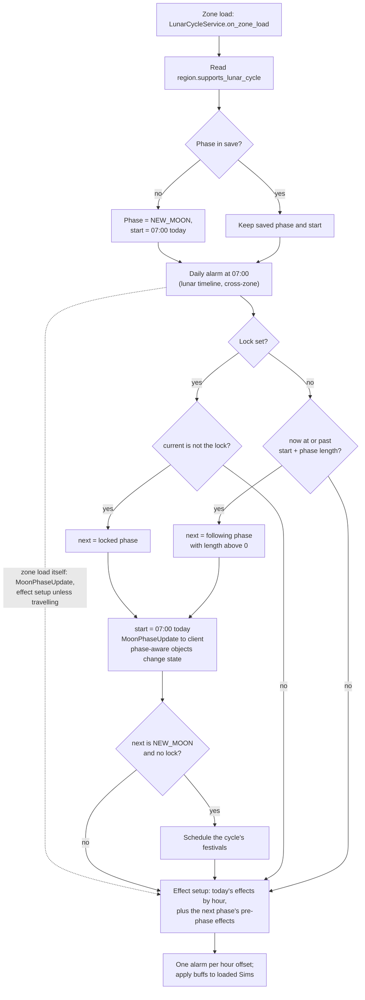

# 2.05 The sky and the moon

*Game version 1.128.90.1030 (Steam, Linux/Proton). Gameplay numbers are the live tuning: the base delta plus the EP04, EP06, EP09, EP12 (High School Years), GP04 and GP12 deltas; client numbers come from the base client packages and the embedded protobuf descriptors. Values from packs that are not installed (EP01, EP02, EP07, EP08, EP10, EP11, EP13, EP15 to EP21, GP08, GP09) are patch data and are labelled so. Written 2026-10-12. Checked 2026-10-12: 79 claims checked, 10 corrected, 3 relabelled, 0 removed. Checked again 2026-10-13: 109 claims checked, 17 corrected, 1 relabelled, 0 removed. Cross-chapter edits 2026-10-13: 3 applied.*

## In plain words

Every world has a tuned sunrise and sunset. The game uses them for one question, "is it day right now?", and that answer drives a lot: vampires suffer in daylight, plant Sims photosynthesize, one way out of a toddler's bedtime sleep waits for sunrise (it also needs a hidden trait from a pack that is not installed, so here it never fires), and many night-only actions (moonbathing, barking at the moon) check it. The base-game worlds use 6:00 to 20:00. Several pack worlds are shorter: the vampire world and the werewolf world both run 7:00 to 18:00. Worlds also carry separate summer and winter times, but those only work with the seasons pack, which is not installed here, so in this game the same times apply all year.

The moon runs on its own eight-phase calendar in the base game: new, waxing crescent, first quarter, waxing gibbous, full, waning gibbous, third quarter, waning crescent. By default each phase lasts one day and the moon changes at 7:00 in the morning, so a full cycle takes eight days. The options let a player shorten the cycle to four or two days (some phases are skipped), stretch it to sixteen or twenty-four, freeze it on one phase, or switch off the moon's effects on Sims. On its own, the base game's moon changes what is drawn in the sky and a handful of small things: a moonbathing moodlet that depends on the phase, children asking whether the moon is cheese, and walk-by visitors whose schedules check the phase. The moon's big effects on Sims (a werewolf's full-moon fury, a vampire's stronger power at the new moon) come from the werewolf and vampire packs (GP12 (Werewolves) and GP04 (Vampires)).

Three things surprise most players. First, changing the phase lock or the cycle length in the options does not change the moon until the next 7:00, when the daily moon check runs. Second, moon effects are handed out by the clock: each effect is tied to an hour after 7:00 (the full moon's main effect lands at 19:00, its fury at 22:00), only to Sims who are currently loaded, and each Sim is tested once per effect, so a Sim who becomes a werewolf at 20:00 misses that night's 19:00 effect. Third, the gameplay sunrise and the drawn sun are separate: the sunrise and sunset tuning never reaches the client's copy of the tuning, so editing it changes when the game thinks it is day without, as far as we can tell, moving the sun.

## Key facts

- **Day is the window from sunrise to sunset of the current world, ends included.** With no world loaded it is never day. Code defaults are 6:00 and 20:00; 10 of the 16 live worlds use them, and the GP04 and GP12 worlds use 7:00 to 18:00.
- **Seasonal sunrise and sunset never apply in this install.** They are read only when the season service exists, and that service is registered only with EP05 (Seasons) installed.
- **The sun is out** when the world provides sunlight, the weather is not shady and it is day. The weather service needs EP05 or EP10 (Snowy Escape), so in this install clouds never block the sun. Two hidden worlds (`region_Hidden_ForgottenGrotto`, `region_Hidden_SlyvanGlade`) have no sunlight at all.
- **No Python code fires at sunrise or sunset.** Day and night are re-read when something asks: a test, a Sim moving, an interaction starting. The only timed hook is the `daytime_state_change_based` condition: an alarm at the next sunrise or sunset, used only in one exit branch of three toddler sleep interactions. That branch is gated on an EP13 (Growing Together) trait, so in this install its test always fails (Inferred).
- **Eight phases, one day each by default.** Cycle lengths: TWO_DAY 2 days (new and full only), FOUR_DAY 4 (new, first quarter, full, third quarter), FULL_LENGTH 8, DOUBLE_LENGTH 16 (2 days a phase), TRIPLE_LENGTH 24 (3 days a phase).
- **The phase changes at 07:00**, from one repeating daily alarm. `PHASE_CHANGE_TIME_OF_DAY` is 7 and the first phase is NEW_MOON; both are code defaults that no tuning overrides.
- **Lock and length changes wait for the next 07:00 check.** A lock then jumps straight to the locked phase, whatever lies between.
- **Lunar effects are timed from 07:00.** Effects sit at hour offsets 0, 1, 12 and 15. The full moon: telegraph buffs at 07:00, insatiable hunger at 08:00, the main buffs at 19:00, fury and moon madness at 22:00, and on the day before, a pre-phase buff at 19:00.
- **37 live lunar effects, all buff effects:** 35 from GP12 tuning (werewolves) and 2 from GP04 (vampires). Durations: 720 Sim minutes for 26 of them, 1440 for the 9 "Blessed" ones, 300 for the fury rate, 360 for the pre-phase buff.
- **Who gets an effect:** every Sim loaded in the zone, if effects are on and the world supports the lunar cycle, and only if the buff's own add test passes (for example `trait_OccultWerewolf_Manifested` for most werewolf buffs, `trait_OccultVampire_Manifested` for the vampire ones). A Sim spawned later gets the effect with its timer aligned to the effect's start.
- **Every live world supports the lunar cycle.** The three worlds that switch it off (`region_Career_AlienWorld` EP01 (Get To Work), `region_Hidden_Magic_Venue` GP08 (Realm of Magic), `region_Destination_Batuu` GP09 (Journey to Batuu)) are patch data; base-game moonbathing blacklists exactly those three ids.
- **The phase festivals do not run here.** Every festival tied to a phase (EP17 (Life & Death) moon bathing, EP20 (Adventure Awaits) GlowAndFlow) is in a pack that is not installed. The phases name them as `TunableReference(pack_safe=True)` mapping keys, and a mapping drops each pair whose pack-safe key does not resolve, so they are gone after load (Inferred from that rule, [0.03](0.03-tuning-system.md)).
- **The client is told the phase, not the sky.** The server sends `MoonPhaseUpdate` (phase, and `skip_environment_changes` = the world does not support the cycle) on zone load and on every phase change. The client draws the moon from eight 256 x 256 textures.
- **No sky-colour keyframes were found in any package.** A search of 45,672 SimData records (49 client packages) and 911,432 other non-texture base client resources found none of the sky shader's colour names; the only time-keyed colour data is six HSV colour-grade sets. The sky colours are computed in the client (Inferred).
- **Commands:** `lunar_cycle.set_cycle_length`, `set_locked_phase`, `set_lunar_effects_disabled`, `request_forecast` and `request_lunar_effect_tooltip` are Live. The client's native strings name the first four; that the moon tooltip sends the fifth is Inferred. `lunar_cycle.set_phase` is untyped, so DebugOnly, and is not registered in a retail game.

## How it works

### Sunrise, sunset and what "day" means

- **Observed** (`world/region.py: Region`). Each region carries `sunrise_time` (`TunableTimeOfDay`, default 6:00), `sunset_time` (default 20:00), `seasonal_sunrise_time` and `seasonal_sunset_time` (season to time maps whose values default to 6:00 and 20:00), `provides_sunlight` (bool, default True, described as "used for gameplay effect (i.e. Vampires)") and `supports_lunar_cycle` (bool, default True). Regions themselves belong to [2.06 Worlds, regions, streets and travel](2.06-worlds-regions-travel.md).
- **Observed** (`Region.get_sunrise_time`, `get_sunset_time`). When `services.season_service()` is None the base time is returned; otherwise the seasonal map is looked up with the base time as fallback. Each map falls back on its own, so a world with only a seasonal sunset keeps its base sunrise in that season.
- **Observed** (`seasons/season_service.py: SeasonService.required_packs` returns EP05; `sims4/service_manager.py: ServiceManager.register_service` skips a service unless one of its required packs is available). EP05 is not installed, so the season service is never registered and the seasonal maps are dormant in this install. Seasons themselves are [2.04 Weather, seasons and the ground](2.04-weather-seasons-ground.md).
- **Observed** (`time_service.py: TimeService.is_day_time`; `date_and_time.py: DateAndTime.time_between_day_times`). Day time is False when there is no region. Otherwise it is true when the time of day is at or after sunrise and at or before sunset; when sunrise is later than sunset the window wraps past midnight. Both ends count as day.
- **Observed** (`TimeService.is_sun_out`, bytecode, since the decompiled control flow is mangled). The sun is out only if the region exists and provides sunlight; then, if a weather service exists and reports shade, it is not out; otherwise the answer is `is_day_time()`. The weather service's `required_packs` are EP05 and EP10 (`weather/weather_service.py`, bytecode; the module failed to decompile), neither installed, so in this install `is_sun_out()` is simply "region provides sunlight and it is day".
- **Observed** (`TimeService.is_in_sunlight`). A Sim is in sunlight when the sun is out, the Sim is outside and the Sim is not in shade.

Who reads these answers, all **Observed** in code:

| Reader | Check | What it does |
|---|---|---|
| `event_testing/test_variants.py: DayTimeTest` (`day_and_time`) | `is_day_time()` | optional `is_day`; when enabled its default is True (day), unchecked means night |
| `filters/tunable.py: CanBeOutside` (Sim filter term) | `is_day_time()` | a vampire aged teen or older without the daywalker perk scores 1 only at night (or when neither end of the requested window is day); everyone else scores 1 |
| `autonomy/autonomy_outside_supression.py: OutsideSupressor.is_not_allowed_outside` (bytecode; the decompile inverts it) | `is_sun_out()` | a lock keeps the Sim inside only while the sun is out and no unlock is active ([3.04 Autonomy](3.04-autonomy.md)) |
| `traits/trait_tracker.py: update_day_night_tracking_state` (bytecode) | `is_day_time()`, `is_in_sunlight()` | trait `day_night_tracking` buffs ([3.07 Personality and feelings](3.07-personality-feelings.md)) |
| `statistics/statistic_conditions.py: DaytimeStateChangeCondition` | `get_sunrise_time()` / `get_sunset_time()` | exit condition at the next sunrise or sunset |

- **Observed** (grep of the decompiled source and of the strings of every module that failed to decompile, plus `trait_tracker.pyc` disassembled). Only `time_service.py`, `world/region.py` and `statistics/statistic_conditions.py` read the sunrise or sunset times (`DayTimeTest` in `event_testing/test_variants.py` reaches them through `is_day_time`), and none of them sets a repeating alarm at either time. Day-night trait buffs are refreshed on the Sim's location-changed callback (`TraitTracker._add_day_night_tracking` registers it), at the start of every interaction (a lambda in `interactions/base/interaction.py`) and from the bucks tracker when perks change (`bucks/sim_info_bucks_tracker.py`).
- **Observed** (live tuning through the live merge). 49 records use a `day_and_time` test with `is_day` enabled. Counting each record once per value it uses (a few use both): night 34, day 6, left at the default (day) 18. Four traits use `day_night_tracking`: `trait_PlantSim` (sunlight buff `Buff_PlantSims_Photosynthesis`), `trait_Scenario_ExploreTheNight`, `trait_Fear_Dark` (night buffs) and `trait_OccultVampire_Manifested` (GP04: day, night and sunlight buff lists plus a forced-refresh list).

### Sunrise and sunset per world

Live regions, read through the live merge (16 records: 9 base delta, 2 EP06 (Get Famous), 1 each from EP04 (Cats & Dogs), EP09 (Eco Lifestyle), EP12 (High School Years), GP04 and GP12). **Observed.** Times are hour:minute; an absent field takes the code default.

| Region | Source | Sunrise | Sunset | Notes |
|---|---|---|---|---|
| `region_Residential_WillowCreek`, `_OasisSprings`, `_Newcrest` | base delta | 6:00 | 20:00 | defaults |
| `region_Residential_PetWorld` | EP04 delta | 6:00 | 20:00 | defaults |
| `region_Residential_FameWorld` | EP06 delta | 6:30 | 19:30 | seasonal (dormant): summer 6:00 to 20:30, fall sunset 19:00, winter 7:00 to 18:00 |
| `region_Residential_EcoWorld` | EP09 delta | 6:00 | 19:30 | seasonal (dormant): summer sunset 20:00, winter 7:00 to 19:00 |
| `region_Residential_HighSchoolWorld` | EP12 delta | 6:30 | 20:00 | |
| `region_Residential_VampireWorld` | GP04 delta | 7:00 | 18:00 | |
| `region_Residential_WolfTown` | GP12 delta | 7:00 | 18:00 | seasonal (dormant): summer 6:30 to 18:30, winter 7:30 to 17:30 |
| `region_Hidden_ForgottenGrotto`, `region_Hidden_SlyvanGlade` | base delta | 6:00 | 20:00 | `provides_sunlight` False |
| `region_Debug_TestWorld` | base delta | 0:00 | 23:59 | debug |
| `region_Debug_Magalog`, `_PerfTest`, `region_BGDebug_MegaLotsTestWorld`, `region_Hidden_ActingStudio` (EP06) | | 6:00 | 20:00 | defaults |

No live region sets `supports_lunar_cycle` to False. The GP04 and GP12 worlds give vampires and werewolves 11 hours of day; Willow Creek gives 14.

Patch data, pack not installed (read from the decoded combined tuning of the 75 missing packs whose `Delta/<pack>` folder ships one; regions with default times are left out; this tuning does not run here):

| Region | Pack | Base | Seasonal |
|---|---|---|---|
| `region_Residential_NorthEurope` | EP02 (Get Together) | 6:00 to 18:30 | none |
| `region_Residential_UniversityWorld` | EP08 (Discover University) | 6:00 to 18:30 | none |
| `region_Residential_EP16World` | EP16 (Lovestruck) | 6:00 to 19:00 | none |
| `region_Residential_IslandWorld` | EP07 (Island Living) | 6:00 to 19:30 | spring, fall 6:00 to 19:30; summer 5:30 to 20:00; winter 6:30 to 19:00 |
| `region_Residential_MountainWorld` | EP10 | 6:00 to 20:00 | summer sunset 21:00; winter 7:00 to 19:00 |
| `region_Residential_CottageWorld` | EP11 (Cottage Living) | 5:30 to 19:00 | spring 6:00 to 20:00; summer 5:00 to 21:00; fall 7:30 to 18:00; winter 8:00 to 16:30 |
| `region_Residential_BayArea` | EP13 (Growing Together) | 6:00 to 20:00 | as CottageWorld |
| `region_Residential_EP19World` | EP19 (Enchanted by Nature) | 5:30 to 19:00 | as CottageWorld |
| `region_Residential_EP20World` | EP20 | 6:00 to 20:00 | as CottageWorld |
| `region_Residential_MultiUnitWorld` | EP15 (For Rent) | 6:00 to 19:00 | spring, fall 6:00 to 18:30; summer 5:30 to 19:00; winter 6:30 to 18:00 |
| `region_Residential_EP17World` | EP17 | 7:00 to 18:00 | spring, fall same; summer 6:00 to 19:30; winter 7:30 to 17:30 |
| `region_Residential_EP18World` | EP18 (Businesses & Hobbies) | 7:00 to 19:00 | spring 7:30 to 19:00; summer 7:00 to 20:00; fall 7:30 to 18:00; winter 8:00 to 17:30 |
| `region_Residential_EP21World` | EP21 (Royalty & Legacy) | 7:30 to 20:00 | spring 7:30 to 19:00; summer 7:00 to 21:00; fall 8:00 to 20:00; winter 8:30 to 18:00 |
| `region_Residential_Magic` | GP08 | 6:15 to 19:15 | summer 5:00 to 20:30; winter 7:30 to 18:00 |

Also patch data: `region_Career_AlienWorld` (EP01, 108705), `region_Hidden_Magic_Venue` (GP08, 219134) and `region_Destination_Batuu` (GP09, 231104) set both `provides_sunlight` and `supports_lunar_cycle` to False. **Observed** in the decoded XML.

### Daytime state changes

- **Observed** (`world/daytime_state_change.py: DaytimeStateChange`). Two values: `Sunrise` 1 and `Sunset` 2.
- **Observed** (`statistic_conditions.py: DaytimeStateChangeCondition`, variant `daytime_state_change_based`; fields `who`, default Actor, and `_daytime`, default Sunset). On attach it reads the current region's sunrise or sunset (so the seasonal time when seasons exist), asks the game clock for the time until the next occurrence of that time of day (`DateAndTime.time_till_next_day_time`: zero at the exact time, otherwise wrapped forward by a day) and hands the minutes to `TimeBasedCondition`, which sets one alarm. It is computed once, when the condition attaches. Conditions in general are [3.03 Needs, statistics and commodities](3.03-needs-statistics.md).
- **Observed** (live tuning; `bed_Sleep_Toddler` read with the tuning indexer over the decoded delta). Three records use it, all base delta and all set to Sunrise: `bed_Sleep_Toddler`, `bed_Sleep_Toddler_Autonomous` and `bed_Sleep_SleepingBag_Toddler`. In each it sits in one conditional action (exit naturally) beside a `stat_based` condition on `motive_Energy` at -25, and that branch is gated by a trait test on 306528, which is `trait_Hidden_ToddlerPersonalityUpdate_EarlyRiser` in EP13 patch data (pack not installed). All conditions of a group must be met before it fires (`interactions/utils/exit_condition_manager.py: ConditionGroup`).
- **Observed** (`sims/sim_info_tests.py: TraitTest`, bytecode of `__call__`; the decompile mangles it). `whitelist_traits` holds `TunablePackSafeReference` entries, which load a missing trait as `None` and keep it in the list ([0.03 The tuning system](0.03-tuning-system.md)). The test enters the whitelist branch because the list is not empty, skips the `None`, counts 0 of the 1 required and fails. **Inferred**: in this install the sunrise branch never passes its test, so `daytime_state_change_based` never ends a toddler's sleep.

### The lunar cycle at a glance

### Phases, lengths and order

- **Observed** (`lunar_cycle/lunar_cycle_enums.py`). `LunarPhaseType`: NEW_MOON 0, WAXING_CRESCENT 1, FIRST_QUARTER 2, WAXING_GIBBOUS 3, FULL_MOON 4, WANING_GIBBOUS 5, THIRD_QUARTER 6, WANING_CRESCENT 7. `LunarPhaseLockedOption` adds NO_LUNAR_PHASE_LOCK 8. `LunarCycleLengthOption`: TWO_DAY 0, FOUR_DAY 1, FULL_LENGTH 2, DOUBLE_LENGTH 3, TRIPLE_LENGTH 4.
- **Observed** (`lunar_cycle/lunar_cycle_tuning.py: LunarCycleTuning`; the tuning indexer over the decoded delta). The module tuning exists only in the base delta, and sets only `LUNAR_PHASE_MAP`, which points each phase at one `LunarPhase` instance (`lunarPhase_NewMoon` 283809, `lunarPhase_WaxingCrescent` 287412, `lunarPhase_FirstQuarter` 287410, `lunarPhase_WaxingGibbous` 287413, `lunarPhase_FullMoon` 283810, `lunarPhase_WaningGibbous` 287414, `lunarPhase_ThirdQuarter` 287411, `lunarPhase_WaningCrescent` 287415). `INITIAL_LUNAR_PHASE` (NEW_MOON) and `PHASE_CHANGE_TIME_OF_DAY` (7, range 0 to 23) are code defaults. The full build has no lunar tuning.
- **Observed** (`lunar_cycle/lunar_phase.py: LunarPhase`, `base_game_only`; live tuning). `length_option_duration_map` gives the phase's length in Sim days per option (minimum 0, default 1). The eight live phases:

| Phases | TWO_DAY | FOUR_DAY | FULL_LENGTH | DOUBLE | TRIPLE |
|---|---|---|---|---|---|
| New moon, full moon | 1 | 1 | 1 (default) | 2 | 3 |
| First quarter, third quarter | 0 | 1 | 1 (default) | 2 | 3 |
| Both crescents, both gibbous | 0 | 0 | 1 (default) | 2 | 3 |
| Cycle | 2 | 4 | 8 | 16 | 24 |

- **Observed** (`lunar_cycle/lunar_cycle_service.py: LunarCycleService._determine_next_phase`). With a lock, the next phase is the locked phase. Without one, it steps to `(phase + 1) mod 8` and keeps stepping past any phase whose length for the current option is 0. `cycle_length_in_days` sums the lengths from the current phase up to the next return to the initial phase, so at the new moon it is the whole cycle and later in the cycle it is the days left until the next new moon.

### The daily check at 07:00

- **Observed** (`LunarCycleService.on_zone_load`, `update`). On zone load the service reads the region's `supports_lunar_cycle`; if no phase is saved it starts NEW_MOON at 07:00 of the current day; it creates its own `Timeline`; it adds one repeating `AlarmHandle` every Sim day (cross-zone) at today's 07:00, or tomorrow's if the hour is already 7 or later; it sends the phase to the client; and unless the player is travelling it sets up the day's effects. `update()` advances the lunar timeline to the current Sim time; the zone calls it every tick while the clock is not paused ([1.01 Time, scheduling and lot loading](1.01-time-scheduling-loading.md)).
- **Observed** (`LunarCycleService._on_daily_phase_check`, `_will_phase_change_occur`). At the alarm: the end of the current phase is its start plus its length for the current option. With a lock, the phase changes if the current phase differs from the lock; without one, if now is at or past the end. Forecasts before today are trimmed. If the phase changes, the new phase starts at 07:00 today, the client gets a `MoonPhaseUpdate`, every registered phase-aware object is told, and if the new phase is the initial phase (NEW_MOON) with no lock, the lunar events service schedules the new cycle's festivals. Whether or not it changed, the day's effects are set up and any effect already running is applied at once.
- **Observed** (`LunarCycleService.set_cycle_length`, `set_locked_phase`, `_fixup_for_changed_calendar_settings`). Changing the length or the lock cancels scheduled effects, trims forecasts, re-schedules the day's upcoming effects, re-schedules festivals and re-sends the forecast. Neither touches the current phase; the change shows at the next 07:00 check.
- **Observed** (`LunarCycleService.set_phase`). The debug path sets the phase at once, starting at 07:00 today, cancels and rebuilds the effects and updates the client and objects; setting NEW_MOON with no lock also schedules the cycle's festivals. It asks for them before it switches the phase, so the festival walk starts from the old phase.
- **Inferred** (`_will_phase_change_occur`). Under a lock, the phase start stops moving once the lock is reached. Clearing the lock leaves an old start time, so the next 07:00 check moves on to the following phase at once.

### Lunar effects: when they fire

- **Observed** (`LunarPhase.effects_by_hour_offset`, `pre_phase_effects_by_hour_offset`, both `TunablePhaseEffectsByHour`: hour 0 to 23 to a list of pack-safe `LunarPhaseEffect` references). An effect at offset h starts at 07:00 + h hours of the phase's day. Pre-phase effects are tuned on a phase but fire during the phase before it.
- **Observed** (`LunarCycleService._lunar_effect_setup`, bytecode). Nothing happens if effects are disabled. Before 07:00 "today" means the previous phase day (and on day 0 before 07:00 nothing is set up). For each effect map that `_todays_effects_gen` yields and each hour offset, it calls the setup callback with the start time; by default that both records already-running effects (`_track_effects_if_active`: started, not yet past `start + effect_duration`) and adds a one-shot alarm for effects still in the future (`_schedule_upcoming_effects`, cross-zone, on the lunar timeline, de-duplicated by start time and list).
- **Observed** (`LunarCycleService._todays_effects_gen`, bytecode). It always yields the current phase's `effects_by_hour_offset`. If the current phase is the locked phase it stops there. Otherwise, if today's 07:00 plus one day is at or before the end of the current phase, it also yields the next phase's `pre_phase_effects_by_hour_offset`.
- **Inferred** (from the setup running every day and the `<=` test above). Under DOUBLE_LENGTH and TRIPLE_LENGTH a phase's effects repeat on each of its days, and the full moon's pre-phase buff fires on every day of the waxing gibbous phase, not only the last one. Under TWO_DAY the full moon's pre-phase buff fires during the new moon. Under a lock the locked phase's effects repeat every day and no pre-phase effect fires.
- **Observed** (`LunarCycleService._on_effect_handler_alarm`). When an effect alarm fires: nothing if effects are disabled; expired entries are pruned; if the region supports the lunar cycle, every instanced Sim (`instanced_sims_gen` with all hidden reasons except uninitialized) that has a lunar effect tracker is pruned and given each effect in the list; then every tracked effect in the list is recorded as active from its start time.
- **Observed** (`LunarCycleService.apply_active_lunar_effects_to_sim`, bytecode; `sims/sim.py: Sim._startup_sim_gen`, bytecode, the module failed to decompile). A Sim that spawns later is given every active effect right after its commodities start, unless effects are disabled or the region does not support the cycle.
- **Observed** (`LunarCycleService.set_lunar_effects_disabled`). Disabling effects clears the service's active list and cancels the effect alarms. No code removes buffs already given; they run out on their own timers (Inferred from the absence of any removal call).

### Lunar effects: what they do and to whom

- **Observed** (`lunar_cycle/lunar_phase_effect.py`). `LunarPhaseEffect` is an abstract instance type in the LUNAR_CYCLE manager. `LunarPhaseEffectBuffs` (tracked) has `effect_duration` (`TunableSimMinute`, default 240, range 1 to 1440) and `effect_buffs` (pack-safe buff references, each with an optional `tooltip_text`). `LunarPhaseEffectOneShot` (untracked) runs a list of dialog, trait-add or statistic-change operations with a single-Sim resolver. **Observed** (live tuning, the base and pack full builds, and the decoded patch data of the 75 missing packs that ship tuning; of the 117 `Delta/` folders, 82 carry a combined tuning resource, 7 of them installed packs, three of them (SP57, SP70, SP82) only in `SimulationPreload.package`, and the other 35, all SP packs, carry none): no `LunarPhaseEffectOneShot` record exists anywhere.
- **Observed** (`LunarPhaseEffectBuffs._tuning_loaded_callback`, `_create_runtime_commodity_for_buff`). For each buff, at load, the game generates a hidden commodity named `<effect>_<buff>`: max and initial value equal to `effect_duration`, min 0, decay rate 1, convergence 0, removed on convergence, time-elapsed fixup, persisted. It has two states: value 0 with no buff, value 0.1 with the buff. A buff that already owns a commodity is skipped (the `logger.error` call beside it has an empty body in the retail build, so nothing shows), so each lunar buff must be unique to its effect.
- **Observed** (`LunarPhaseEffectBuffs.apply_lunar_effect`). If the Sim's tracker has not seen this effect at this start time, each buff is offered through `add_buff_from_op` (which runs the buff's `_add_test_set`, `buffs/buff.py: Buff.can_add`); for each buff that lands, its commodity is wound back to the effect's start (`update_commodity_to_time(start_time)`), so the buff ends at `start + effect_duration` however late the Sim arrived. The tracker then records the effect, whether or not any buff landed.
- **Inferred** (from the unconditional `track_lunar_effect_applied`). A Sim who fails a buff's test when the effect fires is not offered it again for that start time, even if it qualifies later that night.
- **Observed** (`lunar_cycle/lunar_effect_tracker.py: LunarEffectTracker`, a `SimInfoTracker`). It keys entries by (effect id, start time) with the end time as value, saves them as `applied_effects`, reloads them with the end unset and recomputes it from the effect's duration on the next prune (bytecode of `prune_stale_effects`), dropping a reloaded entry whose effect no longer resolves or is untracked. It drops its data when the Sim's level of detail falls below BACKGROUND (`sims/sim_info_tracker.py`). `find_active_effect_tooltip` returns the first tooltip of a tracked effect whose buff the Sim has; `lunar_cycle.request_lunar_effect_tooltip` sends it to the UI.

Installed effects at FULL_LENGTH (live tuning; clock times are 07:00 + offset; durations in Sim minutes). **Observed.**

| Phase | 07:00 (h0) | Later | Duration |
|---|---|---|---|
| New moon | `Vampire_0_NewMoon_Telegraph` (GP04), `Werewolves_0_NewMoon_Telegraph`, `Werewolves_0_NewMoon_Blessed` | 19:00: `Vampire_0_NewMoon` (GP04), `Werewolves_0_NewMoon` | 720; Blessed 1440 |
| Each crescent and gibbous | `Werewolves_<n>_<Phase>_Telegraph`, `_Blessed` | 19:00: `Werewolves_<n>_<Phase>` | 720; Blessed 1440 |
| First and third quarter | `_Telegraph`, `_Telegraph_Negative`, `_Blessed`, `_Blessed_Negative` | 19:00: main and `_Negative` | 720; Blessed 1440 |
| Full moon | `Werewolves_4_FullMoon_Telegraph`, `_FormerLycan_Telegraph` | 08:00: `_InsatiableHunger`; 19:00: `Werewolves_4_FullMoon`, `_FormerLycan`; 22:00: `_FuryRate`, `_MoodMadness` | 720; FuryRate 300 |
| (day before the full moon) | | 19:00: `Werewolves_4_FullMoon_PrePhase` | 360 |

(Effect names are shown without their `lunarPhaseEffectBuffs_` prefix; all are GP12 delta unless marked GP04.)

What the buffs test and do, **Observed** in the live buff tuning (`_add_test_set`, `game_effect_modifier`):

- Most werewolf buffs need `trait_OccultWerewolf_Manifested`. Some add an OR branch: the new-moon buff, for example, goes to manifested werewolves without the `werewolfPerks_LunarBlessing` perk, to any Sim with `buff_LunarCycle_Werewolves_LunarBlessing`, and to Sims with `trait_OccultWerewolf_AspirationTraits_FormerLycan`. The `_FormerLycan` buffs need only that trait.
- `buff_LunarCycle_Werewolves_4_FullMoon_FuryRate`: manifested werewolf, not in its cooldown buff, without `werewolfPerks_LunarResistance`; Angry weight 3; change rate +10 on `commodity_Motive_Werewolf_Fury`; Rampage decay stopped. Its partner `_FuryRate_Resistance` goes to werewolves with that perk: Angry weight 1, change rate +0.1.
- The pre-phase effect holds two buffs: `_PrePhase` (Happy) for werewolves with `werewolfPerks_LunarResistance` and `_PrePhase_Negative` (Stressed) for those without it.
- `buff_Werewolf_MoonMadness`: toddler or child with `trait_OccultWerewolf`; Angry; Fun and Social decay x2.5, toddler Attention x2.
- `buff_LunarCycle_Werewolves_4_FullMoon_InsatiableHungerSpeedup`: needs the commodity `commodity_WerewolfCreation_InsatiableHunger`, and doubles its decay.
- `buff_LunarCycle_Vampire_0_NewMoon` and its telegraph need `trait_OccultVampire_Manifested`; the main buff adds +0.5 change rate to `commodity_Motive_Visible_Vampire_Power`.
- The werewolf rules themselves (fury, rampage, perks, turning) are [3.11 Occults and the supernatural](3.11-occults.md).

Patch data, pack not installed. The base phase records also reference 22 ids that do not resolve in this install; all of them are records in the decoded patch data of missing packs. **Observed.** Effects: `Mermaid_4_FullMoon` and its telegraph (EP07, 295509, 295514), `Witch_4_FullMoon` and its telegraph (GP08, 295516, 295517), eight `EdithBasu_<n>_<Phase>` effects, one per phase at 07:00 (EP17, 389199 to 389201, 389303 to 389307), `Ghost_4_FullMoon` at 19:00 (EP17, 419415), and six `FairyOccult` effects at 07:00 on every phase but the quarters (EP19, 436867 to 436872). Festivals: `festivalDramaNode_EP17_MoonBathing` (385419), `festivalDramaNode_EP17_MoonBathing_FullMoon` (403215) and `festivalDramaNodes_EP20Festival_GlowAndFlow` (450522). **Inferred**: all are `TunableReference(pack_safe=True)` entries (`lunar_phase.py`: the effects are list entries inside `TunablePhaseEffectsByHour`, the festivals are mapping keys of `phase_length_content` and `locked_phase_content`) pointing at missing records. That kind is the one the loader drops: a missing one removes its list entry or its mapping pair ([0.03 The tuning system](0.03-tuning-system.md)); a `TunablePackSafeReference` would instead load as `None` and stay in its list. So they cost nothing here.

### Phase festivals

- **Observed** (`LunarPhase.phase_length_content`, `locked_phase_content`; `lunar_cycle/lunar_events_service.py: LunarEventsService`). Each phase can list drama nodes per length option, each with time offsets from the phase's 07:00 start (`TunableTimeSpan`, default 12 hours), and separately nodes to run while the cycle is locked on that phase, by weekday and time of day (default 19:00). `_schedule_cycle_events` runs at each new cycle (from the 07:00 check or `set_phase`), on a settings change, and on load if nothing is scheduled yet; it walks the phases ahead (`get_phases_for_scheduling`) and asks the drama scheduler for each node at `get_projected_phase_start_time(phase, offset)`, skipping times already past. It pairs every node of a phase with every offset tuned on that phase (the node id stored with each offset is not used as a filter), which only matters for a phase with more than one node. With a lock, `schedule_locked_phase_events` runs instead, and again weekly at the drama scheduler's weekly scheduling time. Festivals are [4.04 Holidays, festivals, live events and competitions](4.04-events-holidays-festivals.md).
- **Observed** (live tuning). The new moon lists 450522 (EP20) at 11 hours (18:00) under every option, with extra offsets at 1 day 11 hours and 2 days 11 hours for the longer cycles, and at 18:00 every day when locked. The full moon lists 403215 at the default 12 hours (19:00) under every option, and every day at 19:00 when locked. The six other phases list 385419 at 19:00 (the quarters under four options, the crescents and gibbous phases under three). For the full moon and these six, DOUBLE_LENGTH adds an offset of 1 day 12 hours and TRIPLE_LENGTH adds 1 day 12 hours and 2 days 12 hours.
- **Inferred** (`get_phases_for_scheduling`). Under DOUBLE_LENGTH and TRIPLE_LENGTH the walk reaches the starting phase again, so a new moon's nodes would be requested twice at the same projected time. It has no effect in this install, where every listed node is missing.

### Objects and tests that follow the moon

- **Observed** (`lunar_cycle/lunar_phase_aware_component.py: LunarPhaseAwareComponent`). `lunar_phase_state_mapping` maps a phase to a list of pack-safe state values. The object registers with the service when added (unless the zone is still loading) and when its load finishes; the service sets the states for the current phase at once and again at every phase change. **Observed** (live tuning). Two objects use it, both GP12: `object_Plant_Moonpetal_Patch_World` (291935) and `object_WolfTown_LunarStatue` (287245). Each maps all eight phases onto the base-delta state `GenericLunarPhase` (291156), values `genericLunarPhase_NewMoon` to `_WaningCrescent` (291148 to 291155). Components in general are [2.02 Objects: components, states and wear](2.02-objects-states-wear.md).
- **Observed** (`lunar_cycle/lunar_cycle_tests.py: LunarPhaseTest`, test key `lunar_phase` in `event_testing/tests.py`). One field, `phases_to_check`, a white or black list of phases; untuned, every phase passes. Tests in general are [0.04 Tests, loot and effects](0.04-tests-loot-effects.md).
- **Observed** (live tuning, strict count of `lunar_phase` test variants). 47 records use it 523 times: 24 base delta, 12 GP12, 4 EP04, 3 EP09, 3 EP12, 1 EP06. By class: 21 walk-by directors (`SchedulingWalkbyDirector`: the neighbourhoods of Willow Creek, Oasis Springs, Newcrest, PetWorld, EcoWorld, HighSchoolWorld and WolfTown; none for FameWorld or VampireWorld), 8 super interactions, 6 social mixers, 4 loot actions, 3 balloon categories and one each of mixer, stand super interaction, waypoint, fish and fishing data.
- **Observed** (live tuning). Base-game uses include five child socials (`IsTheMoonABanana` for the crescents, `IsTheMoonASponge` for the quarters, `IsTheMoonAnEgg` for the gibbous phases, `IsTheMoonCheese` for the full moon, and `WhereDidTheMoonGo`), `mixer_social_FirstKiss_targeted_romance_STC`, the invite-over and swim interactions (full moon), `SleepDreams_Thought` and `balloonCategory_LunarCycle_Tested`, and `Telescope_Lunarcycle_Moongaze_Reward` (full moon). GP12 adds `object_fish_LunaFish`, `fishingData_Wolftown_Lake` and werewolf interactions.
- **Observed** (live tuning, `lunarCycle_Moonbathe`, base delta). Moonbathing has a `day_and_time` test with `is_day` False (night only), a region blacklist of 219134, 231104 and 108705 (the three patch-data regions without a lunar cycle) and a blacklist on `moodBuffs_Lunarcycle_Moonbathe_RecentMoonbathe`. Its loot (`loot_Buff_Lunarcycle_Moonbathe`, base delta, 19 `lunar_phase` tests) always adds `RecentMoonbathe` and gives a Sim who is not a werewolf one base-delta moodlet per phase: CelestialRefresh (new), NormieShine (waxing crescent), LunarGleeFirstQuarter, SpaceRockAmusement (waxing gibbous), FriskyMoon (full, teen and older) or JoyfulMoon (full, child), LunarReassurance (waning gibbous), LunarGleeThirdQuarter, AntiSpaced (waning crescent), all named `moodBuffs_Lunarcycle_Moonbathe_<name>`. With GP12 installed, a Sim with `trait_OccultWerewolf` gets GP12 moodlets instead: the `<name>Werewolf` forms, `Wolfshine` for the waxing crescent, and on the waxing gibbous and full moon a split on `werewolfPerks_LunarResistance` (with it SpaceRockAmusementWerewolf or FriskyMoonWerewolf, without it SpaceRockStress or MoodyMoon). The same loot also lists an EP01 alien moodlet and blacklists `trait_OccultAlien` (EP01 patch data, pack not installed).

### What the server tells the client

- **Observed** (`lunar_cycle/lunar_cycle_ops.py`; protobuf descriptors embedded in `Simulation_x64.dll`, decoded). `MoonPhaseUpdateOp` sends `MoonPhaseUpdate { current_moon_phase (1, required, enum MoonPhase), skip_environment_changes (2, optional bool, default true) }`. The proto enum `MoonPhase` has `DEFAULT_NO_MOON` = -1 and then NEW_MOON 0 to WANING_CRESCENT 7, the same numbers as the Python enum. `LunarEffectTooltipUpdateOp` sends `UiLunarEffectTooltipUpdate` (phase and an optional tooltip). `MoonForecastUpdateOp` sends `MoonForecastUpdate { repeated MoonPhase forecast_moon_phases }`.
- **Observed** (`LunarCycleService._distribute_to_client`). `skip_environment_changes` is always set, to `not region.supports_lunar_cycle`. It is sent on zone load, on every phase change and by `set_phase`. The region field's description says it controls whether world environment effects follow the phase (Inferred: the client skips its moon-dependent environment changes when the flag is true).
- **Observed** (`LunarCycleService.populate_forecasts`, bytecode for the branch structure). The UI asks for N days (`lunar_cycle.request_forecast`). With a lock every day is the locked phase, written from today on, and the lock branch fills one day fewer than asked when a forecast for today already exists (it subtracts the stored days from the count but starts writing at today); otherwise the service walks forward day by day with the same phase-length rules. Today's forecast is the next phase if a change is due at today's 07:00 check.
- **Observed** (protobuf descriptors). The options live in `GameplayOptions`: `lunar_cycle_length` (field 30, default FULL_LENGTH), `lunar_phase_lock` (31, default NO_LUNAR_PHASE_LOCK) and `disable_lunar_effects` (32, default false). The save keeps `PersistableLunarCycleService { current_phase, phase_start_time }` and, per Sim, `PersistableLunarEffectTracker` with repeated `AppliedLunarEffect { lunar_effect_id, effect_start_time }` ([1.02 Saves and persistence](1.02-saves-persistence.md)).
- **Observed** (client strings). The UI side names `GetMoonPhase`, `RequestMoonForecast`, `CurrentMoonPhase`, `LunarEffectTooltipUpdated`, `MoonForecastUpdated` and the commands `lunar_cycle.request_forecast`, `lunar_cycle.set_cycle_length`, `lunar_cycle.set_locked_phase` and `lunar_cycle.set_lunar_effects_disabled`.

### What the client draws

- **Observed** (a package-reader read of the base client packages, type `00B2D882`, group 0, instance = FNV-64 of the lowercase name, DDS headers read in memory). The sky's textures: `moon_new`, `moon_waxingcrescent`, `moon_firstquarter`, `moon_waxinggibbous`, `moon_waninggibbous`, `moon_thirdquarter` and `moon_waningcrescent` (all 256 x 256, 9 mips, DXT5, in ClientDeltaBuild7 and 8), `moon` for the full moon (256 x 256, 4 mips, uncompressed 32-bit RGBA, ClientFullBuild6), `StarNoiseBase` (128 x 128 cube map, L8), `NightSkyStarsFlat` (512 x 512, L8), `Sky_Sun` (64 x 64, L8), `Sky_SunHalo` (128 x 128, L8) and `CloudNoiseBase` (512 x 512, DXT1).
- **Observed** (alpha of mip 0 decoded in memory). The share of texels with alpha above 0.5: new moon 0 (mean alpha 0.06, a faint disc), crescents 0.13, quarters 0.30, gibbous 0.50, full 0.63. Relative to the full disc the lit part is about 21, 48 and 80 percent.
- **Observed** (client strings). A "SceneObject Sky" block names `SkyDataCbuffer`, `SunVector`, `MoonVector`, `StarNoiseCubemap`, `SkyNightStarsFlat`, `SkyMoonTexture`, `SunTexture`, `SunHaloTexture`, `HorizonLight`, `HorizonDark`, `MinspecHorizonColor`, `SkyLight`, `SkyDark`, `FogParams`, `SkyIntensity`, `AmbientDomeBottom` and `AmbientDomeTop`; a clouds block names `CloudColorWRTSunLight`, `CloudColorWRTSunDark`, `CloudColorWRTHorizonLight`, `CloudColorWRTHorizonDark` and `CloudColorWRTShadow`. The sky names occur in `Game/Bin/res/Shaders_DX11.precomp` too, the cloud colours there only in per-layer forms (`CloudColorWRTSunLight1`, `CloudColorWRTShadow2`), with `ShaderDayNightParameters`, `DaytimeMultiplier`, `NighttimeMultiplier`, `SeasonDataCbuffer` and `GameTimeData`. **Inferred**: the client computes sun and moon directions and the sky's horizon and zenith colours itself and feeds them to the sky shader.
- **Observed** (a scan of the client packages). Re-test of "no sky-colour keyframes in any package": 45,672 SimData records in the 49 client packages of the base game and the installed packs (full and delta), and 911,432 other resources under 4 MB in the 27 base client packages (textures of types `00B2D882`, `3453CF95`, `BA856C78`, `2F7D0004` and `2BC04EDF` left out; no read failures). None contains `HorizonLight`, `HorizonDark`, `SkyLight`, `SkyDark`, `AmbientDome`, `SunColor`, `FogColor`, `SkyIntensity` or `MoonVector`, in ASCII or UTF-16. `SkyColor` occurs only inside `WindowDesaturateSkyColor` of `GlobalLightSettings`. **Inferred** (still): the sky colours are built in the client's code, or in data we cannot read.
- **Observed** (a scan of the simulation packages). 79,215 SimData records in the base and installed-pack simulation packages hold none of `sunrise_time`, `sunset_time`, `provides_sunlight`, `supports_lunar_cycle` or the lunar tunables, while 39 of them hold the exported region field `compatible_venues`. The gameplay sun times do not reach the client's tuning copy.
- **Observed** (SimData `Renderer.HsvTweakerSettings`, group `00FC90DD`, in ClientFullBuild0 and ClientDeltaBuild0). Six colour-grade sets keyed by time of day (`mFractionalTod`, hours): `default` (disabled), `test` (debug extremes at 7.5, 12.25, 18.75, 23.59), `SG_HSV_Tuning_Set01` (keys at 1, 19, 24; red and green input gamma 0.9 at 19), `SO_HSV_Tuning_Set01` (saturation of its far key 0.6 at 4:00, 0.5 from 6:00 to 18:00, 0.7 at 21:00, 0.8 at 24:00), `GD_HSV_Tuning_Set01` (far-key saturation 0.8 at every key) and `FG_HSV_Tuning_Set01` (a constant levels grade). Each key holds four saturation values against four `mZ_` values and a `mNumKeysToUse` count; in SO and GD two are used, saturation 1.0 at `mZ_0` 100 and the quoted value at `mZ_1` 500 (Inferred: `mZ_` is a view distance, so these sets desaturate the distance). Which world uses which set was not found.
- **Observed** (SimData `Renderer.GlobalLightSettings`, `00B2600F:DEAD4915C9C6C0D8`, the same in ClientFullBuild0 and ClientDeltaBuild0): `LightIntensityScale` 1.3, `SunlightScale` 1.2, `AmbientScale` 0, `WindowSunBrightness` 0.8, `WindowSunHeading` 39, `WindowSunPitch` 43, `WindowDesaturateSkyColor` 0.05. `AcidRainColor` (0.3, 0.6, 0.2) exists only in the delta copy, which the game reads (Inferred, as for tuning); the two copies also differ in `WindowSpillMultiplier` (full 1.3, delta 0.5), `VertexColorScale` (1.5, 2.0) and the blue of the fill-light colours. Lighting in general, and the visual effect parameters `moonPhaseMultiplier`, `hideNight` and `hideDay` (client strings; that they are effect parameters is Inferred from the names around them), belong to [7.02 Audio, VFX and the camera](7.02-audio-vfx-camera.md).

## Numbers

| Name | Value | Unit | Where | Source |
|---|---|---|---|---|
| `sunrise_time` default | 6:00 | time of day | `world/region.py: Region` | code default |
| `sunset_time` default | 20:00 | time of day | `Region` | code default |
| seasonal map value defaults | 6:00, 20:00 | time of day | `Region.seasonal_sunrise_time`, `seasonal_sunset_time` | code default |
| `provides_sunlight`, `supports_lunar_cycle` defaults | True, True | bool | `Region` | code default |
| live regions | 16 | records | live merge, class Region | live |
| `region_Residential_VampireWorld` | 7:00 to 18:00 | time of day | GP04 | delta |
| `region_Residential_WolfTown` | 7:00 to 18:00 | time of day | GP12 | delta |
| `region_Residential_FameWorld` | 6:30 to 19:30 | time of day | EP06 | delta |
| `region_Residential_EcoWorld` | 6:00 to 19:30 | time of day | EP09 | delta |
| `region_Residential_HighSchoolWorld` | 6:30 to 20:00 | time of day | EP12 | delta |
| `region_Debug_TestWorld` | 0:00 to 23:59 | time of day | base | delta |
| `DaytimeStateChange` | Sunrise 1, Sunset 2 | enum | `world/daytime_state_change.py` | code |
| `_daytime` default | Sunset | enum | `DaytimeStateChangeCondition` | code default |
| `PHASE_CHANGE_TIME_OF_DAY` | 7 (range 0 to 23) | hour | `lunar_cycle.lunar_cycle_tuning` | code default, not tuned |
| `INITIAL_LUNAR_PHASE` | NEW_MOON | enum | `lunar_cycle.lunar_cycle_tuning` | code default, not tuned |
| `LUNAR_PHASE_MAP` | 8 entries | phase to instance | `lunar_cycle.lunar_cycle_tuning` | base delta only |
| `length_option_duration_map` | see the phase table | Sim days | `lunarPhase_*` | base delta (FULL_LENGTH untuned, code default 1) |
| cycle length | 2, 4, 8, 16, 24 | Sim days | per option | derived from delta |
| `effect_duration` default | 240 (range 1 to 1440) | Sim min | `LunarPhaseEffectBuffs` | code default |
| `effect_duration`, main and telegraph effects | 720 | Sim min | 26 `lunarPhaseEffectBuffs_*` | GP12, GP04 delta |
| `effect_duration`, Blessed effects | 1440 | Sim min | 9 `*_Blessed*` | GP12 delta |
| `effect_duration`, `Werewolves_4_FullMoon_FuryRate` | 300 | Sim min | | GP12 delta |
| `effect_duration`, `Werewolves_4_FullMoon_PrePhase` | 360 | Sim min | | GP12 delta |
| effect hour offsets | 0, 12 (every phase); 1, 15 (full moon); pre-phase 12 (full moon) | hours after 07:00 | `lunarPhase_*` | base delta |
| live lunar effects | 37 (35 GP12, 2 GP04) | records | live merge, LUNAR_CYCLE | live |
| `LunarPhaseEffectOneShot` records | 0 | records | live and all patch data | live, patch data |
| generated commodity | decay 1, min 0, max = duration, buff at 0.1 | value | `LunarPhaseEffectBuffs._create_runtime_commodity_for_buff` | code |
| FuryRate change rate | +10 | rate | `buff_LunarCycle_Werewolves_4_FullMoon_FuryRate` on `commodity_Motive_Werewolf_Fury` | GP12 delta |
| FuryRate_Resistance change rate | +0.1 | rate | `buff_LunarCycle_Werewolves_4_FullMoon_FuryRate_Resistance` | GP12 delta |
| MoonMadness decay modifiers | Fun 2.5, Social 2.5, toddler Attention 2 | multiplier | `buff_Werewolf_MoonMadness` | GP12 delta |
| InsatiableHunger decay modifier | 2 | multiplier | `buff_LunarCycle_Werewolves_4_FullMoon_InsatiableHungerSpeedup` | GP12 delta |
| vampire new-moon power rate | +0.5 | rate | `buff_LunarCycle_Vampire_0_NewMoon` on `commodity_Motive_Visible_Vampire_Power` | GP04 delta |
| festival offset, new moon | 11 h (18:00); locked 18:00 | time | `lunarPhase_NewMoon` (node is EP20 patch data) | base delta |
| festival offset, other phases | 12 h (19:00), the `TunableTimeSpan` default; locked 19:00 | time | `lunarPhase_*` (nodes are EP17 patch data) | base delta, code default |
| `lunar_phase` test users | 47 records, 523 uses | count | live merge | live |
| `day_and_time` with `is_day` | 49 records (34 night, 6 day, 18 default day) | count | live merge | live |
| `daytime_state_change_based` users | 3 (Sunrise) | records | `bed_Sleep_Toddler*` | base delta |
| `LunarPhaseAwareComponent` users | 2 | objects | GP12 | delta |
| `GameplayOptions.lunar_cycle_length` | field 30, default FULL_LENGTH | proto | `Simulation_x64.dll` | descriptor |
| `GameplayOptions.lunar_phase_lock` | field 31, default NO_LUNAR_PHASE_LOCK (8) | proto | `Simulation_x64.dll` | descriptor |
| `GameplayOptions.disable_lunar_effects` | field 32, default false | proto | `Simulation_x64.dll` | descriptor |
| `MoonPhase.DEFAULT_NO_MOON` | -1 | enum | `MoonPhaseUpdate` | descriptor |
| moon textures | 256 x 256; DXT5 x 7, RGBA x 1 | pixels | base client packages | client |
| `SunlightScale`, `LightIntensityScale` | 1.2, 1.3 | factor | `GlobalLightSettings` default | client SimData |
| `WindowSunHeading`, `WindowSunPitch` | 39, 43 | degrees (Inferred unit) | `GlobalLightSettings` default | client SimData |
| `AmbientScale`, `WindowSunBrightness`, `WindowDesaturateSkyColor` | 0, 0.8, 0.05 | factor | `GlobalLightSettings` default | client SimData, both builds |
| `AcidRainColor` | (0.3, 0.6, 0.2) | RGB | `GlobalLightSettings` default | client SimData, delta build only |
| SimData records searched for sky colours | 45,672 in 49 packages; 911,432 other base client resources | records | client packages | client scan |
| `Delta/` folders with a combined tuning resource | 82 of 117 (7 installed, 75 patch data) | folders | `Delta/` | package index |
| HSV colour-grade sets | 6 | sets | client `00FC90DD` | client SimData |

## Data shapes

- **`Region`** (sun and moon fields only): `sunrise_time`, `sunset_time` (hour, minute); `seasonal_sunrise_time`, `seasonal_sunset_time` (season to hour, minute); `provides_sunlight`; `supports_lunar_cycle`. None carries `export_modes`, and none appears in any SimData record.
- **`DaytimeStateChangeCondition`**: `who` (participant), `_daytime` (`DaytimeStateChange`). Converts to a one-shot `TimeBasedCondition` interval in minutes.
- **`LunarCycleTuning`** (module tuning): `INITIAL_LUNAR_PHASE`, `PHASE_CHANGE_TIME_OF_DAY`, `LUNAR_PHASE_MAP` (phase to `LunarPhase`).
- **`LunarPhase`** (LUNAR_CYCLE instance, base game only): `length_option_duration_map` (option to days), `phase_length_content` (option to {drama node: [time spans after 07:00]}), `locked_phase_content` (drama node to {days available, time of day}), `effects_by_hour_offset` and `pre_phase_effects_by_hour_offset` (hour 0 to 23 to [effects]).
- **`LunarPhaseEffectBuffs`** (LUNAR_CYCLE instance): `effect_duration` (Sim minutes), `effect_buffs` ([buff, buff reason, optional tooltip text]). Plus one generated hidden commodity per buff.
- **`LunarPhaseEffectOneShot`** (LUNAR_CYCLE instance, unused): `effects` ([dialog | trait_add | statistics]).
- **`LunarCycleService`** state: current phase, phase start, selected length, lock, effects-disabled flag, its own timeline, the daily alarm, the region flag, active effects (effect to start), effect alarms ((start, list) to alarm), phase-aware objects (weak set), forecasts (day to phase).
- **`LunarEffectTracker`** (per Sim info): {(effect id, start time): end time}.
- **`LunarEventsService`** state: per length option a `LunarCycleEvents` table (phase to {offset: drama node id}) and the weekly alarm for locked festivals.
- **`LunarPhaseAwareComponent`**: `lunar_phase_state_mapping` (phase to [state values]).
- **`LunarPhaseTest`**: `phases_to_check` (white or black list of phases).
- **Wire and save**: `MoonPhaseUpdate`, `MoonForecastUpdate`, `UiLunarEffectTooltipUpdate`, `GameplayOptions` fields 30 to 32, `PersistableLunarCycleService`, `PersistableLunarEffectTracker` / `AppliedLunarEffect`.

## For modders

Common tweaks:

- **Change when it is day in a world**: override the world's `Region` (`sunrise_time`, `sunset_time`). This changes every gameplay check above (vampires, plant Sims, night-only actions, toddler sleep). Seasonal times need EP05 to have any effect.
- **Make a world sunless or moonless**: `provides_sunlight` False (no sun, as in the two hidden glades) or `supports_lunar_cycle` False (no lunar effects on Sims there, and the client is told to skip environment changes).
- **Change a phase's length**: `length_option_duration_map` on the `lunarPhase_*` instance. A 0 removes the phase from that cycle option. Keep the new moon non-zero: the cycle's festivals are scheduled when the walk returns to it, and `cycle_length_in_days` loops until it does (Inferred: a zero-length new moon would never be reached and the loop would not end).
- **Add a moon effect**: a new `LunarPhaseEffectBuffs` instance with a new buff (the buff must not have its own commodity), listed under a phase's `effects_by_hour_offset` at an hour 0 to 23 (offset from 07:00). Gate it in the buff's `_add_test_set`. `pre_phase_effects_by_hour_offset` targets the day or days before the phase.
- **Make an object follow the moon**: add `lunar_phase_aware_component` with a phase-to-state map; the base-delta `GenericLunarPhase` state already has one value per phase.
- **Gate content by phase**: the `lunar_phase` test with a whitelist or blacklist.
- **Change the phase change hour**: `PHASE_CHANGE_TIME_OF_DAY` in the `lunar_cycle.lunar_cycle_tuning` module tuning (0 to 23). Effect offsets, festival offsets and the forecast all move with it.

Commands (`lunar_cycle/lunar_cycle_commands.py`; types per `sims4/commands.py`, see [1.04 Debug tools, cheats and telemetry](1.04-debug-cheats-telemetry.md)):

| Command | Type | Arguments | What it does |
|---|---|---|---|
| `lunar_cycle.set_cycle_length` | Live | `LunarCycleLengthOption` | sets the option if different; takes effect at the next 07:00 |
| `lunar_cycle.set_locked_phase` | Live | `LunarPhaseLockedOption` (8 = no lock) | sets the lock if different; takes effect at the next 07:00 |
| `lunar_cycle.set_lunar_effects_disabled` | Live | bool | turns effects off or on; turning on applies the running ones at once |
| `lunar_cycle.request_forecast` | Live | `num_days` (int, default 1) | sends `MoonForecastUpdate` |
| `lunar_cycle.request_lunar_effect_tooltip` | Live | optional Sim | sends the phase and the Sim's active effect tooltip |
| `lunar_cycle.set_phase` | DebugOnly (untyped) | `LunarPhaseType` | sets the phase now; not registered in retail; also a GSI "Set Phase" view cheat (`lunar_cycle/lunar_cycle_handlers.py`) |

Traps:

- **The sun you see is not the sun the game tests.** Region sun times never reach the client's tuning copy (no SimData record holds them), so changing them moves the gameplay day only (Inferred for the drawn sun).
- **Seasonal sun times are dead tuning without EP05.**
- **Length and lock changes are delayed** until the next 07:00 check (switching effects off or on applies at once); `lunar_cycle.set_phase` is the only immediate phase change and it is not available in retail.
- **One test per effect start.** A Sim who fails a buff's add test when the effect fires is recorded anyway and not retried for that start (Inferred from the code).
- **Effects are not removed when switched off.** Buffs already given run out on their own commodity timers.
- **Effects can outlast their phase.** `Werewolves_4_FullMoon_MoodMadness` starts at 22:00 and lasts 720 minutes, to 10:00, three hours into the next phase; nothing ends effects at a phase change.
- **Only loaded Sims are touched.** Effects apply to instanced Sims and to Sims as they spawn; Sims elsewhere in the world never get them.
- **Pack-safe references hide missing content.** The base phase records list effects and festivals from five packs that are not installed (EP07, GP08, EP17, EP19, EP20); nothing reports their absence in a retail game.

## Limits

- `weather/weather_service.py`, `traits/trait_tracker.py`, `sims/sim.py` and `interactions/base/interaction.py` did not decompile, and parts of `time_service.py`, `lunar_cycle_service.py`, `lunar_effect_tracker.py` and `sims/sim_info_tests.py` decompiled with mangled control flow; the claims that rely on them were read from disassembly.
- The client's sky is native code. We read its texture list, shader parameter names and SimData, not its logic: how sun and moon positions are computed, where the drawn sunrise comes from, and how `MoonPhaseUpdate.skip_environment_changes` is used are not known. The client's UTF-16 strings also hold an unexplained format pair (`[%f:#%f,%f,%f,%f:L]`, `[%g:#%g,%g,%g,%g:L]`) next to the sky texture names, a lead for a colour-keyframe parser.
- The sky-colour keyframe search covered SimData of all installed client packages and non-texture resources under 4 MB in the base client packages only; larger resources and pack client packages beyond their SimData were not searched.
- Which world uses which HSV colour-grade set, and `GlobalVolLightScatteringSettings`, were not read.
- The lunar content of packs that are not installed (EP07 mermaids, GP08 witches, EP17 ghosts and moon-bathing festival, EP19 fairies, EP20 festival, EP01, GP09) is described only from patch data and does not run here.
- The pack-safe drop of missing references in list entries and `TunableMapping` keys rests on 0.03's reading of the collection loader's bytecode; it was not watched in a running game.
- That the toddler sleep's sunrise branch never fires here rests on the bytecode of `TraitTest` and on 0.03's reading of `TunablePackSafeReference`; it was not watched in a running game.
- Pack names come from `book/packs.tsv` (read from the base UI tuning and string table), not from each pack's own data.

## File index

| Module | What it holds | Depth |
|---|---|---|
| `simulation/lunar_cycle/__init__.py` | empty package marker | skim |
| `simulation/lunar_cycle/lunar_cycle_commands.py` | the six `lunar_cycle.*` commands; five Live, `set_phase` untyped | deep |
| `simulation/lunar_cycle/lunar_cycle_enums.py` | `LunarPhaseType`, `LunarPhaseLockedOption`, `LunarCycleLengthOption` | deep |
| `simulation/lunar_cycle/lunar_cycle_handlers.py` | GSI "Lunar Cycle/Lunar Phases" grid and its "Set Phase" view cheat | skim |
| `simulation/lunar_cycle/lunar_cycle_ops.py` | `MoonPhaseUpdateOp`, `LunarEffectTooltipUpdateOp`, `MoonForecastUpdateOp` | deep |
| `simulation/lunar_cycle/lunar_cycle_service.py` | `LunarCycleService`: phase state, 07:00 alarm, next-phase walk, effect scheduling and application, forecasts, client ops, save and options | deep |
| `simulation/lunar_cycle/lunar_cycle_tests.py` | `LunarPhaseTest` (`phases_to_check`) | deep |
| `simulation/lunar_cycle/lunar_cycle_tuning.py` | `LunarCycleTuning`: initial phase, phase change hour, phase map | deep |
| `simulation/lunar_cycle/lunar_effect_tracker.py` | `LunarEffectTracker`: per-Sim applied effects, pruning, tooltip, save and load | deep |
| `simulation/lunar_cycle/lunar_events_service.py` | `LunarEventsService`, `LunarCycleEvents`: phase and locked-phase festival scheduling | deep |
| `simulation/lunar_cycle/lunar_phase.py` | `LunarPhase` instance and `TunablePhaseEffectsByHour` | deep |
| `simulation/lunar_cycle/lunar_phase_aware_component.py` | `LunarPhaseAwareComponent`: phase-to-state mapping on objects | deep |
| `simulation/lunar_cycle/lunar_phase_effect.py` | `LunarPhaseEffect`, `LunarPhaseEffectBuffs` (generated commodities), `LunarPhaseEffectOneShot` | deep |
| `simulation/world/daytime_state_change.py` | `DaytimeStateChange` enum (Sunrise 1, Sunset 2) | deep |

Other modules read for this chapter (owned elsewhere): `world/region.py`, `time_service.py`, `date_and_time.py`, `tunable_time.py`, `statistics/statistic_conditions.py`, `event_testing/test_variants.py`, `event_testing/tests.py`, `filters/tunable.py`, `autonomy/autonomy_outside_supression.py`, `traits/trait_tracker.py` (disassembly), `interactions/base/interaction.py` (disassembly), `bucks/sim_info_bucks_tracker.py`, `sims/sim.py` (disassembly), `sims/sim_info.py`, `sims/sim_info_tests.py` (disassembly of `TraitTest.__call__`), `objects/components/buff_component.py`, `sims/sim_info_tracker.py`, `buffs/buff.py`, `statistics/commodity.py`, `game_services.py`, `seasons/season_service.py`, `weather/weather_service.py` (disassembly), `sims4/service_manager.py`, `sims4/commands.py`.

Tuning used (live through the live merge unless noted): module `lunar_cycle.lunar_cycle_tuning`; `lunarPhase_NewMoon`, `_WaxingCrescent`, `_FirstQuarter`, `_WaxingGibbous`, `_FullMoon`, `_WaningGibbous`, `_ThirdQuarter`, `_WaningCrescent`; the 37 `lunarPhaseEffectBuffs_*` and their `buff_LunarCycle_*` buffs, `buff_Werewolf_MoonMadness`; the 16 `region_*` records; `GenericLunarPhase`; `object_Plant_Moonpetal_Patch_World`, `object_WolfTown_LunarStatue`; `lunarCycle_Moonbathe`, `loot_Buff_Lunarcycle_Moonbathe`, `telescope_Lunarcycle_Moongaze`, `Telescope_Lunarcycle_Moongaze_Reward`; `bed_Sleep_Toddler`, `bed_Sleep_Toddler_Autonomous`, `bed_Sleep_SleepingBag_Toddler`; `trait_PlantSim`, `trait_Scenario_ExploreTheNight`, `trait_Fear_Dark`, `trait_OccultVampire_Manifested`; patch data (packs not installed): the Delta region, effect and festival records named above. Client data: `Renderer.HsvTweakerSettings` (group `00FC90DD`), `Renderer.GlobalLightSettings` (`00B2600F:DEAD4915C9C6C0D8`), textures of type `00B2D882`.
