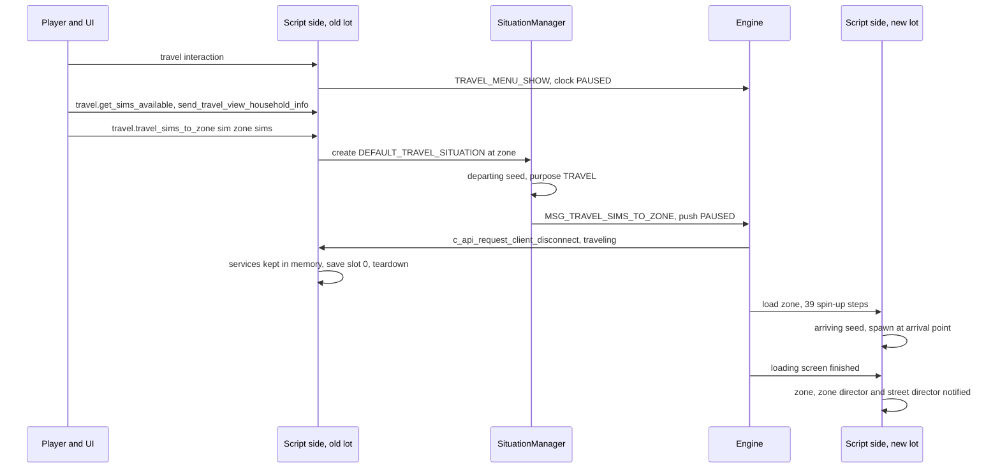
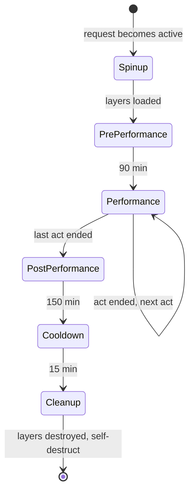

# 2.06 Worlds, regions, streets and travel

*Game version 1.128.90.1030 (Steam, Linux/Proton). The numbers are base-game and installed-pack tuning from the live merge and the base module tuning, with EP04 (Cats & Dogs), EP06 (Get Famous), EP09 (Eco Lifestyle), EP12 (High School Years), GP04 (Vampires), GP12 (Werewolves), SP01 (Luxury Party) and SP42 (Grunge Revival) installed. Records from packs that are not installed are marked "patch data, pack not installed" and are never counted as live. Written 2026-10-12. Checked 2026-10-12: 131 claims checked, 18 corrected, 2 relabelled, 0 removed.*

## In plain words

The map you see in Manage Worlds is split three ways in the game's code. A **region** is one town on the world picker (Willow Creek, Oasis Springs, Brindleton Bay). It decides the things that should feel the same everywhere in that town: when the sun rises and sets, which weather each season can bring, which kinds of lot you may build, which background mood buffs Sims get, where you can fish, and which other towns count as "the same kind of place" so their residents can visit. A **street** is one loaded neighbourhood inside a town, the piece the game streams in around a lot. It owns the street's decoration and NPC rules, its townie target and its civic policies. A **lot** is a zone on a street.

Moving between lots is called travel, and the script side does surprisingly little of it. When you pick a lot and press Travel, the script side decides who comes along, writes a short note about the trip, pauses the clock and sends one message to the game: "take these Sims to that lot". The game then saves the lot you are leaving, tears it down, loads the new one, and the script side reads its note back and places the arriving Sims at the street's arrival point. Everything that is not tied to a lot (households, relationships, the clock) stays in memory across the trip.

A **travel group** is a set of Sims staying somewhere that is not their home: a vacation rental, a stayover at your house, or a getaway. It has an end date, it can be extended for a daily price, and when it ends the Sims are sent home. Each street also runs an **open street director**, a small manager that dresses the street (food carts, festival stalls, seasonal decorations) by switching object layers on and off on a schedule, and that brings in NPC walk-bys. Festivals replace the street's normal director for a few hours.

Sims can also skip walking. A **teleport style** (vampire bat or mist form, werewolf tunnelling, witch teleport) lets a Sim vanish and reappear at the end of a route, sometimes for a price paid from a power meter. A **vehicle** (a bike, a canoe) is an inventory object that the Sim takes out, rides for longer trips and puts away again.

## Key facts

- **16 live regions and 30 live streets** in this install. Regions: 9 from the base delta build (3 playable worlds, 2 hidden, 4 debug), 2 from EP06 (Get Famous), 1 each from EP04 (Cats & Dogs), EP09 (Eco Lifestyle), EP12 (High School Years), GP04 (Vampires) and GP12 (Werewolves). Streets: base 15, EP04 4, EP06 3, EP09 3, EP12 3, GP04 1, GP12 1 (the live merge).
- **No installed region is a destination or persistable.** Every live region leaves `region_type` (RESIDENTIAL) and `is_persistable` (False) at their code defaults. Destination regions exist only in patch data of packs that are not installed: GP01 (Outdoor Retreat), GP06 (Jungle Adventure) and GP09 (Journey to Batuu). GP09's region is the only one that turns on `is_persistable`.
- **Every live region carries the tag `Region_Residential`**, so `is_region_compatible` (any shared tag) says yes for every pair of installed towns. The patch-data destination regions are kept apart by their tags: GP01's carries only `Region_Camping`, GP06's only `Region_Jungle`, and GP09's has no tags at all, so it shares a tag with no other region.
- **Travel is one message and a pause.** All script paths end in `MSG_TRAVEL_SIMS_TO_ZONE` plus the clock set to PAUSED; the engine does the disconnect, save, teardown and load ([1.02](1.02-saves-persistence.md), [1.01](1.01-time-scheduling-loading.md)).
- **A whole-household trip calls no `save_sim`.** At teardown, after the scratch save, `SimInfo.on_zone_unload` runs `_save_for_travel` for every instanced Sim, copying its interactions, inventory and location into its in-memory record (bytecode).
- **Going home takes dependents along.** The go-home interaction adds the Sim's care dependents, then, if the Sim is the only instanced selectable human child or older, every instanced selectable pet; then the active familiar if it is a Sim, and a ridden horse or its rider (bytecode).
- **Travel groups come in three kinds:** vacation, stayover and getaway. Stayovers need EP13 (Growing Together), which is not installed: all of the stayover's situations, relationship bit and creation interaction resolve to nothing here. Getaways are base game.
- **Getaway money, live:** hosting at home earns lot value x (1 + 0.1 x NPCs) x max(1 - 0.33 x quitters, 0) x 0.0036 per day at 12:00; hosting away costs lot value x (1 + 0.75 x household Sims) x (1 - 0.03 x NPCs) x 0.002 per day. Running out of money ends the getaway.
- **A rentable lot's group limit counts played groups only.** The decompile drops the `if group.played` filter; the bytecode has it. NPC (unplayed) groups never block a rental, and whenever any group rents the lot its unplayed groups are destroyed without returning their objects.
- **One scheduling director per street, all 30 live.** Five festival directors are live: the base music festival and four EP12 school festivals. Layer objects load 5 at a time and are destroyed 2 at a time, every Sim minute (live module tuning).
- **12 teleport styles exist; only three carry a cost.** Bat and mist (GP04) cost 5 points of `commodity_Motive_Visible_Vampire_Power`. `teleport_witch_always_teleport` costs 0, additive, on `commodity_Motive_WitchOccult_Charge` from GP08 (Realm of Magic), which is patch data, pack not installed. The cost test passes only for styles that have a cost; routes ignore the cost test, so GP12's cost-free `teleport_basic` teleports for nothing.
- **5 live vehicle objects:** four bikes (minimum route 40 m) and one canoe (15 m, pool surface). Their tuning sits in the base delta build.
- **Commands:** 3 Live travel commands, 6 Live travel-group commands, 2 Automation commands, and 8 untyped or DebugOnly ones that never register in retail ([1.04](1.04-debug-cheats-telemetry.md)).
- **Dead tuning:** `TravelTuning.ENTER_LOT_AFFORDANCE`, `EXIT_LOT_AFFORDANCE` and `NPC_WAIT_TIME` have no reader in Python bytecode or native strings, and the base full build's `world.travel_service` module tuning names a `TravelService.TRAVEL_AFFORDANCE` class that no longer exists.
- **Proven code quirks:** the world spawn point's X jitter is always -0.2 (`uniform(-0.2, -0.2)`; reached on every spawn, harmless); the travel group's `safe_sims_after_end` getter reads an attribute that is never set; the stayover's no-household error path calls a method that exists nowhere; festival situation counts ignore the tag cap; `_save_for_travel` dereferences a missing record after creating it. The middle three are not reached in normal play here; whether the last one is was not traced (details under each mechanism).

## How it works

### Worlds, regions, streets and lots

**Observed** (`world/region.py`, `world/street.py`, `world/__init__.py`, `zone.py`).

- A `Region` is a tuned instance (REGION manager) that also mixes in components, statistics, weather tuning and seasonal parameters. `RegionType` is NONE 0, RESIDENTIAL 1, DESTINATION 2.
- A `Street` is a tuned instance (STREET manager). The class tunable `Street.WORLD_DESCRIPTION_TUNING_MAP` maps a catalog world description to a street; live it has 102 entries, of which 30 point at live streets and 72 at streets of packs that are not installed (71 distinct streets, all present in patch data; one is mapped twice).
- `Region.REGION_DESCRIPTION_TUNING_MAP` does the same for regions: 43 entries, 15 pointing at live regions and 28 at patch-data regions. The one live region not in the map is `region_Hidden_ActingStudio` (EP06).
- What the code calls a "world" is one world file, which is one street. A zone's `world_id` is its `open_street_id`. A neighbourhood record carries the `region_id` (the region description). So the lookup from a lot is: zone record, then `world_id`, then the region description cached by `PersistenceService` from the neighbourhood, then the tuning map (`get_region_instance_from_zone_id`, `get_region_instance_from_world_id`).
- The zone stores its region and street at the end of `Zone.load_zone`, so `services.current_region()` and `services.current_street()` are cheap lookups after that.
- `world/__init__.py` wraps the native `_lot.get_lot_id_from_instance_id`, with a stub returning 0 when the native module is missing.

### What a region decides

**Observed** (readers found by searching bytecode for each field name):

| Region field | Reader | Effect |
|---|---|---|
| `sunrise_time`, `sunset_time`, `seasonal_*` | `time_service.py` | day and night window; seasonal overrides win when seasons run |
| `provides_sunlight` | `time_service.py` | False means no sunlight at any hour |
| `weather`, `snow_behavior`, `weather_supports_fresh_snow`, `is_summit_weather_enabled` | `weather/weather_service.pyc` (bytecode names) | per-season forecasts and snow rules ([2.04](2.04-weather-seasons-ground.md)) |
| `seasonal_parameters` | `seasons/season_service.py` | foliage, flowers, leaves; a street can override |
| `supports_lunar_cycle` | `lunar_cycle_service.py` | moon phase effects on or off ([2.05](2.05-sky-and-moon.md)) |
| `region_buffs` | `buff_component.py` | added to every Sim when it is ready to simulate |
| `outfit_category_restrictions`, `default_outfit_category` | `outfit_tracker.py` | required outfit, allowed list, fallback outfit (optionally travel groups only) |
| `fishing_data` | `fishing_location_component.py` | fish for spots tuned "use region" |
| `welcome_wagon_replacement` | `npc_hosted_situations.py` | replaces the welcome wagon situation |
| `region_currency_bucks_type` | `tooltip_component.py` | price tooltips in a regional currency |
| `store_travel_group_placed_objects` | `object_manager.py`, `travel_group_manager.py` | objects placed during a stay are kept for the household |
| `compatible_venues`, `gallery_download_venue_map`, `travel_group_build_disabled_tooltip` | no Python reader; exported to the client | **Inferred**: build venue list, gallery mapping, tooltip |
| `tracked_terrain_tags` | `interactions/utils/routing.py` | path planner tracks terrain transitions |
| `is_persistable` | `region_service.py` | region gets a saved instance |

- **Compatibility.** `is_region_compatible(other, ignore_tags=False)` is True when the other region is the same or None, False when `ignore_tags` is set, and otherwise True if the two share any tag. `is_sim_info_compatible` also passes a Sim whose travel group is unplayed.
- Users of compatibility: the residential zone director skips resident Sims whose home region is incompatible; `VenueService.get_zone_venue_type_valid_for_venue_types` filters venue searches (situations, Plan an Event); `TravelSimLiability.travel_player` destroys a lone Sim's travel group when it travels to an incompatible region; `GoToSpecificLotTravelInteraction` has a `check_region_compatibility` switch (default False; no live record of that class sets it); `BringHereInteraction` (`sims/sim_info_interactions.py`) has its own switch of that name, default True, which fails the bring-here test for a Sim in an incompatible region, and the live `bring_here_from_vacation_interaction` and `bring_here_add_to_vacation_interaction` turn it off; and the world tests below.
- **Lot traits.** No zone modifier code reads the region. Regions gate lots only through `compatible_venues` (client side) and the venue search above; lot traits belong to [2.01](2.01-lots-venues-rooms.md).
- **Region service.** `RegionService` is a game service. On load it creates an instance only for regions with `is_persistable`, loads their saved data from `save_slot.gameplay_data.region_service`, and saves the same way. **Inferred**: with no persistable region installed, it holds nothing here. Its save error code 417 is shared with the lifestyle service.

**Observed** (live merge; fields not listed keep code defaults):

- All 16 live regions set `compatible_venues` (20 to 45 venues), `fishing_data`, `region_buffs` (9 or 10, the first being `buff_Region_generic`), `snow_behavior` (WINTER: ACCUMULATE), an allowed-outfits blacklist and `tags`.
- The 9 playable regions set four-season `weather` and a `region_icon`.
- Sun times that differ from 6:00 and 20:00: EP09 sunset 19:30; EP06 sunrise 6:30 and sunset 19:30; EP12 sunrise 6:30; GP04 and GP12 sunrise 7:00 and sunset 18:00; the debug test world 0:00 to 23:59. EP06, EP09 and GP12 add seasonal sun times.
- `provides_sunlight` False: the two base hidden regions (Forgotten Grotto, Sylvan Glade). `weather_supports_fresh_snow` False: EP04 and EP06. `welcome_wagon_replacement`: EP09 only (an eco welcome situation).
- No live region sets `store_travel_group_placed_objects`, `region_currency_bucks_type`, `is_summit_weather_enabled`, `tracked_terrain_tags`, `default_outfit_category` or `supports_lunar_cycle`. The venue tunable of the same name, `store_travel_group_placed_objects`, is set on one live venue, `venue_rentable_vacation_generic` (True).

**Patch data, pack not installed** (the decoded patch tuning, shared references resolved): the GP01, GP06 and GP09 regions are `REGIONTYPE_DESTINATION` with `store_travel_group_placed_objects` True. GP09 also sets `is_persistable` True, `provides_sunlight` False, `supports_lunar_cycle` False and the `GalacticCredits` currency, and has no tags. EP10 (Snowy Escape) turns on summit weather. In all, 29 region records sit in the patch files of 23 packs that are not installed, including career regions from EP01 (Get To Work); the list is in the authors' working files, which are not published.

### The live list of towns

**Observed** (live merge).

| Region | Pack | Streets (live) | Notes |
|---|---|---|---|
| `region_Residential_WillowCreek` | base | 6 (5 neighbourhoods and the venue street) | GardenPark eco override -500 |
| `region_Residential_OasisSprings` | base | 6 (5 and the venue street) | DesertPark eco override -500 |
| `region_Residential_Newcrest` | base | 3 | |
| `region_Residential_PetWorld` | EP04 | 4 | no fresh snow |
| `region_Residential_FameWorld` | EP06 | 3 | |
| `region_Hidden_ActingStudio` | EP06 | none | not in the description map |
| `region_Residential_EcoWorld` | EP09 | 3 | Suburbs -500, Industrial +500 eco override |
| `region_Residential_HighSchoolWorld` | EP12 | 3 | two streets name a `travel_lot` |
| `region_Residential_VampireWorld` | GP04 | 1 | the street has no townie target |
| `region_Residential_WolfTown` | GP12 | 1 | names a `travel_lot` |
| `region_Hidden_ForgottenGrotto`, `region_Hidden_SlyvanGlade` | base | none | no sunlight |
| 4 debug regions | base | none | test worlds |

Five of Willow Creek's six base delta street records are spelled `street_WillowCreak_*`; the venue street is `street_WillowCreek_Venue`. 29 of the 30 streets set a townie target of 5; `street_ForgottenHollow` leaves it disabled. No live street sets `vacation_lot` or `beaches`.

### What a street decides

**Observed** (`world/street.py` and its readers).

- `open_street_director` names the street's director (below). `civic_policy` is the street's voting provider ([2.07](2.07-neighbourhood-systems.md)). `initial_street_eco_footprint_override` seeds the eco footprint (2.07).
- `townie_demographics.target_population` is read by `filters/demographics_service.py` to decide whether a street wants more townies ([4.02](4.02-story-progression-townies.md)).
- `travel_lot` gives the street a preferred lot. `Street.get_lot_to_travel_to` returns it unless this street is the current one; festival drama nodes and NPC invite drama nodes use it to pick where to send the player.
- `vacation_lot` makes vacation requests on the street use another zone: `get_vacation_zone_id` swaps the zone id before the travel group rents it.
- `beaches` are placed by `objects/pools/ocean.py`.

### Travel, step by step

**Observed** (`objects/terrain.py`, `world/travel_commands.py`, `situations/situation_manager.py` as summarised in [4.01](4.01-situations-npcs.md), `world/travel_service.py`, `areaserver.py` and `zone.py` as summarised in 1.01 and 1.02).

1. **Open the map.** The terrain or phone travel interaction (`TravelSuperInteraction`) sends `TRAVEL_MENU_SHOW` to the client with the picked lot, then pauses the clock. It does nothing while the save is locked. No live record uses the class: its one record, `terrain-Travel_from_Phone` (75849), exists only in the base full build, which the game does not load.
2. **Fill the picker.** The UI calls `travel.get_sims_available` (Live), which runs `TravelTuning.TRAVEL_AVAILABILITY_SIM_FILTER` (live `filter_TravelPicker_WorldTuningModule`) and pre-selects familiar, club-gathering and ensemble Sims. `travel.send_travel_view_household_info` (Live) sends every household's home zone and which Sims are at home.
3. **Confirm.** The UI calls `travel.travel_sims_to_zone <sim> <zone> <sims...>` (Live). It checks the zone exists, adds the roommate service's auto-invites, and creates `SituationManager.DEFAULT_TRAVEL_SITUATION` (live `Situation_Invite_To`, class `InviteToSituation`) at the target zone with every chosen Sim invited.
4. **Seed and send.** Creating a situation in another zone hands over to the manager's travel path: linked user-facing situations choose the travel behaviour, a departing seed with purpose TRAVEL records the guests and any carried Sims, and `travel_seed` stores it, sends `MSG_TRAVEL_SIMS_TO_ZONE` and pushes PAUSED ("Situation Travel").
5. **Leave.** The engine calls `c_api_request_client_disconnect` with the traveling flag. Game services stop saving, the lot is saved to slot 0 and torn down (1.02).
6. **Arrive.** The destination zone runs the 39 spin-up steps (1.01). Step 7 returns and cleans travel-group objects; step 13 spawns traveled Sims; the zone director sorts traveled, saved and resident Sims. The departing seed comes back as the arriving seed and recreates the travel situation. **Inferred**: the spawner then places the Sims at an arrival spawn point (4.01, 4.02).
7. **Loading screen ends.** `on_loading_screen_animation_finished` runs on the zone, its director and the open street director manager.

Other entry points skip the picker but end the same way:
- `GoHomeTravelInteraction` and its live variants (`sim-gohome`, `GoHomeAndAttendWork`, `GoHomeAndAttendSchool`, `GoHomeAndAttendUniversity`, `horseSim-gohome`, `sim-gohome-Infant`, `sim-gohome-clothingOptional`) build a `TravelSimLiability` (below).
- `GoHomeFromVacationTravelInteraction` goes to the household's home zone.
- `GoToSpecificLotTravelInteraction` (18 live records: 13 base, 3 EP04, 1 GP04, 1 GP12) picks the zone from a specific lot, a participant's zone or home, an object owner's home or a career customer lot.
- `TravelToObject` (`world/travel_elements.py`) reads the object's travel destination zone from the global Sim-object relationship service (falling back to the zone the object is in) and, only if the Sim is elsewhere, records `spawn_object_id`, saves the Sim, sends and pauses.
- `TravelTuning.GO_HOME_INTERACTION` (live `aggregateSI_goHome`) is the interaction the household manager and daycare push to send a Sim home.
- `travel_service.travel_sims_to_zone` is the bare helper: send and pause.



### Going home: who comes along

**Observed** (`sims/self_interactions.py: GoHomeTravelInteraction._run_interaction_gen`, checked in bytecode; `world/travel_tuning.py: TravelSimLiability`, checked in bytecode).

1. If the Sim is already in the target zone, stop.
2. An NPC goes through the plain `TravelInteraction` path. If it is in a rabbit hole, the rabbit-hole service is told to ignore the travel cancel. At the `travel_xevt` animation event (when one is tuned, code default 100) the Sim and a carried care dependent vanish from the client; the interaction's run step then injects the Sim into the target zone as an inactive-zone Sim, saves it and destroys it.
3. A player Sim waits in 1 Sim minute sleeps while any other selectable Sim already holds a travel liability.
4. The companions: the Sim's care dependents; the tutorial housemate during the tutorial; if the Sim is human and the only instanced selectable human aged child or older, every instanced selectable pet; the active familiar if it is a Sim; the horse the Sim rides, or the rider if the Sim is a horse.
5. If another instanced selectable Sim is not among the companions, this is a **split travel**: the liability is attached to the interaction, the Sim and companions fade out at once, and the interaction sleeps 2.4 Sim minutes. When the interaction ends normally, the liability's `release` injects the Sim and its companions into the target zone as inactive-zone Sims, saves and destroys them, and selects the next selectable Sim. If a dialog response is still pending, or the next selectable Sim is the traveller itself, the Sim fades back in instead.
6. Otherwise the whole household is going: `travel_player` runs at once.

`travel_player` order (bytecode): build the travel message for the target zone; send the Sim to work if this is "go home and attend career"; if the Sim is in a travel group with no other household member in it and the destination region is incompatible with the current one, destroy the group; tell the rabbit-hole service to ignore the cancel; cancel all queued interactions; add the companions; send `MSG_TRAVEL_SIMS_TO_ZONE`; pause.

`_save_and_destroy_sim` (split path, bytecode): keep the Sim's parented vehicle only if its inventory component says it should be saved into the inventory; stop the player-facing getaway situation; `save_sim`; schedule the Sim's destruction; then destroy the vehicle.

**Observed**: `travel_player` makes no `save_sim` call, and neither does travel from the map. Only the split path, `TravelInteraction.save_and_destroy_sim` and `TravelToObject` save Sims as they leave.

**Observed** (`sims/sim_info.py: on_zone_unload`, `_save_for_travel`, checked in bytecode). The Sims that stay instanced until the lot closes are still captured. During teardown, after the scratch save (1.02), `SimInfoManager.on_zone_unload` calls `SimInfo.on_zone_unload` for every Sim, and while traveling each one above minimum detail runs `_save_for_travel`: for an instanced Sim it copies the saved interactions, the inventory and the location into its in-memory record, sets a fresh go-home stamp if the household's home is another zone, and notes a world-surface vehicle. It calls `save_sim` only when the Sim has no record yet.

- **Proven latent bug.** In that last case `_save_for_travel` discards what `save_sim` made and keeps the empty local (`pydisasm`: `save_sim` then `POP_TOP`, no new `STORE_FAST sim_msg`), then writes `sim_msg.gameplay_data`, which raises `AttributeError` on None. `SimInfoManager.on_zone_unload` has no guard, so the loop would stop there. Whether an instanced Sim can lack a record at travel time was not traced.

### Spawn points

**Observed** (`world/spawn_point.py`, `world_spawn_point.py`, `dynamic_spawn_point.py`, `dynamic_object_spawn_point.py`, `spawn_point_component.py`, `spawn_point_enums.py`, `spawn_actions.py`).

- `SpawnPoint` is the base. Live tags: `ARRIVAL_SPAWN_POINT_TAG` = `Spawn_Arrival`, `VISITOR_ARRIVAL_SPAWN_POINT_TAG` = `Spawn_VisitorArrival`. Each point adds a route-goal penaliser footprint so Sims do not loiter on it.
- `WorldSpawnPoint` is a point placed in the world file. It has 8 slots in 2 rows of 4, starting at (-1.5, 0, -0.5) from the centre, with a footprint of half size 2 x 1 m. Slot order is shuffled once and then cycled. A horse keeps the spawn point's facing and gets no jitter: a first-row slot moves 0.5 m back on X and on Z, a second-row slot 0.5 m forward on Z. Other Sims get a random facing, the first row's 0.5 m X offset and a jitter.
- **Proven quirk.** The X jitter is `random.uniform(-SPAWN_POINT_JITTER_X, -SPAWN_POINT_JITTER_X)`: both bounds are -0.2 (`pydisasm`: `LOAD_ATTR SPAWN_POINT_JITTER_X, UNARY_NEGATIVE` twice). So every non-horse Sim gets a fixed X shift (0.3 m on the first row, 0.2 m the other way on the second) and only the Z jitter (±0.3 m) varies. Reached on every world spawn; harmless.
- `validate_connectivity` keeps a bitmask of slots that can reach the lot.
- `DynamicInteractionSpawnPoint` (the `DynamicSpawnPointElement`) creates a temporary point near a participant (default 7 m away, found with FGL).
- `DynamicObjectSpawnPoint` belongs to an object's `SpawnPointComponent`: 2 rows by 4 columns at scale 1, with a priority. 13 live objects have the component (base 6, GP12 5, EP04 1, EP09 1).
- `SpawnPointPriority` is a dynamic enum: DEFAULT 0, live adds ELEVATOR 1 and INACTIVE_APARTMENT_DOOR 2. `SpawnPointRequestReason` is DEFAULT 0, SPAWN 1, LEAVE 2.
- Spawn actions (how a Sim appears): `fade_in` (default), `do_nothing`, `affordance` (push an interaction) and `vehicle` (`SpawnOnVehicleActionAffordance`: creates a new vehicle object from the Sim's favourite definition for the tuned tag, else from the fallback definition; nothing is taken from the inventory). Live use: 11 `affordance` actions, no `vehicle` action.
- Which point a Sim uses is the spawner's choice ([4.02](4.02-story-progression-townies.md), 4.01).

### Travel groups

**Observed** (`travel_group/travel_group.py`, `travel_group_manager.py`, `server_commands/travel_group_commands.py`, `world/travel_group_tuning.py`).

- `TravelGroup` has a type: VACATION (default), STAYOVER or GETAWAY. A household may be in one group only.
- Free slots: `Household.MAXIMUM_SIZE` (live 8) minus members. Stayovers take the smaller of that and `HOUSEHOLD_AND_GUEST_MAXIMUM` (live 10, code default 9) minus members, the lot's roommates and the lot household. Getaways cap at `NPC_SOFT_CAP` (code default 20) minus members, roommates and the lot household.
- **Create** (`create_travel_group_and_rent_zone`):
  1. Skip Sims whose household already has a group.
  2. Apply the street's vacation lot.
  3. Build a getaway, stayover or plain group.
  4. Rent the zone. The venue needs a `travel_group_limit` slot, counted over played groups only; then every unplayed group on that zone is destroyed without returning objects, whichever kind of group is renting.
  5. Add the Sims; each gets `INSTANCED_SIM_LOOT` (live `loot_OnVacation_SimInstanced`).
  6. If played and a cost was given, remove it from household funds (reason FUNDS_MONEY_VACATION).
  7. Write telemetry `TGST` and call `on_create`.
- `travel_groups.create_vacation` (Live) takes zone, duration in days and cost, and does not travel. **Inferred**: the client sends the travel itself.
- **Alarms.** An end alarm, plus two warnings: `VACATION_ENDING_DAYS_TNS` (1 day before, code default) and `VACATION_ENDING_HOURS_TNS` (4 hours before, code default).
- **End alarm.** If the active Sim is not in the group, the group ends. Otherwise the extend dialog opens (`MSG_EXTEND_VACATION`, daily cost = the current lot's furnished value). An automatic response ends the stay.
- **Extend.** Adds days, removes the cost (FUNDS_MONEY_VACATION), telemetry `TGEX`. `is_vacation_over` compares the end with the creation time, not with now; `travel_groups.extend_vacation` with 0 days ends the group.
- **Leaving.** Removing a Sim gives `ON_LEAVE_TRAVEL_GROUP_LOOT`. Live that points at `loot_Lifestyles_FrequentTraveler_PostVacation` (EP10, patch data, pack not installed), so here it resolves to nothing. A group whose members all have home zone 0 becomes unplayed.
- **Basic extras** (`travel_group_elements.py`): `add_to_travel_group`, `remove_from_travel_group` (ends the group if the rest cannot live alone), `extend_vacation`, `end_vacation`, `travel_group_claim_object`. Live: add 6 records (base), remove 5 (base 2, EP04 3), extend 1, end 1, claim 0.
- **Tests**: `TravelGroupTest` variants `in_travel_group`, `count` (default), `can_extend`, `includes_target_participant`, `stayover_room`, `is_getaway_schedule`, `supports_manual_invites`.

### Ending a stay

**Observed** (`TravelGroup.end_vacation`, checked in bytecode; the decompile nests it wrongly).

- **Quiet end** when the current region differs from the rental's region, or no active household member was in the group:
  - At home: active household members not spawned yet are spawned.
  - Anyone else instanced gets `make_sim_leave_now_must_run`; Sims not instanced are injected into their home zone.
  - The group is destroyed with `return_objects=True`.
- **Travel end** otherwise:
  - Every instanced active-household Sim's queue is cancelled.
  - Unless the group skips travel on end, one travel message goes to the household's home zone with the group's and the lot's active-household Sims. Other members are injected into their homes. The clock pauses.
  - When the group skips travel, NPC members on the lot are sent away, except the getaway's "safe" Sims.
  - The group is destroyed.
- **Destroy:** telemetry `TGEN`; each Sim removed (career trackers told); zone released; saved record deleted; optional object return; `on_destroy`.
- **Proven latent bug.** `TravelGroup.safe_sims_after_end`'s getter returns `self._safe_sims_on_lot`, an attribute that no code stores (`pydisasm`: one `LOAD_ATTR _safe_sims_on_lot`, and only `STORE_ATTR _safe_sims_after_end` elsewhere). Reading it would raise `AttributeError`. Not reached: the only user, `player_planned_getaway_drama_node.py`, sets the property, and `end_vacation` reads the private `_safe_sims_after_end` directly.

### Objects left in a destination world

**Observed** (`objects/object_manager.py` via bytecode names, `TravelGroupManager.return_objects_left_in_destination_world`, checked in bytecode, and `clean_objects_left_in_destination_world`).

- When a lot is saved in a region or venue with `store_travel_group_placed_objects`, household-owned inventoryable objects placed on it are recorded in the save's `destination_clean_up_data`.
- On return, if the current region and venue do not store objects, each record whose group is gone and whose household still exists is recreated in that household's inventory. A record whose household no longer exists gets household id 0.
- In the destination zone, spin-up step 7 deletes recorded objects whose household is 0.
- Live, only `venue_rentable_vacation_generic` (base) sets the flag ([2.01](2.01-lots-venues-rooms.md)).

### Stayovers and getaways

**Observed** (`travel_group_stayover.py`, `travel_group_getaway.py`, `travel_group_bed_preference_mixin.py`).

- **Stayovers:**
  - Live `HOUSEHOLD_AND_GUEST_MAXIMUM` 10. Every `OFFLOT_ALARM_INTERVAL` (1 hour, code default) guests pulled off the lot are summoned back. `END_STAY_SITUATION` closes the stay.
  - All of the stayover's situations, jobs, the guest relationship bit and the creation interaction are EP13 records (patch data, pack not installed).
  - **Inferred**: `travel_groups.start_stayover_creation` has nothing to push in this install.
- **Bed assignment** (stayover and getaway): `BED_ASSIGNMENT_DATA` gives adults, elders, teens and children the bed, double bed and single bed tags without toddler beds, and human toddlers toddler beds. Partners share a double bed while double beds last; the bed tag is `BED`.
- **Proven latent bug.** In `TravelGroupStayover.rent_zone`, the branch for a lot with no household logs an error and then calls `super()._init_preference_tracker(from_load)`. The method is looked up first (`pydisasm`: `LOAD_METHOD _init_preference_tracker` before `LOAD_GLOBAL from_load`), and no class in the game's bytecode defines it, so this raises `AttributeError`; `from_load` is not defined there either. Not reached here: stayovers need EP13, and the branch is already an error state.
- **Getaways** are travel groups tied to a player-planned getaway drama node (live `playerPlannedGetawayDramaNode`, category GETAWAY). A daily alarm runs at `DAILY_COST_PROFIT_LOOP.time_of_day` (live 12:00, code default 23:00) and survives travel (`cross_zone`).
- **At home** the household earns, when NPCs take part:
  `lot value x (1 + sim_count_multiplier x NPCs) x max(1 + sims_quit_multiplier x quitters, 0) x profit_multiply`
  with live 0.1, -0.33 and 0.0036. Each NPC who quits cuts a third, and three quitters leave 1%. The lot value is fixed when the getaway is created.
- **Away** the household pays:
  `lot value x (1 + household_sim_count_multiplier x household Sims) x (1 - npc_sim_count_multiplier x NPCs) x rent_multiply`
  with live 0.75, 0.03 and 0.002. When the money cannot be taken, the getaway ends.
- Worked example, Observed formula with live numbers: a 50,000 lot with 4 NPCs earns 50,000 x 1.4 x 0.0036 = 252 per day at home. Away with 3 household Sims and 5 NPCs, it costs 50,000 x 3.25 x 0.85 x 0.002 = 276.25 per day.
- Rewards: live `GETAWAY_REWARDS` has 7 activity categories and 14 challenge rule rewards. Getaway `HOUSEHOLD_AND_GUEST_MAXIMUM` is 20 live. **Observed** (bytecode of `RoommateService.get_available_roommate_count`, which does not decompile): the roommate service reads it through the zone's travel group and caps new roommates at that maximum minus the group's members and the household.
- NPC travel groups that rent lots come from story progression ([4.02](4.02-story-progression-townies.md)).

### Open street directors

**Observed** (`open_street_director/*`; the base `open_street_director.pyc` fails to decompile, so it was rescued per function and checked in bytecode).

- `OpenStreetDirectorPriority` is DEFAULT, CART, FESTIVAL (0, 1, 2). `OpenStreetDirectorBase` is a tuned instance (OPEN_STREET_DIRECTOR manager, subclasses only) with `lot_cleanup`, `startup_actions`, `npc_summoning_behavior`, `allow_loading_after_time_passes_elsewhere` (False) and `whim_set`.
- **Lifecycle:**
  - `on_startup` runs the startup actions on objects off the active lot.
  - `load` reads saved layers when `_should_load_old_data` allows it: same resource key, and either no time passed since the street was saved or loading after time passes is allowed. Otherwise it asks the manager to clean the old director.
  - `save` writes the resource key, the loaded layer GUIDs and custom data.
  - `run_lot_cleanup` runs the cleanup on objects off the active lot and not in use.
  - `summon_npcs` uses the behaviour for the purpose, falling back to DEFAULT.
  - `preroll` runs only when nothing was loaded.
- **Layers** go through the conditional layer service. Loading is gradual: live 5 objects (`LAYER_OBJECTS_TO_LOAD`, code 1) every 1 Sim minute (`LAYER_OBJECTS_ALARM_TIME`, code 5), or immediate during preroll. Removal is 2 objects per minute (`LAYER_OBJECTS_TO_DESTROY`, code 1), or immediate while the zone is not running. Loaded layer objects lose their environment score component.
- **Manager and requests:**
  - `VenueService._setup_open_street_director` adds the street's director as a request factory. `ZoneDirectorBase.setup_open_street_director_manager` activates the manager; the zone director can hand it on.
  - Requests keep one list per priority. A new request replaces the active one when its priority is greater than or equal.
  - When the active request shuts down, `_pop_next_request` takes the highest non-empty list. A factory stays in its list and makes a fresh request, so the street's own director always comes back.
- **`SchedulingOpenStreetDirector`** (priority CART): an object layer schedule and a seasonal mapping. It reschedules when the season changes and holds situation shifts. Live: 30 records, one per street. Counted by the `conditional_layer` field name, they reference up to 4 distinct layers each (2 reference none); EP09's three also set `allow_loading_after_time_passes_elsewhere` True.
- **Festivals** (priority FESTIVAL):
  - States check every 10 Sim minutes for missing situations. State kinds: timed (default 60 minutes), situation-ended (preroll counts 60 minutes), load-layer and cleanup-objects. When a state has no successor the director self-destructs.
  - `BasicFestivalOpenStreetDirector`: spin-up 1, main 2, cooldown 3, cleanup 4. Four live EP12 school festivals run a 240-minute main state.
  - `MusicFestivalOpenStreetDirector`: spin-up 1, pre-performance 2 (live 90 minutes), one performance state per tuned act (3), post-performance 4 (live 150), cooldown 6 (live 15), cleanup 5. One live base record, three performances. It tunes `live_event_name` SoM2021 and tears itself down at startup (once the client's live event list has arrived) or on `LiveEventStatesProcessed` when that festival's `LIVE_FESTIVAL_EVENT_DATA` state is DISABLED, as it is in the base delta module tuning, or the event is COMPLETED (`music_performance_festival.py: _self_destruct_if_live_event_inactive`; see [4.04](4.04-events-holidays-festivals.md)).
  - `FestivalDramaNode` and `FestivalContestDramaNode` start them by request with preroll, timeout and premature-end callbacks ([4.04](4.04-events-holidays-festivals.md)).
  - Patch data, pack not installed: `LogicFestivalOpenStreetDirector` (EP03 (City Living), EP20 (Adventure Awaits)), `FestivalWithHighlightOpenStreetDirector` (EP03), lamp contest situations (EP03), `JungleOpenStreetDirector` (GP06; temples are [6.03](6.03-pack-systems.md)).
- **Proven code quirk, not reached.** `BaseFestivalState._create_required_number_of_situations` works out a tag-capped `required_situations` but then creates `number_of_situations - running` situations (`pydisasm`: `LOAD_ATTR number_of_situations, LOAD_FAST number_of_situations_running, BINARY_SUBTRACT` into `range`). Not reached here: no live festival state sets `object_tag_requirement`.



### Teleport

**Observed** (`teleport/*`, `objects/components/buff_component.py` checked in bytecode, `interactions/utils/routing.py` checked in bytecode). The occult side is in [3.11 Occults](3.11-occults.md); the interactions are in [3.05](3.05-interactions-postures-routing.md).

- `TeleportStyle` is a partitioned dynamic enum (NONE 0). Live elements: `teleport_basic`, `teleport_bat`, `teleport_mist`, `teleport_witch`, `teleport_witch_fail`, `teleport_familiar`, `teleport_witch_broom`, `teleport_witch_always_teleport`, `teleport_wolf`, `teleport_ghostPowers`, `teleport_spacebend`, `teleport_fairy`. All 12 have an entry in `TeleportTuning.TELEPORT_DATA_MAPPING`.
- **Sources.** A Sim collects styles by source: `TeleportStyleSource` TUNED_LIABILITY 0 or TELEPORT_STYLE_SUPER_INTERACTION 1, and a buff's GUID for buff styles. No code passes TELEPORT_STYLE_SUPER_INTERACTION.
  - `get_active_teleport_style` prefers a tuned-liability style and reports it as such. Otherwise it returns the first style that has data, whether or not its cost can be paid.
  - `teleport_style_liability` is an entry type of an interaction's `basic_liabilities` list. No live interaction carries it. Two GP04 full-build records, `teleportHere_VampireBat` (bat) and `teleportHere_VampireMist` (mist), list it, but the game does not load the full build.
- **Who has route styles live:** buffs `buff_Vampire_SpiritPowers_BatEnabled` and `_MistEnabled` (GP04); `buff_WolfTown_Portal_BasicTeleport_FirstTime` (GP12, basic, given by the first werewolf transformation); and the two liability interactions above.
- **Teleport-style interactions** are a separate thing: a `TeleportStyleSuperInteraction` teleports the Sim with its own `teleport_style_tuning`. Three are live: VampireBat, VampireMist (GP04) and Werewolf_Tunneler (GP12, `teleport_wolf`). The hidden traits `trait_Hidden_Vampire_SpiritPowers_BatEnabled` and `_MistEnabled` hand the two vampire ones to the Sim through `teleport_style_interaction_to_inject`, and the go-here path injects them in front of the move; no trait injects the werewolf one.
- **Cost:**
  - The multiplier is the product of all buffs' `teleport_cost_multiplier`. Live: GP04 potent power 0.8, 0.65, 0.4; GP04 daytime weakness 1.25, 1.5, 1.75. The cost is multiplier x tuned cost.
  - A non-additive cost is affordable only when the stat value minus the cost stays strictly above the stat's minimum; an additive cost when value plus cost stays strictly below the maximum.
  - With no `teleport_cost` tuned, `get_teleport_cost` returns None (bytecode), so `can_trigger_teleport_style` is False.
  - The cost is applied at the teleport xevent.
- **The gate:** test `teleport_cost_test` (`TeleportCostTest`) fails for any subject who cannot trigger the style. Live: 6 records hold 8 such tests, 4 for bat and 4 for mist.
- **When a route teleports** (`FollowPath._run_gen`, bytecode; the decompile gets the water test backwards). All of these must hold:
  - the Sim has an active style;
  - its walkstyle is not in `WALKSTYLES_OVERRIDE_TELEPORT` (unless the style came from a tuned liability);
  - no routing slave forbids it;
  - the destination is not water;
  - and one of: the path was forced to a ghost route, the 2D squared distance is above `teleport_min_distance`, or the style came from a tuned liability.
- **When planning makes a ghost route** (`PlanRoute._run_gen`, bytecode):
  - the target is farther than `teleport_min_allowable_distance` and walking cannot reach it; or
  - after planning, the target is within `teleport_min_distance` in a straight line but the walking path is longer than that and uses no portal.
  - Both distances are squared at load (`TunableDistanceSquared`), so the comparisons are consistent. Code defaults are 5 m and 2 m.
- `TeleportHelper` moves routing slaves to an FGL spot next to the Sim, skips injecting a teleport-style interaction when the interaction forbids it or already carries `TeleportStyleInjectionLiability`, and builds the animation sequence.
- **Note on costs** (**Observed**, bytecode): a costed style whose cost cannot be paid is still returned as active, and `FollowPath` does not check the cost. The teleport step then asks `get_teleport_cost`, gets None for an unaffordable cost, and skips the deduction, so the route teleports for free. A style with no `teleport_cost`, such as GP12's `teleport_basic`, always teleports for free. Whether live tuning ever leaves a Sim holding the bat or mist buff with too little power to pay was not checked.

### Vehicles

**Observed** (`vehicles/*`; `objects/components/vehicle_component.py` from [2.02](2.02-objects-states-wear.md); `sims/sim.pyc` and `postures/transition_sequence.pyc` checked in bytecode; `interactions/vehicle_liabilities.py` checked in bytecode).

- A vehicle is an ordinary object with a `VehicleComponent`. It carries allowed surfaces, deploy, drive and retrieve interactions, `minimum_route_distance` (code 3.0), `ideal_route_radius` (code 3.0), `object_radius_dismount_multiplier` (code 1.25) and prohibited terrain transitions (code default deep snow).
- `VehicleTuning.SURFACE_FAVORITES` (live): pool surface uses tag `Func_Vehicle_Water`; world surface uses `Func_Vehicle_Land`.
- `VehicleTransitionState`: NO_STATE 1, then DEPLOYING and MOUNTING.
- **Live vehicles** (all base delta):
  - `object_Vehicle_Bike`, `object_vehicle_Bike_NoLight`, `object_vehicle_Bike_Mountain`, `object_Vehicle_Bike_KidsBike`: world surface, minimum route 40 m, ideal radius 2, dismount multiplier 8, retrieve on with the inventory item's own put-away interaction. Drive interaction `generic_vehicle_bike_sit`.
  - `object_islandCanoe`: pool surface, minimum 15 m, ideal radius 6, retrieve on with an override interaction. Drive interaction `generic_IslandCanoe_Loco`.
  - Whether these objects can be bought without a pack was not checked.
- **Picking a vehicle** (`Sim.get_vehicles_for_path`): the favourite vehicle for the Sim's current surface first, then every other inventory vehicle whose `should_deploy_for_path` passes. That test needs a path longer than `minimum_route_distance` and that much distance before the first portal or terrain change it cannot cross.
- **Auto-deploy** (`TransitionSequenceController._handle_vehicle_transition_info`):
  - Skipped when the interaction disables vehicles (5 live records do), when the Sim has routing slaves, or when the Sim does not have all three hands free (`len(get_free_hands()) == 3`).
  - On a path step, when the final body target exists, or the Sim is on the world surface, or a further condition holds, the vehicles are tried in order. The first deploy interaction that runs sets DEPLOYING and derails with CONSTRAINTS_CHANGED.
  - After a dismount, a vehicle with retrieve tuning is put back into the inventory when the remaining transition does not skip retrieval, the Sim's household owns it, it is an inventory item, the Sim is on the same surface and the inventory can take it. A pushed retrieval derails the transition with MUST_EXIT_MOBILE_POSTURE_OBJECT.
- **Vehicle liability:** 5 live interactions carry it (bike deploy, bike deploy-and-ride, kids bike deploy, canoe deploy, canoe walk-by). It walks the Sim close to the deploy point with `si_SatisfyConstraint`, deploys, then mounts.
- **Proven units mismatch, no visible effect.** The liability's "already close enough" check compares `magnitude_squared()` of the distance with `minimum_route_distance`, which the component uses as metres (`pydisasm` offsets 468 to 478: no square root, no squaring of the tunable). The effective threshold is the square root: about 6.3 m for bikes and 3.9 m for the canoe. The check runs only for an unsplit path whose usable stretch starts at node 0, and node 0 is the start of a path planned from the Sim's own position, so the distance is near zero. **Inferred**: the check passes either way in normal play.

### World tests, pick tests and mailboxes

**Observed** (`world/world_tests.py`, `pick_tests.py`, `mailbox_owner_helper.py`; test registration in `event_testing/tests.py`).

- Tests: `location`, `distance`, `venue_availability` (a venue of the tuned types exists in a compatible region, with ownership options), `in_home_neighborhood` (the Sim's home world equals the current street), `in_home_region`, `home_region`, `same_home_region`, plus pick tests `PickTerrainTest`, `PickTypeTest` and `pick_info_test`.
- Live records using them: `in_home_neighborhood` 14, `home_region` 12, `venue_availability` 10, `in_home_region` 4, `same_home_region` 0, `pick_info_test` 67. `location` and `distance` share their names with unrelated fields, so they are not counted.
- `MailboxOwnerHelper` pairs plex mailboxes (tag `Func_Mailbox`) with plex doors by estimated route distance, skips penthouses, and sets nameplate states (live `MailboxWall_Nameplate_0_No` and `_1_Yes` on 9 wall mailbox definitions). The command `mailboxes.assign` that runs it is untyped.

### GSI handlers

**Observed** (`region_service_handlers.py`, `spawn_point_handlers.py`, `open_street_director_handlers.py`). They describe the region service, every spawn point and the open street director manager for the Game Server Inspector, which retail compiles out ([1.04](1.04-debug-cheats-telemetry.md)).

## Numbers

| Name | Value | Unit | Where | Source |
|---|---|---|---|---|
| Live regions | 16 | records | `Region` | live merge |
| Live streets | 30 | records | `Street` | live merge |
| Region description map | 43 entries, 15 live | entries | `Region.REGION_DESCRIPTION_TUNING_MAP` | delta |
| World description map | 102 entries, 30 live | entries | `Street.WORLD_DESCRIPTION_TUNING_MAP` | delta |
| Default sunrise, sunset | 6, 20 | hour | `Region` | code default |
| Townie target per street | 5 (29 streets), disabled (1) | Sims | `Street.townie_demographics` | delta |
| Eco footprint override | -500 (3 streets), +500 (1) | points | `Street` | delta |
| `NPC_WAIT_TIME` | 5 (code 15) | Sim minutes | `TravelTuning` | delta and full; unread |
| Go-home wait step | 1 | Sim minute | `GoHomeTravelInteraction` | code constant |
| Split travel fade wait | 2.4 | Sim minutes | `GoHomeTravelInteraction` | code constant |
| `travel_xevt` | 100 | xevent id | `TravelInteraction` | code default |
| `Household.MAXIMUM_SIZE` | 8 | Sims | `Household` | delta |
| Stayover guest maximum | 10 (code 9, min 9) | Sims | `TravelGroupStayover` | delta |
| Getaway guest maximum | 20 (code 9) | Sims | `TravelGroupGetaway` | delta |
| `NPC_SOFT_CAP` | 20 | Sims | `SimSpawnerService` | code default |
| Off-lot guest summon | 1 | Sim hour | `TravelGroupStayover.OFFLOT_ALARM_INTERVAL` | code default |
| Ending warnings | 1 day, 4 hours | before end | `TravelGroupTuning` | code default |
| Getaway daily alarm | 12:00 (code 23:00) | time of day | `DAILY_COST_PROFIT_LOOP` | delta |
| `sims_quit_multiplier` | -0.33 (code 0.333) | per quitter | `DAILY_COST_PROFIT_LOOP` | delta |
| Getaway rent, profit multiply | 0.002, 0.0036 | x lot value | `RentableZoneTuning.GETAWAY_MODIFIERS` | delta |
| Household, NPC, Sim count multipliers | 0.75, 0.03, 0.1 | per Sim | `GETAWAY_MODIFIERS` | delta |
| World spawn slots | 8 (2 x 4) | slots | `WorldSpawnPoint` | code constant |
| Spawn jitter X, Z | -0.2 fixed, ±0.3 | m | `WorldSpawnPoint` | code constant |
| Spawn footprint half size | 2 x 1 | m | `WorldSpawnPoint` | code constant |
| Dynamic spawn distance | 7.0 | m | `DynamicSpawnPointElement` | code default |
| Layer objects to load, destroy | 5, 2 (code 1, 1) | objects | `OpenStreetDirectorBase` | delta |
| Layer alarm | 1 (code 5) | Sim minutes | `OpenStreetDirectorBase` | delta |
| Festival situation check | 10 | Sim minutes | `BaseFestivalState` | code constant |
| Timed festival state | 60 | Sim minutes | `TimedFestivalState` | code default |
| EP12 festival main state | 240 | Sim minutes | 4 records | delta (EP12) |
| Music festival pre, post, cooldown | 90, 150, 15 | Sim minutes | `musicFestivalOpenStreetDirector` | delta |
| Teleport min distance | 5 (witch 7, broom 40) | m, squared at load | `TELEPORT_DATA_MAPPING` | code default, delta |
| Teleport min allowable distance | 2 (bat 4.4) | m, squared at load | `TELEPORT_DATA_MAPPING` | code default, delta |
| Teleport fade | 0.5 (most 0.3, broom 0.2) | Sim minutes | `TELEPORT_DATA_MAPPING` | code default, delta |
| Bat and mist cost | 5 | power points | `TELEPORT_DATA_MAPPING` | delta |
| Teleport cost multipliers | 0.8, 0.65, 0.4; 1.25, 1.5, 1.75 | factor | GP04 buffs | delta (GP04) |
| Vehicle minimum route | 3.0 code; bikes 40, canoe 15 | m | `VehicleComponent` | code default, delta |
| Vehicle ideal radius | 3.0 code; bikes 2, canoe 6 | m | `VehicleComponent` | code default, delta |
| Get-close source radius | 2.5 | m | `VehicleLiability` | code constant |
| Region service save error | 417 | code | `persistence_error_types` | code constant |

## Data shapes

A region record, trimmed (live, `region_Residential_PetWorld`):

```
<I c="Region" i="region" n="region_Residential_PetWorld" s="166547">
  <L n="compatible_venues"> 42 venue ids </L>
  <L n="region_buffs"> 10 buff ids </L>
  <L n="tags"><E>Region_Residential</E><E>Region_Retail</E><E>Region_ActiveCareer</E></L>
  <L n="weather"> FALL, SPRING, SUMMER, WINTER to forecast ids </L>
  <T n="weather_supports_fresh_snow">False</T>
</I>
```

A street record names its director, civic policy provider, townie target and optional lots: `open_street_director`, `civic_policy`, `townie_demographics {target_population, filter_features}`, `travel_lot`, `vacation_lot`, `beaches`, `initial_street_eco_footprint_override`.

Save data touched here (field names from the code):
- `save_slot.gameplay_data.region_service.region_data[]`: one per persistable region (its commodities).
- The travel group record (`TravelGroup.save_data`; the manager writes them to `travel_groups`, see 1.02): `travel_group_id`, `zone_id`, `played`, `create_time`, `group_type`, optional `end_time`, `claimed_object_ids[]`, `household_sim_ids[] {household_id, sim_ids[]}`, the object preference tracker, and `custom_data`. A getaway also loads `initiating_sim_id` and `lot_value`.
- `save_game.destination_clean_up_data[]`: `travel_group_id`, `household_id`, `object_clean_up_data_list[] {zone_id, world_id, object_data}`.
- Street director data in the open street record: `resource_key`, `loaded_layer_guids[]`, `custom_data`.
- `TravelSimsToZone` message: `zone_id`, `sim_ids[]`. The client also gets `TravelMenuCreate` (`sim_id`, `selected_lot_id`, `selected_world_id`, `selected_lot_name`, `friend_account`) and `TravelViewHouseholdsInfo`.

## For modders

Commands registered by these modules and by `server_commands/travel_group_commands.py` (types from bytecode, see [1.04](1.04-debug-cheats-telemetry.md); untyped means DebugOnly, which never registers in retail):

| Command | Type | Does |
|---|---|---|
| `travel.get_sims_available [sim] [target]` | Live | picker list for the travel UI |
| `travel.send_travel_view_household_info` | Live | households, home zones, at-home flags |
| `travel.travel_sims_to_zone <sim> <zone_id> <sim_ids...>` | Live | travel through the default travel situation |
| `travel_groups.create_vacation <zone_id> <days> <cost> <sim_ids...>` | Live | create and rent, no travel |
| `travel_groups.extend_vacation <group> <days> <cost>` | Live | extend, or end when 0 days |
| `travel_groups.show_extend_vacation` | Live | open the extend dialog |
| `travel_groups.end_vacation <group>` | Live | end the group |
| `travel_groups.start_stayover_creation <days_away> <drama_id>` | Live | push the stayover picker (EP13) |
| `travel_groups.end_stayover <group>` | Live | end a stayover |
| `qa.travel_groups.end_vacation <sim_id>` | Automation | end the Sim's group |
| `open_street.remove_open_street_director` | Automation | withdraw the active request |
| `open_street.add_open_street_director <type>` | untyped | not in retail |
| `travel_groups.list`, `travel_groups.create`, `travel_groups.destroy` | untyped | not in retail |
| `travel_groups.create_temporary_stay` | DebugOnly | not in retail |
| `mailboxes.assign` | untyped | not in retail |
| `world.test_surface_height`, `world.get_forward` | DebugOnly | not in retail |

Traps:
- **The decompile drops conditions inside generator expressions.** `TravelGroupManager.is_zone_rentable` reads as counting every group; the bytecode filters on `group.played`. Read genexprs in `pydisasm` before trusting a count.
- **The decompile nests travel code wrongly** in `GoHomeTravelInteraction._run_interaction_gen`, `TravelSimLiability.travel_player` and `_save_and_destroy_sim`, `TravelGroup.end_vacation`, `return_objects_left_in_destination_world`, `FollowPath._run_gen` (it shows water as a reason to teleport; it blocks one) and `PlanRoute._run_gen`.
- A new region that should host residents of other towns must share a tag with them. The installed towns all share `Region_Residential`.
- `Street.travel_lot` and `vacation_lot` are lot descriptions, not tuning instances, so the live merge will not name them.
- A pack-safe reference to a missing pack quietly becomes None: the stayover tuning and `ON_LEAVE_TRAVEL_GROUP_LOOT` do nothing in this install.
- A teleport style with no `teleport_cost` can still be used by routes, but any `teleport_cost_test` on it always fails.
- Vehicle distances in the liability are compared squared against metres. It does not matter for the paths the game builds today, but a mod that reuses `VehicleLiability` with other start points would see a threshold of the square root.
- `NPC_WAIT_TIME`, `ENTER_LOT_AFFORDANCE`, `EXIT_LOT_AFFORDANCE` and `TravelService.TRAVEL_AFFORDANCE` change nothing.

## Limits

- The engine side of travel (disconnect, load, the client's loading screen) is known only from the script entry points and native strings; see 1.01 and 1.02.
- Region outfit blacklists, compatible venue lists and weather forecasts were counted, not expanded.
- Stayover and destination-world behaviour is described from code and patch data only; none of it runs in this install.
- The vehicle units mismatch and the free-teleport path are traced in code; neither was observed in a running game.
- Whether any instanced Sim can reach `_save_for_travel` without a record (the `AttributeError` path) was not traced.
- Whether the bike and canoe objects are in the catalog without their packs was not checked.
- `Sim.get_vehicles_for_path` and the transition controller live in modules owned by other chapters; only the vehicle parts were read.
- Spawn point selection by the spawner and arrival behaviour of travel situations are left to 4.01 and 4.02.

## File index

| Module | What it holds | Depth |
|---|---|---|
| `simulation/open_street_director/__init__.py` | empty package marker | listed: empty |
| `simulation/open_street_director/basic_festival.py` | `BasicFestivalOpenStreetDirector` states 1 to 4, `FestivalWithHighlightOpenStreetDirector` | deep |
| `simulation/open_street_director/festival_open_street_director.py` | festival state kinds, 10-minute situation check, `BaseFestivalOpenStreetDirector` | deep |
| `simulation/open_street_director/festival_situations.py` | generic festival situations with cooldown state | skim |
| `simulation/open_street_director/jungle_open_street_director.py` | GP06 temple director | listed: GP06 not installed, see 6.03 |
| `simulation/open_street_director/lamp_festival.py` | lamp contest situations and victory states | skim |
| `simulation/open_street_director/logic_festival.py` | logic festival contest situations and states | skim |
| `simulation/open_street_director/music_performance_festival.py` | `MusicFestivalOpenStreetDirector` states | deep |
| `simulation/open_street_director/open_street_director_commands.py` | add (untyped) and remove (Automation) commands | deep |
| `simulation/open_street_director/open_street_director_handlers.py` | GSI schema for the manager | skim |
| `simulation/open_street_director/open_street_director_manager.py` | request lists by priority, activation, factory requests | deep |
| `simulation/open_street_director/open_street_director_request.py` | request states, factory, preroll and timeout callbacks | deep |
| `simulation/open_street_director/scheduling_open_street_director.py` | layer schedule, seasonal mapping, situation shifts | deep |
| `simulation/teleport/__init__.py` | empty package marker | listed: empty |
| `simulation/teleport/teleport_enums.py` | `TeleportStyle`, `TeleportStyleSource` | deep |
| `simulation/teleport/teleport_helper.py` | teleport sequence, cost application, slaves, FGL | deep |
| `simulation/teleport/teleport_tests.py` | `TeleportCostTest` | deep |
| `simulation/teleport/teleport_tuning.py` | `TELEPORT_DATA_MAPPING` | deep |
| `simulation/teleport/teleport_type_liability.py` | `TeleportStyleLiability`, injection liability | deep |
| `simulation/travel_group/__init__.py` | empty package marker | listed: empty |
| `simulation/travel_group/travel_group.py` | `TravelGroup`: members, alarms, extend, end, save | deep |
| `simulation/travel_group/travel_group_bed_preference_mixin.py` | bed assignment for stays | skim |
| `simulation/travel_group/travel_group_elements.py` | add, remove, extend, end, claim object elements | deep |
| `simulation/travel_group/travel_group_getaway.py` | getaway group, daily profit and cost, rewards | deep |
| `simulation/travel_group/travel_group_manager.py` | create, rent, release, destroy, object return and cleanup | deep |
| `simulation/travel_group/travel_group_stayover.py` | stayover group, guest summon, end stay | deep |
| `simulation/travel_group/travel_group_telemetry.py` | telemetry group TGRP, hooks TGAD, TGST, TGEX, TGEN, TGRM | skim |
| `simulation/travel_group/travel_group_tests.py` | `TravelGroupTest` variants | skim |
| `simulation/vehicles/__init__.py` | empty package marker | listed: empty |
| `simulation/vehicles/vehicle_constants.py` | `VehicleTransitionState` | deep |
| `simulation/vehicles/vehicle_tuning.py` | `SURFACE_FAVORITES` | deep |
| `simulation/world/__init__.py` | `get_lot_id_from_instance_id` wrapper | deep |
| `simulation/world/dynamic_object_spawn_point.py` | object-owned spawn points | skim |
| `simulation/world/dynamic_spawn_point.py` | temporary spawn point element | skim |
| `simulation/world/mailbox_owner_helper.py` | plex mailbox pairing, `mailboxes.assign` | skim |
| `simulation/world/pick_tests.py` | pick terrain, type and info tests | skim |
| `simulation/world/region.py` | `Region`, compatibility, lookups | deep |
| `simulation/world/region_service.py` | `RegionService` for persistable regions | deep |
| `simulation/world/region_service_handlers.py` | GSI schema for regions | skim |
| `simulation/world/spawn_actions.py` | fade in, do nothing, affordance, vehicle | deep |
| `simulation/world/spawn_point.py` | `SpawnPoint` base, arrival tags | deep |
| `simulation/world/spawn_point_component.py` | `SpawnPointComponent` | skim |
| `simulation/world/spawn_point_enums.py` | priority and request reason enums | deep |
| `simulation/world/spawn_point_handlers.py` | GSI schema for spawn points | skim |
| `simulation/world/street.py` | `Street`, lookups, vacation zone swap | deep |
| `simulation/world/travel_commands.py` | the three Live travel commands | deep |
| `simulation/world/travel_elements.py` | `TravelToObject` | deep |
| `simulation/world/travel_group_tuning.py` | instanced loot, ending notifications | deep |
| `simulation/world/travel_service.py` | send-and-pause helpers | deep |
| `simulation/world/travel_tuning.py` | `TravelTuning`, `TravelSimLiability` | deep |
| `simulation/world/world_commands.py` | two DebugOnly geometry commands | skim |
| `simulation/world/world_spawn_point.py` | `WorldSpawnPoint` slots and jitter | deep |
| `simulation/world/world_tests.py` | location, distance, venue and home-region tests | skim |

Other modules used: `open_street_director/open_street_director.pyc` (no decompile; rescued per function and read in its disassembly), `sims/self_interactions.py`, `objects/terrain.py`, `objects/components/buff_component.py`, `objects/components/vehicle_component.py`, `interactions/vehicle_liabilities.py`, `interactions/utils/routing.py`, `interactions/base/teleport_interaction.py`, `postures/transition_sequence.pyc`, `sims/sim.pyc`, `server_commands/travel_group_commands.py`, `situations/situation_manager.py`, `venues/zone_director_residential.py`, `venues/venue_service.py`, `time_service.py`, `sims/outfits/outfit_tracker.py`, `filters/demographics_service.py`, `drama_scheduler/festival_drama_node.py`, `custom_schedules/player_planned_getaway_drama_node.py`, `persistence_error_types.py`, `game_services.py`, `sims/sim_info.pyc` (`_save_for_travel`, bytecode), `sims/sim_info_manager.py`, `services/roommate_service.pyc` (no decompile; bytecode), `sims/household_manager.py`, `sims/daycare.py`.

Tuning used (the live merge, module tuning included; patch data from the decoded patch tuning): every `Region`, `Street` and open street director record; `FestivalDramaNode` and `FestivalContestDramaNode` records; objects with `vehicle_component` or `spawn_point`; buffs with `teleport_style` or `teleport_cost_multiplier`; `TeleportStyleSuperInteraction` and travel interaction classes; venues with `store_travel_group_placed_objects`; module tuning `world.region`, `world.street`, `world.travel_tuning`, `world.travel_service`, `world.travel_group_tuning`, `world.spawn_point`, `world.spawn_point_enums`, `world.mailbox_owner_helper`, `world.rentable_lot_tuning`, `travel_group.travel_group`, `travel_group.travel_group_stayover`, `travel_group.travel_group_getaway`, `teleport.teleport_enums`, `teleport.teleport_tuning`, `vehicles.vehicle_tuning`, `open_street_director.open_street_director`, `open_street_director.jungle_open_street_director`, `situations.situation_manager`, `sims.household`, `sims.sim_spawner_service`, `interactions.vehicle_liabilities`.
