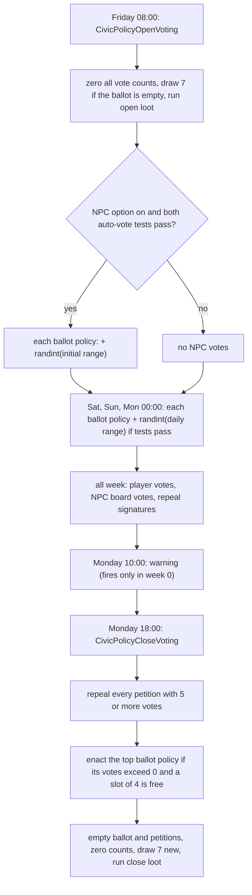
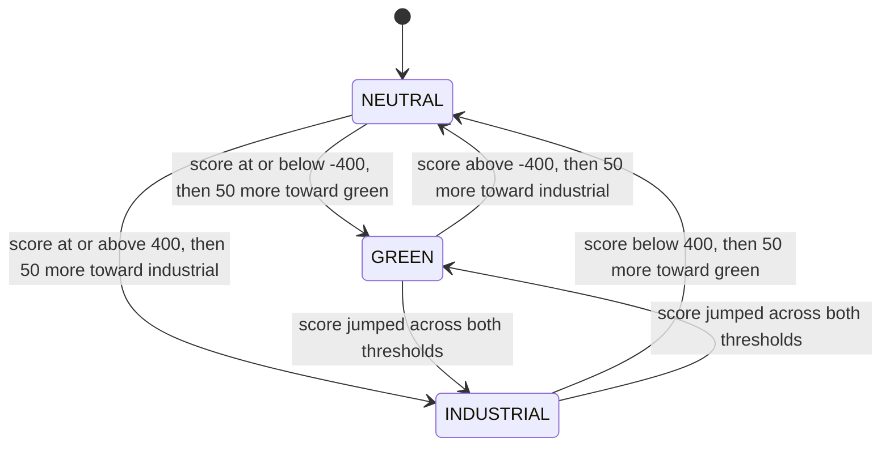
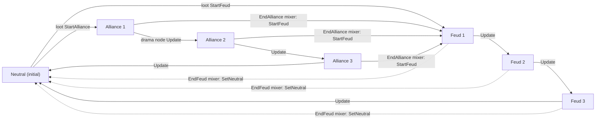

# 2.07 Neighbourhood systems: civic policies, eco footprint, narratives

*Game version 1.128.90.1030 (Steam, Linux/Proton). The numbers come from the live tuning merge and the base module tuning, with EP04 (Cats & Dogs), EP06 (Get Famous), EP09 (Eco Lifestyle), EP12 (High School Years), GP04 (Vampires), GP12 (Werewolves), SP01 (Luxury Party) and SP42 (Grunge Revival) installed. Records that exist only for packs that are not installed are marked "patch data, pack not installed" and are never counted as live. Written 2026-10-12. Checked 2026-10-12: 130 claims checked, 10 corrected, 3 relabelled, 1 removed, 4 added. Deepened 2026-10-13: 0 modules newly explained, 1 failed decompile read. Checked again 2026-10-13: 166 claims checked, 12 corrected, 1 relabelled, 1 removed, 2 added. Cross-chapter edits 2026-10-13: 4 applied.*

## In plain words

Every street keeps a small town council. In the game's interface the council is called **Neighborhood Action Plans**; in the code the plans are **street civic policies**. Each week voting opens on Friday morning and closes on Monday evening. During the week the street's ballot holds seven random plans. You spend **influence** (a points currency you earn from careers, rewards and certain actions) to add votes, NPCs add votes of their own at random, and at the close the single plan with the most votes is enacted, as long as the street has fewer than four plans in force. A plan in force can be thrown out with a repeal petition: start one, collect five signatures before the close, and it is repealed. An enacted plan hands out traits and buffs to the residents and the Sims walking around, changes the scenery, can switch off the power or water one day a week, and in the Evergreen Harbor districts can rebuild whole blocks.

The **eco footprint** is a green-to-industrial score for each street, from -500 (green) to +500 (industrial). Every lot has its own score, which climbs or falls while objects on that lot sit in "clean" or "dirty" states. Once an hour the game works out where the street is heading, a weighted average of its lots in which the lots of played households count far more, and the street score drifts toward that point at a fixed speed. Below -400 the street turns green (fresh air, sun rays, a green sky tint); above +400 it turns industrial (smog, acid rain, an industrial sky). Some action plans pull the street greener.

**Narratives** are long-running, game-wide story states. Only one family of them is live in this install: the two werewolf packs of GP12 (Werewolves) moving between neutral, three steps of alliance and three steps of feud. The narrative service can also swap situations, change the sky, load scenery and run loot on every Sim when a narrative starts, but those features are only used by packs that are not installed here.

Two more systems sit in the same folders and do nothing on this install. **Global policies** are island-wide conservation goals for EP07 (Island Living); the code runs but no policy record is loaded. The **balance system** is EP19 (Enchanted by Nature) tuning that only the game client reads.

## Key facts

- **30 of 30 live streets run a voting provider.** There are 25 `StreetCivicPolicy` records, all EP09 (Eco Lifestyle). Twenty-seven streets offer the same 19 policies. The three EP09 streets offer 21: those 19 plus their district's green and modern renovation plans.
- **The voting week runs from Friday 08:00 to Monday 18:00.** That is 82 Sim hours. The close warning is meant for Monday 10:00, but its alarm is computed against week 0 of the calendar, so after a save's first Sim week it never fires. Each close draws a new ballot of 7 random dormant policies; a player can add an 8th.
- **NPC votes are random rolls.** Each policy on the ballot gets `randint(initial range)` votes when voting opens and `randint(daily range)` more at 00:00 on Saturday, Sunday and Monday. The expected total runs from 0 (Communal Ownership, tuned 0 to 0) to 7 (the renovation plans).
- **A close enacts at most one policy.** The winner is the ballot policy with the most votes, provided it has more than 0 and the street has a free slot out of 4. Ties go to whichever comes first in an unordered set.
- **A repeal needs 5 signatures by the close.** The live tuning sets 5; the code default is 10. Starting a petition costs 10 influence. The code defines a one-at-a-time repeal limit but never reads it.
- **Influence is `InfluenceBuck`.** The influence loots pay 1, 4, 8, 15 or 50. Career and household rewards pay 2, 5 or 10. The server takes the influence total the client reports when you submit the board and never prices the votes itself; the per-vote price of 10 is read only by the client. A total larger than the balance deducts nothing, and the votes still count.
- **The NPC voting option is not enough by itself on most streets.** On the 27 non-EP09 streets automatic votes also need a resident Sim who has been played. On every street they also need fewer than 4 enacted policies.
- **The street eco score drifts 5.4 points per Sim hour** toward a convergence point that is recomputed every hour. Played lots carry 70% to 100% of the weight once any lot is played. The thresholds are -400 and +400, and crossing one pushes the score 50 points further.
- **Lot scores come from object states and build pieces.** There are 569 lot-footprint modifier entries on 163 object records. They run from -0.0175 to +0.07 points per Sim minute and change the active lot's score. A bonfire adds about 100 points a day. Tagged build pieces and objects add more through the hidden lot trait `ZoneModifiers_Hidden_BBGameplayEffects`, only while the building eco-effects option is on.
- **A green renovation plan multiplies the street's green-ward drift by 3 for every zone on the street.** The multiplier is applied once per zone id, and the test behind it is street-wide, so a street of N zones drifts 3^N times faster. Separately, the plan's added offset to the convergence point is only -0.9 points.
- **Seven narratives are live, all GP12, and one starts on its own.** `narrative_WerewolfPack_AllianceFeud_Neutral` is the only live entry of the seven in `INITIAL_NARRATIVES`. An initial narrative is created without its `start()` call, so its trait loot does not run.
- **26 more narratives are patch data, pack not installed.** EP07 has 3, EP20 (Adventure Awaits) 10, EP21 (Royalty & Legacy) 2, GP07 (StrangerVille) 4 and GP09 (Journey to Batuu) 7. There are also 8 `GlobalPolicy` records in EP07 patch data and 0 live.
- **108 live records test for EP07 global policies, and those tests fail here.** They are cooking and fishing records that ask for an EP07 policy at COMPLETE. The pack-safe reference list comes out empty, so the test fails for COMPLETE and would pass only for NOT_STARTED.
- **One defect is reached in normal play: the close warning.** Its alarm subtracts the current time from a close time stored as week 0, so it is armed only during a save's first Sim week (**Observed** in the bytecode; not checked in a running game).
- **Five more defects are confirmed in the bytecode and normal live play does not reach them.** One is an `IndexError` when a lot's venue changes during a utility shut-off, one a `TypeError` in the repealable-policy event keys, one an `AttributeError` on a hand-typed player vote for a policy that is neither on the ballot nor up for repeal, one a `KeyError` when ending a locked narrative, and one an "above" link taken on a fall below the threshold. A seventh defect, in the narrative loot queue, is reachable only if two batches overlap. Two tuning slips are live. The modern Suburban branch of both the NPC board vote and the repeal signature interaction tests the green Suburban plan, so NPCs vote for the modern Suburban plan only while the green one is on the ballot, and a petition against the modern Suburban plan gets board signatures only while the green one is also up for repeal. The NPC board's four branches for the community-lot venue policies can never pass on a street.

## How it works

### The street service and its providers

**Observed** (`simulation/civic_policies/street_civic_policy_service.py: StreetService`, `street_civic_policy_provider.py: StreetProvider`).

- `StreetService` needs EP09 (`required_packs`). At load it builds one `StreetProvider` for every live `Street` whose `civic_policy.civic_policies` is not empty. On this install that is all 30 streets.
- It saves one `street_data` entry per street, holding the civic provider data and the eco footprint data. It also keeps two options in the save options: `npc_civic_voting_enabled` (the NPC voting checkbox) and `eco_footprint_gameplay_enabled`.
- `StreetProvider` combines `BaseCivicPolicyProvider` (voting) with `EcoFootprintStateProviderMixin` (eco footprint). It hard-codes 4 enacted, 8 on the ballot, 7 on a refill, 1 repealable and `provider_type_id` 2.
- **Residents** are the Sim infos of households living in the street's zones. They get the open and close loots, and the resident-loot effects run on them.
- **Eligible voter** means the household's home world is this street. Only an eligible voter sees enabled board controls.
- `is_new_policy_allowed(sim)` is true when the ballot has fewer than 8, fewer than 4 are enacted, a dormant policy exists and the Sim is eligible.
- The street record's `default_layers` (EP09 InnerCity 7, Suburbs 10, Industrial 9) are the base scenery layers that the renovation plans hide.
- `BaseCivicPolicyProvider` has no source (`civic_policies/base_civic_policy_provider.pyc` failed to decompile). Everything said here about it comes from the per-function rescue and from the disassembly of its class body. Venue providers reuse the same base; they belong to [2.01 Lots, venues and rooms](2.01-lots-venues-rooms.md).

### The voting week

**Observed** (`BaseCivicPolicyProviderServiceMixin` in the rescued provider, module tuning `civic_policies.base_civic_policy_provider`).

`CIVIC_POLICY_SCHEDULE` defaults to open Monday 08:00 and close Sunday 16:00, with an 8-hour warning. The base delta changes this to open **Friday** (the hour keeps its default of 8) and close **Monday at 18:00**. The warning duration is not tuned, so the warning is meant for Monday 10:00. The open and close alarms are week-time alarms with `cross_zone=True`, and a time already past rolls to the next week.

**The warning alarm is broken** (**Observed**, bytecode of `_set_next_warn_alarm` offsets 46 to 78 and `_times_from_voting_time_of_week` offsets 18 to 30). `_start_voting_timer` stores the close time as `create_date_and_time(day, hour)`, an absolute time in week 0 of the calendar; only the alarm delay is converted to a week time. `_set_next_warn_alarm` then computes `close_time - sim_now - 8 h` with a plain tick subtraction and arms the alarm only if that is positive. From the save's second Sim week on it is negative, so no warning alarm is set at any zone load and the warning notification never shows. In week 0 it can fire once. The `voting_time_until_change` test reads the same week-0 times and goes wrong the same way, but no live tuning uses it.

- `voting_open` is true when both times are known, the current time is between them and is not exactly the close time.
- **Open.** The service updates the board tooltips, shows the open notification (only for the active household's street, and only when the eco footprint option is on; there is a variant for a street that already has 4 policies) and fires the test event `CivicPolicyOpenVoting`. Every provider hears the event and runs `open_voting`: it zeroes every vote statistic, re-runs `finalize_startup` (which picks a fresh ballot if it is empty), runs `voting_open_loot` on each resident (no live street tunes one) and, if the auto-voting tests pass, adds `randint(initial_vote_random_range)` votes to each ballot policy.
- **Daily roll.** An alarm at the next 00:00 fires while voting is open: if the NPC option is on, `CivicPolicyDailyRandomVoting` makes each provider add `randint(daily_vote_random_range)` votes per ballot policy. Opening on Friday 08:00 gives rolls on Saturday, Sunday and Monday at 00:00. At Tuesday 00:00 voting is shut and the alarm stops.
- **Close.** The service shows the close notification, tells the client to hold its cache updates (`MSG_SUSPEND_CACHE_UPDATES`), fires `CivicPolicyCloseVoting` and resumes updates.
- `_select_balloted_policies` (bytecode) clears the ballot and draws policies one at a time with `random.Random().choice` from the dormant list, without repeats, until it has 7 or the list runs out. Dormant means offered, not enacted, not balloted and not up for repeal.
- On the first load of a save that has no street data yet, voting that is already open is opened quietly (no dialog). The call to action `callToAction_CommunityBoard_Vote` starts once per session.



### Who casts votes

**Observed** (provider bytecode and rescue, `street_civic_policy_commands.py`, live tuning).

A vote is a plain addition to the policy's `vote_count_statistic`. On the street these are `statistic_Street_CivicPolicy_Vote_*` records with a range of 0 to 99, so a count stops at 99. Votes come from five places:

1. **Automatic rolls** (above). `StreetProvider.run_auto_voting_tests` (bytecode; the decompile wrongly nests everything under the street test) returns False if the NPC option is off. It then runs the street-level test set with a `StreetResolver` and returns False if that fails. An empty per-Sim test set returns True; otherwise it returns True as soon as one resident passes. Live tuning:
   - all 30 streets: the street test is "enacted count of the 25 policies is less than 4";
   - 27 streets: the per-Sim test is `sim_info.has_been_played` True, so a street with no played resident gets no automatic votes;
   - the 3 EP09 streets: no per-Sim test.
2. **The community board.** The UI sends `civic_policy.handle_community_board` (Live) with a text proto. For each policy in the reply it calls `add_to_ballot` and then `vote_by_instance(count, user_directed=True)`, and finally `modify_influence(-influence_points)`. The voting window, eligibility, the per-policy counts and the influence total are not checked on the server side; the client disables the controls. `modify_influence` hands the total to `try_modify_bucks` and drops the result (bytecode offset 56): a total larger than the balance is refused whole, so nothing is deducted while the votes stay counted, and a negative total adds influence.
3. **NPCs at the board.** `si_CommunityBoard_Vote_NPC_Random` has 29 test-gated branches: 25 run `civic_policy.street.vote <policy>` for one vote and 4 name the community-lot venue policies (`venueCivicPolicy_CommunityLot_*`). Each street branch is gated on its policy being balloted on the board's own street (`via_zone_source`, current zone). The branch for `NeighborhoodRenovation_ModernPolicy_Suburban` tests the green Suburban plan (233193) instead, a tuning slip: NPCs vote for the modern Suburban plan only while the green one is on the ballot. The four venue branches test their venue policy as balloted (count EQUAL 1) on the street, which offers no venue policy, so they never pass; their command, `civic_policy.street.vote`, would not find the policy on a street either. **Inferred** (from `TestBasedOutcome.decide`, whose decompile garbles the branch nesting but not the closing `weighted_random_item`): every passing branch enters one weighted pick, so a run casts one vote for one balloted policy.
4. **Lobbying.** `mixer_Social_CivicPolicy_ConvinceToSupportPolicy` costs 5 influence (a bucks payment that deducts; [5.01](5.01-money-bills-rewards.md) covers bucks payments) and votes 1 for the picked policy, passing the actor as the target, so the vote lands on the actor's home street. The Civil Designer career's `career_CivilDesigner_RallyVoters_Continuation` also votes.
5. **Repeal signatures.** `si_CommunityBoard_ApplyRepealSignature` has one branch per policy (25), each gated on its policy being up for repeal on the board's street and adding a vote to that policy. The modern Suburban branch carries the same slip as the NPC board: it tests the green Suburban plan (233193) as repealable. A petition against the modern Suburban plan therefore gets no board signatures unless the green plan is up for repeal too, and while the green plan is up, the weighted pick can send its signatures to the modern plan.

`civic_policy.street.vote` resolves the street from the target Sim's home world. The NPC board, signature and Rally Voters commands pass only the policy, so the target falls back to the active Sim: `DoCommand` runs every tuned command with the first client's id, and `OptionalSimInfoParam` without an id returns that client's active Sim ([1.04](1.04-debug-cheats-telemetry.md) documents the parameter). So NPC board votes and signatures count on the active household's home street, wherever the board stands, even though the branch tests read the ballot of the street where the board is (**Observed**, live tuning arguments and `interactions/utils/tunable.py: DoCommand._do_behavior`). A vote for an offered policy that is not on the home street's ballot still raises its count; the count matters only if that policy is up for repeal there or joins the ballot before the close.

**Expected NPC votes per week** when the tests pass (mean of `randint(lo, hi)` is (lo+hi)/2):

| Policy group | Initial | Daily | Mean NPC votes per week |
|---|---|---|---|
| Skill-based (10 of them) and Eco-Friendly Appliances | 2 to 5 | 0 to 2 | 6.5 |
| Old Days | 0 to 3 | 0 to 1 | 3.0 |
| Object-based (3) | 1 to 4 | 0 to 2 | 5.5 |
| Shut-off days (2) | 1 to 3 | 0 to 3 | 6.5 |
| Bag the Neighborhood | 1 to 3 | 0 to 2 | 5.0 |
| Communal Ownership | 0 to 0 | 0 to 0 | 0 |
| Green and modern renovations (6) | 0 to 2 | 0 to 4 | 7.0 |

### Closing: enact and repeal

**Observed** (`BaseCivicPolicyProvider.close_voting` and its inner `get_most_voted_for_policy`, bytecode).

1. `to_enact` holds the one ballot policy with the highest vote count, via `max()`. If that count is 0 or less, the set is empty.
2. `to_repeal` holds every policy up for repeal whose count is at least `REPEAL_PETITION_THRESHOLD` (5 live).
3. `to_repeal -= to_enact`, `to_enact -= enacted`. The repealed policies leave the enacted set and run `repeal()`.
4. `new_enact_max_count` = min(policies offered, 4) - enacted. Because it is computed after the repeals, a repeal frees a slot for the same close. `to_enact` is trimmed to fit.
5. The winner is added and `enact()` runs. Ballot and petitions are emptied, counts zeroed, a new ballot drawn and `voting_close_loot` run on the residents. On every live street that loot is `loot_CivicPolicy_Repeal_StopProcess`, which removes `trait_CivicPolicy_RepealStarted` and every `relationshipBit_AskedforSignature`.

`StreetCivicPolicy.enact` and `repeal` flip the policy, call every effect, and fire `TestEvent.CivicPoliciesChanged` keyed by `(street, policy type)`.

A repeal starts from `mailbox_StartRepeal` or `si_CommunityBoard_GoToRepeal_Continuation`, which run `civic_policy.street.begin_repeal`. `add_for_repeal` accepts only an enacted policy that is not already up. `loot_CivicPolicy_Repeal_PayInfluence` takes 10 influence and adds the RepealStarted trait; the policy pickers `community_Board_Policy_Repealable_Picker` and `community_Mailbox_Policy_Repealable_Picker` run it (live tuning). `immediate_CommunityBoard_StopRepeal` runs `end_repeal` and the StopProcess loot. `max_repealable_policy_count` (1) has no reader in the Python. The one-petition limit lives in the interaction tests instead: `si_CommunityBoard_GoToRepeal` and `mailbox_GoToVote_RepealablePolicies` need at least one of the 25 policies enacted, none of them up for repeal (a repealable blacklist of all 25) and voting open. Both show a price of 10 influence that is display-only ([5.01](5.01-money-bills-rewards.md)).

The close notification for a street with 4 policies (`StreetService._get_close_notification`) picks success or failure from the first policy up for repeal. With one petition allowed that is the only one.

### Influence

**Observed** (`get_influence`, `modify_influence` in the rescued provider; live tuning).

- Influence is the bucks type `InfluenceBuck`, read through `BucksUtils` with the Sim's id as owner. How bucks trackers work belongs to [5.01 Money, bills, perks and rewards](5.01-money-bills-rewards.md).
- Live sources: 329 tuning references to `InfluenceBuck`.
  - `SimReward`: base 196 (139 paying 5, 57 paying 10), EP09 24, EP12 (High School Years) 20, EP06 (Get Famous) 11.
  - `HouseholdReward`: 2, 5 or 10.
  - EP09 loots: `loot_CivicPolicy_InfluencePoints_GiveSingle` 1, `_Small` 4, `_Medium` 8, `_Large` 15 and `_ExtraLarge` 50. Each also runs two Civil Designer follow-up loots.
  - Per-policy rewards: Utility Production pays a small reward daily per dew collector, solar panel and wind turbine; Self Sufficient pays on Tuesday for surplus utilities and off-grid lots.
- Spending: the board total sent by the client (refused whole, with the votes still applied, when it exceeds the balance), 5 for the lobbying mixer, and 10 to start a repeal. `INFLUENCE_TO_VOTE_COST` (10, exported to all) has no Python reader.

### The provider's bookkeeping

**Observed** (`civic_policies/base_civic_policy_provider.pyc`, which has no decompiled source: the methods from the per-function decompile, `vote_by_instance` and `create_add_policy_picker` from the bytecode). These are the rules every street provider inherits; venue providers share them ([2.01](2.01-lots-venues-rooms.md)).

- **Four sets.** A provider builds one instance of every offered policy and keeps three subsets of them: enacted, balloted and up for repeal. Dormant is what is left. The vote counts are statistics on the provider's own statistic component, so they save with the provider's trackers; `_reset_voting_statistics` sets each to 0 and clears it.
- **Direct enact and repeal** (the Live `civic_policy.street.enact` and `.repeal`, through `StreetService`; the close changes the sets itself, as above). `enact` refuses a policy the street does not offer, one already enacted, and any policy when `new_enact_max_count()` is exactly 0; otherwise it removes the policy from the ballot and from the petitions and enacts it. It does not look at the voting window. `repeal` needs an enacted policy and drops any petition for it.
- **The ballot.** `add_to_ballot` takes any offered policy with a vote statistic that is not balloted yet, enacted ones included, and checks no cap. The cap of 8 lives only in `is_new_policy_allowed` (which the base class answers False and `StreetProvider` overrides) and in the add picker.
- **The add picker** (`create_add_policy_picker`, bytecode). Its rows are the dormant policies the player has not already picked in this board session, each with its description as tooltip. Its selectable count is set at run time to min(rows, 8 - balloted - already picked), which overrides the 7 tuned in `COMMUNITY_BOARD_TEXT.add_policy_picker`. With the usual ballot of 7 that leaves 1. After a pick the client is told whether more can be added.
- **A vote** adds the count to the policy's statistic whatever list the policy is on. A user-directed vote also ranks the policy among the ballot (factor +1) or the petitions (factor -1) before and after, for telemetry; a lobbying vote records only the factor. **Defect, not reached by the board**: in the bytecode (offsets 90 to 94) a user-directed vote calls the ranking helper even when the policy is in neither list, and the helper then sorts `None`, which raises `AttributeError`. The board always balloted the policy first, so only a hand-typed `civic_policy.street.vote <policy> <sim> <count> True` or a script mod gets there.
- **Save and load.** Each offered policy saves its own data, then the ballot and petition ids, then the trackers. Load rebuilds the enacted set from the policy data, and drops ballot or petition ids for policies the street no longer offers.
- **The board view.** Enacted policies carry a vote count only while up for repeal; balloted policies carry their count and the statistic's maximum (99). The view carries a disabled tooltip for the policies while voting is closed; when the Sim is not an eligible voter it sets that one and a second for the whole board.

### What a policy does: the effects

**Observed** (`simulation/civic_policies/street_civic_policy_effect.py`, live tuning). A policy is a list of `civic_policy_effects`, each a snippet of one of these classes. The live counts are the 142 effect records.

| Effect class | Live | What enact does |
|---|---|---|
| `StreetConditionalLayerEffect` | 39 | load a conditional layer, after an optional delay |
| `HideDefaultStreetConditionalLayerEffect` | 30 | hide one of the street's default layers, reference-counted per policy |
| `StreetResidentSimLootEffect` | 22 | loot on every resident, including Sims who move in later; optional weekly scheduled loot |
| `StreetMapOverlayEffect` | 21 | add a `MapOverlayEnum` to the street and send `MSG_NS_NEIGHBORHOOD_UPDATE` |
| `StreetInstancedSimLootEffect` | 16 | loot on every instanced Sim on the active street, and on each Sim spawned later |
| `StreetWeatherEffect` | 4 | send a `SeasonParameterUpdateOp` (see [2.04](2.04-weather-seasons-ground.md)) |
| `StreetLootEffect` | 3 | loot with a `StreetResolver` |
| `StreetUtilityShutoffEffect` | 2 | switch a utility off on residential and dorm lots on a weekly schedule |
| `StreetPlexExteriorChangeEffect` | 2 | swap a lot's house description for a plex exterior |
| `StreetActiveSimLootEffect`, `StreetLotsLootEffect`, `StreetCreateSituationEffect` | 1 each | loot on the active Sim, loot per lot (`LotResolver`), create a non-user-facing situation |

- **Layer timing.** `BaseStreetConditionalLayerEffect` stamps the enact or repeal time and applies the change after `delay_from_change`. Live delays are 2, 4 or 6 Sim days on 45 of the 69 layer effects; the other 24 apply at once.
  - If the player is not on that street when the time comes, the change is marked pending (saved as the sentinel 2^64-1) and runs on the next load of the street, without its dialog.
  - `StreetProvider.hide_conditional_layer` and `hide_default_conditional_layer` use `GRADUALLY` speed while the zone runs and `IMMEDIATELY` during load. Layer paging itself belongs to [2.01](2.01-lots-venues-rooms.md).
  - 66 of the 69 layer effects that a policy lists point at client-only layers. The other 3 (the InnerCity apartment block base and modern layers and the modern railway station) are server-side.
- **Not referenced.** Four effects belong to no policy and no eco state: `streetActiveSimLootEffect_EcoFootprint_Green` and the three `streetResidentSimLootEffect_EcoFootprint_*`. Nothing runs them. Four plain `streetConditionalLayerEffect_RemoveTrashLayer_*` effects that nothing lists exist only in EP09's full build, which the game does not load.
- **The policies' gameplay lives in traits and buffs.** Resident loots add `trait_CivicPolicy_*` (for example `trait_CivicPolicy_SkillBased_CreativeArts`). Instanced-Sim loots add `buff_CivicPolicy_NPCAutonomy_*`. Repeal loots remove them. Other tuning reads those traits and buffs; that tuning is not traced here (see Limits).

**Shut-off days.** `streetCivicPolicy_ShutOffDay_Power` shuts the power off on Thursday and `_Water` the water on Wednesday, each from 09:00 for 12 hours, with the reason `CIVIC_POLICY_SHUT_OFF_DAY`. A daily 09:00 scheduled loot fines the active household 100 Simoleons when the lot's utility balance is at or below a household-size threshold and no bill is due. For power the thresholds are -200, -250, -300 and -350 for 1-2, 3-4, 5-6 and 7 or more Sims; for water they are -7, -9, -11 and -12. The shut-off-day policies also halve the matching utility line on the household's bill (0.5 for power or water while `streetCivicPolicy_ShutOffDay_Power` or `_Water` is enacted on the home street). The renovation plans change the bill too: while any of the three modern plans is enacted on the home street, property tax is multiplied by 1.2, and while any of the three green plans is, power and water are each multiplied by 1.5 (module tuning `sims.bills`, `BILL_COST_MODIFIERS_HOUSEHOLD_WITH_REASON`, base delta; each entry is an `enacted` whitelist of the three plans read through the participant's home zone, and a whitelist passes on one match). Bills and utilities are covered in [5.01, Bill multipliers](5.01-money-bills-rewards.md#bill-multipliers).

**The civic inspector.** EP09's civic inspector situation checks the household's lot against the street's enacted policies and changes the next bill (`situations/complex/civic_inspector_situation.py: notify_result_and_push_bill_modifier`). No policy followed sets the lot's `commodity_CivicInspector_notfollowing`; all followed sets `commodity_CivicInspector_following`; a partial result sets neither, so it leaves the bill unchanged. The multipliers and their timing are in [5.01, Bill multipliers](5.01-money-bills-rewards.md#bill-multipliers).

### The 25 live street policies

**Observed** (live tuning, `class_StreetCivicPolicy` dump). "Effects" counts the policy's effect list.

| Policy (`streetCivicPolicy_` + ) | Votes initial / daily | Effects |
|---|---|---|
| `SkillBased_` Aggression, CreativeArts, FreeLove, FunCommunity, HomeCooking, MusicArts, SelfCare, SelfSufficient, TechnologicalProgress | 2-5 / 0-2 | resident trait + NPC buff (2 each) |
| `SkillBased_JuicedCommunity` | 2-5 / 0-2 | 3: also a dazed buff on instanced Sims |
| `SkillBased_OldDays` | 0-3 / 0-1 | resident trait + NPC buff (2); the trait carries `buff_CivicPolicy_PlayerTracking_OldDays`, which adds the three `loot_CivicPolicy_Effect_OldDays_Fine*` loots as extras to some cooking interactions, dumpster woohoo and interactions tagged `Interaction_OldDay_Fine`, and a small influence loot to reading, chess and physical games |
| `EcoFriendlyAppliances` | 2-5 / 0-2 | 1 resident trait |
| `ObjectBased_` GreenGardening, UpcyclingInitiative, UtilityProduction | 1-4 / 0-2 | 1 resident trait each |
| `ShutOffDay_Power`, `ShutOffDay_Water` | 1-3 / 0-3 | shut-off + daily fine |
| `BagNeighborhood` | 1-3 / 0-2 | 1 NPC buff |
| `CommunalOwnership` | 0-0 / 0-0 | resident trait + NPC buff |
| `NeighborhoodRenovation_GreenPolicy_` Industrial, InnerCity, Suburban | 0-2 / 0-4 | 10, 10, 15: layers, map overlays, -40 on every lot; plus, from the bill tuning, power and water bills x1.5 |
| `NeighborhoodRenovation_ModernPolicy_` Industrial, InnerCity, Suburban | 0-2 / 0-4 | 22, 21, 24: layers, overlays, a resident trait, plex exteriors on two; plus, from the bill tuning, property tax x1.2 |

### Eco footprint: lot scores

**Observed** (`objects/components/state.py: StatisticModifierList._start_lot_statistic_gains`, live tuning).

- The lot score is `commodity_EcoFootprint_Lot`: -500 to 500, start 0, decay rate 0. It moves only when something changes it.
- **Object states.** A state value can carry `lot_statistic_modifiers`. While an object is in that state, the game adds an `AutonomyModifier` to `services.active_lot()` that changes the lot commodity at a fixed rate per Sim minute. The code does not check where the object stands, so any loaded object in that state counts toward the active lot.
  - Live: 569 entries on 163 object records. Most rates are ±0.004375 or ±0.00875. The largest are +0.0175, +0.035 (campfire, power generators, atmospheric condenser), +0.07 (bonfire), and -0.0175 (ground solar panel, ground wind turbine, motion game rig).
  - +0.00875 per minute is 12.6 points a day; the bonfire's +0.07 is 100.8.
- **Build pieces.** The hidden lot trait `ZoneModifiers_Hidden_BBGameplayEffects` (235291, base delta, 67 tag keys) also changes `commodity_EcoFootprint_Lot` for tagged columns, fences, floor and wall patterns, roof materials and objects, for example +0.08 or +0.32 per `Minus1` or `Minus2` column and -0.08 or -0.32 per `Plus1` or `Plus2` one, and only while the building eco-effects option is on. These are fixed amounts per piece, not rates per minute: at zone spin-up and on every build-mode exit the trait counts the tagged pieces on the active lot, takes back the total it added last time and adds multiplier x count again, and it moves the lot commodity's convergence value by the change in count (`zone_modifier/zone_modifier.py: ZoneModifier.apply_object_actions`, `zone_modifier_from_objects_actions.py`, `zone.py: Zone.revert_zone_architectural_stat_effects`, `build_buy.py`). The values per piece family (objects 0.25 or 1.5, and -200 for each object tagged `Build_BBGameplayEffect_Object_EcoFootprint_PlusPark`) are in [2.01, Lot traits in the live tuning](2.01-lots-venues-rooms.md#lot-traits-in-the-live-tuning); the same trait's power and water modifiers on objects, roofs and pool surfaces belong to bills and utilities ([5.01](5.01-money-bills-rewards.md)).
- **One-shot loots.**
  - `loot_EcoFootprint_OneShot_Green_Small/Medium/Large/ExtraLarge` take 5, 10, 25 or 50 points. A Sim with `buff_eco_living` takes another 2.5, 5, 10 or 25.
  - The `_Industrial_` versions add 5, 10, 25 or 50.
  - An enacted green renovation plan runs `loot_EcoFootprint_OneShot_Green_CivicPolicy_Enacted` (-40) on every lot of the street. Whether lots that are not loaded keep that change is not traced.
- **Eco upgrades** (EP09 records on base objects, live merge). 85 live plumbing objects (73 base, 7 EP06, 4 EP09, 1 EP12) carry the siphoner fuel states, and 63 the fuel cell's. On all of them the street's eco state picks a decay multiplier for `commodity_EcoUpgrade_Fuel_Siphoner` and `commodity_EcoUpgrade_Fuel_FuelCell`: 1 on a green street, 0.7 on an industrial one, 1 on a neutral one (state values `ecoFootprint_Values_Green`, `_Industrial`, `_Neutral`, set by eco footprint tests on the object's zone when the object is added). **Inferred** (if decay is the only drain): fuel lasts about 1.4 times as long on an industrial street. Whether the state is re-picked when the street changes state later was not traced. Only the two hot tubs, `object_hottub_EVG_Anniversary` and `object_hottub_InGround`, put a lot modifier on `ecoUpgrades_Fill_Values_Siphoner_HasFuel`: +0.00875 per Sim minute, toward industrial, while the siphoner holds fuel.
- The eco inspector situation sets the street score directly (see [4.01](4.01-situations-npcs.md)).

### Eco footprint: the street score and convergence

**Observed** (`simulation/eco_footprint/eco_footprint_state_provider_mixin.py`, `eco_footprint_tuning.py`, `tunable_multiplier.py: TestedSum` bytecode).

The street score is `commodity_EcoFootprint_Street`: -500 to 500, start 0, `decay_rate` 0.09 per Sim minute (5.4 per hour). Per [3.03](3.03-needs-statistics.md), decay moves a commodity toward its convergence value at the base rate times the product of its decay modifiers. The eco code moves that convergence point.

```
p           = played lots / all lots on the street
w           = played_lot_weight(p)      (linear between the tuned points)
aggregate   = w * mean(played lot scores) + (1 - w) * mean(unplayed lot scores)
convergence = clamp(aggregate + tested_sums, -500, 500)
drift       = 0.09 * product over street zones of per-lot multipliers   (points per Sim minute)
```

- **Lot scores.** A lot is played if any household on it `is_played_household`. Its score is the live lot commodity for the active lot, else the value saved in the zone data, else the native `get_eco_footprint_value(house description)`.
- **Curve points.** `played_lot_weight` passes through (0, 0), (0.01, 0.7), (0.2, 0.75), (0.4, 0.8), (0.6, 0.9), (0.8, 0.95) and (1, 1). One played lot out of 10 gives w = 0.724.
- **Tested sums.** -0.9 is added while any of the three green renovation plans is enacted on the current street.
- **First run.** The first computation seeds the street score from the street's `initial_street_eco_footprint_override` if it has one: -500 on 3 streets, +500 on 1 (listed in [2.06](2.06-worlds-regions-travel.md)). Otherwise it seeds the score with the convergence.
- **Hourly update.** Every hour (`update_interval` default 1 h; the alarm is repeating) the game recomputes convergence from the cached contribution of the other lots plus the active lot's current score. It then refreshes the drift modifier and re-checks the state. A build-mode exit recomputes too.
- **Direction multipliers** (`convergence_rate_tuning`, `TunableMultiplier` with base 1):
  - Toward green: ×1.1 for each lot with `zoneModifier_lotTrait_EcoLot`. ×3 when a green renovation plan is enacted. That test reads the current street, so it passes for every zone and the street gets 3^N.
  - Toward industrial: ×1.2 for each lot with `zoneModifier_lotTrait_LandfillLot`.
- **Only the current street simulates.** `finalize_startup` runs the full computation and the hourly alarm only for the street you are on. Other streets keep their saved convergence.
- **Worked example.** One played lot at -100 among 10, the other nine averaging +20: aggregate = 0.724 × -100 + 0.276 × 20 = -66.9. A street at 0 reaches that in about 12.4 Sim hours. To turn the street green, the aggregate has to sit at -400 or below. Even with the played lot at -500, the nine others would need to average about -138. A street with convergence at -500 and no multipliers crosses -400 after 74 Sim hours from 0.

### Eco footprint: states and what they change

**Observed** (`EcoFootprintTunables.eco_footprint_value_to_state`, `change_state`, the three `EcoFootprintState` records).



The state is checked hourly and when the option or the street changes. A change exits the old state's effects, enters the new state's, and adds `additional_footprint_change_on_state_change` (50 live, code 0) in the direction of travel, so the score does not flicker on the line. The thresholds are not tuned, so the code defaults of -400 and 400 apply. `update_simulation_if_stale` (bytecode) enters the current state when the option is switched on and exits it when switched off; the option is the "eco footprint gameplay" checkbox (`eco_footprint.set_eco_footprint_enabled`). The native `get_is_eco_footprint_compatible_for_world_description` decides which worlds take part at all. On an incompatible world every eco test fails, including inverted ones.

The colours are the map and street-descriptor colours from `ECO_FOOTPRINT_UI_TUNABLES`, a client-only export; `ECO_FOOTPRINT_STATE_DATA` holds only the states, the thresholds and the push.

| State (UI colour) | Effects on enter (repeal on exit) |
|---|---|
| Green (75, 166, 74) | street loot: plants and tagged objects switch to green states, a notification and a music sting; instanced Sims get `buff_EcoFootprint_Hidden_Green`; map overlay GREEN; sky parameter ECO_FOOTPRINT to 2 at once; `situation_EcoFootprint_SunRays` places a sun-ray object |
| Neutral (152, 153, 133) | street loot: objects to neutral, sun rays off, the sun-ray situation destroyed |
| Industrial (201, 169, 39) | street loot: plants and objects to industrial states; instanced Sims get `buff_EcoFootprint_Hidden_Industrial`, the acid-rain state when outside in rain, and lose the fresh-air buffs; map overlay INDUSTRIAL; ACID_RAIN 1.0 over 15 Sim minutes, the industrial smog skybox at 0.85, ECO_FOOTPRINT 3 |

`force_set_eco_footprint_state` (the Cheat `eco_footprint.set_eco_footprint_state`) sets the street to -500, 0 or 500 and, by default, every lot to the same value, then recomputes.

### Neighbourhood action plans and street challenges

**Observed** (string tables of the base game and EP09, live tuning). All 30 street providers use the board title string 0xEA344460, "Neighborhood Action Plans". The action plans are the street civic policies described above; there is no second system. The Python has no module, class or tuning type for street or neighbourhood challenges, and neither the base nor any installed pack has an English string for one. Any such feature belongs to a pack that is not installed here.

### Narratives: the service

**Observed** (`simulation/narrative/narrative_service.py`, `narratives.py`, bytecode where noted).

- **A narrative** belongs to one or more `narrative_groups`. Starting one ends every active narrative that shares a group. A narrative cannot start while it is active or locked.
- **`start()`** shows `dialog_on_activation`, plays `audio_sting` and queues `sim_info_loots`. The queued loots run on every instantiable Sim info, sliced into 0.1 seconds of real time per service update (`TIME_SLICE_SECONDS`, code default). Saving is locked until the queue is empty.
- **Ending** moves a narrative to the completed set. Completed narratives are never restarted from `INITIAL_NARRATIVES`, but loots and commands can start them again.
- **Zone load.** Every `INITIAL_NARRATIVES` entry that is neither active nor completed is created and stored, without its `start()` (bytecode of `on_zone_load`).
- **Events.** `handle_narrative_event` follows `narrative_links` from an event to the next narrative. `handle_narrative_event_progression` adds to a per-event counter and follows `narrative_threshold_links` when the counter leaves its interval (code default -50 to 50). The bytecode of `apply_progression_for_event` takes `below_link` only when below the interval and a below link exists; in every other out-of-interval case it takes `above_link`. So a fall below the interval with no below link follows the above link.
- **Other hooks.**
  - Situation replacement: `get_possible_replacement_situation` returns the first active narrative's replacement whose tests pass ([4.01](4.01-situations-npcs.md) shows where the situation manager asks).
  - Extra situation shifts for the bar and library zone directors, keyed `BarVenue` and `LibraryVenue`.
  - `narrative_layers` per street, loaded gradually at 5 objects per Sim minute and destroyed 2 at a time (live; see [2.01](2.01-lots-venues-rooms.md)).
  - Environment overrides: sky parameters and an override forecast, as in [2.04](2.04-weather-seasons-ground.md).
  - An `introduction` dialog on the next zone load, shown once.
  - Suppression of the lot travel sting.
- **`narrative_aware_component`** maps narratives to object states. No live object uses it.

### Live and patch-only narratives

**Observed** (live tuning; the decoded patch tuning).

The seven live narratives are GP12's werewolf-pack relations, all in the group `WerewolfPack_AllianceFeud`: `narrative_WerewolfPack_AllianceFeud_Neutral` (289594), `_Alliance_1/2/3` and `_Feud_1/2/3`. Neutral, Alliance_1 and Feud_1 carry `sim_info_loots` that give pack members (`trait_WerewolfPackA` or `B`) the matching hidden trait. None of the seven uses links, thresholds, layers, replacements or environment overrides, so in this install narratives drive traits and test results only. The bar and library sources add nothing either, because no live narrative tunes `additional_situation_shifts`.



The StartAlliance and StartFeud loots run from `buff_WerewolfPack_AllianceFeud_Hidden_Neutral` and from debug interactions. The EndAlliance mixer is tested on any alliance stage and starts Feud 1; the EndFeud mixer is tested on any feud stage and runs SetNeutral. The leader-to-leader talk (`social_WerewolfPack_LeaderToLeaderTalk`) runs StartFeud with no narrative test, so it can start Feud 1 from any stage but Feud 1 itself. The drama node is tested on all six alliance and feud stages.

`loot_WerewolfPack_AllianceFeud_Update` (run by `dialogDramaNode_WerewolfPack_AllianceFeud`) holds six `start_narrative` operations, each tested on the currently active stage, plus a notification tested on stage 3 of either track. It sets `run_test_first`, which makes `LootActions.get_loot_ops_gen` test all operations before applying any (bytecode of `interactions/utils/loot.pyc`), so one run moves exactly one step.

Patch data, pack not installed (26 records, never live): EP07 `narrative_IslandConservation_Stage_Starting/Intermediate/Final`; EP20 `narrative_WorldPOI_StoryMap_*` (8), `narrative_ButterflyCollection_CryptidQuest_Complete` and `narrative_Cryptid_SocialsUnlocked`; EP21 `narrative_PowerShifts_Sword_InStone/NotInStone`; GP07 `narrative_Strangetown_Act1` to `Act4`; GP09 `narrative_Batuu_Introduction` and three levels each of `Batuu_Resistance` and `Batuu_FirstOrder`. Six of the seven `INITIAL_NARRATIVES` ids point at these (201915 GP07 Act1, 204761 EP07 Starting, 233606 and 233609 GP09 level 1, 239636 GP09 introduction, 484829 EP21 sword in stone) and are dropped on load. The module enums still name groups for StrangerVille, the island conservation, Batuu (two) and the sword, events only for StrangerVille and the island conservation, and environment parameters for StrangerVille and Batuu.

### Global policies (EP07, patch data only)

**Observed** (`simulation/global_policies/*`, bytecode where noted).

- **A `GlobalPolicy`** has a progress value: initial 0, maximum 100, `decay_days` 5 (code defaults; EP07 patch data, pack not installed, sets 60).
- **Progress.** `global_policy_add_progress` loots and the Automation command `global_policy.set_progress` move the value.
  - Reaching the maximum sets COMPLETE, turns the effects on and schedules decay after `decay_days`. Decay resets the value to the initial value and runs `loot_on_decay`.
  - Falling to the initial value sets NOT_STARTED and turns the effects off. Anything in between is IN_PROGRESS.
- **Effects.**
  - `BillReduction` (reason default `GlobalPolicy_ControlInvasiveSpecies`, 50%): reductions for the same reason multiply, and the amount is used as the bill multiplier itself, so a policy tuned to reduce bills by 20 percent leaves 20 percent to pay (`Bills._get_bill_multiplier`; at the default 50 both readings agree; see [5.01](5.01-money-bills-rewards.md)).
  - `ScheduleUtilityShutOff`: `chance` is optional and off by default, and then every scheduled outage happens. When it is on (value default 10%, and 10 in the EP07 patch data, pack not installed), the bytecode of `scheduled_start_action` returns early, skipping the shut-off, when `random() < chance`. So a 10% chance gives the outage 90% of the time, which is the reverse of the tunable's description.
- **Tests.** `global_policy_state` reads all policies or specific ones. In `_SpecificPolicy.test` the bytecode puts the loop at function level (the decompile nests it wrongly): an empty list fails for any state except NOT_STARTED, and otherwise every listed policy must be in the state.
  - Live: 108 records use it, all with `specific_policy` and COMPLETE: 62 cooking records (EP07 `SupportOrganicProduce`, 207010; 59 start-crafting and 3 group-crafting interactions) and 46 fishing records (`ControlOverfishing` 206802 on 7 fishing interactions, `ControlInvasiveSpecies` 206803 on 38 `FishingData` records and 1 fish).
  - The references are pack-safe and EP07 is absent, so the list is empty and every one of these tests fails.
- No live `GlobalPolicy` exists. The 8 EP07 records are patch data, pack not installed.

### Balance system (EP19, client only)

**Observed** (`simulation/balance_system/balance_system_tuning.py`, module tuning). `BalanceSystemTuning` exports only to the client binary. Its commodity is `commodity_BalanceSys_BalanceAxis` (427050), which exists only in EP19 patch data. The bands are: balance from 25 to 100, minor imbalance from -35, major imbalance from -100. The 25 and -35 are tuned; the code says 50 and -50. There are 19 buff-to-description pairs for the UI. Python reads none of it. The option `misc_options.set_balance_system_enabled` is Live with pack EP19, so it does not register on this install.

### Tests and loot ops these systems provide

**Observed** (`civic_policies/base_civic_policy_tests.py`, `street_civic_policy_tests.py`, `street_civic_policy_tuning.py`, `eco_footprint/eco_footprint_tests.py`, `narrative/narrative_tests.py`, `narrative_loot_ops.py`, live tuning).

| Key | Variants | Live users |
|---|---|---|
| `street_civic_policy_test` | enacted, balloted, repealable, dormant, available (white/black list with an optional count threshold), voting_open (negate), voting_time_until_change (default 1 h) | 129 records: 30 streets, 23 walk-by directors, 19 super interactions, 12 loots, 11 broadcasters, 10 mixers and others |
| `eco_footprint` | state (with invert), direction | 169 records, 152 of them objects |
| `narrative` (test) | active, completed, locked | 19 GP12 records: 6 mixers, 6 loots, 2 social interactions, the drama node, 3 debug interactions, 1 picker |
| `narrative` (loot) | trigger_event, start_narrative, end_narrative, reset_completion; plus `narrative_progression` | GP12 loots only |
| `global_policy_state` | all_active_policies, specific_policy | 108 records, all failing here |

The street picker for these tests (`StreetCivicPolicySelectorMixin`) is literal (the code default), `via_zone_source` (current zone by default, the pick, picked zones, or a participant's home zone) or `via_street_participant`. Live, all 770 street-policy tests name their picker explicitly and none is literal.

### Defects confirmed in the bytecode

Each claim below was checked with opcodes from the disassembly and not taken from the decompile.

- **`BaseCivicPolicyProviderServiceMixin._set_next_warn_alarm`.** Offsets 46 to 52 subtract `sim_now` from `_voting_close_time`, which `_times_from_voting_time_of_week` built with `create_date_and_time` (offsets 18 to 30) as a week-0 time; offsets 70 to 78 arm the alarm only if the result minus 8 hours is positive. Normal play reaches it: from the save's second Sim week on, the close warning never shows. The voting-open and close alarms are not affected, because they use `time_to_week_time`.
- **`StreetUtilityShutoffEffect._on_venue_type_changed`.** The opcode at offset 30 is `DELETE_SUBSCR` on `_zone_ids_impacted`, which is a list (it is appended to, and `_collect_residential_zones` builds it as one), using a zone id as the index. A residential lot whose venue changes to a non-residential type during a shut-off window would raise `IndexError`.
  - The callback is registered only during the 12-hour window.
  - It listens on `VenueGameService.on_venue_type_changed`, which only `change_venue_type` fires. Its live callers are EP12's auditorium sub-venues (career day, graduation, prom) and the EP09 community-lot policies; the only live variable venues are `venue_Auditorium` and `venue_CommunityLot`, and neither is residential. `venues.set_venue` is untyped, so it never registers in retail. A lot-type change made in build mode goes through `VenueService` and its own callback list. Normal play does not reach it.
- **`BaseCivicPolicyTestRepealable.get_custom_event_keys`.** The bytecode iterates `white_black_list.get_items` without calling it (`LOAD_ATTR`, no `CALL_METHOD`), which would raise `TypeError`.
  - It runs only when the test's picker is literal (with a street or left empty), the only case where `get_custom_event_registration_keys` asks for keys (its offsets 0 to 26).
  - All 54 live repealable tests, in 5 records, use `via_zone_source`, so it is not reached.
- **`BaseCivicPolicyProvider.vote_by_instance`.** Offsets 32 to 94: with `user_directed` set, the closure `get_current_rank` is called at offset 90 whether or not either list matched, and `policy_list` is still None when the policy is neither balloted nor up for repeal, so `policy_list.sort` raises `AttributeError` after nothing has been counted. The board path calls `add_to_ballot` first; only a manual or modded call with `user_directed` True reaches it.
- **`NarrativeService.update`.** It reads the batch at index 0 (offsets 14 to 20) but removes the last one with `pop()` (offsets 80 to 88). With two batches queued, the second is dropped unapplied and the next `sim_infos.pop()` (offsets 126 to 130) runs on the emptied first batch and raises `IndexError`. The following update removes the empty first batch, and the save lock ends balanced.
  - A batch is queued by every `start()` of a narrative with `sim_info_loots`.
  - Live, that needs a second GP12 start within the seconds a batch takes to apply. No live sequence was found that forces it.
- **`NarrativeService.end_narrative`.** The guard returns only when the narrative is neither active nor locked. A locked narrative that is not active falls through to `del self._active_narratives[narrative]` and would raise `KeyError`. Only the EP07 cheat locks narratives, and it does not register here.
- **`Narrative.apply_progression_for_event`.** This is the fall-through to `above_link` described above. No live narrative has threshold links.

## Numbers

| Name | Value | Unit | Where | Source |
|---|---|---|---|---|
| Voting opens | Friday 08:00 | time of week | `CIVIC_POLICY_SCHEDULE.voting_open` | delta (hour code default 8) |
| Voting closes | Monday 18:00 | time of week | `CIVIC_POLICY_SCHEDULE.voting_close` | delta |
| Close warning | 8 (meant for Monday 10:00; fires only in week 0) | Sim hours before close | `voting_close_warning_duration` | code default |
| Automatic daily rolls | 00:00 Sat, Sun, Mon | time | service mixin | code |
| Ballot refill / ballot cap | 7 / 8 | policies | `StreetProvider` | code |
| Enacted cap per street | 4 | policies | `StreetProvider` | code |
| Repealable cap | 1 (never read) | policies | `StreetProvider` | code |
| Repeal threshold | 5 | votes | `REPEAL_PETITION_THRESHOLD` | delta (code 10) |
| Influence per vote | 10 (client only) | influence | `INFLUENCE_TO_VOTE_COST` | code default |
| Start a repeal | -10 | influence | `loot_CivicPolicy_Repeal_PayInfluence` | delta |
| Lobbying mixer | -5 | influence | `mixer_Social_CivicPolicy_ConvinceToSupportPolicy` payment | delta |
| Influence loot sizes | 1, 4, 8, 15, 50 | influence | `loot_CivicPolicy_InfluencePoints_*` | delta |
| Vote count range | 0 to 99 | votes | `statistic_Street_CivicPolicy_Vote_*` | delta (min code 0) |
| Add-policy picker | 7 tuned; replaced at run time by min(rows, 8 - balloted - picked) | selectable | `COMMUNITY_BOARD_TEXT.add_policy_picker` | delta; code |
| Eco upgrade fuel decay multiplier | 1 green, 0.7 industrial, 1 neutral | factor | `ecoFootprint_Values_*` on 85 (siphoner) and 63 (fuel cell) objects | live (EP09 states) |
| Hot tub siphoner with fuel | +0.00875 | lot points per Sim minute | `object_hottub_EVG_Anniversary`, `object_hottub_InGround` | live |
| Street providers | 30 | streets | `Street.civic_policy` | live |
| Street policies | 25 (EP09) | records | `StreetCivicPolicy` | live |
| Policies offered | 19 on 27 streets, 21 on 3 | policies | `civic_policy.civic_policies` | live |
| Policy effects | 142 in 12 classes; 4 unreferenced | records | `Street*Effect` | live |
| Layer delays | 2, 4, 6 (45 effects); none (24) | Sim days | `delay_from_change` | delta |
| Shut-off windows | power Thu, water Wed, 09:00 for 12 | Sim hours | `streetUtilityShutoffEffect_*` | delta |
| Shut-off fine | 100 at 09:00 daily | Simoleons | `loot_CivicPolicy_Effect_ShutOffDay_Fine_*` | delta |
| Bill multipliers from policies | shut-off day 0.5 (power or water); green plan 1.5 (power and water); modern plan 1.2 (property tax) | factor | `sims.bills` `BILL_COST_MODIFIERS_HOUSEHOLD_WITH_REASON` | delta (module tuning) |
| Eco score range | -500 to 500, start 0 | points | `commodity_EcoFootprint_Street`, `_Lot` | delta |
| Green / industrial threshold | -400 / 400 | points | `ECO_FOOTPRINT_STATE_DATA` | code default |
| State colours | (75, 166, 74), (152, 153, 133), (201, 169, 39) | RGB | `ECO_FOOTPRINT_UI_TUNABLES` | delta, client export |
| State-change push | 50 | points | `additional_footprint_change_on_state_change` | delta (code 0) |
| Street drift | 0.09 (5.4 per hour) | points per Sim minute | `commodity_EcoFootprint_Street.decay_rate` | delta |
| Lot decay | 0 | points per Sim minute | `commodity_EcoFootprint_Lot` | delta |
| Convergence update | 1 | Sim hour | `update_interval` | code default |
| Played-lot weight | 0, 0.7, 0.75, 0.8, 0.9, 0.95, 1 at 0, 0.01, 0.2, 0.4, 0.6, 0.8, 1 | weight | `played_lot_weight` | delta |
| Green renovation offset | -0.9 | points | `tested_sums` | delta |
| Drift multipliers | ×1.1 eco lot, ×3 green plan (per zone), ×1.2 landfill lot | factor | `convergence_rate_tuning` | delta |
| Lot modifier rates | -0.0175 to +0.07 (569 entries, 163 objects) | points per Sim minute | object state values | live |
| One-shot lot loots | ±5, ±10, ±25, ±50; renovation -40 | points | `loot_EcoFootprint_OneShot_*` | delta |
| Street score overrides | -500 (3), +500 (1) | points | `initial_street_eco_footprint_override` | delta |
| Live narratives | 7 (GP12) | records | `Narrative` | live |
| Patch-only narratives | 26 | records | EP07, EP20, EP21, GP07, GP09 | patch data |
| Initial narratives | 7 ids, 1 live | ids | `INITIAL_NARRATIVES` | delta |
| Narrative loot slice | 0.1 | real seconds per update | `TIME_SLICE_SECONDS` | code default |
| Narrative layer pace | 5 load, 2 destroy, every 1 | objects, Sim minutes | `LAYER_OBJECTS_*` | delta (code 1, 1, 5) |
| Global policies | 0 live, 8 patch | records | `GlobalPolicy` | live / patch data |
| Global policy progress | 0 to 100, decay after 5 | points, Sim days | `GlobalPolicy` | code default (EP07 patch data, pack not installed: 60 days) |
| Utility shut-off chance | off; 10 when on (skips the outage) | percent | `ScheduleUtilityShutOff.chance` | code default (EP07 patch data, pack not installed: 10) |
| Balance bands | 25, -35, -100, max 100 | commodity points | `BalanceSystemTuning` | delta (25, -35), code |

## Data shapes

```
PersistableStreetService.street_data[]: street_id
  civic_provider_data: policy_data[] {policy_id, custom_data?},
    balloted_policy_ids[], up_for_repeal_policy_ids[],
    commodity_tracker, statistics_tracker, ranked_statistic_tracker,
    requires_initial_layer_setup, loaded_conditional_layers[],
    turned_off_default_conditional_layers[] {layer, policies[]}
  street_eco_footprint_data: current_eco_footprint_state,
    effects_are_simulated, convergence
options: npc_civic_voting_enabled, eco_footprint_gameplay_enabled
```

- A plain enacted policy saves only its id. A missing `custom_data` on load means "enacted". A policy with stateful effects saves `PersistableCivicPolicyStreetPolicyData {enacted, effect data per effect guid}`. Layer effects store their start tick there, or the pending sentinel.
- `PersistableNarrativeService`: active narratives (each with its progression counters), completed ids, per-street loaded layers, streets to clean up. Locks are not saved.
- Global policies save the progress state, value and remaining decay days per policy.
- The community board is two protos: `CommunityBoardOp` going to the client (influence, enacted with petition counts, ballot with counts and `max_count` 99, `new_policy_allowed`, tooltips) and `CommunityBoardResponse` coming back (`sim_id`, `provider_type` 2 for a street, `balloted_policies {policy_id, count}`, `influence_points`, `target_id`).

## For modders

**Tweaks.**

- *Voting calendar:* module tuning `civic_policies.base_civic_policy_provider`, `CIVIC_POLICY_SCHEDULE` (day and hour for open and close, plus the warning duration, which has no effect after week 0; see the defects below).
- *Repeal difficulty:* `REPEAL_PETITION_THRESHOLD`.
- *How often NPCs pick a plan:* each policy's `initial_vote_random_range` and `daily_vote_random_range`.
- *Where NPCs vote:* each street's four vote test lists. The cap of 4 enacted policies is hard-coded in `StreetProvider`.
- *New action plan:* a `StreetCivicPolicy` snippet with its own vote statistic and a list of the effect snippets above, added to the streets' `civic_policy.civic_policies`. The gameplay usually goes in a resident trait and an NPC buff.
- *Eco speed:* `decay_rate` of `commodity_EcoFootprint_Street`, `played_lot_weight`, the direction multipliers, the state-change push, and the thresholds in `ECO_FOOTPRINT_STATE_DATA`.
- *Eco weight of an object:* a `lot_statistic_modifiers` entry on one of its state values.
- *Narratives:* a new `Narrative` with its own group, started by a narrative loot op. Put it in `INITIAL_NARRATIVES` only if it needs no `start()` side effects.

**Commands** (types and packs from the decorators; DebugOnly never registers in retail, and neither does a command whose `pack=` names a pack that is not installed. Live is always available, Cheat needs cheats on or automation mode, Automation needs automation mode; see [1.04](1.04-debug-cheats-telemetry.md)). EP09 is installed, so its commands below register; the EP07 and EP19 ones do not.

| Command | Type | Pack | Notes |
|---|---|---|---|
| `civic_policy.street.enact`, `.repeal`, `.vote`, `.begin_repeal`, `.end_repeal` | Live | EP09 | act on the target Sim's home street; failure text goes to cheat output |
| `civic_policy.street.show_community_board`, `civic_policy.handle_community_board`, `civic_policy.street.request_add_picker`, `civic_policy.focus_camera_on_community_board` | Live | EP09 | UI plumbing; the camera command's failure uses `sims4.commands.output`, empty in retail |
| `civic_policy.set_npc_voting_enabled` | Live | EP09 | the NPC voting option |
| `civic_policy.street.force_end_voting`, `civic_policy.open_voting`, `civic_policy.force_daily_vote`, `civic_policy.add_influence`, `civic_policy.street.policy_list`, `.vote_count`, `.policy_add_to_ballot` | Automation | EP09 | automation mode only |
| `eco_footprint.set_eco_footprint_enabled` | Live | EP09 | the eco option |
| `eco_footprint.set_eco_footprint_state` | Cheat | EP09 | GREEN, NEUTRAL or INDUSTRIAL, optional lot update |
| `eco_footprint.set_eco_footprint_value` | DebugOnly | EP09 | never registers |
| `narrative.trigger_event`, `.start_narrative`, `.end_narrative`, `.reset_completion`, `.has_narrative` | Automation | none | automation mode only |
| `narrative.get_active_narratives` | DebugOnly | none | never registers |
| `narrative.restart_conservation_narrative`, `set_stage_intermediate…`, `set_stage_final…`, `toggle_island_conservation_narrative_lock` | Cheat | EP07 | not registered here; the stage cheats apply their loot even when locked, after a `sims4.commands.output` message, which writes nothing in retail |
| `global_policy.set_progress` | Automation | none | no live policy to move |
| `misc_options.set_balance_system_enabled` | Live | EP19 | not registered here |

The venue-side `civic_policy.venue.*` commands live in `venues/civic_policies/venue_civic_policy_commands.py`, with the venue policies in [2.01](2.01-lots-venues-rooms.md).

**Traps.**

- The vote, repeal and board commands pick the street from the Sim's **home** world. With no target they act on the active Sim's home street, wherever you stand; with a target, on that Sim's home street.
- The server trusts the client's influence total and counts, and does not check the voting window. A total above the balance is refused without blocking the votes. A script mod calling `vote_by_instance` bypasses every limit except the 99 cap.
- A new NPC board or signature branch must test its own policy: the live modern Suburban branches of both interactions test the green Suburban plan. A branch can only vote on a street policy; the four live venue-policy branches of the NPC board never pass.
- `civic_policy.street.vote` with `user_directed` True on a policy that is neither balloted nor up for repeal raises `AttributeError`; put the policy on the ballot first, as the board does.
- The tuned `max_selectable` of the add-policy picker is overwritten every time the picker opens; tune the ballot cap instead, which is hard-coded at 8 in `StreetProvider`.
- Communal Ownership can never win on NPC votes alone (0 to 0 rolls), and a policy with 0 votes never wins. A street whose residents were never played gets no NPC votes on 27 streets.
- The ×3 green-plan multiplier compounds once per zone. Adding a per-lot multiplier with a street-wide test multiplies by the lot count.
- `force_set_eco_footprint_state` with its default overwrites every lot's score too.
- An eco state test fails on an incompatible world even with `invert`.
- An entry in `INITIAL_NARRATIVES` is created without `start()`, so its dialog, sting and `sim_info_loots` never run on that path.
- A `TunableReference(pack_safe=True)` entry that names a missing pack is dropped from its list, so the `global_policy_state` lists here come out empty, and the test then fails for every state except NOT_STARTED. A `TunablePackSafeReference` would instead load as `None` and stay in the list ([0.03](0.03-tuning-system.md#references-pack-safety-and-deferral)).
- An effect snippet that no policy or state lists does nothing (4 live examples).
- `voting_open_time` and `voting_close_time` are week-0 dates. Code that subtracts `sim_now` from them, as the warning alarm and the `voting_time_until_change` test do, gets a negative span after the first week; `time_to_week_time` gives the right answer.

## Limits

- **Native code.** The world eco-compatibility check, the base footprint of unplayed house descriptions, the number of lots per street (which sets the 3^N factor), how the client prices votes and draws map overlays, and plex exteriors are all native. None was read.
- **Off-street drift.** Whether a street you are not on keeps drifting toward its saved convergence depends on commodity simulation outside the active street. That was not traced.
- **Unloaded lots.** Whether the -40 renovation loot sticks on lots that are not loaded was not traced.
- **Policy gameplay.** What each `trait_CivicPolicy_*` and `buff_CivicPolicy_NPCAutonomy_*` actually does (autonomy, rewards) lives in tuning that reads those traits and was not followed, except the Old Days tracking buff that adds the fines. Personality and buffs in general are in [3.07](3.07-personality-feelings.md).
- **Reachability.** The narrative double-batch defect is proved in the bytecode, but whether normal GP12 play ever queues two batches at once is unproved. The close-warning defect is read from the bytecode; the date a new save starts on was not checked, so whether the warning shows once in week 0 is open.
- **Provider bytecode.** `base_civic_policy_provider.pyc` has no source. Its class body, `run_auto_voting_tests`, `close_voting`, `_select_balloted_policies`, the alarm methods, `vote_by_instance` and `create_add_policy_picker` were read in bytecode; the rest comes from the per-function decompile.
- **Interaction wiring.** The start-repeal pickers and the one-petition tests were read in tuning; what the client shows in those pickers was not checked.
- **Patch data.** The patch-data counts cover only the records the patch files carry; full pack builds may hold more.
- **Running game.** Nothing here was checked in a running game.

## File index

| Module | What it holds | Depth |
|---|---|---|
| `simulation/balance_system/__init__.py` | empty package marker | listed: empty |
| `simulation/balance_system/balance_system_tuning.py` | EP19 balance bands and UI descriptions, client export only | deep |
| `simulation/civic_policies/__init__.py` | empty package marker | listed: empty |
| `simulation/civic_policies/base_civic_policy.py` | vote statistic, vote ranges, enact and repeal flags, save | deep |
| `simulation/civic_policies/base_civic_policy_provider.pyc` | no source; `BaseCivicPolicyProvider` (policy sets, voting, close, ballot, add picker, board view, save) and `BaseCivicPolicyProviderServiceMixin` (schedule, alarms, notifications) | deep (per-function decompile, bytecode) |
| `simulation/civic_policies/base_civic_policy_tests.py` | enacted, balloted, repealable, dormant, available, voting-open and time-until-change tests | deep |
| `simulation/civic_policies/base_civic_policy_utilities.py` | policy list and vote info for automation output | skim |
| `simulation/civic_policies/street_civic_policy.py` | `StreetCivicPolicy`: effect list, change event, effect save data | deep |
| `simulation/civic_policies/street_civic_policy_commands.py` | `civic_policy.*` street commands (Live and Automation, EP09) | deep |
| `simulation/civic_policies/street_civic_policy_effect.py` | the 12 effect classes, layer timing, shut-off, weather | deep |
| `simulation/civic_policies/street_civic_policy_provider.py` | `StreetProvider`: limits, residents, auto-vote tests, layers | deep |
| `simulation/civic_policies/street_civic_policy_service.py` | `StreetService`: providers, options, save, notifications | deep |
| `simulation/civic_policies/street_civic_policy_service_handlers.py` | GSI view of providers and policies | skim |
| `simulation/civic_policies/street_civic_policy_tests.py` | `StreetCivicPolicyTest`, event key registration | deep |
| `simulation/civic_policies/street_civic_policy_tuning.py` | street selector: literal, via zone source, via participant | deep |
| `simulation/eco_footprint/__init__.py` | empty package marker | listed: empty |
| `simulation/eco_footprint/eco_footprint_commands.py` | enable (Live), value (DebugOnly), state (Cheat) | deep |
| `simulation/eco_footprint/eco_footprint_enums.py` | state and direction enums | deep |
| `simulation/eco_footprint/eco_footprint_state.py` | `EcoFootprintState`: effects on enter and exit | deep |
| `simulation/eco_footprint/eco_footprint_state_provider_mixin.py` | convergence, drift modifiers, state changes, save | deep |
| `simulation/eco_footprint/eco_footprint_telemetry.py` | state change telemetry (NBHD, FOOT) | skim |
| `simulation/eco_footprint/eco_footprint_tests.py` | eco state and direction tests | deep |
| `simulation/eco_footprint/eco_footprint_tuning.py` | commodities, thresholds, convergence tuning, value-to-state | deep |
| `simulation/global_policies/__init__.py` | empty package marker | listed: empty |
| `simulation/global_policies/global_policy_commands.py` | `global_policy.set_progress` (Automation) | deep |
| `simulation/global_policies/global_policy_effects.py` | scheduled utility shut-off, bill reduction | deep |
| `simulation/global_policies/global_policy_enums.py` | progress states, token types | skim |
| `simulation/global_policies/global_policy_loots.py` | `global_policy_add_progress` loot | skim |
| `simulation/global_policies/global_policy_service.py` | policy instances, progress, decay, bill reductions, save | deep |
| `simulation/global_policies/global_policy_tests.py` | all-active and specific policy state tests | deep |
| `simulation/global_policies/global_policy_tuning.py` | `GlobalPolicy`: progress range, decay, loots, effects | deep |
| `simulation/narrative/__init__.py` | empty package marker | listed: empty |
| `simulation/narrative/narrative_aware_component.py` | narrative-to-state object component (no live users) | skim |
| `simulation/narrative/narrative_commands.py` | Automation, DebugOnly and EP07 Cheat commands | deep |
| `simulation/narrative/narrative_enums.py` | groups, events, situation shift types, environment parameters | deep |
| `simulation/narrative/narrative_environment_support.py` | environment override: regions, forecast, sky parameters | skim |
| `simulation/narrative/narrative_handlers.py` | GSI view of active and completed narratives | skim |
| `simulation/narrative/narrative_loot_ops.py` | narrative and progression loot ops | deep |
| `simulation/narrative/narrative_service.py` | start, end, events, progression, layers, sliced loots, save | deep |
| `simulation/narrative/narrative_tests.py` | active, completed and locked narrative tests | deep |
| `simulation/narrative/narratives.py` | `Narrative` tunables, start, progression, zone load | deep |

Other modules used: `simulation/interactions/utils/loot.pyc` (no source; `LootActions` bytecode), `simulation/tunable_multiplier.py` (`TestedSum` bytecode, `TunableMultiplier`), `simulation/objects/components/state.py`, `simulation/venues/venue_service.py`, `simulation/careers/career_service.py`, `simulation/services/prom_service.py`, `simulation/server_commands/argument_helpers.py`, `simulation/server_commands/venue_commands.py`, `simulation/interactions/utils/tunable.py` (`DoCommand`), `simulation/date_and_time.py`, `simulation/scheduler.py`, `simulation/bucks/bucks_tracker.py`, `simulation/build_buy.py`, `simulation/situations/complex/eco_inspector_situation.py`, `simulation/situations/complex/civic_inspector_situation.py`, `simulation/interactions/utils/outcome.py` (`TestBasedOutcome`), `simulation/sims/sim_info_tests.py`, `simulation/statistics/statistic.py`, `core/sims4/callback_utils.py`, `core/sims4/math.py` (`LinearCurve`).

Tuning names used: `streetCivicPolicy_*` (25), `statistic_Street_CivicPolicy_Vote_*`, `street_*` and `streets_*` (30), `streetConditionalLayerEffect_*`, `streetMapOverlayEffect_*`, `streetResidentSimLootEffect_*`, `streetInstancedSimLootEffect_*`, `streetUtilityShutoffEffect_Power/Water`, `streetWeatherEffect_EcoFootprint_Green/AcidRain/Smog/Industrial`, `streetLootEffect_EcoFootprint_*`, `streetLotsLootEffect_CivicPolicy_Green_ImproveEcoFootprint`, `streetCreateSituationEffect`, `ecoFootprintStateGreen/Neutral/Industrial`, `commodity_EcoFootprint_Street`, `commodity_EcoFootprint_Lot`, `zoneModifier_lotTrait_EcoLot`, `zoneModifier_lotTrait_LandfillLot`, `situation_EcoFootprint_SunRays`, `loot_EcoFootprint_*`, `loot_CivicPolicy_*`, `buff_eco_living`, `trait_CivicPolicy_RepealStarted`, `relationshipBit_AskedforSignature`, `callToAction_CommunityBoard_Vote`, `staticCommodity_CivicPolicy_Voting`, `si_CommunityBoard_Vote_NPC_Random`, `si_CommunityBoard_ApplyRepealSignature`, `mixer_Social_CivicPolicy_ConvinceToSupportPolicy`, `career_CivilDesigner_RallyVoters_Continuation`, `mailbox_StartRepeal`, `immediate_CommunityBoard_StopRepeal`, `narrative_WerewolfPack_*` (7), `loot_WerewolfPack_AllianceFeud_*`, `dialogDramaNode_WerewolfPack_AllianceFeud`, `zoneDirector_Bar`, `zoneDirector_Library`, `globalPolicy_Conservationist_*` (patch data), `commodity_BalanceSys_BalanceAxis` (patch data), `venue_Auditorium`, `venue_CommunityLot`, `venueCivicPolicy_CommunityLot_*`, `loot_CivicPolicy_Effect_OldDays_Fine*`, `loot_CivicPolicy_InfluencePoints_Small_UtilityProduction_*`, `loot_CivicPolicy_InfluencePoints_Small_SelfSufficient_*`, `object_hottub_EVG_Anniversary`, `object_hottub_InGround`, `ecoUpgrades_Fill_Values_Siphoner_HasFuel`, `ecoFootprint_Values_Green/Industrial/Neutral`, `commodity_EcoUpgrade_Fuel_Siphoner`, `commodity_EcoUpgrade_Fuel_FuelCell`, `buff_CivicPolicy_PlayerTracking_OldDays`, `community_Board_Policy_Repealable_Picker`, `community_Mailbox_Policy_Repealable_Picker`, `si_CommunityBoard_GoToRepeal`, `mailbox_GoToVote_RepealablePolicies`, `ZoneModifiers_Hidden_BBGameplayEffects`, `commodity_CivicInspector_following`, `commodity_CivicInspector_notfollowing`, `buff_WerewolfPack_AllianceFeud_Hidden_Neutral`, `social_WerewolfPack_LeaderToLeaderTalk`.
