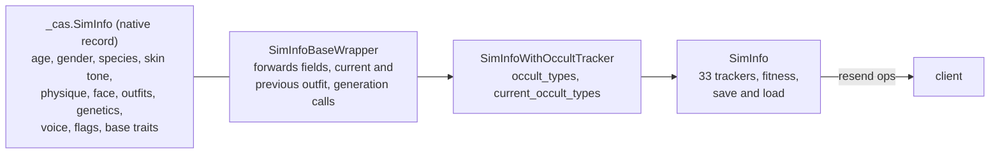
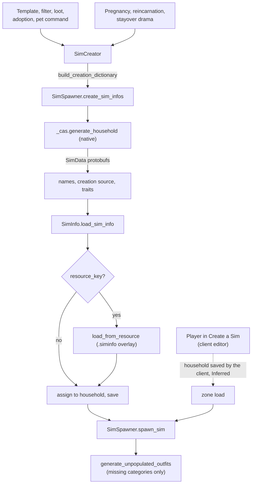
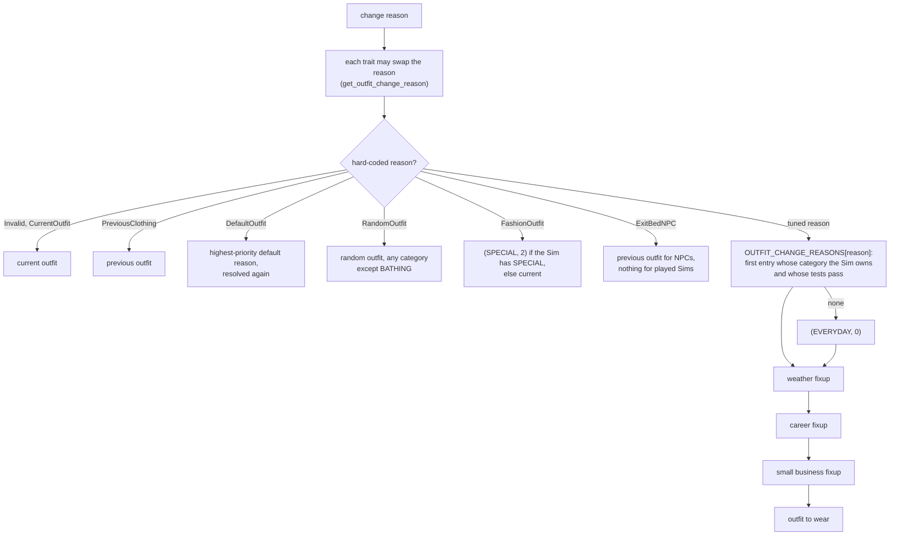

# 3.01 Create a Sim: how a person is built

*Game version 1.128.90.1030 (Steam, Linux/Proton), with EP04 (Cats & Dogs), EP06 (Get Famous), EP09 (Eco Lifestyle), EP12 (High School Years), GP04 (Vampires), GP12 (Werewolves), SP01 (Luxury Party) and SP42 (Grunge Revival) installed (names from `packs.tsv`). Instance counts are the live merge (the base game's delta build, then each installed pack's delta build); module tuning exists only in the base game. Written 2026-10-12. Checked 2026-10-12: 140 claims checked, 22 corrected, 3 relabelled, 6 removed.*

## In plain words

A Sim is a record kept by the game engine, not by the Python scripts. The record says how old the Sim is, whether they are a person, a dog, a cat or a horse, which skin tone they have, how heavy and how fit their body is, what their face looks like, what they wear in each kind of situation, and the hidden genetic copy a child will inherit from. The Python side wraps that record and adds the gameplay on top: traits, needs, careers, relationships and the rest.

There are two very different ways a Sim gets made. When you use Create a Sim, the whole editor runs in the game client; the scripts only open it and later receive the finished household. Every other Sim (townies, premade families, babies, a loot that summons a stranger) is built by the scripts, which describe the Sim they want (age, gender, species, a few style tags) and ask one native function to dress and shape it. Clothes are not all chosen at that moment: a Sim gets its missing outfits when it first appears on a lot, or the first time the game needs one.

Three things surprise most players. First, a Sim you make very fit in Create a Sim will slowly lose some of it: the game lets fitness above 40 (on a scale of -100 to 100) drift back down to 40, while fat never drifts at all. Second, which outfit a Sim changes into is a short ordered list per reason ("going to bed", "entering the pool", "weather"), and the first entry whose tests pass and whose outfit the Sim owns wins. Third, twins, triplets, the baby's gender and its genetic mix all come from one number rolled at conception, but the baby's personality traits do not, so reloading cannot reproduce them.

How sliders, sculpts and part meshes reshape the body belongs to [3.02 Sculpting and parts](3.02-cas-sculpting-parts.md); what traits, aspirations and likes do belongs to [3.07 Personality and feelings](3.07-personality-feelings.md); pregnancy and aging as life events belong to [3.09 Life cycle](3.09-life-cycle.md); occult forms to [3.11 Occults and the supernatural](3.11-occults.md); templates and townie generation to [4.02 Story progression, households and townies](4.02-story-progression-townies.md); the byte layouts of SIMINFO and CASPART files to [8.03 Sim and CAS files](8.03-sim-cas-files.md).

## Key facts

- **A Sim is three layers.** The native record `_cas.SimInfo` holds the look; `SimInfoBaseWrapper` (`sims/sim_info_base_wrapper.py`, 763 lines) is its Python face; `SimInfo` (`sims/sim_info.py`, 3,734 lines) adds 33 gameplay trackers, two of which belong here (`_suntan_tracker`, `_body_type_level_tracker`). A fresh wrapper is MALE, ADULT, HUMAN, skin tone 1, empty physique, wearing (EVERYDAY, 0).
- **Every scripted door ends in one native call.** `SimSpawner.create_sim_infos` turns each `SimCreator` into a creation dictionary (age, gender, tagSet, species, trait_ids, plus optional randomization mode, filter flags and body-type overrides) and hands the list to `_cas.generate_household`, which returns finished `SimData` protobufs. Python then names the Sims, adds traits, loads the records and, when the creator named one, overlays a `.siminfo` resource.
- **The Create a Sim editor runs in the client.** The server commands it registers (all `Live`) only send the client a `sims.exit2cas...` cheat string. The menus, randomize buttons, voices, add-Sim panel and CAS Stories are tuning exported to the client binary.
- **Outfits are filled in at spawn and on demand.** `spawn_sim` generates the missing first outfit of seven human categories (FORMAL, ATHLETIC, SLEEP, PARTY, SWIMWEAR, HOTWEATHER, COLDWEATHER) and of ATHLETIC for horses; `get_outfit` generates any other missing outfit the first time it is asked for. No Python caller sets `generate_all_cas_outfits`.
- **14 outfit categories, capped per category.** EVERYDAY 0 to SMALL_BUSINESS 13 (plus CURRENT_OUTFIT -1). At most 5 outfits each, except BATHING and SITUATION (1) and CAREER and SPECIAL (3). Infants cannot have ATHLETIC or SWIMWEAR, toddlers cannot have ATHLETIC.
- **A clothing change is a reason resolved to a category.** 7 reasons are hard-coded and 36 are tuned (`OutfitChangeReason`); 37 have a tuned list of (tests, category) pairs. The first pair whose tests pass and whose category the Sim owns wins, else (EVERYDAY, 0); weather, career and small-business fixups may then override.
- **Body shape is a string of nine floats** (`physique`, indexed by `BodyBlendTypes`). Fat is `(heavy - lean) x 100` and fit `(fit - bony) x 100` on the commodities' -100 to 100 range. Writing them back sets only one side of each pair, truncated to 3 decimals, so the round trip collapses a Sim that had both.
- **CAS fitness drifts to 40.** `MAXIMUM_SAFE_FITNESS_VALUE` is 40 in both tuning builds (code default 90). A Sim created fitter than 40 has its fit commodity converge to 40 at 0.00278 per Sim minute; fat has decay 0.
- **Randomize is 26 tuned buttons.** Each `CAS_RANDOMIZE_FILTERS` entry is a list of `CASRandomizeFlag` bits, an optional list of `required_flags`, and context criteria (new Sim, species, occult form, age, gender, mannequin).
- **A baby is decided by one seed.** At birth a `Random(seed)` rolls the count (weights 89, 10, 1 for one, two, three babies), each later baby's identical-twin chance (33.33% live, code 50%), the gender (50% female from `statistic_Pregnancy_GenderChance`) and the genetics seed. Traits use the global random, so the same seed does not repeat them.
- **If the birth tests fail, the baby has one parent.** When `AT_BIRTH_TESTS` (not incestuous, plus an age test) fail, both parent ids become the birth parent before genetics run.
- **The parts catalogue is large and mostly delta.** Live union on this install: 38,185 CASPART (full and delta keys minus the base delta's one deletion marker, `00000000:00000000000020A7`), 2,315 SIMINFO and 145 SKINTONE resources; each delta build holds every key of its full build (for CASPART one of them as a deletion marker). Base and pack delta parts are format 52; pack full builds are 31, 42 or 46. Pet parts (species 2, 3, 4) come from EP04.
- **Body hair and acne are commodities (EP12).** Six `BodyTypeLevelCommodity` records map 0 to 100 onto client levels 0 to 3 (thresholds 25, 50, 75). Changes are batched for 0.5 Sim minutes and sent to the native `change_bodytype_level`. Acne is body type 89 `SKINDETAIL_ACNE_PUBERTY`.
- **Likes and dislikes in CAS come from one preference group:** capacity 50 (code 15), randomize at least 3 likes and 3 dislikes (code 1 each), each of the 4 live categories adding 1 to 5.
- **96 premade Sim templates are live**; each premade Sim is fixed up once, at zone spin-up, by `PremadeSimFixupHelper` in a fixed order.

## How it works

### The three layers (Observed)

- **The native record.** `cas/cas.py` binds 36 names from the engine module `_cas`, two classes and 34 functions: `SimInfo` (imported as `BaseSimInfo`), `OutfitData`, `generate_household`, `generate_offspring`, `generate_random_siminfo`, `generate_occult_siminfo`, `generate_merged_outfit`, `set_caspart`, `remove_caspart`, `randomize_caspart`, `randomize_part_color`, `randomize_skintone_from_tags`, `get_catalog_casparts_by_bodytype`, `get_caspart_bodytype`, `caspart_has_tag`, `get_caspart_gender_compatible`, `get_caspart_hide_occult_flags`, `change_bodytype_level`, `apply_siminfo_override`, `age_up_sim`, the `relgraph_*` family and a few more. When `_cas` cannot be imported, the module defines stand-ins that do nothing (Inferred: for tools that load the scripts outside the game).
- **The wrapper.** `SimInfoBaseWrapper.__init__` builds `BaseSimInfo(sim_id, first_name, last_name, breed_name, full_name_key, breed_name_key, age, gender, species, skin_tone, physique, skin_tone_val_shift)` with defaults MALE, ADULT, `SpeciesExtended.HUMAN`, skin tone 1, physique "" and shift 0.0, then sets `voice_pitch` 0.0, `voice_actor` 0, `voice_effect` 0, `facial_attributes` "", `custom_texture` 0, `pelt_layers` "" and `parts_custom_tattoos` {}. Current and previous outfit start at (EVERYDAY, 0). It also owns an `AppearanceTracker` (`buffs/appearance_modifier/appearance_tracker.py`, the appearance modifiers buffs apply).
- **What goes to the client.** `resend_physical_attributes` sends 13 fields: skin tone, tone shift, pelt layers, custom texture, facial attributes, physique, outfits, the three voice fields, trait ids, genetic data and custom tattoos.
- **What is saved by the wrapper.** `save_sim_info` writes gender, age, extended species, physique, facial attributes, skin tone and shift, the outfit list, and the current and previous outfit. `SimInfo` builds the full save message and changes the outfit it records (see "Outfits" below).
- **Occult flags.** `SimInfoWithOccultTracker` stores `occult_types` and `current_occult_types` on the record, both `OccultType.HUMAN` (1) at start; the flags are HUMAN 1, ALIEN 2, VAMPIRE 4, MERMAID 8, WITCH 16, WEREWOLF 32, FAIRY 64. What each form does is [3.11](3.11-occults.md).
- **Gameplay layer.** `SimInfo.SIM_INFO_TRACKERS` lists 33 trackers (relationship, trait, pregnancy, death, career, genealogy, aspiration, suntan, body type level, tattoo and others).

### Ways a Sim comes into existence (Observed unless marked)

**`SimCreator` (`sims/sim_spawner.py`).** Fields: `gender` (a random `Gender` when unset), `age` (ADULT), `species` (HUMAN), first, last and breed names and their string keys, `traits`, a `tag_set` built from `tunable_tag_set`, one weighted pick from `weighted_tag_lists` and `additional_tags`, `sim_name_type`, `randomization_mode`, `filter_flag`, `body_type_chance_overrides`, `body_type_match_not_found_policy` and `resource_key`. With `load_from_sim_info` and a resource key it loads that `.siminfo` into a scratch wrapper and copies gender, age, species, names and traits from it. With `should_populate_breed` and no breed name it draws a random breed tag for the species. `build_creation_dictionary` sends `age`, `gender`, `tagSet`, `species`, `trait_ids` and, when set, `randomization_mode`, `filter_flags`, `body_type_chance_overrides` and `body_type_match_not_found_policy`.

**`create_sim_infos`, in call order** (read from bytecode; the decompiled nesting is wrong):
1. Account: the first client's account, else the system account (made if missing).
2. Household: the one passed in, else a new `Household` (unless `skip_adding_to_household`).
3. Native `generate_household(sim_creation_dictionaries, household_name, generate_deterministic_sim, generate_all_cas_outfits)`.
4. Household family name: random for the account's language unless `family_name` is given; the household goes to the household manager.
5. Per returned `SimData`: a random first name by gender and species when none was given, a last name from `get_last_name` for the Sim's gender and species (with `_get_family_name_for_gender` for females), age, species and breed, the creation source, and the creator's persistable traits.
6. `SimInfo(sim_id)`, `load_sim_info(proto)`, then a breed fix-up from the tag set.
7. With a resource key: `load_from_resource`, then the creator's gender and names are written back over the resource's.
8. Debug name, `assign_to_household`, `save_sim`, `household.add_sim_info`, and `tgt_client.set_next_sim()` when that client has no active Sim; then `push_to_relgraph`, the lifetime log, `sim_info_manager.on_sim_info_created`, and the household is saved.

**`SimInfo.load_from_resource`** (bytecode): native load of the `.siminfo`; fat and fit recomputed from the physique and pushed into the fitness commodities; the resource's aspiration set if it is available; every current trait removed (aspiration traits are kept only when the resource names no known aspiration); the resource's base traits added; the age trait refreshed.

**Doors that use it.**

| Door | Module | Notes |
|---|---|---|
| Template or filter | `filters/sim_template.py`, `filters/sim_filter_service.py` ([4.02](4.02-story-progression-townies.md)) | `TunableSimTemplate` builds the `SimCreator`; filters pick or make townies |
| Loot `CreateSimLootOp` | `sims/sim_creation.py` | source `sim_filter` (default) or `sim_template` |
| Pregnancy | `sims/pregnancy/pregnancy_tracker.py` | `generate_deterministic_sim=True`, creation source "pregnancy", then genetics |
| Reincarnation, stayover drama | `services/reincarnation_service.py`, `drama_scheduler/stayover_drama_node.py` | `generate_deterministic_sim=True`, then `apply_genetics` with the same Sim as both parents and a fresh seed |
| Pet command | `pets/pet_commands.py` | `create_sims(..., generate_deterministic_sim=True)` |
| Premade Sims | `world/premade_sim_template.py` | a `.siminfo` resource per template |

**`CreateSimLootOp._apply_to_subject_and_target`** (bytecode), per created Sim: add the tuned relationship bits from the target, run `pre_spawn_loot`, the source's pre-spawn behaviour, `SimSpawner.spawn_sim`, the optional NPC summoning purpose, the optional genealogy (`set_as_child` or `set_as_secret_child`), and the source's post-spawn behaviour. The decompile nests the last step under the genealogy branch; the bytecode runs it for every Sim.

**Premade Sims.** `PremadeSimCreator` takes a first name, optional last and breed names and a `.siminfo` resource key. `PremadeSimTemplate` adds `clan_info`, `clubs`, `career_level`, `career_lot`, `dynasty` (head, heir, black sheep), `pregnancy` (origin and progress, default 25%), `occult` (type and an occult `.siminfo`), `primary_aspiration`, `packed_pronouns`, `small_business_seed` and `client_fixups` (`KingdomSimClientFixup` in `world/premade_sim_client_fixups.py`: `level` default 0, `priority` default 1 and an `inheriting_premade_sim`, all exported to the client binary only). `add_template_data_to_sim` stamps `sim_template_id` and sets `premade_sim_fixup_completed = False`. At zone spin-up (`zone_spin_up_service.py`), `PremadeSimFixupHelper.fix_up_premade_sims` collects every Sim with a template id whose flag is still false (setting it true at once), then runs, in order: family relations, premade secret children, the household fixup, relationships, a grandparent check, small businesses, clans, clubs, careers, pregnancy, occult forms, the miscellaneous step (pronouns, perks, rank, aspiration, tuned fixups) and dynasties.

### What the record holds, field by field (Observed)

| Field | Type | Values |
|---|---|---|
| `gender` | enum | MALE 4096, FEMALE 8192 (`GenderAttractionPreference` adds ANY 12288 and NONE 16384) |
| `age` | flag enum | BABY 1, TODDLER 2, CHILD 4, TEEN 8, YOUNGADULT 16, ADULT 32, ELDER 64, INFANT 128; comparisons use `SEQUENTIAL_VALUE_MAP` BABY 0, INFANT 1, TODDLER 2, CHILD 3, TEEN 4, YOUNGADULT 5, ADULT 6, ELDER 7 |
| `extended_species` | enum | HUMAN 1, DOG 2, CAT 3, SMALLDOG 4, FOX 5, HORSE 6; `species` collapses SMALLDOG to DOG. Required packs: EP04 for dog, small dog and cat, EP11 (Cottage Living) for fox, EP14 (Horse Ranch) for horse (`get_required_pack`) |
| `skin_tone`, `skin_tone_val_shift` | u64, float | a SKINTONE instance id and a lightness shift |
| `physique` | string | nine comma-separated floats (next section) |
| `facial_attributes` | bytes | face and body modifiers and sculpts ([3.02](3.02-cas-sculpting-parts.md)) |
| `genetic_data` | protobuf | the inheritable copy ([8.03](8.03-sim-cas-files.md)) |
| `outfits` | protobuf `OutfitList` | categories of outfits, each a list of parts by body type |
| `flags` | bits | includes the hair growth bits FACIAL_HAIR 256, ARM_HAIR 512, LEG_HAIR 1024, TORSOFRONT_HAIR 2048, TORSOBACK_HAIR 4096 |
| `occult_types`, `current_occult_types` | `OccultType` flags | see above |
| `voice_pitch`, `voice_actor`, `voice_effect` | float, int, int | voice |
| `pelt_layers`, `custom_texture`, `parts_custom_tattoos` | string, id, map | pet coats, custom textures, tattoo layers |
| `base_trait_ids` | list | traits stored on the record |

**Gender options are traits.** `SimInfo.clothing_preference_gender` returns MALE or FEMALE when the Sim has the male or female clothing preference trait, else the Sim's gender. `update_gender_for_traits(gender, trait_ids)` passes the gender and trait ids to the native record, and the occult tracker calls it for every occult form. The CAS panel for these options is edit mode SIM_CUSTOMIZATION with `CASSimCustomizationOptionType` GENDER 0, SEXUAL_ORIENTATION 1, RELATIONSHIP_EXPECTATIONS 2. Which traits exist is [3.07](3.07-personality-feelings.md).

### Body shape and the fitness link (Observed, `sims/sim_info.py`)

`BodyBlendTypes`: HEAVY 0, FIT 1, LEAN 2, BONY 3, PREGNANT 4, HIPS_WIDE 5, HIPS_NARROW 6, WAIST_WIDE 7, WAIST_NARROW 8.

- `_get_fit_fat` reads indices 0 to 3 and sets `fat = (1 + heavy - lean) * max_fat + min_fat` and `fit = (1 + fit - bony) * max_fit + min_fit`. The commodities (`objects.components.consumable_component`: `FAT_COMMODITY` = `commodity_Fitness_Fat` 16589, `FIT_COMMODITY` = `commodity_Fitness_Fit` 16590) both run from -100 to 100, so this is `(heavy - lean) * 100` and `(fit - bony) * 100`.
- `_set_fit_fat` reads the live commodity values when the Sim is instanced, takes the midpoint (0), and writes `heavy = fat / 100` above it or `lean = -fat / 100` below it (the other side becomes 0), the same for fit and bony, each as `trunc(x * 1000) / 1000`. A CAS Sim with heavy 0.3 and lean 0.1 therefore comes back as heavy 0.2, lean 0: the derived value survives, the pair does not.
- `_setup_fitness_commodities` (run from `load_from_resource` and from `_load_sim_info`, so on every load) sets both commodities, stores `_initial_fitness_value` the first time, and sets the fit commodity's convergence value to that initial value, capped at `MAXIMUM_SAFE_FITNESS_VALUE`. The cap is 40 in both tuning builds; the code default 90 and the docstring's "90" example are not what runs. `commodity_Fitness_Fit` decays at 0.00278 per Sim minute toward that value, `commodity_Fitness_Fat` has decay 0; both start at 0 with states at -100, -80 and 80. `_initial_fitness_value` is saved and reloaded, so the convergence point is the smaller of the Sim's first recorded fitness and the current cap.
- `SimInfo.PHYSIQUE_CHANGE_AFFORDANCES` names eight reaction affordances (`fat_change_reaction_*`, `fit_change_reaction_*`, `fat_change_max_*`).

### Body types and which parts fit which Sim

**Body types (Observed, `sims/outfits/outfit_enums.py`).** `BodyType` runs from NONE 0 to UNUSED 118. Groups: HAT 1, HAIR 2, HEAD 3, TEETH 4, FULL_BODY 5, UPPER_BODY 6, LOWER_BODY 7, SHOES 8, CUMMERBUND 9, accessories 10 to 27 (earrings 10, glasses 11, necklace 12, gloves 13, wrists 14 and 15, piercings 16 to 21, rings 22 to 27), FACIAL_HAIR 28, makeup 29 to 33, EYEBROWS 34, EYECOLOR 35, SOCKS 36, EYELASHES 37, skin details 38 to 44 (TIGHTS is 42) and 55 to 57, tattoos 45 to 54 and TATTOO_HEAD 113, SKIN_OVERLAY 58, FUR_BODY 59, EARS 60, TAIL 61, occult face details 64 to 70, FOREARM_SCAR 71, ACNE 72, FINGERNAIL 73, TOENAIL 74, BODYHAIR_ARM 78 to BODYHAIR_TORSOBACK 81, body scars 82 to 87, SKINDETAIL_ACNE_PUBERTY 89, SCARFACE 90, birthmarks and moles 91 to 98, stretch marks 99 and 100, horse parts 101 to 110 (SADDLE, BRIDLE, REINS, BLANKET, hoof colour, mane, tail and forelock hair, feathers, HORN), TAIL_BASE 111, BIRTHMARKOCCULT 112, WINGS 114, HEADDECO 115, SKINSPECULARITY 116, BASE_LAYER 117.

`BodyTypeFlag.make_body_type_flag` sets bit `1 << body_type`, so a mask over all 119 types needs 128 bits; `set_outfit_flags` splits it into a low and a high 64-bit word and `generate_outfit` passes `body_type_flags >> 64` separately. Named masks: `CLOTHING` (HAT, FULL_BODY, UPPER_BODY, LOWER_BODY, SHOES), `ACCESSORY_ALL` (earrings, glasses, necklace, gloves, socks, tights, base layer, both wrists, six piercings, six rings), `CLOTHING_ALL` (both) and `CATS_DOGS_ALL` (EARS, FUR_BODY, TAIL).

**What a part says about itself (Observed from bytes, format 52).** Every format-52 CASPART carries, after its tags, `body_type`, `body_sub_type`, an `age_gender` word made of the Python `Age` and `Gender` bits (0x1078 is male teen to elder, 0x2004 female child, 0x3002 unisex toddler, 0x3080 unisex infant) and a `species` word in `SpeciesExtended` values. The rest of the layout is [8.03](8.03-sim-cas-files.md).

**Who decides a part fits (Observed calls; the matching itself is native, Inferred).** Python never compares age or species words. It hands a Sim and filters to native calls: `get_catalog_casparts_by_bodytype(sim_info, include_tags, exclude_tags, bodytypes, show_all_variants, rewards_parts)` for catalogue pickers (`interactions/base/cas_catalog_picker.py`, which also passes the household's reward parts), `get_caspart_gender_compatible(sim_info, cas_part)` for jewelry, `caspart_has_tag`, `get_caspart_hide_occult_flags`, and the generation calls below. Inferred: the native side compares the part's age_gender and species words with the Sim's record.

**Tags are the rules Python can tune.**
- `OutfitGenerator` (`sims/outfits/outfit_generator.py`, snippet type "Outfit"): `tags` a part must have and `blocked_tags` it must not have, both limited to the tag prefixes Uniform, OutfitCategory, Style and Situation, plus the randomization fields of `OutfitGeneratorRandomizationMixin` (`sims/outfits/outfit_utils.py`): `filter_flag` (default USE_EXISTING_IF_APPROPRIATE plus USE_VALID_FOR_LIVE_RANDOM), `body_type_chance_overrides` (per body type, default 100%) and `body_type_match_not_found_policy`. The body-type mask sent is `CLOTHING_ALL` plus every body type the two maps name.
- `OutfitFilterFlag`: NONE 0, USE_EXISTING_IF_APPROPRIATE 1, IGNORE_IF_NO_MATCH 2, OR_SAME_CATEGORY 4, EXCLUDE_FULLBODY 8, USE_VALID_FOR_LIVE_RANDOM 16, IGNORE_VALID_FOR_RANDOM 32, MATCH_ALL_TAGS 64, USE_DEFAULT_PARTS 128, KEEP_EXISTING_PARTS_NOT_BEING_UPDATED 256, INCLUDE_GHOST_PARTS 512, FORCE_FULLBODY 1024. `MatchNotFoundPolicy`: MATCH_NOT_FOUND_UNSPECIFIED 0, then FAIL, KEEP_EXISTING and RANDOMIZE (their numbers do not survive the decompile).
- `check_outfit_validity` (used by situations and custom schedules to decide whether an outfit must be regenerated) accepts an outfit when it duplicates the generator's copy-category outfit, or when the tags on its body types include the generator's tags plus the extra tags and the blocked tags are not all present (bytecode: `not blocked_tags.issubset(sim_tags)`). With MATCH_ALL_TAGS only tags shared by every required body type count. An empty blocked list is a subset of every set, so a generator without blocked tags never passes the tag branch.
- `CASTuning.CAS_PROHIBITED_TAGS_BY_MODE` hides tagged parts per CAS edit mode: BATUU hides six `Uniform_Batuu_Alien_*` tags, TATTOO hides `CASCategory_MedicalWearable_Body_Torso`, `CASCategory_MedicalWearable_Face` and `CASCategory_BodyPaint_Body_Arms`.
- Each `CASMenuItem` can carry `part_tags` and `part_tags_exclude` for the catalogue it opens.

### Outfits: categories, slots and saving (Observed, `sims/outfits/`)

- **Categories.** `OutfitCategory`: CURRENT_OUTFIT -1, EVERYDAY 0, FORMAL 1, ATHLETIC 2, SLEEP 3, PARTY 4, BATHING 5, CAREER 6, SITUATION 7, SPECIAL 8, SWIMWEAR 9, HOTWEATHER 10, COLDWEATHER 11, BATUU 12, SMALL_BUSINESS 13. `REGULAR_OUTFIT_CATEGORIES` (the ones a player edits) are EVERYDAY, FORMAL, ATHLETIC, SLEEP, PARTY, SWIMWEAR, HOTWEATHER and COLDWEATHER; `HIDDEN_OUTFIT_CATEGORIES` are CAREER, SITUATION, SPECIAL and BATUU; `NON_RANDOMIZABLE_OUTFIT_CATEGORIES` is BATHING alone. `SpecialOutfitIndex`: DEFAULT 0, TOWEL 1, FASHION 2.
- **Slots.** `get_maximum_outfits_for_category` returns 1 for BATHING and SITUATION, 3 for SPECIAL and CAREER, 5 for everything else.
- **Generating.** `SimInfoBaseWrapper.generate_outfit(category, index, tag_list, exclude_tag_list, filter_flag, body_type_flags, ...)` defaults to USE_EXISTING_IF_APPROPRIATE and `CLOTHING_ALL`, calls the native record, then fires `on_outfit_generated`, resends the outfits and marks the category dirty. `get_outfit` generates a missing (category, index) before returning it. `spawn_sim` calls `generate_unpopulated_outfits` with `OUTFITS_TO_POPULATE_ON_SPAWN`: HUMAN gets FORMAL, ATHLETIC, SLEEP, PARTY, SWIMWEAR, HOTWEATHER, COLDWEATHER, HORSE gets ATHLETIC, and only categories without an outfit at index 0 are generated. The lookup uses `species`, so dogs, cats and small dogs get none at spawn.
- **Which index.** The default `OutfitProvider` on every Sim is `RandomOutfitProvider`: with more than one outfit in the category it picks a random index other than the last one it picked. A `DailyOutfitProvider` exists but nothing creates one.
- **Wearing.** `set_current_outfit` refuses when `can_switch_to_outfit` says no (already wearing it and not dirty). When the Sim lacks the outfit it falls back to the occult tracker's fallback category at index 0; if that is missing too it logs an error and sets the outfit anyway (bytecode). `try_set_current_outfit` plays the species' `OUTFIT_CHANGE_ANIMATIONS` element (human and invalid: `animationElement_Spin`; cat and dog share one element, horse another) and on the spin's end event tells the laundry service, sets the outfit and applies `LOOT_ON_OUTFIT_CHANGE`.
- **Saving.** `SimInfo._generate_sim_protocol_buffer` records the previous outfit instead when the Sim wears (SPECIAL, 0); then it replaces BATHING with (EVERYDAY, 0); then `OUTFIT_CATEGORY_TUNING[category].save_outfit_category` may swap the category (tuned only for BATHING, to EVERYDAY). A Sim saved in the shower loads dressed.
- **Category buffs.** `OUTFIT_CATEGORY_TUNING` gives each of the 14 categories its buffs while worn: ATHLETIC 6, CAREER, FORMAL, PARTY and SWIMWEAR 5, EVERYDAY and SLEEP 4, the rest 1 or none (BATUU and SMALL_BUSINESS have no entry body). Five categories' lists include `buff_ClothingCatagory_Temperature_Modifer`.
- **Streets.** `INAPPROPRIATE_STREETWEAR` is SLEEP: a Sim in sleepwear changes before going off-lot.
- **Trimming.** `clear_outfits_to_minimum` keeps one EVERYDAY outfit and removes every other category.

### Changing clothes: from a reason to an outfit (Observed, `outfit_tracker.py`, bytecode)

- `OutfitChangeReason` is a dynamic enum: Invalid -1, PreviousClothing 0, DefaultOutfit 1, RandomOutfit 2, ExitBedNPC 3, CurrentOutfit 4, FashionOutfit 5 in code, and 36 tuned names from 6 (EnterBathing) to 41 (SmallBusinessWork) in module `sims.outfits.outfit_enums`.
- `OUTFIT_CHANGE_REASONS` maps 37 reasons (36 tuned plus ExitBedNPC, which the code returns before the table is read) to ordered (tests, category) lists. For each entry: a BATHING entry first generates a bathing outfit if the Sim has none (filter flag NONE); an entry for any category other than CURRENT_OUTFIT and SMALL_BUSINESS is skipped when the Sim has no outfit in it, unless the interaction carries a `career_uid`; an entry with tests is skipped when they fail. The first survivor wins: CURRENT_OUTFIT keeps the current outfit, anything else asks the outfit provider for an index.
- Fixups, in order: **weather** (when the weather service offers an outfit change for this reason, the Sim is outside, and the reason is not in `WEATHER_OUFTIT_CHANGE_REASONS_TO_IGNORE`); **career** (a CAREER pick from an interaction with a `career_uid` becomes that career's generated outfit, or EVERYDAY 0 when it has none); **small business** (bytecode: when the zone's business is a small business and the Sim is its employee with an outfit index, every resolved change becomes that (SMALL_BUSINESS, index) outfit, or the current outfit when the Sim lacks it).
- `get_default_outfit` takes the highest-priority entry that interactions pushed with `add_default_outfit_priority` and resolves its reason again with the given interaction or resolver; with no entry the reason is None, which resolves to (EVERYDAY, 0) plus the fixups. Without an interaction or resolver it uses the entry's own interaction, else keeps the current outfit.
- Interactions reach this through `TunableOutfitChange` (`outfit_change.py`), a variant with `no_change` (default), `for_reason`, `for_tags`, `for_new`, `from_participant`, `from_zone` and `from_picker`; through animation events in `outfit_change_element.py` (`XevtOutfitChangeForReason`, `XevtOutfitChangeForTags`, `XevtOutfitChangeFromPicker`, `ChangeOutfitElement`); and through `ChangeOutfitLiability`, which applies the entry outfit (else the exit outfit) when an interaction ends early.
- The "Change outfit" interactions: `OutfitChangeSelfInteraction` (`outfit_interactions.py`, 1 live record; picks by situation tags or outfit tags) and `OutfitPickerSuperInteraction` (`outfit_picker_interactions.py`, 21 live records: base 11, EP04 2, EP06 8; actions push an interaction, delete an outfit or apply a career outfit).
- Tests on outfits (`outfit_tests.py`): `OutfitBodyTypeTest`, `OutfitCASPartTagsTest`, `OutfitTest` (current or previous outfit, can or cannot add), `OutfitPrevalentTrendTagTest`.

### Randomize (Observed unless marked)

- **The buttons.** `CASTuning.CAS_RANDOMIZE_FILTERS` has 26 entries, keyed 1 to 26 for display order. Each holds `criteria`, `flags`, a `name` and optional `required_flags` ("required to be enabled in order for this menu item to be enabled"). In order: 1 body shape (new human, not an active vampire form); 2 skin tone (new non-human); 3 breed size (new dog or small dog; needs body shape, face, clothing and hair enabled); 4 body shape; 5 face; 6 hair; 7 skin tone; 8 hair; 9 facial hair (gender, age, occult and species criteria); 10 voice; 11 and 12 clothing; 13 to 16 hat, top, bottom, shoes; 17 makeup (mannequin criteria); 18 hair; 19 facial hair; 20 to 22 hat, full body and accessories (cats, dogs and small dogs); 23 horse hooves; 24 horse hair; 25 clothing (horses, by age); 26 wings (occult criteria).
- **`CASRandomizeFlag`**: PROFILE_GENDER 1, PROFILE_BODYSHAPE 2, PROFILE_FACE 8, PROFILE_SKINTONE 16, PROFILE_HAIR 32, PROFILE_FACIALHAIR 64, PROFILE_VOICE 128, PROFILE_CLOTHING 256, PROFILE_ASPIRATION 512, PROFILE_TRAITS 2048, OCCULT_SKINDETAIL 4096, OCCULT_TAIL 8192, PROFILE_BREEDSIZE 16384, CLOTHING_HAT 32768, CLOTHING_TOP 65536, CLOTHING_BOTTOM 131072, CLOTHING_SHOES 262144, CLOTHING_MAKEUP 524288, CLOTHING_HAIR 1048576, CLOTHING_FACIAL_HAIR 2097152, CLOTHING_ACCESSORIES 4194304, CLOTHING_FULLBODY 8388608, PROFILE_PREFERENCES 16777216, HORSE_HAIR 33554432, HORSE_HOOVES 67108864, WINGS 134217728, RANDOMIZE_BY_MENUSTATE 2147483648.
- **Copy.** `CAS_COPY_FILTERS` has 8 entries using the same flags (body shape, face, skin tone, hair, facial hair, voice, clothing, makeup), four of them with a werewolf occult criterion.
- **`CASContextCriterion`** kinds: species, age, gender, occult_type, active_occult_form, in_genetics_mode, is_mannequin, is_fashion_mode, is_new_sim, is_full_edit_mode, is_direct_manip_enabled, has_paint_layer, allowed_packs and has_equipped_part, each with `exclude_if_matched`. `CASContextCriteria` groups them as `match_any` and `match_all`.
- **`RandomizationMode`** (passed into native generation by `SimCreator`): SELECTIVE 1, MENU 2, CAREER_OUTFIT 3, CLUB_OUTFIT_ALL 4, CLUB_OUTFIT_SINGLE 5, TEMPLATE 6.
- **Script-side randomizing.** `add_random_variation_to_modifiers(variation_scale)` uses `random.uniform(-1, 1)` when no scale is given and calls the native method; the per-modifier limits it obeys are [3.02](3.02-cas-sculpting-parts.md). `randomize_caspart`, `randomize_part_color` and `randomize_skintone_from_tags` are native calls used by appearance modifiers.

### Genetics and babies (Observed, `sims/pregnancy/pregnancy_tracker.py`)

- **Rolling the offspring.** `create_offspring_data` seeds `r = random.Random(self._seed)`. Count: `pop_weighted` over `MULTIPLE_OFFSPRING_CHANCES` (size 1 weight 89, size 2 weight 10, size 3 weight 1, each weight times its tuned multipliers tested on the pregnant Sim) with `random=r`, unless an override is set, then capped at `household.free_slot_count + 1`. For each baby after the first, `r.random() < MONOZYGOTIC_OFFSPRING_CHANCE` (33.33 live, code default 50) copies the previous baby's gender and genetics seed. Otherwise the gender is FEMALE when `r.random()` is below `(stat - min) / (max - min)` of `GENDER_CHANCE_STAT` (`statistic_Pregnancy_GenderChance`: initial 50, range 0 to 100 from the `Statistic` defaults; 0.5 when the Sim lacks the statistic), and the genetics seed is `r.randint(1, MAX_UINT32)`.
- **Traits break the determinism.** `select_traits_for_offspring` receives no `random=r` (bytecode), so trait picks use the module-level random. Count, gender and genetics repeat for the same seed; traits do not. The trait rules themselves are [3.09](3.09-life-cycle.md) and [3.07](3.07-personality-feelings.md).
- **At birth.** `create_sim_info` first runs `validate_partner`: if `AT_BIRTH_TESTS` (a relationship test "is not incestuous" and a `sim_info` age test on the target) fail between the birth parent and the partner, `_parent_ids` becomes (birth parent, birth parent). `get_parents` also falls back to parent A when parent B is gone. It then builds a `SimCreator` (age, gender, species, names), calls `create_sim_infos(..., generate_deterministic_sim=True, creation_source="pregnancy")`, removes the new Sim's personality traits, adds the rolled ones, and calls `apply_genetics(parent_a, parent_b, seed=offspring_data.genetics)`, which is the native `generate_offspring(parent_a._base, parent_b._base, child._base, seed=...)`.
- **Occult genetics.** `SimInfoWithOccultTracker.apply_genetics` goes through `OccultTracker.apply_occult_genetics`: `random.Random(seed).random() < 0.5` decides which parent counts as A, the human forms are crossed first, then each occult form the child has is crossed from the parents' matching forms. Details are [3.11](3.11-occults.md).
- **Copying.** `copy_physical_attributes` copies physique, facial attributes, voice, skin tone (optional), flags, pelt layers and base traits, then merges the genetic data; `copy_base_attributes` copies age, gender and extended species.

### CAS from the server side: modes, menus and stories (Observed)

- **Entering CAS.** `server_commands/cas_commands.py` registers the commands in the table under "For modders". Each sends `client_cheat("sims.exit2cas ...")`, `"sims.exit2caswithhouseholdid <sim> <household> [mode]"` (modes career, small_business, disguise, gender, batuu, preferences, simCustomization, tattoo) or `"sims.exit2caswithmannequinid <id> [apply_outfit|career|small_business|club|fashion]"`. The `exit2cas` strings are client commands; the server never registers them.
- **Modes.** `CASEditMode`: DEFAULT 0, MANNEQUIN 1, MANNEQUIN_APPLY_OUTFIT 2, MANNEQUIN_CAREER 3, DISGUISE 4, CAREER 5, MANNEQUIN_CLUB 6, SINGLE_SIM 7, GENDER 8, FTUE 9, BATUU 10, FASHION 11, PREFERENCES 12, SIM_CUSTOMIZATION 13, REINCARNATION 14, TATTOO 15, SMALL_BUSINESS 16. `CASMode` (what the camera shows): BODY 0, FACE 1, FACE_DETAIL 2, NOACTION 3, HANDS 4, BODY_PART 5. `CASPaintPose` lists 11 poses for the paint and tattoo views.
- **Menus are data.** 9 live `CASMenu` records (base: Human Body, Human Head, Human Mannequin Body, Human Mannequin Head, Human Vampire Head, Pet Body, Pet Head; GP12: Werewolf Body, Werewolf Head) list 88 `CASMenuItem` records (74 base, 14 GP12). An item has icons, a name, actions (`change_menu_state`, `display_ui_widget`), `remove_action`, `disable_reasons`, `sim_click_activations` (by body type or `SimRegion`), `part_tags` and `part_tags_exclude`; a menu has `criteria` and items with sub-items, each filtered by `CASContextCriteria`.
- **Add Sim panel.** `CAS_ADD_SIM_MENU_DATA` has 17 entries (`CASAddSimAction`): story, gallery, library, add a human, genetics, an occult header with six occult add-Sim entries (alien, vampire, mermaid, witch, werewolf, fairy), a pet header with dog, cat and horse, and pet genetics. Each occult and pet entry carries an `allowed_packs` criterion: alien EP01 (Get To Work), vampire GP04, mermaid EP07 (Island Living), witch GP08 (Realm of Magic), werewolf GP12, fairy EP19 (Enchanted by Nature), dog and cat EP04, horse EP14, the pet header and pet genetics EP04 or EP14. The client applies them (Inferred), so this install would show the vampire, werewolf, dog and cat entries.
- **Voices, poses, tones.** `CAS_VOICES_DATA` by species and age: HUMAN adult 6, child 2, toddler 1, infant 1; DOG and SMALLDOG adult 5, child 2; CAT adult 3, child 2; HORSE adult 1, child 1. `CAS_SPECIES_PAINT_POSES`: 6 tattoo poses for humans, 4 for cats, dogs and small dogs, 2 for horses. `CAS_SKINTONE_TYPE_FILTERS`: 5 buttons, ALL, WARM, NEUTRAL, COOL, MISC.
- **CAS Stories** (the question flow that picks traits and an aspiration). Live: 79 `CasStoriesQuestion` (text, icon, `possible_answers`, a `pack` default BASE_GAME), 237 `CasStoriesAnswer` (each a list of weightings over a trait, a `CasStoriesTraitChooser` or an aspiration track) and 44 `CasStoriesTraitChooser` (weight thresholds to traits). The `pack` field reads BASE_GAME on 58 questions (the 54 base ones and GP04's 4), EP04, EP06 and EP09 5 each, EP12 4, GP12 2. Module `CASStoriesTuning.CAS_STORIES`: `questions_per_pack` by number of packs available (0 packs: 10 base questions; 1 pack: 6 base and 4 per pack; 2: 4 base and 3 per pack; no larger key), `funds_traits` (`trait_CAS_Story_Household_Funds_Low` 20,000, `_Med` 25,000, `_High` 30,000 starting funds), `additional_sims_funds_percentage` untuned (code 0.75) and the silhouette `ymCASStoriesSim.siminfo`. All of it is exported to the client binary only, so the scoring runs in the client (Inferred).
- **Preferences** (`cas_preference_*.py`; what a like does is [3.07](3.07-personality-feelings.md)). One live `CasPreferenceGroup`: capacity 50 (code 15), ages CHILD to ELDER, 7 category references of which 4 resolve (Activity, Color, MusicGenre in the base game, Fashion from EP12), `randomization_minimum_required_likes` 3 and `_dislikes` 3 (code 1 each). No category tunes `_randomization_number_of_preferences`, so each gives 1 to 5. A load-time check errors when the categories' upper bounds cannot reach the minimums (here 20 against 6). Items: 51 `ObjectPreferenceItem` (match by object definition or tag) and 9 `StylePreferenceItem` (EP12), each with a `like` and a `dislike` trait; `CharacteristicPreferenceItem`, `AttractionPreferenceItem` and `ConversationPreferenceItem` exist in code with no live records.
- **How many traits CAS allows** comes from the age data's `personality_trait_count` ([3.07](3.07-personality-feelings.md)).

### Body hair, acne and tan lines (Observed)

- **Body-type levels** (`sims/body_type_level/`, tracker `required_packs` EP12). A `BodyTypeLevelCommodity` names a `body_type`, `eligible_species` (default HUMAN) and `ages_allowed` (default BABY to ELDER, without INFANT), and its states carry a `body_type_client_level`. Live: six, all from EP12: `bodyTypeCommodity_Hair_Arm`, `_Hair_Back`, `_Hair_Face`, `_Hair_Leg`, `_Hair_Torso` and `bodyTypeLevelCommodity_Acne`, each 0 to 100, decay 0, initial 0, `min_lod_value` ACTIVE, with states at 0, 25, 50 and 75 giving levels 0 to 3. None tunes species or ages.
- Entering a state calls `request_client_level_change`; the tracker collects requests for `COLLECT_REQUESTS_MINUTES` (untuned, code 0.5 Sim minutes), then calls the native `change_bodytype_level` and resends occult types and physical attributes.
- Hair growth is switched per area by `HairGrowthFlags` in the record's `flags` (FACIAL_HAIR 256 to TORSOBACK_HAIR 4096, mapped to body types 28 and 78 to 81). `refresh_hair_growth_commodities` unlocks the commodity for areas whose flag is on and locks it for the rest, then sets it from the record's current growth level. Below the ACTIVE level of detail the commodities are locked or removed. `set_acne_enabled(False)` locks acne at its minimum.
- `PreferredBodyTypeLevelTest` compares the current level with the record's preferred growth level; `SetBodyTypeToPreferredLevel` loot sets it.
- **Tans** (`sims/suntan/`). `TanLevel`: NO_TAN 0, DEEP 1, SUNBURNED 2. `SuntanTracker.set_tan_level` stores the level; with the `UPDATE_TAN_LINES_BUFF` buff it records the current outfit's (part, body type) pairs as tan lines, or one random part from `TAN_PRANK_CAS_PARTS` (5 parts) when the prank buff is present; `SetTanLevel` sends level, parts and a force flag to the client. The tracker's object state and the DEEP and SUNBURNED states it names do not resolve in this install's live tuning (Inferred: they come from a pack that is not installed), so `on_start_up` finds no state to set (Inferred: an unresolved pack-safe reference loads as None).

## Numbers

| Name | Value | Unit | Where | Source |
|---|---|---|---|---|
| `MAXIMUM_SAFE_FITNESS_VALUE` | 40 (code 90) | fit points | module `sims.sim_info` | full and delta |
| `commodity_Fitness_Fit` decay | 0.00278 | per Sim minute | statistic 16590 | delta |
| `commodity_Fitness_Fat` decay | 0 | per Sim minute | statistic 16589 | delta |
| Fat and fit range, start | -100 to 100, 0 | points | both commodities | delta |
| Physique truncation | 3 | decimals | `_set_fit_fat` | code |
| `MONOZYGOTIC_OFFSPRING_CHANCE` | 33.33 (code 50) | percent | module `sims.pregnancy.pregnancy_tracker` | delta |
| `MULTIPLE_OFFSPRING_CHANCES` | 89 / 10 / 1 | weight for 1 / 2 / 3 babies | same | delta |
| `statistic_Pregnancy_GenderChance` | initial 50, range 0 to 100 | points (50 = 50% female) | statistic 117011 | delta (range: code) |
| Gender chance without the statistic | 0.5 | probability | `create_offspring_data` | code |
| Outfits per category | 5; BATHING, SITUATION 1; CAREER, SPECIAL 3 | outfits | `get_maximum_outfits_for_category` | code |
| `OUTFITS_TO_POPULATE_ON_SPAWN` | human 7 categories, horse 1 | categories | `sims/sim_spawner.py` | code |
| `OutfitChangeReason` | 7 code + 36 tuned | reasons | module `sims.outfits.outfit_enums` | code, delta |
| `OUTFIT_CHANGE_REASONS` | 37 | mapped reasons | module `sims.outfits.outfit_tuning` | delta |
| `INAPPROPRIATE_STREETWEAR` | SLEEP | category | same | delta |
| `LOOT_ON_OUTFIT_CHANGE` | 3 ids, 1 resolves (`loot_FashionMarketplace_Outfit_Remove`, EP12) | loots | same | delta, live |
| `CAS_RANDOMIZE_FILTERS` | 26 | buttons | module `cas.cas_tuning` | delta |
| `CAS_COPY_FILTERS` | 8 | buttons | same | delta |
| `CAS_ADD_SIM_MENU_DATA` | 17 | entries | same | delta |
| `CAS_SKINTONE_TYPE_FILTERS` | 5 | buttons | same | delta |
| `questions_per_pack` | 0: 10; 1: 6 + 4; 2: 4 + 3 | questions (base + per pack) | `CAS_STORIES` | delta |
| `funds_traits` | 20,000 / 25,000 / 30,000 | Simoleons | `CAS_STORIES` | delta |
| `additional_sims_funds_percentage` | 0.75 | fraction | `CAS_STORIES` | code (untuned) |
| `CasPreferenceGroup.capacity` | 50 (code 15) | preferences | instance `casPreferenceGroup_likesdislikes` | delta |
| Randomized likes, dislikes minimum | 3 and 3 (code 1 and 1) | preferences | same | delta |
| Preferences per category on randomize | 1 to 5 | preferences | `CasPreferenceCategory` | code (untuned) |
| Body-type level thresholds | 25, 50, 75 | commodity points | 6 `BodyTypeLevelCommodity` | EP12 delta |
| `COLLECT_REQUESTS_MINUTES` | 0.5 | Sim minutes | `BodyTypeLevelTracker` | code (untuned) |
| `TAN_PRANK_CAS_PARTS` | 5 | parts | module `sims.suntan.suntan_tracker` | delta |
| `BodyType` | 119 (0 to 118) | body types | `outfit_enums.py` | code |
| SimInfo trackers | 33 | trackers | `SIM_INFO_TRACKERS` | code |
| `CASMenu`, `CASMenuItem` | 9, 88 | records | instances | live |
| `CasStoriesQuestion`, `Answer`, `TraitChooser` | 79, 237, 44 | records | instances | live |
| `ObjectPreferenceItem`, `StylePreferenceItem`, `CasPreferenceCategory` | 51, 9, 4 | records | instances | live |
| `PremadeSimTemplate`, `PremadeHouseholdTemplate` | 96, 45 | records | instances | live |
| `OutfitPickerSuperInteraction`, `OutfitChangeSelfInteraction` | 21, 1 | records | instances | live |
| CASPART (base full, base delta) | 7,069 (format 26), 25,435 (format 52, 1 a deletion marker) | resources | `Data/Client` | package |
| SIMINFO, SKINTONE (base full, base delta) | 666 and 19, 1,230 and 145 | resources | `Data/Client` | package |
| CASPART, SIMINFO live union | 38,185, 2,315 | unique instances | union of full and delta keys minus deletion markers | package |

Per pack (CASPART full / delta, SIMINFO full / delta, full-build CASPART format): EP04 2,371 / 2,676, 550 / 563, 42; EP06 1,642 / 1,798, 87 / 87, 42; EP09 1,639 / 1,828, 78 / 78, 42; EP12 3,046 / 3,047, 160 / 160, 46; GP04 710 / 790, 58 / 60, 42; GP12 1,512 / 1,512, 92 / 108, 46; SP01 433 / 665, 19 / 19, 31; SP42 435 / 435, 10 / 10, 46. Packs ship no SKINTONE resources. Base delta parts by body type (format 52, all 25,434 decoded): hair 6,834, upper body 3,695, lower body 2,422, full body 2,113, eyebrows 2,043, fingernail 1,250, shoes 1,082, facial hair 804, hat 755; species: 25,433 human, 1 horse; 582,266 tags in all. EP04 delta parts by species: human 1,853, small dog 295, cat 283, dog 245.

## Data shapes

- **Creation dictionary** (`SimCreator.build_creation_dictionary`): `age`, `gender`, `tagSet`, `species`, `trait_ids`, and when set `randomization_mode`, `filter_flags`, `body_type_chance_overrides`, `body_type_match_not_found_policy`.
- **`SimCreator`**: the fields listed under "Ways a Sim comes into existence".
- **`OutfitData`** (native): read by Python as `outfit_id`, `part_ids`, `body_types` (parallel lists), plus outfit flags set through `set_outfit_flags(category, index, low, high)`. The `OutfitList` protobuf round-trips through `save_outfits` and `load_outfits`.
- **`OutfitPriority`**: `(change_reason, priority, interaction_ref)`, kept in `_default_outfit_priorities`.
- **`OutfitTuning`** (module `sims.outfits.outfit_tuning`): `INAPPROPRIATE_STREETWEAR` (categories), `OUTFIT_CATEGORY_TUNING` (category to `save_outfit_category` and `buffs`), `COSTUMES_LOCALIZATION_TUNING` (costume tag to pie-menu string), `OUTFIT_CHANGE_ANIMATIONS` (species to animation element), `OUTFIT_CHANGE_REASONS` (reason to list of `tests` and `outfit_category`), `LOOT_ON_OUTFIT_CHANGE`.
- **`PregnancyOffspringData`**: `age`, `gender`, `species`, `genetics` (seed), `last_name`, `traits`, plus a first name drawn later (up to 10 tries for one no household member has).
- **CAS tuning** (`CASTuning`): `CAS_SKINTONE_TYPE_FILTERS` (type, icons, tooltip), `CAS_SPECIES_PAINT_POSES` (species to pose buttons with an occult blacklist), `CAS_VOICES_DATA` (species to age to voice buttons), `CAS_RANDOMIZE_FILTERS` (order to criteria, flags, name, required flags), `CAS_COPY_FILTERS` (the same without the key), `CAS_ADD_SIM_MENU_DATA` (index to criteria, parent index, tooltip, icons, audio, flair, tutorial control, action, species, occult type, genetics species limit), `CAS_PROHIBITED_TAGS_BY_MODE` (edit mode to tags).
- **`BodyTypeLevelCommodity`**: a `Commodity` plus `body_type`, `eligible_species`, `ages_allowed`; states add `body_type_client_level`.
- **Suntan save**: `tan_level` and a list of `(id, body_type)` outfit parts.

## For modders

**Common tweaks, and the tuning to change:**
- *Let CAS fitness stick:* raise `MAXIMUM_SAFE_FITNESS_VALUE` in module `sims.sim_info` (40 live). Every Sim picks it up on its next load, converging to the smaller of its saved `initial_fitness_value` and the new cap.
- *What a Sim wears for an activity:* the reason's list in `OUTFIT_CHANGE_REASONS` (module `sims.outfits.outfit_tuning`). Order matters: the first entry whose tests pass and whose category the Sim owns wins.
- *Buffs while wearing a category:* `OUTFIT_CATEGORY_TUNING[category].buffs`.
- *Twins and triplets:* `MULTIPLE_OFFSPRING_CHANCES` weights and multipliers, `MONOZYGOTIC_OFFSPRING_CHANCE` (module `sims.pregnancy.pregnancy_tracker`); the gender split through `statistic_Pregnancy_GenderChance`.
- *Generated outfits for NPCs and uniforms:* an `OutfitGenerator` snippet's `tags`, `blocked_tags`, `filter_flag`, `body_type_chance_overrides` (for example a hat at 0%) and `body_type_match_not_found_policy`.
- *The randomize panel:* `CAS_RANDOMIZE_FILTERS` entries in module `cas.cas_tuning` (client-side behaviour; the server never runs them).
- *Likes and dislikes in CAS:* `casPreferenceGroup_likesdislikes` capacity and minimums; a category's `_randomization_number_of_preferences`.
- *Body hair and acne speed:* the six EP12 `BodyTypeLevelCommodity` records (thresholds, loots on state change).

**Commands this system registers** ([1.04 Debug tools, cheats and telemetry](1.04-debug-cheats-telemetry.md); `core/sims4/commands.py: Command`). `Live` commands always run; a command with `pack=` is not registered unless that pack is installed; `DebugOnly` (the default type) is never registered.

| Command | Type | Does |
|---|---|---|
| `sims.modify_in_cas`, `sims.modify_outfit_in_cas <category>`, `sims.modify_in_cas_with_householdId` | Live | open CAS on a Sim, on one outfit category, or on the household |
| `sims.modify_career_outfit_in_cas`, `sims.modify_small_business_outfit_in_cas`, `sims.modify_disguise_in_cas`, `sims.modify_gender_in_cas` | Live | CAS in career, small business, disguise or gender mode |
| `sims.modify_preferences_in_cas`, `sims.modify_sim_customization_options_in_cas`, `sims.modify_tattoos` | Live | preferences, gender and orientation options, tattoo mode |
| `cas.modify_mannequin`, `cas.modify_style_in_cas`, `cas.design_fashion_outfits` | Live | mannequin, career style and fashion mannequin modes |
| `cas.modify_business_uniform` for EP01, `cas.modify_small_business_uniform` for EP18 (Businesses & Hobbies), `cas.modify_club_mannequin_in_cas` for EP02 (Get Together), `cas.plan_batuu_outfit` for GP09 (Journey to Batuu) | Live, pack-gated | not registered on this install |
| `sims.reincarnate`, `sims.switch_to_werewolf` | DebugOnly | not registered |
| `body_type_level.set_acne_enabled <bool>` | Live, EP12 | lock or unlock acne for every Sim (registered here) |
| `outfits.set_sharing_mode`, `outfits.copy_outfit` | Live | outfit sharing and copying (`server_commands/outfit_commands.py`) |
| `outfits.current_outfit_info` | Automation | print the current outfit |
| `outfits.generate_outfit`, `outfits.switch_outfit`, `outfits.info`, `outfits.remove_outfit`, `outfits.get_tags`, `outfits.toggle_outfit_change_log`, `outfits.check_fashion_outfits_on_mannequin`, `outfits.check_thrift_store_inventory` | DebugOnly | not registered |

All `cas_commands.py` commands carry `CommandRestrictionFlags.RESTRICT_SAVE_UNLOCKED`.

**Traps:**
- The fit and fat commodities do not store the physique pair. Any write through `_set_fit_fat` zeroes one side of heavy/lean and fit/bony.
- `MAXIMUM_SAFE_FITNESS_VALUE`'s docstring example says 90; the tuned value is 40.
- `get_random_outfit` with no category list can return CAREER, SITUATION, SPECIAL or BATUU outfits; only BATHING and CURRENT_OUTFIT are excluded.
- `set_current_outfit` on an outfit the Sim lacks logs an error and still sets it when the occult fallback is missing too.
- `CLOTHING_BODY_TYPES` (used by clubs and custom schedules to decide what counts as clothing) lists RING_FINGER_RIGHT but not RING_FINGER_LEFT, and includes CUMMERBUND and BASE_LAYER.
- Module tuning lives only in the base game on this install: no pack XML carries a module, so pack content changes CAS and outfit behaviour only through instances and pack-safe references. Several of those references point at packs that are not installed (two of the three `LOOT_ON_OUTFIT_CHANGE` loots, the suntan states, three preference categories, the horse and fairy add-Sim entries).
- A tuned reason whose category the Sim lacks is skipped silently; the fallback is (EVERYDAY, 0), so a missing ATHLETIC outfit makes a workout happen in everyday clothes unless something generated it first.
- Several decompiled functions here have wrong nesting (`create_sim_infos`, `CreateSimLootOp._apply_to_subject_and_target`, `get_outfit_for_clothing_change`, `get_random_outfit`, `set_current_outfit`, `load_from_resource`, the save path). Read the bytecode before trusting an `if` block.

## Limits

- **Native code.** `generate_household`, `generate_offspring`, `generate_outfit`, `add_random_variation_to_modifiers`, `update_gender_for_traits`, `get_catalog_casparts_by_bodytype` and the part compatibility checks, `change_bodytype_level`, and the whole client-side CAS editor are in the executable or engine library. Nothing was decrypted or dumped; the chapter stops where the Python stops. How the client hands a CAS-made household back to the server is Inferred.
- **Decompile gaps.** `world/premade_sim_fixup_helper.py` has no decompiled source and is missing from the module manifest; it was rescued per function from its compiled module, and `_apply_household_fixup` still fails to decompile. `filters/sim_filter_service.py` does not decompile ([4.02](4.02-story-progression-townies.md)). `MatchNotFoundPolicy` values after 0 are elided in the decompile.
- **Package formats.** CASPART formats 26, 31, 42, 46 and 52 are decoded in [8.03](8.03-sim-cas-files.md): every installed part (7,069, 433, 6,362, 4,993 and 38,185) parses to its key table.
- **Packs not installed** (EP01, EP02, EP11, EP14, EP18, GP09 among those the code names) add commands, species, outfits and tuning this install cannot show. Fox and horse Sims cannot be made here.
- **Out of scope.** Slider and modifier limits, sculpts and DMaps ([3.02](3.02-cas-sculpting-parts.md)); SIMINFO and CASPART byte layouts ([8.03](8.03-sim-cas-files.md)); the trait selection rules at birth ([3.09](3.09-life-cycle.md)).

## File index

| Module | What it holds | Depth |
|---|---|---|
| `simulation/cas/__init__.py` | empty package marker | listed |
| `simulation/cas/cas.py` | `OutfitOverrideOptionFlags`; the 36 `_cas` native bindings and their stand-ins | deep |
| `simulation/cas/cas_enums.py` | `CASPaintPose`, `CASMode`, `RandomizationMode`, `CASMenuState`, `CASRandomizeFlag`, `SimRegion`, `CASEditMode`, `CASSkinToneType`, `CASSimCustomizationOptionType` | deep |
| `simulation/cas/cas_preference_category.py` | `CasPreferenceCategory`: decorator flag, randomization interval (default 1 to 5) | deep |
| `simulation/cas/cas_preference_group.py` | `CasPreferenceGroup`: categories, capacity, ages, randomization minimums, load check | deep |
| `simulation/cas/cas_preference_item.py` | `CasPreferenceItem` and the Object, Style, Characteristic, Attraction and Conversation subclasses | skim |
| `simulation/cas/cas_stories_answer.py` | `CasStoriesAnswer`: text and weightings over trait, trait chooser or aspiration track | deep |
| `simulation/cas/cas_stories_question.py` | `CasStoriesQuestion`: text, icon, answers, pack | deep |
| `simulation/cas/cas_stories_trait_chooser.py` | `CasStoriesTraitChooser`: weight thresholds to traits | deep |
| `simulation/cas/cas_tuning.py` | `CASContextCriterion` and lists, `CASMenuItem`, `CASMenu`, `CASAddSimAction`, `CASStoriesTuning`, `CASTuning` | deep |
| `simulation/sims/body_type_level/__init__.py` | empty package marker | listed |
| `simulation/sims/body_type_level/body_type_level_commands.py` | `body_type_level.set_acne_enabled` (Live, EP12) | deep |
| `simulation/sims/body_type_level/body_type_level_commodity.py` | `BodyTypeLevelCommodity`, client levels, body type registry | deep |
| `simulation/sims/body_type_level/body_type_level_loot.py` | `SetBodyTypeToPreferredLevel` | deep |
| `simulation/sims/body_type_level/body_type_level_tests.py` | `PreferredBodyTypeLevelTest` | deep |
| `simulation/sims/body_type_level/body_type_level_tracker.py` | request batching, LOD lock and unlock, hair growth refresh, acne switch | deep |
| `simulation/sims/body_type_level/hair_growth_flags.py` | `HairGrowthFlags`, `HAIR_GROWTH_TO_BODY_TYPE` | deep |
| `simulation/sims/outfits/__init__.py` | empty package marker | listed |
| `simulation/sims/outfits/outfit_change.py` | `TunableOutfitChange` variants, `InteractionOnRouteOutfitChange`, `ChangeOutfitLiability` | skim |
| `simulation/sims/outfits/outfit_change_element.py` | animation-event outfit changes and `ChangeOutfitElement` | skim |
| `simulation/sims/outfits/outfit_enums.py` | `OutfitCategory`, category sets, `SpecialOutfitIndex`, `OutfitChangeReason`, `BodyType`, groups, flags, `OutfitFilterFlag`, `CLOTHING_BODY_TYPES` | deep |
| `simulation/sims/outfits/outfit_generator.py` | `OutfitGenerator` tags and blocked tags, the "Outfit" snippet | deep |
| `simulation/sims/outfits/outfit_interactions.py` | `OutfitChangeSelfInteraction`, situation and tag pickers | skim |
| `simulation/sims/outfits/outfit_picker_interactions.py` | `OutfitPickerSuperInteraction` and its actions | skim |
| `simulation/sims/outfits/outfit_tests.py` | `OutfitBodyTypeTest`, `OutfitCASPartTagsTest`, `OutfitTest`, `OutfitPrevalentTrendTagTest` | skim |
| `simulation/sims/outfits/outfit_tracker.py` | outfit providers, `OutfitTrackerMixin`: generation on demand, clothing change resolution, fixups, random outfit, spin and loot | deep |
| `simulation/sims/outfits/outfit_tuning.py` | `OutfitTuning` module tunables | deep |
| `simulation/sims/outfits/outfit_utils.py` | outfit caps, tag intersection, validity check, `OutfitGeneratorRandomizationMixin` | deep |
| `simulation/sims/sim_creation.py` | `CreateSimLootOp` | deep |
| `simulation/sims/suntan/__init__.py` | empty package marker | listed |
| `simulation/sims/suntan/suntan_ops.py` | `SetTanLevel` distributor op | deep |
| `simulation/sims/suntan/suntan_tracker.py` | `SuntanTracker`: level, tan lines, prank parts, state on spawn, save | deep |
| `simulation/sims/suntan/suntan_tuning.py` | `TanLevel`, `ChangeTanLevel` | deep |
| `simulation/world/premade_sim_client_fixups.py` | `KingdomSimClientFixup` | deep |
| `simulation/world/premade_sim_template.py` | `PremadeSimCreator`, `PremadeSimTemplate` | deep |

Other modules used: `simulation/sims/sim_info_base_wrapper.py`, `simulation/sims/sim_info.py`, `simulation/sims/sim_info_types.py`, `simulation/sims/sim_spawner.py`, `simulation/sims/sim_info_mixin.py`, `simulation/sims/occult/sim_info_with_occult_tracker.py`, `simulation/sims/occult/occult_tracker.py`, `simulation/sims/occult/occult_enums.py`, `simulation/sims/pregnancy/pregnancy_tracker.py`, `simulation/server_commands/cas_commands.py`, `simulation/server_commands/outfit_commands.py`, `core/sims4/commands.py`, `simulation/interactions/base/cas_catalog_picker.py`, `simulation/world/premade_sim_fixup_helper.py` (bytecode only), `simulation/zone_spin_up_service.py`, `simulation/filters/sim_template.py`, `simulation/statistics/statistic.py`, `simulation/objects/components/consumable_component.py`, `simulation/services/reincarnation_service.py`, `simulation/drama_scheduler/stayover_drama_node.py`, `simulation/pets/pet_commands.py`, `simulation/clubs/club.py`, `simulation/custom_schedules/custom_schedule_outfit_tuning.py`, `simulation/objects/components/jewelry_component.py`.

Tuning used (delta and full build via the tuning indexer, instances via the live merge): modules `cas.cas_tuning`, `sims.outfits.outfit_tuning`, `sims.outfits.outfit_enums`, `sims.sim_info`, `sims.pregnancy.pregnancy_tracker`, `sims.suntan.suntan_tracker`, `objects.components.consumable_component`; statistics `commodity_Fitness_Fat`, `commodity_Fitness_Fit`, `statistic_Pregnancy_GenderChance`; `casPreferenceGroup_likesdislikes`, `PreferenceCategory_Activity`, `_Color`, `_MusicGenre`, `_Fashion`; the six `bodyTypeCommodity_*` and `bodyTypeLevelCommodity_Acne`; the nine `CASMenu_*`; loot `loot_FashionMarketplace_Outfit_Remove`. Package data: CASPART (0x034AEECB), SIMINFO (0x025ED6F4) and SKINTONE (0x0354796A) entries in `Data/Client` and each pack's full and delta builds.
