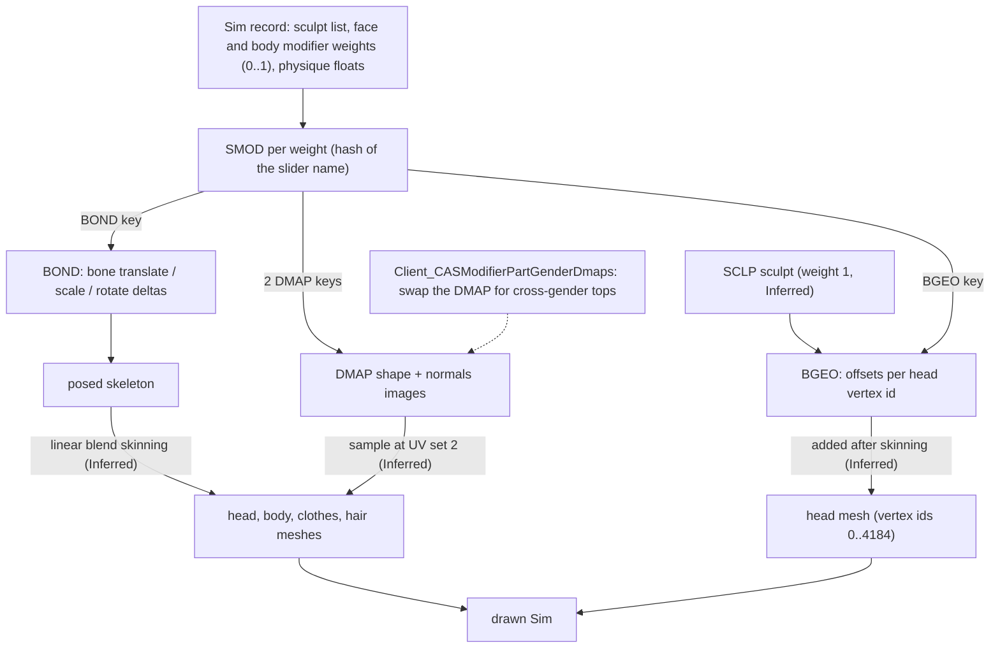

# 3.02 Sculpting and parts: how sliders, hair and clothes change the model

*Game version 1.128.90.1030 (Steam, Linux/Proton). Package data from the base game's client builds; slider and physique tuning from the live merge of the base game and the installed packs, EP04 (Cats & Dogs), EP06 (Get Famous), EP09 (Eco Lifestyle), EP12 (High School Years), GP04 (Vampires), GP12 (Werewolves), SP01 (Luxury Party) and SP42 (Grunge Revival), with the full-build value given where the live one differs. Written 2026-10-12. Checked 2026-10-12: 71 claims checked, 18 corrected.*

## In plain words

A Sim's body and face are never saved as a 3D model. The game saves a short list of slider settings, each a number from 0 to 1, plus a handful of preset face shapes (sculpts) and four body numbers (heavy, fit, lean, bony). When the Sim is drawn, the game starts from one shared base head and body and applies every slider on top. A face slider moves points of the head by a small stored table of offsets; a body slider looks up a "deformer map", an image laid over the body where each pixel says how far that spot of skin moves; many sliders also move bones of the skeleton (the jaw bone, the nose bone, the breast bones), which drags along everything attached to those bones.

Clothes and hair are separate pieces (parts) that ride on the same skeleton and read the same body maps, which is why a shirt grows with a heavy belly and long hair moves with the chest. Each colour of a shirt is its own part record that reuses the same meshes. A part can hide other parts (a space suit hides rings, gloves and socks) and is stacked by a layer number (a top draws over trousers, makeup sits under everything).

Three things tend to surprise players. Each slider only goes one way: "wider jaw" and "narrower jaw" are two different stored sliders, and the Sim record only ever holds positive amounts. Most face sliders are two things at once: a bone move plus a small corrective table that pulls the skin back into shape, so neither half looks right on its own. And the fitness and weight that exercise and food change in live mode are the very same four body numbers Create a Sim edits; gameplay writes them into the Sim record each time weight or fitness moves into another of five bands (and on save), and the code allows values beyond the limits of the Create a Sim sliders.

How a Sim record is put together (outfits, which parts are allowed, genetics) is [3.01 Create a Sim](3.01-create-a-sim.md). The longer byte formats live in [8.03 Sim and CAS files](8.03-sim-cas-files.md). This chapter covers the shape: sliders, sculpts, the three deformation data types, and how parts follow them.

## Key facts

- **A slider is an SMOD resource (type 0xC5F6763E) found by name hash**: instance = FNV-1 64 (multiply, then xor) of the lowercased modifier name. 875 of the 893 distinct names in the 23 live `Client_CASModifierTuning` sets hash to an SMOD in an installed client package; the 18 misses include names with a stray space (`yfheadModifier_ Ears_RotateIn`).
- **An SMOD names up to three kinds of deformation**: a BGEO (per-vertex offsets for the head), a BOND (bone deltas) and a pair of DMAPs (shape and normals maps over the body's UV space). Of the 683 base-game SMODs, 374 are BGEO only, 189 BGEO plus BOND, 95 DMAP only and 25 BOND only. Every SMOD in a body region (SimRegion 14 to 28) is DMAP or BOND.
- **A BGEO is a pointer chain over head vertex ids.** Per id a 16-bit entry: the low 2 bits are flags (bit 0 a position delta, bit 1 a normal delta), the upper 14 bits a signed step of one running pointer into a pool of 16-bit triples stored offset-binary. All 1,046 base BGEOs pass an exact size check (44 + 68 + 2A + 6B bytes).
- **Face sliders that also move bones use the BGEO as a corrective.** Skinning the head to the bone deltas and then adding the BGEO at about 1/8192 m per step gives clean meshes: 0 flipped triangles on all five sliders tested, against 2 to 30 flips with the earlier decode (1/2048 m per step, no bones). The unit is fitted, not read (Inferred).
- **A BOND is a list of 44-byte bone records** (u32 bone hash, translate, scale delta, quaternion delta). 243 base files, 4,255 records, 75 bones of the 165-bone adult rig `auRig`, all hashes FNV-1 32 of the bone name.
- **A DMAP is a run-length image** (version 7 decoded here: 288 of 288 parse to the byte). A shape texel is an offset of -0.2 to +0.2 m per axis in 255 steps (1.57 mm each). Meshes sample it at their second UV set, mirrored at the body centre line (Inferred, fitted): with that mapping the nude top and bottom meet at the waist within one step (1.57 mm) while the heavy map moves that seam 82 mm.
- **The four physique axes are ordinary DMAP sliders** (`yfheadBody_Heavy`, `_Fit`, `_Lean`, `_Bony`, `ym` copies; toddlers and infants have only Heavy and Lean). The DMAP header byte at offset 20 holds 0, 1, 2, 3 on their maps and 4 on the `Body_Pregnant` maps, the order of `SimInfo.BodyBlendTypes` (HEAVY 0, FIT 1, LEAN 2, BONY 3, PREGNANT 4). Elder and child copies of the same maps exist, marked the same way, and no SMOD points at them.
- **Slider weights on a Sim are all positive.** The base game's stored Sims hold 117,451 face and 13,462 body weights (666 full-build records of version 18 and 1,225 delta-build records of version 38), and every one lies in 0 to 1. So a two-way slider is two one-way SMODs (`_Wide` and `_Narrow`).
- **Gameplay physique is two commodities.** `commodity_Fitness_Fat` and `_Fit` run -100 to 100 and map exactly onto heavy/lean and fit/bony (`fat = 100 x (heavy - lean)`). Live tuning makes 150 calories one fat point (`CALORIES_PER_POUND` 150 in the delta tuning, 100 in the full build); a default 500-calorie food adds 3.33 points over 10 bites.
- **The body follows those commodities in steps.** The `Fat` and `Fit` object states cut each commodity into five 40-point bands (edges -60, -20, 20, 60). When a band changes, `Sim.on_state_changed` (`sims/sim.py`, read from bytecode) sets `needs_fitness_update` and pushes one of eight `fat_change_*` / `fit_change_*` reactions with a `FitnessLiability`; the physique is rewritten from the commodity when that reaction's `update_physique` extra runs or the reaction ends, or at once if the push fails. Saving rewrites it too.
- **Each swatch is its own part.** 21,195 of the 25,434 base delta-build CASP parts have meshes and they share 1,748 mesh sets (12.1 parts per set, 55 at most); `preset_count` is 0 in every part of both builds. The hair swatches checked differ in one texture key only.
- **Parts list four LODs, usually in the order 1, 2, 3, 0** (90 percent of tops, 89 percent of trousers; the head lists 3, 1, 2, 0). Level 0 is the most detailed (nude top: 1,884, 1,058, 540, 266 vertices). Levels 0 and 1 carry a flag that depends on the part kind (hats and most hair 0x1, the head and 18 hairs 0x2, tops, trousers, full body and shoes 0x8, facial hair, earrings, glasses, necklaces, wrist parts, socks and tights 0x10), levels 2 and 3 carry 0x1f.
- **Hiding is a 64-bit body-type mask and stacking is a sort layer.** Bit n of `exclude_part_flags` hides the worn part of body type n (67 base parts set any bit; ordinary tops and trousers set none). Layers run from 0 (earrings, glasses) and 1,000 (head) through makeup 5,200 to 5,500, eyebrows 7,000, socks 10,600, shoes 10,700, hats 11,000, hair 12,000, trousers 14,000, tops 16,000 to necklaces 17,100 and wrist parts 17,200.

## How it works

### The whole path

- **Observed** (bytes). The keys in this diagram are real: an SMOD's own key, its BGEO key, its BOND slot and its two DMAP slots are read from all 683 base SMODs; a SIMINFO's modifier list indexes SMOD keys in its own key table.
- **Inferred.** The order (bones, then skinning, then BGEO, with DMAPs sampled per vertex) is the order under which the data produces clean meshes in this chapter's tests. The engine's deformation code is in the game executable, which this book does not read.

### Which copy of a resource the game reads

- **Observed** (`Data/Client/Resource.cfg`). The client delta build packages sit at priority -20 and the full build at -30. Every full-build key of SMOD, BGEO, GEOM, CASP and DMAP is also present in the delta build (537 of 537 BGEOs, 276 of 276 SMODs, 7,164 of 7,164 GEOMs, 7,069 of 7,069 parts, 250 of 250 DMAPs; index reads with the package reader). 24 of those GEOM keys, 1 part and 8 DMAPs are deletion markers in the delta (stored and memory size 0, compression 0xFFE0), so those keys are deleted, not replaced ([8.03](8.03-sim-cas-files.md)). **Inferred:** the higher priority wins, so the delta copy is the live one, and every number below is from the delta build unless it says otherwise.
- **Observed** (a scan of the package index). Pack data adds its own sliders: 601 SMODs in GP12 (121 of the 123 names in `Client_CASModifierTuning_Adult_Werewolf` hash to them) and 264 in EP04, whose tuning adds the cat and dog slider sets; the Delta folders of the installed packs carry none.

### The slider resource (SMOD)

- **Observed** (683 of 683 parse with no byte left over). After a five-word wrapper (3, 1, 0, flag, 1) come the SMOD's own key, a BGEO key when the flag is 1, then `A` (payload offset, 60 or 44), `B` (payload size) and the payload: `C` (144 in every file, meaning unknown), `age_gender`, `region`, a zero word, a flags word (0x30000001 when a BGEO key is present, else 0), three 16-byte key slots (BOND, DMAP shape, DMAP normals; an unused slot is zero), and a count of (u32 bone hash, f32) pairs. Sizes: 132 bytes (512 files), 116 (120), 148 (48) and one each of 140, 188 and 212.
- **Observed.** The BGEO key never shares a BGEO: 563 SMODs point at 563 distinct BGEOs. All 374 BGEO-only SMODs point at a BGEO with their own instance id; all 189 BGEO-plus-BOND SMODs point at a BGEO with a different id. The BOND slot holds the SMOD's own instance in 213 of 214 cases (the exception is `yfheadModifier_Brows_RotateIn`).
- **Observed.** The DMAP keys are `fnv1_64(<name with its first "head" removed>_Shape)` and `..._Normals`: `yfheadBody_Heavy` points at `yfBody_Heavy_Shape` (0xc9c3450344e84bfa). This holds for 32 of the 36 DMAP sliders with a tuned name; the four exceptions are `ymheadChest_Expand`, `_Contract`, `_Deep` and `_Shallow`.
- **Observed.** `age_gender` uses the Python bit word (gender 0x1000 male, 0x2000 female; ages 0x02 toddler, 0x04 child, 0x08 teen, 0x10 young adult, 0x20 adult, 0x40 elder, 0x80 infant). Counts: 0x3080 infant 198, 0x3002 toddler 197, 0x307c child to elder 157, 0x307e 47, 0x1078 male teen to elder 38, 0x207c female child to elder 35, 0x2078 4, 0x3078 4, 0x3004 3.
- **Observed** (`cas/cas_enums.py: SimRegion`). Regions: EYES 102, NOSE 132, MOUTH 80, CHEEKS 39, CHIN 51, JAW 36, BROWS 44, EARS 37, HEAD 73, CHEST 22, NECK 8, SHOULDERS, UPPERARM, LOWERARM, WAIST, HIPS, BELLY, BUTT, THIGHS and LOWERLEG 4 each, FEET 8, BODY 15. In the face regions all but 31 SMODs have a BGEO; the 31 are 12 DMAP (jaw 6, head 6) and 19 BOND-only (nose 2, chin 3, jaw 2, head 12).
- **Observed** (a scan of the client packages). 51 SMODs carry pairs at the end: 48 with two (always `b__L_UpLid__` and `b__L_LoLid__`, factors 0.722 to 1.137), one with 7 and one with 10 (brow and squint bones such as `b__L_InBrow__` at 0.5 or 0.6 and `b__L_Squint__` at 0.75), and one with a single `b__L_Squint__` at 0.001. **Inferred:** per-bone weights for eyelid and brow bones; what the engine does with them is not tested here.

### Face sliders: the BGEO table

- **Observed** (all 1,046 base BGEOs). Layout in the table under Data shapes. Four LOD records each give (first vertex id, id count, vector count); id counts sum to `A` and vector counts to `B`. 810 files use the id layout (0, 2986, 3616, 3976) of the child-to-elder head (infants share it); 235 use (0, 1453, 2217, 2610), which is the toddler head (all 187 toddler SMODs and 48 toddler sculpts point at those); one starts at 1516.
- **Observed** (a scan of the client packages). One running pointer serves the whole file. For each nonzero entry `x` in id order, `ptr += x >> 2` (arithmetic shift, so the step is signed) and `tag = x & 3`. Bit 0 set: a position delta at `window[ptr]`. Bit 1 set: a normal delta at `window[ptr + bit0]`. The pointer carries from LOD to LOD, but each LOD indexes its own window of `vector count` triples. With this rule no reference leaves its window, no slot is used twice, and the last slot used is exactly the window's end in every LOD of the five files tested (`yfheadJaw_Wide` LOD0: 1,193 slots, 1,086 used; the 107 unused hold zero or near-zero vectors, 97 of them exactly zero). A step of 0 never occurs.
- **Observed.** The vertex id is the GEOM vertex attribute with usage 10 (u32). In `yfHead` (CASP 0x1b41) LOD0 is two GEOMs, 1,533 vertices with ids 0 to 1,492 (1,442 distinct; duplicates sit on UV seams) and 96 vertices with ids 1,516 to 2,457; LOD1 has ids 2,986 to 3,615, LOD2 3,616 to 3,975, LOD3 3,976 to 4,184. The male head (0x229c) and the child head (0x6ca8) use the same 1,519 LOD0 ids, so one BGEO serves every head of its age family. Ids the head does not use hold zero entries.
- **Observed** (a scan of the client packages). The bit-1 vectors behave as normal deltas: on LOD2 they point the same way as the normal change that the bit-0 deltas cause (median cosine 0.97 for `yfheadJaw_Wide`, 0.95 for `yfheadModifier_Nose_TipLong`) and lie almost perpendicular to the base normal (median |cos| 0.02 to 0.04). On LOD0 the normal deltas are about zero; the large ones are on LOD2. **Inferred:** LOD0 and LOD1 recompute normals, the low LODs use the stored ones.
- **Inferred** (fit). A step is about 1/8192 m (0.12 mm). For the 58 tuned BGEO-plus-BOND sliders, the BGEO scale that makes "bone skinning + scale x BGEO" smoothest was fitted per slider. On the nine where the fit removes half or more of the roughness, the best scale runs from 1/10,562 to 1/7,054 m per step (median 1/8,767): `Head_FaceDownChild`, `Head_FaceBackward`, `Eyes_SocketsDown`, `Jaw_Overbite`, `Head_Short`, `Head_FaceForward`, `Eyes_SocketsUp`, `Jaw_Wide`, `Chin_Backward`. The fitted sign is positive in all nine: the stored BGEO pulls against the bone motion (for `yfheadJaw_Wide`, cosine -0.89 with the skin motion of the `b__CAS_JawComp__` scale). BGEO-only sliders have nothing to fit against and are assumed to use the same unit.

### What was wrong in the earlier BGEO decode, and the proof

The decode this chapter was seeded from walked the pointer chain correctly: on all five test sliders it yields exactly the same position deltas as the authors' decoder. Its renders still showed torn and spiked triangles because of three errors around the chain:

1. **The unit was 4 times too large.** It moved vertices by 1/2048 m per step. The fit above puts the step near 1/8192 m.
2. **It applied the corrective without the bones.** 189 face sliders carry a BOND, and for them the BGEO is a correction on top of the skinned bone motion (it points against it). Applied alone, and four times too strongly, it pushed the jaw inward by up to 19 mm.
3. **It misread the tags.** It treated tags 2 and 3 as unexplained "correction entries", sliced `tag` vectors per entry (two for tag 2, three for tag 3, against its own text), and called the window "about 90 percent reachable". With bit 0 = position and bit 1 = normal, every window tiles exactly and the holes are zero vectors.

The authors' comparison script applies each slider at weight 1.0 to the delta-build `yfHead` LOD0 (both pieces) and counts triangles whose normal flips, triangles turned more than 60 degrees, the edge-length ratio (min, 1st percentile, 99th percentile, max over moved edges) and the widest gap that opens between vertices that coincide in the base mesh:

| Slider (kind) | Earlier decode: flips, >60 deg, edge ratio | Bones + BGEO at 1/8192: flips, >60 deg, edge ratio | Largest move, new |
|---|---|---|---|
| `yfheadJaw_Wide` (BGEO + BOND) | 2, 5, 0.42 / 0.47 / 1.73 / 2.85 | 0, 0, 0.84 / 0.90 / 1.17 / 1.21 | 4.5 mm |
| `yfheadNose_Up` (BGEO + BOND) | 22, 36, 0.24 / 0.36 / 3.96 / 4.50 | 0, 0, 0.47 / 0.68 / 2.55 / 3.28 | 9.3 mm |
| `yfheadModifier_Nose_TipLong` (BGEO only) | 0, 2, 0.78 / 0.97 / 6.40 / 6.90 | 0, 0, 0.88 / 0.92 / 2.24 / 2.41 | 11.6 mm |
| `yfheadHead_Long` (BGEO + BOND) | 30, 42, 0.07 / 0.49 / 2.49 / 5.41 | 0, 0, 0.76 / 0.92 / 1.34 / 2.49 | 15.4 mm |
| `yfheadEyes_Big` (BGEO + BOND) | 4, 22, 0.43 / 0.70 / 2.03 / 2.74 | 0, 0, 0.61 / 0.83 / 1.18 / 1.31 | 5.6 mm |

- **Observed.** No face case opens a gap between coincident vertices (0.0 mm in every row): vertices on a UV seam share an id and identical skin weights. With the old unit and the bones added, flips remain (Nose_Up 11, Head_Long 20, Eyes_Big 4); with the new unit and no bones there are none, so the unit was the main cause of the tearing. `Nose_Up` still stretches some nose edges up to 3.3 times; the bone move alone already does 2.5 times (it lifts `b__CAS_NoseArea__` by 8.8 mm), so the stretch is the slider's, not the decode's.
- **Observed** (body). The same script applies the body sliders' shape maps (DMAP decode below) to `yfTop_Nude` (CASP 0x198c, 1,884 vertices) and `yfBottom_Nude` (0x1990, 627 vertices): `yfheadBody_Heavy` gives 0 flips, 0 faces turned over 60 degrees, edge ratio 0.63 / 0.85 / 1.80 / 2.44, largest move 97 mm; `yfheadBelly_Big` gives 0 flips, 0.78 / 0.92 / 1.84 / 2.17, largest move 141 mm. The waist seam between the two meshes (25 coincident vertex pairs) stays within 1.57 mm under Heavy and 0.10 mm under Belly_Big.

### Bone deltas (BOND) and the skeleton

- **Observed** (a scan of the client packages). A BOND is the same wrapper, then u32 version (1 in all 243 files), u32 record count and 44-byte records. All 243 parse with no byte left over; 4,255 records name 75 distinct bones, all present in the adult rig.
- **Observed** (a scan of the client packages). The adult rig is `auRig` (RIG 0x8EAF13DE, instance = fnv1_64 of the name; `cuRig`, `puRig` and `iuRig` also exist, `yfRig`, `ymRig`, `afRig` and `amRig` do not). It has 165 bones; each bone stores position, rotation quaternion (x, y, z, w), scale, name, mirror-bone index, parent index, hash and flags. All 165 hashes are FNV-1 32 of the lowercased name (none match FNV-1a). Composing local transforms parent first gives sensible world positions: `b__Head__` at y 1.674 m, `b__CAS_NoseArea__` at (0, 1.695, 0.110), `b__CAS_JawComp__` at (0, 1.665, 0.024).
- **Observed.** Record kinds: 2,315 translate-only (scale and quaternion all zero); 1,739 with scale (1, 1, 1) and the identity quaternion; 128 with a real scale; 37 with a real rotation; 36 with both. Translates run -0.506 to 0.305 m. The 1,739 neutral-looking records sit in 33 files of slot bones (`b__L_Earring_slot`, `b__R_Ring_slot`, ...) that no SMOD or SCLP references.
- **Inferred** (fits the tests above). A record is a delta on the bone's local transform: translate added to the position, scale stored minus 1, the quaternion stored minus identity. Examples: `yfheadNose_Up` moves `b__CAS_NoseArea__` by +8.8 mm along its local x (world up) and `b__CAS_Glasses__` by (4.2, 0.9, 0) mm; `yfheadJaw_Wide` scales `b__CAS_JawComp__` by +0.179 on z; one record (0, 0.1106, 0, -0.0061) is a 12.7-degree turn about y.
- **Observed** (GEOM bone lists and weights). The head is skinned to CAS helper bones (`b__CAS_JawComp__`, `b__CAS_NoseArea__` and others); weights are 4 bytes per vertex summing to 255 and index the GEOM's own bone list. The long hair `yfHair_LongRocker` (largest LOD, 2,012 vertices) is weighted to `b__Head__`, `b__Spine2__`, both clavicles, both CAS breast bones and `b__R_Cheek__`. **Inferred:** any slider that moves those bones moves the hair and every garment weighted to them.

### Body sliders and physique: deformer maps (DMAP)

- **Observed** (a scan of the package index). The base delta build holds 314 DMAP entries: 8 deletion markers over base full-build keys (so 306 base DMAPs are live), 288 version 7, 18 version 9 (not decoded). DMAP files have no wrapper. Version 7 decodes completely: header plus `data_bytes` equals the file size and every scan line decodes, in 288 of 288 files.
- **Observed.** Header: version, a width field, height, `age_gender`, species, one byte that is 0 to 4 for physique maps and 9 otherwise, a shape (0) or normals (1) byte (144 each), the covered column and row range, a robe-channel byte, the skin range (min, delta), the robe range (only when the robe byte is 0, so the header is 59 or 51 bytes), and `data_bytes`. Then one line per covered row: u16 size, u8 kind (0 raw, 1 run-length, 2 empty), and for run-length lines a robe byte, a run table and runs of (count, 3 bytes, plus 3 robe bytes when the line has a robe channel).
- **Observed.** Ranges: 117 maps use -0.2 plus 0.4 x b/255 (shape) and 117 use -0.75 plus 1.5 x b/255 (normals); a few small maps use narrower ranges. **Inferred:** a byte b decodes to `min + delta x b / 255`; 128 is about zero. Sizes (width field x height): 640 x 640 (194), 960 x 880 (30), 16 x 16 (24), 160 x 160 (14), 640 x 1280 (8), 2 x 1 (8), 1428 x 792 (4), 320 x 320 (4), 1356 x 690 (2).
- **Inferred** (fitted). Mapping to a mesh: column = |u| x width_field / 2 and row = v x height, with u, v the vertex's second UV set. The body's second UV set runs u from -1 to 1 with the halves mirrored, so the stored x is negated where u > 0. Stored axes map to model axes as (x, -y, -z). Evidence: a grid search for the smoothest result has a sharp minimum at zero offset and unit scale; with these signs the `yfBody_Heavy` shape map agrees with its own normals map (median cosine 0.99) and moves 84 percent of the moved vertices outward.
- **Observed** (a scan of the client packages). Physique byte: 9 on 224 ordinary maps; 0 (Heavy) on 14, 1 (Fit) on 10, 2 (Lean) on 14, 3 (Bony) on 10, 4 (Pregnant) on 10; 100 on four elder maps and 101 on two infant maps. Each axis has a shape and normals pair per age group: teen to adult female (0x2038) and male (0x1038), elder female (0x2040) and male (0x1040), child (0x3004), and for Heavy and Lean also toddler (0x3002) and infant (0x3080). The child Fit, Bony and Pregnant maps are 160 x 160 and the Pregnant maps of the other ages are 2 x 1, so those are near-empty placeholders.
- **Observed** (SMOD scan, names by hash). Region 28 (BODY) holds exactly 15 SMODs, all DMAP only: `yfheadBody_Heavy`, `_Fit`, `_Lean`, `_Bony`, `_Pregnant` (age_gender 0x207c, female child to elder), the five `ymheadBody_*` (0x1078, male teen to elder), `puheadBody_Heavy` and `_Lean` (0x3002), `iuheadBody_Heavy` and `_Lean` (0x3080), and one unnamed infant SMOD whose maps carry byte 101. The adult SMODs point at the teen-to-adult maps only (`yfheadBody_Heavy` at the 0x2038 pair) although their own age_gender covers child to elder. **Inferred:** the engine swaps in the elder or child map of the same axis by the header's age_gender and physique byte.
- **Observed** (live tuning). There is no human `Client_CASModifierPhysique` record; the three live ones (EP04) map dog and cat Heavy and Fit names. **Inferred:** for humans the engine finds the physique maps by its own defaults, and the header byte above is how they are marked.

### How clothes and hair follow the body

- **Observed** (every 10th of the 19,359 delta GEOMs). 1,931 of the 1,935 sampled meshes parse, all GEOM version 15; all but 4 have two or three UV sets. The usual format is position, normal, UV, UV, colour, bone index, bone weight, tangent (1,772 of them). So nearly every wearable is skinned and has the second UV set the DMAPs are sampled at.
- **Observed** (a scan of the client packages). 36 of the sampled meshes carry the usage-10 vertex id: 4 head pieces and 32 garments (25 full-body, 4 tops, 3 bottoms), every one an infant outfit (name prefixes `if` and `iu`). The garment ids run from 5,000 to 43,212, outside the head's 0 to 4,184, and no base BGEO addresses such ids. So base-game face sliders move only the head mesh through the BGEO path.
- **Inferred** (from the waist test above). The engine displaces every body and clothing vertex by sampling the active DMAPs at its second UV set, which is how a shirt follows Heavy and Belly_Big without vertex ids. Inside the nude bottom, seams mostly hold to one map step (98 coincident pairs: median gap 1.5 mm, 90th percentile 2.3 mm), but four crotch vertices open up to 16.8 mm under Heavy, where the u near 0 and u near 1 edges of the map meet; the engine may handle that edge in a way this decode does not.
- **Observed** (live tuning, 96 `Client_CASModifierPartGenderDmaps` records, all base delta). Each one says: for a Sim of a given age, gender and occult type, when the worn part of body type 5 (full body) or 6 (top) was made for males, the chest sliders use other maps. Example `afAlienMaleFullbodyBreastLiftDroop`: `yfHeadChest_Lift` uses `yfChest_MaleLift`, `yfHeadChest_Droop` uses `yfChest_MaleDroop`. 192 conversions over 8 map names, every one of which hashes (`_Shape`, `_Normals`) to a base DMAP. Other fields: `MinValueMapping`, `MaxValueMapping`, `ActiveIfSimHasBreasts`, `ActiveIfSimDoesntHaveBreasts`. The native strings `FallbackDmapName` and `FallbackDmapValue` name a fallback map and weight.

### Sculpts (SCLP)

- **Observed** (502 base SCLPs, type 0x9D1AB874). Same wrapper as an SMOD. Payload: `C` (176 in all), `age_gender`, region, a zero word, flags, then three 16-byte keys at payload offsets 20, 36 and 52: an RLE2 (always set; the sculpt's icon, Inferred), an RLES and a DDS (instance zero in all 502). The (bone hash, f32) count sits at payload offset 117.
- **Observed.** Sizes: 181 bytes (357 files: BGEO key, no pairs), 197 (126: BGEO key and two pairs) and 165 (19: no BGEO key, two DMAP key slots, 34 of 38 slots set). All 483 BGEO keys point at a BGEO with the SCLP's own instance. Regions: eyes 120, nose 84, mouth 72, cheeks 135, chin 51, jaw 17, forehead 23. The 126 files with pairs are 118 eye and 8 mouth sculpts, always `b__L_UpLid__` and `b__L_LoLid__`, factors 0.83 to 1.01. The 165-byte DMAP sculpts are jaw (17) and nose (2).
- **Observed** (native strings). The head sculpt name template is `%c%cHeadSculpt_%s_%s01` with the strings European, African, MEastern and NAmerican nearby; `Sculpt_Cheeks_European01` also appears.
- **Inferred.** A sculpt is a preset deformation applied at full weight, with the sliders added on top. Only the dog dampening records (EP04) use `SculptLimits` to cap a slider while a given sculpt is worn; the human dampening record has none.

### How slider weights are stored on a Sim and bounded by tuning

- **Observed** (all 666 base full-build SIMINFO records, version 18). A SIMINFO stores 8 physique floats from offset 8, then at offset 0x38 a sculpt list (u8 count, u8 indexes into the record's own key table, all of type SCLP), a face modifier list and a body modifier list (u8 count, then (u8 index, f32 weight) with indexes of SMOD keys). Sculpts: 5 to 7 per Sim (one record has none). Face lists run 0 to 79 entries, body lists 0 to 22 and are empty in 181 records. The 42,618 face and 5,584 body weights all lie in 0 to 1 (mean 0.33 and 0.35).
- **Observed** (base delta build, version 38). The note-09 offset reads nothing from these records: at 0x38 sits a count of 5 followed by zeros, so the version-18 reader sees five sculpts and empty lists in every one. A scan for the first offset where the same three lists parse with valid key types finds them in 1,225 of the 1,230 records. In those, sculpts 5 to 7, face lists 7 to 86 entries, body lists 0 to 22 and empty in 546; the 74,833 face and 7,878 body weights all lie in 0 to 1 (mean 0.31 and 0.35). In 1,153 records the two lists name every SMOD key in the table. The full version-38 layout, decoded in [8.03](8.03-sim-cas-files.md), closes on all 1,230 records: from 0x38 come a u32 pronoun count (5), five pronoun strings (u32 length, UTF-8 text), a u64 skin tone, an f32 skin shift and a u8 pelt count (0 in every base record), then the sculpt count. So the lists start at byte 93 in 1,222 records (the 5 the scan missed included) and at 113 (6 records) or 111 (2) in the 8 records with filled pronouns (the "she" and "he" sets).
- **Observed.** Physique floats reach heavy 0.75, fit 0.75, lean 0.95, bony 0.75 in both builds, assuming the `BodyBlendTypes` order; floats 4 to 7 are zero in every record.
- **Observed** (native strings and the embedded `PersistenceBlobs.proto` schema). The message `EA.Sims4.Persistence.BlobSimFacialCustomizationData` has fields `sculpts`, `face_modifiers`, `body_modifiers`, `aged_face_modifiers` and `aged_body_modifiers`, the last four of message type `Modifier` with a field `amount`. **Observed** (`sims/sim_info.py: SimInfo._save_sim_base`, `_load_sim_info`): Python moves `facial_attr` only as opaque bytes (`sim_msg.facial_attr = self._base.facial_attributes or bytes(0)`). **Inferred:** `facial_attr` holds that message: it is the only message of `PersistenceBlobs.proto`, and no field in any embedded schema has it as its type.
- **Observed** (live tuning, 23 `Client_CASModifierTuning` sets). Rows give `ModifierName` and optionally `LimitDirectManip`, `LimitRandomize`, `Scale`, `Offset`, `MinValue`. Adult (base delta): 128 rows, `LimitDirectManip` on 47 (max 1.0), `LimitRandomize` on 126 (max 0.9). Elder: `LimitDirectManip` up to 2.0, `LimitRandomize` up to 0.5. Sets exist per age (infant, toddler, child, teen, young adult, adult, elder), per occult (GP04 vampire copies, the werewolf set) and per pet (EP04 cat, dog, small dog).
- **Observed.** `Client_CASModifierDampening` (21 human rows, base delta) gives a slider `HeavyLimit`, `FitLimit`, `LeanLimit` or `BonyLimit` values from 0.7 to 2. `Client_CASModifierPregnancy` pairs `yfHeadChest_Small`/`_Big` and `yfHeadBelly_Small`/`_Big` for teen to elder. `Client_CASModifierRandomize` gives `Variation` 0.1 for teen to elder and 0 for children. **Inferred:** Dampening scales a slider's limit with the body axes, Pregnancy names the sliders pregnancy drives.
- **Observed** (`sims/sim_info_base_wrapper.py: SimInfoBaseWrapper.add_random_variation_to_modifiers`). The Python entry draws `variation_scale = random.uniform(-1, 1)` when none is given, calls the native `add_random_variation_to_modifiers` and resends the physical attributes; `sims/pets/breed_tuning.py` calls it for pet models. **Inferred:** the native side scales each slider's tuned `LimitRandomize` by that number.
- **Observed** (`Client_CASTuning`). Physique clamps in the full-build record: MaxHeavy 0.75, MaxLean 0.95, MaxFit 0.75, MaxBony 0.75. The live `Client_CASTuning_Human` record (base delta) sets MaxLean 0.75 and the rest the same, and GP12's `Client_CASTuning_HumanWerewolf` also uses 0.75 for all four. Both: texture fade-out for Heavy and Fit from 0.3 to 0.75, ease-in exponents Heavy 1, Lean 0.85, Fit 1, Bony 0.7; direct manipulation `VirtualSliderScaleHorizontal` and `Vertical` 300, `EaseInExponent` 0.9. **Inferred:** the stored Sims that reach lean 0.95 were made under the older clamp.

### Physique in gameplay: fat, fit and when the body is redrawn

- **Observed** (`sims/sim_info.py: SimInfo.BodyBlendTypes`). The Python `physique` is a comma string indexed HEAVY 0, FIT 1, LEAN 2, BONY 3, PREGNANT 4, HIPS_WIDE 5, HIPS_NARROW 6, WAIST_WIDE 7, WAIST_NARROW 8.
- **Observed** (`SimInfo._get_fit_fat`, `_set_fit_fat`). With the commodity range -100 to 100: `fat = 100 x (heavy - lean)` and `fit = 100 x (fit - bony)` on load; on the way back, `heavy = fat / 100` if fat is above 0 else 0, `lean = -fat / 100` if below 0, the same for fit and bony, each truncated to 3 decimals, then the string is written back to `physique` (whose setter resends it to the client). So fat 100 writes heavy 1.0, beyond the Create a Sim clamp of 0.75.
- **Observed** (live tuning). `commodity_Fitness_Fat` (16589) and `commodity_Fitness_Fit` (16590): -100 to 100, initial 0, default convergence -100; fat decays 0, fit 0.00278 per sim minute (about 4 points a day). States start at -100 (`Buff_MinFat`, `Buff_MinFit`), -80 (none) and 80 (`Buff_MaxFat`, `Buff_MaxFit`).
- **Observed** (`SimInfo._setup_fitness_commodities`, tuning `sims.sim_info`). On load the fit commodity converges to the Sim's first fitness value, or to `MAXIMUM_SAFE_FITNESS_VALUE` if that value is higher. The value is 40 in both the full and the delta tuning (code default 90): a Sim made fitter than 40 drifts back to 40, a Sim made at 30 drifts back to 30.
- **Observed** (`objects/components/consumable_component.py: ConsumableComponent._derive_consumption_operations`). Calories become fat as `calories / (CALORIES_PER_POUND x SIM_WEIGHT_RANGE / 200) / consumption_turns` per bite, where 200 is the fat commodity's range (`max_value_tuning - min_value_tuning`), gated by `FAT_GAIN_TEST`. Live: 150 x 200 / 200 = 150 calories per fat point (full build: 100). Defaults: 500 calories, 10 bites, so 0.33 fat points per bite and 3.33 for the whole default food.
- **Observed** (base delta tuning). Workouts change the commodities inside `periodic_stat_change`: `treadmill_Workout` fat -0.1; `punchingBag_Train` fat -0.05, fit +0.1; `WorkoutMachine_Workout_HeavyLifting` fit +0.225, fat 0. `loot_Career_Statistic_MakeFatter` adds 40 fat and `MakeThinner` removes 40. `Buff_Trait_HighMetabolism` halves the decay of both; `buff_ProteinShake` multiplies increases of fit by 1.5. 79 live records reference the fat commodity and 50 the fit one (a count over the live tuning). **Inferred** (`interactions/utils/statistic_element.py`: the gain type is a rate on a continuous statistic): the amounts are per sim minute, so an hour of heavy lifting adds about 13.5 fit points (0.135 on the fit axis).
- **Observed** (live tuning, `objects/components/state.py: CommodityBasedObjectState.get_value`). `ConsumableComponent.FAT_STATE` is the object state `Fat` (15151) and `FIT_STATE` is `Fit` (15179), each linked to its commodity with five values, `Fat_0` to `Fat_4` and `Fit_0` to `Fit_4`, covering -100 to -60, -60 to -20, -20 to 20, 20 to 60 and 60 to 100. The state's value is the band that holds the commodity's value.
- **Observed** (`sims/sim.py: Sim.on_state_changed`, read with `pydisasm` because the module did not decompile). The method returns unless the Sim is simulating and the state's value changed. For `FAT_STATE` or `FIT_STATE` it sets `needs_fitness_update = True` and copies the commodity into `sim_info.fat` or `.fit`. It then picks a reaction from `SimInfo.PHYSIQUE_CHANGE_AFFORDANCES`: for fat above the midpoint, a gain gives `FAT_CHANGE_NEGATIVE` (`FAT_CHANGE_MAX_NEGATIVE` at the maximum) and a loss `FAT_CHANGE_POSITIVE`; at the fat minimum `FAT_CHANGE_MAX_POSITIVE`; any other fat change `FAT_CHANGE_NEUTRAL`; a fit gain `FIT_CHANGE_POSITIVE`, a fit loss `FIT_CHANGE_NEGATIVE`. It pushes that reaction (script source, low priority) and adds `FitnessLiability(self)` to it; if the push fails it calls `update_fitness_state` at once. `Sim.__init__` sets the flag to False.
- **Observed** (`SimInfo.update_fitness_state`, `interactions/utils/interaction_elements.py: UpdatePhysique`, `interactions/utils/interaction_liabilities.py: FitnessLiability`). `update_fitness_state` returns unless the Sim's `needs_fitness_update` is set; it clears it and calls `_set_fit_fat`, which writes the current commodity values into `physique`. It is called from `UpdatePhysique._do_behavior` (the `update_physique` basic extra, registered in `interactions/base/basic.py`), from `FitnessLiability.release` when the reaction ends, and from `on_state_changed` above. Because the flag is cleared on the first call, the body updates once per band change. `_set_fit_fat` also runs in `_save_sim_base`; `_get_fit_fat` and `_setup_fitness_commodities` run in `load_from_resource` and `_load_sim_info`.
- **Observed** (live tuning `sims.sim_info`, delta). `PHYSIQUE_CHANGE_AFFORDANCES` names the 8 reactions (`fat_change_max_negative`, `fat_change_max_positive`, `fat_change_reaction_negative`, `_neutral`, `_positive`, `fit_change_reaction_negative`, `_neutral`, `_positive`), and each has an `update_physique` extra.
- **Inferred.** Between band changes the drawn body lags the commodity, a save excepted. Each crossing redraws it at the commodity's current value, so the visible change comes in steps of up to 40 points (0.4 on an axis).

### Parts: meshes, LODs, swatches, hiding and layers

- **Observed** (7,069 full-build parts, all version 26; this census left 2 unparsed, and the 8.03 reader parses all 7,069; the delta build is version 52, decoded in [8.03](8.03-sim-cas-files.md)). A part's LOD record is (level, flag word, asset count, assets of three u32, key count, key indexes into the part's key table); the keys resolve to GEOMs. The record order and flags are in Key facts. One-LOD parts list only level 0: all 161 socks, 130 of 131 tights, 36 hairs, 18 facial hairs.
- **Observed.** Swatches: `yfHair_LongRocker_*` are separate delta parts (instances 0x23699 to 0x236a0 and more) with identical key tables (12 GEOMs, 2 RLE2, 1 RMAP, 1 DDS, 1 RLES, 1 null key) except one RLE2, the diffuse texture (Inferred). Across the delta build: 21,195 meshed parts, 1,748 mesh sets, 110 used by one part, the largest by 55.
- **Observed.** Texture-only parts (zero LODs): all 916 eyebrows, 72 facial hairs, 45 hairs, lipstick 48, eye shadow 99, eyeliner 64, blush 5, face paint 2, eye colour 13, tattoos 56, skin details 8, gloves 4, tights 1. **Inferred:** their textures are composited onto the head or body texture in layer order.
- **Observed** (`exclude_part_flags`, 67 full-build parts). Examples: `ymBody_SpaceSuit_*` (full body) bits 8 shoes, 9 cummerbund, 12 necklace, 13 gloves, 14 and 15 wrists, 22 to 27 rings, 36 socks; `yfHat_SpaceHelmet_*` bits 2 hair and 10 earrings; `ymBody_HoodieHiphop_*` bits 1 hat and 2 hair; `yuHat_Luchador_*` bits 2 hair and 28 facial hair; `yuHat_XUaNGrimReaper_*` bits 2 and 11 glasses. Body type numbers are `sims/outfits/outfit_enums.py: BodyType`.
- **Observed.** `exclude_modifier_region_flags` is nonzero in four parts only, the Luchador masks (0x8, bit 3 = CHEEKS). **Inferred:** the cheek sliders do not deform those masks.
- **Observed** (sort layers, full build). Tops 16,000 (1,235) or 13,000 (180); full body 16,000 (544) or 10,200 (15); trousers 14,000 (636), 10,400 (19), 10,100 (19); hair 12,000 (1,369) or 11,000 (27); hats 11,000; shoes 10,700; socks 10,600; tights 10,500; necklaces 17,100; right wrist 17,200; facial hair 8,300; eyebrows 7,000; lipstick 5,500; eyeliner 5,300; eye shadow 5,200 (2,100 for 8); earrings and glasses 0; the head 1,000. **Inferred:** higher layers draw over lower ones.

### What Python can reach

- **Observed** (`sims/sim_info_base_wrapper.py`). The two network fields are `physique` (op `distributor.ops.SetPhysique`) and `facial_attributes` (op `SetFacialAttributes`); setters resend them. `resend_physical_attributes` resends skin tone, pelt layers, custom texture, facial attributes, physique, outfits, voice, traits, genetic data and tattoos. `copy_physical_attributes` copies physique and facial attributes between Sims.
- **Observed** (`distributor/ops.py`, read with `pydisasm` because it did not decompile). `SetPhysique.write` fills a `DistributorOps_pb2.SetPhysique` message with the comma string and serializes it as `SET_PHYSIQUE`. `SetFacialAttributes.write` sets the message type `SET_FACIAL_ATTRIBUTES` and puts the facial-attribute bytes (or `b''`) in its data unchanged, so the server never parses the slider blob.
- **Observed** (`sims/occult/occult_tracker.py: OccultTracker._copy_shared_attributes`). Switching occult form copies `physique` to the other form's `SimInfo`; facial attributes are not in that copy.
- **Observed** (`cas/cas.py`). The native `_cas` module provides `add_random_variation_to_modifiers` (a `SimInfo` method), `generate_offspring`, `apply_siminfo_override`, `revert_modifiers_override` and `dump_active_modifiers`. Their Simulation strings are `O!pfK:revert_modifiers_override` and `O!:dump_active_modifiers` (**Inferred:** C-level argument formats).
- **Observed** (`server_commands/sim_commands.py`, read with `pydisasm` because it did not decompile). Three Live cheat commands reach the sliders. `sims.dump_modifiers [sim]` calls `dump_active_modifiers` and builds a Face Modifiers and a Body Modifiers table with the columns Key, Genetic, Base and Aged, but writes them through `Output`, whose body is empty in retail, so nothing appears in the console (`sims4/commands.py: output`; see [1.04 Debug tools, cheats and telemetry](1.04-debug-cheats-telemetry.md)). `sims.revert_modifiers_override [decrement=True] [sim]` calls `revert_modifiers_override(decrement, amount=0, modifier_id=0)` and, when that returns true, prints "Some body parts will not be returned into their exact state." (through `cheat_output`, which does reach the console); `sims.decrement_modifier_override amount modifier_id [sim]` calls it with `decrement=True` for one modifier. Both resend the physical attributes. **Inferred:** the native side keeps a genetic, a base and an aged value per modifier, the same split as the `face_modifiers` and `aged_face_modifiers` fields of the saved blob.
- **Observed** (`buffs/appearance_modifier/appearance_modifier.py`). Gameplay appearance changes use ten modification classes (`SetCASPart`, `RemoveCASPart`, `RemoveCASPartByBodyType`, `SetSimAttachmentPart`, `SetWingAttachmentPart`, `ReplaceCASPart`, `RandomizeCASPart`, `RandomizeBodyTypeColor`, `RandomizeSkintoneFromTags`, `GenerateOutfit`). None edits a slider or the physique. Their details are [3.07 Personality and feelings](3.07-personality-feelings.md).

## Numbers

| Name | Value | Unit | Where | Build |
|---|---|---|---|---|
| BGEO step | about 1/8192 (fitted 1/10,562 to 1/7,054) | m per step | fit | Inferred |
| DMAP shape range | -0.2 + 0.4 x b/255 (step 1.57 mm) | m | DMAP header | package |
| DMAP normals range | -0.75 + 1.5 x b/255 | unit normal | DMAP header | package |
| MaxHeavy / MaxLean / MaxFit / MaxBony | 0.75 / 0.95 / 0.75 / 0.75 | slider value | `Client_CASTuning.Physique` | full |
| MaxLean (human) | 0.75 | slider value | `Client_CASTuning_Human.Physique` | delta |
| Heavy, Fit texture fade-out | 0.3 to 0.75 | slider value | `Client_CASTuning*.Physique` | full and delta |
| Ease-in Heavy / Lean / Fit / Bony | 1 / 0.85 / 1 / 0.7 | exponent | `Client_CASTuning*.Physique` | full and delta |
| VirtualSliderScaleHorizontal / Vertical | 300 / 300 | (unknown) | `Client_CASTuning*.DirectManip` | full and delta |
| EaseInExponent (direct manipulation) | 0.9 | exponent | `Client_CASTuning*.DirectManip` | full and delta |
| Adult LimitDirectManip | on 47 of 128 rows, max 1.0 | slider value | `Client_CASModifierTuning_Adult` | delta |
| Adult LimitRandomize | on 126 of 128 rows, max 0.9 | slider value | `Client_CASModifierTuning_Adult` | delta |
| Elder limits | DirectManip max 2.0, Randomize max 0.5 | slider value | `Client_CASModifierTuning_Elder` | delta |
| Randomize Variation | 0.1 teen to elder, 0 child | scale | `Client_CASModifierRandomize` | delta |
| `variation_scale` default | uniform(-1, 1) | scale | `sim_info_base_wrapper.py` | code |
| Dampening limits | 0.7 to 2 over 21 sliders | factor | `Client_CASModifierDampening` | delta |
| Part-gender DMAP records | 96 (192 conversions, 8 maps) | records | `Client_CASModifierPartGenderDmaps` | delta |
| Fat, fit range | -100 to 100, initial 0 | points | `commodity_Fitness_Fat`, `_Fit` | delta |
| Fat / fit decay | 0 / 0.00278 | points per sim minute | same | delta |
| Fat, fit commodity states | -100, -80, 80 | points | same | delta |
| `Fat`, `Fit` object-state band edges | -60, -20, 20, 60 (five bands) | points | object states 15151, 15179 | live (base delta) |
| `MAXIMUM_SAFE_FITNESS_VALUE` | 40 (code default 90) | points | `sims.sim_info` | full and delta |
| `CALORIES_PER_POUND` | 150 (full 100, code default 3500) | calories | `objects.components.consumable_component` | delta |
| `SIM_WEIGHT_RANGE` | 200 (code default 100) | pounds | same | full and delta |
| Calories per fat point | 150 (full build 100) | calories | derived | delta |
| Food defaults | 500 calories, 10 bites | | `ConsumableComponent.FACTORY_TUNABLES` | code |
| Treadmill | fat -0.1 | per sim minute (Inferred) | `treadmill_Workout` | delta |
| Punching bag | fat -0.05, fit +0.1 | per sim minute (Inferred) | `punchingBag_Train` | delta |
| Heavy lifting | fit +0.225, fat 0 | per sim minute (Inferred) | `WorkoutMachine_Workout_HeavyLifting` | delta |
| Career loot | +40 / -40 fat | points | `loot_Career_Statistic_MakeFatter`, `MakeThinner` | delta |
| High metabolism | x0.5 on fat and fit decay | multiplier | `Buff_Trait_HighMetabolism` | delta |
| Protein shake | x1.5 on fit increases | multiplier | `buff_ProteinShake` | delta |
| Physique truncation | 3 decimals (`physique_range` 1000) | | `SimInfo._set_fit_fat` | code |
| SMOD, BGEO, DMAP, BOND, SCLP counts | 683, 1,046, 314, 243, 502 | resources | base delta build (full: 276, 537, 250, 103, 374) | package |
| SMOD classes | BGEO 374, BGEO+BOND 189, DMAP 95, BOND 25 | SMODs | base delta build | package |
| CASP, GEOM, RIG, SIMINFO | 25,435, 19,359, 1,703, 1,230 entries | resources | base delta build | package |
| Pack full builds | SMOD 865, BGEO 805, DMAP 626, BOND 493, SCLP 411 | resources | EP04, EP06, EP09, EP12, GP04, GP12, SP01, SP42 | package |
| Head vertex ids | LOD0 0 to 2,457, LOD1 2,986 up, LOD2 3,616 up, LOD3 3,976 to 4,184 | ids | `yfHead` GEOMs | package |
| BGEO size | 7,888 to 39,306, median 21,221 | bytes | 1,046 base BGEOs | package |
| BOND | 243 files, 4,255 records, 75 bones, translate -0.506 to 0.305 m | | base delta build | package |
| Adult rig | 165 bones | bones | `auRig` | package |
| Stored slider weights | face 42,618 + 74,833, body 5,584 + 7,878, all 0 to 1 | weights | SIMINFO version 18 (666, full) + version 38 (1,225, delta) | package |
| SIMINFO modifier lists start | 0x38 (version 18); byte 93 in 1,222 of 1,230, 113 or 111 in the 8 with filled pronouns (version 38) | offset | [8.03](8.03-sim-cas-files.md) | package |

## Data shapes

Every offset below was checked on every base delta-build file of its type unless the row says otherwise. The full field lists of CASP, SIMINFO, GEOM and RIG are in [8.03 Sim and CAS files](8.03-sim-cas-files.md).

**Wrapper** (SMOD, BGEO, BOND, SCLP, GEOM): 5 x u32 (3, 1, 0, flag, 1), the resource's own key (u64 instance, u32 type, u32 group), a BGEO key when flag is 1, u32 payload offset, u32 payload size. DMAP has no wrapper.

**SMOD payload**

| Offset | Field |
|---|---|
| 0 | u32 `C` (144) |
| 4 | u32 `age_gender` |
| 8 | u32 `region` (SimRegion) |
| 12 | u32 0 |
| 16 | u32 flags (0x30000001 with a BGEO key, else 0) |
| 20, 36, 52 | keys: BOND, DMAP shape, DMAP normals (zero if unused) |
| 68 | u32 n, then n x (u32 bone hash, f32 factor) |

**BGEO** (payload at file offset 44)

| Offset | Field |
|---|---|
| 0 | 'BGEO', u32 0x600, u32 LOD count (4) |
| 12 | u32 `A` (id entries), u32 `B` (vectors) |
| 20 | 4 x (u32 first id, u32 id count, u32 vector count) |
| 68 | `A` x int16 entries: step = x >> 2, bit 0 position, bit 1 normal |
| 68 + 2A | `B` x 3 x u16, value - 32768, about 1/8192 m per step (Inferred) |

**BOND record** (after u32 version 1, u32 count): u32 bone hash (FNV-1 32 of the lowercased name), f32 x 3 translate, f32 x 3 scale delta, f32 x 4 quaternion delta (x, y, z, w). 44 bytes.

**DMAP version 7 header**

| Offset | Field |
|---|---|
| 0 | u32 version (7), u32 width field, u32 height, u32 `age_gender`, u32 species |
| 20 | u8 physique (0 to 4, else 9 or 100+), u8 0 shape / 1 normals |
| 22 | u32 min column, max column, min row, max row |
| 38 | u8 robe channel |
| 39 | f32 skin min, f32 skin delta; then f32 robe min, f32 robe delta only if the robe byte is 0 |
| 47 or 55 | u32 data bytes, then one scan line per covered row |

**SIMINFO modifier lists** (checked on every base SIMINFO): u8 sculpt count + u8 key indexes; u8 face count + count x (u8 key index, f32 weight); u8 body count + the same. They start at 0x38 in version 18. In version 38 they follow the pronoun, skin tone and pelt fields: at byte 93 in 1,222 of the 1,230 records, and at 113 or 111 in the 8 with filled pronouns. The rest of the record is in [8.03](8.03-sim-cas-files.md).

**SCLP payload**: u32 `C` (176), `age_gender`, region, 0, flags; keys RLE2, RLES, DDS at 20, 36, 52; two DMAP key slots at 69 and 85 in the 165-byte files; u32 n at 117, then n x (u32 bone hash, f32).

**GEOM version 15 tail** (after the u16 face indices; checked on the head and nude top and bottom meshes): u32 n + n x (u32 index, u32 m, m x 2 f32) UV stitches; u32 n + n x (u32, u16) seam stitches; u32 n + n x 66-byte slot-ray records; u32 n + n x u32 bone hashes (the list bone indexes point into); a short key list.

**Tuning records**: `Client_CASModifierTuning` (`Modifiers`: `ModifierName`, `LimitDirectManip`, `LimitRandomize`, `Scale`, `Offset`, `MinValue`; `Ages`, `Genders`, `OccultType`); `Client_CASModifierDampening` (`ModifierName`, `HeavyLimit`, `FitLimit`, `LeanLimit`, `BonyLimit`, `SculptLimits` of `SculptName` and `Limit`); `Client_CASModifierPregnancy` (`ModifierSliders` of `ModifierName0`, `ModifierName1`; `Ages`, `Genders`); `Client_CASModifierRandomize` (`ModifierRandomList` of `Age`, `Gender`, `Variation`); `Client_CASModifierPartGenderDmaps` (`ModifierDmapConversionList` of `Modifier`, `DmapName`; `MinValueMapping`, `MaxValueMapping`, `ConditionalCasPartBodyType`, `ConditionalCasPartGender`, `ActiveIfSimHasBreasts`, `ActiveIfSimDoesntHaveBreasts`, `Age`, `Gender`, `OccultType`); `Client_CASModifierPhysique` (`HeavyModifierName`, `FitModifierName`, `Ages`, `Genders`, `Species`); `Client_CASTuning` (`Physique`, `DirectManip`, `Randomization` and more).

## For modders

- **Slider limits** are the `Client_CASModifierTuning_<age>` sets (instance type `casmodifiertuning`). `LimitDirectManip` caps dragging on the face, `LimitRandomize` caps the randomizer (both Inferred from the names and the values). All 23 live sets are delta tuning; `Client_CASModifierTuning_YoungAdultMale` exists only in the full build, so it is not in the live set. GP04 and GP12 add their own sets, so an override of the human set does not reach vampires or werewolves.
- **Physique limits** live in two records. Edit `Client_CASTuning_Human` (delta), the live record; `Client_CASTuning` exists only in the full build, outside the live set, and the two disagree on MaxLean (0.75 against 0.95).
- **Weight gain and loss**: `CALORIES_PER_POUND` in the `objects.components.consumable_component` module tuning is 150 in the delta tuning; a mod that reads the full build sees 100. A consumable's `fitness_info` (`calories`, `consumption_effect`, `calorie_modifier`) sets its effect. Workouts are ordinary `periodic_stat_change` operations on commodities 16589 and 16590.
- **Fitness drift**: `MAXIMUM_SAFE_FITNESS_VALUE` (module `sims.sim_info`, 40) is where a fit Sim drifts back to; the fit commodity's `decay_rate` (0.00278) is the speed.
- **New sliders** need an SMOD whose instance is `fnv1_64(lowercase name)`, a row in the matching `Client_CASModifierTuning` set, and data: a BGEO with the head's vertex-id layout, a BOND on rig bones, or two DMAPs named `<name without "head">_Shape` and `_Normals`.
- **Commands**: `sims.dump_modifiers` lists a Sim's face and body modifiers with their genetic, base and aged values; `sims.revert_modifiers_override` and `sims.decrement_modifier_override amount modifier_id` undo modifier overrides (all three Live, in `server_commands/sim_commands.py`). `dump_modifiers` prints through `sims4.commands.Output`, so it shows nothing in retail. No command found names the physique or the fat and fit commodities directly.
- **Traps**:
  - The deformation itself is native, so nothing in Python can be patched to change how a slider moves vertices.
  - Gameplay can write heavy, lean, fit and bony up to 1.0 (fat or fit at 100), past the Create a Sim clamps.
  - The drawn body moves only when fat or fit crosses a band edge (-60, -20, 20, 60) or the game saves; a mod that changes the commodities by small amounts sees no visible change until then.
  - A garment that should follow face sliders needs head-range vertex ids (0 to 4,184); the 32 infant garments that carry ids use 5,000 and up, which no base BGEO addresses.
  - Edits to the full-build copy of any resource lose to the delta copy.

## Limits

- **No source for the deformation math.** The order (bones, skinning, BGEO, DMAP), the BGEO unit and the DMAP mapping are fitted to the data and tested by mesh quality (no flips, smooth edges, closed seams). They are not read from code, so every such claim is labelled Inferred. The fit uses linear blend skinning in bind pose with a quaternion-delta model; the true engine may differ in detail.
- **The BGEO unit has a spread.** Per-slider fits run from 1/10,562 to 1/7,054 m per step. 1/8192 is a round value inside that range, and BGEO-only sliders cannot be fitted at all.
- **DMAP version 9** (18 files: 14 of 640 x 640 and 4 of 1280 x 640, 67 KB to 2.4 MB) is not decoded. The 16 mm gap at four crotch vertices under Heavy is unexplained.
- **CASP versions 52, 42 and 46** (delta build and packs), RMAP (0xAC16FBEC) and TONE (0x0354796A, version 12) are decoded in [8.03](8.03-sim-cas-files.md), not in this chapter; LOD order, layers and masks here are measured on the 7,069 base full-build parts (version 26).
- **Three modules here did not decompile** (`sims/sim.py`, `distributor/ops.py`, `server_commands/sim_commands.py`); the methods cited from them were read from `pydisasm` bytecode listings, which list every name, constant and branch; no source text exists for them. The protobuf modules are not in the decompiled tree; the `BlobSimFacialCustomizationData` fields come from native strings.
- **SIMINFO version 38** was first read here by a scan (the modifier lists found where they parse with valid key types, in 1,225 of 1,230 records). The exact layout, which closes on all 1,230 and is summarized above, is decoded in [8.03](8.03-sim-cas-files.md).
- **Sample-based claims.** The vertex-id census is a 1-in-10 sample of GEOMs; the BGEO window check uses five sliders and the normal check two; the swatch example is one hair.

## File index

The coverage manifest assigns no Python modules to 3.02. Modules read for this chapter, all owned by other chapters:

| Module | What it holds for this chapter | Owner | Depth |
|---|---|---|---|
| `simulation/sims/sim_info.py` | `BodyBlendTypes`, `PHYSIQUE_CHANGE_AFFORDANCES`, `MAXIMUM_SAFE_FITNESS_VALUE`, `_get_fit_fat`, `_set_fit_fat`, `update_fitness_state`, `_setup_fitness_commodities`, `_save_sim_base`, `load_from_resource` | 4.02 | deep |
| `simulation/sims/sim_info_base_wrapper.py` | `physique` and `facial_attributes` fields and ops, `add_random_variation_to_modifiers`, `resend_physical_attributes`, `copy_physical_attributes`, `load_sim_info` | 4.02 | deep |
| `simulation/objects/components/consumable_component.py` | calorie constants and the calories-to-fat operation | 2.02 | deep |
| `simulation/interactions/utils/interaction_elements.py` | `UpdatePhysique` | 3.05 | skim |
| `simulation/interactions/utils/interaction_liabilities.py` | `FitnessLiability` | 3.05 | skim |
| `simulation/interactions/base/basic.py` | registration of the `update_physique` extra | 3.05 | listed (one line read) |
| `simulation/interactions/utils/statistic_element.py` | `PeriodicStatisticChangeElement` gain type and interval | 3.05 | skim |
| `simulation/statistics/continuous_statistic_tuning.py` | `decay_rate` is per sim minute | 3.03 | listed (one tunable read) |
| `simulation/cas/cas.py` | `_cas` bindings and stubs | 3.01 | skim |
| `simulation/cas/cas_enums.py` | `SimRegion` | 3.01 | skim |
| `simulation/sims/outfits/outfit_enums.py` | `BodyType` | 3.01 | skim |
| `simulation/buffs/appearance_modifier/appearance_modifier.py` | the ten appearance modification classes | 3.07 | skim |
| `simulation/sims/pets/breed_tuning.py` | a caller of `add_random_variation_to_modifiers` | 3.12 | listed (one call read) |
| `simulation/objects/components/state.py` | `CommodityBasedObjectState.get_value`: a state value is the band holding the linked stat | 2.02 | listed (one method read) |
| `simulation/sims/occult/occult_tracker.py` | `_copy_shared_attributes` copies `physique` between occult forms | 3.11 | listed (one method read) |
| `simulation/sims/sim.py` (did not decompile; not in the manifest) | `Sim.__init__` and `Sim.on_state_changed`: the fitness flag, the reaction choice, `FitnessLiability` | none | bytecode (`pydisasm`, two methods) |
| `simulation/distributor/ops.py` (did not decompile; not in the manifest) | `SetPhysique.write`, `SetFacialAttributes.write` | none | bytecode (`pydisasm`, two methods) |
| `simulation/server_commands/sim_commands.py` (did not decompile; not in the manifest) | `sims.dump_modifiers`, `sims.revert_modifiers_override`, `sims.decrement_modifier_override` | none | bytecode (`pydisasm`, three commands) |

Package resource types decoded or counted:

| Type | Id | Decoded here |
|---|---|---|
| SMOD (SimModifier) | 0xC5F6763E | fully |
| BGEO (blend geometry) | 0x067CAA11 | fully |
| BOND (bone delta) | 0x0355E0A6 | fully |
| DMAP (deformer map) | 0xDB43E069 | version 7 fully; version 9 not |
| SCLP (sculpt) | 0x9D1AB874 | header, keys, tail |
| CASP (part) | 0x034AEECB | version 26 header, LODs and key table; version 52 key table only |
| GEOM (mesh) | 0x015A1849 | version 15 header, vertices, indices, tail |
| RIG | 0x8EAF13DE | fully |
| SIMINFO | 0x025ED6F4 | physique floats and the sculpt and modifier lists (versions 18 and 38) |
| RMAP, TONE, RLE2, RLES, DDS | 0xAC16FBEC, 0x0354796A, 0x3453CF95, 0xBA856C78, 0x00B2D882 | key types only |

Methods used (the authors' scripts are not published; [0.01](0.01-reading-guide.md#the-tools-by-what-they-do) describes the tools by what they do):

- BGEO parse, chain decode, window check
- the old-against-new proof on five face sliders and two body sliders
- exact SMOD parse and census
- BOND parse and census
- DMAP decode and sampling at UV set 2 (version 7)
- DMAP and SCLP census
- CASP census (version 26 in full, key tables in delta)
- GEOM parse, tail, sample census, head LOD helpers
- rig parse, world transforms, bone-delta skinning (the skinning model is Inferred)
- SIMINFO modifier lists at 0x38 (layout from note 09), version 18 only
- finds the modifier lists in version-38 SIMINFO records by scanning
- the `Fat` and `Fit` object states and their bands
- live-tuning dumps and slider-name hashing
- layout tests, unit fit, normal check, DMAP mapping, seam checks, SMOD tails and vertex-id owners (the fits are Inferred)
- `pydisasm` listings of three modules that did not decompile
- seed index and loaders, kept for the probes

Native strings used (the strings of `Simulation_x64.dll` and the client executable's ASCII strings): `BlobSimFacialCustomizationData` and its fields, `%c%cHeadSculpt_%s_%s01`, `European`, `African`, `MEastern`, `NAmerican`, `Sculpt_Cheeks_European01`, `DeformerMapsCacheBudget`, `FallbackDmapName`, `FallbackDmapValue`, `CASPhysiqueValues`, `FaceModifierCount`, `BodyModifierCount`, `ModifierDmapConversionList`, `SculptLimitData`, `Client_CASModifierPartGenderDmaps`, `Client_CASModifierPhysique`, `O!pfK:revert_modifiers_override`, `O!:dump_active_modifiers`, `siminfo_add_random_variation_to_modifiers`, `SetPhysique`, `AppearanceTrackerModifier`; `SetFacialAttributes` is absent (it is a Python op class, `distributor/ops.py`).

Tuning used (the live merge; module tuning via the tuning indexer, for the full build and for the decoded delta): all 23 `Client_CASModifierTuning` sets, `Client_CASModifierDampening` (3), `Client_CASModifierPregnancy` (4), `Client_CASModifierRandomize`, `Client_CASModifierPartGenderDmaps` (96), `Client_CASModifierPhysique` (3), `Client_CASTuning`, `Client_CASTuning_Human` and `Client_CASTuning_HumanWerewolf`, the object states `Fat` (15151) and `Fit` (15179) with their ten values, `commodity_Fitness_Fat`, `commodity_Fitness_Fit`, `treadmill_Workout`, `punchingBag_Train`, `WorkoutMachine_Workout_HeavyLifting`, `loot_Career_Statistic_MakeFatter`, `loot_Career_Statistic_MakeThinner`, `Buff_Trait_HighMetabolism`, `buff_ProteinShake`, `Buff_MinFat`, `Buff_MaxFat`, `Buff_MinFit`, `Buff_MaxFit`, the eight `fat_change_*` and `fit_change_*` reactions, modules `sims.sim_info` and `objects.components.consumable_component`.
