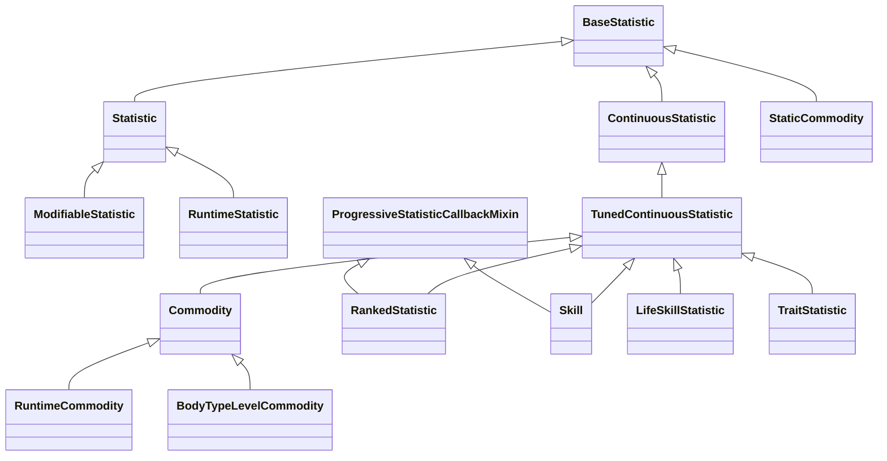
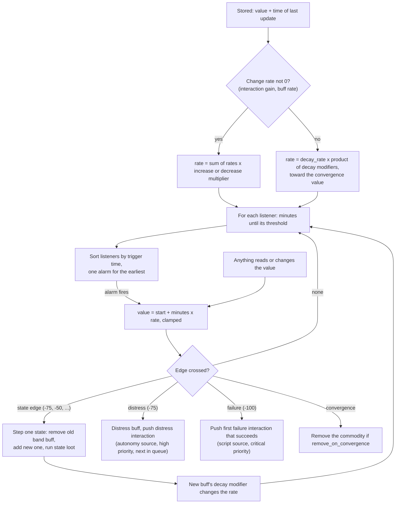

# 3.03 Needs, statistics and commodities

*Game version 1.128.90.1030 (Steam, Linux/Proton). Numbers come from the live tuning as the live merge builds it: the base game's delta build, then the delta builds of EP04 (Cats & Dogs), EP06 (Get Famous), EP09 (Eco Lifestyle), EP12 (High School Years), GP04 (Vampires), GP12 (Werewolves) and SP01 (Luxury Party). They are compared with the base full build where the two differ; SP42 (Grunge Revival) ships no combined tuning. Written 2026-10-12. Checked 2026-10-12: 121 claims checked, 26 corrected, 0 relabelled, 0 removed.*

## In plain words

Every number a Sim or an object carries is a statistic: Hunger and Fun, a skill, the hidden "hours since the last nap" counter, an object's dirtiness, a celebrity's fame. The six needs on the motive panel belong to the largest family, the commodities. A commodity slides on its own toward a resting value, changes the Sim's moodlets when it crosses fixed lines on the bar, and can start an emergency (a Sim wetting themselves, collapsing asleep, starving) when it hits the bottom.

The game does not tick needs every minute. It keeps the last value and the time it was computed, works out when the next line on the bar will be crossed at the current speed, and sets a single alarm for that moment. Between alarms the value is worked out only when something reads it. That is why thousands of statistics on hundreds of Sims cost almost nothing.

Three things surprise most players. First, while a Sim eats or sleeps, the need does not also drain: the interaction's rate takes the place of the drain for as long as it runs. Second, several needs drain more slowly the lower they get: Hunger falls from full to a quarter of the bar in about 15 hours, then needs about 48 more hours to empty, so a Sim can go roughly 63 Sim hours without food. Third, Sims outside your household do not have their needs simulated while they are away from you. When they arrive on your lot the game sets their needs from a time-of-day curve: hungry around 6:00 and 18:00, sleepy late at night.

Toddlers and infants swap Social for a separate Attention need, and their hunger moodlets slow the drain less, so a hungry toddler empties in about 44 hours. Cats and dogs have seven needs of their own; their Hunger slows down so much near the bottom that it takes about 13 Sim days to empty for a dog and about 15 for a cat.

## Key facts

- The live tuning holds 1,528 statistic instances: 931 Commodity, 432 Statistic, 71 SentimentTrack, 47 Skill, 27 RankedStatistic, 9 RelationshipTrack, 6 BodyTypeLevelCommodity, 4 ShortTermContextRelationshipTrack and 1 ObjectRelationshipTrack, plus 644 StaticCommodity in their own instance type.
- A continuous statistic is never ticked. Its value is `start + minutes x rate`, computed on read (`ContinuousStatistic._update_value`), and one alarm per statistic waits for the earliest threshold anyone listens to.
- When anything gives a statistic a change rate (an interaction's per-minute gain, a buff's rate modifier), decay stops entirely; the rate is used alone (`get_decay_rate` returns 0 when the change rate is not 0).
- Decay moves the value toward the convergence value at `base rate x product(decay modifiers)` per Sim minute; the base rate is the tuned `decay_rate` unless an interval band or delayed decay overrides it. All six needs converge on -100, the bottom of their -100 to 100 range.
- Live decay per Sim minute: Hunger 0.2083, Bladder 0.1736, Energy 0.1389, Fun 0.1488, Social 0.0868, Hygiene 0.0694 (same in the full build; [3.04 Autonomy](3.04-autonomy.md) uses the same numbers).
- Band moodlets carry decay modifiers, so full to empty takes about 63 h for Hunger, 18 h for Bladder, 24 h for Energy, 24 h for Fun, 48 h for Social and 42 h for Hygiene (an adult starting full with only the band moodlets applied; computed from the tuning below).
- Each need has states at -100, -75 or -99, -50, -25, 0, 25, 50 and 75 (Energy also 99). A state covers its value up to the next one; entering it swaps the band buff and runs the state's loot. States move one step at a time, so a big drop still passes every band.
- Distress on the six needs starts at -75 (live; the code default is -80) and pushes a distress interaction at high priority. Failure is at -100 and pushes the first failure interaction that succeeds: for adults, `sim_BladderFailure`, `sim_EnergyFailure`, `sim_HygieneFailure`, `sim_SocialFailure` or, for Hunger, `death_Hunger`.
- Fun has no failure. Its distress at -75 pushes `sim_FunDistress` like the other needs, and its bottom is a moodlet (`Buff_Motives_Fun_DesperateForFun`, Stressed weight 3).
- Off-lot, the six needs decay only for selectable Sims (`_off_lot_simulation` = selectable_sims). NPCs get the auto-satisfy curve when they are instantiated, interpolated over up to 1,440 minutes since they were last saved, read at a clock shifted at random by up to 60 (Energy), 90 (Hunger) or 120 minutes either way.
- A decay modifier of 0 stops decay, and an entry left blank in a `decay_modifiers` mapping is 0 (`CommodityDecayModifierMapping` default). `households.disable_household_motive_decay` adds a 0 modifier directly to every visible commodity.
- A ranked statistic is a continuous statistic split into levels by `event_intervals`; some levels are rank-ups. Fame (EP06) has six levels at 162, 837, 1,917, 3,334, 5,021 and 5,262 points and starts to decay only after 30 to 120 Sim hours without a change.
- On save, a commodity keeps its id, value, buff reason and the time of its last change. States, band buffs, alarms and decay modifiers are rebuilt on load from the value and the buffs present.
- Statistics that sit at their default with no rate and no modifiers are not kept as objects: `check_for_unneeded_initial_statistics` replaces them with an empty placeholder until something reads or changes them.

## How it works

### The statistic family

- **Observed** (`simulation/statistics/base_statistic.py: BaseStatistic`). The root class holds the value, the owning tracker, a lock counter, the summed change rate (`_statistic_modifier`), increase and decrease multipliers (products of all applied multipliers), the callback listeners and the urgency curve that autonomy reads (`autonomous_desire`, built as a `WeightedUtilityCurve` with `max_y=1, weight=1`). Tunables are `respect_lod_on_add` and `telemetry`. `instance_required` is true when the value differs from the default or the change rate is not 0. Two enums live here: `StatisticChangeDirection` (INCREASE 0, DECREASE 1, BOTH 2) and `GalleryLoadBehavior` (DONT_LOAD 0, LOAD_ONLY_FOR_OBJECT 1, LOAD_ONLY_FOR_SIM 2, LOAD_FOR_ALL 3).
- **Observed** (`simulation/statistics/statistic.py: Statistic`). A discrete statistic: integer `min_value_tuning` 0, `max_value_tuning` 100 and `_initial_value` 0 by default, optionally a random initial range, `persisted_tuning` True, `gallery_load_behavior` LOAD_ONLY_FOR_SIM, `apply_value_to_object_cost` False, an animation parameter (`stat_asm_param`, see below). It changes only when something sets or adds to it. Static modifiers (`statistic_static_modifier`, see [0.04 Tests, loot and effects](0.04-tests-loot-effects.md)) are sorted by priority and applied whenever the value or the modifier list changes; the result is cached in `_modified_value`, which `get_value` returns, while `get_raw_value` returns the stored value.
- **Observed** (`simulation/statistics/modifiable_statistic.py: ModifiableStatistic`). A `Statistic` whose value is `(initial value + tunable addends) x tunable multipliers`, cached. No instance exists in the installed tuning.
- **Observed** (`simulation/statistics/continuous_statistic.py: ContinuousStatistic`, `simulation/statistics/continuous_statistic_tuning.py: TunedContinuousStatistic`). The time-varying base and its tuned form: `decay_rate` (per Sim minute, code default 0.001), `_default_convergence_value` 0, range -100 to 100, `initial_value` 0, interval decay rates, delayed decay, `communicable_by_interaction_tag` (loot run on Sims an interaction with that tag touches), `persisted_tuning` True.
- **Observed** (`simulation/statistics/commodity.py: Commodity`). Adds states and band buffs, distress, failure, the auto-satisfy curve, off-lot rules, `weight` (default 0.5, used by autonomy), `ad_data` (the urgency curve), `visible` (default False), `remove_on_convergence` (default True) and `_add_if_not_in_tracker` (default True).
- **Observed** (`simulation/statistics/static_commodity.py: StaticCommodity`). A constant advertisement with a single tunable, `ad_data` (float, default 0). Its value is fixed at 0, `set_value`, `lock` and `unlock` raise, it is never saved (`persisted` False) and it is always scored. It lives in its own instance type (`STATIC_COMMODITY`), which is why it is counted apart. Autonomy reads it as a flat desire ([3.04 Autonomy](3.04-autonomy.md)).
- **Observed** (`simulation/statistics/runtime_statistic.py: RuntimeStatistic.generate`, `commodity.py: RuntimeCommodity.generate`). Both build a subclass at runtime under a given name, register it with the statistic manager under the hashed name and mark it not reloadable. **Inferred** (strings of `careers/career_tuning.pyc`, which failed to decompile: `_create_runtime_commodities`, `RuntimeStatistic`, `RuntimeCommodity`). Careers generate their own runtime statistics this way.
- **Observed** (`simulation/statistics/statistic_instance_manager.py: StatisticInstanceManager`). The statistic manager keeps a sorted tuple of all skills and `temp_commodity_buff_mapping`, which maps a timed buff's generated commodity id back to the buff so a save can rebuild it.
- **Observed** (`simulation/statistics/statistic_categories.py: StatisticCategory`). A dynamic enum (INVALID 0) whose values packs extend; categories let loot and modifiers act on a group (for example `decay_modifier_by_category`, `RemoveStatisticByCategory`). Module tuning `statistics.statistic_categories` names them (Stressed_Buffs, Happy_Buffs, Vampire_Buffs and so on).
- **Observed** (`simulation/statistics/statistic_enums.py`). `PeriodicStatisticBehavior` (APPLY_AT_START_ONLY, RETEST_ON_INTERVAL, APPLY_AT_INTERVAL_ONLY), `CommodityTrackerSimulationLevel` (REGULAR_SIMULATION, LOW_LEVEL_SIMULATION) and `StatisticLockAction` (DO_NOT_CHANGE_VALUE 0, USE_MIN_VALUE_TUNING 1, USE_MAX_VALUE_TUNING 2, USE_BEST_VALUE_TUNING 3).
- **Observed** (live tuning, counted by class with the live merge). Commodity 931 (base 568, EP04 210, EP06 50, EP09 51, EP12 27, GP04 10, GP12 14, SP01 1); Statistic 432 (base 256, EP04 25, EP06 46, EP09 53, EP12 49, GP12 3); StaticCommodity 644 (base 407, EP04 80, EP06 43, EP09 42, EP12 50, GP04 12, GP12 10); RankedStatistic 27 (base 1, EP06 14, GP04 4, GP12 8); Skill 47 (base 38); SentimentTrack 71. The base full build alone has Commodity 421, Statistic 138 and StaticCommodity 128; the game reads the base delta instead, which repeats most of those records and adds the rest. No `LifeSkillStatistic`, `TraitStatistic` or `ModifiableStatistic` instance exists in the installed data. Skills belong to [3.10 Skills, careers and school](3.10-skills-careers-school.md), trait statistics to [3.07 Personality and feelings](3.07-personality-feelings.md), relationship and sentiment tracks to [3.08 Relationships, socials and memories](3.08-relationships-socials.md).

### Trackers: where statistics live

- **Observed** (`objects/components/statistic_component.py: StatisticComponent.get_tracker`). Every owner has up to four trackers, created on first use: a `StatisticTracker` for `Statistic` subclasses, a `CommodityTracker` for everything continuous (commodities, skills, ranked statistics), a plain `BaseStatisticTracker` for static commodities, and a trait statistic tracker. `get_tracker` checks the class in this order: static commodity, `Statistic`, trait statistic, then anything continuous. A Sim's trackers live on its `SimInfo` (which has a statistic component), and the `Sim` object forwards to them (`sims/sim_info_mixin.py`), so needs exist even when the Sim is not instantiated. Objects carry the same component ([2.02 Objects: components, states and wear](2.02-objects-states-wear.md)).
- **Observed** (`simulation/statistics/base_statistic_tracker.py: BaseStatisticTracker`). A tracker holds a dict from statistic type to instance plus watchers (called on every change, with unclamped and delta variants), on-remove callbacks and listener seeds. `add_statistic` refuses blacklisted statistics (logging an error except for robot traits), statistics below their minimum level of detail and those whose `can_add` fails.
- **Observed** (`BaseStatisticTracker.add_statistic`, bytecode). With `create_instance=False`, a statistic that would not be `instance_required` is stored as `None`, a placeholder. `get_statistic` turns a placeholder into a real instance on demand. `check_for_unneeded_initial_statistics` turns every statistic that is not `instance_required` back into a placeholder (for commodities: on start-up, when low-level simulation starts and at the end of `update_all_commodities`; the base and discrete trackers also call it on save and load); its own listeners are destroyed and listeners owned by other systems become seeds; a seed is a listener waiting for a statistic that is not there yet, attached as soon as it is added (`base_statistic_listener.py: BaseStatisticCallbackListener.is_seed`).
- **Observed** (`simulation/statistics/continuous_statistic_tracker.py: ContinuousStatisticTracker`). Adds decay time queries and `set_convergence` / `reset_convergence`; setting a non-default convergence adds the statistic when its `_add_if_not_in_tracker` allows.
- **Observed** (`simulation/statistics/commodity_tracker.py: CommodityTracker`). Adds the simulation level (regular or low-level), suppression of all calculations during load or when alarm calculation is suppressed (`should_suppress_calculations`), application of already-active statistic modifiers to a newly added commodity, and cleanup: a commodity that is not core and is `remove_on_convergence` is removed when it reaches convergence. `SimInfo.__init__` sets a new Sim's commodity tracker to LOW_LEVEL_SIMULATION; instantiating the Sim switches it to regular simulation (bytecode of `sim.pyc`: `Sim._startup_sim_gen` calls `start_regular_simulation`).
- **Observed** (`simulation/statistics/statistic_tracker.py: StatisticTracker`). The discrete tracker: saves name hash and value, loads with the gallery, skip and level-of-detail checks, and keeps the statistics flagged `apply_value_to_object_cost` so an object's price can follow them.
- **Observed** (`traits/trait_tracker.pyc` per-function decompile, `Trait.get_all_initial_commodities`). Which commodities a Sim starts with comes from its traits: each trait has `initial_commodities`, `initial_non_motive_commodities`, conditional commodities and `initial_commodities_blacklist`. The trait tracker adds them with `core = True` (core commodities survive convergence cleanup) and removes them when the trait goes. `sim_info.py: SimInfo._create_additional_statistics` then adds the module list `INITIAL_STATISTICS` (live: `rankedStatistic_Reputation` with an age test, and one unresolved id) and a species value statistic for horses; `_setup_fitness_commodities` adds the fat and fit commodities as core.

### Continuous change without ticking

- **Observed** (`continuous_statistic.py: ContinuousStatistic._update_value`, bytecode). An update returns at once if the tracker suppresses calculations or no time has passed. Otherwise it takes the minutes since `_last_update`, stores now as the new update time and computes the rate. With a change rate, the new value is `start + minutes x change rate`. With decay only, it is `start + minutes x decay rate` toward convergence, and if the elapsed time is longer than the time to convergence the value snaps to the convergence value. An optional minimum or maximum decay level stops decay early (ranked statistics use this). The result is clamped to the range and passed to watchers.
- **Observed** (`ContinuousStatistic.get_value`, `get_change_rate`). Reading a value runs `_update_value` first, so a read is always current. `get_change_rate` returns the change rate if it is not 0, else the decay rate.
- **Observed** (`commodity_tracker.py: CommodityTracker.update_all_commodities`, callers in `objects/object_manager.py: pre_save`, `world/lot.py: save` and `world/lot_level.py: save`). The bulk update forces `_update_value` on every commodity and runs on the save path; no timer drives it. Lots carry their own commodity and statistic trackers the same way.
- **Inferred** (from the above). A need with no listener due and nobody reading it costs nothing between alarms; the motive panel stays current because the client is sent a value plus a rate (`send_commodity_progress_msg`, `commodity_messages.py: send_sim_commodity_progress_update_message`) and animates the bar itself.

### Decay, decay modifiers and convergence

- **Observed** (`ContinuousStatistic.get_decay_rate`, `base_decay_rate`, bytecode). The decay rate is 0 unless decay is enabled and the change rate is 0. Otherwise it is `base_decay_rate x _decay_rate_modifier`, signed toward convergence (negative above it, positive below, 0 at it). `base_decay_rate` is the interval override if one is active, else the delayed-decay rate if delayed decay is running, else `decay_rate`.
- **Observed** (`ContinuousStatistic.add_decay_rate_modifier`, `_recalculate_modified_decay_rate`). Decay modifiers are multipliers and they multiply together, along with a skill-based multiplier in the decrease direction. A negative modifier is rejected with an error; 0 is accepted and stops decay. The `decay_modifiers` of an `AutonomyModifier` (buffs, traits, interactions; [0.04 Tests, loot and effects](0.04-tests-loot-effects.md)) reach the statistic through `StatisticComponent.add_statistic_modifier`, which fetches the commodity with `add=_add_if_not_in_tracker`, so a modifier for a commodity the owner lacks is dropped when that flag is off.
- **Observed** (`simulation/statistics/tunable.py: CommodityDecayModifierMapping`, `StatisticCategoryModifierMapping`). The decay modifier mapping is keyed by Commodity or RankedStatistic and its value defaults to 0; the by-category mapping defaults to 1.
- **Observed** (`continuous_statistic_tuning.py: TunedContinuousStatistic._interval_decay_rates`). Interval decay rates replace the base rate inside value bands `[lower, upper)` (defaults -100 to 100). Gaps between bands use the base rate; overlaps are logged and trimmed. They are implemented with two listeners at the current band's edges (below the lower edge, at or above the upper) that swap `_decay_rate_override` when crossed. Decay modifiers still multiply the override. Tuning both interval rates and delayed decay on one statistic is reported as an error. Pet needs use interval rates and band-buff modifiers together.
- **Observed** (`ContinuousStatistic._start_delayed_decay_timer`, `_display_decay_warning`, `_start_delayed_decay`). Delayed decay: after a value change, wait `initial_delay` (code default 30 Sim minutes), show the optional warning, wait `final_delay` (code default 30), then decay at `delayed_decay_rate` (code default 0.001) until the next change. Per-band overrides can change the rate and both delays; a band's values are taken when a listener sees the value enter that band (`TunedContinuousStatistic._on_delayed_decay_rate_override_changed`). The warning shows only when `decay_warning` is tuned and the decay modifier is not 0. NPC Sims skip delayed decay unless `npc_decay` is set.
- **Observed** (`ContinuousStatistic.on_lock`, `on_unlock`). Locking turns decay off and, per `StatisticLockAction`, sets the value to the minimum, maximum or best value, or leaves it. The best value is the maximum, except for a commodity whose `best_value_tuning` names the minimum (`commodity.py: Commodity.best_value`). Unlocking turns decay back on and restarts delayed decay; a commodity unlocked with `auto_satisfy=True` jumps to its auto-satisfy value for the current hour.
- **Observed** (`ContinuousStatistic.instance_required`). A continuous statistic stays instanced while its convergence differs from the tuned default or any rate is not 0.

### Change rates from interactions and buffs

- **Observed** (`interactions/utils/statistic_element.py: PeriodicStatisticChangeElement._add_operation_if_valid`, bytecode). For a running interaction, each `StatisticChangeOp` (or dynamic skill op) on a continuous statistic becomes a per-minute rate in an `AutonomyModifier` (`statistic_modifiers`) added to the participant for the interaction's duration. Ops on discrete statistics, and other op types, are applied by an alarm every `alarm_interval` Sim minutes (tunable default 1; `STATIC_CHANGE_INTERVAL` 1 when no loot block is tuned). [3.05 Interactions, postures and routing](3.05-interactions-postures-routing.md) owns the element itself.
- **Observed** (`ContinuousStatistic._get_change_rate_without_decay`). The change rate is the summed `_statistic_modifier`, times the product of increase multipliers when the sum is positive or of decrease multipliers when it is negative, times an age-speed multiplier: 1, or `get_speed_multiple_relative_to_normal` for the Sim's age when the commodity sets `_tick_relative_to_age_speed`. Decay does not use this multiplier.
- **Observed** (`base_statistic.py: BaseStatistic.add_value`). One-off additions (loot) skip a locked statistic, multiply the amount by the same increase or decrease multiplier and by skill-based multipliers from the interaction's participants, notify delta watchers and clamp.
- **Inferred** (from the two rules above). Band buffs on Hunger carry both a decay modifier and a `stat_use_multiplier` in the DECREASE direction with the same value, so a starving Sim's Hunger falls more slowly both from decay and from activities that drain it.

### Listeners and the alarm math

- **Observed** (`base_statistic_listener.py: BaseStatisticCallbackListener.check_for_threshold`, bytecode). A listener is a threshold (value plus comparison) and a callback. It triggers on an edge: the comparison is false for the old value and true for the new one. On a plain `Statistic` the base `_update_callback_listeners` is level-triggered instead: every listener whose comparison is true for the new value fires on each change (`base_statistic.py`).
- **Observed** (`continuous_statistic.py: _ContinuousStatisticCallbackData.reset_trigger_time`). For continuous statistics each listener stores a trigger time, `now + minutes until the threshold`, or none if the threshold will never be reached at the current rate.
- **Observed** (`ContinuousStatistic._calculate_minutes_until_value_is_reached_through_decay`, bytecode). The minutes until a threshold:
  1. For a strict comparison the target is nudged by `EPSILON` (1.192092896e-07, `core/sims4/math.py`): above for "greater than", below for "less than".
  2. 0 if the threshold is already met or the value equals the target; none if the target lies past the minimum or maximum decay level.
  3. With a change rate: `|target - value| / |rate|` when the rate moves toward the target, else none.
  4. With decay only: none if decay moves away from the target or the convergence value lies strictly between the value and the target; else `|target - value| / decay rate`.
- **Observed** (`ContinuousStatistic._update_callback_listeners`, `_update_active_callback`, `_alarm_callback`, `_insert_callback_listener`). After any change of value or rate, the statistic walks its listeners (in reverse when the value fell), triggers those whose edge was crossed, recomputes every trigger time and re-sorts them (binary insertion). Only the head of the list gets an alarm. If the head is already due it fires at once and the loop repeats. When the alarm fires, every listener due on the same tick fires, then each is re-inserted with a fresh trigger time.
- **Inferred** (from the above). A statistic with twenty listeners still owns one alarm, and a rate change (a buff added, an interaction starting) costs one pass over that statistic's own listeners and one new alarm.

### Precision and update cadence

- **Observed** (`date_and_time.py`: `REAL_MILLISECONDS_PER_SIM_SECOND` 25, `TimeSpan.__init__`). Game time is counted in ticks: 25 per Sim second, 1,500 per Sim minute. A time span is rounded up to a whole tick (`math.ceil`), so an alarm fires at, or up to one tick after, the exact crossing. The alarm path then triggers each due listener directly, with no edge test (`ContinuousStatistic._alarm_callback`, `_trigger_callback`). **Inferred**: the `EPSILON` nudge makes the value read by the callback already lie past a strict threshold.
- **Observed** (`_update_value`). Values are Python floats with no rounding in the decay math; the elapsed time is `TimeSpan.in_minutes()`, a float.
- **Observed** (`continuous_statistic.py: ContinuousStatistic.SAVE_VALUE_MULTIPLE`, `get_saved_value`). One exception: on objects saved for inventory stacking, continuous values are rounded to the nearest multiple of `SAVE_VALUE_MULTIPLE` (code default 10; the module tuning `statistics.continuous_statistic` sets nothing), so similar items stack.
- **Observed** (`commodity.py: Commodity._update_state_up`, `_update_state_down`). State changes step one state at a time with an `EPSILON` nudge; a jump from 100 to -100 steps through every state in between, running each buff swap and each state's loot in order.

### Commodity states and band buffs

- **Observed** (`commodity.py: CommodityState`, `Commodity._tuning_loaded_callback`). A state has a value (its lower edge), a buff, `buff_overrides` (trait to replacement buff), an optional `buff_add_threshold`, an icon and fill level for the panel, and loot lists for entering always, entering upward and entering downward, plus `apply_loot_on_load`. If the lowest state starts above the minimum, an implicit state with no buff is added at the minimum.
- **Observed** (`Commodity._find_state_index`, `_add_state_callback`). The current state is the last one whose value is at or below the current value. Two listeners watch it: one at or above the next state's value (step up) and one below the current state's value (step down).
- **Observed** (`Commodity._set_state`, bytecode). Entering a state removes the previous state's buff, then adds the new buff unless a `buff_add_threshold` is not yet met (in which case a listener adds it later). The buff is added with the commodity's id, its current change rate and the previous buff's id (for transition text). Loot runs only on a real transition (or on load when `apply_loot_on_load`), with a Sim or object resolver: the always list, then the increasing or decreasing list depending on direction.
- **Observed** (tuning `motive_*` and `Buff_Motives_*`, live). The six needs' bands, with each band buff's mood, mood weight and decay multiplier:

| Need | [-100, next) | [-75 or -99, -50) | [-50, -25) | Other |
|---|---|---|---|---|
| Hunger | `Buff_Motives_Hunger_Starving`: Uncomfortable 40, decay x0.0833 | `Hungry`: Uncomfortable 1, x0.0833 (state at -75) | `InvisDecayMods_HungerYellow` (hidden), x0.4 | |
| Bladder | `ReallyHasToPee`: Uncomfortable 40, x1.2 | `HasToPee`: Uncomfortable 1, x1.2 (-75) | `BladderYellow`, x1.2 | |
| Energy | `Exhausted`: Uncomfortable 3, none | `Tired`: Uncomfortable 1, x1 (-75) | `EnergyYellow`, x1 | state at 99 |
| Fun | `DesperateForFun`: Stressed 3, none | `NeedsAmusement`: Stressed 1, x0.9333 (-99) | `FunYellow`, x0.7 | `buff_Motives_Fun_High` at 75 (hidden, no modifier) |
| Social | `Desolate`: Sad 3, none | `Lonely`: Sad 1, x0.6 (-99) | `SocialYellow`, x0.6 | |
| Hygiene | `Filthy`: Uncomfortable 2, none, loot `loot_MakeSimGrubby` | `Grungy`: Uncomfortable 1, x2 (-99) | `HygieneYellow`, x1 | |

  Mood names are the tuning's (`Mood_Uncomfortable`, `Mood_Stressed`, `Mood_Sad`); moods themselves are in [3.07 Personality and feelings](3.07-personality-feelings.md). Traits swap these buffs through `buff_replacements`: `trait_Outgoing` turns Lonely into `Buff_Motives_Social_Lonely_Outgoing` (Sad 2) and `trait_Glutton` turns Hungry into `Buff_Motives_Hunger_HungryGlutton` (Uncomfortable 2). Fill levels on the panel: FAILURE at -100, DISTRESS at -50, NO_FILL at -25, FINE from 25 up; a state left at the default NO_FILL leaves the warning colour to the panel distress threshold (`CommodityState` tunable description).
- **Observed** (same tuning). For Fun, Social and Hygiene the strongest moodlet's state is only one point wide, [-100, -99). Because these needs converge on -100, the strong moodlet appears in the last 7 to 15 minutes of decay and then stays.
- **Observed** (state loot, live). Downward entries at -50 and -25 run `loot_Want_Refresh_Reactionary` (wants, [3.07 Personality and feelings](3.07-personality-feelings.md)); Hunger entered downward at 0 and 25 runs `loot_Want_CommodityTracker_HungerMotive_Reset`; Energy at -75 runs `loot_Fame_Perk_Brand_AllNighter_EnergyDrain_Add` and at 99 the matching remove.
- **Observed** (`Commodity._recalculate_modified_decay_rate`, `_update_buff`). When the decay modifiers change, the commodity passes its state buff a change rate: minus the combined decay modifier when that is above 1, otherwise 0. Separately, each commodity's `arrow_data` (sent to the client only) sets the rates at which the panel shows one, two or three arrows. The code defaults are 1, 20 and 30 per direction; the six needs tune their own (Hunger: 0.001, 1 and 2.3333 up, -0.001, -0.25 and -0.33333 down).

### The six needs in numbers

- **Observed** (tuning `motive_*`, live). All six: range -100 to 100, convergence -100, `visible` True, `remove_on_convergence` False, `initial_as_default` True, `_add_if_not_in_tracker` False (the full build has True), persisted, time fixup FIXUP_USING_AUTOSATISFY_CURVE, `maximum_auto_satisfy_time` 1,440 min, `_off_lot_simulation` selectable_sims, category `Motive_Commodities`, `ui_visible_distress_threshold` -25.
- **Inferred** (arithmetic on the live decay rates and band multipliers above). Hours to fall through each band for an adult human who starts at 100 with nothing else applied, assuming each band buff is added as its state is entered (all six pass their add test for children through elders):

| Need | Decay /min | 100 to -25 | -25 to -50 | -50 to -75 or -99 | Last band | Full to empty |
|---|---|---|---|---|---|---|
| Hunger | 0.2083 | 10.0 h | 5.0 h | 24.0 h | 24.0 h (-75 to -100) | about 63 h |
| Bladder | 0.1736 | 12.0 h | 2.0 h | 2.0 h | 2.0 h | about 18 h |
| Energy | 0.1389 | 15.0 h | 3.0 h | 3.0 h | 3.0 h | about 24 h |
| Fun | 0.1488 | 14.0 h | 4.0 h | 5.9 h (to -99) | 7 min | about 24 h |
| Social | 0.0868 | 24.0 h | 8.0 h | 15.7 h (to -99) | 12 min | about 48 h |
| Hygiene | 0.0694 | 30.0 h | 6.0 h | 5.9 h (to -99) | 14 min | about 42 h |

  [3.04 Autonomy](3.04-autonomy.md) lists the same decay rates with "hours 100 to -100 before modifiers" (16.0, 19.2, 24.0, 22.4, 38.4, 48.0); the table here applies the band modifiers, which is why Hunger, Fun and Social take longer and Bladder and Hygiene less.
- **Observed** (tuning `initial_tuning`, live). Hunger and Energy are flagged to take a new Sim's first value from the auto-satisfy curve for the hour and also tune a range of 75 to 100; Bladder starts random 25 to 75, Fun 0 to 40, Social 0 to 50, Hygiene 70 to 90 (`Commodity.get_initial_value`: uniform in the range).
- **Observed** (tuning `ad_data`, `weight`, `ui_sort_order`). The urgency curves and weights are in [3.04 Autonomy](3.04-autonomy.md). Panel order (`ui_sort_order`): Bladder 0, Fun 1, Hunger 2, Social 3, Energy 4, Hygiene 5.

### Distress and failure

- **Observed** (`commodity.py: TunableCommodityDistress`, `Commodity._enter_distress`, `_setup_distress_essentials`, `_exit_distress`). Distress is a listener at or below `threshold_value` (code default -80; the six needs use -75). On entry, for Sims only: add the distress buff if one is tuned (none on the six needs), add an exit listener (above the threshold), tell the Sim (`enter_distress`) and send a skewer alert if tuned. Then, unless a running or queued interaction `prevents_distress` for this commodity, push the first distress interaction that succeeds, as an autonomy interaction at Priority.High, inserted next in the queue.
- **Observed** (tuning, live). Distress interactions include `sim_HungerDistress`, `sim_HygieneDistress` and carry, toddler and infant variants (`sim_HungerDistress_CarrySim`, `toddler_Cry_Motive_Distress_Hunger`, ...). Fun has the same kind of list: `sim_FunDistress_CarrySim`, `sim_FunDistress`, a carried-toddler variant, toddler crying and tantrum variants, `sim_Toddler_FunDistress` and `MotiveDistress_Infant_Fun`.
- **Observed** (`TunableCommodityFailure`, `Commodity._commodity_fail`). Failure is a listener at the failure threshold (LESS_OR_EQUAL; value default -100). For an object it pushes the first immediate, Sim-less failure interaction that passes. For a Sim it pushes the failure interactions in list order as script interactions at Priority.Critical and stops at the first that succeeds, keeping a weak reference to it. With `repeat_interval` set (code default when enabled: 12 Sim minutes), an alarm re-fails while the value stays at failure and no failure interaction is alive. None of the six needs tunes a repeat interval.
- **Observed** (`_commodity_fail`, its debug message). A Sim hidden in a rabbit hole at the moment of failure gets no failure; with no repeat interval the failure waits for the next zone load. A commodity that is `remove_on_convergence` reaching failure inside a rabbit hole is logged as an error, because its failure will then never run.
- **Observed** (tuning `commodity_failure`, live; lists in order). Hunger: `oceanSwimming_Reactions_Drown_WaterVehicleExit`, two ids not in the installed tuning, `death_Hunger`, `rescueNeglectedDependent_Child`, `sim_HungerFailure`, `rescueNeglectedDependent_Infant`, `rescueNeglectedDependent_Toddler` (the full build has only `death_Hunger`, `rescueNeglectedChild`, `sim_HungerFailure`). Bladder: `sim_BladderFailure`, `_Pool`, `_HotTub`, `toddler_UseDiaper`, `toddler_UseDiaper_failure_standing`, `infant_Diaper_Use`, `infant_Diaper_Use_Standing`. Energy: ocean drowning, `sim_EnergyFailure`, `super_Ponds_Energy_ExitPond_Start`, `sim_EnergyFailure_Pool_Pregnant`, `aggregate_Toddler_EnergyFailure`, infant sleep variants and three unnamed ids. Hygiene: `sim_HygieneFailure_CarrySim`, `sim_HygieneFailure` and two unnamed ids. Social: `sim_SocialFailure`. Fun: none. Which entry wins is decided by each interaction's own tests; death itself belongs to [3.09 Life cycle](3.09-life-cycle.md).
- **Observed** (tuning `commodity_autosolve_failure_interaction`, live; `statistic_commands.pyc` per-function decompile). Each of the six names an interaction for a need that cannot be solved: `hunger-route-fail`, `bladder-route-fail`, `energy-route-fail`, `fun-route-fail`, `social-route-fail` and `hygiene-route-fail`. The only Python reader is `stats.solve_motive`, which pushes it when autonomy finds no interaction for the need.

### Off-lot Sims, auto-satisfy curves and time passage

- **Observed** (`commodity.py: Commodity._can_low_level_simulate`, `start_low_level_simulation`). In low-level simulation (Sim not instantiated), a commodity decays only if the Sim is not a baby, infant or toddler and its `_off_lot_simulation` allows: disabled (never), selectable_sims (only played Sims) or selectable_sims_and_npcs. Otherwise decay is off while the Sim is away. Visible commodities of selectable Sims keep their states and buffs set up either way.
- **Observed** (`Commodity.fixup_for_time`, `fixup_on_sim_instantiated`). When a Sim is instantiated, each commodity is fixed up by `_time_passage_fixup_type`: FIXUP_USING_TIME_ELAPSED decays from the last update (decay forced on for the catch-up); FIXUP_USING_AUTOSATISFY_CURVE sets the auto-satisfy value when off-lot simulation is disabled, the Sim is a baby, or the Sim is an NPC and the commodity does not simulate NPCs; DO_NOT_FIXUP does nothing. Counts in live tuning: 132 time-elapsed, 29 auto-satisfy, 24 do-not-fixup set explicitly, and 746 leave the field out (code default DO_NOT_FIXUP).
- **Observed** (`Commodity.set_to_auto_satisfy_value`, bytecode). Not for locked commodities. A random offset of plus or minus `auto_satisfy_curve_random_time_offset` minutes is added to the clock, the curve (a 24-hour `CircularUtilityCurve`) is read at that hour, and the value is set to it when the Sim has no save time (only for commodities that use the curve as their initial value) or was saved at least `maximum_auto_satisfy_time` ago; otherwise the value moves linearly toward the curve by the fraction of that time that has passed.
- **Observed** (tuning `auto_satisfy_curve_tuning`, live; points are hour, value). Hunger: (6, -45) (6.25, -45) (6.5, 100) (18, -45) (18.25, -45) (18.5, 100), offset 90 min. Bladder: (6, -20) (7, 100) (13, -20) (13.5, 100) (20.5, -20) (21, 100), offset 120 (the full build has -60 instead of -20). Energy: (5, -5) (6, 100) (22, -25) (24, -25), offset 60. Fun 45, Social 0 and Hygiene 80 at every hour, offset 120.
- **Observed** (`statistic_commands.py` bytecode: `stats.disable_autosatisfy_curves`). The class flag `Commodity.use_autosatisfy_curve` turns the whole mechanism off.

### Saving and loading

- **Observed** (`commodity.py: Commodity.get_save_message`, `load_statistic_data`; `commodity_tracker.py: CommodityTracker.save`). A commodity saves its name hash, its saved value, whether to re-apply its buff on start-up, the buff reason and the time of its last value change (for delayed decay). The commodity tracker returns three lists: commodities, skills and ranked statistics. Discrete statistics save name hash and value (`statistic_tracker.py`). Static commodities and anything with `persisted_tuning` False are not saved: 172 commodities set it False in the live tuning.
- **Observed** (`CommodityTracker.load`, bytecode, in order). Rebuild timed-buff commodities from `temp_commodity_buff_mapping`; skip unknown or unpersisted types; check `_test_on_load` traits; skip listed types; skip skills at their initial value; skip gallery-only and remove-on-convergence entries when told to; apply the gallery load behaviour; defer statistics whose minimum level of detail is ACTIVE until the Sim reaches it, or drop them; then load the value and refresh affordance caches.
- **Observed** (`Commodity.load_statistic_data`, `_set_state`). A loaded commodity re-applies its state buff without running the state's entry loot (unless `apply_loot_on_load`), and restarts the delayed decay timer so that the time since the last change is what it was at save (`ContinuousStatistic.load_time_of_last_value_change`).
- **Inferred** (from what is saved). Decay modifiers, change rates, listeners and alarms are not saved. They come back when the buffs, traits and interactions that own them are re-applied.

### Ranked statistics

- **Observed** (`simulation/statistics/ranked_statistic.py: RankedStatistic`, `progressive_statistic_callback_mixin.py: ProgressiveStatisticCallbackMixin`). A ranked statistic is a continuous statistic from 0 to the sum of `event_intervals`. Each interval is the points from the previous level to the next. `event_data` maps a level number to a rank-up flag and loot: `loot` (first time the level is reached), `loot_always` (every time), `level_up_loot`, `level_down_loot`, `loot_always_on_load` and `tests`. Ranks start at `initial_rank` (default 1) and go up by one at each level flagged `rank_up`; the tuning check requires one `rank_tuning` entry per rank and as many rank-up notifications.
- **Observed** (`ProgressiveStatisticCallbackMixin.refresh_threshold_callback`). Two listeners watch a ranked statistic: one at the next level's lower bound (at or above) and, while decay is enabled, one below the current level's bound. Both run `RankedStatistic._callback_handler`.
- **Observed** (`RankedStatistic.on_stat_event`, bytecode). Going up, each level crossed in turn applies its first-time loot only if it is above `highest_level` (then raises `highest_level`), ranks up (first time: rank-up notification and screen slam; later times: the re-rank notification), applies `loot_always` and `level_up_loot`. For a Sim that is not simulating, the first-time and always loot are skipped (so `highest_level` does not move) and rank-ups are only counted and sent as one message; `level_up_loot` runs either way. Setting the rank fires `TestEvent.RankedStatisticChange`.
- **Observed** (`RankedStatistic._get_valid_value`, `set_value`, `_handle_level_down`, `_get_minimum_decay_level`). A level's `tests` cap the value: if they fail, the value stops at the previous level's points. Going down runs `level_down_loot` and decrements the rank at each rank-up level crossed. `min_decay_per_highest_level_achieved` sets a floor in ranks from the highest level ever reached; `set_value` and decay both respect it.
- **Observed** (`RankedStatistic.on_initial_startup`, `on_lock`). Decay runs only for selectable Sims. Locking clears `highest_level` and empties the associated bucks when `zero_out_on_lock` (default True) or the lock action is USE_MIN_VALUE_TUNING. The value itself follows the lock action (`ContinuousStatistic.on_lock`); because `highest_level` is cleared first, USE_MIN_VALUE_TUNING takes it to 0 past any floor.
- **Observed** (tuning `rankedStatistic_Fame`, EP06 delta). Example: Fame.

| Level | Interval | Points to reach | Rank after | First-time loot (examples) |
|---|---|---|---|---|
| 1 | 162 | 162 | 1 | `loot_Fame_Progression_RankUp_1`, `loot_CivicPolicy_InfluencePoints_Small` |
| 2 | 675 | 837 | 2 | `loot_Fame_Progression_RankUp_2`, `loot_DramaNode_Fame_RankUp_Situation` |
| 3 | 1,080 | 1,917 | 3 | `loot_Fame_Progression_RankUp_3` |
| 4 | 1,417 | 3,334 | 4 | `loot_Fame_Progression_RankUp_4` (always: `loot_Buff_CelebrityWalkstyle_On`) |
| 5 | 1,687 | 5,021 | 5 | `loot_Fame_Progression_RankUp_5`, `loot_Fame_CelebrityTile_Notification_TileAchieved` |
| 6 | 241 | 5,262 (max) | 5 | none (tooltip only) |

  Fame has `initial_rank` 0, `decay_rate` 0 and delayed decay: base 0.1125 points/min after 1,680 + 120 min, with overrides by value band [162, 837) 0.234 after 2,040 + 120, [837, 1,917) 0.1875 after 2,760 + 120, [1,917, 3,334) 0.197 after 4,200 + 120, [3,334, 5,262) 0.1674 after 7,080 + 120 Sim minutes. Floors: highest level 3 keeps rank 1 (162 points), level 4 keeps rank 2 (837), levels 5 and 6 keep rank 3 (1,917). `zero_out_on_lock` False; bucks FamePerkBucks and FameQuirkBucks. Fame as gameplay is in [3.13 Sickness, luck, fame and other Sim states](3.13-health-luck-fame.md).
- **Inferred** (from the Fame numbers and the delayed-decay code above). A five-star celebrity (a played Sim: decay is off for the others) who stops doing anything famous gets the decay warning after 118 Sim hours (the [3,334, 5,262) band's 7,080 min), starts losing about 10 points per Sim hour 2 hours later (0.1674 x 60), and can never fall below three stars (rank 3, 1,917 points, reading rank 0 as the empty bar). This needs the band's override, which a listener sets when the value enters the band; without it the base 1,680 + 120 min and 0.1125 points per minute apply.
- **Observed** (`simulation/statistics/ranked_statistic_display_info.py: RankedStatisticDisplayInfo`). UI-only data in the user-interface instance type: perks panel text per bucks type and Sim info panel icons, pointing at a ranked statistic.
- **Observed** (`simulation/statistics/ranked_stat_handlers.py`). Two debug-panel views (`ranked_stat`, `ranked_stat_view`): rank, points to the next rank, decay state and time until decay starts ([1.04 Debug tools, cheats and telemetry](1.04-debug-cheats-telemetry.md)).

### Motive sets per age and species

- **Observed** (tuning `trait_Species_Human`, live). Every human Sim gets the six needs plus `commodity_Motive_Comfort` (hidden, decay 0.0625, no urgency curve), `commodity_Motive_Thirst` (decay 0, range 90 to 100), `commodity_SimInfo_TimeSinceLastSocial`, `commodity_SimInfo_TimeSinceLastSlept`, `commodity_object_burning`, `commodity_sim_BodyTemperature`, one unresolved id and one conditional commodity with a home-region test.
- **Observed** (tuning `trait_teen`, `trait_youngAdult`, `trait_adult`, `trait_elder`). Teens and older add `commodity_Sim_Fulfillment` and several ids whose instances are not installed (uninstalled packs).
- **Observed** (tuning `trait_toddler`, `trait_infant`, `motive_Toddler_Attention`). Toddlers and infants add `motive_Toddler_Attention` and blacklist `motive_Social`. Attention decays 0.0868 per minute, weight 0.5, starts at 0 to 50, distress at -75 (`toddler_Cry_Motive_Distress_Attention` and others), no failure; its band buffs are `buff_Motives_Toddler_Attention_Sad_Very` (Sad 3) at -100, `_Sad` (Sad 1, x0.6) at -99 and a hidden x0.6 band at -50. Infants also add `commodity_Infant_AwakeTime`.
- **Observed** (tuning `trait_toddler` and `trait_infant` `buff_replacements`). The same human needs, with different band buffs:

| Adult buff | Toddler replacement | Infant replacement |
|---|---|---|
| Hunger `Hungry` (x0.0833) | `Toddler_Hunger_Angry` (x0.4) | `Infant_MotiveOverride_Hunger_Sad` (x0.4) |
| Hunger `Starving` (x0.0833) | `Toddler_Hunger_Angry_Very` (x0.0833) | `..._Hunger_VerySad` (x0.0417) |
| Energy `Tired`, `Exhausted` | `Toddler_Energy_Angry`, `_Angry_Very` | `..._Energy_Angry`, `_VeryAngry` (x1) |
| Fun `NeedsAmusement`, `DesperateForFun` | `Toddler_Fun_Sad` (x0.9333), `_Sad_Very` | `..._Fun_Sad` (x0.9333), `_VerySad` |
| Hygiene `Grungy`, `Filthy` | `Toddler_Hygiene_Sad` (x2), `_Sad_Very` | `..._Hygiene_Sad` (x2), `_VerySad` |
| Bladder `HasToPee`, `ReallyHasToPee` | `Toddler_Bladder_Hidden`, `_Hidden_Very` (no decay modifier) | |

- **Inferred** (arithmetic on the live tuning; `buffs/buff.py: Buff.can_add`). Toddler Hunger: 10 + 5 + 5 + 24 = 44 h to empty, against 63 h for an adult; infant Hunger, with x0.4 and x0.0417, takes about 68 h. Toddler Attention takes about 48 h, like adult Social. A toddler's Bladder gets no x1.2 anywhere: its replacement band buffs have no decay modifier, and the adult [-50, -25) band buff `Buff_Motives_InvisDecayMods_BladderYellow` has an add test for children through elders only, so `can_add` refuses it. That gives 12 + 7.2 = 19.2 h.
- **Observed** (tuning `trait_PlantSim`, base). Plant Sims add `motive_PlantSim_Water` (decay 0.0694, failure `sim_PlantSim_WaterFailure`) and blacklist Bladder.
- **Observed** (tuning `trait_OccultVampire_Manifested`, GP04; `trait_OccultWerewolf_Manifested`, GP12). Vampires add `commodity_Motive_Visible_Vampire_Power`, `commodity_Motive_Visible_Vampire_Thirst` and `commodity_Vampire_SunExposure` and blacklist Hunger, Energy and Bladder. Werewolves add `commodity_Motive_Werewolf_Fury`. Occults are in [3.11 Occults and the supernatural](3.11-occults.md).
- **Observed** (tuning `trait_Species_Cat`, `trait_Species_Dog`, EP04). Cats and dogs get seven needs (Affection, Bladder, Bowel, Energy, Hunger, Hygiene, Play), all -100 to 100 converging on -100, `_off_lot_simulation` disabled, distress -75 (a dog's Bladder and Bowel -50; a cat's stay at -75), panel distress at -25:

| Dog need | Decay /min | Weight | Interval decay rates | Failure |
|---|---|---|---|---|
| Affection | 0.21 | 0.24 | none | none |
| Bladder | 0.23 | 0.1 | [-50, -25) 0.038; [-100, -51) 0.07 | `sim_Dog_BladderFailure`, `_Outside` |
| Bowel | 0.087 | 0.1 | [-50, -25) 0.07; [-100, -51) 0.083 | `sim_Dog_BowelFailure`, `_Outside` |
| Energy | 0.21 | 0.3334 | none | `sim_Dog_EnergyFailure`, `_Wading` |
| Hunger | 0.185 | 0.1 | [-50, 0) 0.09; [-75, -51) 0.035; [-100, -76) 0.013 | `sim_Dog_HungerFailure` |
| Hygiene | 0.0065 | 0.2 | none | none |
| Play | 0.28 | 0.167 | none | none |

  Cats use the same structure (the same Hunger interval rates; cat Hygiene weight 0.33). Pet Hunger distress and failure both send a skewer alert. Pet band buffs carry decay modifiers too, on top of the interval rates: `buff_Motives_Pet_Dog_Hungry` x0.25 on [-75, -50) and `buff_Motives_Pet_Dog_Starving` x0.125 below -75; for cats `buff_Motives_Pet_Cat_Hungry` x0.25 on [-50, -25) and `buff_Motives_Pet_Cat_Starving` x0.125 below -50. **Inferred** (arithmetic on the live tuning, starting at 100 with the band buffs added as the value falls; the one-point gaps the interval bands leave, [-51, -50) and [-76, -75), decay at the base 0.185 times the band buff): a dog's Hunger reaches 0 in 9 h, -50 in 18 h, its distress line at -75 in about 64 h and empties in about 311 h (13 Sim days); a cat's empties in about 371 h (15 Sim days). Dog Bladder empties in about 32 h, Bowel 40 h, Energy and Affection 16 h, Play 12 h and Hygiene 513 h. Pets as a system are in [3.12 Pets and horses](3.12-pets-horses.md).
- **Inferred** (tuning `buff_Motives_Pet_Cat_DrowsyEnergy`, `buff_Motives_Pet_Dog_MopeyEnergy`). These pet buffs carry decay modifiers on the human `motive_Energy`. Pets do not have that commodity and its `_add_if_not_in_tracker` is False, so the modifiers find nothing to change.

### Buffs that need several needs at once

- **Observed** (`simulation/sims/multi_motive_buff_tracker.py: MultiMotiveBuffTracker`; `sim.pyc` bytecode, `Sim.MULTI_MOTIVE_BUFF_MOTIVES`). On instantiation a Sim builds one tracker per entry of the module tuning `Sim.MULTI_MOTIVE_BUFF_MOTIVES` (buff to a map of commodity and threshold). Each tracker puts one listener on each commodity, counts how many thresholds are met, adds the buff when all are and removes it when any one fails. It also watches for commodities being added or removed. Threshold comparison defaults to at or above (`TunableThreshold` default GREATER_OR_EQUAL, bytecode of `core/sims4/tuning/tunable.pyc`).
- **Observed** (tuning `sims.sim`, base delta). `Buff_Motives_AllMotivesHigh` needs Bladder, Energy and Hunger at or above -25 and Fun, Hygiene and Social at or above 75. `Buff_Motives_AllMotivesPrettyHigh` needs Bladder, Energy and Hunger at or above -25, the other three at or above 50, and `Commodity_Buff_AllMotivesHighGate` below 100. Toddlers get `buff_Motives_Toddler_AllMotivesOkay_CheckToddler` (`commodity_Toddler_DiaperLoad` below 6; Energy, Hunger and Hygiene at or above -50). Vampires have their own pair using Thirst at or above -50 and Power at or above -25, plus `buff_Vampires_Motives_DispelGreedyNeeds` (Thirst 20, Power 50, Fun, Hygiene and Social 50). The table has 13 entries; six point at buffs not in the installed tuning.

### Timed buffs, static commodities and exit conditions

- **Observed** (`buffs/buff.py: Buff._create_temporary_commodity`). A buff with `_temporary_commodity_info` gets a generated `RuntimeCommodity` named after it: range 0 to `max_duration` (code default 100), starting at `max_duration`, decay 1 per Sim minute toward 0, removed at convergence, hidden, time fixup by elapsed time, and two states (0: no buff, 0.1: the buff). So a moodlet's countdown is an ordinary commodity draining one point per minute. 4,490 of the 7,568 live `Buff` instances use this (the buff instance type also holds 15 `ClothingBuff`).
- **Observed** (`simulation/statistics/statistic_conditions.py: StatisticCondition`, `TunableCondition`). Interaction exit conditions default to `stat_based`: a participant's statistic against a threshold, absolute or relative to the start value (clamped to the statistic's range). The condition puts two tracker listeners on the statistic (the threshold and its inverse), so "eat until full" is the same listener mechanism. `TunableStateCondition` turns an object state boundary into the same check. `get_time_for_stat_satisfaction` estimates time and progress for the progress bar from the rate.
- **Observed** (`simulation/statistics/statistic_picker_interactions.py: CheatSetStatSuperInteraction`, tuning `cheat_SetStatisticOnObject`). A cheat picker lists an object's statistics and commodities with their values and sets the one picked to an integer the player types.
- **Observed** (`simulation/statistics/tunable.py: TunableStatAsmParam`). Maps statistic ranges to an animation parameter (default name `statLevel`), using the user value or effective skill level, so animations can play differently by level ([3.06 Animation](3.06-animation.md)).

## Numbers

Source column: "live merge" is a count over the merged live tuning; "delta" is the live value, read from the delta record that wins the merge, with the full-build value in parentheses where it differs; "both builds" means the full build agrees; "code default" is the value in the Python when tuning leaves the field out.

| Name | Value | Unit | Where | Source |
|---|---|---|---|---|
| Statistic instances by class | Commodity 931, Statistic 432, SentimentTrack 71, Skill 47, RankedStatistic 27, RelationshipTrack 9, BodyTypeLevelCommodity 6, STC track 4, ObjectRelationshipTrack 1 | count | statistic instance type | live merge |
| StaticCommodity instances | 644 | count | static commodity instance type | live merge |
| Full-build counts | Commodity 421, Statistic 138, StaticCommodity 128, Skill 24, RelationshipTrack 3, STC track 4 (no RankedStatistic or SentimentTrack) | count | base full build | full |
| `decay_rate` code default | 0.001 | per Sim min | `TunedContinuousStatistic` | code default |
| `_default_convergence_value` default | 0 | value | `TunedContinuousStatistic` | code default |
| Statistic range default | 0 to 100, initial 0 | value | `Statistic` | code default |
| Commodity range default | -100 to 100, initial 0 | value | `Commodity` | code default |
| `weight` default | 0.5 | | `Commodity` | code default |
| `delayed_decay_rate` defaults | initial 30, final 30, rate 0.001 | Sim min, per min | `TunedContinuousStatistic` | code default |
| `SAVE_VALUE_MULTIPLE` | 10 | value | `statistics.continuous_statistic` | code default (module tuning empty) |
| `EPSILON` | 1.192092896e-07 | value | `core/sims4/math.py` | code |
| Ticks per Sim minute | 1,500 | ticks | `date_and_time.py` | code |
| `STATIC_CHANGE_INTERVAL` | 1 | Sim min | `StatisticOperation` | code |
| Decay modifier mapping default | 0 | multiplier | `CommodityDecayModifierMapping` | code default |
| Distress `threshold_value` default | -80 | value | `TunableCommodityDistress` | code default |
| Failure threshold default | -100 | value | `TunableCommodityFailure` | code default |
| Failure `repeat_interval` default | 12 | Sim min | `TunableCommodityFailure` | code default |
| `auto_satisfy_curve_random_time_offset` default | 120 | Sim min | `Commodity` | code default |
| `maximum_auto_satisfy_time` | 1,440 | Sim min | `motive_*` | delta (also code default) |
| Need decay | Hunger 0.2083, Bladder 0.1736, Energy 0.1389, Fun 0.1488, Social 0.0868, Hygiene 0.0694 | per Sim min | `motive_*` | both builds |
| Need range and convergence | -100 to 100, converge -100 | value | `motive_*` | both builds |
| Need distress | -75 | value | `motive_*` `commodity_distress` | both builds |
| Need panel distress | -25 | value | `motive_*` `ui_visible_distress_threshold` | delta (the full build has -25 as a bare number, an older shape of the field) |
| Need failure | -100 | value | `motive_*` `commodity_failure` | both builds |
| `_add_if_not_in_tracker` on needs | False | flag | `motive_*` | delta (full True) |
| `_off_lot_simulation` on needs | selectable_sims | | `motive_*` | delta |
| Hunger band multipliers | x0.4 [-50, -25); x0.0833 below -50 | multiplier | `Buff_Motives_InvisDecayMods_HungerYellow`, `Buff_Motives_Hunger_Hungry`, `_Starving` | delta |
| Bladder band multiplier | x1.2 below -25 | multiplier | `Buff_Motives_Bladder_*` | delta |
| Fun band multipliers | x0.7 [-50, -25); x0.9333 [-99, -50) | multiplier | `Buff_Motives_Fun_*` | delta |
| Social band multipliers | x0.6 [-50, -25) and [-99, -50) | multiplier | `Buff_Motives_Social_*` | delta |
| Hygiene band multipliers | x1 [-50, -25); x2 [-99, -50) | multiplier | `Buff_Motives_Hygiene_*` | delta |
| Strong moodlet weights | Starving 40, ReallyHasToPee 40, Exhausted 3, DesperateForFun 3, Desolate 3, Filthy 2 | mood weight | `Buff_Motives_*` | delta |
| Initial ranges | Hunger, Energy 75 to 100 (curve first); Bladder 25 to 75; Fun 0 to 40; Social 0 to 50; Hygiene 70 to 90 | value | `motive_*` `initial_tuning` | delta |
| Auto-satisfy offsets | Hunger 90, Energy 60, others 120 | Sim min | `motive_*` | delta |
| Hunger auto-satisfy curve | -45 at 6:00 and 18:00, 100 at 6:30 and 18:30 | value by hour | `motive_Hunger` | both builds |
| Bladder auto-satisfy low points | -20 at 6:00, 13:00, 20:30 | value by hour | `motive_Bladder` | delta (full -60) |
| `motive_Toddler_Attention` | decay 0.0868, weight 0.5, initial 0 to 50, distress -75 | per Sim min | `motive_Toddler_Attention` | delta |
| `commodity_Motive_Comfort` decay | 0.0625 | per Sim min | `commodity_Motive_Comfort` | delta |
| Dog need decay | Affection 0.21, Bladder 0.23, Bowel 0.087, Energy 0.21, Hunger 0.185, Hygiene 0.0065, Play 0.28 | per Sim min | `commodity_Motive_PetDog_*` | delta (EP04) |
| Pet distress | -75; dog Bladder and Bowel -50 | value | `commodity_Motive_PetDog_*`, `commodity_Motive_PetCat_*` | delta (EP04) |
| Dog Hunger interval rates | 0.09 [-50, 0); 0.035 [-75, -51); 0.013 [-100, -76) | per Sim min | `commodity_Motive_PetDog_Hunger` | delta (EP04) |
| Pet Hunger band multipliers | Hungry x0.25, Starving x0.125 | multiplier | `buff_Motives_Pet_Dog_Hungry`, `_Starving`, `buff_Motives_Pet_Cat_Hungry`, `_Starving` | delta (EP04) |
| Fame `event_intervals` | 162, 675, 1,080, 1,417, 1,687, 241 | points | `rankedStatistic_Fame` | delta (EP06) |
| Fame delayed decay | 0.1125 after 1,680 + 120; bands 0.234, 0.1875, 0.197, 0.1674 after 2,040, 2,760, 4,200, 7,080 + 120 | points per Sim min, Sim min | `rankedStatistic_Fame` | delta (EP06) |
| Fame decay floors | level 3: rank 1; 4: rank 2; 5 and 6: rank 3 | rank | `rankedStatistic_Fame` | delta (EP06) |
| Timed buff commodity | max 100 (default), decay 1 | Sim min | `Buff._temporary_commodity_info` | code default |
| Buffs with a timed commodity | 4,490 of 7,568 `Buff` instances | count | buff instance type | live merge |
| `AllMotivesHigh` thresholds | Bladder, Energy, Hunger >= -25; Fun, Hygiene, Social >= 75 | value | `sims.sim` `MULTI_MOTIVE_BUFF_MOTIVES` | delta |
| Commodity feature counts | 384 with states, 26 distress, 47 failure, 16 interval rates, 8 delayed decay (2, 3 and 1 more tune those disabled), 282 urgency curve, 175 auto-satisfy curve, 25 visible, 199 with decay 0, 172 not persisted, 746 without a fixup type | count | Commodity instances | live merge |

## Data shapes

- **`BaseStatistic`** (instance): `_tracker`, `_value`, `_locked` (counter), `_statistic_modifier` (summed change rate), `_statistic_multiplier_increase`, `_statistic_multiplier_decrease`, `_statistic_callback_listeners`; class: `_utility_curve`, `skill_based_statistic_multipliers_increase/decrease`.
- **`Statistic`** (tuning): `initial_tuning` (`_use_stat_value_on_init`, `_value_range`, `_initial_value`), `min_value_tuning`, `max_value_tuning`, `stat_asm_param`, `stat_name`, `icon`, `persisted_tuning`, `gallery_load_behavior`, `apply_value_to_object_cost`.
- **`TunedContinuousStatistic`** (tuning): `decay_rate`, `_interval_decay_rates` (list of `interval [lower, upper)` + `decay_override`), `delayed_decay_rate` (`initial_delay`, `final_delay`, `delayed_decay_rate`, `decay_warning`, `decay_rate_overrides` with per-band delays, `npc_decay`), `_default_convergence_value`, `min_value_tuning`, `max_value_tuning`, `initial_value`, `persisted_tuning`, `communicable_by_interaction_tag`. Instance: `_last_update`, `_decay_rate_modifier`, `_decay_rate_modifiers`, `_convergence_value`, `_decay_rate_override`, `_time_of_last_value_change`, `_delayed_decay_active`, `_alarm_handle`.
- **`Commodity`** (tuning): everything above plus `states` (each `CommodityState`: `value`, `buff`, `buff_overrides`, `buff_add_threshold`, `icon`, `fill_level`, `loot_list_on_enter_always/increasing/decreasing`, `apply_loot_on_load`), `commodity_distress` (`threshold_value`, `buff`, `distress_interactions`, `skewer_alert`), `commodity_failure` (`threshold`, `failure_interactions`, `repeat_interval`, `skewer_alert`), `commodity_autosolve_failure_interaction`, `ad_data`, `weight`, `auto_satisfy_curve_tuning`, `auto_satisfy_curve_random_time_offset`, `maximum_auto_satisfy_time`, `remove_on_convergence`, `visible`, `_add_if_not_in_tracker`, `initial_as_default`, `instance_if_not_default`, `_categories`, `_off_lot_simulation`, `_time_passage_fixup_type`, `time_passage_fixup_for_objects`, `_states_ordered_best_to_worst`, `_affects_plumbob_color`, `_test_on_load`, `_tick_relative_to_age_speed`, `ui_sort_order`, `ui_visible_distress_threshold`, `arrow_data`, `best_value_tuning`. Instance: `_current_state_index`, `_current_state_ge_callback_data`, `_current_state_lt_callback_data`, `_distress_buff_handle`, `_failure_interaction`, `_core`.
- **`RankedStatistic`** (tuning): `event_intervals` (list of int), `event_data` (level to `rank_up`, `loot`, `loot_always`, `level_up_loot`, `level_down_loot`, `loot_always_on_load`, `tests`, `tooltip`), `initial_rank`, `rank_tuning` (rank to name, icon, colour), `rank_up_notification_tuning`, `rank_down_notification_tuning`, `min_decay_per_highest_level_achieved`, `associated_bucks_types`, `zero_out_on_lock`, `rank_down_inclusive`, `visible`, `initial_loot_for_visible_stat`, `gameplay_options_test`, `gameplay_options_decay_setting_test`, `headline`, `ui_flyaway_string`. Instance: `_rank_level`, `highest_level`, `previous_event_level`, `_inclusive_rank_threshold`, `_initial_loots_awarded`.
- **`StaticCommodity`** (tuning): `ad_data` only.
- **Listener** (`BaseStatisticCallbackListener` / `_ContinuousStatisticCallbackData`): statistic, statistic type, `threshold` (value, comparison), callback, reset callback, `should_seed`; continuous ones add `_trigger_time`.
- **Save records**: `protocols.Commodity` (`name_hash`, `value`, `apply_buff_on_start_up`, `buff_reason`, `time_of_last_value_change`); `protocols.RankedStatistic` (`name_hash`, `value`, `highest_level`, `initial_loots_awarded`, `inclusive_rank_threshold`, `time_of_last_value_change`); statistic tracker entries (`name_hash`, `value`). Format details in [1.02 Saves and persistence](1.02-saves-persistence.md).
- **Client messages** (`commodity_messages.py`): commodity progress and list updates, ranked statistic progress and rank change, life skill update and delete, Sim alert (skewer) update; most are sent only for selectable Sims.

## For modders

- *A need drains faster or slower for everyone:* the commodity's `decay_rate` in `motive_*`. The live value is in the delta tuning; a full-build edit alone is overridden by the delta.
- *A need drains differently only near the bottom:* the decay modifiers on the band buffs (`Buff_Motives_InvisDecayMods_*Yellow`, `Buff_Motives_Hunger_Hungry`, and so on). Change the buff, the commodity cannot see the difference.
- *For one trait, age or occult:* a trait's `buff_replacements` (how toddlers and infants get their own band buffs), its `initial_commodities` and `initial_commodities_blacklist` (how vampires lose Hunger), or a buff with `decay_modifiers` in its game effect modifiers.
- *Change where moodlets start:* the `states` list of the commodity (values and buffs). Remember each state covers up to the next state's value.
- *Change what happens at the bottom:* `commodity_distress` and `commodity_failure`. Failure entries run in order and the first one whose push succeeds wins, so put a specific interaction before a general one.
- *NPC needs on arrival:* `auto_satisfy_curve_tuning`, its random offset and `maximum_auto_satisfy_time`; `_off_lot_simulation` decides who decays off-lot.
- *A ranked statistic's ladder:* `event_intervals`, `event_data`, and `rank_tuning` plus `rank_up_notification_tuning` (one entry per rank, or the game logs an error).

Commands (`server_commands/statistic_commands.py`, read as bytecode because it did not decompile; type from the `command_type` argument):

| Command | Type | What it does |
|---|---|---|
| `stats.fill_commodities` | Cheat | Sets the Sim's commodities to their best value (visible only by default) |
| `stats.fill_commodities_household` | Cheat | Same for every selectable Sim |
| `fillmotive <stat>` | Cheat | Sets one statistic of the active Sim to its maximum |
| `stats.set_stat` / `stats.set_commodity` | Cheat | Sets a statistic's value on a Sim, object or lot |
| `stats.enable_commodities`, `stats.disable_commodities`, `stats.enable_all_commodities`, `stats.disable_all_commodities` | Cheat | Adds or removes an `AutonomyModifier` with decay modifier 0 on the named (or all initial) commodities |
| `stats.enable_autosatisfy_curves`, `stats.disable_autosatisfy_curves` | Cheat | Toggles `Commodity.use_autosatisfy_curve` |
| `stats.set_skill_level` | Cheat | Sets a skill level ([3.10 Skills, careers and school](3.10-skills-careers-school.md)) |
| `stats.solve_motive` | Live | Pushes the best autonomous interaction for one need, or the need's `commodity_autosolve_failure_interaction` when there is none |
| `stats.set_modifier`, `stats.remove_modifier` | Live | Adds or removes a change-rate modifier on a statistic |
| `stats.set_rank` | Live | Sets a ranked statistic to the points of a rank |
| `stats.publish_ranked_stat_progress` | Live | Re-sends a ranked statistic's progress to the UI |
| `stats.show_stats`, `stats.show_commodities`, `stats.show_all_statistics`, `stats.get_rank`, `stats.set_all_skills_max`, `stats.set_lot_level_stat`, `qa.stats.show_commodities` | Automation | Listing and test helpers; they run only in automation mode (`paths.AUTOMATION_MODE`) |
| `households.fill_visible_commodities_world`, `households.fill_visible_commodities_household` | Cheat | Best value for visible commodities of every Sim, or of the household (`server_commands/household_commands.py`) |
| `households.disable_household_motive_decay`, `households.enable_household_motive_decay`, `households.disable_world_motive_decay`, `households.enable_world_motive_decay` | Cheat | Adds or removes a decay modifier of 0 on every visible commodity |

**Observed** (`core/sims4/commands.py: Command`, bytecode). Commands without a type (`stats.tank_commodities`, `stats.set_convergence`, `stats.set_commodity_percent`, `stats.randomize_motives` and others) default to DebugOnly. The shipped `is_valid_command` returns False for DebugOnly with no build or flag check, so the decorator returns before `register`, the only Python path into the native command table, and these commands do not exist in this game. **Observed** (`server_commands/__init__.py: is_command_available`, bytecode; checked on every call). Live commands always run, Cheat commands need cheats enabled (or automation mode) and Automation commands need automation mode ([1.04 Debug tools, cheats and telemetry](1.04-debug-cheats-telemetry.md)).

Traps:
- **Absent means default in the delta.** A field the delta tuning leaves out takes the code default; the full-build value does not carry over. `visible` defaults to False, `remove_on_convergence` to True, distress to -80.
- **A blank decay modifier stops decay.** `CommodityDecayModifierMapping` defaults its value to 0, not 1. Negative decay modifiers are rejected with an error.
- **Any change rate switches decay off.** Giving a commodity a small positive `continuous_statistic_modifier` does not slow its drain; the drain disappears and the commodity rises.
- **`_add_if_not_in_tracker` is False on the needs** in the live tuning, so modifiers aimed at a need the Sim lacks (a vampire's Hunger, a pet's human Energy) are silently dropped.
- **Interval decay and delayed decay together** are reported as an error and are not supported.
- **Plain statistics fire listeners on every change** while the condition holds (level-triggered); continuous ones fire once per crossing.
- **Ranked statistic floors also block loot.** `set_value` clamps to `min_decay_per_highest_level_achieved`, so a "lose fame" loot cannot take a Sim below the floor.
- **No repeat interval on the needs' failure**, so a failure reached inside a rabbit hole waits for the next zone load.

## Limits

- `server_commands/statistic_commands.py`, `careers/career_tuning.py`, `core/sims4/tuning/tunable.py` and `sims/sim.py` did not decompile; the commands, the runtime statistics of careers, the threshold default and the multi-motive set-up were read from bytecode or strings. `traits/traits.py` and `traits/trait_tracker.py` were read per function.
- Several statistics functions decompile with broken nesting (`_update_value`, `_calculate_minutes_until_value_is_reached_through_decay`, `base_decay_rate`, `_update_callback_listeners`, `_set_state`, `set_to_auto_satisfy_value`, `add_statistic`, `CommodityTracker.load`, `on_stat_event`, `points_to_rank`); every claim about them was checked against the bytecode.
- Ids such as 190848, 304271, 306749, 401759, 455912, 470716, 427050, 306796, 455826 and 213644 are referenced by installed traits but their instances are not in the installed tuning (packs not installed); what they add is unknown. Packs other than EP04, EP06, EP09, EP12, GP04, GP12, SP01 and SP42 are not installed, so their needs (for example horses' value statistic, `SPECIES_VALUE_STATISTICS`) are not described.
- How the client animates the motive bar between server messages is client code and was not read.
- The Fame example uses EP06 tuning; how fame is earned is left to [3.13 Sickness, luck, fame and other Sim states](3.13-health-luck-fame.md).

## File index

| Module | What it holds | Depth |
|---|---|---|
| `simulation/sims/multi_motive_buff_tracker.py` | `MultiMotiveBuffTracker`: one listener per need, buff when all thresholds are met | deep |
| `simulation/statistics/__init__.py` | empty package marker | skim |
| `simulation/statistics/base_statistic.py` | `BaseStatistic`: value, modifiers, multipliers, `add_value`, level-triggered listeners, urgency curve; `StatisticChangeDirection`, `GalleryLoadBehavior` | deep |
| `simulation/statistics/base_statistic_listener.py` | `BaseStatisticCallbackListener`: threshold, edge test, seeds | deep |
| `simulation/statistics/base_statistic_tracker.py` | `BaseStatisticTracker`: add, remove, placeholders, seeds, watchers, save and load, LOD deferral | deep |
| `simulation/statistics/commodity.py` | `Commodity`, `CommodityState`, distress, failure, auto-satisfy, off-lot, time fixup, save; `RuntimeCommodity`; enums | deep |
| `simulation/statistics/commodity_messages.py` | send helpers for commodity, ranked statistic, life skill and alert messages | skim |
| `simulation/statistics/commodity_tracker.py` | `CommodityTracker`: simulation level, suppression, cleanup, save lists, load order | deep |
| `simulation/statistics/continuous_statistic.py` | `ContinuousStatistic`: lazy update, decay, modifiers, listener alarm math, delayed decay, locks, `SAVE_VALUE_MULTIPLE` | deep |
| `simulation/statistics/continuous_statistic_tracker.py` | `ContinuousStatisticTracker`: decay time, convergence set and reset | skim |
| `simulation/statistics/continuous_statistic_tuning.py` | `TunedContinuousStatistic`: decay tunables, interval decay rates, delayed decay overrides | deep |
| `simulation/statistics/modifiable_statistic.py` | `ModifiableStatistic`: addends and multipliers on a statistic | skim |
| `simulation/statistics/progressive_statistic_callback_mixin.py` | level bounds and next and previous level listeners for ranked statistics and skills | deep |
| `simulation/statistics/ranked_stat_handlers.py` | two debug-panel views of ranked statistics | skim |
| `simulation/statistics/ranked_statistic.py` | `RankedStatistic`: levels, ranks, loot, floors, notifications, save | deep |
| `simulation/statistics/ranked_statistic_display_info.py` | `RankedStatisticDisplayInfo`: perks panel and Sim info panel UI data | skim |
| `simulation/statistics/runtime_statistic.py` | `RuntimeStatistic.generate`: a statistic class built at runtime | skim |
| `simulation/statistics/static_commodity.py` | `StaticCommodity`: constant `ad_data`, never saved | deep |
| `simulation/statistics/statistic.py` | `Statistic`: discrete tuned statistic, static modifiers | deep |
| `simulation/statistics/statistic_categories.py` | `StatisticCategory` dynamic enum | skim |
| `simulation/statistics/statistic_conditions.py` | exit conditions, `StatisticCondition` and the `TunableCondition` variant list | skim |
| `simulation/statistics/statistic_enums.py` | periodic behaviour, simulation level, lock action enums | deep |
| `simulation/statistics/statistic_instance_manager.py` | `StatisticInstanceManager`: skill list, timed-buff commodity mapping | skim |
| `simulation/statistics/statistic_ops.py` | statistic loot ops; read for `StatisticChangeOp`, `STATIC_CHANGE_INTERVAL`, lock op (full coverage in 0.04) | skim |
| `simulation/statistics/statistic_picker_interactions.py` | `CheatSetStatSuperInteraction`: pick a statistic and type a value | skim |
| `simulation/statistics/statistic_tracker.py` | `StatisticTracker`: discrete statistics, save and load, object cost statistics | skim |
| `simulation/statistics/tunable.py` | `TunableStatAsmParam`, `CommodityDecayModifierMapping`, `StatisticCategoryModifierMapping` | deep |

Other modules used: `objects/components/statistic_component.py`, `interactions/utils/statistic_element.py`, `buffs/buff.py`, `sims/sim_info.py`, `sims/sim_info_mixin.py`, `server_commands/household_commands.py`, `server_commands/__init__.py` (bytecode), `core/sims4/commands.py`, `core/sims4/math.py`, `date_and_time.py`, `statistics/skill.py`, `statistics/life_skill_statistic.py`, `statistics/trait_statistic.py`, `sims/aging/aging_statistic.py`, `sims/body_type_level/body_type_level_commodity.py`; per-function decompiles of `traits/traits.pyc` and `traits/trait_tracker.pyc`; bytecode of `server_commands/statistic_commands.pyc`, `sims/sim.pyc`, `core/sims4/tuning/tunable.pyc`; strings of `careers/career_tuning.pyc`.

Tuning used (the live merge, compared with the base full build): commodities `motive_Hunger`, `motive_Bladder`, `motive_Energy`, `motive_Fun`, `motive_Social`, `motive_Hygiene`, `motive_Toddler_Attention`, `motive_PlantSim_Water`, `commodity_Motive_Comfort`, `commodity_Motive_Thirst`, `commodity_Infant_AwakeTime`, `commodity_Sim_Fulfillment`, `commodity_Motive_PetDog_*`, `commodity_Motive_PetCat_*`, `commodity_Motive_Visible_Vampire_Power`, `commodity_Motive_Visible_Vampire_Thirst`, `commodity_Vampire_SunExposure`, `commodity_Motive_Werewolf_Fury`, `Commodity_Buff_AllMotivesHighGate`; buffs `Buff_Motives_*` (band buffs, `AllMotivesHigh`, `AllMotivesPrettyHigh`), `Buff_Motives_InvisDecayMods_*Yellow`, `buff_Motives_Fun_High`, `buff_Motives_Toddler_*`, `buff_Infant_MotiveOverride_*`, `buff_Motives_Pet_Cat_DrowsyEnergy`, `buff_Motives_Pet_Dog_MopeyEnergy`, `buff_Vampires_Motives_*`, `buff_Motives_Toddler_AllMotivesOkay_CheckToddler`; traits `trait_Species_Human`, `trait_Species_Cat`, `trait_Species_Dog`, `trait_toddler`, `trait_infant`, `trait_child`, `trait_teen`, `trait_youngAdult`, `trait_adult`, `trait_elder`, `trait_PlantSim`, `trait_OccultVampire_Manifested`, `trait_OccultWerewolf_Manifested`; ranked statistics `rankedStatistic_Fame`, `rankedStatistic_Occult_VampireXP`, `rankedStatistic_Reputation`; interaction `cheat_SetStatisticOnObject`; modules `sims.sim` (`MULTI_MOTIVE_BUFF_MOTIVES`), `sims.sim_info` (`INITIAL_STATISTICS`, `SPECIES_VALUE_STATISTICS`), `statistics.statistic_categories`, `statistics.continuous_statistic`.
