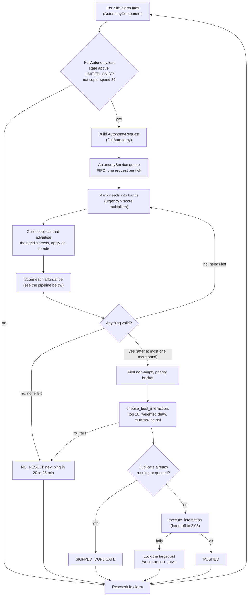
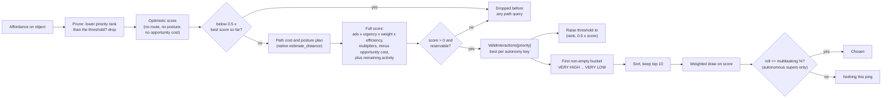

# 3.04 Autonomy: how a Sim chooses what to do

*Game version 1.128.90.1030 (Steam, Linux/Proton). The numbers are base-game tuning, read from both the full build and the base-game delta tuning, with EP04 (Cats & Dogs), EP06 (Get Famous), EP09 (Eco Lifestyle), EP12 (High School Years), GP04 (Vampires), GP12 (Werewolves), SP01 (Luxury Party) and SP42 (Grunge Revival) installed; a count marked live adds each installed pack's delta build to the base game's. Written 2026-10-12. Checked 2026-10-12: 119 claims checked, 23 corrected, 4 relabelled, 1 removed. Checked again 2026-10-13: 187 claims checked, 30 corrected, 0 relabelled, 0 removed. Cross-chapter edits 2026-10-13: 3 applied.*

## In plain words

Every Sim carries an alarm clock. When it rings, the Sim asks the game "what should I do now?" and joins a queue. The game answers one Sim per tick. It looks at the Sim's needs, finds the one or two that are most urgent right now, and only then looks at the objects that promise to fix those needs. Each possible action gets one number: how much it promises, times how badly the Sim wants that, shrunk by how far away it is, then nudged up or down by moods, traits, relationships, ownership and dozens of other rules. The game keeps the ten best and rolls a weighted die among them, so the best option usually wins but not always.

Three things surprise most players. First, the urgency curves are steep and stepped. Hunger counts for nothing while its bar is more than about 37 percent full, counts 8 below that, 64 once the bar is down to a quarter, and jumps to 512, rising to 1024, once it is below an eighth. Second, the "Off" and "Limited" autonomy settings in the options menu are the same setting in the code. Both stop a Sim from starting whole new activities on its own, and neither stops the small actions inside an activity (a chatting Sim still picks what to say, an eating Sim still picks how to eat). Third, being tired is not enough for a Sim to go to bed for the night on its own. The bed's "sleep" only becomes a choice once the Sim has one of the hidden bedtime moodlets the game hands out on a schedule (from 20:00 for a Sim without a job; a job moves the schedule to the wake-up time of the Sim's career level), or once it is Exhausted. Before that, a tired Sim can only choose a nap.

Needs themselves (what Hunger is, how fast it drops, what the moodlets do) belong to [3.03 Needs, statistics and commodities](3.03-needs-statistics.md); what happens after the choice (queueing, postures, walking there) belongs to [3.05 Interactions, postures and routing](3.05-interactions-postures-routing.md); traits and emotions, which reach autonomy through the moodlets they add, belong to [3.07 Personality and feelings](3.07-personality-feelings.md). This chapter is about the choice itself.

## Key facts

- **One alarm per Sim.** The next ping is the last user command plus 5 Sim minutes while the player is directing the Sim, the last empty result plus 20 to 25 minutes after a pass that found nothing, the last autonomous action plus 12 to 15 minutes while the Sim is busy, and the next tick (1e-06 minutes) when it is idle. These are the live (delta) values; the full build says 10, 20 to 25, 8 to 10 and 1e-06.
- **One request per tick.** `AutonomyService` takes requests first in, first out, works on each in slices of 0.1 real seconds, and stops slicing after 1 real second so the request can finish.
- **Needs are ranked before anything is scored.** Only needs whose urgency is at least 0.51 times the top need's urgency are scored in the first pass (0.49 in the full build, 0.9 in code). A need's `weight` is ignored for this ranking and used only inside the score.
- **Urgency curves.** Hunger urgency is 1024 at -100, 512 at -76, 64 from -75 to -51, 8 from -50 to -26 and 0 from -25 up. Bladder holds 1024 down to -76, Energy holds 256. Weights: Energy 2, Fun 1, Social 0.5, Hunger 0.2857, Hygiene 0.25, Bladder 0.05.
- **The score of one action** is the sum, over each need it advertises, of `advertised rate x object multiplier x 0.25 if already being solved x efficiency x ownership preference x urgency x weight`, then about twenty multipliers, minus the cost of quitting what the Sim is doing, plus the value of what it keeps doing. Efficiency is `time_overhead / (time_overhead + distance x 0.025)`. Anything at or below 1e-05 counts as 0.
- **Priority beats score.** An action's `scoring_priority` (VERY HIGH to VERY LOW) puts it in a bucket; the first non-empty bucket supplies every candidate, however well a lower bucket scored. The autonomous bed sleep is HIGH, the toilet NORMAL, the autonomous fridge snack LOW.
- **The pick.** The top 10 by score go into a weighted random draw with probability proportional to score. With randomization off, the single best wins.
- **The busy check.** A Sim that is already doing something draws a number in [0, 1) and keeps it until its activity list changes. It starts a new autonomous action only if that number is at or below the action's multitasking percentage, which falls from 1.0 to 0.1 as the summed attention cost rises from 1.24 to 2, and rises again with the urgency of what the new action solves.
- **Off and Limited are one state.** Both map to `LIMITED_ONLY`, which blocks only full autonomy. Mixer choice, social choice and actions that request autonomy themselves keep running. `MEDIUM` (only idle, undirected Sims act) is not in the menu but `autonomy.household medium` sets it with no cheats on.
- **Moodlets are the lever.** 871 of the 4,676 buffs in the base-game delta tuning carry an `autonomy_modifier` (with the installed packs merged, 1,398 of the 7,583 live buff records do, all of them among the 7,568 `Buff` records and none among the 15 `ClothingBuff`; see [0.04](0.04-tests-loot-effects.md)); no trait carries one directly. A modifier can multiply a need's urgency (`buff_AutonomyMod_SocializeNow`: Social x1000), stop its decay (`Buff_Trait_SteelBladder`: Bladder x0), lock it, hide other needs, block actions or change which objects are in reach.
- **Off-lot reach.** By default a Sim on the active lot (or within 7.5 m of it) uses objects on the lot or within 7.5 m of it, and a Sim off the lot uses objects within 25 m of itself. Off-lot objects score half for a Sim standing on the lot (`OFF_LOT_OBJECT_SCORE_MULTIPLIER` 0.5).
- **A failed push locks the object out** for 15 Sim minutes (`LOCKOUT_TIME`, delta; the code default is 240).
- **Most autonomy console commands do nothing in a retail game.** Untyped and `DebugOnly` commands are never registered, and `Automation` commands only run when the game was started in automation mode. `autonomy.household` and `autonomy.set_autonomy_for_active_sim_option` are `Live` and always work.

## How it works

### The whole loop

### When a Sim asks: the ping loop

- **Observed** (`autonomy_component.py: AutonomyComponent.get_time_until_next_update`). The next ping is the first case that applies, and a time at or before now becomes one tick:
  1. the player is active (a user-directed interaction started within `AUTONOMY_DELAY_AFTER_USER_INTERACTION`): last user-directed action + that delay;
  2. the last pass returned `NO_RESULT`: last empty result + a random value in `FULL_AUTONOMY_DELAY_WITH_NO_RESULT`;
  3. `Sim.has_any_pending_or_running_interactions()` (any visible or autonomous-picker interaction that is not finishing and does not just provide a posture, or a visible transition): last autonomous action + a random value in `FULL_AUTONOMY_DELAY`;
  4. otherwise: last autonomous action + `FULL_AUTONOMY_DELAY_WITH_NO_PRIMARY_SIS`.
- **Observed** (tuning `autonomy.autonomy_modes`, class `AutonomyMode`). Base-game delta tuning values in Sim minutes: 5; 20 to 25; 12 to 15; 1e-06 to 1e-06. The full build has 10; 20 to 25; 8 to 10; 1e-06. Code defaults: 25; 20 to 30; 15 to 30; 1.5 to 2.5.
- **Observed** (`AutonomyComponent._run_full_autonomy_callback_gen`). When the alarm fires the component first stamps "last autonomous action = now", runs `_attempt_full_autonomy_gen`, records whether the result was `NO_RESULT`, and always reschedules. `PushInteractionResult` has four values: `NO_RESULT`, `FAILED`, `SKIPPED_DUPLICATE`, `PUSHED`.
- **Observed** (`interaction.py: Interaction._update_autonomy_timer`, from its disassembly). A user-directed interaction that starts calls `set_last_user_directed_action_time` (for a social, on the target Sim too); an autonomy-sourced one calls `set_last_autonomous_action_time`. Either call reschedules the alarm. An interaction pushed by script (neither source) resets neither timer.
- **Observed** (`AutonomyComponent.start_autonomy_alarm`, `initial_delay`). The first ping comes 5 Sim minutes after the component starts. The Sim object tuning (`object_sim`) sets only `preroll_affordance_skip_set` and `sleep_schedule` in its autonomy component, so `initial_delay` 5, `mixer_interaction_cache_size` 3 and a disabled `get_comfortable` are code defaults.
- **Observed** (`AutonomyComponent._attempt_full_autonomy_gen`, `autonomy_modes.py: FullAutonomy.test`). A ping is dropped when a previous request for this Sim is still valid, when any running interaction asked autonomy to skip (`_autonomy_skip_sis`), when the clock runs at `ClockSpeedMode.SUPER_SPEED3`, when the Sim's state is `LIMITED_ONLY` or lower, or when the Sim follows a routing master that is walking. In `MEDIUM` the Sim must also have no user-directed interaction, nothing queued except social adjustments, cancels and get-comfortable, nothing running that disallows autonomous multitasking, and no recent player command.
- **Observed** (`AutonomyComponent._create_autonomy_request`). The alarm's request is a `FullAutonomy` request that skips the Sim's `standard_static_commodity_skip_set` and passes `limited_autonomy_allowed=False` to the native affordance query.

### The queue and time slicing

- **Observed** (`autonomy_service.py: AutonomyService._register`, `_update_gen`). A caller appends its request to `AutonomyService.queue` and sleeps. One processing element pops requests in order and sleeps until the next tick after each, so at most one Sim's request runs per tick.
- **Observed** (`autonomy_modes.py: FullAutonomy._run_gen`, `timeslice_if_needed_gen`). Between objects and between affordances the request checks real time. After `MAX_SECONDS_PER_LOOP` (0.1 s in both builds; code 1/30 s) it yields to the next tick. Once `MAX_REAL_SECONDS_UNTIL_TIMESLICING_IS_REMOVED` (1 s, both builds and code) has passed since the request started, it stops waiting for ticks and finishes. If the Sim was destroyed or the request invalidated while it slept, `AutonomyExitException` (`autonomy_exceptions.py`) ends it and the interactions it built are invalidated.
- **Observed** (`AutonomyService.score_all_interactions`). The synchronous path (no timeline) never yields. Preroll, subaction and social requests use it.

### The modes

| Mode | Class | What it scores | Started by |
|---|---|---|---|
| Full | `FullAutonomy` | whole interactions on objects, Sims and the inventory | the alarm; interactions asking for autonomy; parameterized requests |
| Subaction | `SubActionAutonomy` | mixers offered by running interactions and by buffs | `AutonomyComponent.run_subaction_autonomy`, called from `Sim.get_next_work` |
| Social | `SocialAutonomy` | social mixers against one target Sim | `SocialPickerSuperInteraction._run_interaction_gen` |
| Preroll | `PrerollAutonomy` (a `FullAutonomy`) | one interaction per Sim when a lot spins up, distance ignored | `sim_info_manager._run_preroll_autonomy` |

- **Observed** (`autonomy_modes.py: PrerollAutonomy`, `autonomy_request.py: PrerollAutonomyRequest`, `AutonomyComponent.run_preroll_autonomy`). Preroll scores objects by `preroll_commodity_flags`, uses `IGNORE_DISTANCE`, and is skipped entirely when a modifier on the Sim has `suppress_preroll_autonomy`. The Sim's `preroll_affordance_skip_set` is tuned (live tuning: socials, phone and video-game actions, hugs and kisses) but no Python reads it: `run_preroll_autonomy` builds its request without it, and the name occurs nowhere else in the compiled modules or the native strings, so its effect is unknown.
- **Observed** (`autonomy_modes.py: AutonomyMode.test`, `_MixerAutonomy.test`). The mixer modes only require a state above `DISABLED`, so `LIMITED_ONLY` Sims keep choosing mixers.
- **Observed** (`parameterized_autonomy_request_info.py: ParameterizedAutonomyRequestInfo`). A parameterized request ("find something that solves X") is a bundle of commodities, static commodities, objects, affordances, a radius and flags such as `consider_scores_of_zero`, `retain_priority` and `randomization_override`; it is run as a `FullAutonomy` request.

### What the player's autonomy setting blocks

- **Observed** (`settings.py: AutonomyState`, `AutonomyRandomization`, `AutonomySettingsGroup`). States: `UNDEFINED` -1, `DISABLED` 0, `LIMITED_ONLY` 1, `MEDIUM` 2, `FULL` 3. Randomization: `UNDEFINED` -1, `DISABLED` 0, `ENABLED` 1. Settings groups: `DEFAULT` 0 in code plus `PETS` 1 in the live tuning; `AutonomyComponent._settings_group` picks a Sim's group.
- **Observed** (`AutonomyComponent._get_appropriate_autonomy_setting`). The first defined value wins: global settings, the Sim's role state override, `FULL` during the tutorial, the Sim's own setting, its household's setting, then the service defaults (`FULL`, randomization `ENABLED`). `RoleState._autonomy_state_override` defaults to `LIMITED_ONLY` when enabled and may not be `MEDIUM` (`role/role_state.py`).
- **Observed** (`AutonomyService.load_options`, `save_options`). The saved `autonomy_level` maps `OFF` and `LIMITED` to `LIMITED_ONLY` and `FULL` to `FULL`. On save, `LIMITED_ONLY` is written as `LIMITED`.
- **Observed** (`server_commands/autonomy_commands.py: _parse_state`). Commands accept `on`, `true`, `full`, `3` (FULL), `medium` (MEDIUM), `limitedonly`, `la`, `off`, `false`, `1` (LIMITED_ONLY), `undefined`, `default` (UNDEFINED). No word yields `DISABLED`.
- **Inferred** (client strings next to the option ids `AutonomyHousehold` and `AutonomyDisabledForActiveSim` in the client executable's strings). The options screen sends `autonomy.household` and `autonomy.set_autonomy_for_active_sim_option`, both `Live` commands.
- **Observed** (`AutonomyService.set_autonomy_for_active_sim`, `_on_active_sim_changed`). With "autonomy for the selected Sim" switched off, the active Sim's own setting is `LIMITED_ONLY`, and the setting follows the player as they switch Sims.
- **Observed** (`FullAutonomy.test`, `_MixerAutonomy.test`). Effect of each state: `DISABLED` blocks full, subaction and social autonomy; `LIMITED_ONLY` blocks full autonomy only; `MEDIUM` allows full autonomy for idle, undirected Sims; `FULL` adds no condition. Requests an interaction makes for itself (`is_script_request`) skip `FullAutonomy.test`, so they still run at `LIMITED_ONLY` (`SuperInteraction._process_parameterized_autonomy_request_gen` and the four `*_autonomy_commodities` lists, read in disassembly).
- **Observed** (`interactions/si_restore.py`). While saved interactions are being restored after a load, every Sim is set to `DISABLED`, and the old value is put back afterwards.
- **Observed** (`AutonomySettings.get_npc_setting`, `AutonomyService.load_options`). The NPC switches `FRIENDLY`, `ROMANTIC` and `BREAKUPS` are loaded from and saved to the options, and no Python module reads them. **Inferred**: the client sends `autonomy.npc_autonomy` (string beside `NPCAutonomyFriendly` in the client), an `Automation` command that returns without acting in a normal game, so whatever gates NPC socials on these switches is native or nowhere.

### Which objects and actions are considered

1. **Observed** (`autonomy_request.py: AutonomyRequest.objects_to_score_gen`, read with the disassembly). An object is a candidate when it is not on the request's ignore list and either its `commodity_flags` meet the needs being scored this pass, it is the target of an affordance the Sim, its traits or its buffs provide, or it is a Sim whose relationship bits with this Sim carry matching commodity flags. The Sim's own inventory is scored too.
2. **Observed** (`AutonomyComponent.get_autonomous_availability_of_object`). Privacy locks always apply. Then the Sim's off-lot rule (`autonomy_modifier.py: OffLotAutonomyRules`):
   - `DEFAULT`: if the Sim is within the tolerance of the active lot, objects within the tolerance of the lot are allowed; a Sim strictly on the lot gets nothing else; otherwise objects within the radius of the Sim are allowed. The tolerance and radius come from `StatisticComponentGlobalTuning`: 7.5 m and 25 m in both builds (code 5 and 20).
   - `ON_LOT_ONLY`, `SHARED_SPACE_ONLY` (plex common areas), `OFF_LOT_ONLY` (radius default 1000), `UNLIMITED` (everything), `RESTRICTED` (the street's autonomy area), `ANCHORED` (within a radius, default 50, of a set anchor, a tagged object or a Sim with a buff; falls back to `DEFAULT` with no anchor), `BUSINESS_EMPLOYEE` and `BUSINESS_CUSTOMER`.
   - For Sim targets two caps come before the rule (after privacy, and after `UNLIMITED`, which returns at once and skips them): a target Sim whose intended position is more than `MAX_OPEN_STREET_ROUTE_DISTANCE_FOR_SOCIAL_TARGET` (15) from where it stands is skipped, and an off-lot target more than `MAX_OPEN_STREET_ROUTE_DISTANCE_FOR_INITIATING_SOCIAL` (100) from this Sim is skipped. Both are code defaults, untuned in either build, and the first applies to every Sim target even though its description talks about the open street.
3. **Observed** (`AutonomyMode._is_available`, `FullAutonomy._is_available`). For autonomy-sourced requests the object must not be locked out for this Sim, must be inside `radius_to_consider` when one is set, and a target Sim running something that disallows autonomous multitasking is excluded.
4. **Observed** (`FullAutonomy._score_object_interactions_gen`, in order). For each affordance the object offers (`potential_interactions`, native): skip non-super affordances; honour the outside lock (`autonomy_outside_supression.py: OutsideSupressor`: a locked Sim skips affordances that do not count as inside while the sun is out, unless an unlock is active); skip affordances outside the request's list; require that its `commodity_flags` meet the active needs and not a need an earlier band already scored; require `allow_autonomous` and at least one advertised need; skip the request's skipped affordances and skipped static commodities; compute the crafted-object relationship value; run the affordance's tests including `test_autonomous`; skip anything an autonomy modifier on the Sim or the object suppresses; intersect constraints; set aside members of a `duplicate_affordance_group`.
5. **Observed** (`_create_and_score_interaction`). The affordance becomes a real interaction object so it can be path-tested. It is dropped when the Sim already runs the same affordance and `autonomy_can_overwrite_similar_affordance` is false (the default), or when its `autonomy_preference` resolves to `DISALLOWED` for this Sim and object (`autonomy_preference.py`; tags in live tuning: LOVESEAT, BED, STUFFED_ANIMAL, Instrument, Computer, Food, Drink, TENT, FOOD_BOWL, PET_SLEEP_OBJECT, HORSE_BED, Laundry).
6. **Observed** (end of each pass). Members of one `duplicate_affordance_group` are cut to `NUMBER_OF_DUPLICATE_AFFORDANCE_TAGS_TO_SCORE` (3, code default): first those with a `USE_PREFERENCE` or stronger preference, then a random sample of the rest. The autonomous bed sleep is in `Interaction_SleepGroup`, so a Sim scores at most three beds per pass.

### How an action advertises

- **Observed** (`interaction.py: Interaction._add_autonomy_ad`, disassembly). Every statistic operation of the affordance with `advertise` true (the default) and subject `Actor` adds an entry to its ad table, keyed by statistic, if that statistic has an urgency curve. The ad's rate is `StatisticOperation.get_fulfillment_rate` (`statistics/statistic_ops.py`): the op's value times the target's `stat_use_multiplier` for that op's subject, divided by an interval that is 1 for `StatisticChangeOp` (and for relationship ops) and the affordance's `time_overhead` for the base class. So for the common periodic change, the advertised rate is the tuned amount itself.
- **Observed** (`Interaction._false_advertisements_gen`, tuning field `_false_advertisements`). A fake ad replaces the real ad for its statistic, so a designer can promise more or less than the action gives. Hidden fake ads (`_hidden_false_advertisements`) add to the score but are left out of `commodity_flags`, so they never make an action a candidate. The tunable's own example: a bubble bath advertises Hygiene for real and Fun as a hidden ad, so it wins when both are low but is never chosen for Fun alone.
- **Observed** (`statistics/static_commodity.py: StaticCommodity`). A static commodity is an on/off want with one number, `ad_data`, which is also its urgency while the Sim has it (`StaticCommodity_Tidy` 2; `StaticCommodity_RoleAutonomy_Wedding_Venue_Take_Picture` 32, delta only). An affordance lists `(static_commodity, desire)` pairs, desire default 1, which the tunable describes as "a blatant lie".
- **Observed** (base-game delta tuning, which is also the live record for all three; full build in brackets where it differs):

| Affordance | Ads | `time_overhead` | `scoring_priority` | `attention_cost` |
|---|---|---|---|---|
| `bed_Autonomous_SingleBed_Sleep` | fake: Energy 0.311/min, plus 0.311 on statistic 150238, GP04's `commodity_Motive_Visible_Vampire_Power` (delta only) | 360 | HIGH [VERY HIGH] | 0.5 |
| `toilet-use-sitting` | two periodic Bladder +10 ops (one `exclusive_to_owning_si`), no tests, both advertise | 5 [15] | NORMAL | 1 |
| `fridge_GrabSnackAutonomously` | fake: Hunger 2.5/min [3.5], `commodity_Trait_Autonomy_Glutton` 3/min [none]; six static commodities, three at desire 4 [none] | 60 | LOW | 0.75 |

- **Observed** (`bed_Autonomous_SingleBed_Sleep`, `bed_sleep`). The autonomous bed sleep is a one-shot that continues into `bed_sleep`, and the real Energy gain of 0.311 per minute is a periodic op on `bed_sleep` (which has `allow_autonomous` false). Its key override `bed_sleep` makes all beds one autonomy key, and its `autonomy_preference` is use-only BED.
- **Observed** (`bed_Autonomous_SingleBed_Sleep: test_autonomous`, `object_sim: sleep_schedule`, `AutonomyComponent.update_sleep_schedule`). For an ordinary Sim the autonomous bed sleep needs one of `buff_AllowSleepDesire`, `buff_SmallSleepDesire`, `buff_LargeSleepDesire`, `Buff_AskedToStayNight_Invisible`, `Buff_Motives_Energy_Exhausted` or buff 313208, which is EP13 (Growing Together) `buff_Role_Sleepover_Sleep` in that pack's patch data (not installed here). The sleep schedule hands out the first three at 12, 10 and 8 hours before the next wake-up and removes them 3 hours before it; each new one replaces the last. The wake-up is the career level's `wakeup_time` for a Sim with a career (`careers/career_base.py: CareerBase.get_next_wakeup_time`, bytecode), else the default 08:00 in tuning (09:00 in code). `buff_SmallSleepDesire` multiplies Energy urgency by 1.15 and `buff_LargeSleepDesire` by 1.34. Toddlers have their own schedule (work time 07:00). The nap (`bed_Autonomous_SingleBed_Nap`: fake Energy ad 0.25/min, `time_overhead` 120, NORMAL) has no bedtime gate, only a block while a nap buff is active.

### The score of one action

**Observed** (`autonomy_modes.py: FullAutonomy._calculate_interaction_score`, read in bytecode; the order matches EA's debug text in `InteractionScore.__str__` except where noted, and that printed equation leaves out the distance-to-object and custom-schedule multipliers). In order:

1. `efficiency = time_overhead / (time_overhead + route_time)`, with `route_time = estimated_distance x 25 / 1000` (`date_and_time.py`: `REAL_MILLISECONDS_PER_SIM_SECOND` 25, `TICKS_PER_REAL_WORLD_SECOND` 1000). `time_overhead` is in Sim minutes, default 10, minimum 1 (`interaction.py`). An unreachable target costs 1,000,000 (`_SuperInteractionAutonomy.UNREACHABLE_DESTINATION_COST`), but only for requests with `ALLOW_UNREACHABLE_LOCATIONS`; otherwise no route drops the action (pruning step 2 below). **Inferred**: `estimate_distance` is native, so its unit (path cost, roughly metres) is not confirmed.
2. For each ad list whose statistic the Sim has and can score (any band, not only the one being scored), or which has `add_if_not_in_tracker` (default true for commodities; false for `motive_Hunger` and the Glutton commodity), and whose ops pass their tests: `fulfillment_rate x object_stat_use_multiplier x same_need_multiplier x efficiency x preference x urgency x weight`.
   - `object_stat_use_multiplier`: product of the target object's `stat_use_multiplier` entries for that statistic whose direction (INCREASE, DECREASE, BOTH) matches the sign of the rate (`_calculate_object_stat_use_multiplier`). The rate itself already holds the target's multiplier for modifiers aimed at the op's subject (`AutonomyModifier.get_stat_multiplier`).
   - `same_need_multiplier`: 0.25 (`FULL_AUTONOMY_MULTIPLIER_FOR_SOLVING_THE_SAME_STAT`, code default) if an interaction the Sim is running already advertises that need, else 1.
   - `preference`: the `autonomy_score` of a scoring-type autonomy preference the Sim holds for this object, else 1.
   - `urgency`: the Sim's `ScoredStatistic` for the need, which is the curve value times the product of every `score_multipliers` entry on the Sim's autonomy modifiers.
   - `weight`: the commodity's `weight` (default 0.5; [3.03 Needs, statistics and commodities](3.03-needs-statistics.md)).
3. For each static commodity the affordance lists that the Sim currently has: `ad_data x desire x efficiency x preference`. The Sim's static commodity multiplier is not in this term; it only shapes the ranking.
4. An affordance that advertises nothing at all scores `efficiency`.
5. `x outside_multiplier`: for autonomy-sourced requests, outside objects and affordances that do not count as inside, the Sim's outside multiplier, replaced by the interaction's own override when it has one (whether or not it advertises anything).
6. If the affordance has `relationship_scoring` (default false) and a target Sim: `x rel_utility x party x buff_utility x situation_type_utility x tested_relationship_utility`.
   - `rel_utility`: the mean, over the target and the members of the target's social groups, of (mean urgency of this Sim's scored relationship tracks with them) x `bit_score`. `bit_score` is the product of positive bit `autonomy_multiplier` values, minus the product of the absolute negative ones when both kinds exist; only positive bits give the positive product, only negative bits give the negative product as a negative number, no bits give 1 (`_get_autonomy_relationship_bit_score`). Relationship tracks belong to [3.08 Relationships, socials and memories](3.08-relationships-socials.md).
   - `party`: the affordance's weight for the group size, times `FULL_AUTONOMY_DESIRE_TO_JOIN_PLAYER_PARTIES` (0, code default) when a group member other than the target is player-controlled. So Sims never join the active player's conversation on their own score.
7. `x` the waiting-line multiplier, the first matching `interaction_score_modifier` from the Sim's modifiers, the distance-to-tagged-object multiplier (`distance_based_scoring_modifier.py`: the multiplier of the first threshold the distance is under, else the outside-threshold multiplier, raised to the power of how many modifiers share the tag), and `(1 + crafted-object relationship value)`.
8. `x 0.5` (`OFF_LOT_OBJECT_SCORE_MULTIPLIER`, both builds) when there is a target, the Sim is strictly on the active lot (and within its own rule's tolerance, which is 0 for any rule but `DEFAULT`) and the target is outside that tolerance.
9. Except in the optimistic pass: `- opportunity cost`. Each running interaction that this choice would cancel adds its own current ad score times its `opportunity_cost_multiplier` (default 1), if it has `canceling_incurs_opportunity_cost`, is not being overwritten as a similar affordance and is not finishing. The sum is multiplied by 1.5 (`POSTURE_CHANGE_OPPORTUNITY_COST_MULTIPLIER`, both builds) when the Sim must change posture, a visible interaction is running and the new affordance has `apply_autonomous_posture_change_cost` (default true). Skipped when the request sets `apply_opportunity_cost` false.
10. `x` the sit-posture transition penalty from the Sim's modifiers, only when the Sim must change posture and is sitting. The code subtracts the cost first and then multiplies; EA's printed equation puts the penalty on the cost alone.
11. `+ remaining activity`: the summed ad score of the interactions the Sim keeps, times `FULL_AUTONOMY_ATTENTION_COST` at their attention cost, set to 0 if it was positive, the affordance has `relationship_scoring` and a target, and `rel_utility` is 0 or less.
12. `x` the club, small business, dynasty and custom-schedule rule multipliers (each from its own service), the ensemble multiplier (when `ensemble_scoring`, default true), and the exclusive-situation multiplier `EXTERNAL_AUTONOMY_DISCOURAGEMENT_MULTIPLIER` (0.1, code default in `situations/situation_manager.py`, untuned). The 0.1 applies only to Sim targets of requests that are not script requests, when either Sim is in a running situation that disallows external autonomy and the two do not share it; when this Sim is in no such situation, the target and the members of the target's social groups are checked ([4.01 Situations, roles and NPC scheduling](4.01-situations-npcs.md)).
   - Dynasty (**Observed**, `dynasty/dynasty.pyc: Dynasty.get_interaction_score_multiplier`, bytecode; `dynasty.py` fails to decompile): for a Sim in a dynasty, an affordance that matches an activity of any of the dynasty's values, aligned or misaligned alike, gets `DYNASTY_ENCOURAGEMENT_MULTIPLIER` 1.1 as a super interaction or `DYNASTY_ENCOURAGEMENT_SUBACTION_MULTIPLIER` 10 otherwise (social mixers included); base-delta module tuning `dynasty.dynasty_tunings`. `DynastyService` requires EP21 (Royalty & Legacy), so in this install it is never registered and the factor is 1; no `DynastyValue` record is live. The small-business factor likewise comes only from EP18 (Businesses & Hobbies), not installed.
13. A result at or below `_MINIMUM_SCORE` 1e-05 becomes 0.

**Multitasking percentage** (same function): `base + bonus - penalty`, with no bonus when the affordance has no statistic ops. `base` is `FULL_AUTONOMY_ATTENTION_COST` at the summed attention cost of the Sim's visible running interactions, plus this one's `attention_cost` (default 1) only when that sum is not 0; for a Sim target the smaller of the actor's and the target's values is used. `bonus` sums `FULL_AUTONOMY_MULTITASKING_PERCENTAGE_BONUS` at the urgency of each need the new action advertises; `penalty` does the same for the interactions that stay.

**Worked example** (**Inferred** arithmetic from the Observed formula and live tuning; every multiplier not named is 1). A Sim at Hunger -80 and Energy -80, every other need fine:
- Hunger urgency is 1024 + 20/24 x (512 - 1024) = 597.3. Energy urgency is 256. The first band keeps needs at or above 0.51 x 597.3 = 304.6, so only Hunger is scored.
- The autonomous snack, for a Sim without the Glutton commodity: 2.5 x 597.3 x 0.2857 = 426.6, times efficiency 60 / (60 + r). At a path cost of 100, r = 2.5 and the score is about 410.
- After that band found something, the next band keeps needs at or above 0.51 x max(256, 597.3), so Energy is still not scored and the pass ends.
- The same Sim at Bladder -80 instead: urgency 1024, toilet ad 20, score 20 x 1024 x 0.05 x 5/(5 + r) = about 930 at r = 0.5. At Energy -80 alone: the Sim is Exhausted, so the bed sleep passes its test and scores 0.311 x 256 x 2 = 159 x efficiency (near 1, since 360 minutes dwarfs the walk). The nap would score 0.25 x 256 x 2 = 128 x efficiency, but it sits in the NORMAL bucket and the sleep in HIGH, so the sleep wins outright, whatever the two scores.

### Needs, bands and pruning

- **Observed** (`FullAutonomy._get_motives_to_score`, `_run_gen` band loop in bytecode). The Sim's scored statistics (`Sim.scored_stats_gen`: commodities, statistics and static commodities that have an urgency curve and pass `is_scorable`) are sorted by urgency. The first band is every one at or above `FULL_AUTONOMY_STATISTIC_SCORE_VARIANCE` x the top. After a pass, the next band is the remaining ones at or above the variance times the larger of the best remaining urgency and the best urgency among needs that produced a valid action. When a valid action exists the loop ends after that one band; when none does it keeps taking bands until one does or none are left.
- **Observed** (`statistic_component.py: is_scorable`, `autonomy_modifier.py: AutonomyModifier.is_scored`). A modifier with `only_scored_stats` or `only_scored_static_commodities` makes every statistic outside its list unscorable, which mutes all other needs.
- **Observed** (`base_statistic.py: _build_utility_curve_from_tuning_data`, `autonomous_desire`). The urgency curve is a `WeightedUtilityCurve` built with `max_y=1, weight=1`, so the tuned y values are used as they are, linearly interpolated and clamped at the ends.
- **Observed** (tuning `motive_*`, identical in both builds). Commodity range -100 to 100, resting value -100, distress at -75. Live decay per Sim minute and the urgency curves:

| Need | Decay /min | Hours 100 to -100 | Weight | Urgency curve (value: urgency) |
|---|---|---|---|---|
| Hunger | 0.2083 | 16.0 | 0.2857 | -100: 1024, -76: 512, -75: 64, -51: 64, -50: 8, -26: 8, -25: 0 |
| Bladder | 0.1736 | 19.2 | 0.05 | -100: 1024, -76: 1024, -75: 128, -51: 128, -50: 8, -26: 8, -25: 0 |
| Energy | 0.1389 | 24.0 | 2 | -100: 256, -76: 256, -75: 32, -51: 32, -50: 8, -26: 8, -25: 0 |
| Fun | 0.1488 | 22.4 | 1 | -100: 128, -99: 32, -50: 8, -25: 4, 100: 1 |
| Social | 0.0868 | 38.4 | 0.5 | -100: 128, -99: 32, -50: 8, -25: 4, 100: 1 |
| Hygiene | 0.0694 | 48.0 | 0.25 | -100: 64, -99: 8, -50: 8, -26: 4, -25: 0 |

- **Observed** (band buffs `Buff_Motives_*`, both builds). Decay multipliers by band: Hunger 0.4 in [-50, -25), 0.0833 below -50; Bladder 1.2 below -25; Fun 0.7 then 0.9333; Social 0.6 and 0.6; Hygiene 1 then 2 in [-99, -50); Energy 1. Hours to empty "before modifiers" are therefore an upper bound for Bladder and a lower bound for Hunger. How decay works belongs to [3.03 Needs, statistics and commodities](3.03-needs-statistics.md).
- **Inferred** (from the curves). Fun and Social still have urgency 1 at full, so a Sim with every need full still has something to want; Hunger, Bladder, Energy and Hygiene drop to 0 above -25.
- **Observed** (`_create_and_score_interaction`, `_process_scored_interaction`). Pruning, in order:
  1. Only while the affordance's preference type is `ALLOWED` (and no inventory posture cache is in use): if a threshold `(rank, 0.5 x score)` exists and this affordance's rank is lower, drop it. Ranks (`FULL_AUTONOMY_INTERACTION_PRIORITY_RANKING`, delta only): VERY HIGH 5, HIGH 4, NORMAL 3, LOW 2, VERY LOW 1; unranked 0. Then compute the optimistic score (route 0, no posture change, no opportunity cost) and drop it if it is below the threshold's score. `FULL_AUTONOMY_OPTIMISTIC_SCORE_THRESHOLD` is 0.5 (delta; also the code default).
  2. Path cost and posture plan; no route drops it, and for requests that are not script requests so does a needed posture change that would cancel a guaranteed interaction.
  3. Full score, then reservation (`may_reserve`) and free-part checks.
  4. A score at or below 0 is rejected for autonomy-sourced requests unless the request allows zero scores.
  5. The `ValidInteractions` table of the affordance's priority keeps one entry per autonomy key (the `_affordance_key_override_for_autonomy` string if set, else the affordance): the better score, ties broken by reservoir sampling. An entry whose preference is `USE_PREFERENCE` or stronger replaces one that is not.
  6. When `use_best_scoring_aop` is false (default true), every scored target is also kept in `similar_aop_cache` for a second draw.
  7. The threshold becomes the larger (as a tuple) of itself and `(rank, 0.5 x new score)`.
- **Observed** (`autonomy_interaction_priority.py`, `super_interaction.pyc` disassembly, `dynamic_enum.py`). `scoring_priority` defaults to `INVALID` (value 0, `needs_tuning`). The buckets are walked in enum order: `INVALID` first, then VERY HIGH, HIGH, NORMAL, LOW, VERY LOW. **Inferred**: an autonomous affordance left at `INVALID` lands in the first bucket and, if it survives pruning (rank 0 is pruned once anything ranked has set a threshold), beats every tuned bucket.

### The final pick

- **Observed** (`FullAutonomy._run_gen`). The candidate list is the first non-empty priority bucket.
- **Observed** (`autonomy_service.py: AutonomyService.choose_best_interaction`, bytecode). In order:
  1. Keep mixers and super interactions that have a target.
  2. Sort by score, lowest first. If zero scores and routing are allowed and the best score is still 0 or less, rescore every entry as `1 - route_time / (max_route_time + 0.0001)`.
  3. Keep the last `NUM_INTERACTIONS` (10 in both builds; code 5) unless the request asks for all options.
  4. Draw the Sim's multitasking roll.
  5. Randomization `ENABLED`: unless zero scores are allowed, drop zero entries; if the top score is positive, pick with `sims4.random.weighted_random_index` (probability score over the sum), else uniformly. Randomization `DISABLED`: take the best if its score is above 0 or zero scores are allowed.
  6. For an autonomy-sourced, non-script super interaction, return nothing when the roll is above the chosen action's multitasking percentage. Mixers and script requests skip this.
- **Observed** (`AutonomyService._select_best_result`). If the chosen affordance has `use_best_scoring_aop` false, the same draw is repeated among all the targets scored for it, so the target is a second weighted draw. Every other interaction built during the pass is invalidated.
- **Observed** (`AutonomyComponent.get_multitasking_roll`, `reset_multitasking_roll`). The roll is `random.random()`, drawn once and kept until the Sim's interaction state changes through a pie-menu, autonomy or script interaction.
- **Observed** (tuning, identical in both builds). `FULL_AUTONOMY_ATTENTION_COST`: 1.0 from 0 to 1.24, 0.75 at 1.25, 0.5 at 1.5, 0.25 at 1.75, 0.1 at 2, -0.5 at 3, -100 at 4, linear between. `FULL_AUTONOMY_MULTITASKING_PERCENTAGE_BONUS` (by urgency): 0 up to 1, 0.1 at 2, 0.3 at 4, 0.4 at 8, 0.5 at 16, 0.6 at 32, 0.7 at 64, 0.9 at 128, 1 at 256, 2 at 512 and above.
- **Inferred** (arithmetic). An idle Sim (attention 0) has base 1 and always passes. A Sim at attention 1.5 starting something with urgency 4, whose kept activity adds no penalty, passes 80 percent of the time; a starving Sim (urgency 512 or more, bonus 2, no penalty) passes up to an attention cost of 3 and fails just above it, where the curve falls toward -100. Among idle Sims, two options scoring 410 and 200 are picked about two to one.

### Autonomy modifiers

- **Observed** (`autonomy/autonomy_modifier.py: AutonomyModifier`, `objects/components/statistic_component.py`). One modifier bundles many independent effects, and only the tuned fields act. Buffs carry most of them through `game_effect_modifier` entries; interactions, object states, lot traits, broadcasters, inventory, slots and the debug command `autonomy.add_modifier` add them too. `get_score_multiplier` multiplies all active modifiers on the owner.

| Field | Effect |
|---|---|
| `score_multipliers`, `static_commodity_score_multipliers` | multiply a need's urgency (ranking and score) |
| `decay_modifiers`, `decay_modifier_by_category` | multiply decay; a blank value reads as 0 and stops decay |
| `stat_use_multiplier` | scale changes to a statistic in a direction; on an object it also scales what it advertises |
| `locked_stats` (`locked_stats_autosatisfy_on_unlock`) | hold the statistic still; a buff's modifier first moves it to its best value, an interaction's keeps the current value (`StatisticComponent.add_statistic_modifier`); optionally fill it on unlock |
| `only_scored_stats`, `only_scored_static_commodities` | mute every other need |
| `provided_affordance_compatibility`, `affordance_compatibility`, `super_affordance_suppression_mode`, `suppress_self_affordances`, `super_affordance_suppress_on_add` | suppress affordances for autonomy, users or both; `ALWAYS_WHITELISTED_AFFORDANCES` (delta: death, Grim Reaper, debug, profile and be-carried lists) always pass |
| `autonomy_constraints` | intersect every autonomous action with a constraint |
| `off_lot_autonomy_rule`, `object_tags_that_override_off_lot_autonomy` | change reach |
| `interaction_score_modifier`, `distance_to_object_score_modifier` | per-affordance and per-distance score multipliers |
| `supress_outside_objects_if_sun_out`, `outside_objects_multiplier` | outside lock and multiplier |
| `relationship_score_multiplier_with_buff_on_target`, `relationship_multipliers`, `tested_relationship_score_multipliers`, `situation_type_social_score_multiplier` | social score factors |
| `transition_from_sit_posture_penalty` | sit-posture penalty |
| `commodities_to_add`, `skill_tag_modifiers`, `override_convergence_value`, `prevent_skills_from_being_added`, `suppress_preroll_autonomy`, `subject` | add commodities, scale skill gain, move a need's resting value, block skills, skip preroll, apply to the owner or to an interaction participant |

- **Observed** (a walk over the base-game delta tuning, shared references resolved, plain and tested lists). 4,676 buffs, 871 with an `autonomy_modifier` (live with the installed packs: 1,398 of 7,568; none of the 15 `ClothingBuff` records has one); 583 traits (1,071 live), none with one directly. Field counts across those modifiers: `stat_use_multiplier` 233, `decay_modifiers` 198, `commodities_to_add` 178, `skill_tag_modifiers` 173, `decay_modifier_by_category` 84, `locked_stats` 81, `only_scored_static_commodities` 68, `score_multipliers` 64, `provided_affordance_compatibility` 56, `super_affordance_suppression_mode` 45, `static_commodity_score_multipliers` 31, `off_lot_autonomy_rule` 11, `only_scored_stats` 11, `interaction_score_modifier` 10, `outside_objects_multiplier` 8. The 132 score-multiplier entries range from 0 to 1000. Live, the same fields in the same order count 318, 355, 280, 196, 95, 137, 163, 100, 96, 64, 41, 30, 14, 15 and 10, with 228 score-multiplier entries, also 0 to 1000.
- **Observed** (examples, delta): `buff_AutonomyMod_SocializeNow` Social x1000 (delta only); `MoodBuff_Hidden_Pumped` Energy urgency x0.03125 and Energy decay x0.6; `MoodBuff_Hidden_Flirty` and `MoodBuff_Hidden_Passionate` Social x1.5; `Buff_Trait_Slob` Hygiene x0.15 and `StaticCommodity_Tidy` x0; `Buff_Trait_Piper_CarolOfCleaning` `StaticCommodity_Tidy` x128; `buff_BeGhost_Hungry` Hunger urgency x2 and decay x2; `buff_Role_Event_NPC` Bladder urgency x0; `Buff_Trait_SteelBladder` Bladder decay x0; `Buff_Trait_NeverWeary` Energy decay x0; `buff_Trait_NeedsNoOne` Social decay x0 (delta only); `buff_Pregnancy_InLabor` decay Bladder x4, Energy and Hunger x1.75, Hygiene x1.2, Fun and Social x0.5.
- **Observed** (object example, delta). `object_sitLivingGFLeather_01` carries `autonomy_modifiers` with a `stat_use_multiplier` of x2.86 on `commodity_Buff_Object_SeatingComfort` (INCREASE) and x1e-05 on `SeatingDiscomfort` (BOTH), aimed at the interaction participant; `_calculate_object_stat_use_multiplier` reads this list. **Inferred**: the chair's comfort ads count 2.86 times and its discomfort ads almost nothing. **Observed** (live merge): 44 live `object_sitLiving*` chairs tune a SeatingComfort multiplier (all INCREASE), 42 of them from 0.75 to 12 and the two lounge chair records (`object_sitLiving_LoungeChair` and its `_Inventory` copy) at 1e-05; the two live hot tubs (`object_hottub_EVG_Anniversary`, `object_hottub_InGround`, base delta) carry x1.49 on `motive_Fun` and x1.46 on `motive_Hygiene` (INCREASE).
- **Inferred** (from the formula). A x1000 multiplier makes that need the only one in the first band; a x0 sets the need's urgency to 0 everywhere, so nothing is chosen for it.

### Mixers and socials

- **Observed** (`autonomy_modes.py: _MixerAutonomy`, `autonomy_mixer_provider.py`, `autonomy_mixer_provider_scoring.py`). Subaction autonomy lists mixer providers: each running interaction that has mixers and each buff that offers interactions; when a running interaction has `only_use_mixers_from_si`, only those interactions are providers and buffs are left out. A provider's score is `max(urgency of its best advertised need, SUBACTION_MOTIVE_UTILITY_FALLBACK_SCORE) x weight`, where the weight is the interaction's `subaction_selection_weight` (default 1) or the buff's `interactions.weight`. Fallback: 1 in both builds, 0.1 in code. A provider is drawn weighted among positive scores; zero-score providers are drawn, uniformly, only when none is positive.
- **Observed** (`_MixerAutonomy._run_gen`). Inside the provider a mixer group is drawn by `SUBACTION_GROUP_WEIGHTING`: DEFAULT 30, IDLES 50 (delta), 25 and 75 (full), 1 for an untuned group. Then its mixers are scored and `choose_best_interaction` runs on all of them (no top-10 cut).
- **Observed** (`autonomy/content_sets.py: generate_content_set`, `interactions/base/mixer_interaction.py: calculate_autonomy_weight`). A mixer's weight is its `sub_action.base_weight` times the `desire` of each of its static commodities that the Sim has. A buff's mixers use the buff's weight.
- **Observed** (`_MixerAutonomy._create_and_score_mixers`, `_get_subaction_content_set_utility_score`). A social mixer scores `mixer weight x content utility x club x business x dynasty x schedule multipliers` (the dynasty factor here is the subaction value, 10, when it applies). Content utility is `SUBACTION_AUTONOMY_CONTENT_SCORE_UTILITY_CURVE` at the mixer's content score; the curve is tuned (0, 0) to (30, 100) but built as a normalised `WeightedUtilityCurve`, so it runs from 0 to 1. A utility of exactly 0 (content score 0 or below) and a missing content score use the fallback 1. Non-social mixers score their weight. Scores at or below 1e-05 become 0, and mixers are requested with zero scores allowed.
- **Observed** (`AutonomyComponent.run_subaction_autonomy`). Up to `mixer_interaction_cache_size` (3, plus `additional_mixers_to_cache` from the running interaction's content set) mixers are chosen at once and cached. The last chosen mixer's affordance is left out of the next draw only if it has a lock-out time that is not target based. **Observed** (`sim.pyc` bytecode, `Sim.get_next_work`): when the Sim's queue head is empty, the zone is running, the posture graph is built and the Sim is not waiting for a carry fix-up, `get_next_work` calls `run_subaction_autonomy` and then reads the queue head again; if any interaction in the queue's autonomy bucket is blocked it cancels those instead. `get_next_work` is called by `MasterController._process` (`sims/master_controller.py`), so mixers are chosen whenever the master controller asks a Sim with an empty queue head for its next work. `_MixerAutonomy._get_autonomous_delay_time_in_sim_minutes` reads a `SUB_ACTION_AUTONOMY_DELAY` that no Python defines.
- **Observed** (`interactions/social/social_picker_super_interaction.py`, `SocialAutonomy._mixer_providers_gen`). Full autonomy picks "socialize with Sim X" as an ordinary super interaction with `relationship_scoring`. When it runs, it issues a `SocialAutonomy` request for that Sim and one social static commodity; each of the target's super affordances that advertises it, has positive pairwise relationship utility and fits both Sims' current activities becomes a mixer provider, and the mixer pick above runs with `push_super_on_prepare`.

### From pick to action

- **Observed** (`AutonomyComponent._push_interaction`). An equivalent super interaction already running or queued (not finishing, not pending complete, not `immediate`) gives `SKIPPED_DUPLICATE`. Otherwise `AffordanceObjectPair.execute_interaction` queues it and the result is `PUSHED`, with an `AutonomousGetComfortableLiability` (`autonomy_liabilities.py`) attached when `get_comfortable` is tuned. On failure the Sim locks the target out for `AutonomyModesTuning.LOCKOUT_TIME` (`autonomy_modes_tuning.py`) and the result is `FAILED`.
- **Observed** (`_attempt_full_autonomy_gen`, bytecode). After scoring, the component's `_autonomy_enabled` flag and `FullAutonomy.test` are checked again (either failing gives `FAILED`, with no lockout). When the chosen interaction has a transition and the Sim's routing master is a Sim with a transition controller, the chosen interaction's own transition is derailed (`DerailReason.PREEMPTED`) before the push; the routing master's transition is not touched.
- **Observed** (`super_interaction.pyc` disassembly: `pre_add_autonomy_commodities`, `pre_run_autonomy_commodities`, `post_guaranteed_autonomy_commodities`, `post_run_autonomy_commodities`). Interactions can ask for autonomy at four points (`_process_parameterized_autonomy_request_gen`); each request is a `FullAutonomy` request with `is_script_request` and `limited_autonomy_allowed` true, `apply_opportunity_cost` false, priority Low unless `retain_priority`, which is how one action chains into "now go find food".
- **Observed** (`autonomy_object_preference_tracker.py: AutonomyObjectPreferenceTracker`, `services.object_preference_overrides_tracker`). Ownership ("this is my bed") is answered by a preference tracker per preference tag. This module adds a per-zone override layer: a provider can tie a Sim to an object for a tag for a while, and `_ProxyObjectPreferenceTracker` answers `get_restriction` from those overrides before it asks the base tracker. The answer becomes `ALLOWED`, `DISALLOWED`, `USE_PREFERENCE` or `USE_ONLY` during scoring.

## Numbers

| Name | Value | Unit | Where | Source |
|---|---|---|---|---|
| `AUTONOMY_DELAY_AFTER_USER_INTERACTION` | 5 (full 10, code 25) | Sim min | `autonomy.autonomy_modes` | delta |
| `FULL_AUTONOMY_DELAY` | 12 to 15 (full 8 to 10, code 15 to 30) | Sim min | `autonomy.autonomy_modes` | delta |
| `FULL_AUTONOMY_DELAY_WITH_NO_RESULT` | 20 to 25 (code 20 to 30) | Sim min | `autonomy.autonomy_modes` | both builds |
| `FULL_AUTONOMY_DELAY_WITH_NO_PRIMARY_SIS` | 1e-06 (code 1.5 to 2.5) | Sim min | `autonomy.autonomy_modes` | both builds |
| `initial_delay` | 5 | Sim min | `AutonomyComponent` | code default |
| `LOCKOUT_TIME` | 15 (code 240) | Sim min | `autonomy.autonomy_modes_tuning` | delta (the full build has 15 only on `AutonomyMode`, which this code does not read) |
| `MAX_SECONDS_PER_LOOP` | 0.1 (code 1/30) | real s | `autonomy.autonomy_service` | both builds |
| `MAX_REAL_SECONDS_UNTIL_TIMESLICING_IS_REMOVED` | 1 | real s | `autonomy.autonomy_modes` | both builds, code |
| `NUM_INTERACTIONS` | 10 (code 5) | count | `autonomy.autonomy_service` | both builds |
| `FULL_AUTONOMY_STATISTIC_SCORE_VARIANCE` | 0.51 (full 0.49, code 0.9) | ratio | `autonomy.autonomy_modes` | delta |
| `FULL_AUTONOMY_OPTIMISTIC_SCORE_THRESHOLD` | 0.5 | ratio | `autonomy.autonomy_modes` | delta, code |
| `FULL_AUTONOMY_INTERACTION_PRIORITY_RANKING` | VERY HIGH 5, HIGH 4, NORMAL 3, LOW 2, VERY LOW 1 | rank | `autonomy.autonomy_modes` | delta only (empty in code and full) |
| `AutonomyInteractionPriority` values | INVALID 0, VERY HIGH 1, HIGH 2, NORMAL 3, LOW 4, VERY LOW 5 | enum | `autonomy.autonomy_interaction_priority` | both builds |
| `FULL_AUTONOMY_MULTIPLIER_FOR_SOLVING_THE_SAME_STAT` | 0.25 | factor | `AutonomyMode` | code default |
| `FULL_AUTONOMY_DESIRE_TO_JOIN_PLAYER_PARTIES` | 0 | factor | `AutonomyMode` | code default |
| `OFF_LOT_OBJECT_SCORE_MULTIPLIER` | 0.5 | factor | `autonomy.autonomy_modes` | both builds, code |
| `POSTURE_CHANGE_OPPORTUNITY_COST_MULTIPLIER` | 1.5 | factor | `autonomy.autonomy_modes` | both builds, code |
| `_MINIMUM_SCORE` | 1e-05 | score | `AutonomyMode` | code constant |
| `NUMBER_OF_DUPLICATE_AFFORDANCE_TAGS_TO_SCORE` | 3 | count | `AutonomyMode` | code default |
| `UNREACHABLE_DESTINATION_COST` | 1,000,000, only with `ALLOW_UNREACHABLE_LOCATIONS` | path cost | `_SuperInteractionAutonomy` | code constant |
| `_ARTIFICIAL_MAX_ROUTE_TIME_INCREMENT` | 0.0001 | route time | `AutonomyService` | code constant |
| `FULL_AUTONOMY_ATTENTION_COST` | (0,1) (1.24,1) (1.25,0.75) (1.5,0.5) (1.75,0.25) (2,0.1) (3,-0.5) (4,-100) | cost to percentage | `autonomy.autonomy_modes` | both builds |
| `FULL_AUTONOMY_MULTITASKING_PERCENTAGE_BONUS` | (0,0) (1,0) (2,0.1) (4,0.3) (8,0.4) (16,0.5) (32,0.6) (64,0.7) (128,0.9) (256,1) (512,2) | urgency to percentage | `autonomy.autonomy_modes` | both builds |
| `SUBACTION_GROUP_WEIGHTING` | DEFAULT 30, IDLES 50 (full 25, 75; untuned 1) | weight | `autonomy.autonomy_modes` | delta |
| `SUBACTION_AUTONOMY_CONTENT_SCORE_UTILITY_CURVE` | (0,0) (30,100), normalised to 0 to 1 | content score to utility | `autonomy.autonomy_modes` | both builds |
| `SUBACTION_MOTIVE_UTILITY_FALLBACK_SCORE` | 1 (code 0.1) | score | `autonomy.autonomy_modes` | both builds |
| `mixer_interaction_cache_size` | 3 | count | `AutonomyComponent` | code default |
| `REAL_MILLISECONDS_PER_SIM_SECOND`, `TICKS_PER_REAL_WORLD_SECOND` | 25, 1000 | ms, ticks | `date_and_time.py` | code constant |
| `time_overhead` | default 10, minimum 1; toilet 5 (full 15), snack 60, bed 360 | Sim min | `interaction.py`; affordances | code; delta |
| `attention_cost` | default 1; bed 0.5, snack 0.75, toilet 1 | cost | `SuperInteraction`; affordances | code; both builds |
| `opportunity_cost_multiplier`, `subaction_selection_weight` | 1, 1 | factor | `SuperInteraction` | code default |
| Static commodity `desire` | default 1 | factor | `Interaction._static_commodities` | code default |
| `EXTERNAL_AUTONOMY_DISCOURAGEMENT_MULTIPLIER` | 0.1 | factor | `situations.situation_manager` | code default (untuned) |
| `DEFAULT_OFF_LOT_TOLERANCE`, `DEFAULT_RADIUS_TO_CONSIDER_OFF_LOT_OBJECTS` | 7.5, 25 (code 5, 20) | m | `objects.components.statistic_types` | both builds |
| `OFF_LOT_ONLY` radius, `UNLIMITED` radius, `ANCHORED` radius | 1000, 1000, 50 | m | `TunableOffLotAutonomy` | code defaults |
| `MAX_OPEN_STREET_ROUTE_DISTANCE_FOR_SOCIAL_TARGET`, `..._FOR_INITIATING_SOCIAL` | 15, 100 | m (Inferred) | `AutonomyService` | code defaults (untuned) |
| `STARTING_DEFAULT_AUTONOMY_STATE`, `STARTING_DEFAULT_RANDOMIZATION` | FULL, ENABLED | enum | `AutonomySettings` (`settings.py`) | code default (untuned) |
| Need decay | Hunger 0.2083, Bladder 0.1736, Energy 0.1389, Fun 0.1488, Social 0.0868, Hygiene 0.0694 | per Sim min | `motive_*` | both builds |
| Need `weight` | Hunger 0.2857, Bladder 0.05, Energy 2, Fun 1, Social 0.5, Hygiene 0.25 (code 0.5) | factor | `motive_*` | both builds |
| Need range, resting value, distress | -100 to 100, -100, -75 | value | `motive_*` | both builds |
| Band decay multipliers | Hunger 0.4, 0.083333, 0.0833333; Bladder 1.2 x3; Fun 0.7, 0.93333; Social 0.6, 0.6; Hygiene 1, 2; Energy 1, 1 | factor | `Buff_Motives_*` | both builds |
| Bed autonomous sleep fake ad | Energy 0.311 | per Sim min | `bed_Autonomous_SingleBed_Sleep` | both builds |
| Toilet ad | Bladder +10 twice | per interval | `toilet-use-sitting` | delta |
| Nap fake ad, `time_overhead`, priority | Energy 0.25 per Sim min, 120 Sim min, NORMAL | mixed | `bed_Autonomous_SingleBed_Nap` | delta |
| Snack fake ads | Hunger 2.5, Glutton commodity 3 (full build: Hunger 3.5 only) | per Sim min | `fridge_GrabSnackAutonomously` | delta |
| Sleep schedule | wake-up 08:00 (code 09:00), else the career level's `wakeup_time`; AllowSleepDesire 12 h, SmallSleepDesire 10 h, LargeSleepDesire 8 h, none 3 h before | hours before work | `object_sim` | delta |
| Sleep desire urgency | Small x1.15, Large x1.34 on Energy | factor | `buff_SmallSleepDesire`, `buff_LargeSleepDesire` | delta |
| `StaticCommodity_Tidy`, `StaticCommodity_RoleAutonomy_Wedding_Venue_Take_Picture` `ad_data` | 2, 32 | urgency | static commodities | delta |
| `DYNASTY_ENCOURAGEMENT_MULTIPLIER`, `DYNASTY_ENCOURAGEMENT_SUBACTION_MULTIPLIER` | 1.1, 10 (not active without EP21) | factor | `dynasty.dynasty_tunings` | delta |

## Data shapes

- **`AutonomyRequest`** (`autonomy_request.py`): `sim`, `autonomy_mode`, `commodity_list`, `static_commodity_list`, `skipped_static_commodities`, `object_list`, `ignored_object_list`, `affordance_list`, `skipped_affordance_list`, `constraint`, `context` (source AUTONOMY, priority Low by default), `is_script_request`, `ignore_user_directed_and_autonomous`, `ignore_suppressed_affordances_autonomy`, `posture_behavior`, `distance_estimation_behavior` (FINAL_PATH, IGNORE_DISTANCE, ALLOW_UNREACHABLE_LOCATIONS), `consider_scores_of_zero`, `ignore_lockouts`, `apply_opportunity_cost`, `push_super_on_prepare`, `radius_to_consider`, `off_lot_autonomy_rule_override`, `reping_delay_on_fail`, `valid`, `valid_interactions`, `similar_aop_cache`, `interactions_to_invalidate`, plus free `interaction_parameters` passed to the native affordance query.
- **`ScoredStatistic(float)`** (`autonomy_modes.py`): `stat_type`, `autonomous_desire`, `score_multiplier`, `stat_value`; its float value is urgency times multiplier.
- **`ScoredInteractionData`**: `score`, `route_time`, `multitasking_percentage`, `interaction`. **`ValidInteractions`**: autonomy key to `ScoredInteractionData`, one table per priority; weak references drop entries whose target dies.
- **`InteractionScore`**: the float score plus every factor of the formula, printed by `__str__` as EA's debug breakdown.
- **`AutonomyAdList`** (`interactions/utils/autonomy_op_list.py`): `stat` and its ops; `get_value`, `get_fulfillment_rate`, `is_valid` over the ops whose tests pass.
- **Affordance autonomy tunables** (`Interaction`, `SuperInteraction`): `allow_autonomous`, `time_overhead`, `_static_commodities` (`static_commodity`, `desire`), `_affordance_key_override_for_autonomy`, `_false_advertisements`, `_hidden_false_advertisements`, `test_autonomous`, `scoring_priority`, `duplicate_affordance_group`, `autonomy_preference` (`tag`, `should_set`, `should_clear`, locked `is_scoring` and `use_only`), `relationship_scoring`, `ensemble_scoring`, `_party_size_weight_tuning`, `attention_cost`, `use_best_scoring_aop`, `autonomy_can_overwrite_similar_affordance`, `subaction_selection_weight`, `apply_autonomous_posture_change_cost`, `opportunity_cost_multiplier`, `disable_autonomous_multitasking_if_user_directed`, `force_autonomy_on_inertia`, the four `*_autonomy_commodities` lists.
- **`AutonomyModifier`** (`autonomy_modifier.py`): the fields in the modifier table; `OffLotAutonomyRules` DEFAULT, ON_LOT_ONLY, SHARED_SPACE_ONLY, OFF_LOT_ONLY, UNLIMITED, RESTRICTED, ANCHORED, BUSINESS_EMPLOYEE, BUSINESS_CUSTOMER; `SuperAffordanceSuppression` (`autonomy_modifier_enums.py`) AUTONOMOUS_ONLY, USER_DIRECTED, USE_AFFORDANCE_COMPATIBILITY_AND_WHITELIST.
- **`AutonomyPreferenceType`** (`autonomy_preference.py`): ALLOWED 0, DISALLOWED 1, USE_PREFERENCE 2, USE_ONLY 3; `ObjectPreferenceTag` is a dynamic enum filled by tuning.
- **`AutonomySettings`** (`settings.py`): per settings group an `AutonomyState` and an `AutonomyRandomization`, plus the three NPC booleans.
- **`AutonomyComponent`** tunables: `initial_delay`, `mixer_interaction_cache_size`, `standard_static_commodity_skip_set`, `preroll_affordance_skip_set`, `sleep_schedule` (`default_schedule` with `default_work_time` and a `schedule` of `{buff, time_from_work_start}`; `trait_overrides`), `_settings_group`, `get_comfortable` (`affordance`, `delay` default 4 min).

## For modders

**Common tweaks, and the tuning to change:**
- *Sims act more or less often:* `autonomy.autonomy_modes` module tuning, `AutonomyMode.FULL_AUTONOMY_DELAY`, `FULL_AUTONOMY_DELAY_WITH_NO_RESULT` and `AUTONOMY_DELAY_AFTER_USER_INTERACTION`. Change the delta value; the full build's copy is not what loads.
- *A need matters more or less:* the commodity's `ad_data` (when it becomes urgent) and `weight` (how much its ads are worth), in `motive_*` ([3.03 Needs, statistics and commodities](3.03-needs-statistics.md)). For one trait or mood only, add `score_multipliers` to that buff's `autonomy_modifier` rather than editing the commodity.
- *Sims consider more needs at once:* lower `FULL_AUTONOMY_STATISTIC_SCORE_VARIANCE` (0.51 live). Lower values score more objects per pass and cost time.
- *An object is more attractive:* its affordance's `_false_advertisements` (promise more of a need), `time_overhead` (higher means distance matters less), `scoring_priority` (a higher bucket beats any score below it), or `_static_commodities` desire.
- *An object is used autonomously at all:* `allow_autonomous`, `test_autonomous`, and the affordance must advertise at least one need.
- *Sims wander further or stay home:* an `off_lot_autonomy_rule` on a buff's `autonomy_modifier`, or `StatisticComponentGlobalTuning` (`objects.components.statistic_types`) for everyone. Its `DEFAULT_OFF_LOT_TOLERANCE` (7.5 m) says in its description that it affects only autonomy, but two other readers use it: the on/off-lot parity check of `AutonomousObjectTaggedPickerInteraction` (`interactions/base/picker_interaction.py: _passes_post_skip_tests`) and the `use_default_tolerance` option of `LocationTest`'s active-lot test (`world/world_tests.py`, through `event_testing/test_variants.py: UseDefaultOfflotToleranceFactory`). **Observed** (those modules).
- *Less randomness:* `autonomy.autonomy_service` `NUM_INTERACTIONS` (fewer options in the draw). Switching randomization off for a Sim takes an `Automation` command; a parameterized request can set its own `randomization_override`.
- *Busy Sims interrupt themselves more or less:* `FULL_AUTONOMY_ATTENTION_COST`, `FULL_AUTONOMY_MULTITASKING_PERCENTAGE_BONUS` and each affordance's `attention_cost`.
- *Bedtime:* `object_sim`, autonomy component, `sleep_schedule`; and the buff whitelist in the `test_autonomous` of `bed_Autonomous_SingleBed_Sleep` and `bed_Autonomous_DoubleBed_Sleep` (the nap affordances have no such gate).

**Commands this system registers** ([1.04 Debug tools, cheats and telemetry](1.04-debug-cheats-telemetry.md); `sims4/commands.py: Command`, `server_commands/__init__.py: is_command_available`):

| Command | Type | Does |
|---|---|---|
| `autonomy.household <state> [sim] [group]` | Live | set the household's state; `medium` works |
| `autonomy.set_autonomy_for_active_sim_option <bool>` | Live | the "autonomy for the selected Sim" option |
| `autonomy.set_autonomy_infants_caregiver_disabled <bool>` | Live | the infant caregiver option (`gameplay_options/misc_options_commands.py`), read by game-option tests |
| `autonomy.global`, `autonomy.global_all`, `autonomy.global_randomization`, `autonomy.sim_randomization`, `autonomy.household_randomization` | Automation | global or per-Sim state and randomization |
| `autonomy.override_full_autonomy_delay <lo> <hi>`, `autonomy.clear_full_autonomy_override`, `autonomy.override_full_autonomy_delay_after_user_action`, `autonomy.clear_full_autonomy_delay_after_user_action` | Automation | override the ping delays |
| `autonomy.test_ping [sim] [affordance]`, `autonomy.show_queue`, `autonomy.show_update_times`, `autonomy.distance_estimates.*`, `autonomy.npc_autonomy`, `autonomy.ambient` (`walkby.toggle`), `qa.automation.*` | Automation | test ping, queue and timing dumps, NPC switches, ambient walk-bys |
| `autonomy.show`, `autonomy.sim`, `autonomy.run`, `autonomy.show_timers`, `autonomy.reset_autonomy_alarm`, `autonomy.clear_skipped_autonomy`, `autonomy.add_modifier`, `autonomy.remove_modifier`, `autonomy.update_sleep_schedule`, `autonomy.reset_multitasking_roll`, `autonomy.log_sim`, `autonomy.toggle_user_directed_interaction_full_autonomy_ping` | DebugOnly (untyped) | not registered in retail |
| `autonomy.trigger_walkby`, `autonomy.set_anchor`, `autonomy.clear_anchor`, `debugvis.autonomy_timer.*` | DebugOnly | not registered in retail |

**Observed** (`server_commands/__init__.py: is_command_available`, disassembly). `Live` always runs; `Cheat` runs with `testingcheats` on; `Automation` runs only when `paths.AUTOMATION_MODE` is set, which the executable passes at start-up, so `testingcheats` does not unlock it. `DebugOnly` commands are never registered (`Command.is_valid_command`).

**Traps:**
- The delta tuning is the live tuning. Several autonomy values differ between builds (delays, variance, group weights, bed priority, toilet overhead); `FULL_AUTONOMY_INTERACTION_PRIORITY_RANKING`, `FULL_AUTONOMY_OPTIMISTIC_SCORE_THRESHOLD`, `AutonomyModesTuning.LOCKOUT_TIME` and `ALWAYS_WHITELISTED_AFFORDANCES` exist only in the delta ([0.03 The tuning system](0.03-tuning-system.md)).
- Leaving `scoring_priority` untuned puts an affordance in the `INVALID` bucket, which is checked first.
- `weight` does not affect which needs are scored, only how much ads for them are worth. To make a need get attention sooner, change `ad_data` or `score_multipliers`.
- A `decay_modifiers` entry with no value stops decay (the value defaults to 0).
- Off and Limited are the same; neither stops mixers, socials already chosen, or actions that request autonomy themselves.
- A x0 `score_multipliers` hides a need from autonomy; it does not stop the need from falling.
- Native pieces that look editable but are not Python: the affordance list an object offers (`potential_interactions`), path cost (`estimate_distance`), object `commodity_flags` caching, and the effect of `limited_autonomy_allowed`. `preroll_affordance_skip_set` looks editable but no Python reads it.

## Limits

- **Native code.** `potential_interactions`, `estimate_distance` and the posture graph, the commodity flag cache on objects, `limited_autonomy_allowed`, how often the master controller calls `Sim.get_next_work`, and any use of the three NPC switches are in the executable. Nothing was decrypted or dumped; the chapter stops where the Python stops.
- **Mangled decompiles.** `autonomy_modes.py`, `autonomy_service.py`, `autonomy_component.py`, `autonomy_request.py`, `autonomy_outside_supression.py` and `server_commands/__init__.py` decompile with broken nesting. The score, the band loop, the pick, the bit score, availability, the outside lock and command gating were read from bytecode (`pydisasm` on the extracted compiled modules). `interaction.py` and `super_interaction.py` were read as disassembly; `sim.py` only as `sim.pyc` bytecode; `dynasty.py` fails to decompile and `Dynasty.get_interaction_score_multiplier` was read in `dynasty.pyc` bytecode.
- **Ids from packs not installed.** No record in either dump or the live merge, but present in those packs' decoded patch data: the bed's static commodities 106217 EP01 (Get To Work) `SimRay_MindControl_Sleep`, 162546 GP05 (Parenthood) `TuckInSim`, 216409 GP08 (Realm of Magic) `Spells_MindControl_Command_Sleep`, 207562 EP07 (Island Living) `KavaBowl_SleepDesire`; buff 313208 EP13 (Growing Together) `buff_Role_Sleepover_Sleep`; the snack's static commodities 137861 and 141223 EP03 (City Living), 228423 EP08 (Discover University), 106184 EP01 (Get To Work), 344207 EP15 (For Rent), 177237 GP06 (Jungle Adventure). Statistic 150238 is GP04's `commodity_Motive_Visible_Vampire_Power`, which is live.
- **Not tabulated.** Relationship track urgency curves and bit `autonomy_multiplier` values ([3.08 Relationships, socials and memories](3.08-relationships-socials.md)); how many autonomous affordances leave `scoring_priority` at `INVALID`; the unit of path cost.
- **Packs not installed** add buffs, affordances and settings groups that this install cannot show.

## File index

| Module | What it holds | Depth |
|---|---|---|
| `simulation/autonomy/__init__.py` | empty package marker | skim |
| `simulation/autonomy/autonomy_component.py` | `AutonomyComponent`: ping alarm and delays, push, lockouts, off-lot availability, preroll, mixer cache, multitasking roll, sleep schedule, settings lookup | deep |
| `simulation/autonomy/autonomy_exceptions.py` | `AutonomyExitException`, raised when a sleeping request is invalidated | skim |
| `simulation/autonomy/autonomy_gsi_enums.py` | `AutonomyStageLabel` and `GSIDataKeys` for the debug log | skim |
| `simulation/autonomy/autonomy_interaction_priority.py` | `AutonomyInteractionPriority` dynamic enum (INVALID 0, rest from tuning) | deep |
| `simulation/autonomy/autonomy_liabilities.py` | `AutonomousGetComfortableLiability`: pushes get-comfortable when the chosen action ends | skim |
| `simulation/autonomy/autonomy_mixer_provider.py` | `_MixerProvider` for SI and buff providers: scored commodity, weight, mixers | deep |
| `simulation/autonomy/autonomy_mixer_provider_scoring.py` | `_MixerProviderScoring`: weighted draw over positive providers, uniform over zeros only when none is positive | deep |
| `simulation/autonomy/autonomy_modes.py` | `AutonomyMode`, `FullAutonomy`, `PrerollAutonomy`, `_MixerAutonomy`, `SubActionAutonomy`, `SocialAutonomy`, scoring, bands, pruning, `ScoredStatistic`, `ValidInteractions`, `InteractionScore` | deep |
| `simulation/autonomy/autonomy_modes_tuning.py` | `AutonomyModesTuning.LOCKOUT_TIME` | deep |
| `simulation/autonomy/autonomy_modifier.py` | `AutonomyModifier` fields, `OffLotAutonomyRules`, `TunableOffLotAutonomy`, default rules, whitelist | deep |
| `simulation/autonomy/autonomy_modifier_enums.py` | `SuperAffordanceSuppression`, `SuppressionCheckOption` | skim |
| `simulation/autonomy/autonomy_object_preference_tracker.py` | per-zone override layer over ownership (Sim to object per tag, by provider) and the proxy that consults it first | skim |
| `simulation/autonomy/autonomy_outside_supression.py` | `OutsideSupressor`: outside lock and unlock counters, outside multiplier | deep |
| `simulation/autonomy/autonomy_preference.py` | `AutonomyPreferenceType`, `ObjectPreferenceTag`, `TunableAutonomyPreference` | deep |
| `simulation/autonomy/autonomy_request.py` | `AutonomyRequest`, `PrerollAutonomyRequest`, candidate object generator | deep |
| `simulation/autonomy/autonomy_service.py` | `AutonomyService`: queue, time slicing, `choose_best_interaction`, `_select_best_result`, settings load and save, NPC switches | deep |
| `simulation/autonomy/autonomy_util.py` | profiling records for pings and per-affordance timings (QA tools) | skim |
| `simulation/autonomy/content_sets.py` | content sets, mixer generation and weights, buff mixers | skim |
| `simulation/autonomy/distance_based_scoring_modifier.py` | `DistanceToObjectBasedScoringModifier`: threshold multiplier raised to its reference count | deep |
| `simulation/autonomy/parameterized_autonomy_request_info.py` | `ParameterizedAutonomyRequestInfo` bundle | skim |
| `simulation/autonomy/settings.py` | `AutonomyState`, `AutonomyRandomization`, `AutonomySettingsGroup`, `NPCAutonomyType`, `AutonomySettings` | deep |

Other modules used: `server_commands/autonomy_commands.py`, `simulation/server_commands/__init__.py`, `core/sims4/commands.py`, `core/paths.py`, `gameplay_options/misc_options_commands.py`, `gameplay_options/misc_options_service.py`, `interactions/utils/autonomy_op_list.py`, `interactions/base/mixer_interaction.py`, `interactions/social/social_picker_super_interaction.py`, `interactions/si_restore.py`, `statistics/statistic_ops.py`, `statistics/commodity.py`, `statistics/base_statistic.py`, `statistics/continuous_statistic.py`, `statistics/static_commodity.py`, `statistics/tunable.py`, `objects/components/statistic_component.py`, `objects/components/statistic_types.py`, `interactions/base/picker_interaction.py`, `world/world_tests.py`, `event_testing/test_variants.py`, `role/role_state.py`, `situations/situation_manager.py`, `date_and_time.py`, `core/sims4/math.py`, `core/sims4/tuning/geometric.py`, `core/sims4/tuning/dynamic_enum.py`, `core/enum.py`, `core/sims4/random.py`; `sims/master_controller.py`, `careers/career_base.py`, `dynasty/dynasty_service.py`, `core/sims4/service_manager.py`; bytecode of `interaction.pyc`, `super_interaction.pyc`, `sim.pyc`, `career_base.pyc`, `dynasty.pyc`.

Tuning used (delta and full build via the tuning indexer): modules `autonomy.autonomy_modes`, `autonomy.autonomy_service`, `dynasty.dynasty_tunings`, `autonomy.autonomy_modes_tuning`, `autonomy.autonomy_interaction_priority`, `autonomy.autonomy_preference`, `autonomy.autonomy_modifier`, `autonomy.settings`, `autonomy.content_sets`, `objects.components.statistic_types`, `situations.situation_manager`; commodities `motive_Hunger`, `motive_Bladder`, `motive_Energy`, `motive_Fun`, `motive_Social`, `motive_Hygiene`; band buffs `Buff_Motives_*` and `Buff_Motives_InvisDecayMods_*Yellow`, `buff_Motives_Fun_High`; buffs `buff_AutonomyMod_SocializeNow`, `MoodBuff_Hidden_Pumped`, `MoodBuff_Hidden_Flirty`, `MoodBuff_Hidden_Passionate`, `Buff_Trait_Slob`, `Buff_Trait_Piper_CarolOfCleaning`, `buff_BeGhost_Hungry`, `buff_Role_Event_NPC`, `Buff_Trait_SteelBladder`, `Buff_Trait_NeverWeary`, `buff_Trait_NeedsNoOne`, `buff_Pregnancy_InLabor`, `buff_AllowSleepDesire`, `buff_SmallSleepDesire`, `buff_LargeSleepDesire`; object `object_sitLivingGFLeather_01`; affordances `bed_Autonomous_SingleBed_Sleep`, `bed_Autonomous_DoubleBed_Sleep`, `bed_Autonomous_SingleBed_Nap`, `bed_sleep`, `toilet-use-sitting`, `fridge_GrabSnackAutonomously`; static commodities `StaticCommodity_Tidy`, `StaticCommodity_RoleAutonomy_Wedding_Venue_Take_Picture`; object `object_sim`.
