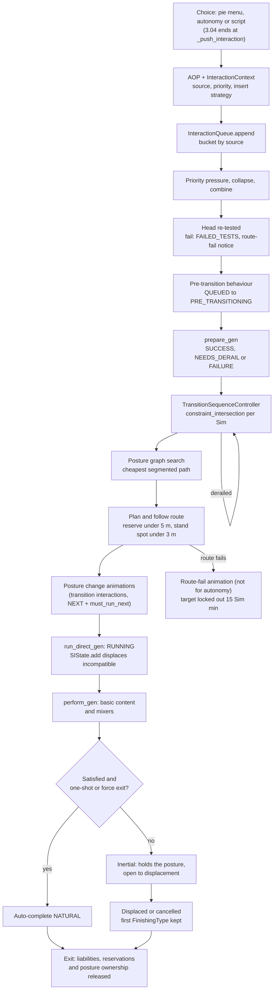
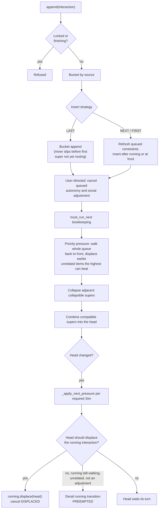
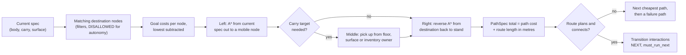

# 3.05 Interactions, postures and routing

*Game version 1.128.90.1030 (Steam, Linux/Proton). The numbers are base-game tuning, read from both the full build and the base-game delta tuning, with EP04 (Cats & Dogs), EP06 (Get Famous), EP09 (Eco Lifestyle), EP12 (High School Years), GP04 (Vampires), GP12 (Werewolves), SP01 (Luxury Party) and SP42 (Grunge Revival) installed; a count marked live adds each installed pack's delta build to the base game's. Written 2026-10-12. Checked 2026-10-12: 164 claims checked, 23 corrected, 3 relabelled, 5 removed.*

## In plain words

Once a Sim has decided to do something (the player clicked it, or the Sim chose it alone, see [3.04 Autonomy](3.04-autonomy.md)), the choice becomes an "interaction" and joins that Sim's own queue. The queue has six lines in a fixed order, and the Sim's own choices sit in the last one, so anything the player or a script queued goes first, whatever the importance numbers say. When an interaction reaches the front, the game works out where the Sim must be and in what pose (standing, sitting on a particular seat, lying on a bed, holding a plate), searches a graph of every pose the Sim could reach for the cheapest way to get there, walks the Sim over, plays the sit-down or pick-up animations, and only then starts the activity itself.

Most activities do not end when their animation ends. Watching TV from a sofa goes on, holding the Sim on the sofa, until something else pushes it aside. The game protects an activity until it has done its job ("guaranteed") and then lets it drift into a soft state ("inertial") where any new order or autonomous whim can replace it. Two activities can run at once only when the places they need overlap: a Sim can sit, watch TV and chat together, but not stand at a counter and sit on a sofa.

Three things surprise most players. First, the queue limit of six is only checked when the player picks from the menu; scripts and the Sim's own choices can push past it. Second, a Sim claims a chair only about 5 m before arriving, which is why two Sims can walk to the same seat and one gives up at the last moment, and a Sim on a low-importance errand never chases anyone out of an object. Third, every conversation is a geometry problem. Every few Sim minutes the game picks the worst-placed Sim in a group and nudges it to a better spot, which is why chatting Sims shuffle into a rough circle; it then calms down to a nudge every 10 to 15 Sim minutes once nobody has moved for a while.

What a social interaction says and does (the jokes, the outcomes) belongs to [3.08 Relationships, socials and memories](3.08-relationships-socials.md); animation playback belongs to [3.06 Animation, thought balloons and the hand-off to the client](3.06-animation.md); slots and object placement belong to [2.03 Build/Buy, placement and slots](2.03-build-buy-placement.md). This chapter covers everything between the choice and the activity: the queue, the posture graph, routing, reservations, carrying and social group geometry.

## Key facts

- **Six buckets, fixed order.** `InteractionQueue` holds social adjustment, carry-cancel replacements, vehicle-cancel replacements, the default bucket (pie menu, script, reactions, posture graph), body-cancel replacements and autonomy, in that order. The head is the first unblocked item of the first bucket that has one, so an autonomous choice waits behind any queued player or script interaction.
- **The visible cap is 6 and it is soft.** `object_sim` tunes `max_interactions` to 6 (code default 8, maximum 10). Only the pie menu (`ChoiceMenu.select`), the "queue full" pie menu check and the `interactions.push` family of commands enforce it; `append` does not.
- **A click clears the Sim's own plans.** Appending a user-directed interaction cancels every queued autonomy and social-adjustment interaction (finishing type `PRIORITY`) and cancels running supers that set `cancel_on_user_directed_action`.
- **Three priorities, strict displacement.** Low 1, High 2, Critical 3 (SubLow 0). A newcomer displaces an existing interaction only with strictly higher priority, or equal priority when the existing one is interruptible.
- **The head displaces or derails.** When the head changes, it either displaces the running interaction (cancel `DISPLACED`) or, when it may not, derails the running interaction's walk with `PREEMPTED` if that walk is still going.
- **Guaranteed, then inertial.** A super interaction is guaranteed until it is RUNNING and satisfied; after that it holds its posture but anything can displace it. One-shot content is satisfied at once and exits.
- **Pipeline.** `PipelineProgress` NONE 0, QUEUED 1, PRE_TRANSITIONING 2, PREPARED 3, RUNNING 4, STAGED 5, EXITED 6. `FinishingType` has 25 values (19 count as cancelled); `DerailReason` has 20.
- **Edge costs.** Stand to Sit costs 1.5 (0.5 for changing mobility plus 1.0 for a different posture). Sliding between two seats of one sofa costs 3.5 for a human (3 between parts plus Sit-to-Sit 0.5), 1.5 when the parts coincide.
- **Goal costs, in metres.** A seat the Sim cannot reserve adds 175 (`IN_USE_PENALTY`), a seat another Sim already picked 35; a preferred object subtracts 100, a seat inside the group's area 100. The lowest goal cost is then subtracted from all of them.
- **Late reservation.** The route callback reserves the target when less than 5.0 m of path remain and rechecks the destination stand spot at 3.0 m. A blocker is kicked only if its interaction can be shooed and has lower priority; a Low priority interaction never kicks anyone.
- **Route failure locks the target out for 15 Sim minutes** (`LOCKOUT_TIME`, delta; code default 240). Interactions the Sim chose alone fail silently, with no route-fail animation.
- **Walk styles.** Walk by default, Jog on outdoor segments of at least 10 m inside a route of at least 20 m, WalkSlow under 7 m. Toddler walk levels have a short-walk distance of 0.
- **Handedness.** A Sim without a handedness trait is left-handed when `sim_id % 4 == 0`, so about one in four. Quadrupeds always use the right track.
- **Groups.** A `SocialGroup` holds 1 to 8 Sims by default; `chat` needs 2, faces 360 degrees, max radius 4 m. Adjustment runs every 2 to 4 Sim minutes within 10 Sim minutes of a geometry change, else every 10 to 15.
- **Census (delta).** 8,242 interaction instances in 164 classes, 104 postures, 56 social group types, 27 put-down strategies. Live, with the installed packs: 13,983 interaction instances in 190 classes, 134 postures, 132 social group types, 29 put-down strategies.

## How it works

### The kinds of interaction

**Observed** (delta tuning census; class names from `interactions/base/*.py`).

- A super interaction (`SuperInteraction`, 3,151 instances) is a long-lived activity with a place in the Sim's set of running activities: use the sofa, cook, sleep, talk. A mixer (`MixerInteraction`, 1,042) is a short action inside a super ("change channel" inside "watch TV"). A social mixer (1,054) needs a social group; a social super (402) creates or joins the group (their content is in [3.08 Relationships, socials and memories](3.08-relationships-socials.md)). `ImmediateSuperInteraction` (676) runs at once with no walk. `SimPickerInteraction` (349), `StartCrafting` (113), `CraftingStep` (106) and `GoHereSuperInteraction` (56) follow. The full build has only 3,087 instances in 132 classes, so the delta is the real catalogue.
- An `AffordanceObjectPair` (AOP, `interactions/aop.py`) pairs an affordance (the tuning instance) with a target. `test_and_execute` turns it into an interaction object with an `InteractionContext` (`interactions/context.py`): actor, source, priority, run priority, insert strategy, `must_run_next`, continuation id, group id, bucket type, carry target and hand, preferred objects.
- `InteractionSource` has 12 values: PIE_MENU 0, AUTONOMY 1, BODY_CANCEL_AOP 2, CARRY_CANCEL_AOP 3, SCRIPT 4, UNIT_TEST 5, POSTURE_GRAPH 6, SOCIAL_ADJUSTMENT 7, REACTION 8, GET_COMFORTABLE 9, SCRIPT_WITH_USER_INTENT 10, VEHCILE_CANCEL_AOP 11 (EA's spelling). With bucket type `BASED_ON_SOURCE`, `InteractionQueue._get_bucket_for_context` sends autonomy, social adjustment and the three cancel sources to their own buckets and everything else to the default bucket.
- `QueueInsertStrategy`: LAST 0 (append), NEXT 1 (just after the running interaction), FIRST 2 (front of the bucket). Continuations default to NEXT (`get_continuation_aop_and_context`). Transition interactions built by the posture graph use NEXT with `must_run_next=True` (`PathSpec.generate_transition_interactions`). The wait-nearby push of a social super uses FIRST (`social_super_interaction.py`), and so does the rally carry wait (`TransitionSequenceController`, Low priority).

**Content census (delta).** Supers: `flexible_length` 1,687, `one_shot` 1,354, untuned 110 (default `flexible_length`). Mixers: `one_shot` 567, `looping_animation` 244, untuned 209 (the base `Interaction` default is `no_content`), `no_content` 22. Social mixers: untuned 696, `no_content` 133, `one_shot` 119, looping 106. Social supers: `one_shot` 214, `flexible_length` 188. Live: supers `flexible_length` 2,908, `one_shot` 2,591, untuned 153; mixers `one_shot` 780, `looping_animation` 433, untuned 256, `no_content` 24; social mixers untuned 968, `one_shot` 264, `no_content` 205, looping 170; social supers `one_shot` 701, `flexible_length` 411. So most social mixers are wrappers whose animation comes from the social system.

**Reservation census (delta).** `basic_reserve_object` on supers: untuned 2,051 (default None, so no interaction-level reservation), disabled 616, enabled 484. Social supers: disabled 296, enabled 106. Live: supers untuned 3,721, disabled 1,186, enabled 745; social supers disabled 968, enabled 144. The posture graph reserves body targets on its own (see Reservation below).

### The life of one interaction



[3.04 Autonomy](3.04-autonomy.md) ends where the chosen AOP is executed (`_push_interaction`); everything in this diagram happens after that.

### The queue: buckets, append and the head

**Observed**, `interactions/interaction_queue.py: InteractionQueue`, `BucketBase`, `BucketList`, `InteractionBucket`, `AutonomyBucket`, `SocialAdjustmentBucket` (decompiled; the bucket placement and head code checked in bytecode).

**The six buckets.** In order: social adjustment (a single slot), carry-cancel replacements (a list), vehicle-cancel replacements (a single slot), the default `InteractionBucket`, body-cancel replacements, and autonomy. The social adjustment and autonomy buckets pick their head with `get_next_unblocked_interaction_cancel_incompatible`: a queued super whose required Sims have no valid path is cancelled outright (`INTERACTION_INCOMPATIBILITY`). The default bucket is gentler.

**Head of the default bucket** (`InteractionBucket.get_next_unblocked_interaction`, bytecode). The head is the first item that is not finishing, mixers included; supers that are affordance-locked are skipped. If the first eligible super reports Sims with invalid paths, the queue calls the blocked-Sims callback, marks it `on_incompatible_in_queue` and stops: nothing behind it may jump ahead, except a mixer further back whose own super is already running in the Sim's `SIState` and not finishing. The result is cached and cleared whenever any required Sim's `SIState` changes.

**Where a new item goes** (`InteractionBucket._append`, bytecode). A super, any item into an empty bucket, or a mixer whose `should_insert_in_queue_on_append()` is False goes to the end. A mixer that already has its super (`MixerInteraction` answers True when `super_interaction` is set) is inserted just before the first queued super that uses the LAST strategy and whose transition is missing or not yet running; otherwise it goes to the end. So a mixer for an activity that is already happening slips in ahead of activities the Sim has not started walking to.

**Append, in order** (`InteractionQueue.append`):

1. Refuse if the queue is locked or the interaction is already finishing.
2. Pick the bucket from the context.
3. LAST: bucket append. NEXT or FIRST: first refresh the constraints of every queued autonomy and default interaction, then insert after the running interaction (NEXT) or at the front (FIRST).
4. `on_added_to_queue`, then `_on_user_driven_action` for user-directed interactions: every queued autonomy-bucket and social-adjustment interaction is cancelled with `PRIORITY`, and every running super that sets `cancel_on_user_directed_action` (default False) and is unrelated to the new one is cancelled at once (`INTERACTION_INCOMPATIBILITY`).
5. A `must_run_next` interaction cancels any earlier one (`INTERACTION_QUEUE`) and becomes the queue's must-run-next item; if another super becomes the running one first, the pending must-run-next item is cancelled too (`InteractionQueue.running` setter).
6. Inside `_head_change_watcher`: priority pressure, then collapsing, then combining; if the head changed, `_on_head_changed`.

**The cap.** `max_interactions` (code default 8, minimum 0, maximum 10, `object_sim` tunes 6 in both builds) is checked by `ChoiceMenu.select` (non-immediate choices only), by the pie menu's queue-full tooltip (`should_generate_pie_menu`) and by `interactions.push`, `push_self_interaction` and `push_targeting_sim_info`. `visible_len()` counts every interaction the queue iterates, the running one included (the tunable's description says the same). `append` never checks it (**Observed**, `interactions/choices.py: ChoiceMenu.select`, `InteractionQueue.can_queue_visible_interaction` and its callers).

### Priority and displacement



**Observed**, `interactions/priority.py`, `interaction_queue.py` (bytecode for the pressure passes).

- `Priority`: Low 1, High 2, Critical 3; `PriorityExtended.SubLow` 0. `can_priority_displace(new, existing, allow_clobbering)` is `new > existing`, or `new >= existing` with clobbering. `can_displace` also requires that the existing interaction is not waiting for a pick-up or put-down and is not a cancel AOP. With `use_max_priority`, a mixer counts at the higher of its own and its super's priority.
- `Interaction.interruptible` defaults to False and `compare_max_priority` to True (**Observed**, `interaction.pyc` rescued per function).
- **Priority pressure** (`_resolve_priority_pressure`) walks the whole queue, every bucket and the running interaction included, from back to front. Each interaction's own `interruptible` sets clobbering and its `compare_max_priority` sets max-priority comparison. An earlier interaction that is unrelated to the highest-priority interaction seen behind it, and that this highest one can displace, is displaced. The highest is replaced whenever a strictly higher priority turns up.
- **Collapsing** (`_resolve_collapsible_interaction`): two adjacent visible, non-finishing supers in the default bucket that are both `collapsible` (default False); the earlier one is cancelled (`INTERACTION_QUEUE`). This is how repeated "Go Here" clicks replace each other.
- **Displacing the running interaction** (`_apply_next_pressure`): for each required Sim whose running interaction is not `must_run`, `_should_head_dispace_running` (EA's spelling) decides. If it says yes, the running interaction is displaced. If it says no, but the running interaction has a transition of this Sim that is still going, is not a social adjustment and is unrelated to the head, that transition is derailed with `PREEMPTED`.
- `_should_head_dispace_running`, in order: `disable_displace` says no; a running mixer that is not interruptible says no; the head being a child of the running one says no; a pick-up-Sim liability whose original is the head says no; a cancel-AOP liability on the head that targets the running one says yes. Then clobbering is allowed if the head is a cancel AOP and the running interaction does not disable transitions, otherwise it is the running one's `interruptible`. When the running interaction is a guaranteed super, the head must pass `can_displace` against it; related interactions are never displaced; two supers that are compatible are not displaced; everything else is.

### Combining several queued interactions into one trip

**Observed**, `InteractionQueue._combine_compatible_interactions`, `_attempt_combination` (bytecode).

The head must exist, not be a put-down, be visible, be a super and be `allowed_to_combine` (default True). Starting from the head's `constraint_intersection(posture_state=None)`, the queue walks the default bucket's supers in order, skipping mixers, and tries each. `_attempt_combination` requires the candidate to be visible and `allowed_to_combine`, to belong to a different continuation chain than anything already combined, the earlier interaction not to be collapsible, and `SIState.are_sis_compatible` to pass; then the constraints must intersect to something valid. The walk is greedy and stops at a queued put-down, at the first failed combination, and as soon as the combination would need more than one carry target. If the set of combined interactions changes while the head is already transitioning, the transition is derailed with `PROCESS_QUEUE` (and goal costs are cleared when there is more than one carry target). This is how "put away dishes, then wash them" can share one walk.

### Processing the head

**Observed**, `InteractionQueue.process_one_interaction_gen`, `SuperInteraction.prepare_gen` (rescued per function).

1. The head is re-tested. A failure cancels it with `FAILED_TESTS`. For a user-directed, visible super the queue then pushes the route-failure interaction (`InteractionFailureOptions.ROUTE_FAILURE_AFFORDANCE`, the `route-fail` affordance in delta tuning) at High priority, SCRIPT source, NEXT, with animation overrides chosen by `FAILURE_REASON_TESTS`, unless the interaction had been queued on an object in an inventory that has since left that inventory or been deleted.
2. A mixer goes QUEUED, then `prepare_gen`: SUCCESS makes it PREPARED, NEEDS_DERAIL returns for another pass, FAILURE cancels it (`INTERACTION_QUEUE`). A prepared mixer runs straight away inside its super.
3. A super goes QUEUED to PRE_TRANSITIONING through `run_pre_transition_behavior` (a failure cancels with `TRANSITION_FAILURE`), then `prepare_gen` with incompatible carries cancelled. `SuperInteraction.prepare_gen`, in order: a waiting line pushes a wait-in-line interaction and returns PUSHED_REPLACEMENT (finishing `WAIT_IN_LINE`); incompatible carry interactions are cancelled (NEEDS_DERAIL if they cannot be yet); autonomy is skipped unless the source is transitional (social adjustment, get comfortable, posture graph); pre-add autonomy; the tuned `run_priority` replaces the queue priority; prepare liabilities; carried Sims are linked; fairy-form route planning; SUCCESS. NEEDS_DERAIL runs a short idle (`get_idle_element(1)`) and returns for another pass.
4. A `TransitionSequenceController` is created if needed and set on every required Sim's queue.
5. If the clock is PAUSED and `force_process_transitions` is off, the loop sleeps until the next tick plus 1 Sim second and then runs the transition. Since Sim time does not pass while paused, this means the walk waits for unpause (**Inferred** from the sleep target).
6. `SIState.process_gen` then removes finished interactions.

### SIState: what a Sim can do at once

**Observed**, `interactions/si_state.py` (rescued per function, conditions checked in its disassembly).

- `SIState` is the per-Sim set of running supers. A Sim can hold several: the posture provider (sitting), watching TV, chatting.
- `are_sis_compatible(a, b)`: the non-constraint test, then cancel-AOP liabilities in either direction, then (unless `ignore_geometry`) a valid intersection of their constraints.
- The non-constraint test is `_are_dissimilar_and_linked`. If the two affordances are the same, or neither sets `super_affordance_can_share_target`, they are incompatible when they share a target or an object and its part. Then they must be linked (`is_linked_to`): two body-posture providers are never compatible; a provider paired with a non-provider is judged by the provider's `super_affordance_compatibility` filter alone; two non-providers must pass both filters.
- `SIState.add` calls `resolve`, which (unless `must_add`) displaces every incompatible running super; `_add` then marks the state dirty and resets any not-yet-running transition queued on the Sim, because the combined constraint has changed.
- **Guaranteed and inertial** (`SuperInteraction.is_guaranteed`): true while a guaranteed lock is held or the pipeline is before RUNNING; false with `force_inertial` or an active cancel replacement; otherwise true until the interaction is satisfied. `perform_gen` marks one-shot content satisfied at once and auto-completes (NATURAL) a super that is no longer guaranteed when it is one-shot or sets `force_exit_on_inertia`. `_on_guaranteed_to_inertial` runs full autonomy on the next ping when `force_autonomy_on_inertia` is set.
- `super_affordance_klobberers` lets a tuned super clobber a guaranteed one (the tunable description's example is `bed_BeIntimate` over `sim_chat`; `bed_BeIntimate` itself is only in the full build).
- `LifetimeState`: INITIAL 0, RUNNING 1, PENDING_COMPLETE 2, CANCELED 3, EXITED 4.

### Running and content

**Observed**, `super_interaction.pyc` and `interaction.pyc` (rescued per function), `interactions/base/basic.py`.

- `SuperInteraction.run_direct_gen` makes sure the interaction is prepared, runs any pre-run behaviour (with a reset `RESET_ON_ERROR` only when such a behaviour exists and fails), takes posture ownership when it provides the posture, sets RUNNING and calls `enter_si_gen`: lifetime RUNNING, initial mixer lockouts (`lock_out_time_initial`), `SIState.add`. If the add fails, the interaction is cancelled with `INTERACTION_INCOMPATIBILITY`.
- `Interaction.perform_gen`: `setup_gen` failing cancels with `FAILED_TESTS`; `_run_priority` replaces the priority; pre-perform, liabilities' `on_run`, then the content. A super that keeps running mixers with Nowhere constraints auto-completes after `MAX_NOWHERE_MIXERS` = 20.
- **Basic content** (`TunableBasicContentSet`): four variants, `no_content`, `one_shot`, `looping_animation` and `flexible_length`. `flexible_length` wraps either staging content (the default: play to a stage point and hold) or looping content. The SuperInteraction default is `flexible_length`, the Interaction default `no_content`. `basic_extras` wrap the content in list order.
- **Conditional actions** (`interactions/utils/exit_condition_manager.py`, `statistic_element.py: ConditionalInteractionAction`): when an exit condition group is satisfied the action fires: GO_INERTIAL (marks satisfied), EXIT_NATURALLY (NATURAL), EXIT_CANCEL (`CONDITIONAL_EXIT`) or LOWER_PRIORITY (priority drops to Low).
- **Mixer lockouts.** `enter_si_gen` calls `set_sub_action_lockout(mixer, initial_lockout=True)` for each mixer with an initial lockout; the lockout keeps the Sim from choosing that mixer again for that many Sim minutes (**Inferred** from the name and the mixer autonomy in [3.04 Autonomy](3.04-autonomy.md)).

### Finishing and derailing

**Observed**, `interactions/interaction_finisher.py`, `postures/__init__.py`, `interactions/utils/routing_constants.py`.

- `InteractionFinisher` keeps the history of finishing moves; the first one is the reason. `FinishingType` has 25 values; 19 count as cancelled (USER_CANCEL, SI_FINISHED, TARGET_DELETED, FAILED_TESTS, TRANSITION_FAILURE, INTERACTION_INCOMPATIBILITY, INTERACTION_QUEUE, PRIORITY, SOCIALS, WAIT_IN_LINE, OBJECT_CHANGED, SITUATIONS, CRAFTING, LIABILITY, DIALOG, CONDITIONAL_EXIT, FIRE, WEDDING, ROUTING_FORMATION). The other six are KILLED, AUTO_EXIT, DISPLACED, NATURAL, RESET and UNKNOWN.
- `DerailReason` has 20 values, NOT_DERAILED 0 to WAIT_FOR_WING_STATE_CHANGE 19: TRANSITION_FAILED, DISPLACE, PREEMPTED, PROCESS_QUEUE, TARGET_RESET, NAVMESH_UPDATED, PRIVACY_ENGAGED, WAIT_FOR_BLOCKING_SIMS, CONSTRAINTS_CHANGED, NAVMESH_UPDATED_BY_BUILD, MUST_EXIT_MOBILE_POSTURE_OBJECT, WAIT_TO_BE_PUT_DOWN, WAIT_FOR_FORMATION_SLAVE, MASTER_SIM_ROUTING, WAIT_FOR_CARRY_TARGET, CARRY_NEEDED, WAIT_FOR_MULTI_SIM_POSTURE, RIDER_WAIT_FOR_CARRIER. `FAILURE_DERAILS` are TRANSITION_FAILED and TARGET_RESET; `MOVING_DERAILS` are CONSTRAINTS_CHANGED, MUST_EXIT_MOBILE_POSTURE_OBJECT, MASTER_SIM_ROUTING, WAIT_TO_BE_PUT_DOWN and RIDER_WAIT_FOR_CARRIER.
- `TransitionFailureReasons` has 12 values, 0 to 11: NONE, BLOCKING_OBJECT, RESERVATION, BUILD_BUY, NO_DESTINATION_NODE, NO_PATH_FOUND, NO_VALID_INTERSECTION, NO_GOALS_GENERATED, NO_CONNECTIVITY_TO_GOALS, PATH_PLAN_FAILED, GOAL_ON_SLOPE, INSUFFICIENT_HEAD_CLEARANCE.
- A derail resets the transition and the controller rebuilds it on its next pass. When the last owner of a non-default posture leaves, a cancel-replacement AOP (stand up, put down, leave the vehicle) arrives through the carry, body or vehicle cancel buckets (**Inferred** from the bucket names, the `CANCEL_AOP_LIABILITY` checks in `SIState` and `StandSuperInteraction.get_cancel_replacement_aops_contexts_postures`).

### Constraints: where a Sim may be

**Observed**, `interactions/constraints.py` (whole-module decompile failed; read from its per-function rescue and its disassembly), `interaction.pyc` rescued per function.

A `Constraint` says where and in what posture a Sim must be. Its fields: geometry (a polygon with an optional facing range), routing surface, scoring and goal functions, a posture state spec (allowed body postures, body and surface targets, slot manifest), age, `allow_small_intersections`, line-of-sight reference point, outer penalty threshold (default 0.8), cost, objects to ignore, a jig factory, terrain tags, water depth range, `require_carried`, `multi_surface`, height scoring.

- **Validity.** A constraint with no geometry or no polygon is valid. One with an empty polygon is not. Otherwise its area must be at least `MINIMUM_VALID_AREA` unless small intersections are allowed. The code default is 2 m², but the `interactions.constraints` module tuning sets 0.5 m² in both builds. A polygon below that area also turns `multi_surface` off.
- **Intersection.** `intersect` hands the work to the class with the lower `INTERSECT_PREFERENCE`: UNIVERSAL 0, CONSTRAINT_SET 1, JIG 2, GEOMETRIC_PLUS 3, REQUIREDSLOT 4, GEOMETRIC 5. For two geometric constraints: polygons and facing ranges intersect; posture specs intersect; ages must match when both are set; the water range becomes (max of minimums, min of maximums) and fails if empty; terrain tags intersect and fail if empty; scoring and goal functions are unioned; small intersections are ORed; the outer threshold takes the minimum and the cost the maximum; objects to ignore are unioned; multi-surface only if both are; routing surfaces must overlap ("Surface Intersection Failure"). Any failure returns `Nowhere`.
- **Singletons and sets.** `Anywhere`, `Nowhere`, `GeometryIncompatibleAnywhere`, `Somewhere`, `TentativeIntersection`; `_ConstraintSet` is an OR (satisfying any member satisfies the set).
- **Factories tuning writes** (`interactions/constraint_variants.py`): Circle, Cone, CurrentPosition, Facing, LineOfSight, RequiredSlot, posture constraints, Jig and ObjectJig, Portal, CarryPath, WaterDepth, TerrainMaterial. Cone defaults: rotation 0, radius 0.25 to 0.75 m, ideal angle 0.25, 8 vertices, cost weight 2.25. `DEFAULT_FACING_RANGE` is pi/2 in code and 100 degrees in tuning. `Circle.NUM_SIDES` is 8 in code and 6 in both builds' tuning; `PointRadius.NUM_SIDES` is 32 in the full build only. `ROUTE_GOAL_COUNT_FOR_SCORING_FUNC` 40 and `WALL_OBJECT_FORWARD_MOD` 0.15 are code constants.
- **Scoring inside a constraint.** `ConstraintCostCircleDist` and `ConstraintCostLineDist` score a goal by its distance from the ideal ring or line, `ConstraintCostArcLength` by how far it sits beyond the safe angle. The route planner uses these so a Sim lands in the best part of the area.

**Where an interaction's constraint comes from** (`Interaction.constraint_intersection`, now read in the per-function rescue). If the Sim's body posture's source interaction is this interaction, the answer is its `body_posture_state_constraint`. Otherwise `constraint_gen` yields, per participant: the current posture's strict constraint when `_require_current_posture`; the tuned `_constraints` (for `_constraints_actor`, default Object) and the automatic constraints; multi-surface versions (`_multi_surface`, default True, overridable by the target or its parent); forbid-small-intersection versions when `basic_reserve_object` is None or the interaction has a multi-reserve; and a routing-slave constraint for formation slaves. Each one is made concrete, gets the posture state applied through a resolver, gets slot constraints when the Sim's parent cannot move, and is intersected into the running total, stopping at the first invalid result. The result is cached per Sim and posture state, then passed through `apply_posture_state_and_interaction_to_constraint`. `SIState.get_total_constraint` folds in every other running super, which is why two supers whose areas do not overlap cannot both run.

### Postures and the posture graph

**Observed**, `postures/posture_specs.py`, `postures/posture_graph.py` (rescued per function), `postures/posture_cost.py`, `postures/posture_tunables.py`; tuning `postures.posture_graph`, `posture_Sit`, `posture_Stand`.

**Postures.** 104 posture instances in the delta build (76 `Posture`, 16 `IntimatePartPosture`, 6 `MobilePosture`, 2 `CarryingSim`, 1 each `MultiSimSocialPosture`, `CarryingObject`, `CarryingNothing`, `BeCarriedPosture`); the full build has 43 and the live merge 134 (91 `Posture`, 30 `IntimatePartPosture`, 2 `MultiSimSocialPosture`, the other classes as in the delta). A Sim has a body track plus carry tracks (left, right, back). Mobile postures (stand, swim, some vehicles) are the ones a Sim can route in. `posture_Sit` (delta) has posture cost 2, jig 20069, `ownable` False, additional put-down and jig distances 1, a toddler validator and a social geometry focal point shifted z 0.15. Its supported postures list Stand (default cost) and Sit itself with a per-species cost of 0.5 (CAT and DOG 0.1); the full build has the older `transition_cost` 0.5.

**Posture specs.** The graph stores `PostureSpec(body, carry, surface)` triples: body (posture type, target), carry (posture type, target, hand), surface (target, slot type, slot target). `PostureSpecVariable` placeholders (ANYTHING, INTERACTION_TARGET, SURFACE_TARGET, HAND, SLOT and others) let an interaction state its needs generically, resolved per plan by a `var_map`. Well-known nodes: `STAND_AT_NONE`, `STAND_AT_NONE_CARRY`, `SWIM_AT_NONE`, `SWIM_AT_NONE_CARRY`.

**Building the graph.** `PostureGraphService.build` seeds the open set with the stand-at-none nodes and mobile posture providers, then `_expand_node` applies each operation that fits a relevant object: `BodyTransition` (into each posture the object's affordances provide; 29 global posture-providing affordances in `postures.posture_graph` cover objectless postures such as kneel, stargaze, dance, sit on ground), `PickUpObject`, `PutDownObject`, `PutDownObjectOnSurface`, `TargetAlreadyInSlot`, `ForgetSurface`, and the default back-to-stand and swim operations. `_validate_node_for_graph` rejects impossible parent and slot arrangements. Objects added or moved in live mode update the graph incrementally. In Build/Buy mode the service counts changes instead: with `INCREMENTAL_REBUILD_THRESHOLD` tuned 0, the first change stops incremental updates and leaving Build/Buy rebuilds the whole graph (`on_exit_buildbuy`).

### Edge costs and goal costs

**Observed**, `postures/posture_specs.py: PostureOperationBodyTransition.cost`, `PostureOperationPickUpObject.cost` (bytecode), `PostureGraphService.add_node`, `distance_fn`; `postures/posture_scoring.py: PostureScoring.get_goal_node_cost`, `build_relationship_bonuses`; tuning `postures.posture_scoring`.

**Edge cost** of a body transition, per species:

- +0.5 (`ENTER_EXIT_OBJECT_COST`) when mobility changes;
- between two different non-mobile targets, +3 (`INNER_NON_MOBILE_TO_NON_MOBILE_COST`) or +1 if they coincide (`..._COINCIDENT_COST`), plus the parts' part-to-part modifier, floored at 0.1 when the sum is 0 or less;
- +1.0 (`COST_STANDARD`) when the current posture is multi-Sim;
- plus the pairwise posture cost from the destination's supported postures (`_PostureCostDefault`: 0 for the same posture, 1.0 otherwise; custom or per-species costs where tuned).

So Stand to Sit is 0.5 + 1.0 = 1.5, and Sit to Sit between two different seat parts is 3 + 0.5 = 3.5 for a human (3.1 for cats and dogs), 1.5 when the parts coincide, before modifiers. Pick-up and put-down operations cost 1.0 (`COST_STANDARD`) plus 0.1 (`COST_NOMINAL`) when the body is not mobile. `postures.posture_specs` is empty in both builds, so these are code values. `add_node` adds operation costs per species and fills missing species from the default.

**Edge cost as walked** (`distance_fn`): the edge's cost for the Sim's species (times the target species modifier), plus `OBJECT_RESERVED_PENALTY` 100 when the Sim could not reserve the next body target, plus, when the next body target is a Sim to be carried, `CARRYING_SIM_BUSY_PENALTY` 20 per guaranteed super that Sim runs, `CARRYING_SIM_NON_CAREGIVER_PENALTY` 80, `CARRYING_SIM_HAS_NOT_MET_PENALTY` 300 and `CARRYING_SIM_NOT_IN_ENSEMBLE_PENALTY` 80.

**Goal cost** of ending in a destination node, in metres:

- `IN_USE_PENALTY` (175 in both builds, code 20) when the body target cannot be reserved by this Sim; with a slot, the lowest-cost free valid slot's cost plus the surface's `slot_cost_modifiers` instead, or the in-use penalty if no slot is free;
- `AUTONOMOUSLY_PREFERRED_BONUS` 100 subtracted when the Sim prefers this object; the interaction's preferred objects (`BEST_PART_BONUS` 75, `BEST_OBJECT_BONUS` 100, distance to the preferred part times `_DISTANCE_MULT` 2);
- `IN_PARTY_CONSTRAINT_BONUS` 100 subtracted when the target lies inside the group's constraint;
- `ADJACENT_TO_GROUP_MEMBER_BONUS` subtracted when a neighbouring part is used by a group member (delta 5; the full build leaves the code default 15);
- `DEST_ALREADY_SELECTED_PENALTY` (35 in both builds, code 10) when another Sim already planned this body target;
- `CANCEL_EXISTING_CARRY_OR_SLOT_COST` 10 for destinations that drop what the Sim holds;
- posture target preference tags, `PREFERRED_POSTURE_TARGET_BONUS` 10, the part's `additional_part_posture_cost`, `current_body_target_cost_bonus` and `posture_surface_slotted_object_preference`;
- the posture's own `cost` when the interaction applies posture costs (overrides first), and `SURFACE_BONUS` (10 in both builds, code 7) when the interaction prefers a surface;
- the relationship bonus below.

After every destination is scored, the lowest goal cost is subtracted from all of them (`get_segmented_paths`), so goal costs are relative.

**Posture costs** (delta, the posture's own `cost`): `posture_MovingStand` 100000 (an effective ban as a destination, **Inferred**); Treadmill and floating 50; Stargaze and Kneel 25; sixteen at 20 (the four toilet postures, steam room sit, StandExclusive, SitOnGround, SitInHighChair, Shower, ShowerClean, LayDownOnGround, Grill, Dance, CrossLegged, Cook, BarMakeDrink); Swim 15; infant lay-on-tummy 12; sleeping-bag cross-legged 11; potty chair, lay-on-stomach-on-object and crib sleep 10; Stand 8, infant lay-on-back 8; LayOnBackOnObject 6; monkey bars hang-out and standing bush fertilizing 5; monkey bars play tuned 0; Sit, SitOnObject and toddler sleeping-bag sit 2; sleeping bag sleep and nap 1. 66 of the 104 leave the default 0. With other things equal a Sim prefers a chair to the floor.

**Relationship bonus** (`build_relationship_bonuses`). For every other Sim standing still in a posture that allows affinity, each candidate seat gets: the interaction's affinity strategies (`Attract` -50, `Avoid` +50, or `Relationship`, which reads the average of the scored relationship tracks off a curve: -100 and -30 give 0, 0 gives 40, 100 gives 60, then negated), `ENSEMBLE_BONUS` -25 if that Sim is in the Sim's most important ensemble, else `HAS_NOT_MET_PENALTY` +15 if they have not met. The total is multiplied by `DISTANCE_TO_IMPACT_CURVE` (delta: 1 from 0 to 4 m, falling to 0 at 10 m) evaluated at the seat-to-Sim distance, floored at 1 m and divided by the social facing score between them (a facing score of 0 or less skips that Sim). Seats in the same seating cluster as the other Sim multiply the bonus by `SAME_CLUSTER_SIM_MULTIPLIER` (1.5 in both builds, code 1.2). This is why Sims sit next to friends.

### The posture graph search



**Observed**, `PostureGraphService.get_segmented_paths`, `_get_all_paths`, `_left_path_gen`, `_middle_path_gen`, `_right_path_gen`, `PathSpec.total_cost` (rescued per function).

1. The Sim's current spec must be a node of the graph.
2. `get_matching_nodes_gen` finds destination nodes for the interaction's destination specs and slot types, dropping excluded objects, failed destination tests, objects without the affordance, and targets whose `AutonomyPreferenceType` is DISALLOWED when the source is autonomy.
3. `PostureScoring.build_destination_costs` scores them (above).
4. Per constraint, one or two `SegmentedPath`s: a path through standing, always, and a "complete" path that stays on the same object (moving between parts) when allowed. Completion is refused if the Sim's position does not intersect the constraint, if a needed outfit change is missing, or if the destination objects differ from the current body object.
5. Each segmented path is searched in pieces (`PathType` LEFT, MIDDLE_LEFT, MIDDLE_RIGHT, RIGHT) by A* (`algos.shortest_path_gen`). The left heuristic adds the estimated walking distance from the source body target to the destinations; `left_distance_fn` charges the goal cost at the last step. The middle segment, only with a carry target, finds how to pick the thing up: from a Sim inventory or the floor at the pick-up cost, from a surface through `get_pickup_path`, from an object inventory by sorting the owners by walking distance. `DistanceEstimator` caches walking estimates.
6. No segmented paths sets `NO_DESTINATION_NODE` (no matching node) or `NO_PATH_FOUND` (nodes but no path).

The controller turns the cheapest chain into a `PathSpec` (a list of `TransitionSpec`s with portals and locked animation parameters). `PathSpec.total_cost` is the path cost plus `routing_cost`, the sum of the route lengths in metres. If the cheapest fails at connectivity or route planning, the next is tried, and finally a failure path. `PathSpec.generate_transition_interactions` then creates, for each posture change, the interaction that provides that posture, with source POSTURE_GRAPH, the final interaction's priority and run priority, NEXT and `must_run_next`; an equivalent existing interaction is reused, and outfit changes are preloaded.

### Reservation and kicking

**Observed**, `reservation/*.py`, `interactions/utils/reserve.py`, `TransitionSpecCython.do_reservation` and `can_remove_blocking_sims` (rescued).

- **Handlers.** `ReservationHandlerBasic` is exclusive (same Sim, parent or child interactions, clobberers, use-list and interlocked holders pass); `ReservationHandlerAllParts` reserves every part; `ReservationHandlerMulti` allows several users with an optional statistic-driven limit; `ReservationHandlerInterlocked` allows a whitelist of affordances; `ReservationHandlerUseList` always allows; `ReservationHandlerSocialGroupExclusive`, `ReservationHandlerUnmovableObjects` and `ReservationHandlerNested` cover the rest.
- **Which object.** `TunableReserveObject` defaults to the participants Object, CarriedObject and CraftingObject.
- **When.** Not at queue time. `do_reservation` runs from the route callback when under 5.0 m of path remain. For each transition interaction it tries the handler; a cancel AOP that fails logs a warning and carries on. Otherwise a Low priority interaction gives up at once. A higher one calls `can_remove_blocking_sims`: any non-Sim user, or any blocker whose interaction on that object cannot be shooed (`can_shoo`, default True) or has a priority equal or higher, makes it give up. Kickable blockers are cancelled as a user cancel and routed away, and the controller derails with `WAIT_FOR_BLOCKING_SIMS`. The next posture body and surface targets get a `ReservationHandlerMulti` with no limit.
- `ReservationMixin.usable_by_transition_controller` (used by posture scoring) says no when any other Sim's reservation on the object or an overlapping part belongs to an interaction of equal or higher priority, or when the new interaction is Low or lower.
- The goal cost already charges 175 for an occupied target, so a free chair wins before any reservation is tried.

### Routing: goals, the route element and blockers

**Observed**, `routing/__init__.py`, `routing/path_planner/path_plan_context.py`, `interactions/utils/routing.py: FollowPath`, `PlanRoute`, `do_route`, `TransitionSequenceController` (rescued), `objects/components/routing_component.py` (rescued). The planner itself is native.

- **Goals.** A constraint's area becomes `routing.Goal` objects (location, cost, tag, group, line-of-sight flag). The native planner returns a path and a result. `GoalType` (Good, Bad, Failure) and `GoalFailureType` (LOSBlocked, OutsideRouteableArea, IsSuppressed, OutOfWaterDepth, TerrainTagViolations, ClipsWithEdge) explain rejected goals. Goal sampling happens in native code (**Inferred**).
- **Planner constants.** The values in `routing/__init__.py` (traversal 1.0, discouragement 100, obstacle 10000, radius 0.123, clearance multiplier 2.0) are fallback stubs used only when the native `_pathing` module is missing. `PORTAL_PLAN_LOCK` 5000, `PORTAL_USE_LOCK` 25000 and `PORTAL_LOCKED_COST` 100000 are real constants.
- **The agent.** `PathPlanContextWrapper` defaults: agent radius 0.123 m, goal radius 0.123 m, extra clearance modifier 2.5, max goal clipping 60, surface preference scoring entries default 10, a circle shape (or a rectangle, default 1.5 x 0.5). `object_sim` tunes none of these, only per-age head clearance (adult 2.25 m, child 1.5, toddler and infant 1), portal allowance flags and shallow wading for toddlers. A bike (`object_Vehicle_Bike`, delta) uses agent radius 0.25, goal radius 0.4 and a 1 x 0.2 rectangle.
- **The route element.** `FollowPath` pushes the Sim's server position about once a second (`ROUTE_SIM_POSITION_UPDATE_FREQUENCY` 1), aborts when elapsed time exceeds twice the planned path time plus 5 seconds, and will not cancel with under 0.5 s left (`ROUTE_MINIMUM_TIME_REMAINING_FOR_CANCELLATION`). The transition's per-tick callback rechecks the stand spot under `DISTANCE_TO_RECHECK_STAND_RESERVATION` 3.0 m and runs reservations, portal locks and fire checks under `DISTANCE_TO_RECHECK_INUSE` 5.0 m; both are untuned Tunables. `TransitionSpec.DISTANCE_TO_FADE_SIM_OUT` 5.0 lets tuned interactions fade the Sim out near the end (**Inferred** use). `do_route` calls the callback once before following when the path is already shorter than 5.0 m, and adds a lockout on failure.
- **Stand-spot reservation** (`TransitionSequenceController`, `RoutingComponent.add_stand_slot_reservation`). When a path ends standing and the final constraint is a single point, or has no measured area, or its smallest area is under `MINIMUM_AREA_FOR_NO_STAND_RESERVATION` 2, the Sim reserves its end point: a route-goal suppressor in the quadtree and a 6-sided polygon of radius twice the agent radius (0.246 m by default). Other Sims inside are pushed out (`force_move_sims_in_polygon`) unless told to skip. At 3.0 m the arriving Sim lists violators standing in that polygon (unless they ignore blocking near destinations); if any, the route stops and the controller derails with `WAIT_FOR_BLOCKING_SIMS`, then waits up to `SIM_MINUTES_TO_WAIT_FOR_VIOLATORS` 15 Sim minutes (untuned; the delta `postures.transition_sequence` module tunes only the call-over and shoo animations).
- **Waiting for others.** A multi-Sim interaction waits for every participant: waiting Sims idle in 1-second steps (`SLEEP_TIME_FOR_IDLE_WAITING`) up to `maximum_time_to_wait_for_other_sims` 8 Sim minutes.

### Route failure

**Observed**, `interactions/utils/route_fail.py: handle_transition_failure`, `RouteFailureTunables`; tuning `interactions.utils.route_fail`, `autonomy.autonomy_modes_tuning`.

A failed transition locks the target out for the Sim for `AutonomyModesTuning.LOCKOUT_TIME`: 15 Sim minutes in the delta tuning, 240 in code, and absent from the full build. The route-fail animation (`RouteFail`, with per-reason balloon overrides for build/buy, slopes, head clearance, no connectivity, no destination node and others) is skipped for social adjustment interactions, when `should_show_route_fail` is false, and for any interaction whose source is AUTONOMY. So only player and script orders produce the shrug.

**Satisfy-constraint helpers** (`interactions/utils/satisfy_constraint_interaction.py`): `RepositioningSuperInteraction`, `SitOrStandSuperInteraction` (default target constraint STAND_OR_SIT; refuses unless the Sim is mobile or posture changes are allowed), `SatisfyConstraintSuperInteraction`, `ForceSatisfyConstraintSuperInteraction`, `CarryRouteSatisfyConstraintSuperInteraction` (re-pushes itself up to 3 times when cancelled by the queue), horse and fairy variants, and `ExitMobilePostureSuperInteraction`.

### Walk styles

**Observed**, `routing/walkstyle/walkstyle_behavior.py: WalksStyleBehavior`, `walkstyle_request.py`, `walkstyle_enums.py`; tuning `object_sim` (delta).

- `object_sim` sets Walk as the default, Jog as the run style and WalkSlow as the short style. Code thresholds (untuned on `object_sim`): `run_required_total_distance` 20 m, `run_required_segment_distance` 10 m, `short_walkstyle_distance` 7 m, `run_allowed_flags` RUN_ALLOWED_OUTDOORS. So a Sim jogs only over outdoor segments of 10 m or more inside a route of 20 m or more, and uses the short style under 7 m.
- Short-distance overrides (delta): Swim and its mood variants 5; `Swim_MediumSpeed` and `Swim_HighSpeed` 4; WalkAngry and WalkSad 4; the mermaid swims 3; the hover-fairy styles 2; WalkToddlerLevel01 to 05 0. The mermaid and swim-speed styles sit under EP07 (Island Living) resource paths and the fairy styles under EP19 (Enchanted by Nature): patch data, pack not installed.
- Combos replace pairs (WalkGhost with Jog gives JogGhost; mood walks with HoverFairy give the matching fairy style). Requests carry a `WalkStylePriority`; carrying filters out incompatible styles and swaps in carry overrides; a style with a statistic cost is allowed only while the statistic stays above its minimum after paying (`WalkstyleCostTest`).
- Walking and jogging speeds live in the animation resources, not in Python (see [3.06 Animation, thought balloons and the hand-off to the client](3.06-animation.md)).

### Carry and put-down

**Observed**, `carry/*.py`; tuning `carry.carry_tuning`, `PutDownStrategy_*`.

- **Hand.** `CarryingComponent.get_preferred_hand`: the handedness trait if the Sim has one; otherwise `RIGHT if sim_id % 4 else LEFT`, stored by adding the matching trait. Quadrupeds always use RIGHT. `choose_hand_and_filter_specs` prefers the hand already holding the target, then the only free hand, then the object's allowed hands, then the preferred hand.
- **Put-down costs** (`PutDownStrategy`, 27 instances in the delta, 29 live): code defaults preferred slot 0, normal slot 1, object inventory 5, floor 15, Sim inventory 20. Tuned families: `PutDownStrategy_Generic_Surface` (floor 40, Sim inventory 60, slot 0, object inventory and preferred slot disabled), `Generic_FloorPreference` (floor 0, Sim inventory 20), `Generic_SimInventory` (floor 40, Sim inventory 0, slot 20), `Generic_FloorOnly` (floor 0, everything else disabled), `Drink` (floor 40, Sim inventory 60, preferred slot set `objectSet_Drink_Preferred`, fridge inventory -10), `Instrument` (floor 0, Sim inventory 20, faces the Sim on terrain). Per-affordance overrides multiply a cost, disallow it, or set it "heavily discouraged" (100).
- **Holstering.** `always_holster_while_routing` and `always_holster_for_non_mobile_transitions` stow carried items; unholster-while-routing is `never`, `always` or `long_routes_only` (a path longer than the Sim's short walk style distance, 7 m).
- **Carry tuning.** Rally and carry-path minimum carry distances default to 1 m. `MAXIMUM_PUTDOWN_DERAILMENT` is 2 in the delta tuning (code 1); `ageUp_AutoAge` also maps to 2. It caps how many times an interaction may derail to wait for a carried Sim to be put down.

### Privacy

**Observed** in part, `interactions/privacy.py`, `TransitionSequenceController._get_privacy_status` (rescued; branch order partly mangled).

An interaction with tuned privacy (toilet, shower) checks it on the last step before entering its posture. Engaging adds a `PrivacyLiability` around the target and plays the shoo animation if there are violators. On a shoo, the interaction's priority is raised to Critical and the transition is derailed with `PRIVACY_ENGAGED`; while violators remain it blocks (**Inferred** order). `TunablePrivacy` defaults: line-of-sight radius 5 m, 30 map divisions, simplification 0.25, shoo radius 2.5 m, minimum room area for discouragement 10 m², privacy cost 20, violators Sims and vehicles. The embarrassed reaction is `privacy_violation_reaction` (delta).

### Social groups: formation, geometry and adjustment

**Observed**, `socials/group.py`, `socials/geometry.py`, `socials/clustering.py`, `socials/jigs/*`, `sims/sim.py: LOSAndSocialConstraintTuning` (bytecode); tuning `socials.group`, `socials.geometry`, `chat`, `sims.sim`. These modules are catalogued in [3.08 Relationships, socials and memories](3.08-relationships-socials.md), which also covers what socials say and do; the group mechanics are here.

- **Census.** 56 social group instances in the delta (SocialGroup 20, JigGroup 16, InObjectGroup 8, GameGroup 5, MultiSimPostureJigGroup 2, ConstraintlessGroup 2, CarriedGroup 2, ThrowingSocialGroup 1); the full build has 17 and the live merge 132 (JigGroup 58, SocialGroup 48, InObjectGroup 12, GameGroup 5, PetSocialGroup 2, the rest as in the delta).
- **Defaults.** `maximum_sim_count` 8, `minimum_sim_count` 1, `max_radius` 3.0 m, `radius_scale` 0.7, `time_until_posture_changes` 15 Sim minutes, `max_distance_to_snap_to_cluster_sq` 1.5 (a squared-distance tunable), `INCOMPATIBLE_OBJECT_REPOSITION_RADIUS` 3, `FACING_AWAY_PENALTY` 10, `FACING_RANGE_IDEAL` pi/2, stagnation time 30, arrangement settling time 10 Sim minutes, `WORST_PLACED_SIM_RANDOMNESS` 1.0, `MINIMUM_JIG_MOVE_EPSILON` 0.01. `chat` (delta): facing range 360, visible, line-of-sight radius 6, `max_radius` 4, minimum 2 Sims, `time_until_posture_changes` 0.
- **Joining.** A social super resolves its group type, greets, and pushes a wait-nearby satisfy-constraint interaction at the front of the queue (FIRST, SCRIPT source, cancelled if it becomes incompatible) so the Sim walks near the target first. The Sim's constraint then comes from `social_group.get_constraint(sim)`.
- **Geometry.** `SocialGeometry` scores a spot with a harmonic-mean accumulator over distance to the group, facing, field overlap and distance to non-members. Delta values: `SCORE_STRENGTH_MULTIPLIER` 10 (full 5, code 3), `DEFAULT_SCORE_CUTOFF` 0.25, `NON_OVERLAPPING_SCORE_MULTIPLIER` 0.1 (code 0.05), `OVERLAP_SCORE_MULTIPLIER` 1, `SCORE_OFFSET_FOR_CURRENT_POSITION` 1 (code 0.5). `GROUP_DISTANCE_CURVE` (0 m, 0), (0.75, 0.95), (1.4, 1), (2, 1), (4, 0.75), (10, 0); `NON_GROUP_DISTANCE_CURVE` (0, 0), (0.75, 0.25), (1.5, 0.75), (1.877, 1); `GROUP_ANGLE_CURVE` (0 rad, 1), (1.571, 0.95), (2.356, 0.205), (3.14, 0.01), (6.28, 0). A Sim scores best 1.4 to 2 m from the group facing within about 90 degrees; past 135 degrees the score collapses.
- **Adjustment.** `_create_adjustment_alarm` draws a delay from `SOCIAL_ADJUSTMENT_DELAY` (delta 2 to 4, code 2 to 16) while the geometry changed within the last 10 Sim minutes, else from `SETTLED_SOCIAL_ADJUSTMENT_DELAY` (delta 10 to 15, code 20 to 30). The tuning text says seconds; the code converts with `interval_in_sim_minutes`, so they are Sim minutes. The alarm picks the worst-placed adjustable Sim (with exponential noise from `WORST_PLACED_SIM_RANDOMNESS`) and pushes `social_adjustment` at High priority, with a STAND outer-penalty constraint (STAND, SIT or SWIM when posture changes are allowed or the Sim is not mobile).
- **Who can be adjusted** (`_can_sim_be_adjusted`): not in the non-adjustable list, the group has more than one member, the last affordance was not a social adjustment, none is queued, the head is not a super, not transitioning or moving, not in a side group, not in a non-adjustable posture, able to route. The non-adjustable list is a deque of length `MAXIMUM_NUMBER_OF_NON_ADJUSTABLE_SIMS` 1. Its only caller adds a Sim when the player sends it to a non-social pie-menu action while it stands in a group with social geometry (`TransitionSequenceController`); the list is cleared when the geometry changes or once it has settled.
- **Social constraints** (`LOSAndSocialConstraintTuning`, bytecode and delta): `constraint_expansion_amount` 4 m (code 5), 8-sided circles for point expansion, route-nearby frequency 5 Sim minutes for incompatible targets, maximum intended distance 20 m, minimum delay between attempts 5 Sim minutes, adjustment cone radius 0.7 m and angle 1.5707 rad.
- **Clusters and jigs.** `ObjectClusterRequest` finds seating clusters by density: `density_epsilon` is a squared-distance tunable whose default 2.82 is squared on load (defaults are converted too: `Tunable.__init__` passes the default through `_convert_to_value` while `convert_defined_values` is on, which is its default), so it means 2.82 m; facing angle pi, minimum size 3 in code (the `CLUSTER_REQUEST` tuning sets 2 with line-of-sight radius 4 in both builds), radius buffer 0.5, time slice 0.1 s (`CLUSTER_TIMESLICE`). Social jigs keep objects and Sims out of a conversation: definition jigs have a footprint cost of 20, explicit two-Sim jigs 25.
- **Focus.** `FOCUS_SPEAKER_SCORE` 5 (code 50) and `FOCUS_LISTENER_SCORE` 1 (code 10) drive where heads look; `MOVEMENT_COST_BASE` and `MOVEMENT_COST_MULTIPLIER` are tuned 0.05 (code 0.1). Both builds carry the same `socials.group` values.

### Ensembles, rallies and formations

**Observed** in part, `ensemble/*.py`, `interactions/base/rally_interaction.py`, `routing/formation/*.py`.

- An `Ensemble` is a tuned set of Sims who stay together: `max_ensemble_radius` 1.0 (a squared-distance tunable) around the centre of mass gives objects an autonomy multiplier of 2.0, `max_limit` 8 when enabled, `rally` True and `visible` True by default. `RallyInteraction` pushes one Sim's choice onto the whole ensemble or group.
- A `RoutingFormation` ties slaves to a master (leashes, riders); the follow type places slaves on attachment nodes (radius 0.25, follow-leader, chain or fishtail) with optional random sway and spring smoothing. A formation slave gets a routing-slave constraint in `constraint_intersection`, and `DerailReason` has WAIT_FOR_FORMATION_SLAVE and MASTER_SIM_ROUTING for it. Horse formations need a pack that is not installed.

### Portals, route events, waypoints and object routing

**Observed** at the level of tunables and names; detail not traced.

- **Portals** (`routing/portals/*`) are the links the planner may cross that are not floor: doors, stairs, ladders, pool edges, elevators, teleports, variable jumps. `PortalComponent` builds them on objects and splits paths at them (Split, TeleportSplit, LadderSplit); `PortalFlags` filters them by species, age, clearance and business areas (the delta adds flags such as `DoorHuman`, `PoolPortal`, `PetDoorLarge`, ocean and build ladders); portal cost variants are traversal length, asymmetrical and fixed (defaults 1); `SURFACE_PORTAL_HEIGH_OFFSET` 0.2 m.
- **Route events** (`routing/route_events/*`) are animations, balloons, carry changes and posture changes scheduled along a path by `RouteEventContext` in duration buckets; `RouteEventType` has priorities from LOW_REPEAT 1 to LAST_INDOOR 11, and `MINIMUM_ROUTE_EVENT_SEGMENT_DURATION_RATIO` is 25.
- **Waypoints** (`routing/waypoints/*`) generate the points that jogging, pacing and wandering interactions route through (`WaypointInteraction` in `interactions/jog_interaction.py`): ellipses, footprints, pools, spawn points, tags, locators, unobstructed lines.
- **Object routing** (`routing/object_routing/*`) moves objects that walk on their own (robots, toys) with behaviours from waypoints, slots or formations, `ObjectRoutingPriority` NONE or CRITICAL and soft and hard caps set by the object routing service.

### The animation hand-off

**Observed**, `postures/transition.py: PostureTransition`. After arriving, the transition plays the source posture's exit and the destination's entry into one animation request, then begins the new posture. Event 750 (`IDLE_TRANSITION_XEVT`) starts the new idle, 751 (`IDLE_STOP_CUSTOM_XEVT`) stops a custom idle. The ASM `distance` parameter, from the distance between the source and destination positions, is "zero" under epsilon, "high" at 1.0 m or more (`DISTANCE_HIGH`), "mid" from 0.8 m (`DISTANCE_MID`), else "low", so one get-in clip adapts to the gap. How requests are built and played is in [3.06 Animation, thought balloons and the hand-off to the client](3.06-animation.md).

## Numbers

| Name | Value | Unit | Where | Source |
|---|---|---|---|---|
| `max_interactions` | 6 (code 8, min 0, max 10) | interactions | `object_sim._interaction_queue` | both builds |
| `always_start_inertial` | False | flag | `InteractionQueue` | code |
| `Priority` | Low 1, High 2, Critical 3; SubLow 0 | enum | `interactions/priority.py` | code |
| `QueueInsertStrategy` | LAST 0, NEXT 1, FIRST 2 | enum | `interactions/context.py` | code |
| `InteractionSource` | 12 values, 0 to 11 | enum | `interactions/context.py` | code |
| `PipelineProgress` | NONE 0 to EXITED 6 | enum | `interactions/__init__.py` | code |
| `FinishingType` | 25 values, 19 cancelled | enum | `interaction_finisher.py` | code |
| `DerailReason` | 20 values, 0 to 19 | enum | `postures/__init__.py` | code |
| `TransitionFailureReasons` | 12 values, 0 to 11 | enum | `routing_constants.py` | code |
| `MAX_NOWHERE_MIXERS` | 20 | mixers | `Interaction` | code |
| `attention_cost` | 1 | | `SuperInteraction` | code |
| `time_overhead` | 10 | Sim min | `Interaction` | code |
| `maximum_time_to_wait_for_other_sims` | 8 | Sim min | `SuperInteraction` | code |
| `SLEEP_TIME_FOR_IDLE_WAITING` | 1 | real s | `TransitionSequenceController` | code |
| `SIM_MINUTES_TO_WAIT_FOR_VIOLATORS` | 15 | Sim min | `TransitionSequenceController` | code (untuned) |
| `MINIMUM_AREA_FOR_NO_STAND_RESERVATION` | 2 | m² | `TransitionSequenceController` | code |
| Stand-spot polygon | 6 sides, radius 2 x agent radius | m | `RoutingComponent.add_stand_slot_reservation` | code |
| `DISTANCE_TO_RECHECK_STAND_RESERVATION` | 3.0 | m | `FollowPath` | code (untuned) |
| `DISTANCE_TO_RECHECK_INUSE` | 5.0 | m | `FollowPath` | code (untuned) |
| `DISTANCE_TO_FADE_SIM_OUT` | 5.0 | m | `TransitionSpec` | code |
| `ROUTE_SIM_POSITION_UPDATE_FREQUENCY` | 1 | real s | `FollowPath` | code |
| `ROUTE_MINIMUM_TIME_REMAINING_FOR_CANCELLATION` | 0.5 | real s | `FollowPath` | code |
| Route abort | elapsed > 2 x path time + 5 | real s | `FollowPath` | code |
| `LOCKOUT_TIME` | 15 (code 240) | Sim min | `autonomy.autonomy_modes_tuning` | delta |
| `MINIMUM_VALID_AREA` | 0.5 (code 2) | m² | `interactions.constraints` | both builds |
| `DEFAULT_FACING_RANGE` | 100 (code pi/2) | degrees | `interactions.constraints` | both builds |
| `Circle.NUM_SIDES` | 6 (code 8) | sides | `interactions.constraints` | both builds |
| `PointRadius.NUM_SIDES` | 32 | sides | `interactions.constraints` | full |
| `IGNORE_OUTER_PENALTY_THRESHOLD` | 0.8 | | `Constraint` | code |
| `ROUTE_GOAL_COUNT_FOR_SCORING_FUNC` | 40 | goals | `Constraint` | code |
| `WALL_OBJECT_FORWARD_MOD` | 0.15 | m | `Constraint` | code |
| Cone defaults | radius 0.25 to 0.75, ideal angle 0.25, 8 vertices, weight 2.25 | m, fraction | `constraints.py` | code |
| `INTERSECT_PREFERENCE` | UNIVERSAL 0 ... GEOMETRIC 5 | order | `constraints.py` | code |
| `COST_NOMINAL`, `COST_STANDARD` | 0.1, 1.0 | cost | `postures.posture_specs` | code (module empty in both builds) |
| `ENTER_EXIT_OBJECT_COST` | 0.5 | cost | `PostureScoring` | code |
| `INNER_NON_MOBILE_TO_NON_MOBILE_COST` | 3 (coincident 1, min 0.1) | cost | `PostureScoring` | code |
| Sit to Sit pair cost | 0.5 (CAT, DOG 0.1) | cost | `posture_Sit._supported_postures` | delta |
| `posture_Sit` | cost 2, jig 20069, ownable False, distances 1, z 0.15 | | `posture_Sit` | delta |
| `INCREMENTAL_REBUILD_THRESHOLD` | 0 | changes | `postures.posture_graph` | delta |
| Global posture-providing affordances | 29 | affordances | `postures.posture_graph` | delta |
| `CONSTRAINT_HEIGHT_TOLERANCE` | 0.3 | m | `postures.posture_tuning` | delta |
| `IN_USE_PENALTY` | 175 (code 20) | m | `postures.posture_scoring` | both builds |
| `OBJECT_RESERVED_PENALTY` | 100 | m | `PostureScoring` | code |
| `DEST_ALREADY_SELECTED_PENALTY` | 35 (code 10) | m | `postures.posture_scoring` | both builds |
| `ADJACENT_TO_GROUP_MEMBER_BONUS` | 5 (code 15) | m | `postures.posture_scoring` | delta |
| `SAME_CLUSTER_SIM_MULTIPLIER` | 1.5 (code 1.2) | x | `postures.posture_scoring` | both builds |
| `SURFACE_BONUS` | 10 (code 7) | m | `postures.posture_scoring` | both builds |
| `BEST_PART_BONUS`, `BEST_OBJECT_BONUS` | 75, 100 | m | `PostureScoring` | code |
| `AUTONOMOUSLY_PREFERRED_BONUS`, `IN_PARTY_CONSTRAINT_BONUS` | 100, 100 | m | `PostureScoring` | code |
| `ENSEMBLE_BONUS`, `HAS_NOT_MET_PENALTY` | 25, 15 | m | `PostureScoring` | code |
| Carry-Sim penalties | busy 20 each, non-caregiver 80, not met 300, not in ensemble 80 | m | `PostureScoring` | code |
| `CANCEL_EXISTING_CARRY_OR_SLOT_COST`, `PREFERRED_POSTURE_TARGET_BONUS` | 10, 10 | m | `PostureScoring` | code |
| `_DISTANCE_MULT` | 2 | x | `PostureScoring` | code |
| Affinity strategies | Attract -50, Avoid +50 | m | `posture_scoring.py` | code |
| `RELATIONSHIP_TO_ATTRACTION_BONUS_CURVE` | (-100, 0) (-30, 0) (0, 40) (100, 60), negated | m | `postures.posture_scoring` | both builds |
| `DISTANCE_TO_IMPACT_CURVE` | (0, 1) (4, 1) (10, 0) | x by m | `postures.posture_scoring` | delta |
| Posture costs | MovingStand 100000, Treadmill 50, Kneel 25, Stand 8, Sit 2 (full list above) | cost | `posture_*` | delta |
| Agent radius, goal radius | 0.123, 0.123 | m | `PathPlanContextWrapper` | code |
| Extra clearance, max goal clipping, surface preference | 2.5, 60, 10 | | `PathPlanContextWrapper` | code |
| Head clearance | adult 2.25, child 1.5, toddler 1, infant 1 | m | `object_sim` routing | delta |
| Bike plan context | radius 0.25, goal radius 0.4, 1 x 0.2 rectangle | m | `object_Vehicle_Bike` | delta |
| Planner stubs | traversal 1.0, discouragement 100, obstacle 10000 | cost | `routing/__init__.py` | code (fallback only) |
| Portal costs | plan lock 5000, use lock 25000, locked 100000 | cost | `routing/__init__.py` | code |
| `SURFACE_PORTAL_HEIGH_OFFSET` | 0.2 | m | `PortalTuning` | code |
| Walk thresholds | run total 20, segment 10, short 7 | m | `WalksStyleBehavior` | code |
| Short-walk overrides | Swim 5, swim speeds 4, WalkAngry/WalkSad 4, mermaid 3, fairy 2, toddler levels 0 | m | `object_sim` | delta |
| Preferred hand | LEFT when `sim_id % 4 == 0` | | `CarryingComponent` | code |
| Put-down defaults | preferred slot 0, slot 1, object inventory 5, floor 15, Sim inventory 20 | cost | `PutDownStrategy` | code |
| Put-down "heavily discouraged" | 100 | cost | `PutDownStrategyOverride` | code |
| `MAXIMUM_PUTDOWN_DERAILMENT` | 2 (code 1) | derails | `carry.carry_tuning` | delta |
| Rally and carry-path min carry distance | 1 | m | `CarryTuning` | code |
| Carry-route retries | 3 | retries | `CarryRouteSatisfyConstraintSuperInteraction` | code |
| Privacy | LoS 5, shoo radius 2.5, room area 10, cost 20 | m, m², cost | `TunablePrivacy` | code |
| `SocialGroup` limits | 1 to 8 Sims, max radius 3.0, radius scale 0.7 | | `socials/group.py` | code |
| `time_until_posture_changes` | 15 (chat 0) | Sim min | `SocialGroup`, `chat` | code, delta |
| `SOCIAL_ADJUSTMENT_DELAY` | 2 to 4 (code 2 to 16) | Sim min | `socials.group` | both builds |
| `SETTLED_SOCIAL_ADJUSTMENT_DELAY` | 10 to 15 (code 20 to 30) | Sim min | `socials.group` | both builds |
| `SOCIAL_GROUP_ARRANGEMENT_SETTLING_TIME` | 10 | Sim min | `SocialGroup` | code |
| `MAXIMUM_NUMBER_OF_NON_ADJUSTABLE_SIMS` | 1 | Sims | `SocialGroup` | code |
| `FOCUS_SPEAKER_SCORE`, `FOCUS_LISTENER_SCORE` | 5 (code 50), 1 (code 10) | score | `socials.group` | both builds |
| `MOVEMENT_COST_BASE`, `MOVEMENT_COST_MULTIPLIER` | 0.05, 0.05 (code 0.1) | | `socials.group` | both builds |
| `chat` group | 2 Sims min, radius 4, facing 360, LoS 6 | m, degrees | `chat` | delta |
| `SCORE_STRENGTH_MULTIPLIER` | 10 (full 5, code 3) | x | `socials.geometry` | delta |
| `DEFAULT_SCORE_CUTOFF` | 0.25 | score | `socials.geometry` | delta |
| `NON_OVERLAPPING_SCORE_MULTIPLIER`, `OVERLAP_SCORE_MULTIPLIER` | 0.1 (code 0.05), 1 | x | `socials.geometry` | delta |
| `SCORE_OFFSET_FOR_CURRENT_POSITION` | 1 (code 0.5) | score | `socials.geometry` | delta |
| `constraint_expansion_amount` | 4 (code 5) | m | `sims.sim` | delta |
| Route-nearby tuning | every 5 Sim min, max 20 m, min delay 5 Sim min, cone 0.7 m, 1.5707 rad | | `LOSAndSocialConstraintTuning` | code |
| Cluster request | epsilon 2.82 m, facing pi, min size 2 (code 3), buffer 0.5, slice 0.1 s | | `socials/clustering.py`, `CLUSTER_REQUEST` | both builds |
| Jig footprint cost | 20 definition, 25 explicit | cost | `socials/jigs/*` | code |
| Ensemble | radius 1.0, autonomy x2.0, limit 8 | m, x, Sims | `Ensemble` | code |
| Idle xevts | 750 start idle, 751 stop custom idle | event id | `PostureTransition` | code |
| ASM distance bands | zero, low, mid from 0.8, high from 1.0 | m | `PostureTransition` | code |
| Interaction instances | 8,242 in 164 classes (full 3,087 in 132; live 13,983 in 190) | instances | interaction tuning | delta |
| Posture instances | 104 (full 43, live 134) | instances | posture tuning | delta |
| Social group instances | 56 (full 17, live 132) | instances | social group tuning | delta |
| Put-down strategies | 27 (live 29) | instances | strategy tuning | delta |

## Data shapes

```
InteractionContext: sim, source, priority, run_priority, insert_strategy, must_run_next, continuation_id,
                    group_id, bucket_type, carry_target, carry_hand, preferred_objects, pick
InteractionQueue:   six buckets, head cache, must_run_next item, transition_controller, max_interactions
SIState:            set of running supers; are_sis_compatible = linked AND no cancel-AOP AND constraints meet
Constraint:         geometry, routing_surface, posture_state_spec, scoring/goal functions, cost, age,
                    water depth, terrain tags, multi_surface, allow_small_intersections
PostureSpec:        (Body(posture_type, target), Carry(posture_type, target, hand),
                     Surface(target, slot_type, slot_target))
EdgeInfo:           operations, validator, {species: cost}
PathSpec:           [TransitionSpec(posture_spec, var_map, portal, route, transition_interactions)],
                    total_cost = cost + routing_cost
SocialGroup:        members, constraint per Sim, geometry, adjustment alarm, non-adjustable deque
```

- **Tuned interaction fields** (on `Interaction` and `SuperInteraction`): `basic_content`, `basic_extras`, `basic_reserve_object`, `allowed_to_combine`, `collapsible`, `can_shoo`, `attention_cost`, `time_overhead`, `_constraints`, `_constraints_actor`, `_multi_surface`, `_require_current_posture`, `run_priority`, `force_exit_on_inertia`, `force_autonomy_on_inertia`, `cancel_on_user_directed_action`, `super_affordance_compatibility`, `super_affordance_klobberers`, `_super_affordance_can_share_target`, `disable_transitions`, `maximum_time_to_wait_for_other_sims`, `posture_preferences`, `walk_style`.
- **Posture** (tuned): `_animation_data` per species (ASM, state, idle, jig name, target actor), `_supported_postures` (posture type plus entry and exit `TunableSupportedPostureTransitionData` with a `TunablePostureCostVariant`), `cost`, `ownable`, `jig`, `social_geometry`, `global_validator`, `additional_put_down_distance`, `additional_interaction_jig_fgl_distance`, `rerequests_idles`.
- **PostureScoring** (module tuning): the penalties and bonuses above, `RELATIONSHIP_TO_ATTRACTION_BONUS_CURVE`, `DISTANCE_TO_IMPACT_CURVE`.
- **PutDownStrategy** (instance tuning): five optional costs, alternative affordances, `put_down_on_terrain_facing_sim`, `ideal_slot_type_set`, `putdown_near_carry_cancellation_target`, `inventory_type_costs`.
- **Reservation handlers**: `may_reserve`, `begin_reservation`, `end_reservation`, `allows_reservation`, held in a weak set on the object (`ReservationMixin`).

## For modders

**Tuning to change.**

- *How many things a player can queue*: `object_sim` > `_interaction_queue` > `max_interactions` (range 0 to 10). Scripts and autonomy ignore it.
- *Whether an action can be interrupted*: on the interaction, `_interruptible` (mixers) and priority; for supers, `super_affordance_compatibility` and `_super_affordance_can_share_target` decide what runs alongside, `super_affordance_klobberers` what it may kick. `run_priority` lets an action queue at one priority and run at another.
- *Whether an action ends or lingers*: `basic_content` (`one_shot` exits; `flexible_length` stays) and `force_exit_on_inertia`.
- *Where a Sim stands or sits*: the interaction's `_constraints` (circle, cone, facing, slot, jig) and `posture_preferences`; the posture's `cost` in its `posture_*` instance; `postures.posture_scoring` for the global penalties and the relationship curve.
- *Where things get put down*: the object's put-down strategy (`PutDownStrategy_*`), per affordance with cost overrides.
- *Conversation spacing*: `socials.group` (adjustment delays, focus scores) and `socials.geometry` (curves, multipliers); per group, the social group instance (`chat`: radius, facing, minimum count).
- *Walking*: `object_sim` > routing component > `walkstyle_behavior` (default, run and short styles, short-distance overrides, combos); `run_required_total_distance` and friends are tunable there.
- *Route-failure lockout*: `autonomy.autonomy_modes_tuning` `LOCKOUT_TIME`.

**Commands** (types from `@sims4.commands.Command`; untyped means DebugOnly, which a retail game never registers; Automation needs automation mode; see [1.04 Debug tools, cheats and telemetry](1.04-debug-cheats-telemetry.md)):

| Command | Type | What it does |
|---|---|---|
| `interactions.push <affordance> [target] [sim] [priority]` | Live | push an interaction on the active Sim (checks the visible cap) |
| `interactions.cancel`, `interactions.cancel_si` | Live | cancel a queued or running interaction by id |
| `interactions.select`, `interactions.choices`, `interactions.has_choices`, `interactions.phone_choices`, `interactions.push_targeting_sim_info` | Live | the pie menu plumbing the client calls |
| `interactions.force_inertial`, `interactions.push_self_interaction`, `qa.interactions.*`, `interactions.debug_outcome_*` | Automation | QA hooks |
| `routing.object_routing_soft_cap`, `routing.object_routing_hard_cap`, `routing.object_routing_soft_cap_threshold` | Automation | object routing caps |
| `death.toggle` | Cheat | turn death on or off |
| `interactions.posture_graph_build` and `interactions.posture_graph_export` (aliases `posture_graph.build`, `posture_graph.export`), `interactions.queue`, `interactions.reevaluate_head`, `interactions.run_first`, `interactions.display_outcomes`, `interactions.show_failure_reason` | untyped | not registered in retail |
| `walkstyle.request`, `walkstyle.clear`, `walkstyle.list`, `routing.debug.*`, `route_events.toggle_gsi_update_log`, `adventure.*` | untyped or DebugOnly | not registered in retail (the `adventure.adventure_moments_enable` command is Automation) |

With `testingcheats` on, shift-click opens the debug pie menu (`should_generate_pie_menu`), even when the queue is full; the cheat entries are interactions such as `CheatSetSkillSuperInteraction` (`interactions/base/cheat_interaction.py`).

**Traps.**

- **Seconds that are minutes.** `SOCIAL_ADJUSTMENT_DELAY` and `SETTLED_SOCIAL_ADJUSTMENT_DELAY` say "seconds" in their description but are read as Sim minutes.
- **Squared-distance tunables square their defaults too.** `density_epsilon` 2.82, `max_distance_to_snap_to_cluster_sq` 1.5 and the ensemble radius 1.0 are distances in metres that the game squares on load. Tune the plain distance.
- **The delta tuning wins.** The full build lacks `autonomy.autonomy_modes_tuning`, `DISTANCE_TO_IMPACT_CURVE` and `ADJACENT_TO_GROUP_MEMBER_BONUS`, has 43 postures against 104 and an older Sit-to-Sit `transition_cost`. Read the delta.
- **Python planner numbers are stubs.** Traversal, discouragement and obstacle costs in `routing/__init__.py` are fallbacks; the live planner and its costs are native.
- **Several tunables are untuned on purpose.** `DISTANCE_TO_RECHECK_INUSE`, `DISTANCE_TO_RECHECK_STAND_RESERVATION`, `SIM_MINUTES_TO_WAIT_FOR_VIOLATORS`, `COST_STANDARD` and `COST_NOMINAL` exist as Tunables but no build sets them; a module tuning file can.
- **Low priority never claims an occupied object.** An autonomous or scripted interaction at Low gives up at the reservation step and shoos no one.
- **`max_interactions` stops at 10.** The TunableRange maximum is 10 and its description says the queue's UI file would have to change for more. The count includes the running interaction.
- **Combining is greedy.** A queued put-down or one incompatible interaction stops the "do these together" pass for everything behind it.

## Limits

- **Decompile gaps.** `interactions/base/interaction.py`, `super_interaction.py`, `interactions/constraints.py`, `si_state.py`, `postures/posture_graph.py`, `transition_sequence.py`, `postures/posture.py`, `objects/components/routing_component.py` and `sims/sim.py` did not decompile whole. Their functions were rescued one at a time (for the interaction module: 401 functions with a 15 s per-function limit, four failed: the `Interaction` class body, `test`, `get_participants`, `cancel_user`). Rescued code can fuse or mis-indent branches; claims that hang on a branch were checked in the disassembly, and the remaining doubtful ones are marked Inferred.
- **Native code.** Goal sampling, the navmesh, local and global planning, route costs and portal traversal timing are in `Simulation_x64.dll`. Walking speeds and clip lengths are in animation resources.
- **Not traced in depth.** Portals, route events, waypoints, object routing, formations and the many generic interaction utilities (loot, outcomes, pickers, death, adventures) are described from their names and tunables only; the File index says which. Pickers belong with the UI ([7.01 UI, dialogs, notifications and tutorials](7.01-ui-dialogs-tutorials.md)), loot with [0.04 Tests, loot and effects](0.04-tests-loot-effects.md).
- **Packs.** Horse, mermaid and fairy postures, walk styles and formations appear in code and tuning, but their packs are not installed, so they were not exercised.
- **Privacy branch order** in `_get_privacy_status` is partly mangled in the rescue; the order of engage, shoo and block is Inferred.

## File index

| Module | What it holds | Depth |
|---|---|---|
| `core/native/routing/__init__.py` | empty package marker for the native routing bindings | skim |
| `core/native/routing/connectivity.py` | thin Python face of the native connectivity handles (`_pathing` import), no logic | skim |
| `simulation/carry/__init__.py` | empty package marker | skim |
| `simulation/carry/be_carried_posture.py` | `BeCarriedPosture`: the posture of a Sim being carried | skim |
| `simulation/carry/carry_interactions.py` | `PickUpObjectSuperInteraction`, `CarryCancelInteraction`, `PickUpRequesterInteraction`; the carry-target posture manifest | skim |
| `simulation/carry/carry_postures.py` | `CarryingObject`, `CarryingNothing` and the carry system targets (terrain, inventory, slot, destroy, custom animation) that say where a carried object ends up | skim |
| `simulation/carry/carry_sim_posture.py` | `CarryingSim`: the posture of a Sim carrying another Sim | skim |
| `simulation/carry/carry_tuning.py` | `CarryTuning` (rally and carry-path minimum distances, `MAXIMUM_PUTDOWN_DERAILMENT`, fairy carry portal flags) and `CarryPostureStaticTuning` | deep |
| `simulation/carry/carry_utils.py` | hand/track conversion, carry ASM parameters, script events for start and stop carry, `_CarryObjectProxy` | skim |
| `simulation/carry/carrying_component.py` | `CarryingComponent`: biped and quadruped carry locomotion, preferred hand (`sim_id % 4` rule) | deep |
| `simulation/carry/holstering_tuning.py` | holster and unholster-while-routing variants (`never`, `always`, `long_routes_only`) | deep |
| `simulation/carry/pick_up_sim_liability.py` | `PickUpSimLiability`, which ties a pick-up of a Sim to its original interaction | skim |
| `simulation/carry/put_down_interactions.py` | put-down, put-away, put-in-inventory and collect-many interactions; put-down constraint generation and the discouraged multiplier 100 | skim |
| `simulation/carry/put_down_sim_interactions.py` | putting a carried Sim down in an object, on a routable surface or anywhere | skim |
| `simulation/carry/put_down_strategy.py` | `PutDownStrategy` costs (preferred slot, slot, object inventory, floor, Sim inventory) and the override variants | deep |
| `simulation/constraints/__init__.py` | empty package marker | skim |
| `simulation/constraints/constraint_functions.py` | goal generation functions for constraints (`ConstraintGoalGenerationFunctionIdealRadius`) | skim |
| `simulation/ensemble/__init__.py` | empty package marker | skim |
| `simulation/ensemble/ensemble.py` | `Ensemble`: a tuned set of Sims who stay together (radius, autonomy bonus 2.0, limit 8, rally, plumbbob) | skim |
| `simulation/ensemble/ensemble_component.py` | `EnsembleComponent` on Sims | listed: names only, bookkeeping for ensemble membership |
| `simulation/ensemble/ensemble_interactions.py` | `EnsembleConstraintProxyInteraction`, a proxy that supplies an ensemble's constraint | listed: names only |
| `simulation/ensemble/ensemble_ops.py` | loot ops that add to, remove from or destroy an ensemble and recolour its plumbbob | listed: names only |
| `simulation/ensemble/ensemble_service.py` | `EnsembleService`: creates, finds and removes ensembles, the visible ensemble per Sim | skim |
| `simulation/interactions/__init__.py` | `PipelineProgress`, `ParticipantType` and the other participant enums every interaction uses | deep |
| `simulation/interactions/aop.py` | `AffordanceObjectPair`: affordance plus target, test and execute, `test_and_execute` | skim |
| `simulation/interactions/attractor_point_interaction.py` | `AttractorPointInteraction`, routes to an attractor point object | listed: names only |
| `simulation/interactions/base/__init__.py` | empty package marker | skim |
| `simulation/interactions/base/basic.py` | basic content (`NoContent`, `OneShotContent`, `LoopingContent`, `FlexibleLengthContent` with staging or looping inside) and the basic extras variant list | deep |
| `simulation/interactions/base/business_rule_interaction.py` | pickers for business rules and rent arrears | listed: names only, content for 5.02 |
| `simulation/interactions/base/cas_catalog_picker.py` | CAS catalogue and tattoo design pickers | listed: names only, content for 3.01 |
| `simulation/interactions/base/cheat_interaction.py` | `CheatSetSkillSuperInteraction`, `CheatRequestServiceNpcSuperInteraction` (cheat pie menu entries) | listed: names only, see 1.04 |
| `simulation/interactions/base/create_object_interaction.py` | create-a-carried-object supers (social and non-social) | listed: names only |
| `simulation/interactions/base/distance_placement_interaction.py` | place an object at a distance, fetch-object social | listed: names only |
| `simulation/interactions/base/hire_contractor_interaction.py` | `ContractorPickerSuperInteraction` | listed: names only |
| `simulation/interactions/base/immediate_interaction.py` | `ImmediateSuperInteraction`: runs at once with no transition; its basic content variant offers no content | skim |
| `simulation/interactions/base/interaction_constants.py` | `InteractionQueuePreparationStatus` (SUCCESS, FAILURE, NEEDS_DERAIL, PUSHED_REPLACEMENT) | deep |
| `simulation/interactions/base/mixer_interaction.py` | `MixerInteraction`: lock-out times, optional, interruptible, compare-max-priority, super insertion | skim |
| `simulation/interactions/base/multi_picker_interaction.py` | `MultiPickerInteraction` | listed: names only, UI picker for 7.01 |
| `simulation/interactions/base/object_picker_mixins.py` | object picker mixins and tagged object filters | listed: names only |
| `simulation/interactions/base/picker_interaction.py` | the 50-odd picker supers (Sim, object, purchase, outfit, lot pickers) | listed: names only, UI pickers for 7.01 |
| `simulation/interactions/base/picker_tunables.py` | `TunableBuffWeightMultipliers` for pickers | listed: names only |
| `simulation/interactions/base/rally_interaction.py` | `RallyInteraction`: one Sim's choice pushed to the whole ensemble or group | skim |
| `simulation/interactions/base/state_picker_interaction.py` | `StatePickerSuperInteraction` | listed: names only |
| `simulation/interactions/base/teleport_interaction.py` | teleport supers (teleport here, to the active Sim, teleport-style) | skim |
| `simulation/interactions/base/tuningless_interaction.py` | builds interactions from code with no tuning instance | skim |
| `simulation/interactions/choices.py` | `ChoiceMenu` (the pie menu); `select` refuses non-immediate choices when the visible queue is full | deep |
| `simulation/interactions/club_buck_liability.py` | club bucks payout liability | listed: names only, content for 4.03 |
| `simulation/interactions/collection_interactions.py` | collection pickers and awards | listed: names only, content for 6.02 |
| `simulation/interactions/constraint_variants.py` | tunable geometric constraint variants and constraint sets (what tuning writes for `_constraints`) | skim |
| `simulation/interactions/context.py` | `InteractionSource` (12 values), `InteractionBucketType`, `QueueInsertStrategy`, `InteractionContext` | deep |
| `simulation/interactions/dynasty_unity_liability.py` | dynasty prestige liability | listed: names only, pack content |
| `simulation/interactions/floor_feature_interactions.py` | go to the nearest floor feature | listed: names only |
| `simulation/interactions/gallery_interactions.py` | move in from the gallery | listed: names only, content for 7.03 |
| `simulation/interactions/generic_affordance_chooser.py` | choose between two affordances by test | listed: names only |
| `simulation/interactions/go_here_test.py` | `go_here_test`, the check behind the "Go Here" click | skim |
| `simulation/interactions/household_interactions.py` | push an interaction on every greeted Sim | listed: names only |
| `simulation/interactions/interaction_cancel_compatibility.py` | `InteractionCancelReason` and which interactions a reason may cancel | skim |
| `simulation/interactions/interaction_finisher.py` | `FinishingType` (25 values) and `InteractionFinisher` history | deep |
| `simulation/interactions/interaction_instance_manager.py` | instance manager for interactions, animation constraint cache build | listed: names only |
| `simulation/interactions/interaction_messages.py` | queue view messages to the UI (add, remove, update) | skim |
| `simulation/interactions/interaction_queue.py` | `InteractionQueue` and its six buckets: append, head selection, priority pressure, collapse, combine, processing | deep |
| `simulation/interactions/inventory_loot.py` | `InventoryLoot` | listed: names only, content for 0.04 |
| `simulation/interactions/item_consume.py` | item and spell costs an interaction consumes | listed: names only |
| `simulation/interactions/jig_part_constraint_interaction.py` | `JigPartConstraintInteraction` and synch mixers | listed: names only |
| `simulation/interactions/jog_interaction.py` | `WaypointInteraction`: routes through waypoint generators (jogging, pacing) | skim |
| `simulation/interactions/join_liability.py` | join-interaction liability | listed: names only |
| `simulation/interactions/liability.py` | `Liability` base and its hooks (on_add, on_run, transfer, release) | skim |
| `simulation/interactions/line_interactions.py` | `WaitInLineSuperInteraction`, the wait-in-line queue at objects | skim |
| `simulation/interactions/looping_object_situation_start_immediate_interaction.py` | starts a looping object situation | listed: names only |
| `simulation/interactions/money_payout.py` | money liability and payout | listed: names only, content for 5.01 |
| `simulation/interactions/music_production_station_interactions.py` | music production station interactions | listed: names only, object content |
| `simulation/interactions/object_liabilities.py` | temporary hidden inventory transfer liability | listed: names only |
| `simulation/interactions/object_retrieval_liability.py` | object retrieval liability with inventory or destroy fallbacks | listed: names only |
| `simulation/interactions/object_rewards.py` | object rewards operation | listed: names only, content for 0.04 |
| `simulation/interactions/paper_airplane_interactions.py` | throw paper airplane super | listed: names only, object content |
| `simulation/interactions/payment_liability.py` | payment liability | listed: names only |
| `simulation/interactions/pie_menu_category.py` | `PieMenuCategory` tuning for pie menu grouping | skim |
| `simulation/interactions/priority.py` | `Priority` (Low 1, High 2, Critical 3), `PriorityExtended.SubLow` 0, `can_priority_displace`, `can_displace` | deep |
| `simulation/interactions/privacy.py` | `Privacy`, `PrivacyService`, shoo liabilities: privacy around toilets and showers | skim |
| `simulation/interactions/privacy_handlers.py` | debug view data for privacy | listed: names only |
| `simulation/interactions/push_affordance_on_parent.py` | push an affordance on a random parent | listed: names only |
| `simulation/interactions/push_npc_leave_lot_now.py` | push NPC leave lot now | listed: names only, see 4.01 |
| `simulation/interactions/rabbit_hole.py` | `HideSimLiability` for rabbit holes | listed: names only |
| `simulation/interactions/route_near_object_interaction.py` | `RouteNearObjectInteraction` | skim |
| `simulation/interactions/run_situation.py` | run a situation from an interaction | listed: names only, see 4.01 |
| `simulation/interactions/si_restore.py` | restores running and queued supers after a load | skim |
| `simulation/interactions/skill_based_multi_interaction.py` | skill-based multi interaction | listed: names only |
| `simulation/interactions/small_business_satisfaction_liability.py` | small business satisfaction liability | listed: names only, see 5.02 |
| `simulation/interactions/utils/__init__.py` | `LootType` enum | skim |
| `simulation/interactions/utils/adventure.py` | adventure moments (choice dialogs inside an interaction) | listed: names only |
| `simulation/interactions/utils/adventure_commands.py` | `adventure.*` debug commands | skim |
| `simulation/interactions/utils/affordance_filter.py` | affordance filters by list or tag | listed: names only |
| `simulation/interactions/utils/animation_reference.py` | tunable animation references and animation constraints (the slot an animation needs) | skim |
| `simulation/interactions/utils/animation_selector.py` | animation selector by participant | listed: names only, see 3.06 |
| `simulation/interactions/utils/apply_loot_to_inventory_items_loot.py` | apply loot to hidden inventory items | listed: names only, see 0.04 |
| `simulation/interactions/utils/apply_overlay_loot.py` | apply a canvas overlay | listed: names only |
| `simulation/interactions/utils/audio.py` | audio effect, sting and play-audio elements | listed: names only, see 7.02 |
| `simulation/interactions/utils/autonomy_op_list.py` | autonomy ad list op | listed: names only, see 3.04 |
| `simulation/interactions/utils/camera.py` | camera focus, walls up and shake elements | listed: names only, see 7.02 |
| `simulation/interactions/utils/change_clock_speed_liability.py` | clock speed change liability | listed: names only |
| `simulation/interactions/utils/clear_space_interaction.py` | `ClearSpaceSuperInteraction`: makes room around a spot | skim |
| `simulation/interactions/utils/clone_sim_info_name_generator.py` | name generators for cloned Sims | listed: names only |
| `simulation/interactions/utils/common.py` | interaction retarget handler and helpers | listed: names only |
| `simulation/interactions/utils/compressed_multiple_inventory_loot.py` | compressed multi-inventory loot | listed: names only |
| `simulation/interactions/utils/conditional_animation.py` | `conditional_animation` helper | listed: names only, see 3.06 |
| `simulation/interactions/utils/content_score_mixin.py` | content score mixin for mixers | listed: names only |
| `simulation/interactions/utils/creation.py` | object creation element and household factories | listed: names only |
| `simulation/interactions/utils/custom_camera_liability.py` | custom camera mode liability | listed: names only |
| `simulation/interactions/utils/death.py` | `DeathTracker`, death toggle | listed: names only, see 3.09 |
| `simulation/interactions/utils/death_enums.py` | `DeathType` enum | listed: names only, see 3.09 |
| `simulation/interactions/utils/death_interactions.py` | death element and death super | listed: names only, see 3.09 |
| `simulation/interactions/utils/destruction.py` | object destruction element | listed: names only |
| `simulation/interactions/utils/destruction_liability.py` | delete object liability | listed: names only |
| `simulation/interactions/utils/display_mixin.py` | display mixin factory | listed: names only |
| `simulation/interactions/utils/display_name.py` | tested and random display names | listed: names only, see 7.01 |
| `simulation/interactions/utils/enum_utils.py` | `FlagField` | listed: names only |
| `simulation/interactions/utils/exit_condition_manager.py` | `ConditionalActionManager`: watches exit conditions and fires the conditional action | skim |
| `simulation/interactions/utils/filter_elements.py` | invite Sim element | listed: names only |
| `simulation/interactions/utils/forwarding.py` | `Forwarding`: offer an object's affordances on another target | listed: names only |
| `simulation/interactions/utils/has_display_text_mixin.py` | display text mixin | listed: names only |
| `simulation/interactions/utils/interaction_elements.py` | xevt-triggered and other basic extra elements (fade, visibility, routing info, rotation) | skim |
| `simulation/interactions/utils/interaction_liabilities.py` | animation context, privacy, owns-posture, uncancelable, cancel-AOP and lock-guaranteed liabilities | skim |
| `simulation/interactions/utils/life_event.py` | life event element | listed: names only |
| `simulation/interactions/utils/lighting_liability.py` | lighting liability | listed: names only |
| `simulation/interactions/utils/line_utils.py` | waiting line helpers and the wait-in-line-together situation | skim |
| `simulation/interactions/utils/localization_tokens.py` | localization token formatters | listed: names only, see 7.01 |
| `simulation/interactions/utils/looping_loot_op.py` | looping loot op | listed: names only, see 0.04 |
| `simulation/interactions/utils/loot_basic_op.py` | `BaseLootOperation` and targeted loot base | listed: names only, see 0.04 |
| `simulation/interactions/utils/loot_element.py` | `LootElement` | listed: names only, see 0.04 |
| `simulation/interactions/utils/loot_ops.py` | the generic loot operations (trait, state, dialog, funds) | listed: names only, see 0.04 |
| `simulation/interactions/utils/notification.py` | notification element | listed: names only, see 7.01 |
| `simulation/interactions/utils/object_definition_or_tags.py` | object filters by definition or tag | listed: names only |
| `simulation/interactions/utils/object_fashion_marketplace_loot.py` | fashion marketplace loot | listed: names only, pack content |
| `simulation/interactions/utils/object_marketplace_loot.py` | marketplace loot | listed: names only, pack content |
| `simulation/interactions/utils/outcome.py` | interaction outcomes (none, single, dual, tested) and debug outcome styles | skim |
| `simulation/interactions/utils/outcome_enums.py` | `OutcomeResult` | listed: names only |
| `simulation/interactions/utils/parent_object.py` | parent object element, formation slave variant | listed: names only |
| `simulation/interactions/utils/periodic_loot_op.py` | periodic loot op | listed: names only, see 0.04 |
| `simulation/interactions/utils/plumbbob.py` | reslot plumbbob element | listed: names only |
| `simulation/interactions/utils/reactions.py` | reaction SI, mixer and trigger (the REACTION source) | skim |
| `simulation/interactions/utils/reserve.py` | `TunableReserveObject` (default participants Object, CarriedObject, CraftingObject) and reserve type variants | deep |
| `simulation/interactions/utils/route_fail.py` | `handle_transition_failure`: route-fail animation, balloon overrides by failure reason, lockout | deep |
| `simulation/interactions/utils/route_goal_suppression_liability.py` | route goal suppression liability | skim |
| `simulation/interactions/utils/routing.py` | `FollowPath`, `PlanRoute`, `do_route`, slot goals, jig transforms: the route element | deep |
| `simulation/interactions/utils/routing_constants.py` | `TransitionFailureReasons` (12 values) | deep |
| `simulation/interactions/utils/routing_elements.py` | `RouteToLocationElement` | skim |
| `simulation/interactions/utils/satisfy_constraint_interaction.py` | repositioning, sit-or-stand, satisfy-constraint, carry-route (3 retries), horse, fairy and exit-mobile-posture supers | deep |
| `simulation/interactions/utils/sim_focus.py` | `SimFocus` and focus elements (where heads look) | skim |
| `simulation/interactions/utils/statistic_element.py` | statistic change elements and `ConditionalInteractionAction` | skim |
| `simulation/interactions/utils/success_chance.py` | `SuccessChance` | listed: names only |
| `simulation/interactions/utils/teleport_liability.py` | teleport liability | listed: names only |
| `simulation/interactions/utils/temporary_state_change_liability.py` | temporary state change liability | listed: names only |
| `simulation/interactions/utils/tested_variant.py` | tested variants and global test lists | listed: names only |
| `simulation/interactions/utils/tunable.py` | continuations, timeout, game speed, critical priority, save lock and push-on-route-fail liabilities | skim |
| `simulation/interactions/utils/tunable_icon.py` | tunable icon factories | listed: names only, see 7.01 |
| `simulation/interactions/utils/tunable_provided_affordances.py` | provided affordances list | listed: names only |
| `simulation/interactions/utils/user_cancelable_chain_liability.py` | user-cancelable chain liability | listed: names only |
| `simulation/interactions/utils/visual_effect.py` | visual effect elements and lifetimes | listed: names only, see 7.02 |
| `simulation/interactions/utils/work_lock_liability.py` | work lock liability | listed: names only |
| `simulation/interactions/variable_distance_interaction.py` | variable distance interaction | listed: names only |
| `simulation/interactions/vehicle_liabilities.py` | `VehicleLiability`: find and use a vehicle for a route | skim |
| `simulation/objects/jigs.py` | `Jig` game object | skim |
| `simulation/objects/parts/__init__.py` | empty package marker | skim |
| `simulation/objects/parts/part_data.py` | `_PartData`, part adjacency and dynamic parts (what the posture graph treats as separate seats) | skim |
| `simulation/postures/__init__.py` | `PostureTrack`, `PostureEvent`, target preference tags, `DerailReason` (20 values) and posture helpers | deep |
| `simulation/postures/base_postures.py` | `MobilePosture`, `MultiSimPosture`, `MultiSimSocialPosture`, `IntimatePartPosture` | skim |
| `simulation/postures/context.py` | `PostureContext` (source, priority, pick) | skim |
| `simulation/postures/generic_posture_node.py` | `SimPostureNode` | listed: names only |
| `simulation/postures/posture_animation_data.py` | per-species posture animation data (ASM, state, idle, jig) and boundary conditions | skim |
| `simulation/postures/posture_cost.py` | posture pair cost variants (default 0 or 1.0, custom, per species) | deep |
| `simulation/postures/posture_errors.py` | posture graph error classes | skim |
| `simulation/postures/posture_interactions.py` | `HoldObject`, `HoldNothing` | skim |
| `simulation/postures/posture_primitive.py` | `PosturePrimitive`, the element that plays a posture | skim |
| `simulation/postures/posture_scoring.py` | `PostureScoring`: goal costs, in-use and reservation penalties, relationship affinity | deep |
| `simulation/postures/posture_specs.py` | `PostureSpec`, its aspects and variables, the posture operations and their edge costs | deep |
| `simulation/postures/posture_specs_ph.py` | placeholder stub | skim |
| `simulation/postures/posture_state.py` | `PostureState`: body and carry aspects, posture constraint, linked states | skim |
| `simulation/postures/posture_tunables.py` | `TunableSupportedPostureTransitionData` (entry and exit costs) | deep |
| `simulation/postures/posture_tuning.py` | `PostureTuning`: height tolerance 0.3, carried posture, multi-Sim entry postures | skim |
| `simulation/postures/posture_validators.py` | posture validators by test | skim |
| `simulation/postures/proxy_posture_owner_liability.py` | proxy posture owner liability | listed: names only |
| `simulation/postures/set_posture_element.py` | `SetPosture` element | skim |
| `simulation/postures/set_posture_with_target_element.py` | set a posture with a target, snap or parent | skim |
| `simulation/postures/stand.py` | `StandSuperInteraction` | skim |
| `simulation/postures/transition.py` | `PostureTransition`: exit and entry animation, holster, idle xevts 750 and 751, distance parameter | deep |
| `simulation/reservation/__init__.py` | empty package marker | skim |
| `simulation/reservation/reservation_handler.py` | `_ReservationHandler` base: begin, end, may_reserve | skim |
| `simulation/reservation/reservation_handler_basic.py` | exclusive, all-parts, unmovable-object and social-group-exclusive handlers | skim |
| `simulation/reservation/reservation_handler_interlocked.py` | interlocked handler with an affordance whitelist | skim |
| `simulation/reservation/reservation_handler_multi.py` | multi-user handler with an optional limit | skim |
| `simulation/reservation/reservation_handler_nested.py` | nested handler | skim |
| `simulation/reservation/reservation_handler_uselist.py` | use-list handler that always allows | skim |
| `simulation/reservation/reservation_mixin.py` | `ReservationMixin`: handlers, clobberers, `usable_by_transition_controller` | deep |
| `simulation/reservation/reservation_result.py` | `ReservationResult` | skim |
| `simulation/reservation/unreserve_object_element.py` | unreserve element | skim |
| `simulation/routing/__init__.py` | goals, goal failure types, path nodes, `Location`, planner fallback constants and portal lock costs | deep |
| `simulation/routing/connectivity.py` | routing handles: goals from constraints and slots, location cost | skim |
| `simulation/routing/formation/__init__.py` | empty package marker | skim |
| `simulation/routing/formation/formation_behavior.py` | formation behaviors that run or cancel interactions on triggers | listed: names only |
| `simulation/routing/formation/formation_data.py` | `RoutingFormation`: a master and its slaves (leashes, riders) | skim |
| `simulation/routing/formation/formation_element.py` | formation and release elements | listed: names only |
| `simulation/routing/formation/formation_liability.py` | formation liability | listed: names only |
| `simulation/routing/formation/formation_tests.py` | formation availability and compatibility tests | listed: names only |
| `simulation/routing/formation/formation_tuning.py` | `FormationTuning` | listed: names only |
| `simulation/routing/formation/formation_type_base.py` | formation type base | listed: names only |
| `simulation/routing/formation/formation_type_follow.py` | follow formation: attachment nodes radius 0.25, chain or fishtail, random sway and spring smoothing | skim |
| `simulation/routing/formation/formation_type_paired.py` | paired and paired-horse formations | listed: names only |
| `simulation/routing/object_routing/__init__.py` | empty package marker | skim |
| `simulation/routing/object_routing/object_route_variants.py` | object routing behaviours from waypoints, slots, formations or FGL | listed: names only |
| `simulation/routing/object_routing/object_routing_behavior.py` | `ObjectRoutingBehavior` for routing objects (robots, pets' toys) | listed: names only |
| `simulation/routing/object_routing/object_routing_behavior_actions.py` | actions an object runs on arrival | listed: names only |
| `simulation/routing/object_routing/object_routing_component.py` | `ObjectRoutingComponent`: privacy checks, route fail, navmesh updates for routing objects | skim |
| `simulation/routing/object_routing/object_routing_handlers.py` | debug views of object routing | listed: names only |
| `simulation/routing/object_routing/object_routing_priority.py` | `ObjectRoutingPriority` (NONE, CRITICAL) for the object routing caps | skim |
| `simulation/routing/object_routing/set_routing_info_and_state_op.py` | set routing info and state op | listed: names only |
| `simulation/routing/path_planner/__init__.py` | empty package marker | skim |
| `simulation/routing/path_planner/height_clearance_helper.py` | `HeightClearance`: extra head clearance an interaction requires; per-age heights come from `object_sim` tuning | skim |
| `simulation/routing/path_planner/path_plan_context.py` | `PathPlanContextWrapper`: agent radius, goal radius, clearance, shape, portal flags | deep |
| `simulation/routing/path_planner/path_plan_enums.py` | allowed heights and wading footprint mask bits | skim |
| `simulation/routing/path_planner/path_plan_loots.py` | loot that changes allowed wading depths | listed: names only |
| `simulation/routing/portals/__init__.py` | portal data key constants | skim |
| `simulation/routing/portals/build_ladders_mixin.py` | build-mode ladder portals | listed: names only |
| `simulation/routing/portals/buildbuy_telemetry.py` | portal telemetry for windows | listed: names only |
| `simulation/routing/portals/portal_animation_component.py` | portal animation component | listed: names only |
| `simulation/routing/portals/portal_component.py` | `PortalComponent`: builds portals on an object, splits paths, portal route events | skim |
| `simulation/routing/portals/portal_cost.py` | portal cost variants: traversal length, asymmetrical, fixed (defaults 1) | skim |
| `simulation/routing/portals/portal_data.py` | `_Portal` instance data | listed: names only |
| `simulation/routing/portals/portal_data_animation.py` | animated portals | listed: names only |
| `simulation/routing/portals/portal_data_base.py` | portal type data base | listed: names only |
| `simulation/routing/portals/portal_data_build_ladders.py` | build ladder portal data | listed: names only |
| `simulation/routing/portals/portal_data_build_ladders_slide.py` | ladder slide portal data | listed: names only |
| `simulation/routing/portals/portal_data_dynamic.py` | dynamic portals | listed: names only |
| `simulation/routing/portals/portal_data_dynamic_stairs.py` | dynamic stairs | listed: names only |
| `simulation/routing/portals/portal_data_elevator.py` | elevator portals | listed: names only |
| `simulation/routing/portals/portal_data_ladders.py` | object ladder portals | listed: names only |
| `simulation/routing/portals/portal_data_locomotion.py` | walk-through portals (doors) and their locations | listed: names only |
| `simulation/routing/portals/portal_data_object_ladders.py` | object ladder data | listed: names only |
| `simulation/routing/portals/portal_data_ocean_ladders.py` | ocean ladder portals | listed: names only |
| `simulation/routing/portals/portal_data_posture.py` | portals that change posture (pool edges) | listed: names only |
| `simulation/routing/portals/portal_data_stairs.py` | stairs portals | listed: names only |
| `simulation/routing/portals/portal_data_teleport.py` | teleport portals | listed: names only |
| `simulation/routing/portals/portal_data_variable_jump.py` | variable jump portals | listed: names only |
| `simulation/routing/portals/portal_enums.py` | `PathSplitType`, `PortalAlignment`, `LadderType` | skim |
| `simulation/routing/portals/portal_event.py` | portal enter, exit and opacity events | listed: names only |
| `simulation/routing/portals/portal_handlers.py` | debug view of portals | listed: names only |
| `simulation/routing/portals/portal_location.py` | portal locations from bones or tuning, routing surface variants | listed: names only |
| `simulation/routing/portals/portal_traversal_interaction.py` | `PortalTraversalInteraction` | skim |
| `simulation/routing/portals/portal_tuning.py` | `PortalFlags` (species, age, clearance, business areas), `PortalType`, surface portal height offset 0.2 | skim |
| `simulation/routing/portals/variable_jump_mixin.py` | variable jump mixin | listed: names only |
| `simulation/routing/route_enums.py` | `RouteEventType`, `RouteEventPriority`, `RoutingStageEvent` | skim |
| `simulation/routing/route_events/__init__.py` | empty package marker | skim |
| `simulation/routing/route_events/route_event.py` | `RouteEvent` tuning: what plays mid-route and when | skim |
| `simulation/routing/route_events/route_event_commands.py` | `route_events.toggle_gsi_update_log` (DebugOnly) | skim |
| `simulation/routing/route_events/route_event_context.py` | `RouteEventContext`: schedules route events along a path by duration buckets | skim |
| `simulation/routing/route_events/route_event_mixins.py` | route event base mixins | listed: names only |
| `simulation/routing/route_events/route_event_paired.py` | paired route events | listed: names only |
| `simulation/routing/route_events/route_event_provider.py` | route event providers (buffs, traits, objects that add events) | listed: names only |
| `simulation/routing/route_events/route_event_type_animation.py` | animation route event | listed: names only, see 3.06 |
| `simulation/routing/route_events/route_event_type_balloon.py` | balloon route event | listed: names only |
| `simulation/routing/route_events/route_event_type_create_carry.py` | create a carried object mid-route | listed: names only |
| `simulation/routing/route_events/route_event_type_empty.py` | empty route event | listed: names only |
| `simulation/routing/route_events/route_event_type_exit_carry.py` | exit a carry mid-route | listed: names only |
| `simulation/routing/route_events/route_event_type_set_posture.py` | set posture mid-route | listed: names only |
| `simulation/routing/route_events/route_event_utils.py` | `RouteEventSchedulePreference` | listed: names only |
| `simulation/routing/routing_commands.py` | `routing.debug.*` (untyped or DebugOnly) and `routing.object_routing_*` caps (Automation) | deep |
| `simulation/routing/walkstyle/__init__.py` | empty package marker | skim |
| `simulation/routing/walkstyle/wading_tests.py` | walk, wet, wade and swim interval tests by water depth | skim |
| `simulation/routing/walkstyle/walkstyle_behavior.py` | `WalksStyleBehavior`: default, run and short styles, thresholds, overrides, combos | deep |
| `simulation/routing/walkstyle/walkstyle_behavior_override.py` | walkstyle behaviour overrides | skim |
| `simulation/routing/walkstyle/walkstyle_carry_overrides.py` | walkstyle overrides while carrying | skim |
| `simulation/routing/walkstyle/walkstyle_commands.py` | `walkstyle.request`, `walkstyle.clear`, `walkstyle.list` (untyped) | deep |
| `simulation/routing/walkstyle/walkstyle_enums.py` | `WalkStyleRunAllowedFlags`, override and request priorities | skim |
| `simulation/routing/walkstyle/walkstyle_request.py` | `WalkStyleRequest` with a priority | skim |
| `simulation/routing/walkstyle/walkstyle_tests.py` | `WalkstyleCostTest` | skim |
| `simulation/routing/walkstyle/walkstyle_tuning.py` | `Walkstyle`, `TunableWalkstyle` | skim |
| `simulation/routing/waypoints/__init__.py` | empty package marker | skim |
| `simulation/routing/waypoints/tunable_waypoint_graph.py` | weighted waypoint graphs | listed: names only |
| `simulation/routing/waypoints/waypoint_generator.py` | `WaypointContext` and the generator base | skim |
| `simulation/routing/waypoints/waypoint_generator_connected_points.py` | waypoints from connected points | listed: names only |
| `simulation/routing/waypoints/waypoint_generator_ellipse.py` | waypoints on an ellipse | listed: names only |
| `simulation/routing/waypoints/waypoint_generator_footprint.py` | waypoints around a footprint | listed: names only |
| `simulation/routing/waypoints/waypoint_generator_gig_objects.py` | waypoints at gig objects | listed: names only |
| `simulation/routing/waypoints/waypoint_generator_locators.py` | waypoints at locators | listed: names only |
| `simulation/routing/waypoints/waypoint_generator_object_mixin.py` | multi-object waypoint strategies | listed: names only |
| `simulation/routing/waypoints/waypoint_generator_pacing.py` | pacing waypoints | listed: names only |
| `simulation/routing/waypoints/waypoint_generator_points.py` | waypoints at object points | listed: names only |
| `simulation/routing/waypoints/waypoint_generator_pool.py` | waypoints around a pool | listed: names only |
| `simulation/routing/waypoints/waypoint_generator_spawn_points.py` | waypoints at spawn points | listed: names only |
| `simulation/routing/waypoints/waypoint_generator_tags.py` | waypoints at tagged objects | listed: names only |
| `simulation/routing/waypoints/waypoint_generator_unobstructed_line.py` | waypoints along an unobstructed line | listed: names only |
| `simulation/routing/waypoints/waypoint_generator_variant.py` | waypoint generator variant | listed: names only |
| `simulation/routing/waypoints/waypoint_stitching.py` | how waypoints are stitched into one route | listed: names only |

Other modules used (read for this chapter, owned elsewhere or not decompiled): `interactions/base/interaction.py`, `interactions/base/super_interaction.py`, `interactions/si_state.py`, `interactions/constraints.py` (all rescued per function), `postures/posture_graph.py`, `postures/transition_sequence.py`, `postures/posture.py`, `postures/posture_state_spec.py`, `objects/components/routing_component.py`, `sims/sim.py` (bytecode), `socials/group.py`, `socials/geometry.py`, `socials/clustering.py`, `socials/jigs/jig_type_definition.py`, `socials/jigs/jig_type_explicit.py`, `interactions/social/social_super_interaction.py`, `interactions/social/social_mixer_interaction.py`, `server_commands/interaction_commands.py`, `server_commands/death_commands.py`, `autonomy/autonomy_modes_tuning.py`, `core/sims4/commands.py`, `core/sims4/tuning/geometric.py`, `core/sims4/tuning/tunable.py`.

Tuning used (delta and full build via the tuning indexer): modules `interactions.constraints`, `interactions.base.interaction`, `interactions.base.super_interaction`, `interactions.utils.route_fail`, `interactions.privacy`, `autonomy.autonomy_modes_tuning`, `postures.posture_graph`, `postures.posture_scoring`, `postures.posture_specs` (empty), `postures.posture_tuning`, `postures.stand`, `postures.transition_sequence`, `carry.carry_tuning`, `routing.portals.portal_tuning`, `socials.group`, `socials.geometry`, `sims.sim`; instances `object_sim`, `object_Vehicle_Bike`, `chat`, `posture_Sit`, `posture_Stand`, `posture_MovingStand` and all `posture_*` costs, `PutDownStrategy_Generic_Surface`, `PutDownStrategy_Generic_FloorPreference`, `PutDownStrategy_Generic_SimInventory`, `PutDownStrategy_Generic_FloorOnly`, `PutDownStrategy_Drink`, `PutDownStrategy_Instrument`, `route-fail`, `privacy_violation_reaction`, `social_adjustment`; and the class census over every interaction, posture, social group and strategy instance.
