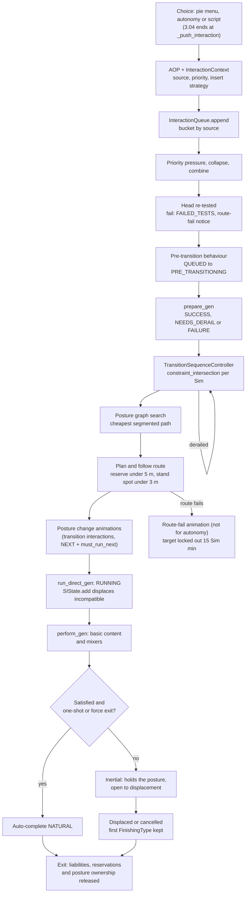
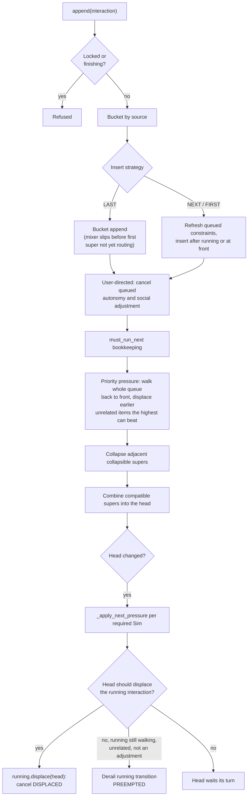
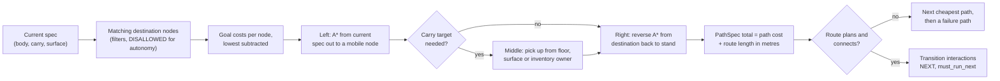

# 3.05 Interactions, postures and routing

*Game version 1.128.90.1030 (Steam, Linux/Proton). The numbers are base-game tuning, read from both the full build and the base-game delta tuning, with EP04 (Cats & Dogs), EP06 (Get Famous), EP09 (Eco Lifestyle), EP12 (High School Years), GP04 (Vampires), GP12 (Werewolves), SP01 (Luxury Party) and SP42 (Grunge Revival) installed; a count marked live adds each installed pack's delta build to the base game's. Written 2026-10-12. Checked 2026-10-12: 164 claims checked, 23 corrected, 3 relabelled, 5 removed. Deepened 2026-10-13: 155 modules newly explained, 13 failed decompiles read. Checked again 2026-10-13: 856 claims checked, 100 corrected, 3 relabelled, 0 removed. Cross-chapter edits 2026-10-13: 9 applied.*

## In plain words

Once a Sim has decided to do something (the player clicked it, or the Sim chose it alone, see [3.04 Autonomy](3.04-autonomy.md)), the choice becomes an "interaction" and joins that Sim's own queue. The queue has six lines in a fixed order, and the Sim's own choices sit in the last one, so anything the player or a script queued goes first, whatever the importance numbers say. When an interaction reaches the front, the game works out where the Sim must be and in what pose (standing, sitting on a particular seat, lying on a bed, holding a plate), searches a graph of every pose the Sim could reach for the cheapest way to get there, walks the Sim over, plays the sit-down or pick-up animations, and only then starts the activity itself.

Most activities do not end when their animation ends. Watching TV from a sofa goes on, holding the Sim on the sofa, until something else pushes it aside. The game protects an activity until it has done its job ("guaranteed") and then lets it drift into a soft state ("inertial") where any new order or autonomous whim can replace it. Two activities can run at once only when the places they need overlap: a Sim can sit, watch TV and chat together, but not stand at a counter and sit on a sofa.

Three things surprise most players. First, the queue limit of six is checked in only a few places, mostly when the player picks from a menu; the Sim's own choices and most scripts can push past it. Second, a Sim claims a chair only about 5 m before arriving, which is why two Sims can walk to the same seat and one gives up at the last moment, and a Sim on a low-importance errand never chases anyone out of an object. Third, every conversation is a geometry problem. Every few Sim minutes the game picks the worst-placed Sim in a group and nudges it to a better spot, which is why chatting Sims shuffle into a rough circle; it then calms down to a nudge every 10 to 15 Sim minutes once nobody has moved for a while.

What a social interaction says and does (the jokes, the outcomes) belongs to [3.08 Relationships, socials and memories](3.08-relationships-socials.md); animation playback belongs to [3.06 Animation, thought balloons and the hand-off to the client](3.06-animation.md); slots and object placement belong to [2.03 Build/Buy, placement and slots](2.03-build-buy-placement.md). This chapter covers everything between the choice and the activity: the queue, the posture graph, routing, reservations, carrying and social group geometry.

## Key facts

- **Six buckets, fixed order.** `InteractionQueue` holds social adjustment, carry-cancel replacements, vehicle-cancel replacements, the default bucket (pie menu, script, reactions, posture graph), body-cancel replacements and autonomy, in that order. The head is the first unblocked item of the first bucket that has one, so an autonomous choice waits behind any queued player or script interaction.
- **The visible cap is 6 and it is soft.** `object_sim` tunes `max_interactions` to 6 (code default 8, maximum 10). The pie menu (`ChoiceMenu.select`), the "queue full" pie menu check, the phone menu, the social picker's test, the `interactions.push` family of commands and two scripted pushes (tutorial tips, a missing pet running away) check it; `append` does not.
- **A click clears the Sim's own plans.** Appending a user-directed interaction cancels every queued autonomy and social-adjustment interaction (finishing type `PRIORITY`) and cancels running supers that set `cancel_on_user_directed_action`.
- **Three priorities, strict displacement.** Low 1, High 2, Critical 3 (SubLow 0). A newcomer displaces an existing interaction only with strictly higher priority, or equal priority when the existing one is interruptible.
- **The head displaces or derails.** When the head changes, it either displaces the running interaction (cancel `DISPLACED`) or, when it may not, derails the running interaction's walk with `PREEMPTED` if that walk is still going.
- **Guaranteed, then inertial.** A super interaction is guaranteed until it is RUNNING and satisfied; after that it holds its posture but anything can displace it. One-shot content is satisfied at once and exits.
- **Pipeline.** `PipelineProgress` NONE 0, QUEUED 1, PRE_TRANSITIONING 2, PREPARED 3, RUNNING 4, STAGED 5, EXITED 6. `FinishingType` has 25 values (19 count as cancelled); `DerailReason` has 20.
- **Edge costs.** Stand to Sit costs 1.5 (0.5 for changing mobility plus 1.0 for a different posture). Sliding between two seats of one sofa costs 3.5 for a human (3 between parts plus Sit-to-Sit 0.5), 1.5 when the parts coincide.
- **Goal costs, in metres.** A seat the Sim cannot reserve adds 175 (`IN_USE_PENALTY`), a seat another Sim already picked 35; a preferred object subtracts 100, a seat inside the group's area 100. The lowest goal cost is then subtracted from all of them.
- **Late reservation.** The route callback reserves the target when less than 5.0 m of path remain and rechecks the destination stand spot at 3.0 m. A blocker is kicked only if its interaction can be shooed and has lower priority; a Low priority interaction never kicks anyone.
- **Route failure locks the target out for 15 Sim minutes** (`LOCKOUT_TIME`, delta; code default 240), unless the interaction shows no route failure at all (social adjustments, `should_show_route_fail` false, or `route_fail_on_transition_fail` off). Interactions the Sim chose alone get the lockout but no route-fail animation.
- **Walk styles.** Walk by default, Jog on outdoor segments of at least 10 m inside a route of at least 20 m, WalkSlow under 7 m. Toddler walk levels have a short-walk distance of 0.
- **Handedness.** A Sim without a handedness trait is left-handed when `sim_id % 4 == 0`, so about one in four. Quadrupeds always use the right track.
- **Groups.** A `SocialGroup` holds 1 to 8 Sims by default; `chat` needs 2, faces 360 degrees, max radius 4 m. Adjustment runs every 2 to 4 Sim minutes within 10 Sim minutes of a geometry change, else every 10 to 15.
- **Liabilities travel with continuations.** Clean-up objects an interaction holds (hidden Sims, lights, save locks, borrowed objects) move to its continuation, shared ones are copied to its children, and a shared one is released only when its last copy ends. A death interaction runs at Critical and kills the Sim even when it is cancelled or its walk fails, unless it targets something other than the dying Sim and ended by a failed walk, a user cancel or failed tests.
- **Census (delta).** 8,242 interaction instances in 164 classes, 104 postures, 56 social group types, 27 put-down strategies. Live, with the installed packs: 13,983 interaction instances in 190 classes, 134 postures, 132 social group types, 29 put-down strategies.

## How it works

### The kinds of interaction

**Observed** (delta tuning census; class names from `interactions/base/*.py`).

- A super interaction (`SuperInteraction`, 3,151 instances) is a long-lived activity with a place in the Sim's set of running activities: use the sofa, cook, sleep, talk. A mixer (`MixerInteraction`, 1,042) is a short action inside a super ("change channel" inside "watch TV"). A social mixer (1,054) needs a social group; a social super (402) creates or joins the group (their content is in [3.08 Relationships, socials and memories](3.08-relationships-socials.md)). `ImmediateSuperInteraction` (676) runs at once with no walk. Other large classes are `SimPickerInteraction` (349), `StartCraftingSuperInteraction` (113), `CraftingStepInteraction` (106) and, further down, `GoHereSuperInteraction` (56). These are base delta figures; the live merge with the installed packs has 5,652 supers, 1,493 mixers, 1,607 social mixers, 1,112 social supers, 1,033 immediate supers, 546 Sim pickers, 130 and 182 crafting starts and steps, and 70 go-here interactions. The full build has only 3,087 instances in 132 classes, so the delta is the real catalogue.
- An `AffordanceObjectPair` (AOP, `interactions/aop.py`) pairs an affordance (the tuning instance) with a target. `test_and_execute` turns it into an interaction object with an `InteractionContext` (`interactions/context.py`): actor, source, priority, run priority, insert strategy, `must_run_next`, continuation id, group id, bucket type, carry target and hand, preferred objects.
- `InteractionSource` has 12 values: PIE_MENU 0, AUTONOMY 1, BODY_CANCEL_AOP 2, CARRY_CANCEL_AOP 3, SCRIPT 4, UNIT_TEST 5, POSTURE_GRAPH 6, SOCIAL_ADJUSTMENT 7, REACTION 8, GET_COMFORTABLE 9, SCRIPT_WITH_USER_INTENT 10, VEHCILE_CANCEL_AOP 11 (EA's spelling). With bucket type `BASED_ON_SOURCE`, `InteractionQueue._get_bucket_for_context` sends autonomy, social adjustment and the three cancel sources to their own buckets and everything else to the default bucket.
- `QueueInsertStrategy`: LAST 0 (append), NEXT 1 (just after the running interaction), FIRST 2 (front of the bucket). Continuations default to NEXT (`get_continuation_aop_and_context`). Transition interactions built by the posture graph use NEXT with `must_run_next=True` (`PathSpec.generate_transition_interactions`). The wait-nearby push of a social super uses FIRST (`social_super_interaction.py`), and so does the rally carry wait (`TransitionSequenceController`, Low priority).

**Content census (delta).** Supers: `flexible_length` 1,687, `one_shot` 1,354, untuned 110 (default `flexible_length`). Mixers: `one_shot` 567, `looping_animation` 244, untuned 209 (the base `Interaction` default is `no_content`), `no_content` 22. Social mixers: untuned 696, `no_content` 133, `one_shot` 119, looping 106. Social supers: `one_shot` 214, `flexible_length` 188. Live: supers `flexible_length` 2,908, `one_shot` 2,591, untuned 153; mixers `one_shot` 780, `looping_animation` 433, untuned 256, `no_content` 24; social mixers untuned 968, `one_shot` 264, `no_content` 205, looping 170; social supers `one_shot` 701, `flexible_length` 411. **Inferred** from these counts: most social mixers are wrappers whose animation comes from the social system.

**Reservation census (delta).** `basic_reserve_object` on supers: untuned 2,051 (default None, so no interaction-level reservation), disabled 616, enabled 484. Social supers: disabled 296, enabled 106. Live: supers untuned 3,721, disabled 1,186, enabled 745; social supers disabled 968, enabled 144. The posture graph reserves body targets on its own (see Reservation below).

### The life of one interaction



[3.04 Autonomy](3.04-autonomy.md) ends where the chosen AOP is executed (`_push_interaction`); everything in this diagram happens after that.

### The queue: buckets, append and the head

**Observed**, `interactions/interaction_queue.py: InteractionQueue`, `BucketBase`, `BucketList`, `InteractionBucket`, `AutonomyBucket`, `SocialAdjustmentBucket` (decompiled; the bucket placement and head code checked in bytecode).

**The six buckets.** In order: social adjustment (a single slot), carry-cancel replacements (a list), vehicle-cancel replacements (a single slot), the default `InteractionBucket`, body-cancel replacements, and autonomy. The social adjustment and autonomy buckets pick their head with `get_next_unblocked_interaction_cancel_incompatible`: a queued super whose required Sims have no valid path is cancelled outright (`INTERACTION_INCOMPATIBILITY`). The default bucket is gentler.

**Head of the default bucket** (`InteractionBucket.get_next_unblocked_interaction`, bytecode). The head is the first item that is not finishing, mixers included; supers that are affordance-locked are skipped. If the first eligible super reports Sims with invalid paths, the queue calls the blocked-Sims callback, marks it `on_incompatible_in_queue` and stops: nothing behind it may jump ahead, except a mixer further back whose own super is already running in the Sim's `SIState` and not finishing. The result is cached and cleared whenever any required Sim's `SIState` changes.

**Where a new item goes** (`InteractionBucket._append`, bytecode). A super, any item into an empty bucket, or a mixer whose `should_insert_in_queue_on_append()` is False goes to the end. A mixer that already has its super (`MixerInteraction` answers True when `super_interaction` is set) is inserted just before the first queued super that uses the LAST strategy and whose transition is missing or not yet running; otherwise it goes to the end. So a mixer for an activity that is already happening slips in ahead of activities the Sim has not started walking to.

**Append, in order** (`InteractionQueue.append`):

1. Refuse if the queue is locked or the interaction is already finishing.
2. Pick the bucket from the context.
3. LAST: bucket append. NEXT or FIRST: first refresh the constraints of every queued autonomy and default interaction, then insert after the running interaction (NEXT) or at the front (FIRST).
4. `on_added_to_queue`, then `_on_user_driven_action` for user-directed interactions: every queued autonomy-bucket and social-adjustment interaction is cancelled with `PRIORITY`, and every running super that sets `cancel_on_user_directed_action` (default False) and is unrelated to the new one is cancelled at once (`INTERACTION_INCOMPATIBILITY`).
5. A `must_run_next` interaction cancels any earlier one (`INTERACTION_QUEUE`) and becomes the queue's must-run-next item; if another super becomes the running one first, the pending must-run-next item is cancelled too (`InteractionQueue.running` setter).
6. Inside `_head_change_watcher`: priority pressure, then collapsing, then combining; if the head changed, `_on_head_changed`.

**The cap.** `max_interactions` (code default 8, minimum 0, maximum 10, `object_sim` tunes 6 in both builds) is checked by `ChoiceMenu.select` (non-immediate choices only), by the pie menu's queue-full tooltip (`should_generate_pie_menu`), by the phone menu (`generate_phone_choices`), by `SocialPickerSuperInteraction._test` (fails with "Interaction queue is full."), by `interactions.push`, `push_self_interaction` and `push_targeting_sim_info`, and by two scripted pushes that skip a full queue: tutorial tips that solve a commodity (`tutorial_tip.py`) and the missing-pet run-away push (`missing_pets_tracker.py`). `visible_len()` counts every interaction the queue iterates, the running one included (the tunable's description says the same). `append` never checks it (**Observed**, `interactions/choices.py: ChoiceMenu.select`, `InteractionQueue.can_queue_visible_interaction` and its callers).

### Priority and displacement



**Observed**, `interactions/priority.py`, `interaction_queue.py` (bytecode for the pressure passes).

- `Priority`: Low 1, High 2, Critical 3; `PriorityExtended.SubLow` 0. `can_priority_displace(new, existing, allow_clobbering)` is `new > existing`, or `new >= existing` with clobbering. `can_displace` also requires that the existing interaction is not waiting for a pick-up or put-down and is not a cancel AOP. With `use_max_priority`, a mixer counts at the higher of its own and its super's priority.
- `Interaction.interruptible` defaults to False and `compare_max_priority` to True (**Observed**, `interaction.pyc` rescued per function).
- **Priority pressure** (`_resolve_priority_pressure`) walks the whole queue, every bucket and the running interaction included, from back to front. Each interaction's own `interruptible` sets clobbering and its `compare_max_priority` sets max-priority comparison. An earlier interaction that is unrelated to the highest-priority interaction seen behind it, and that this highest one can displace, is displaced. The highest is replaced whenever a strictly higher priority turns up.
- **Collapsing** (`_resolve_collapsible_interaction`): two adjacent visible, non-finishing supers in the default bucket that are both `collapsible` (default False); the earlier one is cancelled (`INTERACTION_QUEUE`). This is how repeated "Go Here" clicks replace each other.
- **Displacing the running interaction** (`_apply_next_pressure`): for each required Sim whose running interaction is not `must_run`, `_should_head_dispace_running` (EA's spelling) decides. If it says yes, the running interaction is displaced. If it says no, but the running interaction has a transition of this Sim that is still going, is not a social adjustment and is unrelated to the head, that transition is derailed with `PREEMPTED`.
- `_should_head_dispace_running`, in order: `disable_displace` says no; a running mixer that is not interruptible says no; the head being a child of the running one says no; a pick-up-Sim liability whose original is the head says no; a cancel-AOP liability on the head that targets the running one says yes. Then clobbering is allowed if the head is a cancel AOP and the running interaction does not disable transitions, otherwise it is the running one's `interruptible`. When the running interaction is a guaranteed super, the head must pass `can_displace` against it; related interactions are never displaced; two supers that are compatible are not displaced; everything else is.

### Combining several queued interactions into one trip

**Observed**, `InteractionQueue._combine_compatible_interactions`, `_attempt_combination` (bytecode).

The head must exist, not be a put-down, be visible, be a super and be `allowed_to_combine` (default True). Starting from the head's `constraint_intersection(posture_state=None)`, the queue walks the default bucket's supers in order, skipping mixers, and tries each. `_attempt_combination` requires the candidate to be visible and `allowed_to_combine`, to belong to a different continuation chain than anything already combined, the earlier interaction not to be collapsible, and `SIState.are_sis_compatible` to pass; then the constraints must intersect to something valid. The walk is greedy and stops at a queued put-down, at the first failed combination, and as soon as the combination would need more than one carry target. If the set of combined interactions changes while the head is already transitioning, the transition is derailed with `PROCESS_QUEUE` (and goal costs are cleared when there is more than one carry target). This is how "put away dishes, then wash them" can share one walk.

### Processing the head

**Observed**, `InteractionQueue.process_one_interaction_gen`, `SuperInteraction.prepare_gen` (rescued per function).

1. The head is re-tested. A failure cancels it with `FAILED_TESTS`. For a user-directed, visible super the queue then pushes the route-failure interaction (`InteractionFailureOptions.ROUTE_FAILURE_AFFORDANCE`, the `route-fail` affordance in delta tuning) at High priority, SCRIPT source, NEXT, with animation overrides chosen by `FAILURE_REASON_TESTS`, unless the interaction had been queued on an object in an inventory that has since left that inventory or been deleted.
2. A mixer goes QUEUED, then `prepare_gen`: SUCCESS makes it PREPARED, NEEDS_DERAIL returns for another pass, FAILURE cancels it (`INTERACTION_QUEUE`). A prepared mixer runs straight away inside its super.
3. A super goes QUEUED to PRE_TRANSITIONING through `run_pre_transition_behavior` (a failure cancels with `TRANSITION_FAILURE`), then `prepare_gen` with incompatible carries cancelled. `SuperInteraction.prepare_gen`, in order: a waiting line pushes a wait-in-line interaction and returns PUSHED_REPLACEMENT (finishing `WAIT_IN_LINE`); incompatible carry interactions are cancelled (NEEDS_DERAIL if they cannot be yet); autonomy is skipped unless the source is transitional (social adjustment, get comfortable, posture graph); pre-add autonomy; the tuned `run_priority` replaces the queue priority; prepare liabilities; carried Sims are linked; fairy-form route planning; SUCCESS. NEEDS_DERAIL runs a short idle (`get_idle_element(1)`) and returns for another pass.
4. A `TransitionSequenceController` is created if needed and set on every required Sim's queue.
5. If the clock is PAUSED and `force_process_transitions` is off, the loop sleeps until the next tick plus 1 Sim second and then runs the transition. Since Sim time does not pass while paused, this means the walk waits for unpause (**Inferred** from the sleep target).
6. `SIState.process_gen` then removes finished interactions.

### SIState: what a Sim can do at once

**Observed**, `interactions/si_state.py` (rescued per function, conditions checked in its disassembly).

- `SIState` is the per-Sim set of running supers. A Sim can hold several: the posture provider (sitting), watching TV, chatting.
- `are_sis_compatible(a, b)`: the non-constraint test, then cancel-AOP liabilities in either direction, then (unless `ignore_geometry`) a valid intersection of their constraints.
- The non-constraint test is `_are_dissimilar_and_linked`. If the two affordances are the same, or neither sets `super_affordance_can_share_target`, they are incompatible when they share a target or an object and its part. Then they must be linked (`is_linked_to`): two body-posture providers are never compatible; a provider paired with a non-provider is judged by the provider's `super_affordance_compatibility` filter alone; two non-providers must pass both filters.
- `SIState.add` calls `resolve`, which first tests compatibility (skipped with `must_add`) and returns False if it fails, then (`_resolve`) displaces every incompatible running super of the actor and of the target Sim; `_add` then marks the state dirty and resets any not-yet-running transition queued on the Sim, because the combined constraint has changed.
- **Guaranteed and inertial** (`SuperInteraction.is_guaranteed`): true while a guaranteed lock is held or the pipeline is before RUNNING; false with `force_inertial` or an active cancel replacement; otherwise true until the interaction is satisfied. `perform_gen` marks one-shot content satisfied at once and auto-completes (NATURAL) a super that is no longer guaranteed when it is one-shot or sets `force_exit_on_inertia`. `_on_guaranteed_to_inertial` runs full autonomy on the next ping when `force_autonomy_on_inertia` is set.
- `super_affordance_klobberers` lets a tuned super clobber a guaranteed one (the tunable description's example is `bed_BeIntimate` over `sim_chat`; `bed_BeIntimate` itself is only in the full build).
- `LifetimeState`: INITIAL 0, RUNNING 1, PENDING_COMPLETE 2, CANCELED 3, EXITED 4.

### Running and content

**Observed**, `super_interaction.pyc` and `interaction.pyc` (rescued per function), `interactions/base/basic.py`.

- `SuperInteraction.run_direct_gen` makes sure the interaction is prepared, runs any pre-run behaviour (a failure cancels with `TRANSITION_FAILURE`), takes posture ownership when it provides the posture, sets RUNNING and calls `enter_si_gen`: lifetime RUNNING, initial mixer lockouts (`lock_out_time_initial`), `SIState.add`. If entering the SIState fails, the interaction drops back to PREPARED and is cancelled with `INTERACTION_INCOMPATIBILITY`; when a pre-run behaviour was given, the Sim is also reset (`RESET_ON_ERROR`, "Failed to enter SI State").
- `Interaction.perform_gen`: `setup_gen` failing cancels with `FAILED_TESTS`; `_run_priority` replaces the priority; pre-perform, liabilities' `on_run`, then the content. A super that keeps running mixers with Nowhere constraints auto-completes once their count passes `MAX_NOWHERE_MIXERS` = 20.
- **Basic content** (`TunableBasicContentSet`): four variants, `no_content`, `one_shot`, `looping_animation` and `flexible_length`. `flexible_length` wraps either staging content (the default: play to a stage point and hold) or looping content. The SuperInteraction default is `flexible_length`, the Interaction default `no_content`. `basic_extras` wrap the content in list order.
- **Conditional actions** (`interactions/utils/exit_condition_manager.py`, `statistic_element.py: ConditionalInteractionAction`): when an exit condition group is satisfied the action fires: GO_INERTIAL (marks satisfied), EXIT_NATURALLY (NATURAL), EXIT_CANCEL (`CONDITIONAL_EXIT`) or LOWER_PRIORITY (priority drops to Low).
- **Mixer lockouts.** `enter_si_gen` calls `set_sub_action_lockout(mixer, initial_lockout=True)` for each mixer with an initial lockout; the lockout keeps the Sim from choosing that mixer again for that many Sim minutes (**Inferred** from the name and the mixer autonomy in [3.04 Autonomy](3.04-autonomy.md)).
- **Where queued mixers come from.** **Observed** (`sims/master_controller.py: MasterController._process`, which calls `sim.get_next_work()`; `sims/sim.pyc: Sim.get_next_work`, bytecode lines 4112 to 4127, the module did not decompile): when the Sim's queue has no head, the zone is running and no carry fix-up is pending, `get_next_work` runs `run_subaction_autonomy` (a Python call, not native) and reads the head again. **Inferred** from that re-read: autonomy's mixer pick for the running supers lands in the queue there and is then processed as in step 2 of "Processing the head". If the autonomy bucket holds a blocked interaction, it cancels everything in that bucket instead. How the mixer is chosen is [3.04 Autonomy](3.04-autonomy.md).

### Finishing and derailing

**Observed**, `interactions/interaction_finisher.py`, `postures/__init__.py`, `interactions/utils/routing_constants.py`.

- `InteractionFinisher` keeps the history of finishing moves; the first one is the reason. `FinishingType` has 25 values; 19 count as cancelled (USER_CANCEL, SI_FINISHED, TARGET_DELETED, FAILED_TESTS, TRANSITION_FAILURE, INTERACTION_INCOMPATIBILITY, INTERACTION_QUEUE, PRIORITY, SOCIALS, WAIT_IN_LINE, OBJECT_CHANGED, SITUATIONS, CRAFTING, LIABILITY, DIALOG, CONDITIONAL_EXIT, FIRE, WEDDING, ROUTING_FORMATION). The other six are KILLED, AUTO_EXIT, DISPLACED, NATURAL, RESET and UNKNOWN.
- `DerailReason` has 20 values, NOT_DERAILED 0 to WAIT_FOR_WING_STATE_CHANGE 19: TRANSITION_FAILED, DISPLACE, PREEMPTED, PROCESS_QUEUE, TARGET_RESET, NAVMESH_UPDATED, PRIVACY_ENGAGED, WAIT_FOR_BLOCKING_SIMS, CONSTRAINTS_CHANGED, NAVMESH_UPDATED_BY_BUILD, MUST_EXIT_MOBILE_POSTURE_OBJECT, WAIT_TO_BE_PUT_DOWN, WAIT_FOR_FORMATION_SLAVE, MASTER_SIM_ROUTING, WAIT_FOR_CARRY_TARGET, CARRY_NEEDED, WAIT_FOR_MULTI_SIM_POSTURE, RIDER_WAIT_FOR_CARRIER. `FAILURE_DERAILS` are TRANSITION_FAILED and TARGET_RESET; `MOVING_DERAILS` are CONSTRAINTS_CHANGED, MUST_EXIT_MOBILE_POSTURE_OBJECT, MASTER_SIM_ROUTING, WAIT_TO_BE_PUT_DOWN and RIDER_WAIT_FOR_CARRIER.
- `TransitionFailureReasons` has 12 values: UNKNOWN 0, NO_DESTINATION_NODE 1, NO_PATH_FOUND 2, NO_VALID_INTERSECTION 3, NO_GOALS_GENERATED 4, BUILD_BUY 5, BLOCKING_OBJECT 6, RESERVATION 7, NO_CONNECTIVITY_TO_GOALS 8, PATH_PLAN_FAILED 9, GOAL_ON_SLOPE 10, INSUFFICIENT_HEAD_CLEARANCE 11.
- A derail resets the transition and the controller rebuilds it on its next pass. When the last owner of a non-default posture leaves, a cancel-replacement AOP (stand up, put down, leave the vehicle) arrives through the carry, body or vehicle cancel buckets (**Inferred** from the bucket names, the `CANCEL_AOP_LIABILITY` checks in `SIState` and `StandSuperInteraction.get_cancel_replacement_aops_contexts_postures`).

### Constraints: where a Sim may be

**Observed**, `interactions/constraints.py` (whole-module decompile failed; read from its per-function rescue and its disassembly), `interaction.pyc` rescued per function.

A `Constraint` says where and in what posture a Sim must be. Its fields: geometry (a polygon with an optional facing range), routing surface, scoring and goal functions, a posture state spec (allowed body postures, body and surface targets, slot manifest), age, `allow_small_intersections`, line-of-sight reference point, outer penalty threshold (default 0.8), cost, objects to ignore, a jig factory, terrain tags, water depth range, `require_carried`, `multi_surface`, height scoring.

- **Validity.** A constraint with no geometry or no polygon is valid. One with an empty polygon is not. Otherwise its area must be at least `MINIMUM_VALID_AREA` unless small intersections are allowed. The code default is 2 m², but the `interactions.constraints` module tuning sets 0.5 m² in both builds. A polygon below that area also turns `multi_surface` off.
- **Intersection.** `intersect` hands the work to the class with the lower `INTERSECT_PREFERENCE`: UNIVERSAL 0, CONSTRAINT_SET 1, JIG 2, GEOMETRIC_PLUS 3, REQUIREDSLOT 4, GEOMETRIC 5. For two geometric constraints: polygons and facing ranges intersect; posture specs intersect; ages must match when both are set; the water range becomes (max of minimums, min of maximums) and fails if empty; terrain tags intersect and fail if empty; scoring and goal functions are unioned; small intersections are ORed; the outer threshold takes the minimum and the cost the maximum; objects to ignore are unioned; multi-surface only if both are; routing surfaces must overlap ("Surface Intersection Failure"). Any failure returns `Nowhere`.
- **Singletons and sets.** `Anywhere`, `Nowhere`, `GeometryIncompatibleAnywhere`, `Somewhere`, `TentativeIntersection`; `_ConstraintSet` is an OR (satisfying any member satisfies the set).
- **Factories tuning writes** (`interactions/constraint_variants.py`): the geometric variant offers facing, line of sight, cone, circle, relative circle, position, current position, portal, spawn points (with or without backup), ocean location, water depth, water depth interval and terrain material; the full variant adds posture, welcome, front door, jig, animation, routing slot, object placement, fire-or-lot facing, plex, a constraint set and carry path. `RequiredSlot` and `ObjectJig` are `constraints.py` classes that tuning does not pick directly. Cone defaults: rotation offset 0, ideal region from 0.25 to 0.75 of the way between the minimum and maximum radius, ideal angle 0.25 (a fraction of the cone's angle), 8 vertices, cost weight 2.25. `DEFAULT_FACING_RANGE` is pi/2 in code and 100 degrees in tuning. `Circle.NUM_SIDES` is 8 in code and 6 in both builds' tuning; the full build also tunes `PointRadius.NUM_SIDES` 32, but no `PointRadius` class exists in this build's code, so that value is unused. `ROUTE_GOAL_COUNT_FOR_SCORING_FUNC` 40 and `WALL_OBJECT_FORWARD_MOD` 0.15 are code constants.
- **Scoring inside a constraint.** `ConstraintCostCircleDist` and `ConstraintCostLineDist` score a goal by its distance from the ideal ring or line, `ConstraintCostArcLength` by how far it sits beyond the safe angle. The route planner uses these so a Sim lands in the best part of the area.

**Where an interaction's constraint comes from** (`Interaction.constraint_intersection`, now read in the per-function rescue). If the Sim's body posture's source interaction is this interaction, the answer is its `body_posture_state_constraint`. Otherwise `constraint_gen` yields, per participant: the current posture's strict constraint when `_require_current_posture`; the tuned `_constraints`, built relative to `_constraints_actor` (default Object), and the automatic constraints; multi-surface versions (`_multi_surface`, default True, overridable by the target or its parent); forbid-small-intersection versions when `basic_reserve_object` is None or the interaction has a multi-reserve; and a routing-slave constraint for formation slaves. Each one is made concrete, gets the posture state applied through a resolver, gets slot constraints when the Sim's parent cannot move, and is intersected into the running total, stopping at the first invalid result. The result is cached per Sim and posture state, then passed through `apply_posture_state_and_interaction_to_constraint`. `SIState.get_total_constraint` folds in every other running super, which is why two supers whose areas do not overlap cannot both run.

**Animation constraints come from a cache.** **Observed**, `interactions/interaction_instance_manager.py: InteractionInstanceManager`: the automatic constraints each affordance takes from its animations are read from a prebuilt resource, keyed by class name, when interaction tuning starts (`read_ac_cache_from_resource`; `BUILD_AC_CACHE` is False, so the retail game never builds it). An affordance that has no automatic constraints of its own receives the cached ones with unset postures removed, and the whole pass runs again when packs load. When the resource yields no cache, the pass simply returns (its `logger.warn` call writes nothing in the retail build). **Inferred**: a mod affordance absent from the cache works out its animation constraints itself when first needed.

### Postures and the posture graph

**Observed**, `postures/posture_specs.py`, `postures/posture_graph.py` (rescued per function), `postures/posture_cost.py`, `postures/posture_tunables.py`; tuning `postures.posture_graph`, `posture_Sit`, `posture_Stand`.

**Postures.** 104 posture instances in the delta build (76 `Posture`, 16 `IntimatePartPosture`, 6 `MobilePosture`, 2 `CarryingSim`, 1 each `MultiSimSocialPosture`, `CarryingObject`, `CarryingNothing`, `BeCarriedPosture`); the full build has 43 and the live merge 134 (91 `Posture`, 30 `IntimatePartPosture`, 2 `MultiSimSocialPosture`, the other classes as in the delta). A Sim has a body track plus carry tracks (left, right, back). Mobile postures (stand, swim, some vehicles) are the ones a Sim can route in. `posture_Sit` (delta) has posture cost 2, jig 20069, `ownable` False, additional put-down and jig distances 1, a toddler validator and a social geometry focal point shifted z 0.15. Its supported postures list Stand (default cost) and Sit itself with a per-species cost of 0.5 (CAT and DOG 0.1); the full build has the older `transition_cost` 0.5.

**Posture specs.** The graph stores `PostureSpec(body, carry, surface)` triples: body (posture type, target), carry (posture type, target, hand), surface (target, slot type, slot target). `PostureSpecVariable` placeholders (ANYTHING, INTERACTION_TARGET, SURFACE_TARGET, HAND, SLOT and others) let an interaction state its needs generically, resolved per plan by a `var_map`. Well-known nodes: `STAND_AT_NONE`, `STAND_AT_NONE_CARRY`, `SWIM_AT_NONE`, `SWIM_AT_NONE_CARRY`.

**Posture state specs** (`postures/posture_state_spec.pyc`, rescued per function in the deepening pass; the class body and `get_concrete_version` failed). What a constraint asks of the Sim's pose is a `PostureStateSpec`: a posture manifest (allowed postures, carry hand and target, surface), a slot manifest and a body target. Intersecting two constraints intersects their specs field by field: an empty field takes the other side's value, two different manifests are intersected and an empty result makes the constraint impossible, and two body targets are resolved variable against object (`intersection`, `_resolve_unequal_manifest`). `get_posture_specs_gen` then expands each manifest entry into `PostureSpec` triples for the graph: a carry aspect when the entry names a hand (skipped when the object does not allow that hand; a definition or a to-be-created object gets the carry-nothing aspect), and a surface aspect from the entry's surface or `ANYTHING` when any surface is allowed. `_destination_filter` drops destinations where the carried object would not already sit in the required slot (`TargetAlreadyInSlot`), and `is_vehicle_only_spec` marks specs whose every posture is a vehicle.

**Building the graph.** `PostureGraphService.build` seeds the open set with the stand-at-none nodes and mobile posture providers, then `_expand_node` applies each operation that fits a relevant object: `BodyTransition` (into each posture the object's affordances provide; 29 global posture-providing affordances in `postures.posture_graph` cover objectless postures such as kneel, stargaze, dance, sit on ground), `PickUpObject`, `PutDownObject`, `PutDownObjectOnSurface`, `TargetAlreadyInSlot`, `ForgetSurface`, and the default back-to-stand and swim operations. `_validate_node_for_graph` rejects impossible parent and slot arrangements. Objects added or moved in live mode update the graph incrementally. In Build/Buy mode the service counts changes instead: with `INCREMENTAL_REBUILD_THRESHOLD` tuned 0, the first change stops incremental updates and leaving Build/Buy rebuilds the whole graph (`on_exit_buildbuy`).

### Edge costs and goal costs

**Observed**, `postures/posture_specs.py: PostureOperationBodyTransition.cost`, `PostureOperationPickUpObject.cost` (bytecode), `PostureGraphService.add_node`, `distance_fn`; `postures/posture_scoring.py: PostureScoring.get_goal_node_cost`, `build_relationship_bonuses`; tuning `postures.posture_scoring`.

**Edge cost** of a body transition, per species:

- +0.5 (`ENTER_EXIT_OBJECT_COST`) when mobility changes;
- between two different non-mobile targets, +3 (`INNER_NON_MOBILE_TO_NON_MOBILE_COST`) or +1 if they coincide (`..._COINCIDENT_COST`), plus the parts' part-to-part modifier, floored at 0.1 when the sum is 0 or less;
- +1.0 (`COST_STANDARD`) when the current posture is multi-Sim;
- plus the pairwise posture cost from the destination's supported postures (`_PostureCostDefault`: 0 for the same posture, 1.0 otherwise; custom or per-species costs where tuned).

So Stand to Sit is 0.5 + 1.0 = 1.5, and Sit to Sit between two different seat parts is 3 + 0.5 = 3.5 for a human (3.1 for cats and dogs), 1.5 when the parts coincide, before modifiers. Pick-up and put-down operations cost 1.0 (`COST_STANDARD`) plus 0.1 (`COST_NOMINAL`) when the body is not mobile. `postures.posture_specs` is empty in both builds, so these are code values. `add_node` adds operation costs per species and fills missing species from the default.

**Edge cost as walked** (`distance_fn`): the edge's cost for the Sim's species (times the target species modifier), plus `OBJECT_RESERVED_PENALTY` 100 when the Sim could not reserve the next body target, plus, when the next body target is a Sim to be carried, `CARRYING_SIM_BUSY_PENALTY` 20 per guaranteed super that Sim runs, `CARRYING_SIM_NON_CAREGIVER_PENALTY` 80, `CARRYING_SIM_HAS_NOT_MET_PENALTY` 300 and `CARRYING_SIM_NOT_IN_ENSEMBLE_PENALTY` 80.

**Goal cost** of ending in a destination node, in metres:

- `IN_USE_PENALTY` (175 in both builds, code 20) when the body target cannot be reserved by this Sim; with a slot, the lowest-cost free valid slot's cost plus the surface's `slot_cost_modifiers` instead, or the in-use penalty if no slot is free;
- `AUTONOMOUSLY_PREFERRED_BONUS` 100 subtracted when the Sim prefers this object; the interaction's preferred objects (`BEST_PART_BONUS` 75, `BEST_OBJECT_BONUS` 100, distance to the preferred part times `_DISTANCE_MULT` 2);
- `IN_PARTY_CONSTRAINT_BONUS` 100 subtracted when the target lies inside the group's constraint;
- `ADJACENT_TO_GROUP_MEMBER_BONUS` subtracted when a neighbouring part is used by a group member (delta 5; the full build leaves the code default 15);
- `DEST_ALREADY_SELECTED_PENALTY` (35 in both builds, code 10) when another Sim already planned this body target;
- `CANCEL_EXISTING_CARRY_OR_SLOT_COST` 10 for destinations that drop what the Sim holds;
- posture target preference tags, `PREFERRED_POSTURE_TARGET_BONUS` 10, the part's `additional_part_posture_cost`, `current_body_target_cost_bonus` and `posture_surface_slotted_object_preference`;
- the posture's own `cost` when the interaction applies posture costs (overrides first), and `SURFACE_BONUS` (10 in both builds, code 7) when the interaction prefers a surface;
- the relationship bonus below.

After every destination is scored, the lowest goal cost is subtracted from all of them (`get_segmented_paths`), so goal costs are relative.

**Posture costs** (delta, the posture's own `cost`): `posture_MovingStand` 100000 (an effective ban as a destination, **Inferred**); Treadmill and floating 50; Stargaze and Kneel 25; sixteen at 20 (the four toilet postures, steam room sit, StandExclusive, SitOnGround, SitInHighChair, Shower, ShowerClean, LayDownOnGround, Grill, Dance, CrossLegged, Cook, BarMakeDrink); Swim 15; infant lay-on-tummy 12; sleeping-bag cross-legged 11; potty chair, lay-on-stomach-on-object and crib sleep 10; Stand 8, infant lay-on-back 8; LayOnBackOnObject 6; monkey bars hang-out and standing bush fertilizing 5; monkey bars play tuned 0; Sit, SitOnObject and toddler sleeping-bag sit 2; sleeping bag sleep and nap 1. 66 of the 104 leave the default 0. **Inferred** from these costs: with other things equal a Sim prefers a chair to the floor.

**A worked example: the hot tub.** **Observed** (live tuning, base delta): both live hot tubs, `object_hottub_EVG_Anniversary` (230825) and `object_hottub_InGround` (470090), are one object with 20 parts: 4 `part_hottub_stand` (117150, posture `posture_HotTubStand` 117256), 8 `part_hottub_sit` (117151, `posture_HotTubSit` 117257) and 8 `part_hottub_intimate` (117820, postures `posture_HottubWoohoo` 117782 and `posture_SitIntimate` 15536, both `IntimatePartPosture`). Each tub sets `posture_transition_target_tag` to `SEATING_HOTTUB`. `PostureScoring.get_goal_node_cost` looks the tag up in the interaction's `posture_target_preferences` (surface target first, then body target), and a part with no tag of its own returns its owner's (`objects/part.pyc: Part.posture_transition_target_tag`, bytecode; the module did not decompile), so all 20 seats share the tub's preference. **Inferred**: because the graph sees 20 body targets on one object, moving from a stand spot to a seat in the same tub is priced as a part-to-part move (above) and does not need a walk out of the tub. SP82 (Yard Charm) adds `object_hottub_SP82YARD` (501029) with the same 20-part layout (4 stand, 8 sit, 8 intimate, the same three part instances) and the same tag: patch data, pack not installed.

**Part data.** What a part is (a `Part` proxy of its owner), what an `ObjectPart` record supports and how `Subroot` joints place it are in [2.02 Objects: components, states and wear](2.02-objects-states-wear.md#object-parts-one-object-several-sims). **Observed** (`objects/parts/part_data.py: _PartData`, `TunablePartDataMapping.load_etree_node`; the deprecated list in `objects/script_object.py`; `Part.adjacent_parts_gen` in `objects/part.pyc`, per-function rescue): in the map form `adjacent_parts` is a plain list, so an empty one means the part has no adjacent parts; only an entry of the old `_part_data` list whose optional `adjacent_parts` is left disabled falls back to the parts either side by index. `subroot_index` is an optional field enabled by default with index 0. `is_mirrored` left disabled reads as None and False reads as False, which the callers treat alike (`script_object.py` and the posture's `isMirrored` ASM parameter in `postures/base_postures.py` both turn it into a bool). A part with no `posture_transition_target_tag` takes its owner's, as in the hot tub above.

**Relationship bonus** (`build_relationship_bonuses`). For every other Sim standing still in a posture that allows affinity, each candidate seat gets: the interaction's affinity strategies (`Attract` -50, `Avoid` +50, or `Relationship`, which reads the average of the scored relationship tracks off a curve: -100 and -30 give 0, 0 gives 40, 100 gives 60, then negated), `ENSEMBLE_BONUS` -25 if that Sim is in the Sim's most important ensemble, else `HAS_NOT_MET_PENALTY` +15 if they have not met. The total is multiplied by `DISTANCE_TO_IMPACT_CURVE` (delta: 1 from 0 to 4 m, falling to 0 at 10 m) evaluated at the seat-to-Sim distance, floored at 1 m and divided by the social facing score between them (a facing score of 0 or less skips that Sim). Seats in the same seating cluster as the other Sim multiply the bonus by `SAME_CLUSTER_SIM_MULTIPLIER` (1.5 in both builds, code 1.2). This is why Sims sit next to friends.

### The posture graph search



**Observed**, `PostureGraphService.get_segmented_paths`, `_get_all_paths`, `_left_path_gen`, `_middle_path_gen`, `_right_path_gen`, `PathSpec.total_cost` (rescued per function).

1. The Sim's current spec must be a node of the graph.
2. `get_matching_nodes_gen` finds destination nodes for the interaction's destination specs and slot types, dropping excluded objects, failed destination tests, objects without the affordance, and targets whose `AutonomyPreferenceType` is DISALLOWED when the source is autonomy.
3. `PostureScoring.build_destination_costs` scores them (above).
4. Per constraint, one or two `SegmentedPath`s: a path through standing, always, and a "complete" path that stays on the same object (moving between parts) when allowed. Completion is refused if the Sim's position does not intersect the constraint, if a needed outfit change is missing, or if the destination objects differ from the current body object.
5. Each segmented path is searched in pieces (`PathType` LEFT, MIDDLE_LEFT, MIDDLE_RIGHT, RIGHT) by A* (`algos.shortest_path_gen`). The left heuristic adds the estimated walking distance from the source body target to the destinations; `left_distance_fn` charges the goal cost at the last step. The middle segment, only with a carry target, finds how to pick the thing up: from a Sim inventory or the floor at the pick-up cost, from a surface through `get_pickup_path`, from an object inventory by sorting the owners by walking distance. `DistanceEstimator` caches walking estimates.
6. No segmented paths sets `NO_DESTINATION_NODE` (no matching node) or `NO_PATH_FOUND` (nodes but no path).

The controller turns the cheapest chain into a `PathSpec` (a list of `TransitionSpec`s with portals and locked animation parameters). `PathSpec.total_cost` is the path cost plus `routing_cost`, the sum of the route lengths in metres. If the cheapest fails at connectivity or route planning, the next is tried, and finally a failure path. `PathSpec.generate_transition_interactions` then creates, for each posture change, the interaction that provides that posture, with source POSTURE_GRAPH, the final interaction's priority and run priority, NEXT and `must_run_next`; an equivalent existing interaction is reused, and outfit changes are preloaded.

### Reservation and kicking

**Observed**, `reservation/*.py`, `interactions/utils/reserve.py`, `TransitionSpecCython.do_reservation` and `can_remove_blocking_sims` (rescued).

- **Handlers.** `ReservationHandlerBasic` is exclusive (same Sim, parent or child interactions, clobberers, use-list and interlocked holders pass); `ReservationHandlerAllParts` reserves every part; `ReservationHandlerMulti` allows several users with an optional statistic-driven limit; `ReservationHandlerInterlocked` allows a whitelist of affordances; `ReservationHandlerUseList` always allows; `ReservationHandlerSocialGroupExclusive`, `ReservationHandlerUnmovableObjects` and `ReservationHandlerNested` cover the rest.
- **Which object.** `TunableReserveObject` defaults to the participants Object, CarriedObject and CraftingObject.
- **When.** Not at queue time. `do_reservation` runs from the route callback when under 5.0 m of path remain. For each transition interaction it tries the handler; a cancel AOP that fails is skipped and the loop carries on (its `logger.warn` call writes nothing in retail). Otherwise a Low priority interaction gives up at once. A higher one calls `can_remove_blocking_sims`: any non-Sim user, or any blocker whose interaction on that object cannot be shooed (`can_shoo`, default True) or has a priority equal or higher, makes it give up. Kickable blockers are cancelled as a user cancel and routed away, and the controller derails with `WAIT_FOR_BLOCKING_SIMS`. The next posture body and surface targets get a `ReservationHandlerMulti` with no limit.
- `ReservationMixin.usable_by_transition_controller` (used by posture scoring) looks at every reservation on the object or an overlapping part held by a Sim outside the interaction's required Sims: it says no when that reservation's interaction has equal or higher priority, or, whatever its priority, when the new interaction is Low or lower. With no such reservation it says yes, Low included.
- The goal cost already charges 175 for an occupied target, so a free chair wins before any reservation is tried.

### Routing: goals, the route element and blockers

**Observed**, `routing/__init__.py`, `routing/path_planner/path_plan_context.py`, `interactions/utils/routing.py: FollowPath`, `PlanRoute`, `do_route`, `TransitionSequenceController` (rescued), `objects/components/routing_component.py` (rescued). The planner itself is native.

- **Goals.** A constraint's area becomes `routing.Goal` objects (location, cost, tag, group, line-of-sight flag). The native planner returns a path and a result. `GoalType` (Good, Bad, Failure) and `GoalFailureType` (LOSBlocked, OutsideRouteableArea, IsSuppressed, OutOfWaterDepth, TerrainTagViolations, ClipsWithEdge) explain rejected goals. Goal sampling happens in native code (**Inferred**).
- **Planner constants.** The values in `routing/__init__.py` (traversal 1.0, discouragement 100, obstacle 10000, radius 0.123, clearance multiplier 2.0) are fallback stubs used only when the native `_pathing` module is missing. `PORTAL_PLAN_LOCK` 5000, `PORTAL_USE_LOCK` 25000 and `PORTAL_LOCKED_COST` 100000 are real constants.
- **The agent.** `PathPlanContextWrapper` defaults: agent radius 0.123 m, goal radius 0.123 m, extra clearance modifier 2.5, max goal clipping 60, surface preference scoring entries default 10, a circle shape (or a rectangle, default 1.5 x 0.5). `object_sim` tunes none of these, only head clearance (2.25 m in the default context, which covers every age without an override, teen to elder; child 1.5, toddler and infant 1), portal allowance flags and shallow wading for toddlers. A bike (`object_Vehicle_Bike`, delta) uses agent radius 0.25, goal radius 0.4 and a 1 x 0.2 rectangle. The server `RoutingComponent` that holds these plan contexts (what it tunes, and which live objects carry it) is in [2.02 Objects: components, states and wear](2.02-objects-states-wear.md#routing-objects).
- **The route element.** `FollowPath` pushes the Sim's server position about once a second (`ROUTE_SIM_POSITION_UPDATE_FREQUENCY` 1), aborts when elapsed time exceeds twice the planned path time plus 5 seconds, and will not cancel with under 0.5 s left (`ROUTE_MINIMUM_TIME_REMAINING_FOR_CANCELLATION`). The transition's per-tick callback rechecks the stand spot under `DISTANCE_TO_RECHECK_STAND_RESERVATION` 3.0 m and runs reservations, portal locks and fire checks under `DISTANCE_TO_RECHECK_INUSE` 5.0 m; both are untuned Tunables. `TransitionSpec.DISTANCE_TO_FADE_SIM_OUT` 5.0 lets tuned interactions fade the Sim out near the end (**Inferred** use). `do_route` calls the callback once before following when the path is already shorter than 5.0 m, and adds a lockout on failure.
- **Stand-spot reservation** (`TransitionSequenceController`, `RoutingComponent.add_stand_slot_reservation`). When a path ends standing and the final constraint is a single point, or has no measured area, or its smallest area is under `MINIMUM_AREA_FOR_NO_STAND_RESERVATION` 2, the Sim reserves its end point: a route-goal suppressor in the quadtree and a 6-sided polygon of radius twice the agent radius (0.246 m by default). Other Sims inside are pushed out (`force_move_sims_in_polygon`) unless told to skip. At 3.0 m the arriving Sim lists violators standing in that polygon (unless they ignore blocking near destinations); if any, the route stops and the controller derails with `WAIT_FOR_BLOCKING_SIMS`, then waits up to `SIM_MINUTES_TO_WAIT_FOR_VIOLATORS` 15 Sim minutes (untuned; the delta `postures.transition_sequence` module tunes only the call-over and shoo animations).
- **Waiting for others.** A multi-Sim interaction waits for every participant: waiting Sims idle in 1-second steps (`SLEEP_TIME_FOR_IDLE_WAITING`) up to `maximum_time_to_wait_for_other_sims` 8 Sim minutes.

### Route failure

**Observed**, `interactions/utils/route_fail.py: handle_transition_failure`, `RouteFailureTunables`; tuning `interactions.utils.route_fail`, `autonomy.autonomy_modes_tuning`.

`handle_transition_failure` first returns with nothing done when `should_show_route_fail()` is false, when the interaction's `route_fail_on_transition_fail` is off (the teleport liability turns it off, for one) or when it is a social adjustment. Otherwise a failed transition locks the target out for the Sim for `AutonomyModesTuning.LOCKOUT_TIME` (when there is a target): 15 Sim minutes in the delta tuning, 240 in code, and absent from the full build. The route-fail animation (`RouteFail`, with per-reason balloon overrides for build/buy, slopes, head clearance, no connectivity, no destination node and others) then plays unless the source is AUTONOMY, so an autonomous choice gets the lockout without the shrug and only player and script orders produce it. `do_route` adds the same lockout on its own when a plain route fails.

**Satisfy-constraint helpers** (`interactions/utils/satisfy_constraint_interaction.py`): `RepositioningSuperInteraction`, `SitOrStandSuperInteraction` (default target constraint STAND_OR_SIT; refuses unless the Sim is mobile or posture changes are allowed), `SatisfyConstraintSuperInteraction`, `ForceSatisfyConstraintSuperInteraction`, `CarryRouteSatisfyConstraintSuperInteraction` (re-pushes itself up to 3 times when cancelled by the queue), horse and fairy variants, and `ExitMobilePostureSuperInteraction`.

### Walk styles

**Observed**, `routing/walkstyle/walkstyle_behavior.py: WalksStyleBehavior`, `walkstyle_request.py`, `walkstyle_enums.py`; tuning `object_sim` (delta).

- `object_sim` sets Walk as the default, Jog as the run style and WalkSlow as the short style. Code thresholds (untuned on `object_sim`): `run_required_total_distance` 20 m, `run_required_segment_distance` 10 m, `short_walkstyle_distance` 7 m, `run_allowed_flags` RUN_ALLOWED_OUTDOORS. So a Sim jogs only over outdoor segments of 10 m or more inside a route of 20 m or more, and uses the short style under 7 m.
- Short-distance overrides (delta): Swim and its mood variants 5; `Swim_MediumSpeed` and `Swim_HighSpeed` 4; WalkAngry and WalkSad 4; the mermaid swims 3; the hover-fairy styles 2; WalkToddlerLevel01 to 05 0. These override values are base-game tuning on `object_sim`, but the mermaid and swim-speed styles they name sit under EP07 (Island Living) resource paths and the fairy styles under EP19 (Enchanted by Nature), packs not installed here (**Inferred**: those entries only take effect with those packs).
- Combos replace pairs (WalkGhost with Jog gives JogGhost; mood walks with HoverFairy give the matching fairy style). Requests carry a `WalkStylePriority`; carrying filters out incompatible styles and swaps in carry overrides; a style with a statistic cost is allowed only while the statistic stays above its minimum after paying (`WalkstyleCostTest`).
- Walking and jogging speeds live in the animation resources, not in Python (see [3.06 Animation, thought balloons and the hand-off to the client](3.06-animation.md)).

### Carry and put-down

**Observed**, `carry/*.py`; tuning `carry.carry_tuning`, `PutDownStrategy_*`.

- **Hand.** `CarryingComponent.get_preferred_hand`: the handedness trait if the Sim has one; otherwise `RIGHT if sim_id % 4 else LEFT`, stored by adding the matching trait. Quadrupeds always use RIGHT. `choose_hand_and_filter_specs` takes the hand already holding the target; else the free hand when the other one is busy; else (when told which hand the target used) the other hand; else the object's allowed hand when it allows exactly one; else the preferred hand when the object allows it.
- **Put-down costs** (`PutDownStrategy`, 27 instances in the delta, 29 live): code defaults preferred slot 0, normal slot 1, object inventory 5, floor 15, Sim inventory 20. Tuned families: `PutDownStrategy_Generic_Surface` (floor 40, Sim inventory 60, slot 0, object inventory and preferred slot disabled), `Generic_FloorPreference` (floor 0, Sim inventory 20), `Generic_SimInventory` (floor 40, Sim inventory 0, slot 20), `Generic_FloorOnly` (floor 0, everything else disabled), `Drink` (floor 40, Sim inventory 60, preferred slot set `objectSet_Drink_Preferred`, fridge inventory -10), `Instrument` (floor 0, Sim inventory 20, faces the Sim on terrain). Overrides are per trait on the carrying Sim (`CarryingComponent.put_down_strategy_multipliers`, a trait-to-`PutDownStrategyOverride` map, for example for toddlers) and touch only the slot and object-inventory costs: multiply a cost, disallow it, or set it "heavily discouraged" (100).
- **Holstering.** `always_holster_while_routing` and `always_holster_for_non_mobile_transitions` stow carried items; unholster-while-routing is `never`, `always` or `long_routes_only` (a path longer than the Sim's short walk style distance, 7 m).
- **Using one carried object while holding another.** **Observed** (`carry/carry_utils.py: interact_with_carried_object`): when the Sim works with one carried object while its other hand holds a second, unholstered one, the sequence is wrapped in a critical section that adds actor `x` to the carry interaction mask of the interaction's animation context (and any context passed in) and counts it on the Sim's `asm_auto_exit`, then removes both at the end. Unless the caller passes `must_run`, this is skipped for an interaction with `disable_carry_interaction_mask` set and for a staging interaction that is the source or owner of the Sim's posture (bytecode). The mask is the `Trackmask_CarryInteraction` track override of [3.06 Animation, thought balloons and the hand-off to the client](3.06-animation.md).
- **Carry tuning.** Rally and carry-path minimum carry distances default to 1 m. `MAXIMUM_PUTDOWN_DERAILMENT` is 2 in the delta tuning (code 1); `PUTDOWN_DERAILMENT_INTERACTION_MAP` also maps `ageUp_AutoAge` (193172) and `ageUp_IPCTYAE_Debug` (196291) to 2. It caps how many times an interaction may derail to wait for a carried Sim to be put down.

### Carry elements: picking up, swapping and handing over mid-interaction

**Observed**, `carry/carry_elements.pyc` (the module did not decompile; 81 functions rescued one at a time, of which `_create_exit_carry_posture`, one exit event handler and two nested transition functions failed and were read in the bytecode); callers in `interactions/base/basic.py` and `sims/sim_info_manager.py`; module tuning `carry.carry_tuning` (base delta).

The posture graph plans a pick-up as a walk plus a transition. Carry elements are the other way in: a basic extra changes what a Sim holds in the middle of an interaction, with no planning, at an animation event. All of them go through `CarryElementHelper`, which holds the Sim, the carried object, the owning affordance, the hand track, the animation context and an optional priority override.

- **Entering a carry** (`_create_enter_carry_posture`). The object must have a carryable component (else `RuntimeError`). The helper builds a `PostureOperation.PickUpObject` with `enter_carry_while_holding`, a new posture state and a carry posture flagged as an external transition. `enter_carry_while_holding` waits for the "start carry" script event (xevt 700) on the animation; only if the event fires does the carry transition run, inside a block that defers cancellation and keeps the ASM from auto-exiting. It then makes the carry posture's own source interaction in a context at the front of the queue (FIRST, `must_run_next`, source POSTURE_GRAPH, the interaction's priority or the helper's override, or High without `must_run_next` when there is no interaction). The owning super (by default the owning affordance on the interaction's target) is made in a clone of the interaction's context with NEXT; when it passes its test it takes ownership of the new carry posture and both are executed. If no owning super can be made, the running interaction takes ownership and the source interaction runs directly (`_do_push_si_gen`). A second start on the same helper is refused ("calling to start a carry multiple times").
- **Exiting a carry** (`_create_exit_carry_posture`, bytecode). The put-down target is a surface (`PutDownObjectOnSurface`) when the object is not transient, the Sim's surface has a slot type and the interaction has a slot manifest; otherwise a plain `PutDownObject`. The hand goes to `posture_CarryNothing` (15521). Missing specs or a failed destination check are reported to a telemetry hook (`TELEMETRY_HOOK_EXIT_CARRY_POSTURE`) unless the posture is being preserved; the accompanying log calls write nothing in retail. `exit_carry_while_holding` listens for the "stop carry" xevt and forces the exit at the end if the event never fired; when the carried object is a Sim, the carrier runs an extra transition that clears its own body target and surface unless its body posture is a multi-Sim one.
- **Swap and change.** `swap_carry_while_holding` drops one object and takes another at the same xevt: the old one becomes transient and is removed from the client (failure raises "Failed to exit carry"). `change_carry_while_holding` exits at the stop event and enters at the start event, and hands a carried Sim's carry persistence over to the new carrier.
- **Immediately** (`build_enter_carry_immediately_element`). Without waiting for an xevt (the carry posture's animation request is still distributed): if the owning affordance passes its test (SCRIPT, High, FIRST), the object is parented at once to the given joint when one is given, the transition, the owning super and the callback run in one critical section, and animations are flushed. A failed owning-affordance test returns nothing; the caller returns False, and its `logger.error` writes nothing in retail.

| Basic extra | What it does | Defaults that matter | Live records |
|---|---|---|---|
| `enter_carry_while_holding` | Puts a participant (default `CarriedObject`) in the Sim's hand mid-interaction, optionally at once on a joint | `carry_track_override` off by default (the interaction's own carry track); when enabled, explicit (default RIGHT; BODY is refused) or the Sim's handedness | 16 (base 8, EP04 7, GP04 1) |
| `create_and_enter_carry_while_holding` | Creates an object (household owner set), then carries it; destroys it if an immediate carry fails | track RIGHT | 0 |
| `exit_carry_while_holding` | Puts down what a hand holds (optional `carry_target_from_hand`, default RIGHT); with nothing in that hand it returns success (its `logger.error` writes nothing in retail) | | 77 (base 44, EP04 13, EP09 11, GP04 5, GP12 3, EP06 1) |
| `change_carry_while_holding` | Exit then enter at the stop and start xevts | | 1 |
| `transfer_carry_while_holding` | Enter for the receiver and exit for the giver, wrapped so the receiver may clobber the giver's reservation | | 0 |

**The carry fix-up after loading** (`run_fixup_carryable_sims`, the per-function rescue with the bytecode for the generator filters). The tuning's own description gives the purpose: carry Sims (especially infants) at once after travel, a move-in or an adoption, so they do not lie on the ground; so after travel or a zone load the game rebuilds who carries whom. `sim_info_manager.py` calls it for Sims that travelled, selectable Sims injected into the zone, the household on its first visit home, and Sims whose saved `carrying_sim` and `carry_track` name a pair; `situation.py`, `small_business_situation.py` and `adoption_interactions.py` call it too. The rules are `CarryTuning.CARRYABLE_SIMS_FIXUP_RULES`:

1. Carryable Sims must pass `carryable_sim_eligibility_tests` (live: infants and toddlers, with a test set from EP17 (Life & Death) patch data that does not resolve here, or child-age cats and dogs). They are scored by their priority tests and sorted by score, then id. Carriers must pass `carrying_sim_eligibility_tests` (a species test); a carrier named in a saved pair goes first.
2. For each hand track in order, for each unused carrier: skip it if its saved track is a later one. Try each (owning affordance, joint) pair of that track, skipping an affordance whose pack is missing, and pick the carrier's saved carryable first. A carryable reserved by a saved pair for a carrier that has not had its turn is skipped.
3. The pair is joined with the immediate carry element on `parenting_joint` (`parenting_joint_pet` for pets). Live rules: RIGHT hand uses `socialSuperInteraction_CarryPickUp_Infant` (271032) and then `socialSuperInteraction_CarryPickUp` (134423, pet joint `b__R_Stigmata`), both on `b__ROOT__`; the BACK track names 271090, which resolves only in EP13 (Growing Together) patch data, so this install never fixes up a back carry.
4. Then `PERSIST_CARRIED_SIMS_FIXUP_RULES` by species re-joins pairs saved at departure. Its only live row is HORSE: left track, `socialSuperInteraction_CarryPickUp_HorseRiding` (312885), an EP14 (Horse Ranch) affordance: patch data, pack not installed.

`run_fixup_fairy_wings` does the same for EP19 (Enchanted by Nature) fairies: a fairy with an empty BACK track gets a wing proxy object carried on the back joint. `FAIRY_SIM_CARRYING_PORTAL_FLAGS` swap the fairy-fly ladder flag for climb and slide while a fairy carries (trait 433288, EP19 patch data, pack not installed).

### Privacy

**Observed** in part, `interactions/privacy.py`, `TransitionSequenceController._get_privacy_status` (rescued; branch order partly mangled).

An interaction with tuned privacy (toilet, shower) checks it on the last step before entering its posture. Engaging adds a `PrivacyLiability` around the target and plays the shoo animation if there are violators. On a shoo, the interaction's priority is raised to Critical and the transition is derailed with `PRIVACY_ENGAGED`; while violators remain it blocks (**Inferred** order). `TunablePrivacy` defaults: line-of-sight radius 5 m, 30 map divisions, simplification 0.25, violators Sims and vehicles. The shoo radius and the minimum room area for discouragement are per-instance overrides, off unless tuned, that fall back to the module values `Privacy._SHOO_CONSTRAINT_RADIUS` 2.5 m and `_MIN_ROOM_AREA_FOR_DISCOURAGEMENT` 10 m² (untuned in both builds; the room-area check itself reads the module value). `privacy_cost_override` is off unless tuned (20 when enabled); otherwise the region costs the default discouragement cost. The embarrassed reaction is `privacy_violation_reaction` (delta).
`interactions/privacy_handlers.py` only builds the GSI debug view of a privacy instance (`privacy_management`: violators, line-of-sight and shoo radii, discouragement cost, allowed and exempt Sims); it changes no behaviour.

### Social groups: formation, geometry and adjustment

**Observed**, `socials/group.py`, `socials/geometry.py`, `socials/clustering.py`, `socials/jigs/*`, `sims/sim.py: LOSAndSocialConstraintTuning` (bytecode); tuning `socials.group`, `socials.geometry`, `chat`, `sims.sim`. These modules are catalogued in [3.08 Relationships, socials and memories](3.08-relationships-socials.md), which also covers what socials say and do; the group mechanics are here.

- **Census.** 56 social group instances in the delta (SocialGroup 20, JigGroup 16, InObjectGroup 8, GameGroup 5, MultiSimPostureJigGroup 2, ConstraintlessGroup 2, CarriedGroup 2, ThrowingSocialGroup 1); the full build has 17 and the live merge 132 (JigGroup 58, SocialGroup 48, InObjectGroup 12, GameGroup 5, PetSocialGroup 2, the rest as in the delta).
- **Defaults.** `maximum_sim_count` 8, `minimum_sim_count` 1, `max_radius` 3.0 m, `radius_scale` 0.7, `time_until_posture_changes` 15 Sim minutes, `max_distance_to_snap_to_cluster_sq` 1.5 (a squared-distance tunable), `INCOMPATIBLE_OBJECT_REPOSITION_RADIUS` 3, `FACING_AWAY_PENALTY` 10, `FACING_RANGE_IDEAL` pi/2, stagnation time 30, arrangement settling time 10 Sim minutes, `WORST_PLACED_SIM_RANDOMNESS` 1.0, `MINIMUM_JIG_MOVE_EPSILON` 0.01. `chat` (delta): facing range 360, visible, line-of-sight radius 6, `max_radius` 4, minimum 2 Sims, `time_until_posture_changes` 0.
- **Joining.** A social super resolves its group type, greets, and pushes a wait-nearby satisfy-constraint interaction at the front of the queue (FIRST, SCRIPT source, cancelled if it becomes incompatible) so the Sim walks near the target first. The Sim's constraint then comes from `social_group.get_constraint(sim)`.
- **Geometry.** `SocialGeometry` scores a spot with a harmonic-mean accumulator over distance to the group, facing, field overlap and distance to non-members. Delta values: `SCORE_STRENGTH_MULTIPLIER` 10 (full 5, code 3), `DEFAULT_SCORE_CUTOFF` 0.25, `NON_OVERLAPPING_SCORE_MULTIPLIER` 0.1 (code 0.05), `OVERLAP_SCORE_MULTIPLIER` 1, `SCORE_OFFSET_FOR_CURRENT_POSITION` 1 (code 0.5). `GROUP_DISTANCE_CURVE` (0 m, 0), (0.75, 0.95), (1.4, 1), (2, 1), (4, 0.75), (10, 0); `NON_GROUP_DISTANCE_CURVE` (0, 0), (0.75, 0.25), (1.5, 0.75), (1.877, 1); `GROUP_ANGLE_CURVE` (0 rad, 1), (1.571, 0.95), (2.356, 0.205), (3.14, 0.01), (6.28, 0). A Sim scores best 1.4 to 2 m from the group facing within about 90 degrees; past 135 degrees the score collapses.
- **Adjustment.** `_create_adjustment_alarm` draws a delay from `SOCIAL_ADJUSTMENT_DELAY` (delta 2 to 4, code 2 to 16) while the geometry changed within the last 10 Sim minutes, else from `SETTLED_SOCIAL_ADJUSTMENT_DELAY` (delta 10 to 15, code 20 to 30). The tuning text says seconds; the code converts with `interval_in_sim_minutes`, so they are Sim minutes. The alarm picks the worst-placed adjustable Sim (with exponential noise from `WORST_PLACED_SIM_RANDOMNESS`) and pushes `social_adjustment` at High priority, with a STAND outer-penalty constraint (STAND, SIT or SWIM when posture changes are allowed or the Sim is not mobile).
- **Who can be adjusted** (`_can_sim_be_adjusted`): not in the non-adjustable list, the group has more than one member, the last affordance was not a social adjustment, none is queued, the head is not a super, not transitioning or moving, not in a side group, not in a non-adjustable posture, able to route. The non-adjustable list is a deque of length `MAXIMUM_NUMBER_OF_NON_ADJUSTABLE_SIMS` 1. Its only caller adds a Sim when the player sends it to a non-social pie-menu action while it stands in a group with social geometry (`TransitionSequenceController`); the list is cleared when the geometry changes or once it has settled.
- **Social constraints** (`LOSAndSocialConstraintTuning`, bytecode and delta): `constraint_expansion_amount` 4 m (code 5), 8-sided circles for point expansion, route-nearby frequency 5 Sim minutes for incompatible targets, maximum intended distance 20 m, minimum delay between attempts 5 Sim minutes, adjustment cone radius 0.7 m and angle 1.5707 rad.
- **Clusters and jigs.** `ObjectClusterRequest` finds seating clusters by density: `density_epsilon` is a squared-distance tunable whose default 2.82 is squared on load (defaults are converted too: `Tunable.__init__` passes the default through `_convert_to_value` while `convert_defined_values` is on, which is its default), so it means 2.82 m; facing angle pi, minimum size 3 in code (the `CLUSTER_REQUEST` tuning sets 2 with line-of-sight radius 4 in both builds), radius buffer 0.5, time slice 0.1 s (`CLUSTER_TIMESLICE`). Social jigs keep objects and Sims out of a conversation, but only some lay a routing cost (**Observed**, `socials/jigs/*.py`, `socials/jig_group.pyc: JigGroup._create_social_polygon_footprint`, bytecode): explicit, legacy and animation jigs return a `PolygonFootprint` with cost 25. A definition jig does so only when `override_polygon_and_cost` is enabled (code default cost 20), which 2 live records do (`group_PairedDancing`, `group_PairedDancing_Teens`, both tuning `footprint_cost` 40, so no live jig lays 20); otherwise it returns a plain compound polygon of the jig object, which the group keeps as its shape but does not treat as a routing footprint, so groups such as `group_Platonic`, `group_KissQuick` and `group_Romance` lay no cost. Jig groups are explained in full in [3.08 Relationships, socials and memories](3.08-relationships-socials.md).
- **Focus.** `FOCUS_SPEAKER_SCORE` 5 (code 50) and `FOCUS_LISTENER_SCORE` 1 (code 10) drive where heads look; `MOVEMENT_COST_BASE` and `MOVEMENT_COST_MULTIPLIER` are tuned 0.05 (code 0.1). Both builds carry the same `socials.group` values.

### Ensembles, rallies and formations

**Observed** in part, `ensemble/*.py`, `interactions/base/rally_interaction.py`, `routing/formation/*.py`.

- An `Ensemble` is a tuned set of Sims who stay together: `max_ensemble_radius` 1.0 (a squared-distance tunable) around the centre of mass gives objects an autonomy multiplier of 2.0, `max_limit` off by default (8 when enabled; of the 4 live `Ensemble` records only `ensemble_Generic` enables it), `rally` True and `visible` True by default. `RallyInteraction` pushes one Sim's choice onto the whole ensemble or group.
- **Automatic ensembles** (`ensemble/ensemble_component.py: EnsembleComponent.create_auto_ensembles`, run for every instanced Sim by `EnsembleService.on_all_sims_spawned_during_zone_spin_up`). The component maps relationship bits to ensemble types; for each bit it gathers the instanced Sims the owner shares that bit with, picks one of them (preferring one already in an ensemble of that type) and calls `create_ensemble` for the owner and that Sim. **Inferred**: this is how a pet ends up walking with its owner. `ensemble/ensemble_ops.py` holds the add, remove and destroy elements and the plumbbob loots (table under Elements, loot operations and helpers), and `EnsembleConstraintProxyInteraction` makes a Sim's choice keep it near the ensemble's centre of mass (long-tail table).
- A `RoutingFormation` ties slaves to a master (leashes, riders); the follow type places slaves on attachment nodes (radius 0.25, follow-leader, chain or fishtail) with optional random sway and spring smoothing. A formation slave gets a routing-slave constraint in `constraint_intersection`, and `DerailReason` has WAIT_FOR_FORMATION_SLAVE and MASTER_SIM_ROUTING for it. Horse formations need a pack that is not installed. How formations are started, run and ended is below.

### Routing formations: leashes, group walks and rides

**Observed**, `routing/formation/formation_element.py`, `formation_behavior.py`, `formation_type_base.py`, `formation_type_paired.py`, `formation_tests.py`, `formation_liability.py`, `formation_tuning.py`; live counts from the live merge.

- **Starting one.** The basic extra `routing_formation` (`RoutingFormationElement`, 30 live records: base 9, EP04 18, EP06 3) joins the Actor as master and the TargetSim as slave, using the first formation in its list whose tests pass. `release_routing_formation` (3 live) ends it and cancels the interaction that created the formation (`slave_data.interaction`) as a user cancel. `RoutingFormationLiability` releases the formation data when the interaction that made it ends.
- **Types.** `FormationRoutingType` is NONE, FOLLOW, PAIRED or PAIRED_HORSE. Live: 23 `RoutingFormation` records, 20 `follow` (the eight dog-walking slots with and without a leash in EP04, the eight `routingFormation_GroupWalk_1` to `_8`, the EP06 streaming drone, the burglar and police walk, adventure and wait-in-line), 2 `paired` (`routingFormation_PairedVehicle`, `routingFormation_IslandCanoe_Ride`) and 1 `paired_horse` (`routingFormation_HorseRiding_Ride`, a base record for EP14 content). A paired slave takes the `SLAVE_PAIRED_CHILD` posture on the master; the horse variant adds rein pick-up and put-down animations.
- **Behaviours** (`formation_behavior.py`). A formation can run actions on two triggers, `route_stop` and `interaction_start`, after an optional delay (off by default; 4 Sim minutes when enabled). The one action, `run_interaction`, pushes an affordance on the slave at Low priority from SCRIPT, can cancel the triggering interaction once every pushed one ends, and is stopped when the master starts a route at least `route_length_minimum` long.
- **Tests** (`RoutingSlaveTest`): `in_formation`, `available_formations` (the master's slave count is under the formation's maximum and the formations are compatible) and `compatibility`.
- `FormationTuning.GOAL_HEIGHT_LIMIT` (0.5 m, code, untuned): slave goals more than this far above or below the master are dropped. **Observed** (bytecode of `postures/posture_graph.pyc: append_handles`): when the Sim's routing master has FOLLOW slaves, the graph passes the limit and the master as reference to `get_goals`, and `routing/connectivity.py: RoutingHandle._is_generated_goal_location_valid` rejects goals whose height differs from the reference by more than the limit.

### Portals: doors, stairs, ladders, jumps and teleports

**Observed**, `routing/portals/portal_data.py: _Portal`, `portal_data_base.py`, the `portal_data_*.py` type modules, `portal_location.py`, `portal_event.py`, `build_ladders_mixin.py`, `variable_jump_mixin.py`, `portal_animation_component.py`; live counts from the live merge.

A portal is a link the native planner may use where there is no floor to walk: through a door, up stairs, over a pool edge, onto a ledge. `PortalComponent` asks each `PortalData` instance on an object for its entry and exit points and registers every pair with the planner (`add_portal`) together with a cost, flags and a usage penalty. There are 126 live `PortalData` records (base 30, EP04 82, GP12 (Werewolves) 12, EP06 1, EP12 1).

- **Checks before registering** (`_validate_portal_positions`). When the traversal type needs line of sight, a ray 0.2 m above both points (`SURFACE_PORTAL_HEIGH_OFFSET`) must not hit placement geometry. On a multi-unit lot a portal that would lead from the current unit into another is dropped (**Inferred**: the plex branch nests wrongly in the decompile).
- **Fields that matter.** `traversal_cost` (traversal length, asymmetric or fixed); `required_flags`, `discouragement_flags` and `exclusion_flags`, matched against the Sim's portal allowance flags; `usage_penalty` (off by default, -1; 1 when enabled, 0 to 9999), which raises the portal's cost each time a Sim uses it so other Sims spread to other portals; `max_agent_radius` 0.5 m; `allow_teleport_style_interaction_to_skip_portal` True; `use_vehicle_after_traversal` (a docking point for vehicles such as the water scooter, within a squared tunable distance of 15). Interactions can override a portal's cost for everyone or one Sim; the highest override wins (`set_portal_cost_override`).
- **Portal events** (`portal_event.py`): `enter`, `exit` and `change_opacity` (the default; opacity 0, duration 0 s, at time 1.0), run as the Sim crosses. Portal locations (`portal_location.py`) are bones or tuned offsets on a routing surface: terrain (default), object, global object, ocean, parent object or parent object terrain, with a level override from -3 to 5.

| Traversal type | Module | How a Sim crosses | Notable defaults | Live records |
|---|---|---|---|---|
| `locomotion` (default) | `portal_data_locomotion.py` | Walks through (doors, gates); the path is not split | bidirectional offset 0.1 m; height tolerance `no_tolerance` 0.1 m, `allow_step_foundation` 0.26 m, or unlimited; line of sight required | 10 (base 5, EP04 5) |
| `animation` | `portal_data_animation.py` | Plays an animation between the points; the way back is another animation, the bones, or none (one way) | line of sight True, height check False | 8 (base 6, EP04 1, EP12 1) |
| `variable_jump` | `portal_data_variable_jump.py`, `variable_jump_mixin.py` | A jump whose length comes from the animation; the duration is read off the clip's timing | | 71, all EP04 (cats and dogs onto furniture) |
| `dynamic_jump` | `portal_data_dynamic.py` | Jumps built at run time between nearby objects and parts | search radius 2.0 m (parts 2.7 m) plus `additional_search_radius` 0 | 5, EP04 |
| `teleport` | `portal_data_teleport.py` | A wormhole to an object with a destination tag; with portal interactions the path is split (`TeleportSplit`) | | 12, all GP12 (`portalData_WolfTown_*`: mine, sewer and the howl spot) |
| `posture_change` | `portal_data_posture.py` | Changes posture at the crossing (pool edge stand to swim and back), optional outfit change and per-species overrides | bidirectional True, line of sight True, locked on use | 7 |
| `stairs` | `portal_data_stairs.py` | Walk-cycle stairs; a crossing on one surface requires the portal flag `STAIRS_PORTAL_SHORT`, one between surfaces `STAIRS_PORTAL_LONG`; landings shoo Sims with 0.3 m padding | duration = stair count x the walk style's cycle duration | 1 (`portalData_Stairs`) |
| `dynamic_stairs` | `portal_data_dynamic_stairs.py` | Stairs on an object with lanes | stair count 8 | 2 (stage stairs, EP06 actor career) |
| `elevator` | `portal_data_elevator.py` | A wormhole between the shell bone `_route_0` and the elevator bones `_route_`; a penthouse refuses ungreeted Sims | | 2 (apartment, lighthouse) |
| `ocean_ladder` | `portal_data_ocean_ladders.py` | Swim up or walk down a ladder, with route events at the top and bottom | route event offset 0.5 | 2 (adult and child) |
| `build_ladder`, `build_ladder_slide` | `portal_data_build_ladders.py`, `..._slide.py`, `build_ladders_mixin.py` | Build-mode ladders and slides; climb cycles per rung | alignment `PA_FRONT`; rung 0.25 m | 3 and 3 |
| `object_ladder` | `portal_data_object_ladders.py`, `portal_data_ladders.py` | Ladders on objects: rungs = (top - bottom - rung) // rung + 1, top and bottom on the object's level | rung 0.25 m, clips `ladder_up_start`, `ladder_up_cycle_r`, `ladder_up_stop` and the down set | 0 |

`portal_animation_component.py` gives an object (a door) its own animation state machine so the door can play when a Sim crosses; `buildbuy_telemetry.py` is the telemetry hook (group `BDBY`, hook `WOPN`) that a portal component with `report_telemetry` set (openable windows) sends on leaving Build/Buy, with the object's definition id and its portal count; `portal_handlers.py` is the GSI view of portals. Every type extends `portal_data_base.py`, which defines the hooks each type answers: its portal events and duration, whether it needs line of sight, whether it locks while used, whether it is discouraged while a path is planned, whether ungreeted Sims are refused, and the exclusion flags the dynamic area service gives the build blocks at its two ends.

### Route events: things that happen during a walk

**Observed**, `routing/route_events/route_event.py`, `route_event_provider.py`, `route_event_paired.py`, `route_event_mixins.py`, `route_event_utils.py` and the `route_event_type_*.py` modules; live counts from the live merge.

A route event is a small action scheduled at a point along a path the Sim is already walking: a wave, a sneeze, an umbrella opening, a change of posture. `RouteEventContext` places them in free time buckets along the route (smallest bucket 0.1 s, `MINIMUM_BUCKET_SIZE`). Each `RouteEvent` (74 live: base 37, EP04 34, EP09 3) has an `event_type`, a priority, a `chance` (`SuccessChance`), tests (optionally re-run when it executes), `skippable` True, loot (at the start, or at the end with `loot_at_end`) and `allowed_at_animated_portal` False. Two scheduling options are off unless tuned: `scheduling_override` (BEGINNING when enabled; `RouteEventSchedulePreference` BEGINNING 0, END 1, RANDOM 2) and `prefer_straight_paths`, which centres the event on the longest segment and requires a share of its duration on a straight segment (`straight_path_percentage`, default 25%, `MINIMUM_ROUTE_EVENT_SEGMENT_DURATION_RATIO`).

| Event type | What it does | Defaults | Live |
|---|---|---|---|
| `animation` (default) | Plays animation elements on the Sim (tested against its posture and carry), with loot fired on an xevt | `_duration_override` off unless tuned (0.1 s when enabled, minimum 0.1); `loots_on_xevt` event 101 | 71 |
| `balloon` | Shows a weighted thought balloon | duration override 0 | 1 |
| `set_posture` | Switches posture mid-route | | 2 |
| `create_carry` | Creates an object chosen by trait (or a default) and carries it in the right hand; skipped when either hand holds something | carry priority: the route interaction's, unless `priority_override` is enabled (Low when enabled) | 0 |
| `exit_carry` | Puts away a carried object found by tag | | 0 |
| empty | Waits, holding a slot in the schedule | 0.1 s | 0 |

Events reach a route from providers. `RouteEventProviderRequest` is a basic extra (`route_events`, 0 live) and a state change (`ROUTE_EVENT`); 47 live buffs enable one (for example `buff_EcoFootprint_BaskInTheLight_Burnt`). A single event is added as route event type `LOW_SINGLE` (2), a repeating one as `LOW_REPEAT` (1); these are `RouteEventType` values, not priorities. `route_event_mixins.py` holds the two base classes: an event has a time and a duration, and its data answers `test`, `prepare`, `execute` and `process`. `RouteEventPaired` (`route_event_paired.py`) runs one event for two Sims together and can make the walker look at the other Sim while it plays (optional focus: layer, score default 1, bone override).

### Waypoints: jogging, pacing, laps and wandering

**Observed**, `interactions/jog_interaction.py: WaypointInteraction`, `routing/waypoints/*.py`; the class body and `_get_waypoint_constraints_from_polygons` of `waypoint_generator_lot.pyc` (the module did not decompile; 6 functions tried, these two read in the bytecode); generator filters in `waypoint_stitching.py`, `tunable_waypoint_graph.py` and `waypoint_generator_object_mixin.py` checked in the bytecode, because the decompiler drops the `if` clause of generator expressions there.

A `WaypointInteraction` routes the Sim through a list of constraints made by a waypoint generator, in a loop. There are 52 live records (base 27, EP04 21, GP12 3, EP12 1), and every one names its generator.

- **The interaction.** `waypoint_constraint` names the generator, and `waypoint_constraint_override` can swap in another one whose tests pass; `waypoint_count` default 2 (minimum 2); a walk style; `waypoint_stitching` (the same variant 1 live `ObjectRoutingBehavior` tunes); a locomotion mask clear (off by default); an agent radius override used only while goals are generated (off by default; 0.123 m when enabled, at most 1 m); a route-fail balloon only for player-directed runs; a `max_goal_clipping` override. Staging content cycles the route until something cancels it. When several Sims or vehicles run waypoints at once, goals near paths already planned by the others are given an obstacle cost so they spread out.
- **Stitching** (`waypoint_stitching.py`). `none` (the default) plans one route per waypoint. `waypoints` (33 live, against 1 explicit `none`) joins waypoints into one route and starts a new group, beginning at the last waypoint, only when the group has more than one waypoint and both its distance and its goal count (`max_goals` 200) would be exceeded. The distance is a sum of squared hops: each hop between waypoint centroids adds `magnitude_2d_squared`, and the sum is compared with `max_distance`, a squared tunable whose default 500 m is stored as 250,000, so it is not a route length in metres. The bytecode ANDs all three conditions.
- **The generator base** (`waypoint_generator.py`): `_loops` 1, `use_provided_routing_surface`, a water-depth constraint from the generator's parameters, and a 0.1 m wading interval for vehicles.

| Generator (variant key) | Module | What it yields | Defaults that matter | Live |
|---|---|---|---|---|
| `spawn_points` (default) | `waypoint_generator_spawn_points.py` | Circles around spawn points, optionally by tag. On the active lot it starts at the arrival spawn point and leaves the own lot out. The first waypoint is the spawn point most in front of the Sim (dot product with the pick direction or the Sim's forward); later ones are drawn by weight, farther from the last point and from home being likelier; the route ends where it started | radius 6 m | 15 (base 11, EP04 2, GP12 2) |
| `lot_points` | `waypoint_generator_lot.pyc` | Native `build_buy.generate_lot_waypoints` on the active lot (or plex unit), each point a 2 m circle; tagged-object waypoints (optional) are merged, and one already covered by a lot point is dropped. When that tag generator restricts placement, `inside_only` drops the lot points of outdoor block 0 and the outside setting keeps only them; with no tag generator every block is kept | radius 2 m; water depth 0 to 1000; `waypoints_outside_only` False | 14 (base 5, EP04 9) |
| `pool_laps` | `waypoint_generator_pool.py` | In a pool: the edge constraints (inward, width 1.5 m), shuffled again at each wrap; in the ocean: 10 random swim goals within 30 m | `keep_away_from_edges` 0.25 m when on; `ocean_unique_goal_count` 10 | 9 (base 7, EP04 2) |
| `pacing` | `waypoint_generator_pacing.py` | Random goals within the object radius of the target, each at least 1 m from the previous one (squared tunable) or, after 5 random tries, the farthest tried; `outside_only` finds an outdoor start with a 10-step search | object radius 2 m, waypoint radius 1 m (minimum 0.1) | 8 (base 2, EP04 5, GP12 1) |
| `ellipse` | `waypoint_generator_ellipse.py` | Points evenly spaced on an ellipse around the target, starting at the Sim's angle | x and z radii from 1 m, offset, orientation | 2 |
| `object_points` | `waypoint_generator_points.py` | Alternates a random point near the object and the object itself | object radius 3 m, waypoint radius 1 m | 2, EP04 |
| `multiple_objects_by_tag` | `waypoint_generator_tags.py`, `..._object_mixin.py` | Objects with any of the tags, within 5 m (squared tunable) and connected; the first is the start, then the next `count - 1` | constraint radius 5 m; `randomize_order` False | 2 (EP04 1, EP12 1) |
| `footprint` | `waypoint_generator_footprint.py` | A rounded rectangle around the target's footprint, rotated to start nearest the Sim | corner radius 1 m, offset 0 | 0 |
| `unobstructed_line` | `waypoint_generator_unobstructed_line.py` | Evenly spaced points on a free line of random orientation found by a placement search; the line is marked with a temporary discouragement footprint the Sim itself ignores | length 3 m | 0 |
| `connected_points` | `waypoint_generator_connected_points.py`, `tunable_waypoint_graph.py` | A walk over a weighted graph of locators (circles of 1.5 m): the next point is drawn among connections with weight above 0 that are not the previous point, else it backtracks; stops at an end point or `max_waypoints` (0 = no limit) | | 0 |
| `gig_objects` | `waypoint_generator_gig_objects.py` | Objects a GP10 (Dream Home Decorator) gig added to the client's lot, minus those deleted | | 0 |

`waypoint_generator_locators.py` holds `LocatorIdToWaypointGenerator`, built in code from locator ids (no variant key). The object mixin's `sorted_by_distance` strategy sorts by the x coordinate (see For modders).

### Object routing: things that walk on their own

**Observed**, `routing/object_routing/object_routing_behavior.py: ObjectRoutingBehavior`, `object_route_variants.py`, `object_routing_behavior_actions.py`, `set_routing_info_and_state_op.py`, `object_routing_handlers.py`; `services/object_routing_service.py` for the caps (module tuning `services.object_routing_service`, delta); live counts from the live merge.

An object with a routing component (a robot vacuum, a drone, a farm animal) runs `ObjectRoutingBehavior` snippets: plan a route, walk it, then run actions. There are 17 live behaviours: base 8 (the `objectRoutingBehavior_AnimalObjects_Generic_*` set, the formation group anchors and `objectRoutingBehavior_SitLoungeFloat_Drift`), EP04 5 (the `RobotVacuum` runs and dock) and EP06 4 (the streaming drone).

- **Where to go** (`route`): `from_waypoints` (the default, 10 live: a waypoint generator with `waypoint_count` 10, stitching, optional return to a start circle of 6 m, random orientation), `from_target_object` (picks among tagged objects the one with the lowest estimated path cost, `estimate_path_batch`, optionally within a squared radius of 1 m and with a reservation; results are cached by the service only when the routing component sets `allow_target_object_cache`, off by default), `from_fgl` (a free spot between 0 and the maximum placement distance, by surface and terrain tag; 1 live, EP06), `from_locator` (radius 1.5 m; 1), `from_social_transform` (one shot; 1), `from_routing_formation` (1, EP06), `from_created_object`, and two deprecated variants still used (`DEPRECATED_from_participant_type` 2, `DEPRECATED_from_slot_constraint` 1).
- **Then** (`routing_actions`, default `play_animation`): play an animation (an optional wait for an animation event, off unless tuned and event 100 when enabled; optional loop time and tested loop-exit conditions; with conditions only, it sleeps up to 1,000 days waiting for them), destroy objects (by tag within a squared radius of 1 m, or the target, with a fade and loot), apply loot (to the part owner by default) or a procedural rotation. `success_loot` and `termination_loot` close the behaviour; `walkstyle_override` and `clear_locomotion_mask` change how it moves.
- **Caps.** Before each route the object asks the service for a slot. The soft cap is the NPC soft cap minus the Sims in the zone plus `OBJECT_ROUTING_SOFT_CAP_THRESHOLD` (10 in the delta, code 5), at least 1; the hard cap is 30 (code). A blocked object sleeps for `ROUTE_WAIT_DURATION` (120 Sim minutes in the delta, code 1) and is promoted after `PROMOTION_WAIT_DURATION` (15, code 5). `object_routing_priority` must be tuned to something other than NONE (`ObjectRoutingPriority` is a dynamic enum, NONE 0 and CRITICAL 1 in code); a higher value routes more often at the soft cap, and only CRITICAL bypasses it (the soft cap's description). An `interruptible` behaviour (the default) gives its slot back after every route.
- `object_routing_handlers.py` only builds the GSI view of routing objects and their base or promoted priority.
- `set_routing_info_and_state` (4 live loot uses) sets an object's routing target and owner and forces a state; `update_allowed_wading_depths` (`routing/path_planner/path_plan_loots.py`, 2 live) changes how deep a Sim may wade, by default to the tuned flags (`WADING_MEDIUM` is the default mask).

### The animation hand-off

**Observed**, `postures/transition.py: PostureTransition`. After arriving, the transition plays the source posture's exit and the destination's entry into one animation request, then begins the new posture. Event 750 (`IDLE_TRANSITION_XEVT`) starts the new idle. 751 (`IDLE_STOP_CUSTOM_XEVT`) is declared beside it but no script reads it (bytecode: the name is only stored). The ASM `distance` parameter, from the distance between the source and destination positions, is "zero" under epsilon, "high" at 1.0 m or more (`DISTANCE_HIGH`), "mid" from 0.8 m (`DISTANCE_MID`), else "low", so one get-in clip adapts to the gap. How requests are built and played is in [3.06 Animation, thought balloons and the hand-off to the client](3.06-animation.md).

### Liabilities: what an interaction carries and hands on

**Observed**, `interactions/liability.py` (the base hooks), `interaction.pyc` rescued per function (`Interaction.add_liability`, `release_liabilities`), and the bytecode of `interaction.pyc` for the tuned variant.

A liability is an object an interaction holds under a key and must clean up when it ends: an object to show again, a light to switch back on, a save lock to drop. `Liability` has the hooks `on_add`, `on_run`, `release`, `merge`, `should_transfer` (True by default), `transfer`, `on_reset` (which calls `release`) and `gsi_text`.

- **Adding.** `add_liability` stores it under its key. If one already sits there, the old one's `merge` returns the survivor; `ReplaceableLiability` simply replaces. When the interaction already has a continuation queued, a liability that agrees to transfer goes straight to the continuation.
- **Handing on.** When a continuation (same `continuation_id`) or a child (`source_interaction_id`) is created, the parent offers it every liability that agrees to transfer. A `SharedLiability` given to a child is copied (`create_new_liability`), and its shared clean-up runs only once every copy is released. A continuation gets the liability itself after its `transfer` hook. A super hands one to a mixer only when the liability allows it (`LiabilityCrossTransferMixin.allow_transfer_from_si_to_mixers`), and a mixer never hands one to a super. Everything else is released with the parent. **Inferred**: the order of these branches is mangled in the rescue.
- **Preparation liabilities** (`PreparationLiability`) add an `on_prepare_gen` step that runs before the Sim walks (registered with `add_prepare_liability` on supers) and can hold back path planning (`path_generation_deferred`).
- **Tuning.** `basic_liabilities` is a list of variant entries with 30 options (bytecode of `interaction.pyc`). **Observed** (live, records that tune each): `timeout` 339, `game_speed` 110, `critical_priority` 106, `hide_whims` 87, `save_lock` 55, `remove_buff` 54, `hide_sim_liability` 47, `animation_overrides` 41, `route_goal_suppression` 27, `push_affordance_on_route_fail` 25, `teleport` 13, `proxy_posture_owner` 13, `temporary_hidden_inventory_transfer` 11, nine more with 1 to 7 records each (`crafting_station` 7, `create_situation` 7, `vehicles` 5, `change_clock_speeds_liability` 3, `user_cancelable_chain` 2, and `object_retrieval`, `game_challenge_liability`, `missing_pet` and `career_event_travel` 1 each), and eight options no live record uses (`lighting`, `daycare`, `restaurant_deliver_food_liability`, `teleport_style_liability`, `outfit_change`, `running_situation`, `temporary_state_change`, `enable_custom_camera`).

| Module | Liability | What it does | Live use |
|---|---|---|---|
| `rabbit_hole.py` | `HideSimLiability` (`hide_sim_liability`) | On run: fades out and hides the Sim with the `RABBIT_HOLE` visibility flag, hides any Sim it carries and its routing slaves (a pet on a leash), cancels other Sims' interactions that target it (`OBJECT_CHANGED`) and takes it off the quadtree. Release reverses all of it. | 47 supers, e.g. `RabbitHole_Shell_Visit`; also added in code by adoption and career interactions |
| `object_retrieval_liability.py` | `ObjectRetrievalLiability` (`object_retrieval`) | A preparation liability in three phases (PUTTING_DOWN 1, USE_AND_RETRIEVE 2, PUSHED_RETRIEVAL_AFFORDANCE 3). When `put_down_tuning` is set (optional), before the walk it pushes that put-down affordance (SCRIPT, High, FIRST) and derails; when it is released with the object still out of any inventory it pushes the retrieval affordance and moves itself onto it. If that fails, `fallback_behavior` runs: `send_to_inventory` (default) or `destroy_object`. **Inferred** (mangled): `send_to_inventory` tries the Sim's inventory, then the household's, else destroys the object. | 1, `burglarNPC_Steal` |
| `object_liabilities.py` | `TemporaryHiddenInventoryTransferLiability` | Moves the picked object (or its whole stack) into the hidden inventory when added and back when released or reset; never transfers. | 11, seed planting and fertilizing |
| `utils/lighting_liability.py` | `LightingLiability` (`lighting`) | Turns off every light within the radius (squared tunable, default 1 m) of the Actor except lights tagged manual. Release sets them to full intensity, not their old dimmer value; lights on automation go back to automation. | 0 |
| `utils/change_clock_speed_liability.py` | clock speed override | Forces a `ClockSpeedMultiplierType` while it runs; if another override is already active the clock refuses the new one (the `logger.error` writes nothing in retail), and release clears whatever override is active; never transfers. | 3, music festival performances |
| `utils/custom_camera_liability.py` | `CustomCameraLiability` (`enable_custom_camera`) | Sends `ToggleCustomCamera` with the hashed mode name on run and again on release. | 0 |
| `utils/destruction_liability.py` | `DeleteObjectLiability` | A shared liability: destroys its objects when the last copy is released. `destroy_object` adds it for saved participants. | through `destroy_object` |
| `join_liability.py` | `JoinInteractionLiability` | On release cancels every interaction that joined this one, with the owner's finishing type (else `LIABILITY`); merging adds the joiners together. Added by reactions (`utils/reactions.py`). | code |
| `money_payout.py` | `MoneyLiability` | Holds the amounts per participant that the money token shows in text. | code |
| `payment_liability.py` | `PaymentLiability` | Holds an amount and payment destinations for `payment/payment_cost.py`. | code |
| `club_buck_liability.py` | `ClubBucksLiability` | Club bucks on a timer for encouraged activities; see [4.03 Clubs, organizations, clans and factions](4.03-groups-factions.md). Transfers only to an encouraged continuation. | code |
| `dynasty_unity_liability.py` | `DynastyPrestigeLiability` | The same timer pattern for dynasty prestige (first award after `DYNASTY_PRESTIGE_ENCOURAGED_REWARDS_TIMER_START` 0, then every 6 Sim minutes; code 10 and 10), each award through `update_individual_prestige` into the dynasty total; transfers while the Sim is a dynasty member. On run it removes itself when there is no dynasty service, when the dynasty is gone, or when the dynasty has no active-household members; otherwise it starts the timer. The service needs EP21 (Royalty & Legacy) and is never registered here, so the liability always removes itself at once ([3.09](3.09-life-cycle.md#dynasties-ep21-prestige-unity-and-succession)). The timer values are base delta module tuning (`dynasty.dynasty_tunings`), not pack patch data. | code (`DynastyService`) |
| `small_business_satisfaction_liability.py` | callback holder | Calls a callback on release and always transfers; EP18 (Businesses & Hobbies), not installed. | code |
| `utils/teleport_liability.py` | `TeleportLiability` (`teleport`) | A rescue for a failed walk. On release, only if the transition failed, it searches a free spot inside the interaction's constraint (Sim footprint, build/buy test on by default, staying in the same connected area by default, height tolerance off unless tuned (0.1 m when enabled)) and moves the Sim there, then pushes `on_success_affordance`; if no success affordance is tuned or it cannot be pushed, it pushes `on_failure_affordance`, even after a successful teleport (bytecode). With no constraint target and `require_target_for_teleport` (default True) it reports success without moving. Adding it turns off the route-fail reaction for that interaction (`route_fail_on_transition_fail`), and an affordance that tunes it skips distance estimation and posture checks. | 13 (base 10, EP04 3) |
| `utils/temporary_state_change_liability.py` | `TemporaryStateChangeLiability` (`temporary_state_change`) | Sets state values on a participant when added or when the interaction runs (default `on_run`) and puts the old values back on release; transfers only after it has run and before it applies; the states must reset on load. | 0 |
| `utils/user_cancelable_chain_liability.py` | `UserCancelableChainLiability` | One shared "the player cancelled" flag for a chain of interactions; merging keeps the flag. Outcomes and horse mounting pass it to the interaction they push (`outcome.py`, `MountHorseSuperInteraction.py`). | code |
| `utils/work_lock_liability.py` | `WorkLockLiability` | Adds a work lock on a Sim (`add_work_lock`) and removes it on release; added by the aging element (`aging_element.py`). | code |
| `postures/proxy_posture_owner_liability.py` | `ProxyPostureOwnerLiability` (`proxy_posture_owner`) | On release, if this interaction is the only remaining owner of the Sim's body posture and is not the posture's source, cancels that source interaction (`SI_FINISHED`), so the posture ends with it. | 13 (EP06 12) |

### Pickers: interactions that ask first

**Observed**, `interactions/base/picker_interaction.py` (3,341 lines; the branches named below were checked in the bytecode), `object_picker_mixins.py`, `picker_tunables.py`, `multi_picker_interaction.py`, `state_picker_interaction.py`. The dialog itself is [7.01 UI, dialogs, notifications and tutorials](7.01-ui-dialogs-tutorials.md).

A picker interaction shows a list (Sims, objects, items to buy, states), and the choice becomes the `picked_item_ids` of a continuation it pushes. `PickerSuperInteraction` is an immediate super, so asking costs no walk.

- **Test.** `PickerSuperInteractionMixin._test` runs the normal test, then fails with the row's tooltip when a pre-picked row is disabled, and with the disabled tooltip when `has_valid_choice` finds nothing to pick. So a picker with no valid rows greys out in the pie menu instead of opening empty.
- **Rows in the pie menu.** With `pie_menu_option` set, each row becomes its own pie menu entry (`_PickerPieMenuProxyInteraction`); autonomy sees them only when `allow_autonomous` is set.
- **Single choice.** `PickerSingleChoiceSuperInteraction.potential_interactions`: when `single_choice_display_name` is tuned and exactly one row qualifies, the pie menu offers one entry named after that row with the choice already made. `_show_picker_dialog` also skips the dialog when the only row is the picked one, unless `force_show_dialog_when_single_choice`.
- **Sim pickers** (`SimPickerMixin`). The candidate list starts from the Sim filter (or the household) and drops, in this order (**Inferred**, the rescue fuses some tests): Sims that cannot be instanced, excluded Sims, the actor and the target (both off by default), uninstantiated or instantiated Sims per two flags (both allowed by default), Sims outside `radius` (off by default; 5 m when enabled, range 1 to 50; only when both are instanced), hidden relationships, failed filter results, then `sim_tests` run with that Sim as the picked item. With `create_sim_if_no_valid_choices`, the filter creates Sims to make up the minimum. Each pick gets the actor, target and picked continuations (`continuations_are_multi_push` True, `continuations_are_sequential` False); `continuation_linking` (NEITHER, ACTOR, TARGET, PICKED, ALL) ties their cancellation together. `_push_continuations` inserts LAST when no picked continuation is tuned, else NEXT (bytecode).
- **Autonomous Sim pickers** (`AutonomousSimPickerSuperInteraction`) pick with no dialog: candidates whose continuation is linked to the Sim's guaranteed supers (`test_compatibility`), then a weighted draw by filter score (`pop_weighted`), or the nearest one with `order_by_proximity`; success loot runs before the continuations.
- **Object pickers.** `ObjectPickerMixin` (in `object_picker_mixins.py`) gathers objects by radius (on by default, `enabled_by_default`, 5 m, 1 to 50), `object_filter_test`, parts and connectivity. The picker version tests the continuation against each object for each actor, so a row appears only if the follow-up would pass; continuations go in LAST. The autonomous versions skip objects the Sim is locked out of (route failure), drop objects whose continuation fails, and draw at random unless `order_by_proximity`. `AutonomousObjectTaggedPickerInteraction` (tag whitelist and blacklist, radius on by default at 5 m) has an inside-first rule (bytecode): when the outside multiplier is not 1.0 or outside is forbidden, outdoor objects are either dropped (`supress_outside_if_modifier` True, the default) or held back and offered only if no indoor object passed. It refuses objects on another level unless `allow_different_level`, and unconnected ones unless `allow_unroutable`.
- **Purchase and sell pickers.** `PurchasePickerInteraction` lists stock from one of seven sources (`all_items` default, `specific_items`, `inventory_items`, `random_items`, `tested_items`, `tested_items_from_tags`, `limited_items`), with a price multiplier (`int(price * multiplier)`) and a delivery method (`purchase_to_inventory` default, `mailman_delivery`, `slot_to_parent`, `delivery_service_npc`). `SellPickerInteraction` sells from inventories.
- **Small pickers.** `StatePickerSuperInteraction` lists a target's state values and sets the chosen one. `MultiPickerInteraction` chains several pickers in one dialog (0 live; EP17 (Life & Death) and GP10 (Dream Home Decorator) patch data). `TunableBuffWeightMultipliers` (`picker_tunables.py`) multiplies an autonomous pick's weight per buff on the actor (default 1.0).

**Observed** (live records per class): `SimPickerInteraction` 546, `AutonomousObjectTaggedPickerInteraction` 168, `ObjectInInventoryPickerInteraction` 146, `AutonomousSimPickerSuperInteraction` 94, `PurchasePickerInteraction` 56, `AutonomousObjectInInventoryPickerInteraction` 19, `StatePickerSuperInteraction` 16, `MapViewPickerInteraction` 14, `ObjectInHouseholdInventoryPickerInteraction` 10 (all EP09 (Eco Lifestyle)), `ObjectsInMultipleInventoriesPurchasePickerInteraction` 4, `AutonomousObjectInSlotPickerInteraction` 4, `PickerTravelHereSuperInteraction` 3, `PurchasePickerWithFailureOptionInteraction` 3, and one each of `AutonomousPreferredObjectPickerInteraction`, `ObjectInSlotPickerInteraction` and `SellPickerInteraction`. The bare `ObjectPickerInteraction` and `AutonomousObjectPickerInteraction` have 0, and the gig and style-tag pickers exist only in GP10 patch data.

### Death in the interaction pipeline

**Observed**, `interactions/utils/death_interactions.py: DeathSuperInteraction`. What a death does to the Sim, the household and the urnstone is [3.09 Life cycle: aging, babies, family and death](3.09-life-cycle.md); this is how the interaction itself behaves.

- `__init__` forces both priority and run priority to Critical, so a death displaces anything below Critical.
- `on_added_to_queue` locks saving and marks the Sim as dying; a second death interaction fails its test while the mark is set.
- `build_outcome` decides the outcome first and wraps the death element (the urnstone) around the outcome only when the result is FAILURE. A death interaction whose outcome succeeds is a survived scare.
- `_exited_pipeline` (bytecode): whenever the interaction leaves the pipeline with an outcome other than SUCCESS, it finishes the death (`run_death_behavior(from_reset=True)`, which does nothing if the death element already ran). The one exception is an end by `TRANSITION_FAILURE`, `USER_CANCEL` or `FAILED_TESTS` when the target is neither the Sim itself nor nothing. Cancelling a death, or a death whose walk fails, therefore does not save the Sim. The save lock and the dying mark are dropped either way.
- `_should_remove_from_household` (bytecode; the decompile returns only from its inner branch): the Sim leaves its household for every death option except PLAYER_GHOST, and a PLAYER_GHOST leaves it too when the death also sets the Sim to minimum detail (`_should_set_to_min_lod`: no `death_info`, `set_to_minimum_lod` tuned on, or REINCARNATION chosen; the `logger.error` on that path writes nothing in retail). The answer decides whether the Sim is taken off the client and destroyed after the death, and it is passed to `set_death_type` as `remove_from_household` ([3.09](3.09-life-cycle.md#the-death-flow)).
- `DeathType` (`death_enums.py`) is a dynamic enum with NONE 0 that tuning extends. `death.py` holds the `DeathTracker` and `DeathOption` (PLAYER_GHOST, FREEROAMING_GHOST, REINCARNATION) that 3.09 explains. `DebugDeathInteraction` (3 live) pushes a chosen death at Critical from the debug pie menu. **Observed** (live): 31 `DeathSuperInteraction` records; 29 of them tune `remove_from_ensemble` and 27 `camera_focus` as basic extras.

### Adventures: branching moments inside one interaction

**Observed**, `interactions/utils/adventure.py` (775 lines); module tuning `interactions.utils.adventure` (delta).

An adventure is a basic extra (`adventure`) that turns a running interaction into a short chain of moments: a dialog with choices, or an invisible roll, each leading to loot and maybe a next moment. It is far more common than its name suggests: 1,758 live interaction records carry one (745 supers, 645 social mixers, 200 social supers), and there are 457 live `AdventureMoment` snippets (162 base; EP12 (High School Years) adds the most, 128).

- **Moments.** `_adventure_moments` maps an `AdventureMomentKey` (a dynamic enum with 622 entries in the base delta) to a moment and a per-Sim cooldown: `sim_specific_cooldown` in Sim hours (default 50, minimum 1), `one_shot`, or `no_cooldown` (the default). `_initial_moments` is a weighted choice of the first one.
- **Timing.** The element waits `_trigger_interval` (8 to 12 Sim minutes, random) between moments and stops after `_maximum_triggers` (0 means no limit). With `_resumable` (default True) a Sim that leaves and comes back resumes at the saved moment.
- **A moment.** `_visibility` is either a dialog (shown, and the element sleeps while it is up; shown with `auto_response` 0, the answer used when no one can respond) or invisible (the first finish action whose tests pass runs). Each finish action has availability tests, texts, an optional cost (simoleons or items, `ItemCost`) and weighted `action_results`, each with loot, a notification, an optional next moment, events, a results dialog and a continuation. Results whose next moment is unavailable are left out unless that would leave none.
- **Tracker.** `AdventureTracker` (per Sim, saved) remembers the current moment per interaction and the cooldowns. **Inferred**: a "success override" in the tracker picks the result whose loot raises a wanted statistic, for scripted outcomes.

### Interaction subclasses in the long tail

**Observed** in each module named; live counts from the live merge. Each adds one behaviour over `SuperInteraction`, `ImmediateSuperInteraction`, `SocialSuperInteraction` or `MixerInteraction`.

| Module | Class | What it adds | Tunables that matter | Live records |
|---|---|---|---|---|
| `base/create_object_interaction.py` | `CreateCarriedObjectSuperInteraction`, `CreateCarriedObjectSocialSuperInteraction` | Creates an object (tuned definition or one passed at run time), sets the household owner and puts it straight into the Sim's hands, then pushes the continuation, optionally one per definition. | `definition`, `carry_track_override`, `enter_carry_immediately` (skips the usual xevt 700 hand-off), `initial_states`, `continuation` | 66 (base 36, SP01 (Luxury Party) 18); social 10, all EP04 (Cats & Dogs) |
| `base/distance_placement_interaction.py` | `DistancePlacementSuperInteraction`, `FetchObjectSocialSuperInteraction` | Throws an object: on entry searches a landing spot (`placement_distance` 0 to 10 m, raytest radius 0.1 m) and sets the ASM parameters `ThrowDistance`, `BounceDistance` and `LandingSurface`; the Sim's constraint becomes a circle around that spot facing it (facing range pi/8, buffer 0.1 m), else Nowhere. Fetch adds the dog: route plans for the catchers are made in advance and handed out at the throw xevt. | `placement_distance`, `facing_radius` 1, `bounce_jig`, `MAX_FETCH_RADIUS` 3 m | 1 and 7, all EP04 |
| `attractor_point_interaction.py` | `AttractorPointInteraction` | Fails its test when no object with the tag exists; otherwise picks one at random and pushes the real interaction on it as a continuation. | tag, `_attractor_point_interaction` | 4 |
| `floor_feature_interactions.py` | `GoToNearestFloorFeatureInteraction` | Constraint set of a 1.5 m circle with facing around each terrain feature of the type (default BURNT) within the optional radius filter (off unless tuned; 5 m, a squared tunable, when enabled); Nowhere if none. | `terrain_feature`, `indoors_only`, `radius_filter` | 1 |
| `jig_part_constraint_interaction.py` | `JigPartConstraintInteraction`, `SynchMixerInteraction`, `SynchInSituationMixerInteraction` | Constrains the Sim to one part of a jig; the synch mixers add other Sims (from the group, or from situations by tag) as a virtual actor "x" so one mixer animates several Sims. | jig part index, situation tags | 2; 0; 5, all EP12 |
| `paper_airplane_interactions.py` | `ThrowPaperAirplaneSuperInteraction` | Needs a jig constraint; script event 101 snaps the plane to the Sim's position plus the jig slot distance forward. | | 0 (EP20 (Adventure Awaits) patch data) |
| `music_production_station_interactions.py` | `UseMusicProductionStationSuperInteraction`, `RemixTrackMixerInteraction` | Plays and stops the station's stored track on xevts 520 and 521; the remix mixer turns channels on or off at xevt 522 (channel 1 excluded). | start and stop xevts, remix xevt | 10 and 1, EP06 (Get Famous) |
| `run_situation.py` | `RunSituationSuperInteraction` | Starts a situation with participants mapped to jobs and a host (default Actor). See [4.01 Situations, roles and NPC scheduling](4.01-situations-npcs.md). | `situation`, `job_mapping`, `invite_only` | 19 |
| `looping_object_situation_start_immediate_interaction.py` | `LoopingObjectSituationStartImmediateInteraction` | One pie entry per `object_data` row; starts a looping situation with a reusable affordance; not saved. | `object_data` | 0 (GP05 (Parenthood) patch data) |
| `skill_based_multi_interaction.py` | `SkillBasedMultiInteraction` | One pie entry per skill the target has, with its own name and outcome; optional object criteria with slot tests. | `interaction_data` | 0 (GP05 patch data) |
| `generic_affordance_chooser.py` | `GenericChooseBetweenTwoAffordancesSuperInteraction` | An OK/Cancel dialog that pushes the accept or reject affordance; if a pack lacks one of them it pushes the other without asking. | the two affordances | 7 (EP12 6) |
| `household_interactions.py` | `PushInteractionOnAllGreetedSimsInteraction` | Pushes an affordance on every instanced Sim on the active lot that passes the appropriateness tags (the actor only with `push_on_actor`); despite the name it does not check greeting. | affordance, tags | 2 |
| `gallery_interactions.py` | `MoveInFromGallerySuperInteraction` | Moves a household from the gallery onto the lot; refuses the active household's home, the current zone, non-residential and multi-unit lots, and does nothing while saving is locked. See [7.03 Thumbnails and the gallery](7.03-thumbnails-gallery.md). | | 1 |
| `collection_interactions.py` | `StockFishFromCollectionPickerInteraction`, `CombineCollectiblesPickerInteraction`, `AwardCollectiblesInteraction` | Stocks a pond from the household's fish collection; combines two collectibles by picking one whose states match a per-state random of mother, father or blend; a cheat that awards every item of a collection. See [6.02 Gardening, fishing and collecting](6.02-gardening-fishing-collecting.md). | `COLLECTION_COMBINING_TUNING` | 2, 1, 1 |
| `base/cheat_interaction.py` | `CheatSetSkillSuperInteraction`, `CheatRequestServiceNpcSuperInteraction` | Debug-menu entries: set a skill level (with "almost level up" the value lands 50 points under the next threshold), or request any service NPC (one entry per service, on a fake 8-hour alarm). | | 2, 1 |
| `base/business_rule_interaction.py`, `base/hire_contractor_interaction.py` | `BusinessRulePickerSuperInteraction`, `RentArrearsPickerSuperInteraction`, `ContractorPickerSuperInteraction` | Landlord pickers: rules and fines, overdue rent, contractors for unit emergencies (cost index 0 for experienced, 1 otherwise). EP15 (For Rent) patch data, pack not installed. | | 0 |
| `base/cas_catalog_picker.py` | `CASCatalogPicker`, `TattooDesignPicker` | Lists CAS parts by body type and tags, including reward parts from the household's reward inventory; the tattoo version charges for the design. See [3.01 Create a Sim: how a person is built](3.01-create-a-sim.md). | body types, tags | 0 (tattoo: EP18 patch data) |
| `ensemble/ensemble_interactions.py` | `EnsembleConstraintProxyInteraction` | A proxy (name prefix "[Ensemble]") that adds the ensemble's centre-of-mass constraint to the affordance it wraps; generated at run time by `ensemble.py`. | | generated |
| `base/pool_interactions.pyc` (did not decompile; per function, class body and `constraint_gen` from the bytecode) | `PoolEdgeSocialInteraction` | A social at the edge of the water where the player clicked. The test fails with no pick ("Pool edge social has no picked location.") or when the picked spot is not connected for the Sim ("Cannot build constraint over an unroutable area."). The constraint, built once and cached: the pool under the pick (build block one level below the pick) gives its edge constraints (`get_edge_constraint`, line of sight to the pick); with no pool block, on an ocean surface a Sim already in water may stand anywhere and a dry Sim gets an ocean start constraint at WET depth; on any other surface there is no constraint. | `edge_constraint_width` 2.0 m (0.5 to 5) | 1, EP04 (`poolEdge_social_play_fetch`) |
| `variable_distance_interaction.py` | `VariableDistanceInteraction` | Sets the animation's initial and target translation and orientation parameters on actor x (the Sim's and the target's), so one clip covers a variable distance. | | 0 |
| `utils/pregnancy_interactions.pyc` (did not decompile; per function, two functions from the bytecode) | `DeliverBabySuperInteraction`, `DeliverBabyOverridableBassinetInteraction`, `HaveBabyAtHospitalInteraction`, `DeliverBabyOnSurgeryTableInteraction` | The birth. For the pipeline: naming each baby is a dialog element, and a timeout or missing name cancels the interaction with `DIALOG`; the hospital version pushes the spouse to the hospital from `prepare_gen` and, for an off-lot birth, adds a travel liability and asks before travelling home. What a birth does is [3.09 Life cycle](3.09-life-cycle.md). | | 3, 1, 2, 0 |

### Elements, loot operations and helpers in `interactions/utils`

**Observed** in each module; live counts are records whose `basic_extras` tune the entry. Loot operations in general, their resolver and their family counts are [0.04 Tests, loot and effects: the glue every system uses](0.04-tests-loot-effects.md); these are the ones that act on interactions, objects or Sims in place.

| Module | What it adds | Numbers and defaults | Live use |
|---|---|---|---|
| `creation.py` | `ObjectCreationElement` (`create_object`): creates an object at a location (the carry location enters carry). `SimCreationElement` (`create_sim`): sources are a stored Sim to resurrect (the default), Sims near a mass object, a clone (names, traits valid for the source, relationship +1, lineage, every visible commodity at its best value), a Sim filter or a template; household options active, participant (default), none, hidden (funds 0) or new. | `cancel_on_destroy` True (fails with "Cannot place object"), `transient` False | `create_object` 359, `create_sim` 6 (e.g. `urnstone_Resurrect`) |
| `destruction.py` | `ObjectDestructionElement` (`destroy_object`): hides the objects at once (off the client, value 0, footprint off) and destroys them when the interaction ends; can pay out their value. | fade 1.2 Sim minutes when custom (else the object default), `award_value` multiplier 1.0 | 259 |
| `loot_element.py` | `LootElement` (`loot`): applies a loot list at its timing, optionally once per object found by `object_override` (default the object's children). | | 5,625 |
| `notification.py` | `NotificationElement` (`notification`): shows a notification; `allow_autonomous` True; the active household resolves to the active Sim. See 7.01. | | 1,189 |
| `ensemble/ensemble_ops.py` | `AddToEnsemble`, `RemoveFromEnsemble`, `DestroyEnsemble` elements; plumbbob texture and tint loots for an ensemble. | | `remove_from_ensemble` 121 (careers 35, deaths 29), `destroy_ensemble` 2, `add_to_ensemble` 1 |
| `filter_elements.py` | `InviteSimElement` (`invite`): sends a stored Sim's travel-to-zone request. | | |
| `life_event.py` | `TunableLifeEventElement` (`life_event`): tells the client a life event happened, with participant ids. | | |
| `interactions/push_affordance_on_parent.py` | `PushAffordanceOnRandomParent`: pushes an affordance (SCRIPT, High) on a random young adult or older household member or an instanced genetic parent, targeting the child. | | 2, `si_Career_GradeSchool` and `si_Career_HighSchool` |
| `interactions/push_npc_leave_lot_now.py` | `PushNpcLeaveLotNowInteraction` (`push_leave_lot_interaction`): tries the NPC's trait leave-lot interactions first, then the module list: with `must_run` (default False) `NPCLeaveLotNow_NPC_MustRun_WaveGoodBye` or `npc_leave_lot_now_must_run_ss3_request`, pushed regardless; without it `NPCLeaveLotNow_NPC_WaveGoodBye`, pushed only if compatible with the NPC's guaranteed supers (`can_push`). **Inferred**: the trait branch nests wrongly in the decompile. | module tuning (delta) | 7 |
| `interactions/item_consume.py` | `ItemCost`: items an interaction consumes, at the beginning (not critical) or at the end (default criticality: on cancel); the test tooltip lists what is missing. `SpellCost` reads a spell's ingredients. | quantity at least 1 | |
| `interactions/money_payout.py` | `MoneyChange` (`money_loot`): a fixed or random amount, times statistic multipliers, skill payout multipliers, the payment service modifier and, for an active Sim's sell action, the sell modifier; rounded; a negative amount removes what funds there are. | | see 0.04 |
| `interactions/object_rewards.py` | `ObjectRewardsOperation` (`object_rewards`): weighted reward objects (default quantity 10 plus tested bonuses, optional luck), placed in the mailbox, the Sim's inventory or the household inventory; an NPC subject gets nothing. | quantity 10 | see 0.04 |
| `loot_ops.py` | About 45 loot operations: life extension, state change, dialogs, add and remove trait, interest (`int(money * rate * 0.01)`), fire (1 to 10), door locks, aspiration resets, summon NPC, travel to a Sim, slot and spawn objects, `SimInteractionLootOp` (pushes affordances at Low by default, SCRIPT source, only when a target resolves), and others. | `FLOAT_TO_PERCENT` 0.01, breakthrough display 5 s | see 0.04 |
| `loot_basic_op.py` | `BaseLootOperation`, the base every operation above extends (subject, tests, chance, display text). Explained in 0.04. | | |
| `compressed_multiple_inventory_loot.py` | The follow-up of the multi-inventory purchase picker: per picked object destroy, move to an inventory, or recycle for bucks (per-object recycling values times multipliers times count); a finalizing operation must come last. | | EP09 |
| `display_name.py`, `has_display_text_mixin.py`, `display_mixin.py`, `localization_tokens.py` | Tested display names (first passing override of name, icon, tooltip, pie category), random names (weighted, cached per Sim, target and affordance for 10 Sim minutes), the display data factory, and the 35 localization token types text uses (`TOKEN_PARTICIPANT` 0 to `TOKEN_DYNASTY` 34). See 7.01. | random name timeout 10 Sim minutes | |
| `autonomy_op_list.py` | `AutonomyAdList`: an interaction's advertisement per statistic; untested operations go first, and value and fulfillment are summed over the operations whose tests pass, chance ignored. See [3.04 Autonomy](3.04-autonomy.md). | | |
| `content_score_mixin.py` | `content_score` of a social or mixer: base score 0 plus preference tables (social context, relationship bits, traits, buffs, mood, topics, career assignments), buff adjustments, topic scores, per-AOP score modifiers, a front page penalty and club rule bonuses. See [3.08 Relationships, socials and memories](3.08-relationships-socials.md). | base score 0 | |
| `common.py` | `retarget_interaction` (temporarily sets a new target) and `InteractionUtils.do_put_near` (find a good location near the target, else the lot's spawn point). | | |
| `audio.py`, `camera.py`, `animation_selector.py`, `conditional_animation.py` | Audio stings and effects and camera focus ([7.02 Audio, VFX and the camera](7.02-audio-vfx-camera.md)); animation selectors and "play this, then set the state" ([3.06](3.06-animation.md)). | | `camera_focus` 64, `audio_sting` 365 |
| `affordance_filter.py`, `object_definition_or_tags.py`, `forwarding.py`, `clone_sim_info_name_generator.py`, `apply_overlay_loot.py`, `apply_loot_to_inventory_items_loot.py`, `looping_loot_op.py`, `interactions/inventory_loot.py` | Small helpers: filter affordances by snippet or tags; match objects by definition or tag (the two intersect to definitions carrying any tag); forwarding filters; clone names (first random, last from the source); a canvas overlay; loot on hidden-inventory items; loot once per subject; move an object between inventories. | | |
| `parent_object.py` | `ParentObjectElement` (`parent_object`): parents a child (default `CarriedObject`) to a parent (default `Object`, or its part owner) in a slot found by name (default `_ctnm_`) or slot type. `ParentObjectWithRoutingFormationSlave` first cancels the object's routing formations (`KILLED`), sets tuned states and can wait for an idle state before parenting. | slot `_ctnm_` | `parent_object` 2 |
| `plumbbob.py` | `reslot_plumbbob` (basic extra and a tuple other components reuse): moves the Sim's plumbbob onto a bone of a participant (default `Object`), with a position offset and a balloon offset, and puts it back in a `finally` step when the wrapped sequence ends, cancelled or not. | offsets default zero | 49 (base 43) |
| `visual_effect.py` | `PlayVisualEffectElement` (`vfx`) and `PlayVisualEffectLootOp`: plays an effect on a participant (default `Object`); an optional target (off unless tuned) aims it at a joint (default `_FX_`) of another participant (default `TargetSim`). Lifetimes: `one_shot` (default), `interaction` (stops with the interaction), `continuation` (kept alive by a liability that moves to the continuation) and `animation_event` (starts at an xevt, default 100). See [7.02 Audio, VFX and the camera](7.02-audio-vfx-camera.md). | event 100 | basic extra 242 records, loot 34 |
| `periodic_loot_op.py` | `PeriodicLootOperation`, a state-value change (`PERIODIC_LOOT`): each entry applies its loots on a repeating alarm on the object or Sim; `stop` cancels the alarms (**Inferred**: when the state value is replaced). | first after 15 Sim min, then every 15 (minimum 5) | 41 live records: 17 `ObjectStateValue` instances plus the client-state tables of 23 objects and 1 Sim |
| `success_chance.py` | `SuccessChance`: a base chance times every multiplier whose tests pass, capped at 1. `SuccessChance.ONE` is the always-succeed constant states use. | base 100%, multipliers 1 | |
| `tested_variant.py` | `TunableTestedVariant` (a value, or a list of tested values where the first passing one wins) and `TunableGlobalTestList`, the tests that may run as global tests: narrative, global policy, street and venue civic policy, conditional layer and zone tests. | | |
| `tunable_icon.py` | Icon tunables and factories: an icon from a participant, a holiday, a privacy state, a lifestyle brand, a career override, a small business, a ranked statistic, a dynasty or a secret scandal. See 7.01. | | |
| `tunable_provided_affordances.py` | The list format objects use to hand affordances to Sims: target and carry target (default `Object`), `allow_self` False, `is_linked` True, `unlink_if_running` False, an object filter. | | |
| `outcome_enums.py` | `OutcomeResult` NONE 0, SUCCESS 1, FAILURE 2: the result an outcome reports (the death interaction above reads it). | | |
| `object_marketplace_loot.py`, `object_fashion_marketplace_loot.py` | Two identical loot operations for two marketplace components: `list` (default; adds the component if missing), `delist` (only when listed or pending sale) and `sell`. Only the fashion one has live users (EP12 loots). | | fashion: 3 loots, all EP12; plain: 0 |

## Numbers

| Name | Value | Unit | Where | Source |
|---|---|---|---|---|
| `max_interactions` | 6 (code 8, min 0, max 10) | interactions | `object_sim._interaction_queue` | both builds |
| `always_start_inertial` | False | flag | `InteractionQueue` | code |
| `Priority` | Low 1, High 2, Critical 3; SubLow 0 | enum | `interactions/priority.py` | code |
| `QueueInsertStrategy` | LAST 0, NEXT 1, FIRST 2 | enum | `interactions/context.py` | code |
| `InteractionSource` | 12 values, 0 to 11 | enum | `interactions/context.py` | code |
| `PipelineProgress` | NONE 0 to EXITED 6 | enum | `interactions/__init__.py` | code |
| `FinishingType` | 25 values, 19 cancelled | enum | `interaction_finisher.py` | code |
| `DerailReason` | 20 values, 0 to 19 | enum | `postures/__init__.py` | code |
| `TransitionFailureReasons` | 12 values, UNKNOWN 0 to INSUFFICIENT_HEAD_CLEARANCE 11 | enum | `routing_constants.py` | code |
| `MAX_NOWHERE_MIXERS` | 20 (auto-complete once the count passes it) | mixers | `Interaction` | code |
| `attention_cost` | 1 | | `SuperInteraction` | code |
| `time_overhead` | 10 | Sim min | `Interaction` | code |
| `maximum_time_to_wait_for_other_sims` | 8 | Sim min | `SuperInteraction` | code |
| `SLEEP_TIME_FOR_IDLE_WAITING` | 1 | real s | `TransitionSequenceController` | code |
| `SIM_MINUTES_TO_WAIT_FOR_VIOLATORS` | 15 | Sim min | `TransitionSequenceController` | code (untuned) |
| `MINIMUM_AREA_FOR_NO_STAND_RESERVATION` | 2 | m² | `TransitionSequenceController` | code |
| Stand-spot polygon | 6 sides, radius 2 x agent radius | m | `RoutingComponent.add_stand_slot_reservation` | code |
| `DISTANCE_TO_RECHECK_STAND_RESERVATION` | 3.0 | m | `FollowPath` | code (untuned) |
| `DISTANCE_TO_RECHECK_INUSE` | 5.0 | m | `FollowPath` | code (untuned) |
| `DISTANCE_TO_FADE_SIM_OUT` | 5.0 | m | `TransitionSpec` | code |
| `ROUTE_SIM_POSITION_UPDATE_FREQUENCY` | 1 | real s | `FollowPath` | code |
| `ROUTE_MINIMUM_TIME_REMAINING_FOR_CANCELLATION` | 0.5 | real s | `FollowPath` | code |
| Route abort | elapsed > 2 x path time + 5 | real s | `FollowPath` | code |
| `LOCKOUT_TIME` | 15 (code 240) | Sim min | `autonomy.autonomy_modes_tuning` | delta |
| `MINIMUM_VALID_AREA` | 0.5 (code 2) | m² | `interactions.constraints` | both builds |
| `DEFAULT_FACING_RANGE` | 100 (code pi/2) | degrees | `interactions.constraints` | both builds |
| `Circle.NUM_SIDES` | 6 (code 8) | sides | `interactions.constraints` | both builds |
| `PointRadius.NUM_SIDES` | 32 (unused: no `PointRadius` class in this build's code) | sides | `interactions.constraints` | full |
| `IGNORE_OUTER_PENALTY_THRESHOLD` | 0.8 | | `Constraint` | code |
| `ROUTE_GOAL_COUNT_FOR_SCORING_FUNC` | 40 | goals | `Constraint` | code |
| `WALL_OBJECT_FORWARD_MOD` | 0.15 | m | `Constraint` | code |
| Cone defaults | rotation offset 0, ideal radius 0.25 to 0.75 of the radius span, ideal angle 0.25 of the angle, 8 vertices, weight 2.25 | fraction | `constraints.py` | code |
| `INTERSECT_PREFERENCE` | UNIVERSAL 0 ... GEOMETRIC 5 | order | `constraints.py` | code |
| `COST_NOMINAL`, `COST_STANDARD` | 0.1, 1.0 | cost | `postures.posture_specs` | code (module empty in both builds) |
| `ENTER_EXIT_OBJECT_COST` | 0.5 | cost | `PostureScoring` | code |
| `INNER_NON_MOBILE_TO_NON_MOBILE_COST` | 3 (coincident 1, min 0.1) | cost | `PostureScoring` | code |
| Sit to Sit pair cost | 0.5 (CAT, DOG 0.1) | cost | `posture_Sit._supported_postures` | delta |
| `posture_Sit` | cost 2, jig 20069, ownable False, distances 1, z 0.15 | | `posture_Sit` | delta |
| `INCREMENTAL_REBUILD_THRESHOLD` | 0 | changes | `postures.posture_graph` | delta |
| Global posture-providing affordances | 29 | affordances | `postures.posture_graph` | delta |
| `CONSTRAINT_HEIGHT_TOLERANCE` | 0.3 | m | `postures.posture_tuning` | delta |
| `IN_USE_PENALTY` | 175 (code 20) | m | `postures.posture_scoring` | both builds |
| `OBJECT_RESERVED_PENALTY` | 100 | m | `PostureScoring` | code |
| `DEST_ALREADY_SELECTED_PENALTY` | 35 (code 10) | m | `postures.posture_scoring` | both builds |
| `ADJACENT_TO_GROUP_MEMBER_BONUS` | 5 (code 15) | m | `postures.posture_scoring` | delta |
| `SAME_CLUSTER_SIM_MULTIPLIER` | 1.5 (code 1.2) | x | `postures.posture_scoring` | both builds |
| `SURFACE_BONUS` | 10 (code 7) | m | `postures.posture_scoring` | both builds |
| `BEST_PART_BONUS`, `BEST_OBJECT_BONUS` | 75, 100 | m | `PostureScoring` | code |
| `AUTONOMOUSLY_PREFERRED_BONUS`, `IN_PARTY_CONSTRAINT_BONUS` | 100, 100 | m | `PostureScoring` | code |
| `ENSEMBLE_BONUS`, `HAS_NOT_MET_PENALTY` | 25, 15 | m | `PostureScoring` | code |
| Carry-Sim penalties | busy 20 each, non-caregiver 80, not met 300, not in ensemble 80 | m | `PostureScoring` | code |
| `CANCEL_EXISTING_CARRY_OR_SLOT_COST`, `PREFERRED_POSTURE_TARGET_BONUS` | 10, 10 | m | `PostureScoring` | code |
| `_DISTANCE_MULT` | 2 | x | `PostureScoring` | code |
| Affinity strategies | Attract -50, Avoid +50 | m | `posture_scoring.py` | code |
| `RELATIONSHIP_TO_ATTRACTION_BONUS_CURVE` | (-100, 0) (-30, 0) (0, 40) (100, 60), negated | m | `postures.posture_scoring` | both builds |
| `DISTANCE_TO_IMPACT_CURVE` | (0, 1) (4, 1) (10, 0) | x by m | `postures.posture_scoring` | delta |
| Posture costs | MovingStand 100000, Treadmill 50, Kneel 25, Stand 8, Sit 2 (full list above) | cost | `posture_*` | delta |
| Agent radius, goal radius | 0.123, 0.123 | m | `PathPlanContextWrapper` | code |
| Extra clearance, max goal clipping, surface preference | 2.5, 60, 10 | | `PathPlanContextWrapper` | code |
| Head clearance | default context 2.25 (teen to elder), child 1.5, toddler 1, infant 1 | m | `object_sim` routing | delta |
| Bike plan context | radius 0.25, goal radius 0.4, 1 x 0.2 rectangle | m | `object_Vehicle_Bike` | delta |
| Planner stubs | traversal 1.0, discouragement 100, obstacle 10000 | cost | `routing/__init__.py` | code (fallback only) |
| Portal costs | plan lock 5000, use lock 25000, locked 100000 | cost | `routing/__init__.py` | code |
| `SURFACE_PORTAL_HEIGH_OFFSET` | 0.2 | m | `PortalTuning` | code |
| Walk thresholds | run total 20, segment 10, short 7 | m | `WalksStyleBehavior` | code |
| Short-walk overrides | Swim 5, swim speeds 4, WalkAngry/WalkSad 4, mermaid 3, fairy 2, toddler levels 0 | m | `object_sim` | delta |
| Preferred hand | LEFT when `sim_id % 4 == 0` | | `CarryingComponent` | code |
| Put-down defaults | preferred slot 0, slot 1, object inventory 5, floor 15, Sim inventory 20 | cost | `PutDownStrategy` | code |
| Put-down "heavily discouraged" | 100 | cost | `PutDownStrategyOverride` | code |
| `MAXIMUM_PUTDOWN_DERAILMENT` | 2 (code 1) | derails | `carry.carry_tuning` | delta |
| Rally and carry-path min carry distance | 1 | m | `CarryTuning` | code |
| Carry-route retries | 3 | retries | `CarryRouteSatisfyConstraintSuperInteraction` | code |
| Privacy | LoS 5; shoo radius 2.5 and room area 10 (module values; per-instance overrides off unless tuned); cost 20 only when `privacy_cost_override` is enabled, else the default discouragement cost | m, m², cost | `TunablePrivacy`, `Privacy` | code |
| `SocialGroup` limits | 1 to 8 Sims, max radius 3.0, radius scale 0.7 | | `socials/group.py` | code |
| `time_until_posture_changes` | 15 (chat 0) | Sim min | `SocialGroup`, `chat` | code, delta |
| `SOCIAL_ADJUSTMENT_DELAY` | 2 to 4 (code 2 to 16) | Sim min | `socials.group` | both builds |
| `SETTLED_SOCIAL_ADJUSTMENT_DELAY` | 10 to 15 (code 20 to 30) | Sim min | `socials.group` | both builds |
| `SOCIAL_GROUP_ARRANGEMENT_SETTLING_TIME` | 10 | Sim min | `SocialGroup` | code |
| `MAXIMUM_NUMBER_OF_NON_ADJUSTABLE_SIMS` | 1 | Sims | `SocialGroup` | code |
| `FOCUS_SPEAKER_SCORE`, `FOCUS_LISTENER_SCORE` | 5 (code 50), 1 (code 10) | score | `socials.group` | both builds |
| `MOVEMENT_COST_BASE`, `MOVEMENT_COST_MULTIPLIER` | 0.05, 0.05 (code 0.1) | | `socials.group` | both builds |
| `chat` group | 2 Sims min, radius 4, facing 360, LoS 6 | m, degrees | `chat` | delta |
| `SCORE_STRENGTH_MULTIPLIER` | 10 (full 5, code 3) | x | `socials.geometry` | delta |
| `DEFAULT_SCORE_CUTOFF` | 0.25 | score | `socials.geometry` | delta |
| `NON_OVERLAPPING_SCORE_MULTIPLIER`, `OVERLAP_SCORE_MULTIPLIER` | 0.1 (code 0.05), 1 | x | `socials.geometry` | delta |
| `SCORE_OFFSET_FOR_CURRENT_POSITION` | 1 (code 0.5) | score | `socials.geometry` | delta |
| `constraint_expansion_amount` | 4 (code 5) | m | `sims.sim` | delta |
| Route-nearby tuning | every 5 Sim min, max 20 m, min delay 5 Sim min, cone 0.7 m, 1.5707 rad | | `LOSAndSocialConstraintTuning` | code |
| Cluster request | epsilon 2.82 m, facing pi, min size 2 (code 3), buffer 0.5, slice 0.1 s | | `socials/clustering.py`, `CLUSTER_REQUEST` | both builds |
| Jig footprint cost | 25 explicit, legacy and animation jigs; a definition jig lays one only with `override_polygon_and_cost` (`footprint_cost` code default 20; both live records, `group_PairedDancing` and `group_PairedDancing_Teens`, tune 40), else none | cost | `socials/jigs/*` | code; live |
| Ensemble | radius 1.0, autonomy x2.0, limit 8 when `max_limit` is enabled (off by default) | m, x, Sims | `Ensemble` | code |
| Idle xevts | 750 start idle; 751 `IDLE_STOP_CUSTOM_XEVT` is declared but never read in script | event id | `PostureTransition` | code |
| ASM distance bands | zero, low, mid from 0.8, high from 1.0 | m | `PostureTransition` | code |
| Interaction instances | 8,242 in 164 classes (full 3,087 in 132; live 13,983 in 190) | instances | interaction tuning | delta |
| Main interaction classes | delta: super 3,151, mixer 1,042, social mixer 1,054, social super 402, immediate 676, Sim picker 349, go-here 56; live: 5,652, 1,493, 1,607, 1,112, 1,033, 546, 70 | instances | interaction tuning | delta; live (the live merge) |
| Posture instances | 104 (full 43, live 134) | instances | posture tuning | delta |
| Social group instances | 56 (full 17, live 132) | instances | social group tuning | delta |
| Put-down strategies | 27 (live 29) | instances | strategy tuning | delta |
| `basic_liabilities` options | 30 | variant entries | `interactions/base/interaction.py` | bytecode |
| Picker radius | 5 (range 1 to 50); off by default on `SimPickerMixin`, on by default (`enabled_by_default`) on `ObjectPickerMixin` and `AutonomousObjectTaggedPickerInteraction` | m | `SimPickerMixin`, `ObjectPickerMixin`, `AutonomousObjectTaggedPickerInteraction` | code |
| Buff weight multiplier default | 1.0 | x | `picker_tunables.py: TunableBuffWeightMultipliers` | code |
| Picker records | `SimPickerInteraction` 546 (delta 349), tagged object picker 168, inventory picker 146, autonomous Sim picker 94, purchase picker 56 | records | interaction tuning | live |
| Adventure `_trigger_interval` | 8 to 12 | Sim min | `adventure.py: Adventure` | code |
| Adventure `sim_specific_cooldown` | `no_cooldown` by default; `hours` option 50 (minimum 1); also `one_shot` | Sim hours | `adventure.py` | code |
| Adventure `_maximum_triggers` | 0 (no limit) | moments | `adventure.py` | code |
| `AdventureMomentKey` entries | 622 | enum entries | `interactions.utils.adventure` | delta |
| `AdventureMoment` snippets | 457 (base 162, EP12 128, EP06 82, GP12 48, EP04 27, EP09 8, GP04 2) | records | snippet tuning | live |
| Records with an `adventure` basic extra | 1,758 | records | interaction tuning | live |
| Distance placement | placement 0 to 10 m, raytest radius 0.1 m, `facing_radius` 1, facing range pi/8, constraint buffer 0.1 m | | `DistancePlacementMixin` | code |
| `MAX_FETCH_RADIUS` | 3 | m | `FetchObjectSocialSuperInteraction` | code |
| Floor feature constraint | circle 1.5 m, radius filter 5 m | m | `GoToNearestFloorFeatureInteraction` | code |
| Music station xevts | 520 start, 521 stop, 522 remix | event id | `music_production_station_interactions.py` | code |
| Paper airplane snap xevt | 101 | event id | `ThrowPaperAirplaneSuperInteraction` | code |
| Carry hand-off xevt skipped by `enter_carry_immediately` | 700 | event id | `CreateCarriedObjectMixin` | code |
| Custom destruction fade | 1.2 | Sim min | `ObjectDestructionElement` | code |
| Random display name cache | 10 | Sim min | `display_name.py: RandomDisplayName` | code |
| Localization token types | 35 (0 to 34) | enum values | `LocalizationTokens` | code |
| Set-skill cheat, "almost level up" | next threshold minus 50 | skill points | `CheatSetSkillSuperInteraction` | code |
| Service NPC cheat alarm | 8 | Sim hours | `CheatRequestServiceNpcSuperInteraction` | code |
| `ObjectRewardsTuning` quantity | 10 | objects | `object_rewards.py` | code |
| `ItemCost` quantity | at least 1 | items | `item_consume.py` | code |
| `FLOAT_TO_PERCENT` | 0.01 | x | `loot_ops.py` (interest income) | code |
| Fire loot | 1 to 10 | fires | `loot_ops.py` | code |
| Breakthrough display | 5 | real s | `loot_ops.py` | code |
| `SimInteractionLootOp` priority | Low | priority | `loot_ops.py` | code |
| `LightingLiability` radius | 1 (squared tunable) | m | `lighting_liability.py` | code |
| Death priority | Critical for priority and run priority | | `DeathSuperInteraction.__init__` | code |
| `DeathSuperInteraction` records | 31 (base 20) | records | interaction tuning | live |
| Dynasty prestige timer | start 0, repeat 6 | Sim min | `dynasty.dynasty_tunings` | delta (base-game module tuning) |
| Object retrieval phases | PUTTING_DOWN 1, USE_AND_RETRIEVE 2, PUSHED_RETRIEVAL_AFFORDANCE 3 | enum | `object_retrieval_liability.py` | code |
| Leave-lot-now affordances | `NPCLeaveLotNow_NPC_WaveGoodBye`; must run: `NPCLeaveLotNow_NPC_MustRun_WaveGoodBye`, `npc_leave_lot_now_must_run_ss3_request` | | `interactions.push_npc_leave_lot_now` | delta |
| Hot tub parts | 20: 4 stand, 8 sit, 8 intimate | parts | `object_hottub_EVG_Anniversary`, `object_hottub_InGround` | live (base delta); SP82 the same, patch data |
| `PUTDOWN_DERAILMENT_INTERACTION_MAP` | `ageUp_AutoAge` 2, `ageUp_IPCTYAE_Debug` 2 | derails | `carry.carry_tuning` | delta |
| Carry fix-up rules | RIGHT: 271032, then 134423 (pet joint `b__R_Stigmata`); BACK: 271090 (EP13 patch data); joint `b__ROOT__` | | `CARRYABLE_SIMS_FIXUP_RULES` | delta |
| Persisted carry rules | HORSE only: LEFT track, 312885 (EP14) | | `PERSIST_CARRIED_SIMS_FIXUP_RULES` | delta |
| Carry posture constants | CarryNothing 15521, CarryObject 15522 | posture ids | `CarryPostureStaticTuning` | delta |
| Carry element records | enter 16, exit 77, change 1, create-and-enter 0, transfer 0 | records | `basic_extras` | live |
| `edge_constraint_width` | 2.0 (0.5 to 5) | m | `PoolEdgeSocialInteraction` | code |
| `PortalData` records | 126 (base 30, EP04 82, GP12 12, EP06 1, EP12 1) | records | portal tuning | live |
| Portal traversal types | variable jump 71, teleport 12, locomotion 10, animation 8, posture change 7, dynamic jump 5, build ladder 3, slide 3, dynamic stairs 2, elevator 2, ocean ladder 2, stairs 1 | records | `traversal_type` | live |
| Portal `usage_penalty` | off by default (-1); when enabled 1 (0 to 9999) | cost | `_Portal` | code |
| Portal `max_agent_radius` | 0.5 | m | `_Portal` | code |
| Vehicle docking distance | 15 (squared tunable) | m | `use_vehicle_after_traversal` | code |
| Locomotion portal | offset 0.1; height tolerance 0.1 or 0.26 (step foundation) | m | `portal_data_locomotion.py` | code |
| Dynamic portal search | 2.0 (parts 2.7) | m | `portal_data_dynamic.py` | code |
| Stairs | landing shoo padding 0.3 m; dynamic stairs 8 steps | | `portal_data_stairs.py`, `portal_data_dynamic_stairs.py` | code |
| Ladders | rung 0.25 m; ocean ladder route event offset 0.5 | | `portal_data_ladders.py`, `portal_data_ocean_ladders.py` | code |
| Elevator bones | `_route_0` shell, `_route_` elevator | | `portal_data_elevator.py` | code |
| Portal opacity event | opacity 0, duration 0 s, time 1.0 | | `portal_event.py` | code |
| Portal level override | -3 to 5 | level | `portal_location.py` | code |
| `RouteEvent` records | 74 (base 37, EP04 34, EP09 3); animation 71, set posture 2, balloon 1 | records | route event tuning | live |
| `RouteEventSchedulePreference` | BEGINNING 0, END 1, RANDOM 2 | enum | `route_event_utils.py` | code |
| Route event durations | animation override min 0.1 s; empty 0.1 s; loot xevt 101 | | `route_event_type_*.py` | code |
| Buffs with route events | 47 | records | `route_events` on buffs | live |
| `WaypointInteraction` | `waypoint_count` 2 (min 2); agent radius override off by default (0.123 when enabled, max 1) | | `jog_interaction.py` | code |
| `WaypointInteraction` records | 52 (base 27, EP04 21, GP12 3, EP12 1) | records | interaction tuning | live |
| Waypoint generators used | spawn points 15, lot points 14, pool laps 9, pacing 8, ellipse 2, object points 2, tags 2 | records | `waypoint_constraint` | live |
| Waypoint stitching | `max_distance` 500 (squared, 250,000, compared with a sum of squared hops), `max_goals` 200; `waypoints` stitching used by 33 waypoint interactions and 1 object routing behaviour | m, goals | `waypoint_stitching.py` | code; live |
| Waypoint radii | spawn 6, lot 2, pacing 2 and 1, object points 3 and 1, tags 5 (search 5, squared), graph 1.5, footprint corner 1 | m | `routing/waypoints/*` | code |
| Pool laps | edge width 1.5 m, ocean radius 30 m, 10 ocean goals, keep away 0.25 m | | `waypoint_generator_pool.py` | code |
| Pacing | min distance 1 m (squared), 5 tries, water depth 0 to 1000 | | `waypoint_generator_pacing.py` | code |
| Unobstructed line | 3 | m | `waypoint_generator_unobstructed_line.py` | code |
| `ObjectRoutingBehavior` records | 17 (base 8, EP04 5, EP06 4) | records | snippet tuning | live |
| Object route `from_waypoints` | 10 waypoints, return radius 6 m | | `object_route_variants.py` | code |
| Object routing caps | soft = NPC cap - Sims + threshold 10 (code 5), min 1; hard 30 | objects | `services.object_routing_service` | delta, code |
| Object routing waits | route wait 120 (code 1), promotion 15 (code 5) | Sim min | `services.object_routing_service` | delta |
| Object routing action | animation event wait off by default (100 when enabled); destroy radius 1 (squared); loop sleep 1,000 days | | `object_routing_behavior_actions.py` | code |
| `RoutingFormation` records | 23: follow 20, paired 2, paired horse 1 | records | formation tuning | live |
| Formation behaviour delay | 4 when `delay` is enabled (off by default) | Sim min | `formation_behavior.py` | code |
| `GOAL_HEIGHT_LIMIT` | 0.5 | m | `FormationTuning` | code |
| Teleport liability | height tolerance off by default (0.1 m when enabled); build/buy test and connectivity on | | `teleport_liability.py` | code |
| Periodic loot | first after 15, every 15 (min 5) | Sim min | `periodic_loot_op.py` | code |
| `SuccessChance` | base 100%, capped at 1 | | `success_chance.py` | code |
| VFX defaults | optional target joint `_FX_` (target off by default), animation event 100 | | `visual_effect.py` | code |
| `OutcomeResult` | NONE 0, SUCCESS 1, FAILURE 2 | enum | `outcome_enums.py` | code |

## Data shapes

```
InteractionContext: sim, source, priority, run_priority, insert_strategy, must_run_next, continuation_id,
                    group_id, bucket_type, carry_target, carry_hand, preferred_objects, pick
InteractionQueue:   six buckets, head cache, must_run_next item, transition_controller, max_interactions
SIState:            set of running supers; are_sis_compatible = linked AND no cancel-AOP AND constraints meet
Constraint:         geometry, routing_surface, posture_state_spec, scoring/goal functions, cost, age,
                    water depth, terrain tags, multi_surface, allow_small_intersections
PostureSpec:        (Body(posture_type, target), Carry(posture_type, target, hand),
                     Surface(target, slot_type, slot_target))
EdgeInfo:           operations, validator, {species: cost}
PathSpec:           [TransitionSpec(posture_spec, var_map, portal, route, transition_interactions)],
                    total_cost = cost + routing_cost
SocialGroup:        members, constraint per Sim, geometry, adjustment alarm, non-adjustable deque
```

- **Tuned interaction fields** (on `Interaction` and `SuperInteraction`): `basic_content`, `basic_extras`, `basic_reserve_object`, `allowed_to_combine`, `collapsible`, `can_shoo`, `attention_cost`, `time_overhead`, `_constraints`, `_constraints_actor`, `_multi_surface`, `_require_current_posture`, `run_priority`, `force_exit_on_inertia`, `force_autonomy_on_inertia`, `cancel_on_user_directed_action`, `super_affordance_compatibility`, `super_affordance_klobberers`, `_super_affordance_can_share_target`, `disable_transitions`, `maximum_time_to_wait_for_other_sims`, `posture_preferences`, `walk_style`.
- **Posture** (tuned): `_animation_data` per species (ASM, state, idle, jig name, target actor), `_supported_postures` (posture type plus entry and exit `TunableSupportedPostureTransitionData` with a `TunablePostureCostVariant`), `cost`, `ownable`, `jig`, `social_geometry`, `global_validator`, `additional_put_down_distance`, `additional_interaction_jig_fgl_distance`, `rerequests_idles`.
- **PostureScoring** (module tuning): the penalties and bonuses above, `RELATIONSHIP_TO_ATTRACTION_BONUS_CURVE`, `DISTANCE_TO_IMPACT_CURVE`.
- **PutDownStrategy** (instance tuning): five optional costs, alternative affordances, `put_down_on_terrain_facing_sim`, `ideal_slot_type_set`, `putdown_near_carry_cancellation_target`, `inventory_type_costs`. Per-trait overrides sit on the Sim's `CarryingComponent` (`put_down_strategy_multipliers`).
- **Reservation handlers**: `may_reserve`, `begin_reservation`, `end_reservation`, `allows_reservation`, held in a weak set on the object (`ReservationMixin`).
- **Liability** (`interactions/liability.py`): hooks `on_add`, `on_run`, `release`, `merge`, `should_transfer`, `transfer`, `on_reset`, `gsi_text`; subclasses `ReplaceableLiability`, `SharedLiability` (`create_new_liability`, shared release), `PreparationLiability` (`on_prepare_gen`, `path_generation_deferred`). Held in a dict by key on the interaction.
- **Picker** (`PickerSuperInteractionMixin`): `picker_dialog`, `pie_menu_option` (`pie_menu_name`, `show_disabled_item`), `pie_menu_test_tooltip`; single choice: `single_choice_display_name`, `force_show_dialog_when_single_choice`. `SimPickerMixin` adds `sim_filter`, `sim_tests`, `actor_continuation`, `target_continuation`, `picked_continuation`, `continuation_linking`, include flags, `radius`, `create_sim_if_no_valid_choices`, `success_loot_actions`.
- **Adventure** (basic extra): `_adventure_moments` {key: moment, `sim_specific_cooldown`}, `_initial_moments` (weighted), `_trigger_interval`, `_maximum_triggers`, `_resumable`. **AdventureMoment** (snippet): `_visibility`, `_finish_actions` [`test`, `display_text`, `display_subtext`, `display_overrides`, `cost` (`simoleon_cost` or `item_cost`), `action_results` [`weight`, `loot_actions`, `next_moments`, `events_to_send`, `continuation`, notification and results dialog]].
- **CarryTuning** (module tuning `carry.carry_tuning`): `CARRYABLE_SIMS_FIXUP_RULES` {`carry_hand_affordance_mappings` {track: [(`owning_affordance`, `parenting_joint`, `parenting_joint_pet`)]}, `carryable_sim_eligibility_tests`, `carrying_sim_eligibility_tests`, priority tests}, `PERSIST_CARRIED_SIMS_FIXUP_RULES` [species, `carry_rules` (track, affordance, joint)], `FAIRY_SIM_CARRYING_PORTAL_FLAGS`, `MAXIMUM_PUTDOWN_DERAILMENT`, `PUTDOWN_DERAILMENT_INTERACTION_MAP`, `CARRIED_SIM_PROXY_AFFORDANCE`, `RALLY_INTERACTION_CARRY_RULES`. Saved per Sim: `carrying_sim` and `carry_track`.
- **Carry elements** (basic extras): `carry_obj_participant_type`, `sim_participant_type`, `target`, `owning_affordance`, `carry_track_override` (explicit or handedness), `enter_carry_immediately` (`parenting_joint`); create-and-enter adds `object_definition`; exit has `carry_target_from_hand`.
- **PortalData** (instance): `traversal_type` (13 variants), `traversal_cost`, `required_flags`, `discouragement_flags`, `exclusion_flags`, `usage_penalty`, `use_vehicle_after_traversal`, `allow_teleport_style_interaction_to_skip_portal`, `max_agent_radius`; each type adds its locations, animations, outfit change and events.
- **RouteEvent** (instance): `event_type`, `priority`, `chance`, `tests`, `retest_on_execute`, `skippable`, `scheduling_override`, `prefer_straight_paths`, `loot_actions`, `broadcaster`, `loot_at_end`, `allowed_at_animated_portal`; `RouteEventPaired` adds `focus`.
- **WaypointInteraction**: `waypoint_constraint` (generator variant), `waypoint_constraint_override` [(generator, tests)], `waypoint_count`, `waypoint_walk_style`, `waypoint_stitching`, `waypoint_randomize_orientation`, `waypoint_clear_locomotion_mask`, agent radius and goal clipping overrides. A generator: `_loops`, `use_provided_routing_surface`, water depths, plus its own radii.
- **ObjectRoutingBehavior** (snippet): `route`, `pre_route_animation`, `routing_actions`, `termination_loot`, `success_loot`, `walkstyle_override`, `clear_locomotion_mask`, `object_routing_priority`, `interruptible`.
- **RoutingFormation** (instance): `formation_routing_type` (follow, paired, paired horse), slave count, compatibility, tests, `formation_behaviors` [trigger, delay, action].

## For modders

**Tuning to change.**

- *How many things a player can queue*: `object_sim` > `_interaction_queue` > `max_interactions` (range 0 to 10). Scripts and autonomy ignore it.
- *Whether an action can be interrupted*: on the interaction, `_interruptible` (mixers) and priority; for supers, `super_affordance_compatibility` and `_super_affordance_can_share_target` decide what runs alongside, `super_affordance_klobberers` what it may kick. `run_priority` lets an action queue at one priority and run at another.
- *Whether an action ends or lingers*: `basic_content` (`one_shot` exits; `flexible_length` stays) and `force_exit_on_inertia`.
- *Where a Sim stands or sits*: the interaction's `_constraints` (circle, cone, facing, slot, jig) and `posture_preferences`; the posture's `cost` in its `posture_*` instance; `postures.posture_scoring` for the global penalties and the relationship curve.
- *Where things get put down*: the object's put-down strategy (`PutDownStrategy_*`); per-trait overrides of the slot and object-inventory costs on the Sim's carrying component (`put_down_strategy_multipliers`).
- *Conversation spacing*: `socials.group` (adjustment delays, focus scores) and `socials.geometry` (curves, multipliers); per group, the social group instance (`chat`: radius, facing, minimum count).
- *Walking*: `object_sim` > routing component > `walkstyle_behavior` (default, run and short styles, short-distance overrides, combos); `run_required_total_distance` and friends are tunable there.
- *Route-failure lockout*: `autonomy.autonomy_modes_tuning` `LOCKOUT_TIME`.
- *Jogging and pacing routes*: the `WaypointInteraction`'s `waypoint_constraint` (generator and radii), `waypoint_count` and `waypoint_stitching`.
- *A portal Sims avoid or crowd*: the `PortalData` instance's `traversal_cost` and `usage_penalty`; flags decide who may use it.
- *A robot or animal that wanders*: its `ObjectRoutingBehavior` snippet (`route`, `routing_actions`); the caps are `services.object_routing_service`.
- *What a baby or pet is carried with after a load*: `carry.carry_tuning` `CARRYABLE_SIMS_FIXUP_RULES`.

**Commands** (types from `@sims4.commands.Command`; untyped means DebugOnly, which a retail game never registers; Live is always available, Cheat with cheats on (or in automation mode), Automation only in automation mode (`server_commands/__init__.py: is_command_available`); a command whose decorator names a pack that is not installed is never registered; see [1.04 Debug tools, cheats and telemetry](1.04-debug-cheats-telemetry.md)):

| Command | Type | What it does |
|---|---|---|
| `interactions.push <affordance> [target] [sim] [priority]` | Live | push an interaction on the active Sim (checks the visible cap) |
| `interactions.cancel`, `interactions.cancel_si` | Live | cancel a queued or running interaction by id |
| `interactions.select`, `interactions.choices`, `interactions.has_choices`, `interactions.phone_choices`, `interactions.push_targeting_sim_info` | Live | the pie menu plumbing the client calls |
| `interactions.force_inertial`, `interactions.push_self_interaction`, `qa.interactions.*`, `interactions.debug_outcome_*` (except the untyped `interactions.debug_outcome_style_current`, not registered in retail) | Automation | QA hooks |
| `routing.object_routing_soft_cap`, `routing.object_routing_hard_cap`, `routing.object_routing_soft_cap_threshold` | Automation | object routing caps |
| `death.toggle` | Cheat | turn death on or off |
| `interactions.posture_graph_build` and `interactions.posture_graph_export` (aliases `posture_graph.build`, `posture_graph.export`), `interactions.queue`, `interactions.reevaluate_head`, `interactions.run_first`, `interactions.display_outcomes`, `interactions.show_failure_reason` | untyped | not registered in retail |
| `walkstyle.request`, `walkstyle.clear`, `walkstyle.list`, `routing.debug.*`, `route_events.toggle_gsi_update_log`, `adventure.*` | untyped or DebugOnly | not registered in retail (the `adventure.adventure_moments_enable` command is Automation) |

With `testingcheats` on, shift-click opens the debug pie menu (`should_generate_pie_menu`), even when the queue is full; the cheat entries are interactions such as `CheatSetSkillSuperInteraction` (a picker of the skills the Sim can take, then a level; 2 live records) and `CheatRequestServiceNpcSuperInteraction` (one entry per service NPC), both in `interactions/base/cheat_interaction.py`, and `DebugDeathInteraction` (one pie entry per tuned `death_options` row; it pushes that death on the target at Critical).

**Traps.**

- **Seconds that are minutes.** `SOCIAL_ADJUSTMENT_DELAY` and `SETTLED_SOCIAL_ADJUSTMENT_DELAY` say "seconds" in their description but are read as Sim minutes.
- **Squared-distance tunables square their defaults too.** `density_epsilon` 2.82, `max_distance_to_snap_to_cluster_sq` 1.5 and the ensemble radius 1.0 are distances in metres that the game squares on load. Tune the plain distance.
- **The delta tuning wins.** The full build lacks `autonomy.autonomy_modes_tuning`, `DISTANCE_TO_IMPACT_CURVE` and `ADJACENT_TO_GROUP_MEMBER_BONUS`, has 43 postures against 104 and an older Sit-to-Sit `transition_cost`. Read the delta.
- **Python planner numbers are stubs.** Traversal, discouragement and obstacle costs in `routing/__init__.py` are fallbacks; the live planner and its costs are native.
- **Several tunables are untuned on purpose.** `DISTANCE_TO_RECHECK_INUSE`, `DISTANCE_TO_RECHECK_STAND_RESERVATION`, `SIM_MINUTES_TO_WAIT_FOR_VIOLATORS`, `COST_STANDARD` and `COST_NOMINAL` exist as Tunables but no build sets them; a module tuning file can.
- **Low priority never claims an occupied object.** An autonomous or scripted interaction at Low gives up at the reservation step and shoos no one.
- **`max_interactions` stops at 10.** The TunableRange maximum is 10 and its description says the queue's UI file would have to change for more. The count includes the running interaction.
- **Combining is greedy.** A queued put-down or one incompatible interaction stops the "do these together" pass for everything behind it.
- **A fallback makes every object picker valid.** `ObjectPickerMixin.has_valid_fallback` returns True whenever `fallback_continuation` is tuned, without testing it, so such a picker never greys out for lack of objects (`picker_interaction.py`).
- **A tagged autonomous picker drops outdoor objects by default.** With an outside multiplier other than 1.0, `supress_outside_if_modifier` (EA's spelling, default True) removes outdoor candidates outright; turn it off to keep them as a fallback when nothing indoors qualifies.
- **The lighting liability does not remember dimmers.** Lights it turned off come back at full intensity (`LightingLiability.release`).
- **"Greeted" is not checked.** `PushInteractionOnAllGreetedSimsInteraction` pushes on every instanced Sim on the active lot that passes its tags.
- **A death cannot be cancelled away.** Cancelling a `DeathSuperInteraction`, or a failed walk to it, still kills the Sim when the target is the Sim or nothing (`_exited_pipeline`). Switch death off with `death.toggle` instead (a Cheat command, so cheats must be on).
- **`SimInteractionLootOp` needs a target.** It pushes nothing when its target participant does not resolve, and its pushes default to Low priority, so they lose to anything the Sim is already doing at High.
- **Water depth for a throw.** `DistancePlacementMixin._update_water_depth_requirements` has a helper named `safe_max` that takes the minimum (bytecode), so outside swimming the landing search keeps the lower of the two Sims' minimum water depths.
- **`sorted_by_distance` sorts by x.** The waypoint object strategy named `sorted_by_distance` sorts the objects by their x coordinate (`waypoint_generator_object_mixin.py`), so the route follows the world x axis and ignores distance.
- **A teleport rescue can push both outcomes.** `TeleportLiability` pushes `on_failure_affordance` whenever the success affordance is missing or cannot be pushed, even after it moved the Sim. Tune both, or neither.
- **Waypoint stitching needs all three limits, and its distance is squared.** A stitched route only splits when a group has more than one waypoint and exceeds both `max_distance` and `max_goals` (200); lowering one alone changes nothing. The distance compared is a sum of squared hops between waypoint centroids against the squared tunable (500 m becomes 250,000), so it does not behave like a route length.
- **Back carries and horses need packs.** The BACK carry fix-up rule and the only persisted-carry rule (HORSE) point at EP13 and EP14 affordances; without those packs nothing re-joins a back carry after a load.
- **Decompiled generator expressions lose their filters.** In this build's decompile, `(x for x in y if ...)` often comes out without the `if` (`waypoint_stitching.py`, `tunable_waypoint_graph.py`, the destroy-objects action). Read the bytecode before trusting a filterless generator.

## Limits

- **Decompile gaps.** `interactions/base/interaction.py`, `super_interaction.py`, `interactions/constraints.py`, `si_state.py`, `postures/posture_graph.py`, `transition_sequence.py`, `postures/posture.py`, `objects/components/routing_component.py` and `sims/sim.py` did not decompile whole. Their functions were rescued one at a time (for the interaction module: 401 functions with a 15 s per-function limit, four failed: the `Interaction` class body, `test`, `get_participants`, `cancel_user`). Rescued code can fuse or mis-indent branches; claims that hang on a branch were checked in the disassembly, and the remaining doubtful ones are marked Inferred. The deepening pass rescued four more the same way: `carry/carry_elements.pyc` (81 functions, 4 failed and read in the bytecode), `interactions/base/pool_interactions.pyc` and `routing/waypoints/waypoint_generator_lot.pyc` (class bodies and one function each from the bytecode), and `interactions/utils/loot.pyc` and `pregnancy_interactions.pyc` (read for this chapter's rows; explained in 0.04 and 3.09).
- **Native code.** Goal sampling, the navmesh, local and global planning, route costs and portal traversal timing are in `Simulation_x64.dll`. Walking speeds and clip lengths are in animation resources.
- **Not traced in depth.** Outcomes (`interactions/utils/outcome.py`) are covered only at skim depth, in the File index. Every other module of this chapter has now been read: pickers, liabilities, adventures, the death interaction, the `interactions/utils` elements, carry elements, portals, route events, waypoints, object routing and formations. Loot operations are summarized here and explained in [0.04 Tests, loot and effects](0.04-tests-loot-effects.md), and the picker dialog in [7.01 UI, dialogs, notifications and tutorials](7.01-ui-dialogs-tutorials.md). `generic_posture_node.py` stays listed: it holds one proxy class that nothing in the decompiled code uses. `generate_lot_waypoints`, portal registration and portal timing are native, so where lot waypoints fall and how a portal's cost is charged were not traced.
- **Mangled branches in the long tail.** In the decompiles of `picker_interaction.py` (the Sim picker's filter order), `object_retrieval_liability.py` (the inventory fallback), `display_name.py` (the random-name cache), `floor_feature_interactions.py`, `push_npc_leave_lot_now.py` (the trait branch) and the liability hand-on in `interaction.pyc`, nesting is broken; those claims are marked Inferred. The picker test, the single-choice path, the continuation insert strategy, the tagged picker's outside rule and the `safe_max` helper were checked in the bytecode. In the deepening pass the decompiler also dropped the `if` filters of generator expressions and mis-nested branches in `waypoint_stitching.py`, `tunable_waypoint_graph.py`, `waypoint_generator_object_mixin.py`, `teleport_liability.py` and the destroy-objects action; those were read in the bytecode. The spawn-point generator's vehicle branch and the portal plex check are still mis-nested and marked Inferred.
- **Packs for the long tail.** The landlord pickers (EP15), tattoo picker and small business liability (EP18), paper airplane (EP20), skill-based multi and looping object situation interactions (GP05) and the gig and style-tag pickers (GP10) have no installed pack, so they are read from code and patch data only.
- **Packs.** Horse, mermaid and fairy postures, walk styles and formations appear in code and tuning, but their packs are not installed, so they were not exercised. The carry fix-up's back-carry rule (EP13), the persisted horse carry (EP14), fairy wing fix-ups (EP19), the gig-object waypoints (GP10) and the SP82 hot tub exist only as patch data here.
- **Privacy branch order** in `_get_privacy_status` is partly mangled in the rescue; the order of engage, shoo and block is Inferred.

## File index

| Module | What it holds | Depth |
|---|---|---|
| `core/native/routing/__init__.py` | empty package marker for the native routing bindings | skim |
| `core/native/routing/connectivity.py` | thin Python face of the native connectivity handles (`_pathing` import), no logic | skim |
| `simulation/carry/__init__.py` | empty package marker | skim |
| `simulation/carry/be_carried_posture.py` | `BeCarriedPosture`: the posture of a Sim being carried | skim |
| `simulation/carry/carry_elements.pyc` | no source; `CarryElementHelper` and the enter, exit, swap, change, transfer and create-and-carry elements; the carry fix-up after loading and the fairy wing fix-up | deep (per-function decompile, bytecode) |
| `simulation/carry/carry_interactions.py` | `PickUpObjectSuperInteraction`, `CarryCancelInteraction`, `PickUpRequesterInteraction`; the carry-target posture manifest | skim |
| `simulation/carry/carry_postures.py` | `CarryingObject`, `CarryingNothing` and the carry system targets (terrain, inventory, slot, destroy, custom animation) that say where a carried object ends up | skim |
| `simulation/carry/carry_sim_posture.py` | `CarryingSim`: the posture of a Sim carrying another Sim | skim |
| `simulation/carry/carry_tuning.py` | `CarryTuning` (rally and carry-path minimum distances, `MAXIMUM_PUTDOWN_DERAILMENT`, fairy carry portal flags) and `CarryPostureStaticTuning` | deep |
| `simulation/carry/carry_utils.py` | hand/track conversion, carry ASM parameters, script events for start and stop carry, `_CarryObjectProxy`, `interact_with_carried_object` (the carry interaction mask on actor `x`) | skim |
| `simulation/carry/carrying_component.py` | `CarryingComponent`: biped and quadruped carry locomotion, preferred hand (`sim_id % 4` rule) | deep |
| `simulation/carry/holstering_tuning.py` | holster and unholster-while-routing variants (`never`, `always`, `long_routes_only`) | deep |
| `simulation/carry/pick_up_sim_liability.py` | `PickUpSimLiability`, which ties a pick-up of a Sim to its original interaction | skim |
| `simulation/carry/put_down_interactions.py` | put-down, put-away, put-in-inventory and collect-many interactions; put-down constraint generation and the discouraged multiplier 100 | skim |
| `simulation/carry/put_down_sim_interactions.py` | putting a carried Sim down in an object, on a routable surface or anywhere | skim |
| `simulation/carry/put_down_strategy.py` | `PutDownStrategy` costs (preferred slot, slot, object inventory, floor, Sim inventory) and the override variants | deep |
| `simulation/constraints/__init__.py` | empty package marker | skim |
| `simulation/constraints/constraint_functions.py` | goal generation functions for constraints (`ConstraintGoalGenerationFunctionIdealRadius`) | skim |
| `simulation/ensemble/__init__.py` | empty package marker | skim |
| `simulation/ensemble/ensemble.py` | `Ensemble`: a tuned set of Sims who stay together (radius, autonomy bonus 2.0, optional limit 8 when enabled, rally, plumbbob) | skim |
| `simulation/ensemble/ensemble_component.py` | `EnsembleComponent`: relationship bit to ensemble type map; `create_auto_ensembles` builds pet-and-owner style ensembles | deep |
| `simulation/ensemble/ensemble_interactions.py` | `EnsembleConstraintProxyInteraction`: proxy adding the ensemble's centre-of-mass constraint | deep |
| `simulation/ensemble/ensemble_ops.py` | `AddToEnsemble`, `RemoveFromEnsemble`, `DestroyEnsemble` elements; plumbbob texture and tint loots | deep |
| `simulation/ensemble/ensemble_service.py` | `EnsembleService`: creates, finds and removes ensembles, the visible ensemble per Sim | skim |
| `simulation/interactions/__init__.py` | `PipelineProgress`, `ParticipantType` and the other participant enums every interaction uses | deep |
| `simulation/interactions/aop.py` | `AffordanceObjectPair`: affordance plus target, test and execute, `test_and_execute` | skim |
| `simulation/interactions/attractor_point_interaction.py` | `AttractorPointInteraction`: random tagged attractor, real interaction pushed as continuation | deep |
| `simulation/interactions/base/__init__.py` | empty package marker | skim |
| `simulation/interactions/base/basic.py` | basic content (`NoContent`, `OneShotContent`, `LoopingContent`, `FlexibleLengthContent` with staging or looping inside) and the basic extras variant list | deep |
| `simulation/interactions/base/business_rule_interaction.py` | landlord rule and rent-arrears pickers (EP15 patch data) | skim |
| `simulation/interactions/base/cas_catalog_picker.py` | `CASCatalogPicker`, `TattooDesignPicker`: CAS parts by body type and tags, reward parts | skim |
| `simulation/interactions/base/cheat_interaction.py` | `CheatSetSkillSuperInteraction` (threshold minus 50 for almost level up), `CheatRequestServiceNpcSuperInteraction` | deep |
| `simulation/interactions/base/create_object_interaction.py` | `CreateCarriedObjectMixin` and its super and social versions: create an object straight into carry | deep |
| `simulation/interactions/base/distance_placement_interaction.py` | `DistancePlacementMixin` throw and `FetchObjectSocialSuperInteraction`: landing search, ASM distances, fetch routes | deep |
| `simulation/interactions/base/hire_contractor_interaction.py` | `ContractorPickerSuperInteraction`: contractors for unit emergencies (EP15 patch data) | skim |
| `simulation/interactions/base/immediate_interaction.py` | `ImmediateSuperInteraction`: runs at once with no transition; its basic content variant offers no content | skim |
| `simulation/interactions/base/interaction.pyc` | no source; `Interaction`: participants, liabilities, outcome, the pipeline hooks every interaction shares | deep (per-function decompile, bytecode) |
| `simulation/interactions/base/interaction_constants.py` | `InteractionQueuePreparationStatus` (SUCCESS, FAILURE, NEEDS_DERAIL, PUSHED_REPLACEMENT) | deep |
| `simulation/interactions/base/mixer_interaction.py` | `MixerInteraction`: lock-out times, optional, interruptible, compare-max-priority, super insertion | skim |
| `simulation/interactions/base/multi_picker_interaction.py` | `MultiPickerInteraction`: several pickers in one dialog, continuation and notifications | skim |
| `simulation/interactions/base/object_picker_mixins.py` | `ObjectPickerMixin` (radius 5 m, on by default, filter test, parts), gig and style-tag object mixins | deep |
| `simulation/interactions/base/picker_interaction.py` | every picker class: test, pie-menu rows, single choice, Sim and object pickers, autonomous, purchase and sell | deep |
| `simulation/interactions/base/picker_tunables.py` | `TunableBuffWeightMultipliers` (default 1.0) | skim |
| `simulation/interactions/base/pool_interactions.pyc` | no source; `PoolEdgeSocialInteraction`: a social at a picked pool or ocean edge | deep (per-function decompile, bytecode) |
| `simulation/interactions/base/rally_interaction.py` | `RallyInteraction`: one Sim's choice pushed to the whole ensemble or group | skim |
| `simulation/interactions/base/state_picker_interaction.py` | `StatePickerSuperInteraction`: pick a state value for the target | skim |
| `simulation/interactions/base/super_interaction.pyc` | no source; `SuperInteraction`: guaranteed and inertial, transitions, posture ownership, cancellation | deep (per-function decompile) |
| `simulation/interactions/base/teleport_interaction.py` | teleport supers (teleport here, to the active Sim, teleport-style) | skim |
| `simulation/interactions/base/tuningless_interaction.py` | builds interactions from code with no tuning instance | skim |
| `simulation/interactions/choices.py` | `ChoiceMenu` (the pie menu); `select` refuses non-immediate choices when the visible queue is full | deep |
| `simulation/interactions/club_buck_liability.py` | `ClubBucksLiability`: timed club bucks for encouraged activities | skim |
| `simulation/interactions/collection_interactions.py` | stock fish from collection, combine collectibles, award a collection (cheat) | deep |
| `simulation/interactions/constraint_variants.py` | tunable geometric constraint variants and constraint sets (what tuning writes for `_constraints`) | skim |
| `simulation/interactions/constraints.pyc` | no source; `Constraint` and its geometry, facing, slot, jig and water-depth forms, intersection | deep (per-function decompile, bytecode) |
| `simulation/interactions/context.py` | `InteractionSource` (12 values), `InteractionBucketType`, `QueueInsertStrategy`, `InteractionContext` | deep |
| `simulation/interactions/dynasty_unity_liability.py` | `DynastyPrestigeLiability`: timed dynasty prestige (timer in base delta module tuning `dynasty.dynasty_tunings`), active-household dynasties only, removes itself without the EP21 service | skim |
| `simulation/interactions/floor_feature_interactions.py` | `GoToNearestFloorFeatureInteraction`: 1.5 m circles around terrain features | deep |
| `simulation/interactions/gallery_interactions.py` | `MoveInFromGallerySuperInteraction`: lot checks before a gallery move-in | skim |
| `simulation/interactions/generic_affordance_chooser.py` | `GenericChooseBetweenTwoAffordancesSuperInteraction`: OK/Cancel pushes one of two affordances | deep |
| `simulation/interactions/go_here_test.py` | `go_here_test`, the check behind the "Go Here" click | skim |
| `simulation/interactions/household_interactions.py` | `PushInteractionOnAllGreetedSimsInteraction`: push on every instanced Sim on the lot passing tags | deep |
| `simulation/interactions/interaction_cancel_compatibility.py` | `InteractionCancelReason` and which interactions a reason may cancel | skim |
| `simulation/interactions/interaction_finisher.py` | `FinishingType` (25 values) and `InteractionFinisher` history | deep |
| `simulation/interactions/interaction_instance_manager.py` | `InteractionInstanceManager`: loads the animation constraint cache | deep |
| `simulation/interactions/interaction_messages.py` | queue view messages to the UI (add, remove, update) | skim |
| `simulation/interactions/interaction_queue.py` | `InteractionQueue` and its six buckets: append, head selection, priority pressure, collapse, combine, processing | deep |
| `simulation/interactions/inventory_loot.py` | `InventoryLoot`: move the target object into the subject's inventory | skim |
| `simulation/interactions/item_consume.py` | `ItemCost`, `SpellCost`: items consumed at the start or end, missing-item tooltip | deep |
| `simulation/interactions/jig_part_constraint_interaction.py` | `JigPartConstraintInteraction`, synch mixers with a virtual actor "x" | deep |
| `simulation/interactions/jog_interaction.py` | `WaypointInteraction`: routes through waypoint generators (jogging, pacing) | skim |
| `simulation/interactions/join_liability.py` | `JoinInteractionLiability`: cancels joined interactions on release | deep |
| `simulation/interactions/liability.py` | `Liability` base and its hooks (on_add, on_run, transfer, release) | skim |
| `simulation/interactions/line_interactions.py` | `WaitInLineSuperInteraction`, the wait-in-line queue at objects | skim |
| `simulation/interactions/looping_object_situation_start_immediate_interaction.py` | one pie entry per row, starts a looping situation (GP05 patch data) | skim |
| `simulation/interactions/money_payout.py` | `MoneyLiability`, `MoneyChange` (`money_loot`) multipliers and rounding | deep |
| `simulation/interactions/music_production_station_interactions.py` | music station use (xevts 520, 521) and remix mixer (522) | deep |
| `simulation/interactions/object_liabilities.py` | `TemporaryHiddenInventoryTransferLiability` | deep |
| `simulation/interactions/object_retrieval_liability.py` | `ObjectRetrievalLiability`: put down first, retrieve afterwards, three phases | deep |
| `simulation/interactions/object_rewards.py` | `ObjectRewardsOperation`: weighted reward objects, quantity 10, placement order | deep |
| `simulation/interactions/paper_airplane_interactions.py` | `ThrowPaperAirplaneSuperInteraction`: xevt 101 snap (EP20 patch data) | skim |
| `simulation/interactions/payment_liability.py` | `PaymentLiability`: amount and destinations holder | skim |
| `simulation/interactions/pie_menu_category.py` | `PieMenuCategory` tuning for pie menu grouping | skim |
| `simulation/interactions/priority.py` | `Priority` (Low 1, High 2, Critical 3), `PriorityExtended.SubLow` 0, `can_priority_displace`, `can_displace` | deep |
| `simulation/interactions/privacy.py` | `Privacy`, `PrivacyService`, shoo liabilities: privacy around toilets and showers | skim |
| `simulation/interactions/privacy_handlers.py` | GSI schema for privacy instances only | skim |
| `simulation/interactions/push_affordance_on_parent.py` | `PushAffordanceOnRandomParent`: push on a random adult household member or genetic parent | deep |
| `simulation/interactions/push_npc_leave_lot_now.py` | `PushNpcLeaveLotNowInteraction`: trait leave-lot interactions, then the must-run or normal list | deep |
| `simulation/interactions/rabbit_hole.py` | `HideSimLiability`: hide a Sim, its carried Sims and routing slaves while in a rabbit hole | deep |
| `simulation/interactions/route_near_object_interaction.py` | `RouteNearObjectInteraction` | skim |
| `simulation/interactions/run_situation.py` | `RunSituationSuperInteraction`: start a situation with job mapping and host | skim |
| `simulation/interactions/si_restore.py` | restores running and queued supers after a load | skim |
| `simulation/interactions/si_state.pyc` | no source; `SIState`: the set of running supers and compatibility | deep (per-function decompile, bytecode) |
| `simulation/interactions/skill_based_multi_interaction.py` | `SkillBasedMultiInteraction`: one entry per target skill (GP05 patch data) | skim |
| `simulation/interactions/small_business_satisfaction_liability.py` | release callback, always transfers (EP18) | skim |
| `simulation/interactions/utils/__init__.py` | `LootType` enum | skim |
| `simulation/interactions/utils/adventure.py` | `Adventure` element, `AdventureMoment`, `AdventureTracker`: moments, cooldowns, finish actions | deep |
| `simulation/interactions/utils/adventure_commands.py` | `adventure.*` debug commands | skim |
| `simulation/interactions/utils/affordance_filter.py` | `AffordanceFilterVariant`: by snippet or by tags | skim |
| `simulation/interactions/utils/animation_reference.py` | tunable animation references and animation constraints (the slot an animation needs) | skim |
| `simulation/interactions/utils/animation_selector.py` | `TunableAnimationSelector`: single reference or per participant group | skim |
| `simulation/interactions/utils/apply_loot_to_inventory_items_loot.py` | `ApplyLootToHiddenInventoryItemsLoot` | skim |
| `simulation/interactions/utils/apply_overlay_loot.py` | `ApplyCanvasOverlay`: composite an overlay onto a canvas | skim |
| `simulation/interactions/utils/audio.py` | audio stings and effects as interaction elements (explained in 7.02) | skim |
| `simulation/interactions/utils/autonomy_op_list.py` | `AutonomyAdList`: summed advertisement per statistic | deep |
| `simulation/interactions/utils/camera.py` | camera focus, walls-up and shake elements (explained in 7.02) | skim |
| `simulation/interactions/utils/change_clock_speed_liability.py` | clock speed override while running | deep |
| `simulation/interactions/utils/clear_space_interaction.py` | `ClearSpaceSuperInteraction`: makes room around a spot | skim |
| `simulation/interactions/utils/clone_sim_info_name_generator.py` | name generators for clones (random or from source) | skim |
| `simulation/interactions/utils/common.py` | `retarget_interaction`, `InteractionUtils.do_put_near` | skim |
| `simulation/interactions/utils/compressed_multiple_inventory_loot.py` | `CompressedMultipleInventoryLoot`: destroy, move or recycle picked objects | deep |
| `simulation/interactions/utils/conditional_animation.py` | `conditional_animation`: play, then set a state | skim |
| `simulation/interactions/utils/content_score_mixin.py` | `content_score`: base score and preference tables of socials and mixers | deep |
| `simulation/interactions/utils/creation.py` | `ObjectCreationElement`, `SimCreationElement` (sources, households, clones) | deep |
| `simulation/interactions/utils/custom_camera_liability.py` | `CustomCameraLiability`: toggle a custom camera mode | deep |
| `simulation/interactions/utils/death.py` | `DeathType` users, `DeathTracker`, `DeathOption` (death itself in 3.09) | skim |
| `simulation/interactions/utils/death_enums.py` | `DeathType` dynamic enum (NONE 0) | skim |
| `simulation/interactions/utils/death_interactions.py` | `DeathSuperInteraction` pipeline (Critical, save lock, dies on cancel, who leaves the household) and `DebugDeathInteraction` | deep |
| `simulation/interactions/utils/destruction.py` | `ObjectDestructionElement`: hide now, destroy at exit, award value | deep |
| `simulation/interactions/utils/destruction_liability.py` | `DeleteObjectLiability`: shared, destroys on last release | deep |
| `simulation/interactions/utils/display_mixin.py` | `get_display_mixin`: display data factory | skim |
| `simulation/interactions/utils/display_name.py` | `TestableDisplayName`, `RandomDisplayName` (10 Sim minute cache) | deep |
| `simulation/interactions/utils/enum_utils.py` | `FlagField` holder | listed (empty: one small holder class, nothing to explain) |
| `simulation/interactions/utils/exit_condition_manager.py` | `ConditionalActionManager`: watches exit conditions and fires the conditional action | skim |
| `simulation/interactions/utils/filter_elements.py` | `InviteSimElement`: travel request for a stored Sim | skim |
| `simulation/interactions/utils/forwarding.py` | `Forwarding` object filter | skim |
| `simulation/interactions/utils/has_display_text_mixin.py` | display text: default, none or override | skim |
| `simulation/interactions/utils/interaction_elements.py` | xevt-triggered and other basic extra elements (fade, visibility, routing info, rotation) | skim |
| `simulation/interactions/utils/interaction_liabilities.py` | animation context, privacy, owns-posture, uncancelable, cancel-AOP and lock-guaranteed liabilities | skim |
| `simulation/interactions/utils/life_event.py` | `TunableLifeEventElement`: life event message to the client | skim |
| `simulation/interactions/utils/lighting_liability.py` | `LightingLiability`: lights off nearby, back on at full | deep |
| `simulation/interactions/utils/line_utils.py` | waiting line helpers and the wait-in-line-together situation | skim |
| `simulation/interactions/utils/localization_tokens.py` | `LocalizationTokens`: 35 token types | skim |
| `simulation/interactions/utils/looping_loot_op.py` | `LoopingLootOp`: loot once per subject | skim |
| `simulation/interactions/utils/loot.pyc` | no source; `LootActions`, `LootActionVariant`, `RandomWeightedLoot`, `WeightedSingleSimLootActions` (explained in 0.04) | skim (per-function decompile; the failed class body and luck path are read in 0.04) |
| `simulation/interactions/utils/loot_basic_op.py` | `BaseLootOperation` (explained in 0.04) | skim |
| `simulation/interactions/utils/loot_element.py` | `LootElement` (`loot` basic extra) | deep |
| `simulation/interactions/utils/loot_ops.py` | about 45 loot operations, `SimInteractionLootOp` priority and target rule | deep |
| `simulation/interactions/utils/notification.py` | `NotificationElement` (explained in 7.01) | skim |
| `simulation/interactions/utils/object_definition_or_tags.py` | definition, tag and specific-object filters and their intersection | skim |
| `simulation/interactions/utils/object_fashion_marketplace_loot.py` | `ObjectFashionMarketplaceLootOp`: list, delist or sell on the fashion marketplace component (EP12 loots) | skim |
| `simulation/interactions/utils/object_marketplace_loot.py` | `ObjectMarketplaceLootOp`: the same three operations on the plain marketplace component; no live user | skim |
| `simulation/interactions/utils/outcome.py` | interaction outcomes (none, single, dual, tested) and debug outcome styles | skim |
| `simulation/interactions/utils/outcome_enums.py` | `OutcomeResult` NONE 0, SUCCESS 1, FAILURE 2 | skim |
| `simulation/interactions/utils/parent_object.py` | `ParentObjectElement` (slot by name, default `_ctnm_`, or type) and the routing-formation-slave variant that cancels formations first | deep |
| `simulation/interactions/utils/periodic_loot_op.py` | `PeriodicLootOperation`: repeating loot alarms from a state value (15 then every 15 Sim min) | deep |
| `simulation/interactions/utils/plumbbob.py` | `reslot_plumbbob`: moves the plumbbob to a bone and back in a finally step | deep |
| `simulation/interactions/utils/pregnancy_interactions.pyc` | no source; the delivery, hospital and surgery-table birth interactions (explained in 3.09) | skim (per-function decompile, bytecode in 3.09) |
| `simulation/interactions/utils/reactions.py` | reaction SI, mixer and trigger (the REACTION source) | skim |
| `simulation/interactions/utils/reserve.py` | `TunableReserveObject` (default participants Object, CarriedObject, CraftingObject) and reserve type variants | deep |
| `simulation/interactions/utils/route_fail.py` | `handle_transition_failure`: route-fail animation, balloon overrides by failure reason, lockout | deep |
| `simulation/interactions/utils/route_goal_suppression_liability.py` | route goal suppression liability | skim |
| `simulation/interactions/utils/routing.py` | `FollowPath`, `PlanRoute`, `do_route`, slot goals, jig transforms: the route element | deep |
| `simulation/interactions/utils/routing_constants.py` | `TransitionFailureReasons` (12 values) | deep |
| `simulation/interactions/utils/routing_elements.py` | `RouteToLocationElement` | skim |
| `simulation/interactions/utils/satisfy_constraint_interaction.py` | repositioning, sit-or-stand, satisfy-constraint, carry-route (3 retries), horse, fairy and exit-mobile-posture supers | deep |
| `simulation/interactions/utils/sim_focus.py` | `SimFocus` and focus elements (where heads look) | skim |
| `simulation/interactions/utils/statistic_element.py` | statistic change elements and `ConditionalInteractionAction` | skim |
| `simulation/interactions/utils/success_chance.py` | `SuccessChance`: base chance times passing multipliers, capped at 1; `SuccessChance.ONE` | skim |
| `simulation/interactions/utils/teleport_liability.py` | `TeleportLiability`: on a failed walk, moves the Sim into the constraint and pushes the success or failure affordance | deep |
| `simulation/interactions/utils/temporary_state_change_liability.py` | `TemporaryStateChangeLiability`: state values set on add or run and restored on release | deep |
| `simulation/interactions/utils/tested_variant.py` | `TunableTestedVariant` and the global test list (narrative, policy, layer, zone tests) | skim |
| `simulation/interactions/utils/tunable.py` | continuations, timeout, game speed, critical priority, save lock and push-on-route-fail liabilities | skim |
| `simulation/interactions/utils/tunable_icon.py` | icon tunables and nine icon factories (participant, holiday, privacy, brand, career, business, ranked statistic, dynasty, scandal) | skim |
| `simulation/interactions/utils/tunable_provided_affordances.py` | the provided-affordances list format (targets, `allow_self`, `is_linked`, object filter) | skim |
| `simulation/interactions/utils/user_cancelable_chain_liability.py` | `UserCancelableChainLiability`: one shared user-cancel flag across a chain | deep |
| `simulation/interactions/utils/visual_effect.py` | `PlayVisualEffectElement` and loot op; lifetimes one shot, interaction, continuation, animation event | deep |
| `simulation/interactions/utils/work_lock_liability.py` | `WorkLockLiability`: adds and removes a Sim work lock (used by aging) | skim |
| `simulation/interactions/variable_distance_interaction.py` | `VariableDistanceInteraction`: start and target translation and orientation as ASM parameters | skim |
| `simulation/interactions/vehicle_liabilities.py` | `VehicleLiability`: find and use a vehicle for a route | skim |
| `simulation/objects/jigs.py` | `Jig` game object | skim |
| `simulation/objects/parts/__init__.py` | empty package marker | skim |
| `simulation/objects/parts/part_data.py` | `_PartData`, part adjacency and dynamic parts (what the posture graph treats as separate seats): an empty map-form adjacency list means none, `subroot_index` on by default at 0, `is_mirrored` disabled reads like False; parts themselves are in 2.02 | skim |
| `simulation/postures/__init__.py` | `PostureTrack`, `PostureEvent`, target preference tags, `DerailReason` (20 values) and posture helpers | deep |
| `simulation/postures/base_postures.py` | `MobilePosture`, `MultiSimPosture`, `MultiSimSocialPosture`, `IntimatePartPosture` | skim |
| `simulation/postures/context.py` | `PostureContext` (source, priority, pick) | skim |
| `simulation/postures/generic_posture_node.py` | `SimPostureNode`: a proxy with a name and one property | listed (empty: one proxy class, no caller in the decompiled code) |
| `simulation/postures/posture.pyc` | no source; `Posture`: tracks, animation data, entry and exit, ownership | deep (per-function decompile) |
| `simulation/postures/posture_animation_data.py` | per-species posture animation data (ASM, state, idle, jig) and boundary conditions | skim |
| `simulation/postures/posture_cost.py` | posture pair cost variants (default 0 or 1.0, custom, per species) | deep |
| `simulation/postures/posture_errors.py` | posture graph error classes | skim |
| `simulation/postures/posture_graph.pyc` | no source; `PostureGraphService`: building the graph and the segmented search | deep (per-function decompile) |
| `simulation/postures/posture_interactions.py` | `HoldObject`, `HoldNothing` | skim |
| `simulation/postures/posture_primitive.py` | `PosturePrimitive`, the element that plays a posture | skim |
| `simulation/postures/posture_scoring.py` | `PostureScoring`: goal costs, in-use and reservation penalties, relationship affinity | deep |
| `simulation/postures/posture_specs.py` | `PostureSpec`, its aspects and variables, the posture operations and their edge costs | deep |
| `simulation/postures/posture_specs_ph.py` | placeholder stub | skim |
| `simulation/postures/posture_state.py` | `PostureState`: body and carry aspects, posture constraint, linked states | skim |
| `simulation/postures/posture_state_spec.pyc` | no source; `PostureStateSpec`: posture and slot manifests, body target, intersection and expansion into posture specs | deep (per-function decompile) |
| `simulation/postures/posture_tunables.py` | `TunableSupportedPostureTransitionData` (entry and exit costs) | deep |
| `simulation/postures/posture_tuning.py` | `PostureTuning`: height tolerance 0.3, carried posture, multi-Sim entry postures | skim |
| `simulation/postures/posture_validators.py` | posture validators by test | skim |
| `simulation/postures/proxy_posture_owner_liability.py` | `ProxyPostureOwnerLiability`: ends the body posture's source when the last owner releases | deep |
| `simulation/postures/set_posture_element.py` | `SetPosture` element | skim |
| `simulation/postures/set_posture_with_target_element.py` | set a posture with a target, snap or parent | skim |
| `simulation/postures/stand.py` | `StandSuperInteraction` | skim |
| `simulation/postures/transition.py` | `PostureTransition`: exit and entry animation, holster, idle xevt 750 (751 declared, never read), distance parameter | deep |
| `simulation/postures/transition_sequence.pyc` | no source; `TransitionSequenceController`: planning, reservations, stand spots, derails, privacy | deep (per-function decompile, bytecode) |
| `simulation/reservation/__init__.py` | empty package marker | skim |
| `simulation/reservation/reservation_handler.py` | `_ReservationHandler` base: begin, end, may_reserve | skim |
| `simulation/reservation/reservation_handler_basic.py` | exclusive, all-parts, unmovable-object and social-group-exclusive handlers | skim |
| `simulation/reservation/reservation_handler_interlocked.py` | interlocked handler with an affordance whitelist | skim |
| `simulation/reservation/reservation_handler_multi.py` | multi-user handler with an optional limit | skim |
| `simulation/reservation/reservation_handler_nested.py` | nested handler | skim |
| `simulation/reservation/reservation_handler_uselist.py` | use-list handler that always allows | skim |
| `simulation/reservation/reservation_mixin.py` | `ReservationMixin`: handlers, clobberers, `usable_by_transition_controller` | deep |
| `simulation/reservation/reservation_result.py` | `ReservationResult` | skim |
| `simulation/reservation/unreserve_object_element.py` | unreserve element | skim |
| `simulation/routing/__init__.py` | goals, goal failure types, path nodes, `Location`, planner fallback constants and portal lock costs | deep |
| `simulation/routing/connectivity.py` | routing handles: goals from constraints and slots, location cost | skim |
| `simulation/routing/formation/__init__.py` | empty package marker | skim |
| `simulation/routing/formation/formation_behavior.py` | formation behaviours: route-stop and interaction-start triggers, optional delay (4 Sim min when enabled), run-interaction action | deep |
| `simulation/routing/formation/formation_data.py` | `RoutingFormation`: a master and its slaves (leashes, riders) | skim |
| `simulation/routing/formation/formation_element.py` | `RoutingFormationElement` (first passing formation) and the release element | deep |
| `simulation/routing/formation/formation_liability.py` | `RoutingFormationLiability`: releases formation data with the interaction | skim |
| `simulation/routing/formation/formation_tests.py` | `RoutingSlaveTest`: in formation, available formations, compatibility | deep |
| `simulation/routing/formation/formation_tuning.py` | `FormationTuning.GOAL_HEIGHT_LIMIT` 0.5 m (read by the posture graph for FOLLOW slaves' goals) | skim |
| `simulation/routing/formation/formation_type_base.py` | `FormationRoutingType` NONE, FOLLOW, PAIRED, PAIRED_HORSE and the type hooks | deep |
| `simulation/routing/formation/formation_type_follow.py` | follow formation: attachment nodes radius 0.25, chain or fishtail, random sway and spring smoothing | skim |
| `simulation/routing/formation/formation_type_paired.py` | paired formations (`SLAVE_PAIRED_CHILD`) and the paired horse with reins | deep |
| `simulation/routing/object_routing/__init__.py` | empty package marker | skim |
| `simulation/routing/object_routing/object_route_variants.py` | the eight route sources of an object routing behaviour (waypoints, target object, FGL, locator and others) | deep |
| `simulation/routing/object_routing/object_routing_behavior.py` | `ObjectRoutingBehavior`: route, actions, loots, priority, interruptible, cap waits | deep |
| `simulation/routing/object_routing/object_routing_behavior_actions.py` | actions after a route: animation (optional event wait, 100 when enabled; loop exits), destroy objects, loot, rotation | deep |
| `simulation/routing/object_routing/object_routing_component.py` | `ObjectRoutingComponent`: privacy checks, route fail, navmesh updates for routing objects | skim |
| `simulation/routing/object_routing/object_routing_handlers.py` | GSI views of object routing and its priorities | skim |
| `simulation/routing/object_routing/object_routing_priority.py` | `ObjectRoutingPriority` (NONE, CRITICAL) for the object routing caps | skim |
| `simulation/routing/object_routing/set_routing_info_and_state_op.py` | loot that sets an object's routing target and owner and forces a state | skim |
| `simulation/routing/path_planner/__init__.py` | empty package marker | skim |
| `simulation/routing/path_planner/height_clearance_helper.py` | `HeightClearance`: extra head clearance an interaction requires; per-age heights come from `object_sim` tuning | skim |
| `simulation/routing/path_planner/path_plan_context.py` | `PathPlanContextWrapper`: agent radius, goal radius, clearance, shape, portal flags | deep |
| `simulation/routing/path_planner/path_plan_enums.py` | allowed heights and wading footprint mask bits | skim |
| `simulation/routing/path_planner/path_plan_loots.py` | `UpdateAllowedWadingDepths` loot (tuned flags, `WADING_MEDIUM` default) | skim |
| `simulation/routing/portals/__init__.py` | portal data key constants | skim |
| `simulation/routing/portals/build_ladders_mixin.py` | build-mode ladder mixin: alignment `PA_FRONT`, blocked alignments | skim |
| `simulation/routing/portals/buildbuy_telemetry.py` | openable-window portal count telemetry on leaving Build/Buy (`BDBY`, `WOPN`) | skim |
| `simulation/routing/portals/portal_animation_component.py` | a portal object's own animation state machine (doors) | skim |
| `simulation/routing/portals/portal_component.py` | `PortalComponent`: builds portals on an object, splits paths, portal route events | skim |
| `simulation/routing/portals/portal_cost.py` | portal cost variants: traversal length, asymmetrical, fixed (defaults 1) | skim |
| `simulation/routing/portals/portal_data.py` | `_Portal`: traversal types, cost, flags, usage penalty, vehicle docking, validation raycast, cost overrides | deep |
| `simulation/routing/portals/portal_data_animation.py` | animated portals with a back portal from animation, bones or none | deep |
| `simulation/routing/portals/portal_data_base.py` | the portal type base: events, line of sight, lock on use, discourage on plan | skim |
| `simulation/routing/portals/portal_data_build_ladders.py` | build ladder data: rung count, top and bottom levels | skim |
| `simulation/routing/portals/portal_data_build_ladders_slide.py` | ladder slide data | skim |
| `simulation/routing/portals/portal_data_dynamic.py` | dynamic jumps: search radius 2.0 m (parts 2.7 m) | deep |
| `simulation/routing/portals/portal_data_dynamic_stairs.py` | dynamic stairs (lanes, 8 steps) | deep |
| `simulation/routing/portals/portal_data_elevator.py` | elevator wormholes (`_route_0`, `_route_`), penthouse greeting check | deep |
| `simulation/routing/portals/portal_data_ladders.py` | ladder base: rung 0.25 m, climb cycle clip names, `LadderSplit` | deep |
| `simulation/routing/portals/portal_data_locomotion.py` | walk-through portals: offset 0.1 m, height tolerances 0.1 and 0.26 m | deep |
| `simulation/routing/portals/portal_data_object_ladders.py` | ladders on objects: rung count formula, one level | deep |
| `simulation/routing/portals/portal_data_ocean_ladders.py` | ocean ladders: swim up, walk down, route events at offset 0.5 | deep |
| `simulation/routing/portals/portal_data_posture.py` | posture-change portals (pool edge), outfit change, species overrides | deep |
| `simulation/routing/portals/portal_data_stairs.py` | stairs: short and long portal flags (same surface or between surfaces), shoo padding 0.3 m, duration from walk cycles | deep |
| `simulation/routing/portals/portal_data_teleport.py` | teleport wormholes to tagged objects, `TeleportSplit` | deep |
| `simulation/routing/portals/portal_data_variable_jump.py` | variable jump portals (EP04 pets) | deep |
| `simulation/routing/portals/portal_enums.py` | `PathSplitType`, `PortalAlignment`, `LadderType` | skim |
| `simulation/routing/portals/portal_event.py` | portal events: enter, exit, change opacity | deep |
| `simulation/routing/portals/portal_handlers.py` | GSI view of portals | skim |
| `simulation/routing/portals/portal_location.py` | portal locations: surfaces terrain to parent object terrain, level -3 to 5 | deep |
| `simulation/routing/portals/portal_traversal_interaction.py` | `PortalTraversalInteraction` | skim |
| `simulation/routing/portals/portal_tuning.py` | `PortalFlags` (species, age, clearance, business areas), `PortalType`, surface portal height offset 0.2 | skim |
| `simulation/routing/portals/variable_jump_mixin.py` | jump duration read from the animation's timing | deep |
| `simulation/routing/route_enums.py` | `RouteEventType`, `RouteEventPriority`, `RoutingStageEvent` | skim |
| `simulation/routing/route_events/__init__.py` | empty package marker | skim |
| `simulation/routing/route_events/route_event.py` | `RouteEvent` tuning: what plays mid-route and when | skim |
| `simulation/routing/route_events/route_event_commands.py` | `route_events.toggle_gsi_update_log` (DebugOnly) | skim |
| `simulation/routing/route_events/route_event_context.py` | `RouteEventContext`: schedules route events along a path by duration buckets | skim |
| `simulation/routing/route_events/route_event_mixins.py` | route event base and data base hooks (test, prepare, execute, process) | skim |
| `simulation/routing/route_events/route_event_paired.py` | `RouteEventPaired`: one event for two Sims, optional focus | deep |
| `simulation/routing/route_events/route_event_provider.py` | `RouteEventProviderRequest` (basic extra, state change, buffs) | deep |
| `simulation/routing/route_events/route_event_type_animation.py` | animation route event (min 0.1 s, loot on xevt 101) | deep |
| `simulation/routing/route_events/route_event_type_balloon.py` | balloon route event | deep |
| `simulation/routing/route_events/route_event_type_create_carry.py` | create and carry an object by trait mid-route | deep |
| `simulation/routing/route_events/route_event_type_empty.py` | empty route event, 0.1 s | skim |
| `simulation/routing/route_events/route_event_type_exit_carry.py` | put away a carried object by tag mid-route | deep |
| `simulation/routing/route_events/route_event_type_set_posture.py` | switch posture mid-route | deep |
| `simulation/routing/route_events/route_event_utils.py` | `RouteEventSchedulePreference` BEGINNING 0, END 1, RANDOM 2 | skim |
| `simulation/routing/routing_commands.py` | `routing.debug.*` (untyped or DebugOnly) and `routing.object_routing_*` caps (Automation) | deep |
| `simulation/routing/walkstyle/__init__.py` | empty package marker | skim |
| `simulation/routing/walkstyle/wading_tests.py` | walk, wet, wade and swim interval tests by water depth | skim |
| `simulation/routing/walkstyle/walkstyle_behavior.py` | `WalksStyleBehavior`: default, run and short styles, thresholds, overrides, combos | deep |
| `simulation/routing/walkstyle/walkstyle_behavior_override.py` | walkstyle behaviour overrides | skim |
| `simulation/routing/walkstyle/walkstyle_carry_overrides.py` | walkstyle overrides while carrying | skim |
| `simulation/routing/walkstyle/walkstyle_commands.py` | `walkstyle.request`, `walkstyle.clear`, `walkstyle.list` (untyped) | deep |
| `simulation/routing/walkstyle/walkstyle_enums.py` | `WalkStyleRunAllowedFlags`, override and request priorities | skim |
| `simulation/routing/walkstyle/walkstyle_request.py` | `WalkStyleRequest` with a priority | skim |
| `simulation/routing/walkstyle/walkstyle_tests.py` | `WalkstyleCostTest` | skim |
| `simulation/routing/walkstyle/walkstyle_tuning.py` | `Walkstyle`, `TunableWalkstyle` | skim |
| `simulation/routing/waypoints/__init__.py` | empty package marker | skim |
| `simulation/routing/waypoints/tunable_waypoint_graph.py` | weighted waypoint graphs: no immediate backtrack, radius 1.5 m | deep |
| `simulation/routing/waypoints/waypoint_generator.py` | `WaypointContext` and the generator base | skim |
| `simulation/routing/waypoints/waypoint_generator_connected_points.py` | waypoints walked over a graph from start to end points | deep |
| `simulation/routing/waypoints/waypoint_generator_ellipse.py` | evenly spaced points on an ellipse | deep |
| `simulation/routing/waypoints/waypoint_generator_footprint.py` | a rounded rectangle around a footprint | deep |
| `simulation/routing/waypoints/waypoint_generator_gig_objects.py` | GP10 gig objects on the client lot | skim |
| `simulation/routing/waypoints/waypoint_generator_locators.py` | `LocatorIdToWaypointGenerator`, built in code | skim |
| `simulation/routing/waypoints/waypoint_generator_lot.pyc` | no source; `_WaypointGeneratorLotPoints`: native lot waypoints as 2 m circles, inside or outside, merged with tagged objects | deep (per-function decompile, bytecode) |
| `simulation/routing/waypoints/waypoint_generator_object_mixin.py` | object strategies (default, x-sorted), distance 5 m, inside or outside | deep |
| `simulation/routing/waypoints/waypoint_generator_pacing.py` | pacing: random goals near the target, each 1 m (squared) from the last | deep |
| `simulation/routing/waypoints/waypoint_generator_points.py` | object points: random point and back, radii 3 and 1 m | deep |
| `simulation/routing/waypoints/waypoint_generator_pool.py` | pool laps and ocean swims | deep |
| `simulation/routing/waypoints/waypoint_generator_spawn_points.py` | spawn-point wandering weighted by distance | deep |
| `simulation/routing/waypoints/waypoint_generator_tags.py` | waypoints at tagged objects | deep |
| `simulation/routing/waypoints/waypoint_generator_unobstructed_line.py` | points on a free 3 m line | deep |
| `simulation/routing/waypoints/waypoint_generator_variant.py` | the 11 generator variant keys (default spawn points) | deep |
| `simulation/routing/waypoints/waypoint_stitching.py` | `none` and `waypoints` stitching: summed squared hops against 500 m squared, and 200 goals | deep |

Other modules used (read for this chapter, owned elsewhere or not decompiled): `objects/part.pyc` (bytecode, the posture target tag), `sims/sim.pyc` (bytecode, `Sim.get_next_work`) and `sims/master_controller.py` (its caller), `sims/sim_info_manager.py` and `situations/situation_manager.py` (carry fix-up callers), `services/object_routing_service.py`, `interactions/social/MountHorseSuperInteraction.py`, `sims/aging/aging_element.py`, `objects/components/state.py` (periodic loot and route event state changes), `objects/components/routing_component.py`, `sims/sim.py` (bytecode), `socials/group.py`, `socials/geometry.py`, `socials/clustering.py`, `socials/jigs/jig_type_definition.py`, `socials/jigs/jig_type_explicit.py`, `interactions/social/social_super_interaction.py`, `interactions/social/social_mixer_interaction.py`, `server_commands/interaction_commands.py`, `server_commands/death_commands.py`, `autonomy/autonomy_modes_tuning.py`, `core/sims4/commands.py`, `core/sims4/tuning/geometric.py`, `core/sims4/tuning/tunable.py`, `interactions/liability.py`, `interactions/base/basic.py` (the basic extras variant), `interactions/utils/reactions.py` (who adds the join liability).

Tuning used (delta and full build via the tuning indexer): modules `interactions.constraints`, `interactions.base.interaction`, `interactions.base.super_interaction`, `interactions.utils.route_fail`, `interactions.privacy`, `autonomy.autonomy_modes_tuning`, `postures.posture_graph`, `postures.posture_scoring`, `postures.posture_specs` (empty), `postures.posture_tuning`, `postures.stand`, `postures.transition_sequence`, `carry.carry_tuning`, `routing.portals.portal_tuning`, `socials.group`, `socials.geometry`, `sims.sim`; instances `object_sim`, `object_Vehicle_Bike`, `chat`, `posture_Sit`, `posture_Stand`, `posture_MovingStand` and all `posture_*` costs, `PutDownStrategy_Generic_Surface`, `PutDownStrategy_Generic_FloorPreference`, `PutDownStrategy_Generic_SimInventory`, `PutDownStrategy_Generic_FloorOnly`, `PutDownStrategy_Drink`, `PutDownStrategy_Instrument`, `route-fail`, `privacy_violation_reaction`, `social_adjustment`; the class census over every interaction, posture, social group and strategy instance; for the deepening pass, modules `interactions.push_npc_leave_lot_now`, `interactions.utils.adventure`, `interactions.item_consume` and `dynasty.dynasty_tunings` (all base delta), and live counts of every picker and long-tail interaction class, of `AdventureMoment` snippets and of each `basic_extras` and `basic_liabilities` entry; for part b of the deepening pass, modules `carry.carry_tuning` and `services.object_routing_service` (delta), instances `object_hottub_EVG_Anniversary`, `object_hottub_InGround`, `part_hottub_stand`, `part_hottub_sit`, `part_hottub_intimate`, `posture_HotTubSit`, `posture_HotTubStand`, `posture_HottubWoohoo`, `poolEdge_social_play_fetch`, every `PortalData`, `RouteEvent`, `RoutingFormation`, `ObjectRoutingBehavior` and `WaypointInteraction` record and their variant keys, `group_PairedDancing` and `group_PairedDancing_Teens`, the `basic_extras`, `loot_actions` and state-value entries counted above (live), and `object_hottub_SP82YARD` (SP82 patch data).
