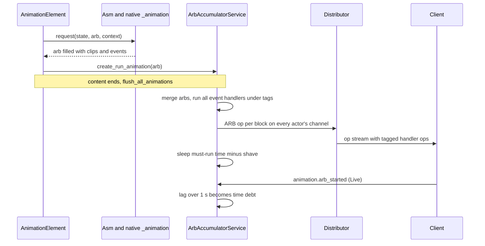
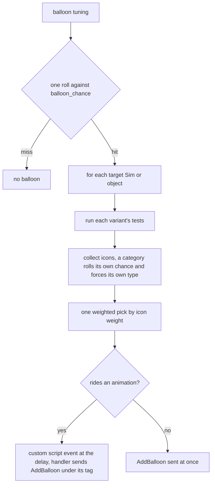

# 3.06 Animation, thought balloons and the hand-off to the client

*Game version 1.128.90.1030 (Steam, Linux/Proton). Live numbers are the merged tuning of the base game and the installed packs: EP04 (Cats & Dogs), EP06 (Get Famous), EP09 (Eco Lifestyle), EP12 (High School Years), GP04 (Vampires), GP12 (Werewolves), SP01 (Luxury Party) and SP42 (Grunge Revival). Written 2026-10-12. Checked 2026-10-12: 160 claims checked, 20 corrected, 1 relabelled, 0 removed. Deepened 2026-10-13: 0 modules newly explained (all 3 listed modules are empty), 0 failed decompiles (none belong to this chapter); added the SP70 dollhouse override example and reworded five logging statements. Checked again 2026-10-13: 182 claims checked, 23 corrected, 1 relabelled, 0 removed.*

## In plain words

The simulation never draws a frame. When a Sim sits, eats or hugs, the Python side decides which animation to play and when, and the game client (the separate rendering program) plays it. Animators author "state machines" (ASMs): small graphs of named states such as "entry", "loop" and "exit", with clips on the paths between them. The script asks the engine's native animation library to walk from one state to another. The library answers with a sealed package of instructions, the animation request block (ARB, or "arb"), which Python can read a few facts from (how long it lasts, which events it contains) but never edits. Python ships that package to the client in its stream of network operations and then simply waits the right amount of time.

The server does not wait for the client to say "done". It trusts its own clock: it sleeps for the part of the animation that must play, and it lets itself run up to one second ahead of the client by trimming at most five frames (1/6 s) off each batch, which lets the client blend one clip into the next without gaps. The client reports when it actually started each batch; if it fell more than a second behind, the server records the lag as "time debt" and pays it back at the next looping animation. Things that must happen at a precise moment in a clip (a cup appearing in a hand, a sound, a balloon) are worked out on the server when the batch is prepared, and the resulting operations are tagged so the client holds them until the clip reaches that moment.

Thought and speech balloons ride on the same machinery. An interaction's tuning lists possible pictures with tests and weights; the game picks one per Sim, pins it to a time inside the animation, and the client shows it for 3 seconds. Awareness and focus are two client-side systems that make Sims and pets glance at things. The server only feeds them numbers: how interesting each object is (focus scores none 0, low 1, medium 10, high 40) and, for pets only, how sensitive they are to noise and to people nearby.

## Key facts

- The install holds 1,600 live ASM resources and 30,015 live clips across the base game and the eight installed packs (a delta copy replaces the full one, and deletion markers remove their key). Live tuning has 3,480 ANIMATION instances (3,373 `AnimationElement`, 61 `ObjectAnimationElement`, 36 `AnimationElementSet`, 10 `ObjectPose`) naming 1,395 distinct ASMs.
- An arb is opaque to Python. It travels as `AnimationRequestBlock.arb_data` (bytes) inside an op of type `ARB` (34), next to a list of (event type, event id, tag) triples, the objects to reset, and two flags.
- Clip-event handlers run on the server when the batch is flushed, all at once, before the client has played anything; an arb distributed directly (route events, idles, overlays, carry) runs them when it is distributed. Each event gets one fresh distributor tag, shared by all its handlers; the ops they create wait on that tag on the client (client side Inferred).
- The server never waits for a client "animation done" message. `animation.arb_complete` has no command type, so it is DebugOnly and absent from retail; the client's Live `animation.arb_started` only feeds drift correction.
- Run-ahead budget: `MAXIMUM_TIME_DEBT` 1 s, at most 5 frames at 1/30 s and at most half the must-run time shaved per flushed batch. All three are code defaults; the live module tuning record for `animation.arb_accumulator` sets nothing.
- Arbs queue per zone in `ArbAccumulatorService` and are flushed when an interaction's basic elements end, merged into as few blocks as the native `_can_append` allows. Custom script events take ids from 901, reset at every flush.
- A Sim may hold at most one ASM still needing its exit; a second raises "Multiple ASMs in need of auto-exit simultaneously". The 51st ASM call for one Sim within one clock tick (50 repeats) raises a `RuntimeError`, a guard against endless zero-length loops.
- Balloons: one roll against `balloon_chance` covers every target, then each target (a Sim or an object) gets one weighted pick among icons whose tests pass. Live: 9,115 balloon tunings, 8,883 of them leaving the chance at its default of 100% (38 more tune 100% explicitly); 675 `BalloonCategory` instances, 662 at 100%.
- Balloon types map to wire (type, priority): thought (0, 2), speech (1, 1), distress (2, 0), sentiment (3, 3), infant sentiment (4, 4). `BALLOON_DURATION` is 3.0 s (code default, no module tuning record).
- A balloon's delay only works when it rides an animation, where it becomes a custom script event at that time. Ordinary route-failure balloons ride the route-fail animation, so their delay works; balloons from loot, from the route-failure fallback, from jog waypoints and from walking are sent at once, and none is sent for a hidden Sim.
- Passive walking balloons have a 240 Sim-minute lockout plus 0 to 60 random (base-game delta tuning; code 10 and 20). In this install both tuned `ROUTING_BALLOONS` entries test for a whim (445576) and a buff (427287) that no installed tuning defines, so both tests fail and no passive balloon can appear. Both ids belong to EP19 (Enchanted by Nature), according to patch data for that pack, which is not installed.
- Awareness is enabled only on the three EP04 (Cats & Dogs) pet Sim objects (`object_Cat`, `object_Dog`, `object_smallDog`). Five buffs tune it, and no tuning can add an awareness source; the only sources are code paths that give an object an audio-volume score of 1 while a sound or video plays on it, or while it is a non-Sim actor of a running animation.
- Focus: 2,663 live object tunings enable the focus component. Live `FOCUS_SCORE_VALUES`: NONE 0, LOW 1 (the code default, no value tuned), MEDIUM 10, HIGH 40. 13 objects score per species; on each, only the human entry carries a 1.25 multiplier for `trait_ArtLover`.
- The native boundary is narrow: Python sees `AsmBase` and `ArbBase` from `_animation` (set actors and parameters, request, traverse, enter and exit, read timing, events and bytes) plus a few rig joint lookups. Clip playback, blending and event timing are native or client side.

## How it works

### The pieces: ASM, actors, states and clips

**Observed**, `core/native/animation/__init__.py: NativeAsm`, `animation/asm.py: Asm`. An ASM resource (type `0x02D5DF13`) declares named actors, parameters, public states, and the props it can create. Python binds real objects to actor names (`set_actor(name, actor, rig_key, suffix)` calls the native `_set_actor(name, actor.id, suffix)`), sets parameters, and then asks the native side to reach a state. A parameter can be global (`set_parameter`) or for one actor (`set_actor_parameter`); tuples `(param, actor)` in override tables address one actor. Multi-part objects are bound as virtual actors (`add_virtual_actor`), and `specialize_virtual_actor_relationship` adds a namespace override so the same ASM can drive the right part.

The native request returns one of three result codes: success, target state not found, and "jumped to target state". They are imported from `_animation`; the values 0, 1 and 2 are the Python fallback used when that import fails, and the native values were not read. `Asm.request` turns "jumped" into a `RuntimeError` ("no valid path exists") and returns False for "not found" (its `logger.error` call is empty in retail, so nothing is written; see [0.02 Architecture](0.02-architecture.md)). Python keeps its actors as weak references with their suffix and participant type, and each actor can add its own overrides (`actor.get_anim_overrides(actor_name).override_asm(...)`). Actor types carry fixed hashes (`animation_constants.py: ActorType`: Sim 149264255, Object 200706046, Door 2935391323, ProceduralObject 1054400919, Creature 2661483290).

**Observed**, native strings in `Simulation_x64.dll`. The native error texts are "Could not reach state '%s' from '%s' in '%s'.", "State '%s' is Private'." and "invalid state traversal from '%s' to '%s' in ASM '%s'". The engine also knows a fixed set of animation tracks (idle; low, normal, high and ultra, each with a "plus" level; five carry tracks (left, left plus, right, right plus, back), carry interaction, carry override, locomotion overlay, wing idle and wing overlay); Python only touches them through track-mask overrides, for example `Trackmask_CarryInteraction` at value 50000 (`animation/__init__.py: AnimationContext._pre_request`), which `carry/carry_utils.py: interact_with_carried_object` sets on actor `x` while the Sim interacts with one carried object and holds a second, unholstered one (carry itself is in [3.05](3.05-interactions-postures-routing.md)).

### Where animation sits in an interaction

**Observed**, `interactions/base/basic.py`, `animation/animation_element.py: AnimationElement`. An interaction's `basic_content` names one ANIMATION tuning (`animation_ref`). The interaction's own run generator (`build_basic_elements(sequence=self._run_interaction_gen)`, behind any route to a location) is passed into the animation element as its inner sequence, so the element tree is "begin states, then the interaction's run, then end states". Statistic changes and the content's loop conditions wrap the animation from outside. When the content tunes `animation_ref_overrides`, the first override whose tests pass replaces `animation_ref` (`basic.py`). Postures, routing and the interaction lifecycle around it are in [3.05 Interactions, postures and routing](3.05-interactions-postures-routing.md).

An `AnimationElement` tunes `asm_key`, `actor_name` (default `x`), `target_name`, `carry_target_name`, `create_target_name`, `initial_state`, `begin_states`, `end_states`, `repeat`, `_overrides`, `base_object_name`, `custom_part_owner_actor_name` and `carry_back_compatibility`. At run time it asks the interaction for an ASM (`Interaction.get_asm`, which reuses a posture-registered ASM so consecutive animations share one state machine), applies alternative props and balloon requests, and calls `animate_states`. An `AnimationElementSet` picks the member whose ASM best supports the Sim's current posture and, when tuned, the carried object's animation parameters; without an interaction it takes the first member. Live, 94 elements set `repeat` true and 34 set it false explicitly.

**Observed**, `animation_element.py: animate_states`, read in bytecode. The function builds:

1. `do_begin`: apply overrides to the ASM; call the setup callback (the posture sets actors and parameters); register balloon events; create an `Arb` with the interaction's extra blockers; if the ASM sits in "exit", move it to "entry"; request each begin state; hand the arb to the accumulator with `create_run_animation`; prepend any auto-exit the actors still owe (it carries its own flush); register this ASM for auto-exit; if an inner sequence follows, flush now so the begin clips play before it.
2. The inner sequence. When `repeat` is set, a `RepeatElement` of `do_begin` runs alongside it (`do_all`) after the first `do_begin`, and is soft-stopped when the inner sequence ends; the loop does not replace the inner sequence.
3. `do_end`: request the end states into a new arb.

With `require_end` the three parts sit in a critical section, so `do_end` runs even when the interaction is cancelled. The whole thing is wrapped in `with_audio_awareness` and a final ASM cleanup. After `do_begin`'s sequence has run, a guard counts ASM calls made while the clock has not moved since the Sim's previous call. The counter is 0 on the first call in a tick and raises at 50 (`MAX_ZERO_LENGTH_ASM_CALLS_FOR_RESET`), so the 51st call in one tick raises a `RuntimeError` naming the ASM, interaction, posture and states. The constant's name says the intent is to force a reset out of an endless zero-length loop (Inferred).

### The animation context: request id, handlers and props

**Observed**, `animation/__init__.py: AnimationContext`. A super interaction gets an `AnimationContext` the first time one is asked for: `Interaction.get_animation_context_liability` (bytecode read) creates it and stores it as an `AnimationContextLiability`. A mixer returns its super interaction's liability (`mixer_interaction.py: MixerInteraction.get_animation_context_liability`), so mixers share the context of their super interaction; an animation with `animation_context` set gets a fresh one instead (tuning text: "Normally, animation contexts are shared across an entire Super Interaction"). A context's unique id is the request id passed to the native request, and the engine copies it into each event's data, so every context handler first checks `event_data["request_id"] == self.request_id` and ignores events from other requests in a merged block.

`reset_for_new_interaction` registers eight default handlers: Effect, StopEffect, ServerSoundStart, ServerSoundStop, Censor, MaterialState, GeometryState and FadeObject. They start a VFX (with tuned per-actor overrides, mirrored joints for mirrored clips), start or stop a server-side sound (a `vo` prefix marks voice), set a censor-grid state, set a material or geometry state, or fade an object. Their ops reach the client through the tag mechanism below; what VFX and audio do there is in [7.02 Audio, VFX and the camera](7.02-audio-vfx-camera.md).

`_pre_request` runs before each native request. It registers the context's handlers on the arb once per arb (the arb remembers which contexts it has seen, `arb._context_uids`), then creates the props that the traversal needs (`asm.get_props_in_traversal(current_state, target_state)`), reusing shared props by share key and applying tuned prop overrides and state values. A custom event gets its id when its handler is registered (`register_custom_event_handler` calls `ArbAccumulatorService.claim_xevt_id()`: 901 upwards, reset at each flush; when the counter reaches 999 it calls `logger.warn`, which writes nothing in retail, and keeps counting). `_post_request` then places each one with `arb.add_custom_event(actor_id, time, event_id)`; a positive time counts from the start of the arb, a negative one from the end. When no actor is named, the first arb actor that accepts the event takes it. If no actor accepts it, a stub alarm (`allow_stub_creation`) can stand in only for an event that names an actor; balloon events name none, so such a balloon is not shown with that arb and nothing is logged. The context is reference counted; when the last holder releases it, effects stop, censors clear, props are destroyed and reserved slots are released.

### The arb, its events and the tag mechanism

**Observed**, `core/native/animation/arb.py: NativeArb.handle_events`, `animation/arb_element.py: ArbElement`. `ClipEventType` lists 29 event kinds (Invalid 0 to FadeObject 24, plus four hashed ids such as `TimelineScript` and `ClientLocationCapture`). Python code references 16 of them: 15 have server handlers, and `TimelineScript` events are matched as Script (`event_types_match`), so they reach the Script handlers too. The other twelve (Sound, Unparent, FootPlant, CreateProp, DestroyProp, BlockTransition, Reaction, DoubleModifierSound, DspInterval, FocusCompatability, SuppressLipSync, EnableFacialOverlay), plus Invalid, have no server handler, so they are the client's alone (Inferred). Native reaction handling is switched off at server start (`areaserver.py: c_api_server_init` calls `enable_native_reaction_event_handling(False)`).

`handle_events` reads every event in the arb, sorts client-location captures first, and runs the matching handlers of each event inside one `BlockOnAnimationTag`, so all handlers of an event share its tag; handlers that matched are then removed from the arb. That context takes a new tag id from the distributor and adds it to the set of open tags; the distributor's journal stamps every op added while the tag is open with `block_on_tag(tag)`, which puts it on an unmanaged channel named by the tag and zeroes its other channel masks. The arb element then lists `(event_type, event_id, tag)` for every handled event and adds the same tag channels to its own ARB op (`_add_block_tags_for_event_records`). The client can therefore hold a handler's ops until playback reaches that event, then release them (the release is client side, Inferred from the message shape). The tag and channel model itself is in [0.02 Architecture](0.02-architecture.md).

`ArbElement` adds six handlers of its own: Snap (move an actor to a transform, optionally relative to a reference actor's subroot joint and snapped to terrain height), Parent (re-parent to a joint, mirrored if the clip is mirrored), Visibility, AdvanceFlipBook (an `UPDATE_FLIPBOOK` op), and the client-location capture and restore pair, which makes the server resend a location instead of setting one while the client owns it. Handlers count nesting depth: an arb handled inside another arb's handler reports that it should not sleep (moot in practice, since an `ArbElement` never sleeps on its own; see the timing section below), and detaching its actors waits until the outer handling ends.

### The accumulator: queueing, merging, flushing

**Observed**, `animation/arb_accumulator.py: ArbAccumulatorService.flush`, `animation_utils.py: flush_all_animations`. `create_run_animation(arb)` appends to the zone's queue. Nothing is sent until a flush, which happens at the end of every non-immediate interaction's basic elements (`Interaction.build_basic_elements` wraps the content, the outcome and the extras in a critical section closing with `flush_all_animations`) and inside `animate_states` when an inner sequence follows the begin states. An arb sent with `distribute_arb_element` (route events, idles, overlays, carry, the xevt element) skips the queue and runs its event handlers when it is distributed.

The flush walks the queue and merges consecutive arbs into one `ArbElement` while the native `_can_append(arb, safe_mode)` agrees. Merging runs each arb's events at once (`execute_and_merge_arb`), so all script events of the whole batch execute on the server during the flush. Their ops are deferred by the distributor's `dependent_block` and enter the journal ahead of the ARB op that carries the batch. A list in the queue (produced by `parallelize()`, used by `outcome.py` for the response animations of several Sims) is first combined with `force_sync` so its parts start together. Any arb added while a flush is running (an event handler that starts an animation) is distributed immediately as an "event-triggered ARB". Finally an `ArbSequenceElement` distributes every element and then sleeps once for the whole batch.



### Timing: sleeping, shaving and time debt

**Observed**, `arb_accumulator.py: ArbSequenceElement._run_gen`, `animation_sleep_element.py: AnimationSleepElement`. Each arb reports `get_timing()` as three numbers: total, must-run and repeat (the native docstring promises a pair, the Python code unpacks three). The sequence sums must-run across the batch and takes interrupt time (total minus must-run) and repeat from the last block only.

The shave is `min(MAXIMUM_TIME_DEBT - debt, duration / 2, 5 × 1/30 s)`, never below zero, where `debt` is the largest debt among the batch's Sims on the main timeline. Shaved time is added to each Sim's debt. When nothing could be shaved and the last block ends in looping content for every Sim, the server adds the whole debt to the sleep and resets it to zero: a loop is a safe place to let the client catch up.

The sleep element then waits: the must-run part as a fixed sleep on the game clock (1000 ticks per real second at normal speed); a repeat part as a loop of such sleeps until the interaction is soft-stopped; otherwise, when allowed, the interruptible tail as a soft sleep that any new work can cut short, whose elapsed time is subtracted from the debt. A batch with both an interruptible tail and a repeat part is refused with an `AssertionError` when the sleep element is built. Debt is also paid back by `with_skippable_animation_time`: basic content with `sleeping` set and a non-repeating animation, and a social mixer's listen animation, subtract their wall-clock duration (`time.monotonic`) from the Sim's debt.

While the zone is loading, `Zone.animate_instantly` is true (zone state not RUNNING). The posture primitive then flushes with `flush_all_animations_instantly`, whose sequence skips the sleep. Other flushes still sleep. A directly distributed arb never sleeps at all, loading or not: `ArbElement.distribute` runs the element with no timeline, and the element only builds a sleep when it has one. No caller runs an `ArbElement` on a timeline, so its own `animate_instantly` check is never reached.

**Observed**, `animation_drift_monitor.py`. The monitor keeps up to 4,096 records, one per sleep element, each holding its arbs by network id. When the client sends `animation.arb_started` for every arb in a record, the drift is the time from the server starting its sleep to the client starting the last arb, in seconds of game clock. Each Sim in the record gets its debt set (overwritten) to `max(0, drift - MAXIMUM_TIME_DEBT)`, so a client that lags by more than a second leaves the server less room to shave (none once the lag reaches 2 s), and the debt is paid back at the next loop. Because the value is overwritten, a report with less than a second of lag resets the debt to 0, including any debt built up by shaving. The end-of-sleep callback exists in the module but is not attached in the retail build.

### Two actors and more

**Observed**. Two-Sim animations are one ASM with two actors (`x` and `y` by convention), so one arb carries both. `ArbElement.attach` puts its ARB op on every actor's channel with one mask, built from the part suffixes of all the arb's actor instances (`1 << suffix` each, or all bits when none has a suffix) and applied to every attached actor, so each Sim's op stream contains the same block. At the end of a non-immediate interaction, `sync_element` (a local function inside `Interaction.build_basic_elements`) records a no-op `SetLocation` on the Sim with an extra channel for every other required Sim, which lines up the Sims' op streams at that point (`interaction.py`, bytecode read). `_ArbSyncGroup` (a Python wrapper over the native begin and end of a synchronized group) exists, but no Python code uses it.

### Auto-exit and the reference arb

**Observed**, `animation_utils.py: get_auto_exit, mark_auto_exit`, `animate_states`. Many ASMs leave a Sim in a looping state that needs an exit clip. `do_begin` registers the ASM as each Sim actor's pending auto-exit (a reference tagged `auto_exit`); the next animation for that Sim on a different ASM first requests "exit" on the old one. `get_auto_exit` wraps that exit arb in its own `create_run_animation` plus `flush_all_animations`, made must-run, so the exit is flushed on its own before the new animation's arbs are queued. Only one pending ASM per Sim is allowed.

**Observed**, `objects/client_object_mixin.py: reference_arb`, `arb_element.py: ArbElement._run_gen`. After each block, every actor's reference arb is updated with the native `update_post_condition_arb`. The reference arb travels as a `StartArb` op (`ARB_INITIAL_UPDATE`, 28) when an object is created on the client, so a newly visible object appears in the pose its last animation left it in. A reset sends an empty arb with `objects_to_reset`.

### Overrides, props, overlays and object animations

**Observed**, `animation_utils.py: AnimationOverrides`, `tunable_animation_overrides.py`. Overrides carry parameters, VFX and sound replacements, prop definitions and prop state values, posture manifest overrides, required slots, balloons, a reactionlet, `animation_context` (give this animation its own fresh context) and alternative props. When two override sets merge, the dict tables (parameters, VFX, sounds, props, prop state values, manifests) are combined with the incoming value winning per key; required slots, balloons, the reactionlet and `animation_context` take the incoming value when it is set; alternative props keep only the incoming value. Five live animations set `animation_context`, and so do 64 override blocks in 59 interactions (41 one-shot, 16 looping, 7 in outcomes). Overrides attached to objects lock manifests, slots, balloons and reactionlets off. `animation_overrides_liability.py` lets an interaction push dynamic overrides onto participants and their running ASMs.

**Observed**, `animation_element.py: AnimationElement.__init__`, `objects/script_object.py: ScriptObject._anim_overrides_internal`. Precedence follows the merge rule, each later layer winning. For an animation element, its tuned `_overrides` are lowest, the interaction's `anim_overrides` beat them, and overrides passed in by the caller beat both; a content set's `balloon_overrides` replace the balloons. For an object bound as an actor, the built-in parameters (`isParented`, `heightAboveFloor`, walkstyle, part `subroot` and the like) are lowest, then the object's `_anim_overrides`, its parent's `_anim_overrides_for_children`, its components' overrides, its children's component overrides (only when `apply_children_component_anim_overrides` is set) and last its dynamic overrides. Object overrides reach the ASM when the object is bound (`Asm.set_actor`), the element's overrides at the start of `do_begin`, before the setup callback (which may bind actors again). For one parameter or prop name the later write to the ASM decides, so the result depends on when each actor was bound.

**Observed** (patch data, pack not installed: the decoded patch tuning of SP70, whose only record this is; live merge). SP70 (SpongeBob Kid's Room) ships `object_dollhouseGENModern_01_SP70` 489184. Compared field by field with the live `object_dollhouseGENModern_01` 14870 (base delta), it differs only in three prop definitions of its `_anim_overrides`: `toyDoll` from object definition 29027 (`toyDollGENModern_01`) to 510533 (`toyDoll_SP70GENbarnacleBoy_set1`), `toyDoll1` from 29027 to 510735 (`toyDoll_SP70GENmanRay_set1`), and `toyHandSmall1` from 22325 (`toyHandSmallGENHelicopter_01`) to 510736 (`toyDoll_SP70GENmermaidMan_set1`); `toyHandSmall` stays 22321 (`toyHandSmallGENCar_01`). The `style` parameter `modern`, the 29 super affordances and every other field match. The names come from the object definition records in SP70's patch-data `SimulationPreload.package` and the base client delta. So the pack reuses the dollhouse's interactions and animations and changes only the toys they spawn; the object's own model and look live in client data, which was not compared. **Inferred.** The play animations look the same apart from the toys.

**Observed**, `animation_overlay.py`, `animation_overlay_component.py`. Overlay animations run through a tuning-less `AnimationInteraction` (a script-sourced, high priority super interaction). The overlay component starts its tuned overlays when it is added and refreshes all of them on every mood change by distributing an arb directly; an overlay clears its interaction's animation cache when the Sim's body posture changes. `animation_xevt_element.py` plays a weighted choice of animations as an immediate arb and applies loot. `object_animation.py` drives object idle ASMs (`ObjectPose` with `asm` and `state_name`, and `ObjectAnimationElement`). `animation_controls.py` and `procedural_animation_helpers.py` send procedural controls (wheels, a skate, a lip-sync jaw on `b__Jaw__`, and a look-at rotation). The look-at rotation (`PROCEDURAL_CONTROL_ROTATE`) is used in play by the tuned `ProceduralAnimationRotationElement` (`interactions/utils/interaction_elements.py`) and the object-routing action `ObjectRoutingBehaviorActionProceduralAnimationRotation`, as well as by a DebugOnly command.

### Boundary conditions and the caches

**Observed**, `asm.py: Asm.get_boundary_conditions_list`, `animation_bc_cache.py`, `animation_ac_cache.py`. Routing needs to know where an animation starts and ends relative to its target. The native `traverse` into a throwaway arb with `from_boundary_conditions=True` returns `BoundaryCondition` records (pre and post transforms, reference joints, required slots). Python keys them by ASM, actor, target, from and to state and posture, filters them by locked parameters and actor age, and caches them. To save start-up time, both caches ship prebuilt per pack as pickles: the boundary-condition cache (`bc_pickle_cache_<PACK>`, version `version#0002`, 18 live resources) and the interaction animation-constraint cache (`ac_pickle_cache_<PACK>` plus `_bg_delta` merges, version `version#0004`, 34 live resources). A version mismatch empties the cache, so start-up is slower (the `logger.warn` that says so is empty in retail; only a failed unpickle reaches `logger.exception`). Constraint use is in [3.05](3.05-interactions-postures-routing.md).

### Balloons: tuning shape and selection

**Observed**, `balloon/tunable_balloon.py: TunableBalloon.build_balloon_requests` (bytecode read), `balloon_category.py`, `balloon_variant.py`, `balloon_icon.py`. A balloon tuning has `balloon_target` (participants), `balloon_choices` (a list of variants), `balloon_delay` (seconds, negative counts from the end), `balloon_delay_random_offset` (adds 0 to that many seconds), `balloon_chance` (default 100%) and `balloon_view_offset`. A variant has tests and an item that is either a `balloon_icon` (weight at least 1, type default thought, icon, overlay, optional category icon) or a reference to a `BalloonCategory` (BALLOON instance tuning).



The chance roll happens once for the whole tuning. Targets are participants, so objects can carry balloons too; a target Sim with no instance on the lot is skipped. For each target, all passing icons are flattened into a list of (weight, icon) and one is drawn with `sims4.random.weighted_random_item`. A category rolls `random.random() <= balloon_chance` each time it is asked, and every icon inside it takes the category's type (the member factories lock `balloon_type`). Categories may nest; the innermost category's type wins. Across one `balloons` list, a Sim gets at most one balloon: `get_balloon_requests` shares one set of used targets over the list, so a later entry that picks an icon for the same Sim is skipped (silently in retail: the `logger.error` there has an empty body). An icon with neither a picture nor an object is skipped too, but only after the target has been marked used, so it still blocks later entries for that Sim.

Live, the 675 categories split into 347 thought (339 by default), 297 speech and 31 distress; 662 show every time and 13 use a chance between 30% and 75%. They hold 3,746 entries (median 4, at most 58), 14 of them nested categories. Of 9,115 balloon tunings, 8,873 sit on interactions, 197 on objects, 28 in animations and 17 in snippets.

### Balloons: timing and delivery

**Observed**, `animation_element.py: register_balloon_requests`, `balloon_request.py`, `balloon_ops.py: AddBalloon`. Inside an animation, each request becomes a custom script event at `delay` seconds plus a random part of the offset; its handler distributes the balloon, so the `AddBalloon` op is created during the flush under that event's tag and the client shows it when the clip reaches the event (client side Inferred). In repeat mode only the first request is registered per loop and the requests are re-rolled for the next loop; the tuning text warns that looping animations show the balloon immediately.

`BalloonRequest.distribute` sends nothing for a hidden Sim. The `AddBalloon` op (`ADD_BALLOON`, 53) carries the Sim, icon or icon object, overlay, type, priority, duration (`BALLOON_DURATION` 3.0 s), view offset, category icon, relationship track (sentiment balloons from `relationships/sentiment_track_tracker.py`) and icon info. The message has no delay field, so a balloon sent at once cannot be delayed. A loot balloon (`ShowBalloonOp`) and the route-failure fallback ignore any tuned delay; jog's `waypoint_route_fail_balloon` and the passive `ROUTING_BALLOONS` lock `balloon_delay` and its random offset to 0, so there no delay can be tuned at all. An ordinary route failure plays `route_fail_animation` with the failure's overrides and flushes it, so its balloons ride that animation and their delay works (`interactions/utils/route_fail.py: route_failure`); only when no posture supports that animation are the balloons sent at once. The object-route `route_fail_balloon` is a `BalloonVariant`, which has no delay field at all. The client resolves overlaps with the priority number; lower appears to mean more urgent, since distress uses 0 (Inferred from the enum names).

Live delays: 8,053 balloon tunings leave the delay unset, 384 use 2 s, 234 use 0.5 s, 109 use 1 s, 104 use 3 s and 16 count back 1 s from the end. 264 add a 1 s random offset.

### Passive and routing balloons

**Observed**, `passive_balloons.py: PassiveBalloons.request_passive_balloon`, called from the route progress callback in `postures/posture_graph.py` when Sim time passes `sim.next_passive_balloon_unlock_time`. If more than `BALLOON_LONG_LOCKOUT` (420 Sim minutes) have passed since the unlock time, the Sim gets a fresh random 0 to 60 minute lockout and no balloon, so a walker that just spawned does not balloon at once. Otherwise up to `MAX_NUM_BALLOONS` (25) entries are sampled, each builds a request with a delay locked to 0, one is drawn by entry weight and sent at once, and the next unlock is 240 plus 0 to 60 Sim minutes away.

**Observed**, live tuning (`balloon.passive_balloons`, base delta). `ROUTING_BALLOONS` has two entries of weight 1: one tests for whim 445576, the other is a buff test whose whitelist holds buff 427287. Neither id exists in any installed tuning (full or delta, base or pack). Both references are pack-safe, so they load as empty sets: `WhimTest` returns false for an empty set ("Either no whims were added to the test or they were all from packs that are not present"), and a `BuffTest` with an enabled but empty whitelist can never be satisfied (`apply_whitelist_on_individual_basis` defaults to true, and `any()` over an empty set is false). The tests are not skipped either: `safe_to_skip` only applies under `run_tests(skip_safe_tests=True)`, and `BalloonVariant` runs them with the default false. In this install no passive walking balloon can appear.

Both ids belong to EP19 (Enchanted by Nature): whim 445576 is `want_BuyObject_FairyHome` and buff 427287 is `buff_BalanceSys_Hidden_MinorImbalance` (patch data, pack not installed; the decoded patch tuning of EP19). With EP19 installed, a Sim who has that want or carries that hidden buff could get these walking balloons (Inferred; not run).

`request_routing_to_object_balloon` (called from `postures/transition.py`) shows an interaction's `route_start_balloon`, skipping user-directed interactions unless `also_show_user_directed` is set, and picks one request with `random.choice`.

### Awareness

**Observed**, `awareness/awareness_component.py`, `awareness_ops.py`, `awareness_tuning.py`, `awareness_elements.py`. Awareness is "the client-driven awareness system" (tuning text of the Sim class's `_awareness_component`). There are two channels in code, PROXIMITY 0 and AUDIO_VOLUME 1, plus room for ten dynamic gameplay channels from 1000; the protobuf names them `AWARENESS_CHANNEL_GAMEPLAY_0` to `_9`. The live dynamic-enum record is empty, so no gameplay channel exists.

A Sim with the component sends `ConfigureAwarenessActor` (`AWARENESS_CONFIGURE_AWARENESS`, 600). For each channel the first modifier in its list wins; a channel whose list empties is resent with no gate, gain or threshold value, which leaves them to the client (Inferred: its own defaults); an `UNSET` modifier removes the channel. Per channel the server can set gate (default 0), gain (default 1) and trigger threshold (default 0.5), and from `AWARENESS_CHANNEL_DATA` the evaluation mode (peak, average, sum) and limit (256). The live mapping is empty, so mode and limit are never sent. Proximity radii combine across buffs: the largest inner radius and the smallest outer radius win. The tunable's defaults (inner 1.1 m, outer 1.25 m) apply only when a buff enables the option; with no such buff, no radius is sent. `hold_time` and `cool_down_time` exist in the message with a 1.5 s default, and Python never sets them.

Objects become sources through `ConfigureAwarenessSourceObject` (`AWARENESS_CONFIGURE_NOTICEABLE`, 601), a per-channel score sum. In live tuning every source comes from code: a sound playing on a target (`audio/primitive.py`), a playing video (`objects/components/video.py`), and `with_audio_awareness`, which marks every non-Sim actor of an ASM (and a posture's target) with audio volume 1 while the animation runs. The state-change hook `StateChange.AWARENESS` exists, but no tuning can add a source: `AwarenessSourceRequest`'s channel key lists both static channels (PROXIMITY, AUDIO_VOLUME) as `invalid_enums`, so only gameplay channels could be tuned, and none exists. Live, the 221 awareness entries in object states all say `no_awareness` or `leave_unchanged`, and no `awareness_sources` entry is tuned.

**Observed**, live tuning. The component is enabled on `object_Cat`, `object_Dog` and `object_smallDog` (EP04 delta). Four species buffs set inner 1.5 m and outer 3 m (`buff_Trait_Species_Cat`, `buff_Trait_Species_Dog`, `buff_Trait_SpeciesExtended_LargeDog`, `buff_Trait_SpeciesExtended_SmallDog`); `buff_Trait_Pet_Skittish` doubles the gain on both channels and sets inner 2 m and outer 5 m, so a skittish pet that also carries its species buff ends with inner 2 m and outer 3 m. How the client turns scores into head turns is not visible from Python.

### Focus

**Observed**, `focus/focus_component.py`, `focus_score.py`, `focus_ops.py`, `focus_tuning.py`; `interactions/utils/sim_focus.py`. An object's focus component sends `SetFocusScore` (`SET_FOCUS_SCORE`, 403): either one global entry or one per species, each a base value from `FOCUS_SCORE_VALUES` plus trait multipliers. Sims choose what to look at "based on the weighted randomization of all objects" (tuning text), so with live values a HIGH object (40) is 40 times as likely to be picked as a LOW one (1), all else equal (Inferred: the client does the weighting). Live entries: LOW 1,517, NONE 656, MEDIUM 302, HIGH 214; 13 objects score per species (cat LOW, dog LOW, human MEDIUM), and only the human entry carries `trait_ArtLover` (27918) at 1.25. 17 objects move the focus bone to `_IKtarget_0_LookAt` and 4 to `b__R_Eye__`; the rest use the default `_focus_`.

Interactions add temporary focus through `FocusEvent` ops (`FOCUS` 10 or `FOCUS_NON_BLOCKING` 11): add, delete, clear, modify score, disable, force update and print, on layers (ambient 0, super interaction 3, interaction 5, always-pick-first `0xFFFFFFFF`) with optional distance and facing curves. A tuned focus element adds two records per participant pair, Sim to object and object to Sim. The tuning side is in [3.05](3.05-interactions-postures-routing.md). The distributor also defines a `SetFocusCompatibility` actor-data op (`distributor/ops.py`, rescued per function); no decompiled module sends it.

### The native boundary

**Observed** (Python side), `core/native/animation/__init__.py`, `core/native/animation/arb.py`; **Inferred** (native side), from the docstrings in `Simulation_x64.dll`. The module `_animation` ("Native services for sims4 animation runtime") gives Python two base classes and a few functions, and the Python wrappers add little logic.

- `AsmBase`: actors (`_set_actor`, `_clear_actor`, `_set_reaction_actor`, virtual actors, namespace overrides, track-mask overrides), parameters (`_set_parameter`, `_set_actor_parameter`, `_set_single_actor_parameter_if_possible`, `_get_params`, `_get_param_sequences`), movement (`_request`, `_traverse` "between two states", `_set_current_state`, `_enter`, `_exit` "tunneling request to the exit state", `_schedule_exit_content`), and queries (supported and provided postures, props in a traversal, actor definitions, public states).
- `ArbBase`: `_bytes`, `_events`, `_add_custom_event`, `_get_timing`, `get_estimated_duration`, `_actors`, `_actor_instances`, `_is_interruptible`, `_should_analyze` ("analyzed ahead of time on the client", usually for an authored path; in the binary both docstrings are mislabelled `_bytes()`), `_ends_in_looping_content`, `_can_append`, `_append`, synchronized groups, `_get_boundary_conditions`, `schedule` (its docstring: a "CSL-formatted controller string"), `preload`, `is_valid`, `empty`.
- Functions: joint transform and joint name lookups on a rig, mirrored joint hashes, `update_post_condition_arb`, `enable_native_reaction_event_handling`.

What happens inside (clip lookup, graph search, the arb's binary layout, blending) is native and client code that this book does not decompile.

## Numbers

| Name | Value | Unit | Where | Source |
|---|---|---|---|---|
| `MAXIMUM_TIME_DEBT` | 1 | s | `ArbAccumulatorService` | code (live M record empty) |
| `MAXIMUM_SHAVE_FRAMES_PER_ANIMATION` | 5 | frames of 1/30 s | `ArbAccumulatorService` | code (live M record empty) |
| `MAXIMUM_SHAVE_ANIMATION_RATIO` | 2 | divisor of must-run | `ArbAccumulatorService` | code (live M record empty) |
| largest shave per flushed batch | 0.167 | s | `get_shave_time_given_duration_and_debt` | code |
| custom event ids | 901 up; `logger.warn` call at 999 (writes nothing in retail) | id | `CUSTOM_EVENT`, `MAX_XEVT` | code |
| `MAX_ZERO_LENGTH_ASM_CALLS_FOR_RESET` | 50 | repeat calls per Sim in one tick (the 51st call raises) | `animation_constants.py` | code |
| drift records kept | 4,096 | records | `animation_drift_monitor.py` | code |
| ASM request result codes | 0 success, 1 not found, 2 jumped | code | `core/native/animation` | code (Python fallback values; native values not read) |
| `ClipEventType` | 29 kinds, 16 used by Python (15 with handlers, TimelineScript matched as Script) | enum | `core/native/animation/arb.py` | code |
| ASM resources (live) | 1,600 (base 1,063) | resources | type `0x02D5DF13` | package index, delta wins, deletion markers removed |
| clips (live) | 30,015 (base 21,646) | resources | type `0x6B20C4F3` | package index, delta wins, deletion markers removed |
| rigs (live) | 2,904 | resources | type `0x8EAF13DE` | package index, delta wins, deletion markers removed |
| BC / AC cache resources (live) | 18 / 34 | resources | `0x1C99B344` / `0xE2249422` | package index, delta wins, deletion markers removed |
| ANIMATION instances | 3,480 (base 2,119) | instances | live | live merge |
| distinct ASMs named by ANIMATION | 1,395 | ASMs | live | live merge |
| `animation_context` set true | 5 ANIMATION records; 64 override blocks in 59 interactions | tunings | live | live merge |
| `BALLOON_DURATION` | 3.0 | s | `TunableBalloon` | code (no M record) |
| `BALLOON_LOCKOUT` | 240 (code 10) | Sim minutes | `PassiveBalloons` | delta |
| `BALLOON_RANDOM` | 60 (code 20) | Sim minutes | `PassiveBalloons` | delta |
| `BALLOON_LONG_LOCKOUT` | 420 (code 120) | Sim minutes | `PassiveBalloons` | delta |
| `MAX_NUM_BALLOONS` | 25 | entries | `PassiveBalloons` | code |
| `ROUTING_BALLOONS` | 2 entries, weight 1, both testing EP19 ids (whim 445576, buff 427287), unreachable here | entries | `PassiveBalloons` | delta; ids from patch data, pack not installed |
| balloon type to (type, priority) | thought (0, 2), speech (1, 1), distress (2, 0), sentiment (3, 3), infant (4, 4) | enum | `BALLOON_TYPE_LOOKUP`, `AddBalloon` | code + protobuf |
| `BalloonCategory` instances | 675 (base 442, EP04 177, GP04 23, EP12 14, EP06 8, EP09 8, GP12 3) | instances | live | live merge |
| balloon tunings | 9,115 | tunings | live | live merge |
| `X_ACTOR_EVENT`, `Y_ACTOR_EVENT` | 710, 711 (no reader) | event id | `TunableBalloon` | code |
| `FOCUS_SCORE_VALUES` | NONE 0, LOW 1, MEDIUM 10, HIGH 40 | weight | `FocusTuning` | delta (LOW: code default) |
| objects with focus component | 2,663 | objects | live | live merge |
| awareness gate, gain, threshold | 0, 1, 0.5 | score | `AwarenessModifiers` | code |
| proximity inner, outer radius | 1.1, 1.25 (only when a buff enables the option) | m | `AwarenessModifiers` | code |
| channel limit, mode | 256, PEAK | score | `AwarenessChannelData` | code (live mapping empty) |
| `hold_time`, `cool_down_time` | 1.5 | s | `ChannelOptions` | protobuf default |
| pet species radii | 1.5 inner, 3 outer | m | four EP04 species buffs | delta |
| skittish pet | gain 2, inner 2, outer 5 | ratio, m | `buff_Trait_Pet_Skittish` | delta |
| `SIT_POSTURE_TYPE` | 15535 | posture id | `PostureConstants` | delta |
| `ChoreographyState` | CENTER, LEFT, RIGHT, FINAL, BIGMOMENT | dynamic enum | `animation_constants` | delta |
| op types | ARB 34, ARB_INITIAL_UPDATE 28, ADD_BALLOON 53, FOCUS 10, FOCUS_NON_BLOCKING 11, SET_ACTOR_DATA 15 (subtypes hash32 of `actortype`, `creaturetype`, `statemachine`, `posture`, `focus_compatibility`), SET_ACTOR_STATE_MACHINE_PARAMS 229, PROCEDURAL_CONTROL_ROTATE 279, UPDATE_FLIPBOOK 350, SET_FOCUS_SCORE 403, AWARENESS 600 and 601 | op id | `DistributorOps.Operation` | protobuf |

## Data shapes

Field numbers are from the protobuf descriptors in `Simulation_x64.dll`.

```
AnimationRequestBlock: 1 arb_data bytes (required), 2 event_handlers [AnimationEventHandler],
                       3 objects_to_reset [ManagerObjectId], 4 is_interruptible bool,
                       5 should_analyze bool
AnimationEventHandler: 1 event_type uint32, 2 event_id uint32, 3 tag uint64 (all required)
AddBalloon:            1 sim_id, 3 icon ResourceKey, 4 icon_sim_id, 5 overlay ResourceKey,
                       6 type BalloonType, 7 priority BalloonPriority, 8 duration float,
                       9 icon_object ManagerObjectId, 10 category_icon IconInfo,
                       11 view_offset_override Vector3, 12 rel_track, 13 icon_info IconInfo
```

```
FocusEvent:              1 type (ADD 0, DELETE 1, CLEAR 2, MODIFY_SCORE 3, DISABLE 4,
                         FORCE_UPDATE 5, PRINT 6), 2 id, 3 layer, 4 flags, 5 score float,
                         6 joint_name_hash, 7 target_id, 8 offset Vector3,
                         9 distance_curve [CurveData], 10 facing_curve [CurveData], 11 source_id
SetFocusScore:           1 global_score FocusScoreEntry, 2 specific_scores [species, score]
FocusScoreEntry:         1 base double, 2 multipliers [trait_id, multiplier]
ConfigureAwarenessActor: 3 channels_to_remove, 4 channels_to_configure [ChannelOptions],
                         5 proximity_inner_radius, 6 proximity_outer_radius
ChannelOptions:          1 name, 2 eval_mode, 3 gate, 4 gain, 5 limit, 6 trigger_threshold_delta,
                         7 type_name, 8 hold_time (1.5), 9 cool_down_time (1.5)
```

```
ConfigureAwarenessSourceObject: 3 gameplay_channel_values [name, value], 4 audio_volume_multiplier,
                                5 audio_full_volume_radius, 6 audio_falloff_radius
Event handler record (Python):  clip_name, event_type, event_id, callbacks, event_data, tag, errors
BoundaryCondition (Python):     pre/post condition transforms, reference object ids, joint hashes,
                                required slots (filled from native traverse data)
AnimationContext:               request_id, props, placeholders, vfx and sound overrides,
                                custom handlers, event handlers, ASMs, alarms, ref count
```

The channel eval modes in the message also include `SUM_SPLITSIGN` 3 and `AVERAGE_SPLITSIGN` 4, which the Python enum (`AwarenessChannelEvaluationType`, PEAK 0, AVERAGE 1, SUM 2) cannot select.

## For modders

**Tuning to change.**

- *An animation*: ANIMATION instance tuning (`AnimationElement`): `asm_key`, actor names, `begin_states`, `end_states`, `repeat`, `_overrides`. The states must be public states of the ASM; a missing one makes the request return False with nothing written in retail, `animate_states` ignores that result and plays on without the state, and a "jumped" result raises.
- *Animation details without a new ASM*: `TunableAnimationOverrides` on the interaction's basic content: `params` (tuple keys address one actor), `vfx`, `sounds`, `props`, `prop_state_values`, `balloons`, `animation_context`.
- *Different props in the same animation*: an object's `_anim_overrides.props` maps a prop name of the ASM to an object definition; a new object record with its own map changes what the Sim plays with and needs no new clip (the SP70 dollhouse, patch data, does exactly this).
- *Balloons on an interaction*: the `balloons` list in the overrides; `balloon_target`, `balloon_choices`, `balloon_delay`, `balloon_chance`. Shared sets belong in a `BalloonCategory` (BALLOON instance tuning) with its own `balloon_type` and `balloon_chance`.
- *Balloons from a loot*: `ShowBalloonOp` (loot op `show_balloon` with a `balloon` tuple).
- *Walking balloons*: module tuning `balloon.passive_balloons`, `PassiveBalloons.ROUTING_BALLOONS`. Keep `BALLOON_LONG_LOCKOUT` above lockout plus random. The two shipped entries need EP19 tuning, so without that pack a mod must add entries whose tests can pass.
- *Pet sensitivity*: a buff's `awareness_modifiers` (`awareness_options` per channel, `proximity_modifiers`).
- *What Sims look at*: an object's `_components` > `focus` (`_focus_bone`, `_focus_score` global or species-specific with trait multipliers); the weights in module tuning `animation.focus.focus_tuning`.
- *Run-ahead*: `animation.arb_accumulator` module tuning. Setting `MAXIMUM_TIME_DEBT` to 0 turns shaving off; the tuning text warns that it ruins blending.

**Commands.** Types are read from the `@Command` decorators. Live commands are always available; Automation commands only in automation mode; DebugOnly commands, including every untyped one (the decorator's default), are never registered in the retail game, so a player cannot run them; the debug tooling around them is in [1.04 Debug tools, cheats and telemetry](1.04-debug-cheats-telemetry.md).

| Command | Type | What it does |
|---|---|---|
| `animation.arb_started` | Live | client reports an arb started; feeds the drift monitor |
| `animation.route_complete`, `animation.route_time_update`, `animation.route_event_executed`, `animation.route_event_skipped` | Live | client route reports, see [3.05](3.05-interactions-postures-routing.md) |
| `animation.profile_boundary_condition_creation`, `animation.boundary_conditions.postures.build`, `animation.boundary_conditions.clear_cache`, `animation.toggle_asm_name_into_callstack` | Automation | boundary-condition profiling and cache tools (automation mode only) |
| `animation.control_rotation_lookat` | DebugOnly (not registered) | sends a procedural look-at rotation |
| `animation.arb_complete` | untyped (DebugOnly, not registered) | client duration report for the drift archive |
| `animation.asm_describe`, `animation.set_parent`, `animation.arb_log.enable`, `animation.arb_log.disable`, `animation.boundary_condition.add_log`, `animation.boundary_condition.clear_log`, `animation.list_parameter_sequences`, `animation.list_asm_params`, `animation.set_shave_time`, `animation.toggle_asm_parameter_logging` | untyped (DebugOnly, not registered) | inspection and logging |
| `balloons.trigger_passive_balloon` | untyped (DebugOnly, not registered) | forces a passive balloon attempt |

**Traps.**

- Script events of a queued arb run at flush time on the server, before the client plays the clip (a directly distributed arb runs them when it is sent). Game state changed in a handler (a stat, a parent, a created object) is already true while the Sim is still in the earlier part of the animation; only the handler's ops wait for the clip.
- A balloon delay outside an animation does nothing; the message has no delay field. Ordinary route-failure balloons are inside the route-fail animation, so their delay does work.
- A balloon whose script event no arb actor accepts is not shown with that arb, and nothing is logged. The "Failed to schedule all requested balloons" error cannot fire, because the handler registration that it checks always succeeds.
- Icons inside a `BalloonCategory` cannot have their own type. To mix speech and thought, use two categories.
- `balloon_chance` on the balloon tuning is one roll for all targets; a category's chance is rolled again for every target.
- In one `balloons` list, the first entry that picks an icon for a Sim wins; later entries for that Sim are dropped without a trace in retail (the `logger.error` that says "has multiple balloons tuned for source" has an empty body). Use one entry with several choices instead.
- Starting a new animation on another ASM while one still waits for its exit raises "Multiple ASMs in need of auto-exit simultaneously". `disable_asm_auto_exit` exists for sequences that manage exits themselves. The old ASM's exit is flushed as its own batch, so it plays and sleeps before anything queued for the new animation.
- Custom script events claim ids 901, 902 and so on until the next flush. The 98th claim (it returns 998) brings the counter to 999 and calls `logger.warn`, which writes nothing in retail; the ids keep counting.
- `animation.set_shave_time` (untyped, so DebugOnly and not registered in retail) writes `ArbAccumulatorService.SHAVE_TIME`, which nothing reads.
- `TunableBalloon.X_ACTOR_EVENT` and `Y_ACTOR_EVENT` (710, 711) are defined and never used.
- Decompiled text of `AwarenessComponent.remove_proximity_modifier` nests the outer-radius removal under the inner-radius check; the bytecode shows two independent checks, so a buff that only sets an outer radius is removed correctly.
- Decompiled `interactions/jog_interaction.py` calls `random.random.choice`. That is correct code: `from sims4 import random` replaces the standard import, and `sims4.random` exposes the standard module as `random`.

## Limits

- The arb's byte layout, the ASM graph search, clip blending and how the client releases tagged ops are native or client code; statements about them are Inferred from Python, docstrings and message shapes.
- The awareness and focus decisions (which stimulus triggers a reaction, which object a Sim looks at) run in the client and are not visible here.
- Resource counts read package indexes only (a delta copy replaces the full one, deletion markers remove their key). Clips that exist only in packs not installed are not counted, and the counts do not say which ASMs are reachable.
- The passive balloon finding is specific to this pack set; the whim and buff it needs ship in EP19, which is not installed, so that case was not run.
- `sims/sim.py` did not decompile as a whole; the Sim class's `_awareness_component` is read from the per-function rescue (which adds the component when the tunable is set) and from live tuning.
- The native values of the ASM request result codes were not read; the chapter's 0, 1 and 2 are the Python fallback.
- Timing statements assume normal game speed; how speed 2 and 3 scale clip playback on the client was not traced.

## File index

| Module | What it holds | Depth |
|---|---|---|
| `core/native/animation/__init__.py` | `NativeAsm` over native `AsmBase`: actors, parameters, request, traverse, enter and exit, boundary conditions; rig joint helpers; native result codes | deep |
| `core/native/animation/arb.py` | `NativeArb` over `ArbBase`, `ClipEventType`, `BlockOnAnimationTag`, event dispatch, custom events, sync groups, censor states | deep |
| `simulation/animation/__init__.py` | `AnimationContext`: request id, default VFX, sound, censor, state and fade handlers, props, custom events, ref counting | deep |
| `simulation/animation/animation_ac_cache.py` | per-pack interaction animation-constraint cache loader (`ac_pickle_cache`, version 0004) | skim |
| `simulation/animation/animation_bc_cache.py` | per-pack boundary-condition cache loader (`bc_pickle_cache`, version 0002) | skim |
| `simulation/animation/animation_constants.py` | auto-exit tag, zero-length limit 50, ASM parameter names, actor and creature types, ASM type flags, procedural control types | deep |
| `simulation/animation/animation_controls.py` | procedural controls: wheel, sphere wheel, skate, lip-sync jaw | skim |
| `simulation/animation/animation_drift_monitor.py` | drift records, client start times, time debt from lag | deep |
| `simulation/animation/animation_element.py` | `AnimationElement`, `AnimationElementSet`, `animate_states`, balloon registration | deep |
| `simulation/animation/animation_interaction.py` | tuning-less `AnimationInteraction` used by overlays | skim |
| `simulation/animation/animation_overlay.py` | overlay animations played through `AnimationInteraction`; clears the interaction's animation cache on a body posture change | skim |
| `simulation/animation/animation_overlay_component.py` | overlay component: holds the tuned overlays, starts them on add, refreshes all of them on every mood change | skim |
| `simulation/animation/animation_overrides_liability.py` | dynamic overrides pushed onto participants and their ASMs | skim |
| `simulation/animation/animation_overrides_tuning.py` | parameter mapping, posture manifest override, required slot override tunables | skim |
| `simulation/animation/animation_sleep_element.py` | must-run, repeat and soft sleeps for an arb batch | deep |
| `simulation/animation/animation_utils.py` | `AnimationOverrides`, `create_run_animation`, flush helpers, auto-exit, event-handler wrappers | deep |
| `simulation/animation/animation_xevt_element.py` | weighted immediate animations with loot | skim |
| `simulation/animation/arb.py` | `Arb` with extra blockers; retail no-op request logging | deep |
| `simulation/animation/arb_accumulator.py` | `ArbAccumulatorService`, merge and flush, `ArbSequenceElement`, shave and time debt, parallelize | deep |
| `simulation/animation/arb_element.py` | `ArbElement`: channels, default handlers, tags, `write` of `AnimationRequestBlock`, `distribute_arb_element` | deep |
| `simulation/animation/asm.py` | `Asm`: actor binding, request wrapper, boundary conditions and their cache, locked params, posture support | deep |
| `simulation/animation/awareness/__init__.py` | empty package marker | listed (empty: `pass` only) |
| `simulation/animation/awareness/awareness_component.py` | `AwarenessComponent`: modifier lists and resend | deep |
| `simulation/animation/awareness/awareness_elements.py` | `with_audio_awareness` around animations | deep |
| `simulation/animation/awareness/awareness_enums.py` | `AwarenessChannel` (dynamic, offset 1000) and evaluation types | deep |
| `simulation/animation/awareness/awareness_ops.py` | `SetAwarenessOp`, `SetAwarenessSourceOp` | deep |
| `simulation/animation/awareness/awareness_tuning.py` | channel data, modifiers, source requests, `AWARENESS_CHANNEL_DATA` | deep |
| `simulation/animation/focus/__init__.py` | empty package marker | listed (empty: `pass` only) |
| `simulation/animation/focus/focus_component.py` | `FocusComponent`: focus bone and score field | deep |
| `simulation/animation/focus/focus_ops.py` | `SetFocusScore` op | deep |
| `simulation/animation/focus/focus_score.py` | global and per-species focus scores with trait multipliers | deep |
| `simulation/animation/focus/focus_tuning.py` | `FocusScore` enum and `FOCUS_SCORE_VALUES` | deep |
| `simulation/animation/locked_params.py` | locked-parameter categories for logging | skim |
| `simulation/animation/object_animation.py` | `ObjectPose`, `ObjectAnimationElement` for object idles | skim |
| `simulation/animation/posture_manifest.py` | posture manifest entries, match wildcards, carry hands | skim |
| `simulation/animation/posture_manifest_constants.py` | stand, sit and swim manifests and constraints; `SIT_POSTURE_TYPE` | skim |
| `simulation/animation/procedural_animation_helpers.py` | `ProceduralAnimationRotationMixin` and the look-at rotation op, used by an interaction element and an object-routing action | skim |
| `simulation/animation/tunable_animation_overrides.py` | `TunableAnimationOverrides` and the object variant | deep |
| `simulation/balloon/__init__.py` | empty package marker | listed (empty: `pass` only) |
| `simulation/balloon/balloon_category.py` | `BalloonCategory` (BALLOON instance tuning): type, chance, members | deep |
| `simulation/balloon/balloon_commands.py` | `balloons.trigger_passive_balloon` | deep |
| `simulation/balloon/balloon_enums.py` | `BalloonTypeEnum` and the wire type and priority lookup | deep |
| `simulation/balloon/balloon_icon.py` | `BalloonIcon`: weight, type, icon, overlay, category icon | deep |
| `simulation/balloon/balloon_loot_ops.py` | `ShowBalloonOp` loot | deep |
| `simulation/balloon/balloon_ops.py` | `AddBalloon` op | deep |
| `simulation/balloon/balloon_request.py` | `BalloonRequest` element and its hidden-Sim check | deep |
| `simulation/balloon/balloon_utils.py` | helpers that build one request, optionally with a custom duration | skim |
| `simulation/balloon/balloon_variant.py` | `BalloonVariant`: tests plus icon or category | deep |
| `simulation/balloon/passive_balloons.py` | passive walking balloons and route-start balloons | deep |
| `simulation/balloon/tunable_balloon.py` | `TunableBalloon`, request building, `BALLOON_DURATION` | deep |

Other modules read for this chapter (owned elsewhere): `simulation/server_commands/animation_commands.py`, `simulation/distributor/system.py`, `simulation/distributor/distributor_service.py`, `simulation/objects/client_object_mixin.py`, `simulation/interactions/base/basic.py`, `simulation/interactions/base/interaction.py` (rescued per function), `simulation/interactions/utils/sim_focus.py`, `simulation/interactions/utils/outcome.py`, `simulation/audio/primitive.py`, `simulation/objects/components/video.py`, `simulation/areaserver.py`, `simulation/whims/whim_tests.py`, `simulation/sims/sim_info_tests.py`, `simulation/postures/posture_graph.py` (rescued per function), `simulation/postures/transition.py`, `simulation/postures/posture_primitive.py`, `simulation/interactions/utils/route_fail.py`, `simulation/interactions/jog_interaction.py`, `simulation/interactions/social/social_mixer_interaction.py`, `simulation/interactions/utils/interaction_elements.py`, `simulation/routing/object_routing/object_routing_behavior_actions.py`, `simulation/zone.py`, `simulation/event_testing/tests.py`, `core/sims4/commands.py`, `core/sims4/random.py`, the Sim class rescued per function, and the distributor ops rescued per function.

Tuning used (the live merge; module tuning from the base delta, since packs ship none): modules `animation.arb_accumulator`, `animation.animation_constants`, `animation.awareness.awareness_tuning`, `animation.awareness.awareness_enums`, `animation.focus.focus_tuning`, `animation.posture_manifest_constants`, `balloon.passive_balloons`; instances of types ANIMATION and BALLOON; buffs `buff_Trait_Species_Cat`, `buff_Trait_Species_Dog`, `buff_Trait_SpeciesExtended_LargeDog`, `buff_Trait_SpeciesExtended_SmallDog`, `buff_Trait_Pet_Skittish`; objects `object_Cat`, `object_Dog`, `object_smallDog`; trait `trait_ArtLover`; every live record holding `balloon_choices` or a `focus` component. EP19 ids from the decoded patch tuning of EP19 (patch data, pack not installed). Patch data, pack not installed: SP70 `object_dollhouseGENModern_01_SP70` (the only record in SP70's decoded patch tuning), compared field by field with the live `object_dollhouseGENModern_01`; object definition names from the OBJD records in `Delta/SP70/SimulationPreload.package` and the base client delta.
