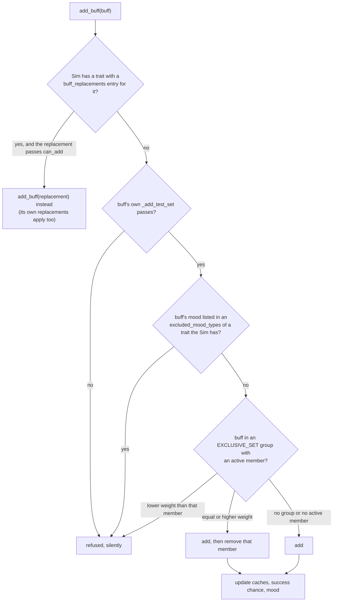
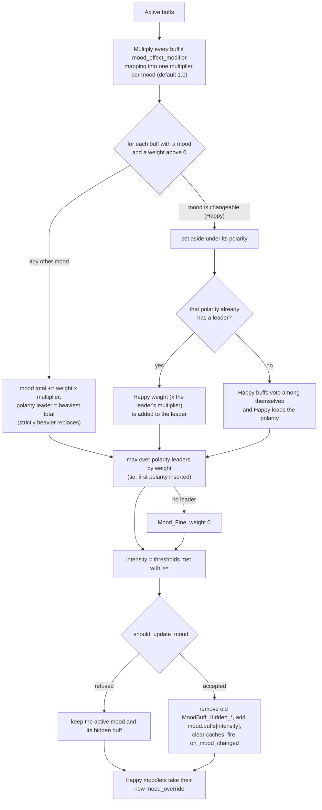
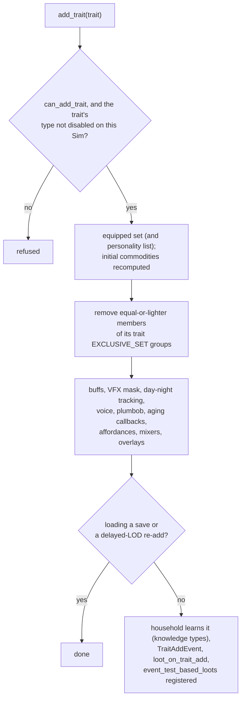
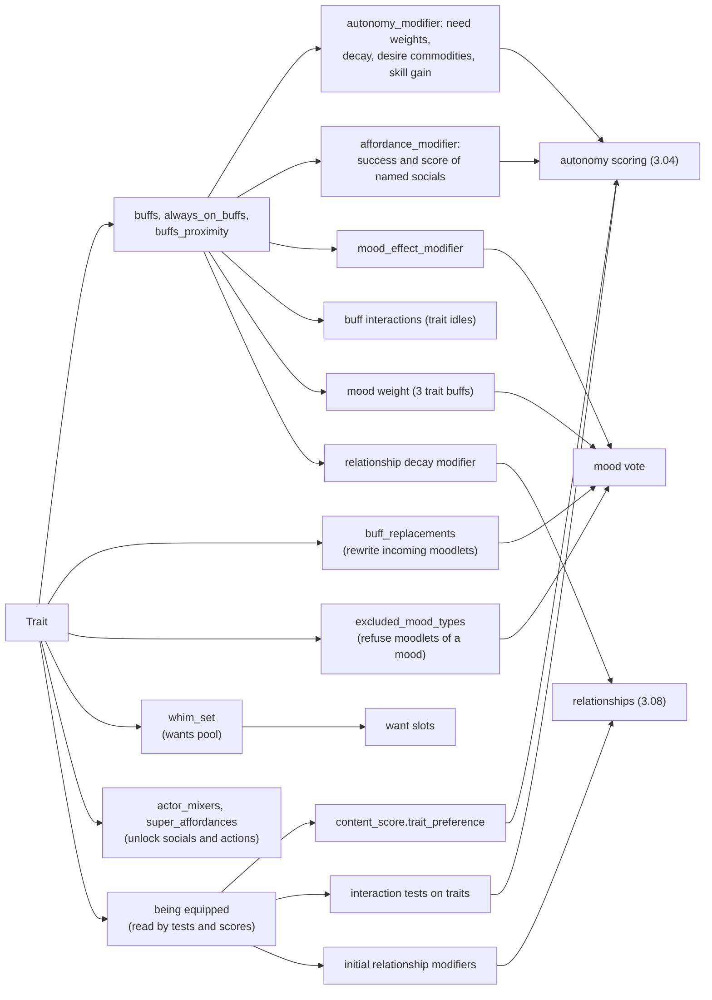
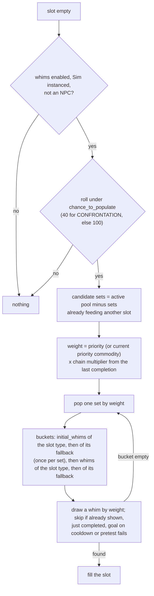

# 3.07 Personality and feelings: traits, emotions, wants, aspirations

*Game version 1.128.90.1030 (Steam, Linux/Proton). Numbers come from the base-game delta tuning unless a line says full tuning, live or code default, with EP04 (Cats & Dogs), EP06 (Get Famous), EP09 (Eco Lifestyle), EP12 (High School Years), GP04 (Vampires), GP12 (Werewolves), SP01 (Luxury Party) and SP42 (Grunge Revival) installed; a live count adds each installed pack's delta build to the base game's. Written 2026-10-12. Checked 2026-10-12: 110 claims checked, 22 corrected, 5 relabelled, 2 removed. Deepened 2026-10-13: 7 modules newly explained, 4 failed decompiles read. Checked again 2026-10-13: 305 claims checked, 47 corrected, 0 relabelled, 0 removed. Cross-chapter edits 2026-10-13: 3 applied.*

## In plain words

A Sim's personality and feelings run on one container, the moodlet (the game calls it a buff). A trait does very
little by itself. It hands the Sim a few moodlets, most of them hidden, and those do the work: they make a need count
more or less when the Sim chooses what to do, give the Sim private urges (a Lazy Sim's urge to lie down), unlock
socials and idle animations, change how fast skills grow, and rewrite or block other moodlets before they land. Likes
and dislikes are traits too: doing a liked activity adds a small happy moodlet for exactly as long as the activity runs.

The emotion a Sim shows is a vote. Every moodlet that has an emotion adds its weight to that emotion, and the heaviest
emotion wins. Positive and negative emotions compete; they never cancel, so a Sim with 5 points of happy moodlets and 4
of tense ones is simply Happy. Happy is special: happy moodlets join whichever positive emotion is already leading, so
a Confident Sim who gets happy moodlets just becomes more Confident. The winning weight sets the strength (Happy, then
Very Happy), and the strength is what changes skill gain and unlocks the emotion socials. A strong emotion is sticky in
one narrow case: a very sad Sim stays very sad when an angry moodlet makes Angry slightly heavier at the same strength,
yet a rival that is only mild takes over at once.

Wants are four slots that refill by weighted draws from want lists offered by the Sim's traits, aspiration,
relationships, career, skills, the season, the venue and nearby objects. The current emotion never chooses the wants,
and a Sim never acts on its own wants: they are for the player. Finishing one pays satisfaction points and a short mood
boost, and points buy reward traits and potions. A Sim who goes about three days without finishing a want may pick up
the fear of being unfulfilled, and only a Sim with that fear then wakes up to the stressed, sad and angry "unfulfilled"
moodlets. One reward, the satisfaction points boost, triples the points the wants panel shows but pays nine times the
base, because the game applies it twice.

An aspiration is a ladder of milestones plus a bonus trait, and its want list feeds the want slots from day one.
Lifestyles exist in the code, but the traits that make them up belong to a pack that is not installed here.

## Key facts

- **Mood is a vote.** Each mood's weight is the sum of its moodlets' weights times any `mood_effect_modifier`; the
  heaviest mood of each polarity leads it; the heaviest leader wins; no moodlet with a mood gives `Mood_Fine` at weight 0.
- **Happy is the only changeable mood.** Happy moodlets add their weight to the leading positive mood when there is one,
  and lead only when no other positive mood has a moodlet.
- **A tie between two polarity leaders goes to the polarity whose first non-Happy moodlet was added earliest**; a
  side made only of Happy moodlets counts after every other side. The code's "keep the active mood" clause only
  applies at weight 0.
- **Intensity is a count of thresholds met with `>=`.** Happy has one threshold (8), Angry two (3, 7), Playful two (8, 15),
  Sad one (3). Embarrassed is 4, 8 in the delta tuning and 3, 6 in the full tuning; the delta wins.
- **Stickiness is narrow.** `UPDATE_INTENSITY_BUFFER` is the code default 1 and is tuned nowhere. A different mood is
  refused only when its step equals the active mood's step and that step is at least 1; a rival at step 0, a lower step
  or a higher step takes over.
- **Weights are small.** Of 2,654 buffs with a mood, 1,629 weigh 1 and 741 weigh 2 (live, with the installed packs: 3,777, 2,179 and 1,079); emotion potions weigh 100 and
  sleeping 10,000.
- **A moodlet lives on a hidden countdown** that starts at `max_duration` and loses 1 per Sim minute; 2,834 buffs have
  one, and 240 minutes is the commonest length (644 buffs; live 4,501 and 970).
- **Four gates, in this order, decide whether a buff lands:** a trait replacement, the buff's own add tests, a trait
  that excludes its mood, and its exclusive group (420 groups).
- **Traits act through their buffs.** 583 `Trait` instances (57 PERSONALITY; live 1,071, 101 of them personality traits); of the 241 buffs owned by traits, 158
  carry an `autonomy_modifier`, and the trait class itself has no autonomy field.
- **The personality cap is CAS slots plus discoverable slots.** `TraitTracker.can_add_trait` refuses a personality
  trait only when the free count reaches 0, and the cap is `personality_trait_count` plus
  `discoverable_personality_trait_count`: 3 + 3 = 6 for Young Adults, Adults and Elders, 2 for Teens, 1 for Children.
- **13 routes lead from a trait to behaviour.** The widest are `content_score.trait_preference` (857 interactions),
  trait tests in an interaction's own tests (894 interactions), `buff_replacements` (80 traits) and `whim_set` (65); live 1,282, 1,669, 93 and 80.
- **Wants:** 4 slots, 638 whims, 169 whim sets (116 with a fixed priority, 53 switched on by objectives); live 680 whims and 198 sets. The
  confrontation slot fills 40 percent of the time. A finished want's set is weighted x1.5 on the next draw.
- **Satisfaction:** 325 of the 542 short-term wants pay 25 points (live 354 of 572). The store has 124 entries, 72 with an explicit price
  from 100 to 10,000 (median 1,000). The score multiplier is applied twice.
- **Fulfillment** runs 0 to 100 and falls 0.023 per minute (about 3 days). At 0 a 10 percent base roll may add
  `trait_Fear_Unfulfilled`; the Stressed, Sad, Angry chain starts on waking only for Sims with that fear.
- **Autonomy never reads wants.** No module under `autonomy/` mentions whims; the 9 whim commodities have no desire
  curve, and the only gameplay read is `WhimTest` (used by 6 tuning instances; live 9).

## How it works

### The chain from a trait to a feeling

- **Observed** (rescued `traits/traits.py: Trait`, `buffs/buff.py: Buff`, `statistics/mood.py: Mood`,
  `objects/components/buff_component.py: BuffComponent`). Per Sim: `TraitTracker` holds traits; each trait's `buffs`
  are added to the Sim's `BuffComponent`; each `Buff` carries an optional mood type and weight, game effects,
  interactions, mixers, a walk style and loot; the component turns the active buffs into one `Mood` (17 instances in
  the base game; 37 live, because EP04 adds 20 cat and dog moods) and an intensity; it then adds that mood's hidden `MoodBuff_Hidden_*` buff for the intensity, whose own game effects are
  what a mood changes. Almost every behavioural difference between two Sims is a buff difference.
- **Observed** (tuning). The 41 hidden mood buffs (`MoodBuff_Hidden_*`, `moodBuffs_Hidden_*`; 61 live with EP04's pet ones) carry no mood of their
  own, so the result of the vote never votes again.

### What a buff carries

- **Observed** (`buffs/buff.py: Buff` tunables). Beyond `mood_type` and `mood_weight`: `game_effect_modifier` (a list,
  plus a tested list that needs a test set to pass), `interactions` (a list with a `weight` and a `scored_commodity`),
  `actor_mixers` and `provided_mixers` (keyed by a mixer provider such as `sim_Chat`), `super_affordances`,
  `target_super_affordances`, `walkstyle` and `walkstyle_behavior_override`, `_loot_on_addition`, `_loot_on_instance`,
  `_loot_on_removal`, `_add_buff_on_remove`, `static_commodity_to_add`, `success_modifier`, `refresh_on_add`,
  `reloot_on_add`, `_temporary_commodity_info`, `_add_test_set`, `visible`, `appearance_modifier` and appropriateness tags.
- **Observed** (`game_effect_modifier/game_effect_modifiers.py: TunableGameEffectVariant`). There are 16 kinds of game
  effect. Buffs that use each (delta tuning, `Buff` and `ClothingBuff`, plain and tested lists): `autonomy_modifier` 871,
  `continuous_statistic_modifier` 254, `effective_skill_modifier` 89, `affordance_modifier` 57,
  `statistic_static_modifier` 51, `affordance_filters` 16, `pie_menu_modifier` 8, `mood_effect_modifier` 5,
  `object_sell_price_modifier` 2, `relationship_track_decay_modifier` 2, `relationship_track_decay_locker` 1,
  `satisfaction_point_multiplier` 1; `satisfaction_point_gain`, `adventure_moments_success_modifier`,
  `forbid_by_object_tags_pie_menu_modifier` and `sim_override_put_down_strategy_modifier` appear on no buff. 1,066 buffs
  carry at least one game effect. The `autonomy_modifier` fields (score and decay multipliers, `commodities_to_add`,
  `skill_tag_modifiers`, `stat_use_multiplier`, `relationship_multipliers`, `decay_modifier_by_category`, locked stats)
  are explained in [3.04 Autonomy](3.04-autonomy.md); `commodities_to_add` appears on 159 buffs.
- **Observed** (`BuffComponent._update_chance_modifier`). `success_modifier` is in percentage points. The Sim's total is
  the sum of the positive ones minus (1 minus the product of (1 + each negative one)). Only 22 buffs set it:
  `Buff_Career_SchoolDay_<Mood>` gives +10 for Confident, Energized, Flirty, Focused, Happy, Inspired and Playful and -10
  for Angry, Bored, Embarrassed, Sad and Stressed; `Buff_Object_ChessTableWin` +10 and its `_HighLogic` version +15;
  `Buff_BodySpray`, `Buff_Breathspray` and two dirty-object buffs +1; `Buff_Trait_Clumsy` -1; two voodoo backfire buffs
  -10 and -5; `buff_Debug_InteractionFail` -100.

### How long a buff lives

- **Observed** (`Buff._create_temporary_commodity`). A buff with `_temporary_commodity_info` is backed by a generated,
  hidden commodity: `decay_rate` 1, convergence 0, `remove_on_convergence` on, minimum 0, maximum and starting value
  `max_duration`, time passed off-lot fixed up from elapsed time (`FIXUP_USING_TIME_ELAPSED`), saved only when `persists`
  is set. Its two states are value 0.1 (holds the buff) and 0 (drops it). So a buff lasts `max_duration` Sim minutes.
- **Observed** (delta tuning). 2,834 buffs have a countdown. Lengths: 240 minutes (644 buffs), 480 (570), 120 (334),
  180 (230), 1,440 (129), 60 (116), 2,880 (85), 360 (79), 780 (67), 30 (60), 5 (48); 55 buffs leave `max_duration` at its
  code default of 100.
- **Observed** (`BuffComponent.add_buff_from_op`). Adding a buff the Sim already has refreshes the countdown to its
  maximum (or its minimum when the commodity converges to its maximum). `refresh_on_add` defaults to on; 62 buffs turn it
  off, and those are not refreshed. `reloot_on_add` reruns the buff's loot on a repeat add.
- **Observed** (`_temporary_commodity_info.categories`, `buff_ops.py: BuffRemovalOp`, `autonomy_modifier.py`). The
  countdown's categories (`Happy_Buffs`, `Stressed_Buffs` and so on) let a loot remove a whole family of moodlets, and let
  `decay_modifier_by_category` on another buff make a family of moodlets run out faster or slower.

### Adding a buff: four gates, in order

- **Observed** (`BuffComponent.add_buff`, `_get_replacement_buff_type_and_reason`). The trait replacement comes first.
  The candidates are the buff's `trait_replacement_buffs`, sorted by `buff_replacement_priority` (highest first; the tuned
  values are `NORMAL` and `HIGH_GENDER`); the first one whose trait the Sim has and whose replacement buff passes
  `can_add` wins, and the replacement is added by a fresh `add_buff` call, so a replacement can itself be replaced.
- **Observed** (`BuffComponent._can_add_buff_type`, control flow checked against the bytecode). Then the buff's own
  `can_add`, then the mood exclusion (`mood.excluding_traits` against the Sim's traits), then the exclusive group. The
  group check returns at the first active buff of the same group: a lower `exclusive_weight` is refused, an equal or
  higher one is added and that buff removed. A buff with no mood skips the exclusion check only.
- **Observed** (module tuning `objects.components.buff_component`, `EXCLUSIVE_SET`). 420 groups of `{buff_type, weight}`;
  at load each buff gets its group number and weight. Examples: the seven `Buff_CoreSocial_*` conversation buffs, all
  weight 1 (the newest replaces the old); bartending-drink and cooking groups ranked by weight; the 55 make-up looks of
  `buff_Object_Vanity_MakeUpApplied_*`, all at the default weight, so the newest look replaces the old; the Loner pair
  `Buff_Trait_Loner_IsAlone` (1) and `_NearStrangers` (2).
- **Observed** (`BuffComponent.add_buff_from_op`). The loot path (`BuffOp`) runs `_can_add_buff_type` on the original
  buff before anything else, so an original that fails its own tests, an excluded mood or its group is dropped even when
  a trait would have replaced it with something allowed.

### The mood vote

- **Observed** (`BuffComponent._get_largest_mood`, branch structure checked against the bytecode). Polarity is
  `BuffPolarity` NEUTRAL 0, NEGATIVE 1, POSITIVE 2 (`buffs/__init__.py`). Eight moods are NEGATIVE, seven POSITIVE, and
  Fine and Asleep leave the field at its default, NEUTRAL, so a Fine-mood buff with weight (23 buffs have mood Fine) or
  a sleep buff (weight 10,000) forms a third leader that competes like the others.
- **Observed.** Within a polarity, the weights of different moods never add: Playful 4 and Inspired 4 are two totals of
  4. Happy is the exception, because a Happy buff is `is_changeable` and joins the leader: Confident 4 plus Happy 3
  makes Confident 7, and the Happy moodlets are re-labelled to that mood (`mood_override`, sent to the client).
- **Observed** (bytecode of the last block). The winner is `max()` over the polarity leaders keyed on weight, and on a tie
  `max()` keeps the first leader in the dictionary, which is the polarity whose first non-Happy moodlet came first in the
  Sim's buff list; a polarity led only by Happy moodlets is entered in the second loop, after every other polarity, so
  it loses every tie. The following line accepts the winner if its weight is above 0, or equal to 0 and it is the active
  mood, so the active mood only matters for weight-0 leaders. The seed note had this as "a tie keeps the current mood";
  it does not, though the stickiness rule below often has the same effect.
- **Observed** (`BuffComponent._get_intensity_from_mood`). Intensity starts at 0 and gains 1 for each threshold, in
  order, while `weight >= threshold`. A mood with no thresholds has intensity 0 always.
- **Observed** (`statistics/mood.py: Mood.is_changeable`; tuning). `Mood_Happy` is the only mood with `is_changeable`.

### Intensity and stickiness

- **Observed** (`BuffComponent._should_update_mood`, generator filter and nesting checked against the bytecode):
  1. If the winner is the active mood, update only when its intensity changed.
  2. Otherwise recompute the active mood's intensity from the plain summed `mood_weight` of the buffs whose mood is the
     active mood (no `mood_effect_modifier`, no adopted Happy weight).
  3. If there are re-labelled Happy buffs and the active mood is not Happy, recompute the vote without them; if that
     result would itself replace the active mood, it becomes the comparison base.
  4. The rival wins when any of these hold: the base mood is changeable and the rival has the same polarity; the rival's
     intensity is 0; it is lower than the base intensity; it is at least the base intensity plus
     `UPDATE_INTENSITY_BUFFER`; either mood is `Mood_Fine`. Otherwise the active mood stays.
- **Inferred** (from rule 4 with the buffer at 1). Steps are whole numbers, so the only refused case is a rival at the
  same step as the active mood with that step at least 1. Example: a Sim is Sad at weight 3 (step 1, the Depressed
  hidden buff). Angry moodlets reach weight 4: Angry wins the vote at step 1 (threshold 3), the step equals Sad's, and
  the Sim stays Sad. A Happy weight of 5 instead (step 0) takes over at once. The code's own tuning description says the
  same: a weaker predominant mood becomes active.
- **Observed** (`BuffComponent._update_current_mood`, checked against the bytecode). On an accepted change the old
  hidden mood buff is removed and `mood.buffs[intensity]` is added, caches are cleared and `on_mood_changed` fires. A
  refused change leaves even the active mood's own intensity unchanged until the next accepted update. The Happy buffs
  get their `mood_override` after every vote, accepted or refused (the loop sits after the accept block, at the target
  of the refusal jump), so a Happy moodlet can show as Confident while the Sim's active mood stays, say, Sad.
- **Observed** (`BuffComponent.on_zone_load`). Travelling resets the recorded active mood to `Mood_Fine` at intensity 0
  and forgets the hidden mood buff handle.

### The 17 moods

**Observed** (tuning, `Mood` instances; delta unless noted):

| Mood | Polarity | Thresholds | Hidden buff by intensity (`MoodBuff_Hidden_*`) |
|---|---|---|---|
| Angry | NEGATIVE | 3, 7 | Angry, Furious, Enraged |
| Bored | NEGATIVE | none | Bored |
| Dazed | NEGATIVE | none | Sloshed |
| Embarrassed | NEGATIVE | 4, 8 (full tuning 3, 6) | Embarrassed, Humiliated, Mortified |
| Sad | NEGATIVE | 3 | Sad, Depressed |
| Scared | NEGATIVE | 4 | `moodBuffs_Hidden_ScaredTrack_Scared`, `_Terrified` |
| Stressed | NEGATIVE | 4 | Tense, Stressed |
| Uncomfortable | NEGATIVE | 4 | Uncomfortable, Miserable |
| Confident | POSITIVE | 8 | Confident, Fearless |
| Energized | POSITIVE | 8 | Energized, Pumped |
| Flirty | POSITIVE | 8 | Flirty, Passionate |
| Focused | POSITIVE | 8 | Focused, InTheZone |
| Happy (changeable) | POSITIVE | 8 | Happy, Elated |
| Inspired | POSITIVE | 8 | Inspired, Imaginative |
| Playful | POSITIVE | 8, 15 | Playful, Silly, Hysterical |
| Fine | NEUTRAL (default) | none | one empty entry, no buff |
| Asleep | NEUTRAL (default) | none | Asleep |

- **Observed** (buff census, delta). 4,691 buffs (4,676 `Buff`, 15 `ClothingBuff`); 2,654 have a mood: Happy 556, Sad 303,
  Stressed 257, Confident 235, Angry 212, Embarrassed 180, Uncomfortable 168, Playful 160, Inspired 153, Focused 116,
  Energized 111, Flirty 71, Bored 48, Scared 31, Dazed 24, Fine 23, Asleep 6. Weights: 0 (17 buffs), 1 (1,629), 2 (741),
  3 (178), 4 (28), 5 (20), 6 (2), 8 (9), 10 (2), 40 (8), 50 (3), 99 (2), 100 (9), 10,000 (6). The large values are
  overrides: the six `*ByPotion` buffs (and three cheat buffs) weigh 100; all six `Mood_Asleep` buffs weigh 10,000
  (`buff_Sim_IsSleeping`, `Buff_Motives_Energy_Tranquilized`, `buff_LoungeChair_DozeOff` and three infant sleep buffs);
  the three starving buffs, the bursting bladder, labour, two death warnings and a lightning strike weigh 40; freezing 99.
- **Observed** (live merge). EP04 (Cats & Dogs) adds 20 more `Mood` instances, `mood_<Mood>_Cat` and `mood_<Mood>_Dog`
  (Happy, Angry, Anxious, Scared, Flirty, Asleep, Fine for both; Drowsy for cats; Ashamed, Excited, Mopey, Sad for dogs;
  one shared `mood_Hyper_Pets`), each with no thresholds and one hidden buff. They run through the same vote; this
  chapter's tables cover the 17 Sim moods.
- **Inferred.** With ordinary moodlets of weight 1 to 3, Elated (Happy weight 8) takes three to eight happy moodlets,
  and Furious (Angry weight 3) takes one to three angry ones.
- **Observed** (`Mood` tunables). Besides the thresholds: `buffs`, `buff_polarity`, `is_changeable`,
  `environment_scoring_commodity`, `asm_param_name`, `whim_set` and `excluding_traits` (filled at load). No `Mood` sets
  `whim_set`, and no Python reads `Mood.whim_set`.

### What a mood changes

The mood does nothing by itself; its hidden buff does.

- **Observed** (`MoodBuff_Hidden_Happy`, `_Elated`). `effective_skill_modifier` on `Skill_All` +1 (Happy) or +2 (Elated);
  `skill_tag_modifiers` `Skill_All` x1.2 or x1.4; Charisma gain x1.1 (INCREASE); five toddler skills x0.875; the
  emotion social `mixer_social_HeartfeltCompliment_targeted_friendly_emotionSpecific` on `sim_Chat`; the private commodity
  `commodity_Emotion_Autonomy_Happy`.
- **Observed** (`MoodBuff_Hidden_Angry`, `_Enraged`). Creative, Mental and Charisma effective skill -1 (Angry) or -3
  (Enraged), Mischief +1 or +3; Creative and Mental gain x0.8 or x0.4, Charisma gain x0.8 or x0.4, Mischief gain x1.2 in
  both; the angry emotion socials (`ChewOut`, `InsultFace`, `Provoke` and `RantAndRave` mixers) on `sim_Chat`, and
  `CalmDown` for other Sims to use on the angry one.
- **Observed** (`MoodBuff_Hidden_Focused`, `_InTheZone`). Mental effective skill +2 or +3, Mental gain x1.4 or x1.6,
  Video Gaming gain x1.25 or x1.5, Charisma gain x1.1.
- **Observed** (`commodity_Emotion_Autonomy_Angry` and siblings, `Emotion_Idle`). Each mood buff adds a private
  commodity (range -100 to 100, start and convergence -100, decay 1.111 per minute, weight 0.15, desire curve `ad_data`
  (-100, 8), (0, 0), (100, 0)) and offers `Emotion_Idle`, a mixer in group IDLES with `sub_action` base weight 2, not
  user-directable, locked out 90 to 120 minutes after use, refused while a `buff_Suppress_Emotion_Idle*` buff or the
  toddler or infant trait buff is present. **Inferred:** the commodity rests at its floor, where the desire curve is
  highest, so the emotion idle is always attractive and its lock-out sets how often a Sim visibly acts out its mood.
- **Observed** (`content_score.mood_preference`, `interactions/utils/content_score_mixin.py`). 889 of the 8,242
  interactions carry a mood-to-score map that is added to a social's content score when the actor is in that mood.
  `mixer_social_InsultFace_targeted_mean_emotionSpecific`: Angry +5, Sad +3, Stressed +3, Confident +2, Dazed +2,
  Uncomfortable +2, Happy -5, Inspired -5, Focused -5, Flirty -5, Energized -3, Playful -3, Bored -2. How content score
  becomes a choice is in [3.04 Autonomy](3.04-autonomy.md).
- **Observed** (`scores_socialoutcomes_friendly_compliments`, 153 entries plus 2 batch tests). Moods also decide whether
  a social lands. Actor terms: Happy +5, Confident +3, Inspired +3, Energized +2, Flirty +2, Focused +2, Playful +2,
  Bored -2, Angry -3, Embarrassed -3, Sad -3, Uncomfortable -3, Dazed -5, Stressed -5, Scared -5; listener terms:
  Happy +5, Angry -9. The rest of that score and the outcome tiers are in
  [3.08 Relationships, socials and memories](3.08-relationships-socials.md).

### Scaling a mood: `mood_effect_modifier`

- **Observed** (`game_effect_modifier/mood_effect_modifier.py: MoodEffectModifier`; 5 buffs). A map from mood to a
  multiplier on that mood's summed weight (a mood listed without a value gets 0.5; an unlisted mood 1.0).
  `Buff_Trait_Teen` multiplies 14 moods (all but Scared, Fine and Asleep) by 1.5; `buff_Trait_Infant` multiplies the same
  14 by 0.5; `buff_Trait_Brave` multiplies Confident by 1.5 and Scared by the blank default 0.5;
  `buff_Object_CraftSalesTable_AutonomyMod_Tend` multiplies Stressed and Uncomfortable by 0.1;
  `buff_Sim_Scared_ScreamIncoherently_EmotionalSupport` halves Scared. Live, GP04 (Vampires) adds three more:
  `buff_PersonaPowers_EmotionalDampening_Level1` to `_Level3` multiply the same 14 moods by 0.75, 0.5 and 0.25.
- **Inferred.** The multiplier is applied inside the sum, so a teenager reaches Furious (Angry 3) on two weight-1 angry
  moodlets (1.5 + 1.5), where an adult needs three. Rule 2 of the stickiness check uses raw weights, so the same teenager
  is judged at step 0 when an equal rival arrives.

### Cheat emotions

- **Observed** (tuning `DebugEmotionIntensity_*`, `CheatingIntensityBuff_*`). 30 immediate interactions (31 live: EP04 adds `DebugEmotionIntensity_Pets_Hyper`) marked
  `debug=True`, in pie-menu categories `pieMenuCategory_CheatEmotion_<Mood>`; the 30 base ones each run a
  `Loot_Buff_DebugIntensity_*` loot, the EP04 one `loot_Buff_DebugEmotionIntensity_Pets_Cat_Hyper`.
  The 31 `CheatingIntensityBuff_*` buffs (40 live: EP04 adds nine dog buffs of weight 1) last 100,000 minutes (about 69 days) with weights picked to land on one step:
  Happy 2, Elated 8; Angry 2, Furious 4, Enraged 100; Embarrassed 2, Humiliated 4, Mortified 100; Playful 2, Silly 8,
  Hysterical 100; Sad 2, Depressed 4; Tense 2, Stressed 5; Scared 1, Terrified 6.
  **Inferred:** these are the testingcheats emotion options on a Sim's debug menu.

### Traits: types, slots, conflicts

- **Observed** (`traits/trait_type.py: TraitType`). 36 values, PERSONALITY 0 to CHILD_REWARD 36 with no 3 (LIFESTYLE 21,
  LIKE 22, DISLIKE 23, FEAR 29, GAMEPLAY_OBJECT_PREFERENCE 31 among them).
- **Observed** (base-game delta tuning only; the installed packs add more, for example EP09 (Eco Lifestyle)'s `trait_Ghost_Beetle`, which makes GHOST 38 in the live merge). The base-game trait manager holds 583 `Trait`, 92 `Preference` and 18 `GameplayObjectPreference`
  instances. `Trait` by type: HIDDEN 317, GAMEPLAY 76, PERSONALITY 57, GHOST 37, GENDER_OPTIONS 31, SIM_PHONE 24, FEAR 14,
  ASPIRATION 12, WALKSTYLE 10, AGENT 3, TAILSTYLE 2. No `Trait` has type LIFESTYLE, TEMPERAMENT, TRADITION or
  FOOD_RESTRICTION here; live, GP12 adds 22 TEMPERAMENT traits (`trait_OccultWerewolf_Temperaments_*`). The 57 personality traits are the 42 familiar adult and teen ones (Romantic to active), six
  infant ones (`trait_Infant_*`), eight toddler ones (`trait_Toddler_*`) and `trait_HOS_EV009Reward`; 56 own a buff, 43 a
  whim set, 32 declare conflicts.
- **Observed** (field census over the 583). `buffs` 248, `conflicting_traits` 87, `buff_replacements` 80, `actor_mixers`
  77, `loot_on_trait_add` 77, `whim_set` 65, `always_on_buffs` 37, `super_affordances` 24, `target_super_affordances` 21,
  `initial_commodities` 20, `buffs_proximity` 15, `excluded_mood_types` 7, `provided_mixers` 7, `conditional_commodities` 2.
- **Observed** (rescued `TraitTracker`, module tuning `sims.aging.aging_tuning` `AGING_DATA`). The personality slot count
  comes from the age data's `personality_trait_count`: Young Adult, Adult and Elder 3 (the code default; the delta
  tuning leaves it unset for those ages), Teen 2, Child, Toddler and Infant 1, Baby 0 (human); the three adult ages also
  have `discoverable_personality_trait_count` 3 (code default 0). The
  `EQUIP_SLOT_NUMBER_MAP` in module `traits.traits` holds the same human numbers, but only the `Trait` class body
  defines it: no function in `traits.pyc`, `trait_tracker.pyc` or the decompiled tree reads it.
- **Observed** (rescued `TraitTracker.equip_slot_number`, `max_personality_trait_count`,
  `available_personality_trait_count`, `_should_occupy_personality_trait_slot`; the `== 0` comparison read in the
  bytecode of `can_add_trait`). The cap that `can_add_trait` enforces is `equip_slot_number` (`_unlocked_equip_slot`,
  which only `__init__` sets, to 0, plus `personality_trait_count`) plus `discoverable_personality_trait_count`: 6 for
  the three adult ages, 2 for a Teen, 1 for a Child. A personality trait whose id is in the Sim's
  `extra_personality_trait_slot` set takes no slot. The refusal fires only when the free count equals 0, so a Sim
  already over the cap still passes. **Inferred:** CAS fills the three `personality_trait_count` slots, and the other
  three are room for personality traits gained in play.
- **Observed** (rescued `TraitTracker.can_add_trait`, order checked against the bytecode). A trait is refused when the
  Sim is below the trait's minimum LOD, already has it, is out of personality slots (personality traits), has a full
  preference group (preferences), fails the trait's age, species and gender rules (`is_valid_trait`), conflicts with an
  equipped trait, is a lifestyle trait while lifestyles are off, lacks the account entitlement, or would break one of
  the weighted `EXCLUSIVE_SET` groups of `traits.trait_tracker`.
- **Observed** (rescued `TraitTracker._is_excluded`, `_fixup_exclusivity`; module tuning `traits.trait_tracker`, delta).
  Inside a trait `EXCLUSIVE_SET` group, a trait is refused while the Sim holds a member of strictly higher weight, and
  equipping it removes every member of equal or lower weight. The delta tuning has 5 groups (four of 13 traits, one of
  4), and every member is an EP14 (Horse Ranch) horse-competition placing (`trait_Horse_HorseCompetition_*`, weights 0
  up, read in patch data, pack not installed); none resolves here, so the trait groups do nothing in this install.
- **Observed** (rescued `Trait.is_conflicting`). A conflict counts in both directions: the new trait lists an equipped
  one, or an equipped one lists the new trait. Lazy lists Ambitious, active and Neat; Neat lists Slob and Lazy; Outgoing
  lists Loner and Grouch.
- **Observed** (rescued `Trait._tuning_loaded_callback`). At load every trait writes itself into two reverse indexes:
  `buff.trait_replacement_buffs[trait]` for each `buff_replacements` key, and `mood.excluding_traits` for each
  `excluded_mood_types` entry. Seven traits exclude moods: `trait_Carefree` (Stressed), `trait_Shameless` (Embarrassed),
  `trait_toddler` (nine moods), and `trait_Hidden_SimPreference_ActiveDislike` (Happy, Inspired, Playful, Focused,
  Energized, Confident) among them.
- **Observed** (`traits/trait_quirks.py: TraitQuirkSet`, bytecode of `add_quirks` and its count generator;
  `sims/aging/aging_mixin.py`; `TraitTracker.load`; live census). Quirks are traits handed out on every age change and
  every trait load from a quirk set on the Sim's species definition: each set gives a fixed or ranged count (the range
  shifted by traits the Sim has) of weighted quirk traits that pass `can_add_trait`, optionally for one age only, topping
  up only when the Sim holds fewer of the set's quirks than the count, drawn with a random generator seeded by the Sim
  id, so the same Sim always rolls the same quirks. Live, only EP04's `object_Cat`, `object_Dog` and `object_smallDog`
  tune quirk sets (61, 65 and 65 entries); human Sims have none.
- **Observed** (`trait_day_night_tracking.py`, `trait_voice_effect.py`, `trait_plumbbob_override.py`; the `Trait` fields
  `day_night_tracking`, `voice_effect`, `plumbbob_override`). A trait can add
  buffs in sunlight, shade, day or night; apply a voice effect; and swap the plumbob model (the last two each with a
  request priority).

### Equipping, removing and reloading a trait

- **Observed** (rescued `TraitTracker._add_trait`, `_apply_trait`; branch structure checked against the bytecode,
  because the decompiled text wrongly nests most steps under `is_robot_trait`). Adding a trait: `can_add_trait` (the
  personality count is skipped for an extra-slot trait), then a refusal if the trait's type is switched off on this Sim
  (`disable_traits_of_type`); the trait joins the equipped set and, for a personality trait, the ordered personality
  list, and initial and conditional commodities are recomputed. `_apply_trait` then, for every trait:
  1. removes the equal-or-lighter members of its trait `EXCLUSIVE_SET` groups (`_fixup_exclusivity`);
  2. adds `always_on_buffs`, then `buffs` (only while the Sim is instanced when `buffs_add_on_spawn_only` is set), the
     VFX mask and day-night tracking, and refreshes voice effect and plumbob;
  3. switches on ghost routing for a ghost trait, refreshes the age callbacks for `disable_aging` and age-duration
     traits, and for a robot trait outside a load sets days alive to 0;
  4. registers super affordances, target super affordances, mixers, the teleport style, animation overlays,
     `hide_relationships` and food restrictions;
  5. outside a load only: household members learn the trait if its type is a knowledge type, the client gets the new
     trait list, `TraitAddEvent` fires (only for an instanced Sim unless `always_send_test_event_on_add`, set on 2 live
     traits), `loot_on_trait_add` runs, a trait statistic is told, `event_test_based_loots` are registered and
     compatibilities are recomputed.
- **Inferred** (step 5). `loot_on_trait_add` (77 base traits) runs once, when the trait is gained, and never again on a
  save load; state it sets up has to persist on its own.
- **Observed** (module tuning `traits.trait_tracker` `KNOWLEDGE_TRAIT_TYPES`, delta; `_apply_trait`). The knowledge
  types are UNIVERSITY_DEGREE, LIFESTYLE, DISLIKE, LIKE, HORSE_ACCOLADE, ASPIRATION, GAMEPLAY and one blank entry
  (**Inferred:** the enum default, PERSONALITY). A Sim who gains a trait of one of these types in play is known to have
  it by every other member of the household at once; other Sims learn traits through socials
  ([3.08](3.08-relationships-socials.md)).
- **Observed** (rescued `TraitTracker.on_sim_startup`, bytecode, as the function fails to decompile). When the Sim object
  spawns, each equipped trait re-adds its spawn-only buffs, commodity flags, teleport style and animation overlays, and
  ghost routing for a ghost trait.
- **Observed** (rescued `TraitTracker._remove_trait`, checked against the bytecode). Removal undoes the list: buffs,
  always-on buffs, VFX mask, day-night and build-buy tracking, the trait, sexuality and relationship-expectation knowledge
  other Sims held, affordance caches, aging callbacks; removing a ghost trait also removes every `GHOST_ONLY_TRAITS`
  trait. Telemetry, `TraitRemoveEvent`, the teleport style and overlays need an instanced Sim; the rest, including
  `loot_on_trait_remove` (1 live trait, `trait_isPregnant`), runs on every removal outside a save load. While the
  tracker is loading, removal stops once the trait has left the equipped lists, and adding stops before
  `_apply_trait`; `set_load_in_progress(False)` then applies every equipped trait in one pass.
- **Observed** (rescued `TraitTracker.load`, checked against the bytecode). On load the age trait is refreshed first;
  traits the account has not been granted are still equipped but listed as ungranted (and removed by
  `remove_ungranted_traits`); a trait whose minimum LOD the Sim does not meet waits until the Sim reaches that LOD if
  the minimum is ACTIVE, and is dropped otherwise; a Sim loaded with a creation path set (`skip_load`: CAS, re-entry,
  premade, clone or gallery), unless it is a premade still awaiting its fixup, keeps only traits with
  `allow_from_gallery` (code default on; 71 live traits turn it off: 26 base, 35 GP12, 10 EP12, every one through a
  shared tuning node). If no granted personality trait is left and the Sim is not a baby, one personality trait that
  passes `can_add_trait` is picked at random. Then default gender-option traits, quirks and object preferences are
  added, and ghost-only traits are dropped from a Sim with no GHOST trait. `save` writes only traits with `persistable`
  on, plus the delayed-LOD ones.
- **Observed** (`TraitTracker.add_auto_traits`; module tuning, delta). Gender and species traits are automatic: the call
  removes every trait in `GENDER_TRAITS` (FEMALE `trait_GenderFemale`, MALE `trait_GenderMale`), `SPECIES_TRAITS` (HUMAN
  `trait_Species_Human`, CAT `trait_Species_Cat`, DOG `trait_Species_Dog`, HORSE 308723, an EP14 record) and
  `SPECIES_EXTENDED_TRAITS` (DOG `trait_SpeciesExtended_LargeDogs`, SMALLDOG `trait_SpeciesExtended_SmallDogs`), then
  adds the ones that match the Sim; the cat, dog and extended dog traits are EP04 (Cats & Dogs) records.
  `DEFAULT_GENDER_OPTION_TRAITS` lists 16 traits per sex: clothing, frame, two pregnancy traits, toilet, lactation, two
  attraction traits, `trait_GenderOptions_Sexuality_Exploring`, two woohoo-interest traits, four
  relationship-expectation traits and EP04's pet-reproduction trait 162563 (`trait_PregnancyOptions_Pet_CanReproduce`).
- **Observed** (`TraitTracker.on_lod_update`, `_has_valid_lod`, `on_zone_unload`; Trait field census, live). Each trait
  has a `min_lod_value` (282 live traits set MINIMUM, 81 FULL, 7 BACKGROUND). When a Sim's LOD drops below a trait's
  minimum the trait is removed, and one whose minimum is ACTIVE or higher is remembered and re-added when the Sim is
  active again. On a zone unload while travelling, traits with `persistable` off (55 live: 25 `trait_Scenario_*`, 24
  EP06 crystal-helmet traits and 6 others) are removed.
- **Observed** (`TraitTracker._register_trait_events`, `_test_key`, `handle_event`, `_handle_build_buy_purchase_event`;
  live census). `event_test_based_loots` pairs a test with a loot that runs every time a matching event passes, for
  player Sims only (an NPC registers nothing); 4 live traits use it, the age traits `trait_teen`, `trait_youngAdult`,
  `trait_adult` and `trait_elder`. `build_buy_purchase_tracking` runs loot on each Build/Buy purchase; only EP09 (Eco
  Lifestyle)'s `trait_Freegan` has it.
- **Observed** (rescued `Trait` class body, bytecode; Trait field census over the 1,071 live traits;
  `sims/aging/aging_mixin.py: AgingMixin.is_death_disabled`). The `Trait` class body declares 70 tunables of its own
  (mixer and affordance fields come from its base classes). The special-case ones in use: `can_die` off on 53 traits
  (the 38 ghost traits plus 15 such as `trait_infant`, `trait_isPregnant` and `trait_isGrimReaper`), and one such trait
  stops the Sim from dying ([3.09](3.09-life-cycle.md)); `disable_aging` 62; `npc_leave_lot_interactions` 45;
  `voice_effect` 39; `vfx_mask` 19; `remove_on_death` 18; `is_npc_only` 12 (removed from Sims with a home when the zone
  loads); `culling_behavior` 9 (all immune to culling); `buffs_add_on_spawn_only` 5; `outfit_replacements` 5;
  `display_overrides` 3; `plumbbob_override` 2 (`trait_OccultVampire`, `trait_OccultWerewolf`);
  `teleport_style_interaction_to_inject` 2 (the vampire mist and bat forms); `hide_relationships` 1.

### Two base-game trait effects that never fire here

- **Observed** (live records `Buff_Trait_Ambitious_PromotionAnx` and `Loot_Buff_Trait_Commodity_CommitmentIssues_Career`,
  base delta; `sims/university/university_tests.py: UniversityEnrollmentTest.is_valid` in the bytecode;
  `sims/sim_info.py: SimInfo._initialize_sim_info_trackers` in the bytecode and `SimInfo.on_lod_update`;
  `DegreeTracker.required_packs`). The base delta build adds a `university_enrollment_test` (enrollment status not
  ENROLLED, GRADUATED or PROBATION, major not tested) to both records. That test returns False for any Sim without a
  degree tracker, whatever its settings, and a Sim gets a degree tracker only when EP08 (Discover University) is
  available. EP08 is not installed, so:
  - `Buff_Trait_Ambitious_PromotionAnx` (Stressed 1, 240 minutes) is never added: its only add-test group holds the
    university test next to "has a career", "not at level 10" and "not already jobless-anxious". The loot that offers it,
    `Loot_Buff_Trait_Commodity_NeedtoAdvance`, also offers `Buff_Trait_Ambitious_PromotionAnx(Jobless)` (Stressed 2,
    240 minutes), which has no university test. **Inferred:** a jobless Ambitious Sim still gets anxious about
    advancing, and an employed one below the top level never does.
  - In `Loot_Buff_Trait_Commodity_CommitmentIssues_Career`, the buff `Buff_Trait_CommitmentIssues_FeelingTrapped-Career`
    sits behind the same test and never applies; the loot's other action, setting
    `commodity_Trait_CommitmentIssues_CareerCommitment` to 100 behind a career test, still runs.
- **Observed** (both records, read in the full build with the tuning indexer). The full build of both records has no university test, so these two
  effects are lost only through the delta tuning the game reads.

### Trait and aspiration pickers

| Class (module) | What it lists | What choosing does | Records |
|---|---|---|---|
| `TraitPickerSuperInteraction` (`traits/trait_tracker.py`) | add mode: every trait matching `filter_by_types` and `filter_by_tags`, without `sim_info_fixup_actions`, that passes `can_add_trait` (an equipped one too when `already_equipped_tooltip` is set); remove mode: the equipped traits of those types | adds or removes the one trait on `picker_target`, then pushes `continuation` | 4 live, base: `picker_Trait_Add`, `picker_Trait_Remove`, `traitPicker_Fear_RemovalPotion` (remove), `picker_CarryableInfant_SetPreferredCarrier` |
| `AgentPickerSuperInteraction` (same module) | the `agents_available` traits of each career's current level | as above | 2 live: `agentPickerSuperInteraction_FreeLancer` (base), `agentPickerSuperInteraction_Add` (EP06) |
| `MatchmakingTraitPickerSuperInteraction` (same module) | the Sim's own traits of the types (with `only_active_personality_traits`), else as the parent | stores the picked trait ids on the Sim's matchmaking profile; a single choice raises `NotImplementedError` | 0 live; 1 in EP16 (Lovestruck) patch data |
| `ReincarnationTraitPickerSuperInteraction` (same module) | the traits saved in the Sim's `reincarnation_data` that match type and tag, with invalid, already-owned and conflict tooltips | a single choice adds the trait into an extra personality slot; a multi choice adds the picked traits normally | 0 live; 2 in EP17 (Life & Death) patch data |
| `TraitTypePickerSuperInteraction` (`traits/trait_type_picker_interaction.py`) | every trait of one `trait_type` (default PERSONALITY), filtered by `traits_to_show` | makes the picked set the Sim's set (below) | 0 live; 3 EP08 robot behaviour-module pickers in patch data |
| `TimedAspirationPickerInteraction` (`aspirations/timed_aspiration_picker_interaction.py`) | its `timed_aspirations` | activates the picked one, runs `loot_on_picker_selection`, pushes `actor_continuation` | 0 live; 1 EP05 (Seasons) resolution picker offering 18 in patch data |

- **Observed** (per-function decompile of `traits/trait_type_picker_interaction.py`; `picker_rows_gen` and the class
  body in the bytecode). `traits_to_show` is ALL_TRAITS (default), EQUIPPED_ONLY or UNEQUIPPED_ONLY. With ALL_TRAITS a row
  starts selected when the Sim has the trait; EQUIPPED_ONLY lists only equipped traits, all unselected; UNEQUIPPED_ONLY
  skips them. A row for a trait the Sim lacks is enabled only if `can_add_trait` passes, else it shows
  `disabled_row_tooltip`. The picker remembers the equipped traits it listed; on confirm it removes every remembered
  trait that was not picked and adds every picked one it did not remember (`_update_traits`). **Inferred:** in
  EQUIPPED_ONLY mode a choice keeps the picked traits and strips the rest of that type; in UNEQUIPPED_ONLY mode nothing
  is remembered, so a choice only adds.
- **Observed** (bytecode of `TraitPickerSuperInteraction._trait_selection_gen` and of
  `TimedAspirationPickerInteraction.picker_rows_gen`). The trait picker's add list keeps an equipped trait only when
  `already_equipped_tooltip` is set. The timed-aspiration picker runs each aspiration's own `tests` with tooltip search:
  a pass is an enabled row, a failure with a tooltip a disabled row showing it, a failure without one no row at all.

### From a trait to behaviour: the 13 routes

| # | Route | What it does | Scale (delta tuning) | Example |
|---|---|---|---|---|
| 1 | `Trait.buffs` then `autonomy_modifier` | scales need weights and decay, adds commodities, scales skill gain | 158 of 241 trait-owned buffs | `Buff_Trait_Slob`: Hygiene score x0.15 |
| 2 | `autonomy_modifier.commodities_to_add` | private desire commodity the autonomy engine can score | 159 buffs in all | `commodity_Trait_Autonomy_Lazy` |
| 3 | `Buff.interactions` | trait idles and sub-actions | 48 trait-owned buffs | `Idle_Trait_Lazy`, base weight 5 |
| 4 | `Buff.actor_mixers`, `Trait.actor_mixers` | unlock social mixers for this Sim | 32 trait-owned buffs, 77 traits | `sim_Chat` mixers on Lazy |
| 5 | `Trait.super_affordances`, `target_super_affordances` | add interactions without a buff | 24 and 21 traits | |
| 6 | `Trait.buff_replacements` | rewrite a buff as it is added | 80 traits | Lazy: comfy-seat Happy 1 becomes Happy 2 |
| 7 | `Trait.excluded_mood_types` | refuse buffs of a mood | 7 traits | Carefree: no Stressed |
| 8 | `Trait.whim_set` | offer a whim set | 65 traits | `whimset_HasTraitLazy` |
| 9 | `content_score.trait_preference` | add to a social's score when the actor has the trait | 857 of 8,242 interactions | `InsultFace`: Evil, Hot-Headed, Mean +15; Good -20 |
| 10 | trait tests | allow or block an interaction | 894 interactions in their own `tests`/`test_globals`; 3,259 with a trait test anywhere | `Idle_Trait_Lazy` needs `trait_Lazy` |
| 11 | `relationship_track_decay_modifier`, `_locker` | slow or freeze relationship decay | 2 and 1 buffs | `buff_Trait_Loyal` x0.5, `Buff_Trait_Legendary` lock |
| 12 | `mood_effect_modifier` | scale a mood's weight | 5 buffs (3 trait-owned) | `buff_Trait_Brave`: Confident x1.5 |
| 13 | initial relationship modifiers | shift a new pair's starting friendship | tested modifiers on `LTR_Friendship_Main` | see [3.08](3.08-relationships-socials.md) |

- **Observed** (trait-owned buffs: the 240 resolved `Trait.buffs` targets plus one `always_on_buffs` target, 25 ids
  unresolved). 158 carry `autonomy_modifier`, 62 loot on add, 48 interactions, 41 a walk style, 32 actor mixers, 30
  `statistic_static_modifier`, 25 `affordance_modifier`, 5 `affordance_filters`, 5 `walkstyle_behavior_override`, 4
  `effective_skill_modifier`, 4 `pie_menu_modifier`, 3 `mood_effect_modifier`, 3 a mood of their own.
- **Observed** (`affordance_modifier`, aspiration trait buffs). `success_modifier` is a percentage-point shift applied
  to the interactions in the named lists or tags, and `content_score_bonus` adds to their content score; together they
  change both how often a Sim picks a social and how often it lands.

### Two traits traced end to end

**Lazy** (`trait_Lazy`; tags `TraitPersonality`, `TraitGroup_Lifestyle`). **Observed:**

- `Buff_Trait_Lazy` (mood weight 0) adds `commodity_Trait_Autonomy_Lazy` (range -100 to 100, converges to -100, starts at
  a random -100 to -25, decays 0.416667 per minute, weight 0.15, desire curve (-100, 2), (0, 0), (100, 0)) and
  `commodity_Trait_Lazy_TV` (0 to 19, decay 0.1; at 19 it adds `Buff_Trait_Lazy_TV`, Happy 1).
- Its `stat_use_multiplier` doubles `commodity_Buff_Object_Fitness-Fatigue` gain and the drop of
  `commodity_Buff_CleaningEmotion`; it offers `Idle_Trait_Lazy` (group IDLES, base weight 5, locked out 120 to 480 minutes,
  240 to 480 on first use) and two `sim_Chat` mixers; its walk-style override drops `RUN_ALLOWED_OUTDOORS`.
- `buff_replacements`: `buff_Object_Seating_Happy` (Happy 1) becomes `buff_Object_Seating_Cozy_Lazy` (Happy 2);
  `Buff_CleaningSad` (Stressed 1, 240 minutes) becomes `Buff_Trait_Lazy_Chores` (Stressed 2); the fitness-fatigue moodlet
  becomes its `_Lazy` version (Uncomfortable 2 and an idle); two uncomfortable moodlets become the empty
  `Buff_hidden_MoodReplacement`, so they never show.
- `whimset_HasTraitLazy` (priority 10) opens with `want_TakeNap` and holds nine wants. `Whim_Lazy_TakeNap` pays 25,
  completes on any `InteractionStart` tagged `Interaction_Nap`, and its goal loot adds `buff_Want_Gained_Happy`
  (Happy 1, 90 minutes).
- **Inferred:** a Lazy Sim moves at the same speed as anyone. It scores naps and TV higher through the desire commodity,
  idles lazily a few times a day, suffers more from chores and exercise and enjoys comfort more.

**Loner** (`trait_Loner`). **Observed:** `Buff_Trait_Loner` adds `commodity_Trait_Autonomy_Loner`,
`Commodity_Trait_Loner_Solitude` and `commodity_trait_Loner_NearLowRelations`, and halves both the decay and the autonomy
score of `motive_Social`. Solitude (0 to 100, converges to 100 at 1.6667 per minute) adds `Buff_Trait_Loner_IsAlone`
(Happy) at 99; `buffs_proximity` adds `Buff_Trait_Loner_NotAlone` and a hidden near-strangers buff. Replacements turn
`Buff_Motives_Social_Lonely` into an empty buff and `Buff_Motives_Social_Desolate` into Lonely, so loneliness is one step
milder. **Inferred:** an hour alone (100 / 1.6667 = 60 minutes) earns the alone moodlet.

**Slob** and **Neat**, briefly. **Observed:** `Buff_Trait_Slob` scores Hygiene at x0.15 and the Tidy static commodity at
x0 (it never tidies on its own) and adds its own desire commodity; `Buff_Trait_Neat` adds a desire commodity and slows the
drop of the cleaning-emotion commodity. The pattern across all of them: one buff owns the behaviour, one or two private
commodities give autonomy something to score, replacements retune moodlets, and a whim set supplies matching wants.

### Likes and dislikes

- **Observed** (`traits/preference.py: Preference`, `preference_enums.py`, `base_preference.py`). A like or dislike is a
  `Preference` (a `Trait` subclass, type LIKE 22 or DISLIKE 23) pointing at a `CasPreferenceItem`. 92 in the base
  game: 46 likes and 46 dislikes, each side 18 activities, 11 colours and 17 music genres. Live 120 (60 and 60): per
  side EP12 (High School Years) adds 9 fashion styles, EP06 (Get Famous) two activities, GP04 (Vampires) one, and EP04
  (Cats & Dogs) and EP09 (Eco Lifestyle) one music genre each. `PreferenceSubject` is OBJECT, DECOR,
  CHARACTERISTIC or CONVERSATION. `PREFERENCE_CAPACITY` is 50 in the delta tuning (code default 15).
  `CAS_PREFERENCE_GROUPS` lists two ids, but only `casPreferenceGroup_likesdislikes` loads here (the other id names no
  installed record); how CAS offers them is [3.01 Create a Sim](3.01-create-a-sim.md), and who learns
  another Sim's likes is [3.08](3.08-relationships-socials.md).
- **Observed** (`generic_cook`, `basic_extras`). An activity's interaction adds `buff_SimPreference_Likes_Activities_<X>`
  when the actor has the like trait, or `..._Dislikes_...` for the dislike trait; the buff is tied to the interaction and
  ends with it.
- **Observed** (`buff_SimPreference_Likes_Activities_Cooking` and the dislike twin). Like: Happy weight 1,
  `commodity_SimPreference_BadTime` -1 per minute, `motive_Fun` +1 per minute, a loot that adds the 480-minute memory buff
  `buff_SimPreference_Recent_Likes_Cooking` (which unlocks a friendly social about it). Dislike: Stressed weight 2,
  BadTime +0.5 per minute, Fun -1, and a loot that adds `trait_Hidden_SimPreference_ActiveDislike` (which blocks six
  positive moods) and removes it when the activity ends.
- **Observed** (`commodity_SimPreference_BadTime`). 0 to 100, decay 0.2 per minute; at 25 it adds
  `buff_SimPreference_BadTime_Uncomfortable`, at 75 `buff_SimPreference_BadTime_Angry`. **Inferred** (net 0.3 per minute):
  forced through a disliked activity, a Sim turns Uncomfortable after about 83 minutes and Angry after about 250.
- **Observed** (`generic_cook` adventure extras, `sims/sim_info_tests.py: MoodTest`). While the Sim cooks, two adventure
  moments (`adventureMoment_SimPreference_Activities_Cooking_Like` and `_Dislike`) can fire. Their weight is multiplied by
  0 when `testSetInstance_SimPreference_PreferenceDiscovery_MaxOrCooldownOrAge` passes, when the Sim already has the like,
  dislike or NoOpinion trait for the activity, or when a `MoodTest` with `disallow` set passes: Mood_Inspired for the
  Like moment, Mood_Angry for the Dislike one. **Inferred:** a like is offered only while Inspired and a dislike only while
  Angry. Accepting runs `loot_SimPreference_Gain_*` (the trait plus the 2,160-minute `buff_SimPreference_GainCooldown`);
  declining runs a NoOpinion loot that adds one of 21 `NoOpinion` traits, so the question is not asked again. Both
  loots put the cooldown buff on every Sim of the active household (subject `ActiveHousehold`). The base game has 73
  preference adventure moments and 70 gain loots (two of them spelled `Loot_SimPreference_Gain_*`); live 101 moments,
  98 gain loots and 33 NoOpinion traits.
- **Observed** (`gameplay_object_preference*.py`). A separate family, `GameplayObjectPreference` (18 instances, type 31),
  records a Sim's feeling about one object definition as UNSURE, DISLIKE, LIKE or LOVE, set by
  `AddGameplayObjectPreferenceLootOp` and read by `GameplayObjectPreferenceTest`.
- **Observed** (`traits/attraction_preference.py`). `AttractionPreference` adds a `TestedSum` attraction modifier; no
  instance is in this install.
- **Observed** (`traits/gameplay_object_preference_tests.py`, `traits/preference_tests.py`; live census of the keys).
  Four preference tests. `gameplay_object_preference_test` (`GameplayObjectPreferenceTest`) passes when the TargetSim's
  feeling about one `GameplayObjectPreference` is in a list of types, for the picked object's definition or, with
  `targetless`, for any object; 12 live records use it (10 test sets, 2 object-definition pickers).
  `gameplay_object_stored_sim_test` passes when the picked Sim is the Sim stored on the picked object (0 live).
  `object_preference_test` (`ObjectPreferenceTest`) passes when a Sim has a like (or dislike) whose item matches the
  target, among preferences of the listed subjects (0 live). `gig_preference` (`GigPreferenceTest`) looks at a career's
  current gig: a client preference of a category known or not, or all of them revealed (built for the Decorator career;
  0 live). The loot key `add_gameplay_object_preference` is used by 72 live loots, all base game.

### Relationships, sentiments and compatibility

Relationship tracks, bits, sentiments, Sim knowledge and compatibility belong to
[3.08 Relationships, socials and memories](3.08-relationships-socials.md). Where they meet this chapter:
**Observed** a relationship bit can carry a `whim_set` (for the Sim, or for the other Sim with `apply_to_target`) and
buffs on add (`relationships/relationship_bit.py`); `buff_Trait_Loyal` halves friendship decay toward Sims it holds a
friend, good-friend or best-friend bit with, and romance decay toward a romantic partner, and `Buff_Trait_Legendary`
locks both friendship and romance decay; social outcome scores read both Sims' moods (above). Compatibility checks
`required_packs` EP13 (Growing Together), which is not installed (`relationships/compatibility.py`).

### Wants: slots and where they come from

- **Observed** (`whims/whims_tracker.py: WhimsTracker`, module tuning `whims.whims_tracker`). Four slots, in order
  `WHIM_SLOTS` = LONG_TERM, SHORT_TERM, REACTIONARY, CONFRONTATION. `WHIM_TYPE_CONFIGURATION`: CONFRONTATION
  `chance_to_populate` 40 (the others the default 100) and `can_be_locked` False; REACTIONARY `can_be_locked` False;
  LONG_TERM falls back to SHORT_TERM and SHORT_TERM to LONG_TERM. `CONSTANT_WHIM_SETS` = `whimset_Motives`.
- **Observed** (`WhimsTracker.get_active_whimset_data`). The pool is the union of: sets switched on at runtime; the
  primary aspiration track's `whim_set`; the venue's; every trait's; every relationship bit's (a bit with
  `apply_to_target` gives its set to the other Sim); the season's; each career's; each skill's; the constant sets and the
  sets of objects with a `WhimComponent` on the lot (`whims/whim_component.py`); the zone director's open street
  director's set, plus its reactionary set when its conditions hold for the instanced Sim; and dynasty sets. Mood is
  not a source. The decompiled text nests every source after the runtime sets under
  `primary_aspiration is not None`; the bytecode shows each source is tested on its own.
- **Observed** (`whims/whim_set.py`; tuning). `ObjectivelessWhimSet` (116) has a fixed `priority`: 10 for 95 sets, 8 for
  14, 2 for 7. `AspirationWhimSet` (53) is switched on by objectives and has `activated_priority` (default 6),
  `chained_priority` (default 11) and `priority_decay_rate` (default 0.01; 0.00833 per minute in all 53, 12 a day). Its
  priority lives in a hidden commodity that decays toward 0, and reaching 0 switches the set off. Tuned (activated,
  chained) pairs: (4, 10) in 20 sets, (3, 5) in 11, (6, 10) in 5, (default 6, 7) in 5, (0, 10) in 2, (default, default)
  in 2, and one each of (default, 9), (4, 4), (5, default), (5, 10), (2, 2), (7, 10), (6, 12), (8, 10). A set holds
  `initial_whims` (used once per set per Sim) and weighted `whims` (default weight 1). 92 of the 169 sets tune initial
  whims, and 20 (31 live) list no `whims` at all; such a set never fills a slot, because
  `_generate_whim_buckets_for_type_and_whimset` returns no bucket when `whims` is empty.
- **Observed** (examples). `whimset_Motives` (priority 10) holds REACTIONARY wants for each need.
  `WhimSet_child_MonsterUnder_TheBed` is an `AspirationWhimSet` switched on by the objective `whimset_Age_Child` (which
  tests for `trait_child`), but it lists no whims, so it offers a child nothing.

### Filling a slot

- **Observed** (`WhimsTracker._populate_slots`, `_try_populate_slot_from_whimset`,
  `_generate_whim_buckets_for_type_and_whimset`, bucket order checked against the bytecode). As drawn above.
- **Observed** (`whims/whim.py: Whim`; tuning, 638 whims). A whim holds a `goal` (a situation goal), a `type`, a
  first-person description (`fluff_description`), an optional `chaining_whimset_chance_multiplier` and an optional
  `commodity` it adds while active (9 whims). Types: SHORT_TERM 542, LONG_TERM 45, REACTIONARY 36, CONFRONTATION 15.
  Chain multiplier: 1.5 on 622, 50 on the 15 confrontation whims, none on 1. Goal classes:
  `SituationGoalObjectInteraction` 286, `SituationGoalRanInteractionOnTargetedSim` 114, `SituationGoalActor` 114,
  `SituationGoalCraftObject` 61, `SituationGoalPurchasedObject` 24, `SituationGoalRelationshipChangeTargetedSim` 17,
  `SituationGoalSimoleonsEarned` 13, `SituationGoalCompound` 5, `SituationGoalZoneLoaded` 2, `SituationGoalObjectCount`
  1, `SituationGoalInteractionTime` 1. Goal cooldown: none on 579, 1,440 minutes on 27, 0 on 15, 10,080 on 11, 2,880 on
  2, 4,320 on 2, 2,440 on 1, 600 on 1.
- **Observed** (`WhimsTracker.get_provided_super_affordances`; tuning). Two base-game whims add interactions while shown:
  `fear_ConfrontationGoal_DeadEndJob` (super affordances) and `fear_ConfrontationGoal_Failure` (target super affordances);
  live, EP12's `fear_ConfrontationGoal_DisappointingParents_ParentsDeceased` (target super affordances) makes three.

### What a finished want pays

- **Observed** (goal `_score`). SHORT_TERM: 25 for 325, 50 for 154, 100 for 46, 75 for 17. LONG_TERM: 75 for 19, 100 for
  14, 50 for 7, 150 for 3, 25 for 2. REACTIONARY: 25 for 22, 5 for 10, 100 for 3, 50 for 1. CONFRONTATION: 100 for 12,
  50 for 2, 25 for 1.
- **Observed** (`WhimsTracker._on_goal_completed`). Completion clears the slot and fires `WhimCompleted`; a whim with a
  chain multiplier keeps its set active and hands the multiplier to the next draw (x1.5 on that set's weight), otherwise
  the set is switched off. The score is `int(goal score x multiplier)` (`get_score_for_whim`) and is then paid with
  `apply_satisfaction_points_delta`, which multiplies a positive amount by the multiplier again
  (`satisfaction/satisfaction_tracker.py: SatisfactionTracker.apply_satisfaction_points_delta`). The panel message
  (`send_goals_update`) uses `get_score_for_whim` once. So with `buff_XP_Boosts_SatisfactionPoints_gain`
  (`SatisfactionPointMultiplierModifier` x3, the only base-game buff with one) a 25-point want shows 75 and pays 225.
  Live, EP06 (Get Famous)'s `buff_Object_CrystalHelmet_Traits_Jet` carries the same x3. **Inferred:** the tracker
  multiplies every active multiplier together, so a Sim with both sees x9 and is paid x81.
- **Observed** (goal loots). 625 whims run `goalLoot_WantFear_Fulfillment_Gain`; 375 `goalLoot_Want_Fulfilled_BuffGain_Happy`
  (adds `buff_Want_Gained_Happy`, Happy 1, 90 minutes); the other mood versions are Inspired 74, Focused 63, Playful 40,
  Energized 20, Flirty 18, Confident 13, plus a liked-music cooldown 17 and `pivotalMomentLoot_GoalLoot_WhimComplete` 10.
- **Observed** (`whims/whim_modifiers.py`). `SatisfactionPointPeriodicGainModifier` would grant points on a timer:
  `score_rate` (default 1 point per Sim minute) times `score_interval` (default 8 Sim minutes), so 8 points every 8
  minutes by default, paid through `apply_satisfaction_points_delta`; no buff uses it.
- **Observed** (`whims/whim_loot_ops.py`, `WhimsTracker`). `RefreshWhimsLootOp` re-rolls all slots or one type;
  `PushWhimsetLootOp` switches on an `ObjectivelessWhimSet` with a target; `HideWhimsLiability` hides the wants while an
  interaction runs. Slot filling is skipped for NPCs.

### The reward store

- **Observed** (module tuning `satisfaction.satisfaction_tracker`, `SATISFACTION_STORE_ITEMS`). 124 entries. 72 set a
  cost: 43 TRAIT, 26 OBJECT, 1 MONEY (5,000), 1 with no award type (so MONEY by default, 500) and 1 CHILDHOOD_INSPIRATION;
  costs run 100 to 10,000, median 1,000. The other 52 are CHILDHOOD_INSPIRATION entries at the default cost 100.
  Examples: `reward_consumable_WantRefresher` 200; the six emotion potions 200 each; `reward_consumable_MoodletSolver` 500;
  `reward_Trait_SpeedCleaner` 500; `reward_consumable_PotionofYouth` 1,500; `reward_Trait_Shameless` 2,000;
  `reward_Trait_Carefree` 3,000; `reward_consumable_TraitChange` 5,000; `reward_Brave` 8,000;
  `reward_Trait_ForeverFull` and `reward_Trait_NeverWeary` 10,000. A trait reward also adds the hidden
  `buff_PivotalMoments_Hidden_RewardPurchased`.
- **Observed** (live merge; `TunableMapping._process_dict_value`, bytecode of `core/sims4/tuning/tunable.pyc`, which
  failed to decompile). The store's keys are pack-safe references, and the mapping drops an entry whose key does not
  load. Only 54 of the 124 keys name a reward present in this install: 33 TRAIT, 17 OBJECT and 4
  CHILDHOOD_INSPIRATION. The other 70, the MONEY entry and the entry with no award type among them, name rewards of
  packs that are not installed, so the store here holds 54 entries.
- **Observed** (`SatisfactionTracker.is_award_type_valid_for_sim`, `send_satisfaction_reward_list`). CHILDHOOD_INSPIRATION
  entries are listed only for Sims older than Child and only when EP20 (Adventure Awaits) is available; EP20 is not
  installed, so none of the 53 shows here (49 of them do not even load), and the panel is sent 50 rewards (some may still
  be greyed out by the reward's own validity test).
- **Inferred.** Wants are the one loop where behaviour buys a permanent personality change.

### Fulfillment and the fear of being unfulfilled

- **Observed** (`commodity_Sim_Fulfillment`). 0 to 100, starts at 100, decays 0.023 per minute (33 a day, about 3 days
  to empty). Entering 0 runs `loot_Fear_Unfulfilled_Trigger`. A want with `goalLoot_WantFear_Fulfillment_Gain` sets it
  back to the maximum and removes the three `buff_WantFear_Fulfillment_Negative_Level1..3` buffs.
- **Observed** (`loot_Fear_Unfulfilled_Trigger`). Without `buff_Fear_Immunity_ResolvedRecently` and without the trait
  already, a 10 percent base chance, adjusted by tested multipliers x0.25, x1.25, x0, x0 and x2.5, adds
  `trait_Fear_Unfulfilled`. The two x0 multipliers apply to a Sim who has completed any aspiration track and to a Lazy
  or Professional Slacker Sim; x2.5 applies while the Sim is Stressed or Sad; x0.25 and x1.25 test for buffs of packs
  that are not installed. It is a FEAR trait; the base game has 14 (BeingBurgled, BeingCheatedOn, BeingJudged,
  Cowplant, CrowdedPlaces, Dark, DeadEndJob, Death, Failure, Fire, Ghosts, Magic, Swimming, Unfulfilled), and EP12 adds
  five school and parent fears (live 19).
- **Observed** (`loot_Wakeup_HighQuality`, `_MedQuality`, `_LowQuality`, `_LowQuality_Camping`, `_LowQuality_Child`). On
  waking, these five loots add `buff_WantFear_Fulfillment_Negative_Level1` only when a trait test for
  `trait_Fear_Unfulfilled` passes. Level1 is Stressed 1 for 240 minutes; its `_add_buff_on_remove` adds Level2 (Sad 2,
  240 minutes) if Fulfillment is 99 or lower, and Level2 adds Level3 (Angry 3, 240 minutes, with the mixer
  `mixer_WantFear_Fulfillment_Angry`) the same way.
- **Observed** (`whimset_Fear_Unfulfilled`). The fear brings a priority-10 set with the confrontation whim
  `fear_ConfrontationGoal_Unfulfilled` (score 100, chain multiplier 50); its goal loot
  `goalLoot_Fear_Unfulfilled_ConfrontationGoal` removes `trait_Fear_Unfulfilled` and adds `buff_Fear_ConfrontedRecently`,
  so finishing the confrontation want cures the fear.
- **Inferred.** The order is: about three days with no finished want, then a roll for the fear, then (for Sims with the
  fear) a bad morning that escalates Stressed, Sad, Angry over 12 hours until any want is finished. The seed note had the
  moodlets first and the fear last, and said the start of the chain was not found.

### Do wants steer autonomy?

- **Observed** (`autonomy/*.py` and the whim tuning). Nothing under `autonomy/` reads the whim tracker. The 9 whim
  commodities have no `ad_data`, so nothing advertises them to autonomy. `WhimTest` (`whims/whim_tests.py`, pass if any
  listed whim is active, with `invert`) is the only gameplay read, used by 6 base-game tuning instances (9 live).
- **Inferred.** Wants reach a Sim through the player: completion needs only the goal's event (any nap counts, whoever
  chose it), and the set a trait or aspiration offers decides which wants appear. The confrontation whims that add
  interactions (two in the base game, three live) are the exception that changes what a Sim can do.

### Aspirations

- **Observed** (tuning; `aspirations/aspiration_tuning.py`). The aspiration manager holds `Aspiration` 172,
  `AspirationCareer` 159, `ObjectivelessWhimSet` 116, `AspirationWhimSet` 53, `AspirationNotification` 49, `AspirationGig`
  30, `AspirationAssignment` 18, `AspirationFamilialTrigger` 7, `AspirationSimInfoPanel` 37, `AspirationUnfinishedBusiness`
  1; separate managers hold `AspirationTrack` 38 and `AspirationCategory` 23 (live 55 and 26). The base game has no
  `TimedAspiration` instance; the installed packs add 4 (EP04 2, EP06 1, EP09 1).
- **Observed** (`AspirationTrack`). A track is a ladder keyed LEVEL_1 to LEVEL_4: 30 tracks have four levels, 5 three, 3
  one; 3 are `is_hidden_unlockable`. It names a `category`, a `primary_trait`, a `reward`, a `whim_set` (23 of 38 tracks
  have one), `provided_traits` and `override_traits`.
- **Observed** (`aspirations/aspirations.py: AspirationTracker.complete_milestone`). For a full aspiration: check
  `is_valid_for_sim`, record completion, give the milestone's own `reward`, send the screen slam, and if every milestone
  of the active track is done give the track's `reward` and notification; then run `on_complete_loot_actions` and
  activate the next level's objectives. Completing a whim-set aspiration switches its whim set on
  (`activate_whimset_from_objective_completion`).
- **Observed** (grep for `primary_trait`; `server_commands/aspiration_commands.py: set_primary_track`). No gameplay Python
  equips the primary trait: `ui.aspirations.set_primary` only sets the track, and the trait appears only when cloning a
  Sim and in a dialog message. **Inferred:** the client (CAS and the aspiration picker) swaps the trait.
- **Observed** (aspiration traits, 12 of type ASPIRATION in the base game, 18 live):

| Category | Primary trait | What its buff or tuning does |
|---|---|---|
| Athletic | `trait_High_Metabolism` | Fat and Fit commodities decay x0.5 |
| Deviance | `trait_Dastardly` | mean socials +20 success and +2 content score; Mischief +2; mischief track gain x1.5 |
| Food | `trait_EssenceOfFlavor` | Gourmet and Homestyle cooking +2, Bartending +1 |
| Knowledge | `trait_Quick_Learner` | all skill gain x1.1 |
| Love | `trait_Alluring` | kiss, flirt and woohoo socials +20 success; Charisma +2 |
| Popularity | `trait_Gregarious` | friendly socials +20 success; friendship gain x1.25 |
| Creativity | `trait_Muser` | no buff; replaces the Inspired and Imaginative mood buffs with Muser versions |
| Nature | `trait_Collector` | no buff; whim set `whimset_HasTraitCollector` |
| Family | `trait_FamilySim` | no buff, replacement or whim set; 49 tuning instances refer to it (tests and loots) |
| Fortune | `trait_Business_Savvy` | no buff, replacement or whim set; 235 tuning instances refer to it |

- **Observed** (`Track_Athletic_A`). Levels `aspiration_Athletic_A1` to `A4` (each TEEN_OR_OLDER), primary trait
  `trait_High_Metabolism`, reward `Reward_Athletic_Longevity` (adds `trait_Longevity`), whim set
  `Whimset_Asp_Athletic_Bodybuilder` (priority 10, opens with `want_GoForJog`).
- **Observed** (`timed_aspiration.py`, `suggested_aspirations_manager.py`, `childhood_inspiration_tuning.py`). Timed
  aspirations run for a time span or weekly schedule, with complete, failure and cancel loots, a warning buff and a reward
  trait. Childhood inspirations use them through a suggested list (module tuning `REFRESH_TIME` 1 in the delta, code
  default 90 hours; 5 visible, 5 active, 90-hour cooldown by code default). Most of the content is EP20 (Adventure
  Awaits) patch data (35 `TimedAspiration` records, pack not installed); the installed packs add 4, and the only pack
  check in the Python is the reward store's EP20 test (above).
- **Observed** (`aspirations/timed_aspiration_loot_op.py`; key names in the constants of
  `interactions/utils/loot.pyc`; live census). Loot key `timed_aspiration` (`TimedAspirationLootOp`) acts on one timed
  aspiration: activate it, deactivate it, add it to or remove it from the suggested list, or `add_objective_list`, which
  shuffles its `objectives` and adds up to `number_to_add` (default 1) the aspiration does not already hold, registers
  their tests and updates the client (ADD for `add_objective_action_type` INITIAL_ADD, else OBJECTIVE_UPDATE, the default,
  meant for objectives added by the previous objective's completion loot). It needs the subject's aspiration tracker,
  which the code's own error text says only active-LOD Sims have. 7 live loots use the key, all
  `loot_ChildhoodInspiration_ActivateChallenge_*` and `_AddSuggestedChallenge_*` (EP04 4, EP06 2, EP09 1).
  `change_childhood_inspiration_completed_state` (`ChangeChildhoodInspirationCompletedStateLootOp`) sets the panel's
  completed flag; no live loot uses it.
- **Observed** (`aspirations/unfinished_business_loot_op.py`; module tuning
  `aspirations.unfinished_business_aspiration_tuning`, delta). Loot key `unfinished_business_loot` adds or removes one
  objective, removes all, or removes the completed ones, on the single aspiration of
  `GLOBAL_UNFINISHED_BUSINESS_ASPIRATION_TRACK`; an add writes the telemetry hook GADD (group UNBU) with the Sim's age
  and the objective. The module also defines GCMP, which `AspirationTracker` writes when such an objective completes.
  The track is 378861 (`unfinished_Business_Track`) and `UNFINISHED_BUSINESS_STAT` is 377782
  (`rankedStatistic_MovingOn_SoulsJourney`), both EP17 (Life & Death) records (patch data, pack not installed);
  `UNFINISHED_BUSINESS_CATEGORIES` lists Adventure, Create, Family, Party, Success, Trait, Travel and Woohoo. Every
  operation returns at once when the track does not resolve, and no live loot uses the key.
- **Observed** (`aspirations/aspiration_tests.py`, registered in `event_testing/tests.py`; live census of each test key,
  counting records that use it anywhere). The aspiration tests:

| Test key (class) | Passes when | Live records |
|---|---|---|
| `selected_aspiration_test` (`SelectedAspirationTest`) | the Sim's active aspiration (the milestone in progress) is the tuned one | 70 (59 of them EP12 loots) |
| `aspiration_track_complete` (`CompletedAspirationTrackTest`) | a tuned track (any track when the list is empty) is complete, or, with `levels`, its first `levels` milestones in a row are; checked on `MilestoneCompleted` | 57 |
| `selected_aspiration_track_test` (`SelectedAspirationTrackTest`) | the Sim's primary track is the tuned one; checked on `AspirationTrackSelected` | 48 (24 objectives, 8 tutorial tips) |
| `has_timed_aspirations` (`HasTimedAspirationTest`) | has any timed aspiration, one of a list, one holding a given objective, or one with a count of objectives (each with `invert`) | 9 |
| `childhood_inspiration` (`ChildhoodInspirationTest`) | active list full, suggested list full, an inspiration in the suggested list, or one on cooldown | 9 |
| `objective_available_test`, `objective_available_by_type_test` | an objective (or any objective of a category) could still be given: it is not among the Sim's current unfinished-business objectives, not already completed, and passes its `tests_for_picker_availability` | 2, 0 |
| `objective_completed_test` | the listed objectives of an aspiration are completed (or not) | 0 |
| `unfinished_business_objective_test` | the unfinished-business aspiration holds an objective, or a count of them | 1 |

- **Observed** (bytecode of the generator inside `HasSpecificTimedAspirationTest._run_test`). The decompiled text of
  this test drops the generator's filter and reads as "pass if the list is not empty"; the bytecode keeps the filter, so
  it passes when the Sim holds one of the listed timed aspirations. `AspirationChangedTest` is not a test key: only
  situation goals use it.

### Lifestyles

- **Observed** (`statistics/lifestyle_service.py: LifestyleService`, module tuning). `LIFESTYLES` lists 16 trait ids,
  `HIDDEN_LIFESTYLES` 6 of them; `MAX_ACTIVE_LIFESTYLES` code default 3; the `TraitStatistic` group `Lifestyle` allows 3.
  None of the 16 ids resolves: the pack that adds the lifestyle traits is not installed. Switching the service's
  `lifestyles_enabled` off removes every lifestyle statistic and trait from every Sim, and `can_add_trait` refuses
  lifestyle traits while it is off.
- **Observed** (`statistics/trait_statistic.py: TraitStatistic`, `trait_statistic_tracker.py`). A lifestyle is a
  statistic that moves with behaviour: `periodic_tests` (a `TestedSum`) add to it on a timer (`PERIODIC_TEST_TIMER` 8
  hours, the first alarm delayed by a random 0 to 60 Sim minutes, code default 30; `END_OF_DAY_TIME` hour 0), capped per
  day only when the optional `max_daily_progress` is tuned (off unless tuned; value default 10 when on), with a
  `daily_pushback` (default 0). States LOCKED, IN_PROGRESS, UNLOCKED, AT_RISK and their OPPOSING_ mirrors, with default
  thresholds 50 (locked to in progress), 25 (back to locked), 75 (unlocked), 50 (unlocked to at risk), 25 (at risk to
  locked), 75 (at risk to unlocked), negated for the opposing trait; `neglect_buffs` escalate each neglected day.
- **Observed** (tuning that refers to lifestyle ids). `scores_socialoutcomes_friendly_compliments` scores
  `testSetInstance_SimsHaveOpposingLifestyles` -10 and `testSet_Lifestyles_SharedLifestyle` +5; the `InsultFace` trait
  preference lists lifestyle 248829 (an id in `LIFESTYLES`) at +5; LIFESTYLE is one of the `KNOWLEDGE_TRAIT_TYPES`
  (module tuning `traits.trait_tracker`), the trait types another Sim can learn.

### Buff odds and ends

- **Observed** (`buffs/clothing_buff.py`, `burnout_buff.py`, `buff_element.py`, `dynamic_buff_loot_op.py`, `memory.py`).
  `ClothingBuff` (15 instances) starts its countdown at 1 and is removed after `removal_minutes` (default 40);
  `BurnoutBuff` shows as display type BURNOUT and resends career data on add and remove; `BuffFireAndForgetElement` adds a
  countdown buff at an animation event; `DynamicBuffLootOp` adds one buff picked by weight; `Memory.MEMORIES` maps memory
  types to names and a reminisce interaction.
- **Observed** (`buffs/buff_ops.py: BuffTransferOp`). Replaces the subject's buffs with copies of the target's: it first
  removes the subject's buffs (all of them, or with `moods_only` every buff that has a mood), then adds the target's,
  optionally moods only, a mood list or one polarity.
- **Observed** (`buffs/appearance_modifier/appearance_tracker.py: AppearanceTracker.evaluate_appearance_modifiers`). A
  buff's `appearance_modifier` sets, randomizes or removes CAS parts, skin tone, outfits or attachments through the
  Sim's `AppearanceTracker`. For each kind of change only one modifier is shown: the highest priority, and on a tie
  the one added first (new ones are appended and the sort by priority is stable).
- **Observed** (`buffs/appearance_modifier/appearance_modifier_constants.py`, `appearance_modifier_handlers.py`). The
  constants module holds one id, `DYNAMIC_ATTACHMENT_FAIRY_WINGS` 455208; the handlers module defines a debug (GSI)
  archive, `appearance_modifier`, which records each add and remove request (source, priority, the apply-to-all-outfits
  flag, each modifier's permanence and which modifier was chosen) only while that archive is enabled.

## Numbers

Delta = base-game delta tuning; live = the base delta plus each installed pack's delta build; full = full build tuning; code = default in the decompiled Python.

| Name | Value | Unit | Where | Source |
|---|---|---|---|---|
| `Mood` instances | 17 (live 37: EP04 adds 20 cat and dog moods) | | `Mood_*` | delta |
| `DEFAULT_MOOD` | `Mood_Fine` | | module `objects.components.buff_component` | delta |
| `UPDATE_INTENSITY_BUFFER` | 1 | steps | `BuffComponent` | code (tuned nowhere) |
| Angry thresholds | 3, 7 | weight | `Mood_Angry` | delta |
| Embarrassed thresholds | 4, 8 (full: 3, 6) | weight | `Mood_Embarrassed` | delta overrides full |
| Playful thresholds | 8, 15 | weight | `Mood_Playful` | delta |
| Sad thresholds | 3 | weight | `Mood_Sad` | delta |
| Scared, Stressed, Uncomfortable thresholds | 4 | weight | `Mood_*` | delta |
| Confident, Energized, Flirty, Focused, Happy, Inspired thresholds | 8 | weight | `Mood_*` | delta |
| Buffs / with a mood | 4,691 / 2,654 (live 7,583 / 3,777) | instances | `Buff` 4,676 + `ClothingBuff` 15 | delta |
| Weight 1 / 2 / 3 buffs | 1,629 / 741 / 178 | instances | `Buff.mood_weight` | delta |
| Potion buffs, sleep buffs | 100, 10,000 | weight | `Buff_*ByPotion`; the 6 `Mood_Asleep` buffs, such as `buff_Sim_IsSleeping` | delta |
| Buffs with a countdown | 2,834 | instances | `_temporary_commodity_info` | delta |
| Commonest `max_duration` | 240 (644), 480 (570), 120 (334), 180 (230) | Sim minutes | `_temporary_commodity_info` | delta |
| `max_duration` default | 100 | Sim minutes | `Buff` (55 buffs rely on it) | code |
| Countdown speed | 1 | point per Sim minute | `Buff._create_temporary_commodity` | code |
| `refresh_on_add` off | 62 | buffs | `Buff` | delta (code default on) |
| `EXCLUSIVE_SET` | 420 | groups | module `objects.components.buff_component` | delta |
| `success_modifier` buffs | 22 (school day +10 / -10, chess +10 / +15, debug -100) | percentage points | `Buff` | delta |
| Game effect kinds | 16 | | `TunableGameEffectVariant` | code |
| Buffs with `autonomy_modifier` | 871 | instances | `Buff` | delta |
| Buffs with `commodities_to_add` | 159 | instances | `Buff` | delta |
| `mood_effect_modifier` | Teen x1.5 (14 moods), Infant x0.5 (14), Brave Confident x1.5 / Scared x0.5, craft table x0.1, scream x0.5 | multiplier | 5 buffs (live 8: GP04 EmotionalDampening x0.75 / 0.5 / 0.25) | delta |
| `mood_effect_modifier` blank value | 0.5 | multiplier | `MoodEffectModifier` | code |
| Happy / Elated | +1 / +2 all skills; gain x1.2 / x1.4; Charisma x1.1; toddler skills x0.875 | skill levels, multiplier | `MoodBuff_Hidden_Happy`, `_Elated` | delta |
| Angry / Enraged | Creative, Mental, Charisma -1 / -3; gain x0.8 / x0.4; Mischief +1 / +3, gain x1.2 | skill levels, multiplier | `MoodBuff_Hidden_Angry`, `_Enraged` | delta |
| Focused / InTheZone | Mental +2 / +3, gain x1.4 / x1.6; Video Gaming x1.25 / x1.5 | skill levels, multiplier | `MoodBuff_Hidden_Focused`, `_InTheZone` | delta |
| Emotion commodity | -100 to 100, start -100, decay 1.111, desire 8 at -100, weight 0.15 | per Sim minute | `commodity_Emotion_Autonomy_*` | delta |
| `Emotion_Idle` | base weight 2, lock-out 90 to 120 | Sim minutes | `Emotion_Idle` | delta |
| Interactions with `mood_preference` | 889 of 8,242 | instances | `content_score` | delta |
| Cheat emotion buffs | 31 (live 40), each 100,000 | Sim minutes | `CheatingIntensityBuff_*` | delta |
| `Trait` instances | 583 (PERSONALITY 57, HIDDEN 317; live 1,071) | instances | `Trait` | delta |
| `Preference` instances | 92 (46 LIKE, 46 DISLIKE; live 120, 60 and 60) | instances | `Preference` | delta |
| Personality slots | YA, Adult, Elder 3; Teen 2; Child, Toddler, Infant 1; Baby 0 | traits | `AGING_DATA` in module `sims.aging.aging_tuning` | delta (YA, Adult, Elder: code default 3, not set in the delta) |
| Discoverable slots | 3 (YA, Adult, Elder) | traits | `AGING_DATA` | delta |
| `PREFERENCE_CAPACITY` | 50 (code 15) | preferences | module `traits.preference_tuning` | delta |
| Trait-owned buffs | 241 | instances | `Trait.buffs`, `always_on_buffs` | delta |
| Interactions with `trait_preference` | 857 | instances | `content_score` | delta |
| Interactions testing a trait | 894 own tests; 3,259 anywhere | instances | `tests`, `test_globals` | delta |
| Like buff | Happy 1, BadTime -1, Fun +1 | weight, per minute | `buff_SimPreference_Likes_Activities_*` | delta |
| Dislike buff | Stressed 2, BadTime +0.5, Fun -1 | weight, per minute | `buff_SimPreference_Dislikes_Activities_*` | delta |
| `commodity_SimPreference_BadTime` | 0 to 100, decay 0.2; Uncomfortable at 25, Angry at 75 | per Sim minute | tuning | delta |
| Recent like and dislike memory buffs | 480 | Sim minutes | `buff_SimPreference_Recent_*` | delta |
| Preference discovery cooldown | 2,160 | Sim minutes | `buff_SimPreference_GainCooldown` | delta |
| Whim slots | 4; CONFRONTATION 40 percent | slots, percent | module `whims.whims_tracker` | delta |
| Whims | 638 (SHORT 542, LONG 45, REACTIONARY 36, CONFRONTATION 15; live 680) | instances | `Whim` | delta |
| Whim sets | 116 objectiveless (priority 10 x95, 8 x14, 2 x7), 53 aspiration-triggered | instances | aspiration manager | delta |
| `priority_decay_rate` | 0.00833 (code 0.01) | per Sim minute | `AspirationWhimSet` | delta |
| `activated_priority`, `chained_priority` defaults | 6, 11 | | `AspirationWhimSet` | code |
| Chain multiplier | 1.5 on 622, 50 on 15 | multiplier | `Whim.chaining_whimset_chance_multiplier` | delta |
| Short-term want score | 25 x325, 50 x154, 100 x46, 75 x17 | satisfaction points | goal `_score` | delta |
| Want mood buff | Happy 1 for 90 (375 whims) | weight, Sim minutes | `buff_Want_Gained_Happy` | delta |
| Satisfaction boost | x3, applied twice (x9) | multiplier | `buff_XP_Boosts_SatisfactionPoints_gain` (live also EP06 `buff_Object_CrystalHelmet_Traits_Jet`, x3) | delta and code |
| Periodic gain defaults | rate 1 per Sim minute, paid every 8 Sim minutes (8 points) | points | `SatisfactionPointPeriodicGainModifier` | code (unused) |
| Store | 124 entries (54 load here); 72 priced 100 to 10,000, median 1,000 | satisfaction points | module `satisfaction.satisfaction_tracker` | delta |
| Store cost default | 100 | satisfaction points | `SATISFACTION_STORE_ITEMS` | code |
| `commodity_Sim_Fulfillment` | 0 to 100, start 100, decay 0.023 | per Sim minute | tuning | delta |
| Unfulfilled fear roll | 10 base; x0.25, x1.25, x0, x0, x2.5 | percent, multipliers | `loot_Fear_Unfulfilled_Trigger` | delta |
| Unfulfilled moodlets | Stressed 1, Sad 2, Angry 3, 240 each; next if Fulfillment <= 99 | weight, Sim minutes | `buff_WantFear_Fulfillment_Negative_Level1..3` | delta |
| `AspirationTrack` | 38 (30 four-level, 5 three, 3 one; 3 hidden; live 55) | instances | tuning | delta |
| Lifestyles | 16 listed, 6 hidden, 3 active | traits | module `statistics.lifestyle_service` | delta and code |
| Lifestyle timer | 8 hours; first alarm + 0 to 60 Sim minutes (code 30); daily cap off unless tuned (value 10 when on, code) | | module `statistics.trait_statistic_tracker`, `TraitStatistic` | delta and code |
| Childhood inspiration refresh | 1 (code 90) | Sim hours | module `aspirations.childhood_inspiration_tuning` | delta |
| Personality trait cap | 6 (YA, Adult, Elder), 2 (Teen), 1 (Child, Toddler, Infant), 0 (Baby) | traits | `TraitTracker.max_personality_trait_count` with `AGING_DATA` | delta and code |
| `discoverable_personality_trait_count` default | 0 | traits | `AgingData` | code |
| Trait `EXCLUSIVE_SET` | 5 groups (4 of 13, 1 of 4), all EP14 horse-competition traits, none resolves | groups | module `traits.trait_tracker` | delta |
| `KNOWLEDGE_TRAIT_TYPES` | 8 entries (one blank) | trait types | module `traits.trait_tracker` | delta |
| `DEFAULT_GENDER_OPTION_TRAITS` | 16 per sex | traits | module `traits.trait_tracker` | delta |
| `Trait` tunables declared on the class | 70 | fields | `Trait` class body | bytecode |
| Traits with `can_die` off | 53 (38 ghost traits) | records | `Trait` | live |
| Traits with `persistable` off | 55 (code default on) | records | `Trait` | live |
| Traits with `allow_from_gallery` off | 71 (26 base, 35 GP12, 10 EP12; code default on) | records | `Trait` | live |
| Traits with `disable_aging` | 62 | records | `Trait` | live |
| `min_lod_value` | MINIMUM 282, FULL 81, BACKGROUND 7 | records | `Trait` | live |
| `event_test_based_loots` | 4 traits (the four age traits) | records | `Trait` | live |
| Trait pickers | `TraitPickerSuperInteraction` 4, `AgentPickerSuperInteraction` 2, the other four picker classes 0 | records | interaction tuning | live |
| `number_to_add` default | 1 | objectives | `timed_aspiration_loot_op.py: _AddObjectiveList` | code |
| `timed_aspiration` loot key | 7 loots (EP04 4, EP06 2, EP09 1) | records | `LootActions` | live |
| Unfinished business track, statistic | 378861, 377782 (EP17 records) | ids | module `aspirations.unfinished_business_aspiration_tuning` | delta |
| Aspiration test uses | `selected_aspiration_test` 70, `aspiration_track_complete` 57, `selected_aspiration_track_test` 48, `has_timed_aspirations` 9, `childhood_inspiration` 9, `objective_available_test` 2, `unfinished_business_objective_test` 1 | records | test keys | live |
| `gameplay_object_preference_test` uses; `add_gameplay_object_preference` loots | 12; 72 | records | test and loot keys | live |
| `Buff_Trait_Ambitious_PromotionAnx` | Stressed 1, 240; never added without EP08 | weight, Sim minutes | buff | live (the university test is only in the delta) |
| `Buff_Trait_Ambitious_PromotionAnx(Jobless)` | Stressed 2, 240 | weight, Sim minutes | buff | live |

## Data shapes

Field names as they appear in the tuning.

| Record | Main fields |
|---|---|
| `Trait` | `trait_type`, `ages`, `species`, `buffs[]`, `always_on_buffs[]`, `buffs_proximity[]`, `buff_replacements{buff: {buff_type, buff_reason, buff_replacement_priority}}`, `conflicting_traits[]`, `excluded_mood_types[]`, `loot_on_trait_add[]`, `actor_mixers{provider: mixers}`, `provided_mixers`, `super_affordances[]`, `target_super_affordances[]`, `whim_set`, `initial_commodities`, `conditional_commodities`, `tags[]` |
| `Preference` | a `Trait` with `trait_type` LIKE or DISLIKE and `preference_item` (a `CasPreferenceItem`) |
| `Buff` | `mood_type`, `mood_weight`, `_temporary_commodity_info{max_duration, categories, persists}`, `refresh_on_add`, `reloot_on_add`, `success_modifier`, `game_effect_modifier{_game_effect_modifiers[], _tested_game_effect_modifiers[{game_effect_modifier, test_set}]}`, `interactions{interaction_items, weight, scored_commodity}`, `actor_mixers`, `provided_mixers`, `_loot_on_addition`, `_loot_on_removal`, `_add_buff_on_remove{buff, tests}`, `_add_test_set`, `walkstyle`, `visible` |
| `Mood` | `buff_polarity`, `intensity_thresholds[]`, `buffs[{buff_type, buff_reason}]`, `is_changeable`, `environment_scoring_commodity`, `asm_param_name`, `whim_set` |
| `MoodEffectModifier` | `mood_effect_mapping{mood: multiplier}` |
| `EXCLUSIVE_SET` entry | list of `{buff_type, weight}` |
| `Whim` | `goal` (situation goal with `_score`, `_goal_test`, `_goal_loot_list`, `_pre_tests`, `_cooldown`), `type`, `chaining_whimset_chance_multiplier`, `commodity`, `super_affordances` |
| `ObjectivelessWhimSet` | `priority`, `initial_whims[{weight, whim}]`, `whims[{weight, whim}]` |
| `AspirationWhimSet` | `objectives`, `activated_priority`, `chained_priority`, `priority_decay_rate`, `timeout_retest`, whims as above |
| `SATISFACTION_STORE_ITEMS` entry | key: reward; value: `cost`, `award_type` (MONEY 0, BUFF 1, OBJECT 2, TRAIT 3, CASPART 4, CHILDHOOD_INSPIRATION 5) |
| `AspirationTrack` | `aspirations{LEVEL_n: Aspiration}`, `category`, `primary_trait`, `reward`, `whim_set`, `provided_traits`, `override_traits`, `is_hidden_unlockable` |
| `Aspiration` | `objectives`, `on_complete_loot_actions`, `reward`, `aspiration_valid_age_type`, `screen_slam` |
| `TraitStatistic` | `trait_data{trait, six state thresholds, neglect_buffs, daily_pushback}`, `opposing_trait_data`, `periodic_tests`, `max_daily_progress`, `group` |
| `Trait` (special cases) | `min_lod_value`, `persistable`, `allow_from_gallery`, `can_die`, `remove_on_death`, `disable_aging`, `is_npc_only`, `culling_behavior`, `buffs_add_on_spawn_only`, `loot_on_trait_remove`, `event_test_based_loots[{test, loot}]`, `build_buy_purchase_tracking`, `hide_relationships`, `restricted_ingredients`, `sim_info_fixup_actions`, `vfx_mask`, `voice_effect`, `plumbbob_override`, `day_night_tracking`, `display_overrides`, `reincarnation_carry_over_traits`, `teleport_style_interaction_to_inject`, `always_send_test_event_on_add` |
| `TraitTracker` module tuning | `GENDER_TRAITS{gender: trait}`, `SPECIES_TRAITS{species: trait}`, `SPECIES_EXTENDED_TRAITS`, `DEFAULT_GENDER_OPTION_TRAITS{gender: traits[]}`, `TRAIT_INHERITANCE[{parent_a_whitelist, parent_a_blacklist, parent_b_whitelist, parent_b_blacklist, outcomes[{weight, trait}]}]`, `KNOWLEDGE_TRAIT_TYPES{TraitType}`, `EXCLUSIVE_SET[[{trait, weight}]]` |
| `TraitPickerSuperInteraction` | `is_add`, `filter_by_types` (white/black list of types), `filter_by_tags`, `picker_target`, `already_equipped_tooltip`, `continuation` |
| `TraitTypePickerSuperInteraction` | `trait_type` (default PERSONALITY), `traits_to_show` (ALL_TRAITS, EQUIPPED_ONLY, UNEQUIPPED_ONLY), `disabled_row_tooltip` |
| `TimedAspirationPickerInteraction` | `picker_dialog`, `timed_aspirations[]` (unique), `actor_continuation`, `loot_on_picker_selection[]` |
| `TimedAspirationLootOp` | `aspiration` (a `TimedAspiration`), `operation`: `timed_aspiration_activate`, `timed_aspiration_deactivate`, `add_objective_list{objectives, number_to_add, add_objective_action_type}`, `add_timed_aspiration_to_suggested_aspirations`, `remove_timed_aspiration_from_suggested_aspirations` |
| `UnfinishedBusinessAspirationLootOp` | `operation`: `add_objective{objective}`, `remove_objective{objective}`, `remove_all_objectives`, `clear_completed_objectives` |

Runtime state per Sim (decompiled code): `TraitTracker` (equipped traits); `BuffComponent` (`_active_buffs` keyed by buff
type, `_active_mood`, `_active_mood_intensity`, `_active_mood_buff_handle`, success chance); `WhimsTracker` (four slot
records, active whim sets with targets, initial-whim history, completed goals); `SatisfactionTracker` (points, clamped 0
to `MAX_POINTS`, and a list of score multipliers multiplied together); `AspirationTracker` (active track and milestone,
timed aspirations, suggested aspirations); `TraitStatisticTracker` when lifestyles are on.

## For modders

Tuning to change for common tweaks:

| Goal | Change |
|---|---|
| Make an emotion easier or harder to reach | `intensity_thresholds` on the `Mood_*` instance; the delta copy is the live one |
| Make a moodlet stronger or last longer | `mood_weight`, `_temporary_commodity_info.max_duration` on the `Buff` |
| Change what a trait does | the game effects of its `Buff_Trait_*` buff (most traits act there), then the `Trait`'s `buff_replacements`, `excluded_mood_types`, `whim_set` |
| Change what a mood does | the hidden `MoodBuff_Hidden_*` buff for that step |
| Personality slot counts | `personality_trait_count` (CAS slots) and `discoverable_personality_trait_count` in `AGING_DATA` (module `sims.aging.aging_tuning`); `can_add_trait` caps personality traits at their sum |
| Want frequency and kind | `WHIM_TYPE_CONFIGURATION` (module `whims.whims_tracker`), whim set `priority` and entry weights, goal `_score` |
| Reward store prices | `SATISFACTION_STORE_ITEMS` (module `satisfaction.satisfaction_tracker`) |
| The unfulfilled chain | `commodity_Sim_Fulfillment` decay, `loot_Fear_Unfulfilled_Trigger` chance, the `loot_Wakeup_*` loots |
| Likes and dislikes | `PREFERENCE_CAPACITY` (module `traits.preference_tuning`), `commodity_SimPreference_BadTime` states, the activity buffs |
| Let the player add or remove traits in play | a `TraitPickerSuperInteraction` (`is_add`, `filter_by_types`, `filter_by_tags`), as `picker_Trait_Add` does |
| Run loot when a trait is gained, or on events while it is held | `loot_on_trait_add` (once, never on load); `event_test_based_loots` (player Sims only) |

Commands (from the decorators; `server_commands/__init__.py: is_command_available`: Live always runs, Cheat needs
testingcheats, Automation needs automation mode, and DebugOnly, the default when no type is given, is never registered).
Text these commands send through plain `sims4.commands.output` is never shown, because that function is empty in retail;
only `CheatOutput` reaches the console, and the Automation listings reach only the automation stream
([1.04 Debug tools, cheats and telemetry](1.04-debug-cheats-telemetry.md)):

| Command | Type | What it does |
|---|---|---|
| `traits.equip_trait`, `traits.remove_trait` | Live | add or remove a trait |
| `traits.clear_personality_traits`, `traits.equip_all_traits_with_tag` | Live | clear personality traits; add every trait with a tag |
| `traits.show_traits`, `traits.clear_traits` | Automation | list traits (on the automation stream) or remove all traits |
| `traits.show_inherited_traits`, `traits.show_traits_of_type`, `traits.dump_traits_with_commodities` | DebugOnly | not available in a retail game |
| `traits.equip_gameplay_object_preference`, `traits.remove_gameplay_object_preference` | Live | set an object preference |
| `lifestyles.reset_all` / `lifestyles.generate_dialog.ui` | Cheat / Live | reset lifestyles; open the lifestyle dialog |
| `sims.add_buff`, `sims.show_buffs`, `sims.remove_all_buffs` | Automation | add a buff (through `debug_add_buff_by_type`), list buffs (on the automation stream) or clear buffs |
| `sims.remove_buff` (alias `removeBuff`) | Cheat | remove one buff |
| `sims.remove_buff_from_all` | Live | remove a buff from every Sim |
| `sims.give_satisfaction_points` | Cheat | add points through `apply_satisfaction_points_delta` |
| `sims.whims_award_prize`, `sims.request_satisfaction_reward_list` | Live | buy a store reward; send the store list |
| `whims.refresh`, `whims.toggle_lock`, `whims.give_whim_from_whimset`, `whims.set_whims_enabled` | Live | re-roll, lock a slot, draw from a named set, switch wants on or off; the first three raise `TypeError` on a Sim with no whim tracker (trap below) |
| `whims.give_whim`, `whims.give_whim_to_sim_and_target`, `whims.complete_whim`, `whims.activate_whimset`, `whims.refresh_all`, `whims.clear_whim`, `whims.clear_whimset_history`, `whims.offer_whims`, `whims.print_whimsets` | DebugOnly | not available in a retail game |
| `aspirations.complete_aspiration`, `aspirations.complete_current_milestone`, `aspirations.complete_objective` | Cheat | complete an aspiration, the current milestone or one objective |
| `ui.aspirations.set_primary`, `aspirations.activate_timed_aspiration` and the other timed or suggested aspiration commands | Live | set the primary track; manage timed aspirations |
| `aspirations.reset_data`, `aspirations.list_all_aspirations` | DebugOnly | not available in a retail game |
| `appearance_modifier.make_permanent` | Live | keep the active appearance modifier with a tag |
| `qa.generate_premade_sim_preferences` | Automation | fill preferences on premade Sims |

Traps:

- **`sims.add_buff` is Automation in this build's Python**, so testingcheats alone does not make it run
  (`server_commands/sim_commands.pyc` constants; `is_command_available`). The debug emotion interactions
  (`DebugEmotionIntensity_*`) are the tuned way to force a mood.
- **The Live want commands raise an exception on a low-detail Sim.** When the target Sim has no whim tracker (the tracker
  exists only at FULL LOD and above, `WhimsTracker._tracker_lod_threshold`), `whims.refresh`, `whims.toggle_lock` and
  `whims.give_whim_from_whimset` call `sims4.commands.output` with one argument (bytecode: `CALL_METHOD` 1). The retail
  function takes two, so the call raises `TypeError`, and `invoke_command` raises it again instead of reporting it
  (`server_commands/whim_commands.pyc`; every such command: [1.04](1.04-debug-cheats-telemetry.md#unregistered-and-refused-commands)). Their other refusals (no whim, no Sim)
  return False with no visible text.
- **Cheat-emotion buffs last 100,000 minutes** (about 69 days). Remove them with `sims.remove_buff` (Cheat).
- **The delta tuning overrides the full build.** Embarrassed is 4, 8 live and 3, 6 in the full tuning;
  `PREFERENCE_CAPACITY` is 50 live against a code default of 15. Read both and use the delta value.
- **`UPDATE_INTENSITY_BUFFER` is tuned nowhere**; the 1 is the code default. A module tuning override would have to add
  it (Inferred from it being a `TunableRange` on `BuffComponent`).
- **`EXCLUSIVE_SET` silently drops lighter buffs.** A buff with a lower group weight than an active member is refused
  with no message, and a buff can be in only one group.
- **A loot-added buff is tested before its replacement.** Through `BuffOp`, the original must pass its own tests, mood
  exclusion and group first; a trait replacement cannot rescue it.
- **Happy is changeable.** Giving a new moodlet the Happy mood makes it add to whatever positive mood leads; use
  another positive mood if it must stand on its own.
- **`Mood.whim_set` is dead tuning**: no Python reads it.
- **`EQUIP_SLOT_NUMBER_MAP` looks like the slot count**, but no code reads it; `TraitTracker` uses `AGING_DATA`.
- **The satisfaction multiplier is applied twice**, both for wants and for `sims.give_satisfaction_points` (a positive
  delta is multiplied inside `apply_satisfaction_points_delta`).
- **A store entry whose reward does not load is dropped without a trace.** `SATISFACTION_STORE_ITEMS` keys are
  pack-safe references in a `TunableMapping`, which skips a key that resolves to nothing; 70 of the 124 entries are
  gone in this install.
- **Hidden mood buffs must not carry a mood** or the result of the vote would vote again (none of the 41 does).
- **The aspiration's primary trait is not set by Python**; changing `primary_aspiration` from a script leaves the old
  aspiration trait in place (Inferred).
- **`loot_on_trait_add` runs once.** It is skipped on save load and on the delayed-LOD re-add, so it cannot rebuild state
  a save lost (`TraitTracker._apply_trait`, bytecode).
- **A non-persistable trait is gone after travel and is never saved** (`persistable`, 55 live traits;
  `TraitTracker.on_zone_unload`, `save`).
- **The trait `EXCLUSIVE_SET` here lists only EP14 traits.** A mod that wants mutually exclusive traits must add its own
  group to module tuning `traits.trait_tracker`; equal or lighter members are removed on add, a heavier one blocks it.
- **Two base-game trait buffs need EP08 in this build** because the delta added university tests to them
  (`Buff_Trait_Ambitious_PromotionAnx`, `Buff_Trait_CommitmentIssues_FeelingTrapped-Career`); a mod that restores them
  has to drop the `university_enrollment_test`.
- **Decompiled tests can lie.** `HasSpecificTimedAspirationTest`'s decompiled generator has lost its membership filter;
  read the bytecode before trusting a decompiled test.

## Limits

- **Missing source.** `traits/traits.py`, `traits/trait_tracker.py`, `traits/trait_type_picker_interaction.py`,
  `aspirations/timed_aspiration_picker_interaction.py` and `server_commands/sim_commands.py` are absent from the
  decompiled tree, and `interactions/base/interaction.pyc` failed; the four trait and aspiration modules were read
  function by function, with every class body (the tunable lists) and every function that still failed
  (`picker_rows_gen` of all five pickers, `TraitTracker.on_sim_startup`) read in the bytecode; only
  `Trait._verify_tuning_callback` (a load-time tuning check) was left unread. The buff and want commands come from the
  bytecode constants of `sim_commands.pyc`.
- **Damaged decompiles.** The nesting in `BuffComponent._get_largest_mood`, `_should_update_mood`,
  `_can_add_buff_type`, `TraitTracker.can_add_trait`, `_apply_trait`, `_remove_trait`, `load`,
  `TraitPickerSuperInteraction._trait_selection_gen`, `HasSpecificTimedAspirationTest._run_test`,
  `GameplayObjectPreferenceTest.__call__`, `SatisfactionTracker.is_award_type_valid_for_sim`,
  `WhimsTracker.get_active_whimset_data`, `_generate_whim_buckets_for_type_and_whimset` and
  `server_commands/__init__.py: is_command_available` is wrong in the decompiled text; each was checked against the
  bytecode before being labelled Observed. `core/sims4/tuning/tunable.pyc` failed to decompile; the store's dropping of
  unloaded rewards was read in its bytecode (`TunableMapping._process_dict_value`).
- **Missing packs.** No lifestyle traits or `TraitStatistic` instances (the lifestyle pack is not installed), no
  compatibility (EP13), no childhood inspiration store or panel content beyond the four pack `TimedAspiration` records
  and their seven loots (the rest needs EP20), no `AttractionPreference` or `CharacteristicPreferenceItem` instances, no
  live instance of four of the six trait and aspiration picker classes (EP05, EP08, EP16 and EP17 patch data only), no
  unfinished business (EP17). Those mechanisms are documented from code only.
- **Unresolved ids.** Tuning that refers to absent packs keeps numeric ids (25 trait buff ids, the 16 lifestyle ids,
  70 of the 124 reward-store keys, several `sim_Chat` mixers and test sets), so counts that depend on them are lower
  bounds.
- **Static reading only.** Nothing was run. Rates (how often the emotion idle plays, how long moodlets last in a real
  save) come from tuned values and were not measured; dictionary order in the tie rule is Python 3 insertion order.
- **Strings.** Display names were not resolved; moodlet and trait names here are tuning names.

## File index

Modules the book assigns to this chapter (the first table is the decompiled source; the second the modules that failed
to decompile):

| Module | What it holds | Depth |
|---|---|---|
| `simulation/aspirations/__init__.py` | package marker | skim |
| `simulation/aspirations/aspiration_instance_manager.py` | `AspirationInstanceManager.all_whim_sets_gen`: yields the WHIM_SET aspirations | skim |
| `simulation/aspirations/aspiration_tests.py` | 21 classes (20 tests and the `CurrentUnfinishedBusinessSource` helper) behind 9 test keys: selected track or aspiration, completed track, timed aspirations, childhood inspirations, unfinished business, objectives; live use counted per key | deep (one generator in bytecode) |
| `simulation/aspirations/aspiration_tuning.py` | `Aspiration`, `AspirationTrack`, `AspirationCategory`, career, notification, assignment, gig, familial and sim-info-panel types, valid age types | deep |
| `simulation/aspirations/aspiration_types.py` | `AspriationType` enum (spelled so in code), 12 values | skim |
| `simulation/aspirations/aspirations.py` | `AspirationTracker`: activation, milestone completion order, track reward, timed and suggested aspirations, save and load | deep |
| `simulation/aspirations/childhood_inspiration_tuning.py` | childhood inspiration refresh, cooldown and panel caps | skim |
| `simulation/aspirations/suggested_aspirations_manager.py` | suggested timed aspirations: list, refresh alarm, cooldown, client message | skim |
| `simulation/aspirations/timed_aspiration.py` | `TimedAspiration`: duration or weekly schedule, complete, failure and cancel loots, warning buff, reward trait; organization tasks | skim |
| `simulation/aspirations/timed_aspiration_loot_op.py` | `TimedAspirationLootOp` (key `timed_aspiration`: activate, deactivate, add objectives at random, add or remove suggestions; 7 live loots) and the childhood-inspiration completed-state op | deep |
| `simulation/aspirations/unfinished_business_aspiration_tuning.py` | `UnfinishedBusiness` module tuning: global track, objective categories, ranked statistic | skim |
| `simulation/aspirations/unfinished_business_loot_op.py` | `UnfinishedBusinessAspirationLootOp` (key `unfinished_business_loot`): add, remove, clear or prune objectives on the EP17 global track, telemetry group UNBU | deep |
| `simulation/aspirations/zone_event_listener.py` | `ZoneDirectorEventListener`: an aspiration completed within time windows (default 9 to 17) for a zone director | skim |
| `simulation/buffs/__init__.py` | `BuffPolarity` (NEUTRAL 0, NEGATIVE 1, POSITIVE 2), `Appropriateness` | deep |
| `simulation/buffs/appearance_modifier/__init__.py` | package marker | skim |
| `simulation/buffs/appearance_modifier/appearance_modifier.py` | `AppearanceModifier`: CAS part, colour, skin tone, outfit and attachment changes with a priority | skim |
| `simulation/buffs/appearance_modifier/appearance_modifier_commands.py` | `appearance_modifier.make_permanent` (Live) | skim |
| `simulation/buffs/appearance_modifier/appearance_modifier_constants.py` | `AppearanceModifierDynamicAttachmentID`: one id, `DYNAMIC_ATTACHMENT_FAIRY_WINGS` 455208 | skim |
| `simulation/buffs/appearance_modifier/appearance_modifier_handlers.py` | GSI archive `appearance_modifier`: add and remove requests with source, priority and chosen modifier | skim |
| `simulation/buffs/appearance_modifier/appearance_modifier_type.py` | `AppearanceModifierType`: 8 kinds of change | skim |
| `simulation/buffs/appearance_modifier/appearance_tracker.py` | `AppearanceTracker`: add, remove, evaluate by priority, make permanent | skim |
| `simulation/buffs/buff.py` | `Buff`: every buff tunable, temporary countdown commodity, loot hooks, appropriateness | deep |
| `simulation/buffs/buff_display_type.py` | `BuffDisplayType` DEFAULT, BURNOUT | skim |
| `simulation/buffs/buff_element.py` | `BuffFireAndForgetElement`: add a countdown buff at an animation event | skim |
| `simulation/buffs/buff_ops.py` | `BuffOp`, `BuffTransferOp`, `DynamicBuffLootOp`, `BuffRemovalOp` (by category) | skim |
| `simulation/buffs/buff_telemetry.py` | buff add and remove telemetry hooks | skim |
| `simulation/buffs/burnout_buff.py` | `BurnoutBuff`: BURNOUT display, career data refresh | skim |
| `simulation/buffs/clothing_buff.py` | `ClothingBuff`: countdown starting at 1, `removal_minutes` default 40 | skim |
| `simulation/buffs/dynamic_buff_loot_op.py` | random weighted buff loot | skim |
| `simulation/buffs/memory.py` | `Memory.MEMORIES`: memory types, names, reminisce interaction | skim |
| `simulation/buffs/tunable.py` | `BuffReference`, `TunableBuffReference`, `TunableBuffElement`, `RemoveBuffLiability` | skim |
| `simulation/statistics/lifestyle_service.py` | `LifestyleService`: lifestyle list, hidden list, active cap, enable switch | deep |
| `simulation/statistics/mood.py` | `Mood`: thresholds, polarity, changeable flag, hidden buffs, `excluding_traits` | deep |
| `simulation/statistics/trait_statistic.py` | `TraitStatistic`: lifestyle progress, states, periodic tests, daily cap and pushback | deep |
| `simulation/statistics/trait_statistic_handlers.py` | debug (GSI) view of trait statistics | skim |
| `simulation/statistics/trait_statistic_tracker.py` | `TraitStatisticTracker`: periodic test alarm, end-of-day handling | deep |
| `simulation/traits/__init__.py` | package marker | skim |
| `simulation/traits/attraction_preference.py` | `AttractionPreference`: a preference with a tested attraction modifier | skim |
| `simulation/traits/base_preference.py` | `BasePreference(Trait)` | skim |
| `simulation/traits/gameplay_object_preference.py` | `GameplayObjectPreference`: a preference about one object definition, type 31 | skim |
| `simulation/traits/gameplay_object_preference_commands.py` | equip, remove (Live) and clear (Automation) object preferences | skim |
| `simulation/traits/gameplay_object_preference_loot.py` | `AddGameplayObjectPreferenceLootOp` (default UNSURE) | skim |
| `simulation/traits/gameplay_object_preference_tests.py` | `GameplayObjectPreferenceTest` (12 live uses), `GameplayObjectStoredSimTest` (0) | deep (`__call__` checked in bytecode) |
| `simulation/traits/gameplay_object_preference_tracker_mixin.py` | per-Sim map of object preference types and display strings | skim |
| `simulation/traits/objective_picker_interaction.py` | picker interactions that list objectives, including unfinished business | skim |
| `simulation/traits/preference.py` | `Preference`: preference item, category, decorator flag | deep |
| `simulation/traits/preference_commands.py` | `qa.generate_premade_sim_preferences` (Automation) | skim |
| `simulation/traits/preference_enums.py` | `PreferenceTypes`, `GameplayObjectPreferenceTypes`, `PreferenceSubject` | deep |
| `simulation/traits/preference_tests.py` | `ObjectPreferenceTest`, `GigPreferenceTest` (decorator gig client preferences); 0 live uses each | skim |
| `simulation/traits/preference_tracker_mixin.py` | likes and dislikes accessors, capacity check | skim |
| `simulation/traits/preference_tuning.py` | `PreferenceTuning`: capacity, CAS groups and rates | deep |
| `simulation/traits/preference_utils.py` | iterate preferences, by category | skim |
| `simulation/traits/trait_commands.py` | trait and lifestyle commands and their types | deep |
| `simulation/traits/trait_day_night_tracking.py` | sunlight, shade, day and night buffs for a trait | skim |
| `simulation/traits/trait_plumbbob_override.py` | plumbob model override request | skim |
| `simulation/traits/trait_quirks.py` | `TraitQuirkSet`, `add_quirks`: weighted quirk traits on age change and trait load, seeded by Sim id | skim |
| `simulation/traits/trait_type.py` | `TraitType`, 36 values | deep |
| `simulation/traits/trait_voice_effect.py` | voice effect request | skim |
| `simulation/whims/__init__.py` | package marker | skim |
| `simulation/whims/whim.py` | `Whim`, weighted whim references | deep |
| `simulation/whims/whim_component.py` | `WhimComponent`: an object's whim set while it is on the lot | skim |
| `simulation/whims/whim_loot_ops.py` | `RefreshWhimsLootOp`, `PushWhimsetLootOp` | skim |
| `simulation/whims/whim_modifiers.py` | `SatisfactionPointMultiplierModifier`, `SatisfactionPointPeriodicGainModifier` | deep |
| `simulation/whims/whim_set.py` | `ObjectivelessWhimSet`, `AspirationWhimSet`, target factories, priority commodity | deep |
| `simulation/whims/whim_tests.py` | `WhimTest` | deep |
| `simulation/whims/whims_tracker.py` | `WhimsTracker`: slots, sources, fill, completion, score, liability | deep |

| Module (failed decompile) | What it holds | Depth |
|---|---|---|
| `simulation/traits/traits.pyc` | `Trait` (70 class tunables), conflicts, validity, reverse indexes, appearance-override criteria, `TraitBuffReplacementPriority` | deep (per-function decompile; class body in bytecode; `_verify_tuning_callback` unread) |
| `simulation/traits/trait_tracker.pyc` | `TraitTracker`: slots and cap, add, apply, remove, load, save, LOD, events, exclusivity, inheritance; module tuning; the trait, agent, matchmaking and reincarnation pickers | deep (per-function decompile; class bodies, `on_sim_startup` and three `picker_rows_gen` in bytecode) |
| `simulation/traits/trait_type_picker_interaction.pyc` | `TraitTypePickerSuperInteraction`, `TraitsToShow` | deep (per-function decompile; class body and `picker_rows_gen` in bytecode) |
| `simulation/aspirations/timed_aspiration_picker_interaction.pyc` | `TimedAspirationPickerInteraction` | deep (per-function decompile; class body and `picker_rows_gen` in bytecode) |

Other modules read for this chapter: `simulation/objects/components/buff_component.py` (the vote, gates and
stickiness), `simulation/game_effect_modifier/game_effect_modifiers.py`, `mood_effect_modifier.py`,
`continuous_statistic_modifier.py`, `simulation/satisfaction/satisfaction_tracker.py`, `simulation/sims/sim_info.py`
(`apply_satisfaction_points_delta`), `simulation/sims/aging/aging_data.py`, `simulation/sims/sim_info_tests.py`
(`MoodTest`), `simulation/interactions/utils/content_score_mixin.py`, `simulation/server_commands/whim_commands.py`,
`simulation/server_commands/aspiration_commands.py`, `simulation/server_commands/__init__.py`, `core/sims4/commands.py`,
the bytecode of `server_commands/sim_commands.pyc`, the bytecode of `sims/university/university_tests.pyc`
(`UniversityEnrollmentTest.is_valid`) and `sims/sim_info.pyc` (`_initialize_sim_info_trackers`),
`simulation/sims/university/degree_tracker.py` (`required_packs`), `simulation/sims/aging/aging_mixin.py`
(`is_death_disabled`), `simulation/event_testing/tests.py` (test keys), the constants of
`interactions/utils/loot.pyc` (loot keys), `simulation/relationships/relationship_bit.py`,
`simulation/relationships/compatibility.py`, `simulation/situations/situation_goal.py` and the bytecode of
`core/sims4/tuning/tunable.pyc` (`TunableMapping._process_dict_value`, which drops unloaded keys).

Tuning names used: `Mood_*` (17), `MoodBuff_Hidden_*`, `moodBuffs_Hidden_ScaredTrack_*`, `commodity_Emotion_Autonomy_*`,
`Emotion_Idle`, `CheatingIntensityBuff_*`, `DebugEmotionIntensity_*`, `Buff_*ByPotion`, `buff_Sim_IsSleeping`,
`Buff_Trait_Teen`, `buff_Trait_Infant`, `buff_Trait_Brave`, `Buff_Trait_Lazy`, `Buff_Trait_Loner`, `Buff_Trait_Slob`,
`Buff_Trait_Neat`, `buff_Trait_Loyal`, `Buff_Trait_Legendary`, `trait_Lazy`, `trait_Loner`, `trait_Carefree`,
`trait_Shameless`, `trait_toddler`, `trait_Hidden_SimPreference_ActiveDislike`, `commodity_Trait_*`, `Idle_Trait_Lazy`,
`whimset_HasTrait*`, `Whim_Lazy_TakeNap`, `mixer_social_InsultFace_targeted_mean_emotionSpecific`,
`mixer_social_HeartfeltCompliment_targeted_friendly_emotionSpecific`, `scores_socialoutcomes_friendly_compliments`,
`generic_cook`, `buff_SimPreference_*`, `commodity_SimPreference_BadTime`, `adventureMoment_SimPreference_*`,
`loot_SimPreference_*`, `testSetInstance_SimPreference_PreferenceDiscovery_MaxOrCooldownOrAge`, `whimset_Motives`,
`WhimSet_child_MonsterUnder_TheBed`, `whimset_Fear_Unfulfilled`, `fear_ConfrontationGoal_*`, `goalLoot_Want*`,
`buff_Want_Gained_Happy`, `buff_XP_Boosts_SatisfactionPoints_gain`, `reward_*`, `commodity_Sim_Fulfillment`,
`loot_Fear_Unfulfilled_Trigger`, `loot_Wakeup_*`, `buff_WantFear_Fulfillment_Negative_Level1..3`, `trait_Fear_*`,
`Track_Athletic_A`, `Whimset_Asp_Athletic_Bodybuilder`, `Reward_Athletic_Longevity`, the aspiration traits in the table,
`testSetInstance_SimsHaveOpposingLifestyles`, `testSet_Lifestyles_SharedLifestyle`; module tuning
`objects.components.buff_component`, `traits.traits`, `traits.trait_tracker`, `traits.preference_tuning`,
`sims.aging.aging_tuning`, `whims.whims_tracker`, `satisfaction.satisfaction_tracker`, `statistics.lifestyle_service`,
`statistics.trait_statistic`, `aspirations.childhood_inspiration_tuning`, `aspirations.unfinished_business_aspiration_tuning`.
Added by the deepening pass: `Buff_Trait_Ambitious_PromotionAnx`, `Buff_Trait_Ambitious_PromotionAnx(Jobless)`,
`Loot_Buff_Trait_Commodity_NeedtoAdvance`, `Loot_Buff_Trait_Commodity_CommitmentIssues_Career`,
`Buff_Trait_CommitmentIssues_FeelingTrapped-Career`, `commodity_Trait_CommitmentIssues_CareerCommitment`,
`picker_Trait_Add`, `picker_Trait_Remove`, `traitPicker_Fear_RemovalPotion`,
`picker_CarryableInfant_SetPreferredCarrier`, `agentPickerSuperInteraction_FreeLancer`,
`agentPickerSuperInteraction_Add`, `loot_ChildhoodInspiration_*`, `trait_GenderFemale`, `trait_GenderMale`,
`trait_Species_*`, `trait_SpeciesExtended_*`, `trait_Freegan`, `trait_isPregnant`, `trait_Horse_HorseCompetition_*`
(EP14 patch data), `unfinished_Business_Track` and `rankedStatistic_MovingOn_SoulsJourney` (EP17 patch data).
Added by the second check: `buff_Object_CrystalHelmet_Traits_Jet` (EP06), `casPreferenceGroup_likesdislikes`,
`buff_Fear_ConfrontedRecently`, `trait_ProfessionalSlacker`, `whimset_Age_Child`,
`fear_ConfrontationGoal_DisappointingParents_ParentsDeceased` (EP12).
