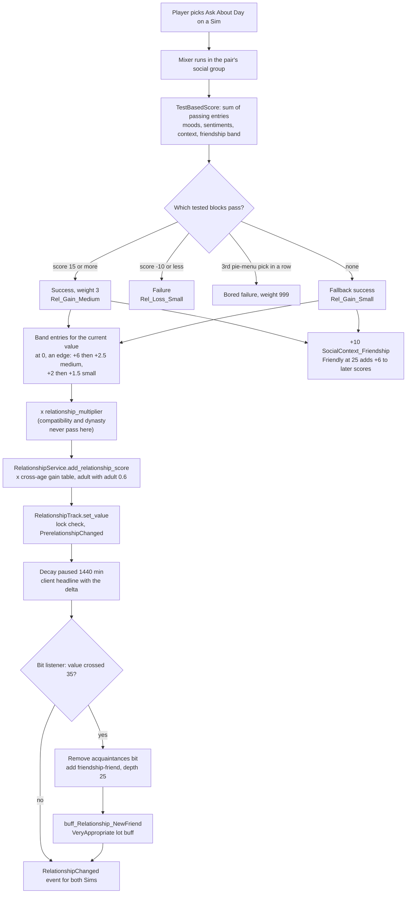
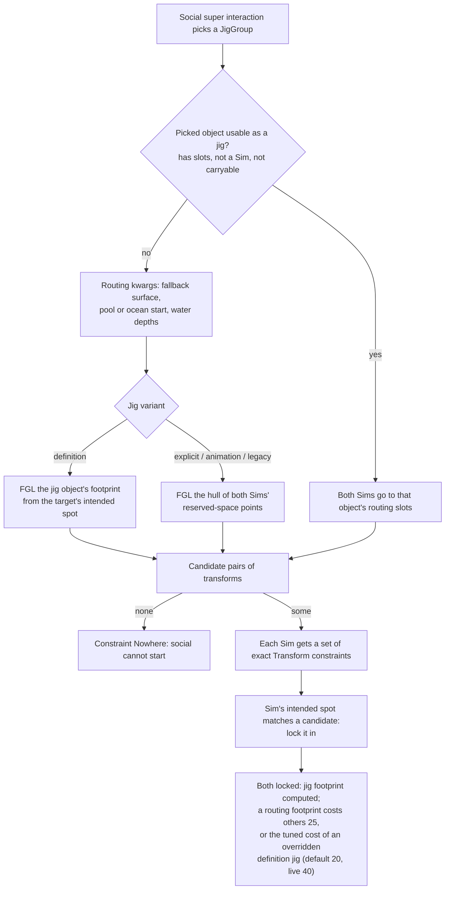
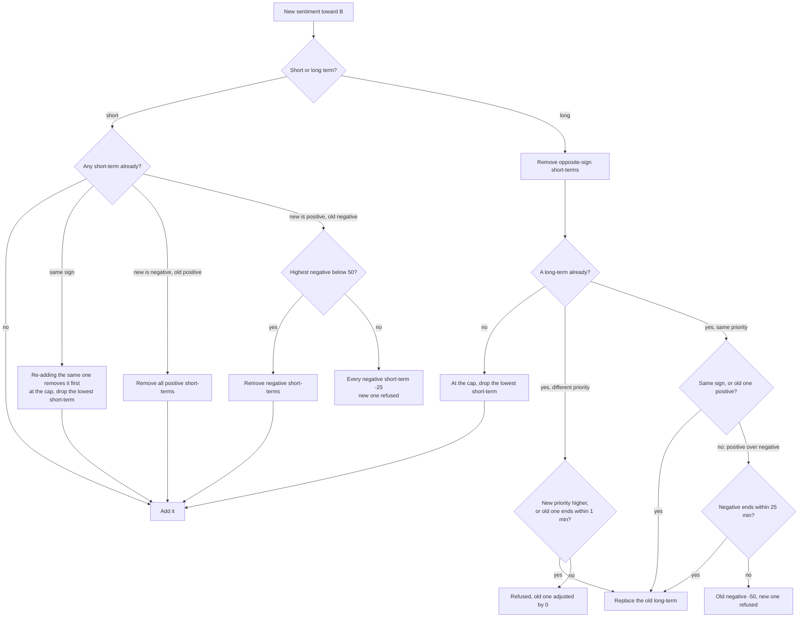

# 3.08 Relationships, socials and memories

*Game version 1.128.90.1030 (Steam, Linux/Proton). Numbers come from the live tuning (the base game's delta build, then each installed pack's delta build, merged) unless a line says full tuning or code default. Packs that supply numbers here: base game, EP04 (Cats & Dogs), EP06 (Get Famous), EP12 (High School Years) and GP12 (Werewolves); EP09 (Eco Lifestyle) and GP04 (Vampires) add 3 relationship bits each to the count, and social groups (GP04 4, among them group_VampireDrink and group_VampireDuel; EP09 1); SP01 (Luxury Party) and SP42 (Grunge Revival) are installed but add nothing this chapter cites. Checked 2026-10-12: 136 claims checked, 28 corrected, 2 relabelled, 10 added. Deepened 2026-10-13: 23 modules newly explained, 6 failed decompiles read. Checked again 2026-10-13: 464 claims checked, 52 corrected, 4 relabelled, 1 removed. Cross-chapter edits 2026-10-13: 4 applied.*

## In plain words

Every pair of Sims who have met shares one relationship record. It holds the two bars a player sees, friendship
and romance, which both Sims share, so the value is always the same from either side. On top of the bars sit labels
("Friend", "Spouse", "Despised"), each switched on and off by the bar crossing a line or by an event. One-way things live
on each side of the record: what this Sim knows about the other, and up to four feelings about them (sentiments such
as "Hurt" or "Close"), which fade on their own over four to ten Sim days.

Whether a friendly social works comes from a score. The game adds it up from both Sims' moods,
traits, sentiments, the mood of the conversation and the current friendship, then picks among the outcomes whose
conditions that score meets. For the everyday "Ask About Day" chat, any score above -10 and below 15 always succeeds
with a small gain; the chat fails only when the score drops to -10 or lower, or when the player has picked the same
social on that listener three times in a row (socials the Sims choose on their own never count). Gains shrink as the
bar rises: a first good chat with a stranger gives +8.5 friendship (a new pair sits at 0, the edge of two bands, so
both bands pay out: +6, then +2.5), the same chat between best friends gives +1, and the
pair's ages scale both: two adults get 60% of that, two young adults 120%, two teens double.

Friendship between two Sims you do not play never decays. For a played Sim outside your current household it decays
only while it sits between -20 and 20. Every change to a bar pauses its decay for a full Sim day. Romance between a
teen and an adult, or involving a child, is multiplied by zero at the moment it is added, so even the
`modifyrelationship` cheat cannot raise it.

Where two Sims stand for a hug, a kiss or a pet's nuzzle is not worked out on the spot. The game looks for room near
the Sim being approached for an invisible "jig" (a small object or a fixed pair of footprints), sends both Sims to its
marks. For pet socials, paired dances and a few others it also makes that patch of floor costly for everyone else to
walk through until the social ends.

## Key facts

- One record per unordered pair of Sim ids; friendship and romance are shared values, sentiments, knowledge and some
  labels are one-way. There is no per-Sim limit on how many relationships a Sim holds in the relationship code;
  story progression culls the shallowest ones for played NPCs past 35 (see [4.02](4.02-story-progression-townies.md)).
- Both main bars run -100 to 100, start at 0, converge to 0. Friendship decays 1.0 to 4.0 points per Sim day
  depending on the band; romance decays 1 to 6 per day and decays fastest when it is highest (75 to 100: 6 per day).
- Decay waits 1440 Sim minutes (one day) after every change to the bar before it resumes.
- Friendship labels: Despised at -70, Disliked at -20, Acquaintances near 0, Friend at 35, Good Friends at 60.
  Despised, Disliked, Friend and Good Friends each come off 5 points back toward 0 (Friend added at 35, removed
  below 30).
- Romance labels come from a two-axis table of romance against friendship: Soulmates need romance 75 with friendship
  60; Lovers at romance 50 (friendship 60) or 75 (friendship near 0); Enemies With Benefits at romance 50 with
  friendship -70.
- Friendship gains are banded by the current friendship value: Rel_Gain_Medium gives 8, 6, 2.5, 2, 1.5, 1 across
  six bands from below -40 to above 80. The bands share their edges, so a value exactly on an edge (0 for a new pair)
  collects two entries: a first medium gain is 6 + 2.5 = 8.5. Losses grow with friendship: Rel_Loss_Large is -5 up to 20, -10 from 20 to 80,
  -15 above 80.
- From 0 to Friend (35) takes 13 medium-success chats or 26 small ones at a cross-age multiplier of 1. The friendship
  gain table makes that 24 and 46 for two adults (x0.6), 11 and 23 for two young adults (x1.2), 6 and 13 for two
  teens (x2).
- Romance is multiplied by 0 for every pair involving an infant, toddler or child, and for a teen with a young adult,
  adult or elder (crossAgeTuning_RomanceZero).
- A Sim can hold at most 4 sentiments toward another Sim. Each starts at 100 and loses 0.017 per minute (short-term,
  about 4.1 days) or 0.007 per minute (most long-term, about 9.9 days).
- A strong negative short-term sentiment (value 50 or more) blocks a new positive one and loses 25 instead.
- When Sims with sentiments are near each other, the game rolls the sentiment's effect at most once every 125 Sim
  minutes per direction, drawing one sentiment (or nothing); the "no effect" weight is 1, or 5 when the pair has only
  a neutral history.
- The conversation itself has a mood (social context): +10 per friendly success, "Friendly" at 25, and it does not
  decay while the Sims stay in the group (decay multiplier 0); outside the group it moves 0.55 per minute back toward
  the pair's baseline.
- Compatibility from EP13 (Growing Together), attraction and satisfaction from EP16 (Lovestruck), secrets from EP15 (For Rent) and EP21 (Royalty & Legacy), and matchmaking from EP16 are coded but
  need packs that are not installed here.
- 299 relationship bits, 9 relationship tracks, 71 sentiment tracks, 4 social-context tracks and 38 topics are live.
- Two-Sim socials run in a jig group: 526 live interaction references point at the 58 JigGroup records, 189 of them at
  `group_Platonic`. The jig is placed near the Sim being approached (the target stays, the actor walks); explicit,
  animation and legacy jigs also lay a footprint other Sims pay 25 to cross. A definition jig lays one only with
  `override_polygon_and_cost` (cost 20 by default); the two live records that enable it, group_PairedDancing and
  group_PairedDancing_Teens, tune it to 40.

## How it works

### The relationship record

**Observed** (`relationships/relationship_service.py: RelationshipService._get_key_tuple`): the service keys every
relationship by the two Sim ids sorted low to high, so A-with-B and B-with-A are the same object. It also keeps a
list of relationships per Sim id (`_sim_relationships`) for lookups such as "all of this Sim's relationships".
**Observed** (`relationships/relationship_tracker.pyc`, per-function decompile): each Sim's `RelationshipTracker` holds
no relationship data of its own; every call (scores, bits, knowledge, social group joins, LOD changes) forwards to the
service with the Sim's id. The same module holds `RelbitPickerSuperInteraction`, a picker that lists every non-collection bit the pair lacks (`is_add`) or every bit it has, and force-adds or removes the chosen one.

**Observed** (`relationships/relationship_objects/sim_relationship.py: SimRelationship.get_track_tracker`): a
`SimRelationship` holds one shared part and two one-way parts.

- The shared part (`relationships/data/bidirectional_relationship_data.py`) holds tracks of type RELATIONSHIP
  (friendship, romance, the social-context tracks) and the bidirectional bits. A bidirectional bit is stored once and
  shown on both sides (`BidirectionalRelationshipData._update_client_from_bit_add` updates both Sims' panels).
- Each one-way part (`relationships/data/unidirectional_relationship_data.py`) holds SENTIMENT tracks, UNIDIRECTIONAL
  tracks, one-way bits (for example Widow and Widower) and the `SimKnowledge` record. An optional custom label
  (`relationships/data/relationship_label_data.py`: label text and icon) is not one-way: `SimRelationship` keeps one
  `_relationship_label_data` for the pair.
- `relationships/relationship_enums.py` defines the three track types and bit directionality; a bit defaults to
  BIDIRECTIONAL (`relationships/relationship_bit.py`).

**Observed** (`relationships/data/relationship_data.py: RelationshipData.depth`): relationship depth is the sum of
the `depth` of every bit present; `SimRelationship.get_relationship_depth` adds the shared part and the one-way part
for that Sim. Depth values from live tuning: has_met 1, acquaintances 10, disliked 15, friend 25, HasBeenFriends 25,
despised 35, good_friends 50, Significant_Other 50, Divorced 50, nemesis 75, BFF 100, Engaged 100, Married 100.
Depth is what story progression sorts by when it culls ([4.02](4.02-story-progression-townies.md)).

**Observed** (`relationships/relationship_objects/object_relationship.py`, `relationships/object_relationship_track_tracker.py`):
Sims also hold relationships with objects, keyed by Sim id and object definition id, with a name the player can set.
`ObjectRelationshipTrack.OBJECT_BASED_FRIENDSHIP_TRACKS` maps tracks to object tag sets. It is tuned with five pairs;
key and value are both `TunableReference(pack_safe=True)` (`relationship_track.pyc` bytecode), so the mapping drops the
four pairs that do not resolve here and loads only smart_Hub_Friendship_Main for TagSet_Smart_Hub. Object relationships always decay (`relationship_track.py:
BaseRelationshipTrack._should_decay`). `relationships/object_relationship_interactions.py` holds the interaction that
lets the player rename one.

### Tracks: values, decay and the bits they drive

Live counts: 9 RelationshipTrack instances (base 8, EP06 1), 4 short-term-context tracks and 1
object relationship track (**Observed**, a count over the live tuning).

**LTR_Friendship_Main** (id 16650, base delta). Range -100 to 100, initial 0, convergence 0. Interval decay in points
per Sim minute, with per-day equivalents (x1440):

| Friendship band | Decay per minute | Per Sim day |
|---|---|---|
| -100 to -70 | 0.002775 | 4.0 |
| -70 to -20 | 0.001735 | 2.5 |
| -20 to 35 | 0.000695 | 1.0 |
| 35 to 60 | 0.00104 | 1.5 |
| 60 to 100 | 0.000695 | 1.0 |

**Observed** (`LTR_Friendship_Main`, delta against full): the full build has the old field name
`_decay_rate_overrides` with values twice as large (0.00555 in the lowest band) and the old
`decay_only_affects_selectable_sims`; the base-game delta tuning replaces them with `_interval_decay_rates` and
`decay_affecting_played_sims`. The full build's romance bands are doubled the same way (0.00278 to 0.00833). Neither
old name appears anywhere in the current code (the live field is `_interval_decay_rates` in
`statistics/continuous_statistic_tuning.py`).

**LTR_Romance_Main** (id 16651, base delta). Base decay 0.001735 per minute (2.5 per day), with bands: -100 to -50 at
2 per day, -50 to 0 at 1, 0 to 25 at 3, 25 to 50 at 4, 50 to 75 at 5, 75 to 100 at 6. It adds HaveBeenRomantic the
first time romance reaches 10 (`_add_bit_on_threshold`). It is visible in the panel when the pair is married,
steady, engaged or getting married, or when romance is 10 or more.

**Observed** (`relationship_track.py: BaseRelationshipTrack._should_decay`, rescued per function from the
pyc): the decision whether a bar decays runs in this order.

1. No decay if the rate is 0 or the track is locked (a lock comes from a bit lock or a buff such as
   `Buff_Trait_Legendary`, see [3.07](3.07-personality-feelings.md)).
2. Object relationships always decay.
3. If the track has `decay_affecting_played_sims` (friendship and romance both do): decay if either Sim is in the
   active household. Otherwise, if either Sim is a played Sim, decay only if the relationship could be culled (no bit
   that prevents culling) and the value is strictly inside the tuned range, -20 to 20 live (code default -20 to 35).
   Otherwise, for two unplayed Sims, no decay.
4. A track without that field always decays.

**Observed** (`relationship_track.py: BaseRelationshipTrack.reset_decay_alarm`, `RelationshipTrack.set_value`): every
`set_value` resets the decay alarm, which turns decay off for `delay_until_decay_is_applied` minutes (1440 live for
friendship and romance). So a pair that talks at least once a day never decays.

**Observed** (`relationship_track.py: RelationshipTrack.set_value`): a value change does the following, in order.
A locked track ignores the change. Otherwise it fires `PrerelationshipChanged` for both Sims, sets the value, updates
visibility, resets the decay alarm, sends the relationship to the client with the delta (which drives the plus or
minus headline over the Sim's head) and fires `RelationshipChanged` for both Sims. It writes a telemetry hook only
when the value changed and the track sets `_send_telemetry_on_value_changed` (default False; friendship and romance do
not set it).

**Observed** (`relationships/relationship_track_tracker.py`, `relationships/tunable.py`): bits follow the value
through listeners. Each node in `bit_data_tuning` has a bit with an add value and a remove value; the gap between
them stops a label flickering at the boundary. When the value crosses a node, the tracker removes the old bit and adds
the new one. Friendship nodes (add, remove): despised -70/-65, disliked -20/-15, acquaintances -1/-1 below zero and
0/0 above, friend 35/30, good_friends 60/55; the neutral bit is relationshipBits_Friendship_NeutralBit.

**Observed** (`relationships/tunable.py`, the 2D bit data on `LTR_Romance_Main`): romance labels use a two-axis
table, romance on one axis and friendship rows on the other.

| Friendship row (add/remove) | Romance 75 | 50 | 25 | 10 | 0 | -10 | -50 |
|---|---|---|---|---|---|---|---|
| 60 / 55 | Soulmates | Lovers | Lovebirds | RomanticInterest | JustGoodFriends | ItsComplicated | ItsVeryComplicated |
| 35 / 30 | Sweethearts (50) | Sweethearts | Lovebirds | RomanticInterest | JustFriends | AwkwardFriends | BadRomance |
| 0 and -1 / 0 | Lovers | Lovebirds (25) | Lovebirds | RomanticInterest | Acquaintances | ItsAwkward | ItsVeryAwkward |
| -20 / -15 | HotAndCold (50) | HotAndCold | HotAndCold (10) | HotAndCold | Disliked | BadMatch | TerribleMatch |
| -70 / -65 | EnemiesWithBenefits (50) | EnemiesWithBenefits | HotAndCold (10) | HotAndCold | Despised | TerribleMatch | TotalOpposites |

Where a cell names a threshold in parentheses, the label starts at that romance value and covers the higher columns
of its row. Each romance threshold has a remove value 5 points closer to 0 (Soulmates 75/70, RomanticInterest 10/5,
ItsComplicated -10/-5, ItsVeryComplicated -50/-45); the 0 node has no gap.

**Observed** (`LTR_Friendship_Main.tested_initial_modifier`, `TestedSum.get_max_modifier` confirmed in bytecode): a
new friendship starts at 0 plus the largest passing modifier (0 if none pass): werewolf meeting vampire -50, a vampire
with the unpleasant aura -10, and five trait tests that each need a trait from a pack not installed (+20, -20, +10,
-25, +25; the +10 needs a single actor trait, the others a trait on each Sim), so they never pass here. The full build has no initial modifier at all.

Other tracks (all **Observed**, live tuning):

- LTR_Mischief_Main: no decay, PartnersInCrime at 25 (removed at 20).
- LTR_Feud_Main (EP06): no decay.
- LTR_PetToPet_Friendship_Main: Hostile at -50 (remove -40), Friendly at 50 (remove 40), decays like friendship,
  species dog, cat, fox, horse. LTR_SimToPet_Friendship_Main (base delta): bits at -70, -20, -1, 35, 60; +5
  initial for a Sim with trait_Animal_Attraction (EP04). Its decay bands are the friendship ones under `_interval_decay_rates`
  (0.002775 to 0.000695 per minute); the EP04 full build, which the game does not read, has an older copy with them under
  `_decay_rate_overrides`. Pets are [3.12](3.12-pets-horses.md).
- LTR_SimToAnimalObject_Friendship_Main: friendship-like, for animal objects.
- relationshipTrack_Fear_BeingCheatedOn: converges to 100, decays 0.0174 per minute.
- relationshipTrack_Infant_CheckOn: decays 1 per minute from a maximum of 1440 (a one-day timer).

**Observed** (`relationship_objects/relationship.py: Relationship._build_relationship_track_proto`, bytecode;
`relationship_track.py: check_relationship_track_display_priorities`, bytecode): the relationship panel receives every
track that has a `display_priority` or `display_in_sim_profile`, sorted by priority ascending with unprioritised tracks
last; only tracks visible to the client get a bar, but each one's current bit is sent. Live priorities: friendship 1,
romance 2, Sim-to-pet 3, pet-to-pet 5, Sim-to-animal-object 9 (the object track smart_Hub_Friendship_Main also has 1,
on its own object relationship). Sentiment tracks are locked to priority 1 (`sentiment_track.py`) and skipped by the
load-time check. Its only action when two non-sentiment tracks share a priority is a `logger.error` call, which is
empty in the retail build, so it neither shows anything nor changes anything at run time.

**Observed** (track `ad_data` curves, read by autonomy in [3.04](3.04-autonomy.md)): the utility curve that makes a
Sim want to socialize with someone is friendship -100 → 0, 0 → 1, 35 → 1.5, 100 → 1.75; romance -100 → 0, 0 → 1,
100 → 1.5; mischief and feud -100 → 0, 100 → 2.

**Observed** (`relationship_track.py: RelationshipTrack._should_initialize_first_same_sex_relationship_callback`,
`filters/sim_template.py: _add_gender_preference`): the first time a romance between two Sims of the same gender, at
least one of them in the active household, reaches 2 (`ENABLE_AUTOGENERATION_SAME_SEX_PREFERENCE_THRESHOLD`), a global switch flips so newly generated Sims use
the "enabled" orientation weight tables. **Observed** (`sims.global_gender_preference_tuning`, base delta): both tables
are 50/50 live, so the switch changes nothing in this build.

### Cross-age multipliers

**Observed** (`relationships/relationship_service.py: RelationshipService.add_relationship_score` line 407,
`sim_relationship.py: SimRelationship.add_track_score`): every score added through the service is multiplied by the
track's cross-age table, the gain table when the increment is 0 or more, the loss table otherwise, looked up in
`relationships/cross_age_tuning.py` by (age of the other Sim, age of the Sim the score is added for):
`add_track_score` calls `_get_paired_sim_infos(self._sim_id_b == sim_id)`, which hands back the other Sim as the
"actor". Non-Sim participants skip the table.

**Observed** (`crossAgeTuning_RomanceZero`, used for both gain and loss on `LTR_Romance_Main`): every pair that
includes an infant, toddler or child gets 0, and so does a teen with a young adult, adult or elder. Teen with teen and
young adult, adult and elder among themselves get 1. Romance through loot, the `modifyrelationship` cheat and
`relationship.add_score` all pass through the same multiplier.

**Observed** (`LTR_Friendship_Main.cross_age_multipliers`, base delta): friendship has its own tables. Rel_Gain and
Rel_Loss have subject Actor and target Listeners, so the score is added for the actor and the table is read as
(listener age, actor age); the pairs below are written in that order.
Gains: adult with adult 0.6, young adult with young adult 1.2, elder with elder 0.8, teen with teen 2, child with
child 2.5, toddler with toddler 2.25, adult to young adult 1, young adult to adult 0.8, teen to adult or elder 0.5;
toward an infant 1.8 from adults, elders and children, 0.8 from young adults and toddlers, 0.7 from teens. Losses: adult with adult 1.3, young adult with young adult 1.3, elder with elder
1.2, teen with teen 1.5, any infant 0.5. So two adults gain friendship at 60% of the loot tables below and lose it at
130%.

### Bits

**Observed** (a count over the live tuning): 299 RelationshipBit, 21 RelationshipBitCollection (rbc_Family_*, rbc_Friend_*,
rbc_Romantic, rbc_Sentiment_* and others), 18 SocialContextBit, 3 PromRelationshipBit (EP12).

What a bit can carry (**Observed**, `relationships/relationship_bit.py: RelationshipBit` tunables; counts from the
live data):

- `timeout` (39 bits): the bit removes itself after that many Sim minutes (`relationships/bit_timout.py` keeps the
  alarm, `RelationshipData._timeout_alarm_callback` removes it). Examples:
  TryToGreet 30, RecentNegativeSocial 60, InFightWith 240, quick-social hug and kiss 300, InQuarrelWith
  360, RecentFirstKiss 360, askedAboutSentiment 720, JustBrokeUpOrDivorced 2880, HaveDoneWooHoo_Recently 2880,
  DeadSpouse 2880, healedNegativeSentiment 4320.
- `autonomy_multiplier` (40 bits): scales how much autonomy wants to target that Sim. Family 1.25, siblings 1.5,
  parent 1.75, son or daughter and stepchild 2.25, spouse, steady, engaged and promised 1.75, TheyUnderstand 2,
  TwoPeasInAPod 3, situation bits 2 to 4, Dining 10, AlluringVisage 50, infant NotChecked 4.
- `buffs_on_add_bit` (40 bits): friend gives buff_Relationship_NewFriend, good friends Buff_NewGoodFriend, the romantic
  combos RomanticInterest, Lovebirds, Sweethearts, Lovers and Soulmates (and the steady bit) give an NPC
  TalkAboutMarriage buff, engaged, married, steady, divorced and widowed give their relationship buffs. `buffs_to_add_if_on_active_lot` gives the appropriateness buffs that unlock socials:
  friend VeryAppropriate, good friends and BFF Appropriateness_Friends, romantic bits Appropriateness_Lovers.
- `group_id` and `priority`: within a group, a new bit replaces the old one only if its priority is equal or higher.
  SignificantOther group: Significant_Other 1, Engaged 2, Promised 2, Married 3, Divorced 4, Despised_Ex 5,
  Broken_Up 6, Broken_Up_Engaged 7, Frustrated_Ex 8. Widow and Widower carry priority 4 but sit in no group.
- `required_bits` and `remove_on_threshold`: friendship-bff requires good_friends and removes itself when friendship
  falls to 10 or below. friendship-nemesis requires despised.
- `exclusive`: a Sim may hold the bit with one other Sim only (FanStan_Stan, StanCooldown, Feud_Target).
- `relationship_culling_prevention`: PLAYED_AND_UNPLAYED on 34 bits, PLAYED_ONLY on 33, ALLOW_ALL on 1 (the code
  default is ALLOW_ALL). `persisted_tuning` False on 9 bits rebuilt at load, such as neighbor,
  multi_unit_neighbor, GettingMarried, RenewingVows and the caregiver bits.
- `counts_as_incest` (17 family bits, including Cousin, ParentsCousin, CousinsChild, AuntUncle, NieceNephew,
  Grandnibling, GrandPibling, Halfsibling, Ancestor and Descendant).
- `bit_added_loot_list` and `bit_removed_loot_list`, notifications, a `whim_set`.

**Observed** (`relationships/relationship_bit_lock.py`): a bit lock blocks changes inside a bit group for a time. The
only live lock is relationshipBitLock_Pet_to_Pet (EP04): group PetRelationship, timeout 2160 minutes; after that,
each attempted change has a 75% chance to relock the group for another 2160 minutes and be refused
(`try_and_aquire_lock_permission`; code defaults 360 minutes and 0%). `relationships/relationship_lock_change.py` is the loot op that adds or
removes a lock; `relationships/relationship_bit_add.py` and `relationships/relationship_bit_change.py` are the loot ops
that add, remove or swap bits ([0.04](0.04-tests-loot-effects.md)).

**Observed** (`relationships/global_relationship_tuning.py`, module tuning in base delta): the global anchors are
REL_INSPECTOR_TRACK LTR_Friendship_Main (the default track for every command), DEFAULT_SHORT_TERM_CONTEXT_TRACK
SocialContext_Friendship, HAS_MET_RELATIONSHIP_BIT has_met, MARRIAGE romantic-Married, ENGAGEMENT romantic-Engaged,
STEADY romantic-Significant_Other, NEIGHBOR neighbor, DELAY_UNTIL_RELATIONSHIP_IS_CULLED 1440, and
MEANINGFUL_RELATIONSHIP_BITS (friend, good friends and BFF with their Evil variants, the BromanticPartner BFF, and
five romantic combos).
TropeGlobalTuning lists family and romance tropes by relationship type with ids that do not resolve here (a pack not
installed).

**Observed** (`relationships/neighbor_bit_fixup_helper.py`): when the household's home zone changes, neighbor and
multi-unit neighbor bits are checked and fixed.

### Incest prevention

**Observed** (`sims/sim_info.py: incest_prevention_test`, `relationships/relationship_objects/relationship.py`):
romance is blocked if the family tree service says the two are related; otherwise the relationship's
`considered_incest` flag, set by any bit with `counts_as_incest`, decides. The family-tree check looks for the
closest common ancestor and calls the pair related when the two generation distances to it add up to 5 or less
(`COMMON_ANCESTRY_DISTANCE_INCEST_THRESHOLD`, a code constant; a Sim is depth 0 to itself). The attraction module
tuning (`relationships.attraction_tuning`, `TRACK_ATTRACTION_TESTS`, base delta) also tests "not incestuous".

### Social context: the mood of the conversation

**Observed** (`ShortTermContextRelationshipTrack` in `relationship_track.py`, live tuning): four short-term-context
tracks run per pair while they talk. All decay 0.55 per minute, with `socialization_decay_modifier` 0, which freezes
them while the two Sims share a social group, and `decay_to_initial_modifier` True, which on leaving the group sets
the convergence point to the tested initial modifier so the context drifts back to the pair's baseline.

| Track | Bits (add value) | Tested initial modifiers |
|---|---|---|
| SocialContext_Friendship | Abhorrent -75, Offensive -50, Distasteful -15, Casual 0/-1, Friendly 25 (remove 20) | -20 for trait 161628 at friendship -1 or lower (the trait does not resolve here, so it never applies); sentiments: Positive +10, Bitter -15, Close +20, Furious -50, Hurt -10; NosyNeighbor +10 |
| SocialContext_Fun | InsufferablyTedious -75, Tedious -50, Boring -25, Funny 25, Hilarious 75 | none read |
| SocialContext_Romance | Suggestive 25, Amorous 50, Steamy 75 | Enamored +30, Guilty -10, Hurt -10 |
| SocialContext_Awkwardness | VeryAwkward -50, Awkward -1, Casual 0 | Guilty -10 |

**Observed** (`data/bidirectional_relationship_data.py: get_prevailing_short_term_context_track`): the pair's
prevailing context is the context track with the largest absolute value; with none, SocialContext_Friendship is
added. **Observed** (`socials/social_tests.py: SocialContextTest.get_overall_short_term_context_bit`): for a group,
the game takes every pair's prevailing track, keeps the positive or the negative side (the negative side wins ties),
averages each track type and picks the strongest, then returns the bit at that average. This bit is what
"Friendly", "Tedious" and the others in the UI refer to, and what social scoring reads.

**Observed** (Loot_SocialContext_Friendship_Gain): a friendly success adds +10 to the friendship context, so three
successes move a Casual chat to Friendly. The same loot pulls the other contexts toward 0: Fun and Romance lose 20 at
50 or more and 10 between 15 and 50, and gain 20 at -50 or less and 10 between -50 and -15; Awkwardness gets the same
two gains on its negative side. Loot_SocialContext_Friendship_Gain_setFriendly sets the friendship context to 50 and
the other three to 0.

### Socials: from a click to a change on the bar

**Observed** (`interactions/social/social_mixer_interaction.py: SocialMixerInteraction`,
`interactions/social/social_super_interaction.py: SocialSuperInteraction`): a social is a mixer that runs inside a
social super interaction, which owns the social group. The mixer's outcome is an `InteractionOutcomeTestBased`
(`interactions/utils/outcome.py`, mechanics in [3.05](3.05-interactions-postures-routing.md)). Its decision rule,
confirmed in bytecode: prioritized outcomes, if any, are tested first and the first that passes is taken outright;
otherwise every tested block whose tests pass contributes its weighted outcomes, the fallback is used only when no
block passed, and one outcome is drawn by weight.

The score that the tests read is a `TestBasedScore` (`event_testing/test_based_score.py`): the sum of the scores of
every passing entry plus the numbers returned by batch tests. Relationship-band entries use closed intervals and add
every matching band (**Observed**, bytecode of `RelationshipTestBasedScore`).

Worked example: **mixer_social_AskAboutDay_targeted_Friendly_alwaysOn** (autonomous allowed), scored by
scores_socialoutcomes_friendly_smalltalk (**Observed**, live tuning).

Score entries (points):

- Actor's mood: Happy +5; Confident, Inspired +3; Energized, Flirty, Focused, Playful +2; Fine +1; Bored -2; Angry,
  Embarrassed, Sad, Uncomfortable -3; Dazed, Stressed, Scared -5.
- Listener's mood: Angry -9, Happy +5, any other +1.
- BFF +8. Target recently broken up or divorced (hidden buff) -15.
- Sentiments: Positive +5, Adoring +5, Bitter -8, Close +3, Furious -10, Guilty +5, Hurt -3.
- Lifestyles: opposing -10, shared +5. Fame difference +5 to +20. Socially awkward trait -2, -3 or -7 by charisma.
  Vampire aura -10. A charmer toddler +20.
- Social context: Boring -6, Tedious -10, InsufferablyTedious -15, Friendly +6, Distasteful -5, Offensive -10,
  Abhorrent -14, Awkward -3, VeryAwkward -5, the positive Fun and Romance contexts +1 each; Casual and any context not
  listed score 0 (`socials/social_tests.py: SocialContextTest`, `get(context, 0)`).
- Friendship band: -100 to -70 -8, -70 to -30 -4, -30 to -15 -2, -15 to 25 +1, 25 to 60 +5, 60 to 100 +8.
- Romance band: +1 for each of four bands (-100 to -50, -50 to 0, 0 to 50, 50 to 100) that matches. The bands are
  closed, so a value on a boundary matches two: romance 0 scores +2, friendship exactly 25 scores +6.

Outcome blocks:

| Block | Test | Weight | Result |
|---|---|---|---|
| 0 | score 15 or more | 3 (x1.1 with RegalResidence) | success: Rel_Gain_Medium, +10 friendship context, basic friendly success loot, a crush chance |
| 1 | score -10 or less | 2 | failure: Rel_Loss_Small, friendship context loss, Loot_DidNegativeSocial |
| 2 | score -20 or less | 1 | failure with the SociallyAwkward idle |
| 3 | testSet_SocialBoredom_Low | 999 | bored failure |
| fallback | nothing passed | | success: Rel_Gain_Small, plus the same +10 friendship context, basic friendly success loot and crush chance as block 0 |

**Inferred** (arithmetic on the entries as tuned): two strangers in Fine moods in a Casual chat score 5 (+1 mood,
+1 listener, 0 context, +1 friendship band, +2 romance band), which passes no block, so the fallback success runs
every time. A Happy pair in a Friendly chat scores 19 (+5, +5, +6, +1, +2) and gets the medium success every time.
Failure needs a score of -10 or lower, or boredom.

**Inferred** (missing packs change these sums): six entries test for a relationship bit from a pack that is not
installed. The bit list is a pack-safe set, so the loader drops the missing bit (`instance_manager.get` raises
`UnavailablePackSafeResourceError` and `_TunableCollection.load_etree_node` skips the element, both read in bytecode),
and `RelationshipTest` skips the bit check when that set is empty (bytecode of `RelationshipTest.__call__`). The
entries then test the friendship range alone: +3 and +5 always, +20 and +5 at friendship -20 or more, -5 and -20 at
35 or less. In this install every smalltalk score is therefore 8 higher between friendship -20 and 35, 33 higher
above 35 and 17 lower below -20: the strangers above score 13 (still the fallback) and a Happy actor alone (17) is
enough for the medium success. Trait tests behave the other way: a missing whitelist trait stays as an empty slot
and the test fails (`sims/sim_info_tests.py: TraitTest`). Entries whose whole test is a missing test set are dropped.

**Observed** (`socials/group.py: SocialGroup._add_boredom`, `get_boredom`; `event_testing/test_variants.py:
SocialBoredomTest`): the group remembers, per Sim and per listener, how many times each mixer ran, for the last
`BOREDOM_QUEUE_SIZE` distinct mixers. That is 1 (code default; neither the full nor the delta build sets it), so
only the most recent mixer counts and any other counted social in between resets it. Only visible mixers that the
player picked from the pie menu are counted (bytecode of `_add_boredom`: it returns early for super interactions,
hidden ones and any other source), so autonomous socials neither add to the count nor reset it.
testSet_SocialBoredom_Low passes at a count of 3 or more (**Observed**: `TunableThreshold` defaults to
GREATER_OR_EQUAL, bytecode of `TunableThreshold.__init__` in `sims4/tuning/tunable.pyc`). **Inferred**: the count is
taken when the mixer starts (`SocialGroup._on_interaction_start`), so the third pick in a row is the first bored one.

**Observed** (Rel_Gain and Rel_Loss loots, base delta; `statistic_ops.py: StatisticAddRelationship`, a
[0.04](0.04-tests-loot-effects.md) module): each loot lists one entry per friendship band, applied to the listeners.
Each entry carries the band twice: as a relationship test and as `track_range`. Both are closed intervals (lower <=
value <= upper; bytecode of `TunedInterval.__contains__`; the tunable's description text says "> lower" but the code
does not). The loots set `run_test_first`, so every entry's test runs on the starting value, then each passing entry
checks `track_range` against the live value as it applies (`LootActions.get_possible_actions`, bytecode). Neighbouring
bands share an edge, so a value exactly on one collects two entries: from 0, Rel_Gain_Medium gives +6 (the -40 to 0
band), then +2.5 (the 0 to 20 band), 8.5 in all. Points:

| Loot | below -40 | -40 to 0 | 0 to 20 | 20 to 40 | 40 to 80 | above 80 |
|---|---|---|---|---|---|---|
| Rel_Gain_Large | 16 | 12 | 8 | 6 | 4 | 2 |
| Rel_Gain_Medium | 8 | 6 | 2.5 | 2 | 1.5 | 1 |
| Rel_Gain_Small | 4 | 2 | 1.5 | 1 | 0.5 | 0.5 |
| Rel_Loss_Large | -5 | -5 | -5 | -10 | -10 | -15 |
| Rel_Loss_Medium | -5 | -5 | -5 | -7 | -7 | -11 |
| Rel_Loss_Small | -2 | -2 | -2 | -2 | -3 | -4 |
| Loot_LTR_Romance_Large | 18 | 12 | 6 | 4.5 | 3 | 1.5 |
| Loot_LTR_Romance_Medium | 10 | 6 | 4 | 3 | 2 | 1 |
| Loot_LTR_Romance_Small | 6 | 4 | 2 | 1.5 | 1 | 0.5 |

Romance losses are flat: -2 (Small_Loss), -4 (Medium_Loss), -6 (Large_Loss). Romance bands are on the romance value.

**Observed** (`relationship_multiplier` on each Rel_Gain entry, a `TunableMultiplier`: base times the product of
every passing multiplier, `tunable_multiplier.py`): compatibility Amazing x1.5, Good x1.25, Bad x0.75, Awful x0.5;
allied dynasty x1.25, rival dynasty x0.75 (the rival multiplier sits only on the four bands below 40); on the 20 to 80 bands an infant listener or actor with trait_Infant_Sunny
x1.25 and trait_Infant_Cautious x0.75; and six entries that need a pack not installed, so they never pass here: two
test sets (x1.25, x0.75), a third test set (x1.5), and three x1.5 entries that pair a revealed secret or a buff with a
target trait (some base game, such as Kleptomaniac, Goofball and Evil).
Losses mirror the compatibility multipliers (Amazing x0.5 up to Awful x1.5) and the dynasty ones (allied x0.75, rival
x1.25). 73 live loots carry the dynasty entries (68 base, 5 EP06). Compatibility never applies in this install
(below), and neither do the dynasty entries: `SimInAllyDynastyTest` and `SimInRivalDynastyTest` return False when
there is no dynasty service, which needs EP21 (`dynasty/dynasty_tests.py`, `dynasty_service.py: required_packs`).

**Observed** (extra entries in the same loots): family get +5 more, up to a friendship of 94; coworkers +8 (Large),
+2.5 (Medium) or +1.5 (Small) to the target; a Day of the Dead buff +2.5; the friendship XP boost buff adds +3 romance
in the romance loots. Medium and Large gains carry randomWeightedLoot_AddSentiment_Socialization_Friendly_veryLowChance:
weight 100 for nothing, 5 for a Close sentiment and 1 for a short-term Adoring one, so about 4.7% and 0.9% before
their multipliers; with an infant listener the "nothing" weight drops to 2. Losses: a Loner listener has a 20% chance
of Embarrassed; -2 more with trait_Reward_Infant_Unhappy; a werewolf with the Prideful temperament may get a
narcissist buff (50%, 25%, 10% on Large, Medium, Small). Medium and Large losses also roll a 5% Bitter grudge
sentiment (x2 if the listener's friendship toward the actor is -25 or lower, x1.25 if the listener is Mean) and a 5%
short-term Hurt sentiment (x1.5 at friendship 60 or more, x2 for family).

**Inferred** (arithmetic on the tables with the shared band edges, cross-age multiplier 1, no decay since every chat
pauses it): from 0 the first medium success gives 8.5 (both bands at the 0 edge), then +2.5 a chat to 20 and +2 a chat
to 35, so 13 chats reach Friend; small successes take 26 (3.5 for the first, then 1.5 and 1). With the age table: two
adults (x0.6) need 24 medium or 46 small, two elders (x0.8) 17 or 34, two young adults (x1.2) 11 or 23, two teens (x2)
6 or 13, two children (x2.5) 4 or 9 (computed by the checker).

The romantic counterpart, **mixer_social_ComplimentAppearance_targeted_romance_alwaysOn** (score
scores_socialoutcomes_romance_flirtation): success at 50 or more (weight 2), failure at 0 or less (weight 1), bad
failure at -15 or less (weight 3), boredom at testSet_SocialBoredom_Medium (4 repeats, weight 999), fallback success
with Rel_Gain_Small and Loot_LTR_Romance_Small (the 50-or-more success gives the same small gains). Failures add an
Awkwardness context loss, a friendship loss, a romance loss and an Embarrassed commodity. A score of 1 to 49
therefore always succeeds small; 0 or less always fails. Two prioritized outcomes come first: if the target is not
attracted to the actor's gender the flirt is rejected and the actor learns the target's orientation, and when an NPC
flirts with a played Sim who has trait_Loyal and is in a relationship with someone else, the played Sim rejects it
(**Observed**, live tuning).



### Greetings

**Observed** (`interactions/social/greeting_socials/greetings.py`, `social_super_interaction.py:
SocialSuperInteraction._greet_sim`): a social first checks whether the pair has the SpecialBits_Greeted bit. If not,
it adds the bit before the greeting so the greeting cannot repeat, then runs a greeting: a targeted greeting, unless
the target is in a group with more than one member, in which case a group greeting covers every ungreeted member.
Live: 66 TunableTestedGreetingTargeted and 14 group greetings. The module tuning lists the entry points by priority
and the game tries them from the highest down, taking the first whose tests pass (`greetings.py:
_try_push_greeting_for_sim` sorts descending). Of the 10 group entries 6 resolve here (priorities 10 to 60: fallback,
friends, family, romantic, then the two social-override sets); of the 33 targeted entries 18 resolve (priorities 1
to 170, with the EP04 pet greetings at 110 to 170 above the infant greeting at 100, the base social override for mean
Sims at 65, romantic 50, family 40, best friends 30, the GP12 werewolf pack greeting at 25, friends 20, the EP06
celebrity wave at 15, acquaintance 10 and the non-mean override at 1). No pack ships its own greetings module tuning. The greeting needs the actor in a cone of 200 degrees around the target (ideal angle 0.6,
ideal radius 0 to 0.6).

**Observed** (`sims/sim_info_manager.py`, `greetings.py`): the greeted bit is removed when a Sim spawns
(`update_greeted_relationships_on_spawn`) and when the zone spins up, unless both Sims travelled together. So Sims
greet again each visit. `interactions/social/greeting_socials/greeting_commands.py` registers
`greetings.make_sim_ungreeted`, `greetings.make_all_sims_ungreeted` and `greetings.toggle_greeted_rel_bit`.

### Social group types

**Observed** (a walk over the live interaction tuning): every social super interaction names the group it runs in,
1,184 times as `_social_group_type` and 57 times as `social_group_type`. The group decides where its members may
stand. How an ordinary chat circle scores spots and nudges the worst-placed Sim is in
[3.05](3.05-interactions-postures-routing.md) (`socials/group.py`, `socials/geometry.py`, `socials/clustering.py`);
this section covers the subclasses. Live counts come from the live merge; "uses" counts the interaction
references; "patch data" means a pack that is not installed.

| Class (module) | What it adds over `SocialGroup` | Tunables that matter | Live records (uses) |
|---|---|---|---|
| `SocialGroup` (`group.py`) | the free circle with dynamic adjustment ([3.05](3.05-interactions-postures-routing.md)) | radius, facing, Sim counts | 48 (488): `chat` 123, SocialGroup_Basic_SuperSocial 40 |
| `JigGroup` (`jig_group.py`, failed decompile) | two Sims on fixed marks from a jig, next subsection | `jig`, `participant_slot_map`, `stay_outside` | 58 (526) |
| `MultiSimPostureJigGroup` (`jig_group.py`) | a jig group whose jig may be placed next to a third participant (unused live, next subsection) | the jig's `jig_positioning_single_participant` | 2 (3): group_PairedDancing, _Teens |
| `SideGroup` (`side_group.py`) | base for groups inside another group: no geometry, no adjustment alarm, `is_side_group` True, no default facing constraint; only subclasses are tuned | | abstract |
| `InObjectGroup` (`side_group.py`) | a side group whose constraint is Anywhere: the Sims are inside one object | | 12 (144): group_Woohoo 45, group_PetIntimate 27 |
| `GameGroup` (`side_group.py`) | anchored to the object with the game component (`social_anchor_object`, default the actor's surface); no constraint, no line of sight, no mixer targets. When a member's interaction exits it leaves the game, and the group shuts down once no game is running | | 5 (72): Cards, Chess, Don't Wake the Llama, video game console 67, stuffed animal |
| `SocialGameGroup` (`social_game_group.py`) | the same game mixin on a normal circle group | | 0 (EP16 (Lovestruck) patch data 1) |
| `ConstraintlessGroup` (`constraintless_group.py`) | Anywhere for every member | | 2: fairy occult ability, tummy time |
| `CarriedGroup` (`carried_group.py`) | built around a Sim who carries another (an infant in arms, a horse with a rider): carrier and carried are unconstrained, the others satisfy `group_constraints` around the carrier, moved 1.5 m forward on a horse so cones do not clip its head. When the carrier moves, a horse cancels the running socials and rebuilds the constraint; otherwise a two-member group whose carried Sim has left shuts down | `group_constraints`; `HORSE_SOCIAL_CONSTRAINT_OFFSET` | 2 (5): chat_Infant_BeCarried, chat_HorseRiding_BeCarried (cone 1.5 to 3 m) |
| `PetSocialGroup` (`pet_group.py`) | picks the member to move at random, never one running or receiving a "main" pet social; a main social locks other main socials out for `main_social_lockout_time` (10 minutes, code default, untuned live); each member scores spots with `PetGroupCostFunction` | adjustment 2 to 7 min live; main tag Main_Pet_Social | 2 (2), EP04 |
| `ThrowingSocialGroup` (`throwing_group.py`) | anchor is a terrain point at the thrower when none is tuned; adjusts on its own timer with a weighted pick; members scored by `ThrowingGroupCostFunction`; Sims running one of `adjustment_mixers` are not moved | adjustment 6 to 10 min live | 1 (1): throwingThings_group |
| `BouquetTossGroup` (`bouquet_toss_group.py`) | non-leaders satisfy `non_leader_constraint` around the leader; the group ends when a tuned bouquet-toss interaction completes | | 0 (GP11 (My Wedding Stories) patch data 1) |
| `FormationSocialGroup` (`formation_group.py`) | creates a routing object as anchor; members follow it in a routing formation chosen by group size; between members at least `minimum_paired_angle` (10 degrees) apart it schedules paired route events every 3 to 5 real seconds | `formation_tuning`, `routing_events` | 0 (EP10 (Snowy Escape) 2, EP13 2, GP10 (Dream Home Decorator) 1, patch data) |
| `InterrogationGroup` (`interrogation_group.py`) | the officer's interrogation statistic drives a client progress bar; when it passes the tuned threshold the officer pushes the end interaction on the suspect | `interrogation_statistic`, threshold | 0 (EP01 (Get to Work) patch data 1) |
| `SocialGroupAnchored` (`group_anchored.py`) | built around the picked object, no dynamic adjustment, never "get close and wait" | | 0 (EP03 (City Living) patch data 1) |

**Observed** (`socials/social_scoring.py`): the per-Sim cost functions behind the last rows. Lower cost is better.
`SocialGroupCostFunction` (the default circle) returns minus the geometry score of a spot, times
`SCORE_STRENGTH_MULTIPLIER`, with a bonus for staying put ([3.05](3.05-interactions-postures-routing.md) has the
curves). `PetGroupCostFunction` gives -3 to a spot that is between `minimum_distance` and `maximum_distance` from the
other pet and 45 to 135 degrees off its forward axis, so pets settle side by side; spots closer than
`required_distance` to the Sim's own position score 0, which makes it move. Its code defaults are inverted (maximum 1.0
below minimum 1.5, so nothing scores); both live pet groups tune 0.5 to 3 m and 1 m. `ThrowingGroupCostFunction`
gives +20 (`INVALID_GOAL_SCORE`) inside `minimum_distance` of the other Sim, then sets the cost to minus the squared
distance from the anchor and adds +20 when the move is shorter than `adjustment_distance` (live 3, 5 and 3 m). The
assignment discards the snow and inside-or-outside location tests computed just before it, and `maximum_distance` is
never read (both confirmed in bytecode). **Inferred**: throwers spread toward the edge of the group's 5 m radius.

**Observed** (`throwing_group.py: ThrowingSocialGroup._pick_worst_placed_sim`, confirmed in bytecode): after a
weighted draw over the adjustable Sims, the code resets the adjustment score and marks a pending readjustment for the
loop variable, the last Sim iterated, instead of the Sim it drew.

**Observed** (`socials/clustering.py`, `socials/geometry.py`): the seating-cluster service and the spot scorer that
[3.05](3.05-interactions-postures-routing.md) describes. Adding, moving or removing a clustering object (or a wall change)
marks the clusters dirty; they are rebuilt the next time someone asks for them, and the service then refills its
pairwise reachability cache in slices of at most 0.1 s per update. Objects that fail a new cluster's line-of-sight
test are clustered again (split into four quadrants around the centre when none passed), as are objects dropped for
facing away. `score_transforms` keeps candidate spots scoring at least `DEFAULT_SCORE_CUTOFF` times the best one, and the facing
term multiplies the curve value of A facing B by that of B facing A.

### Jig groups: where two Sims stand

**Observed** (`socials/jig_group.py`, failed decompile, read per function and from bytecode; the class body,
`_get_routing_surface_and_kwargs` and the module constants from bytecode only): a `JigGroup` is a `SideGroup`, so it
has no circle geometry and no adjustment alarm. Its tunables: `jig` (a `TunableJigVariant`, default `definition`),
`participant_slot_map` (participant to slot index), `cancel_delay` (15 Sim minutes), `stay_outside` and
`stay_in_enclosed_room` (both False). `HORSE_RIDER_CANCEL_DELAY_ADDITION` is a module tunable (`TunableSimMinute`)
that no module tuning sets, so it stays at its code default of 120 Sim minutes. Code constants:
`DEFAULT_SLOT_INDEX_ACTOR` 1, `DEFAULT_SLOT_INDEX_TARGET` 0; `social_anchor_object` and
`include_default_facing_constraint` are locked off.



The steps, in order (all **Observed**, per-function decompile unless noted):

1. **Before the group exists**, `make_constraint_default` (called by `SocialSuperInteraction._constraint_gen` for the
   fallback constraint) builds the candidates and returns, for the actor and the target, a set of exact `Transform`
   constraints; any other participant gets Anywhere, and no candidate gives Nowhere ("Unable to get constraints from
   jig").
2. **Candidates** (`_get_jig_transforms_gen`). If the interaction has a picked object with a slot resource that is
   neither a Sim nor carryable, the Sims use that object's routing slots directly. Otherwise the jig variant searches.
3. **Search settings** (`_get_routing_surface_and_kwargs`, bytecode). When the two Sims stand on different surfaces, the
   fallback surface is the initiator's if that is a world surface, else the target's. A target in a pool or
   the ocean turns the fallback into the world surface: in the ocean (off lot) the search starts at the nearest wet
   start location; in a pool, at the land end of the nearest pool portal (ladder); and the search may then leave the
   connectivity group and ignore facing restrictions. Water depths are made safe for both Sims, the pond depth is the
   lower of their two wading limits, and the routing context is the initiator's unless the target is a horse.
4. **After creation** (`_create_social_geometry`): the candidate pairs are stored per Sim and the group focus is set on
   the target's mark. If no pair was found the group's constraint is Nowhere. `get_constraint` hands each Sim its
   candidate marks; when a Sim's intended location matches one (2D, almost equal), `_set_sim_intended_location` locks
   that mark, and once both Sims have one, the jig's footprint is computed. When it is a routing footprint (explicit,
   animation and legacy jigs, and definition jigs with `override_polygon_and_cost`) the two members ignore its contour
   and everyone else pays its cost to cross it; a plain definition jig returns an ordinary polygon that only sets the
   group's radius, so nothing is laid on the routing map (`_create_social_polygon_footprint` checks for
   `PolygonFootprint`). Locked animation parameters from the jig are pushed into the
   ASM (`setup_asm_default`).
5. **Ending.** `_consider_adjusting_sim` would shut the group down once no member runs a non-staging interaction, none
   has a mixer queued and nothing happened for `cancel_delay` (plus 120 minutes if either Sim rides a horse). Its only
   caller is the base group's adjustment alarm (a search of all bytecode finds the name in `group.pyc` and
   `jig_group.pyc` only), and `SideGroup._create_adjustment_alarm` returns at once (bytecode). **Inferred**: the
   inactivity shutdown never runs in this build, and a jig group ends with its social interactions.

The four jig variants (`socials/jigs/jig_variant.py: TunableJigVariant`, default `definition`):

| Variant (module) | How the marks are found | Footprint while active | Live JigGroups |
|---|---|---|---|
| `definition` (`jig_type_definition.py`) | an object definition acts as an invisible jig. Find-good-location (FGL) searches for the jig's footprint, starting at the relative Sim's intended spot (where it would stop if its current route were cancelled), any facing, scored by distance from that spot, at most `MAX_FGL_DISTANCE` away (20 m live) in 10 steps, with `SOCIAL_FGL_HEIGHT_TOLERANCE` 0.85 live. The Sims stand on the jig's routing slots: actor slot 1, target slot 0 unless `participant_slot_map` says otherwise. `use_exact_target_position` puts the jig on the target itself. Results are cached on the target Sim per (actor, slots, jig) (`interactions/utils/routing.py`) | the jig object's compound polygon, used only for the group radius (no routing cost); with `override_polygon_and_cost` its placement polygon as a path footprint, cost 20 by default (live: 40 on both records that enable it, group_PairedDancing and group_PairedDancing_Teens) | 28 (+2 MultiSimPostureJigGroup) |
| `explicit` (`jig_type_explicit.py`) | a fixed offset and rotation for the actor and a list of candidate offsets for the target, each tried in turn; FGL places the convex hull of the front, back, left and right reserved-space points of both Sims (each 1 m by default) | that hull, object footprint, cost 25 | 7 (EP04: infant-to-pet, group_WalkDog) |
| `animation` (`jig_type_animation.py`) | at load, reads the canonical animation's boundary conditions to get the relative transform per parameter set; at run time keeps the sets that match both Sims' species and age, and passes the remaining parameters to the ASM as locked parameters. Reserved space from the default table | hull of the default reserved-space points, cost 25 | 23 (EP04 pet socials) |
| `legacy` (`jig_type_legacy.py`) | the target faces the actor at a fixed distance from `SIMS_3_DISTANCE_MATRIX`: human to human 0.7 m, human to dog or cat 1 m, anything to a horse 1.5 m, horse to horse 2.5 m, kitten to puppy 0.3 m; reserved space tuned per species or from the default table | hull, cost 25 | 0 |

**Observed** (`socials/jigs/jig_utils.py`): `JigPositioning` decides who stays put. With the default
`RelativeToSimB` the FGL starts at the target and the actor walks over; `RelativeToSimA` swaps the roles (live: group_Platonic_JigRelativeToSimA and
chat_Infant_Immobile_Actor_JigGroup); `RelativeToSingleParticipant` (definition jigs only) places the jig facing a
third participant, such as an object, within `jig_positioning_max_distance`, an optional tunable that is off by default (2 m when enabled). That mode is what
`MultiSimPostureJigGroup` adds, but both live records (paired dancing) tune `RelativeToSimB` with the override
footprint at cost 40, so they behave as plain jig groups here. When the FGL fails on
the start surface it retries once on the fallback surface. The default reserved space per species (front, back,
left, right, metres): human and child 0.5 each way; dog 0.75, 1.0, 0.3, 0.3; puppy, cat, small dog and fox 0.4, 0.5,
0.3, 0.3; kitten 0.2, 0.3, 0.2, 0.2; horse 1.5, 2.5, 0.5, 0.5; foal 1.0, 1.5, 0.3, 0.3.

**Observed** (live tuning): the most used jig groups are group_Platonic (189 interactions, a definition jig on
object definition 19509, which 14 other groups share, among them group_KissQuick, group_Romance, group_StageTwoSim, group_VampireDrink and group_Wedding), group_KissQuick 43, group_StageTwoSim 40 (EP06), group_Romance 34, group_VampireDrink 18
(GP04), group_WalkDog 17 (explicit: both rotated 180 degrees, the target offset (-0.71, 0.71), about 1 m away on the diagonal) and
group_VampireDuel 14. 42 interactions override the slot map through `_social_group_participant_slot_overrides`.
Two groups tune `stay_outside` True (group_Platonic_Outside, group_Stargaze); group_PlatonicToddler sets
`cancel_delay` 60 and group_Splash 1, which step 5 says have no effect.

**Observed** (`interactions/social/MountHorseSuperInteraction.py`): mounting a horse is the continuation of a jig
interaction. It reads the jig liability, lets the horse keep its current spot, and gives the rider `RequiredSlot`
constraints from the mount animation's boundary conditions, setting the `pitch` and `uphillAngle` parameters from the
terrain; it then pushes a carried-Sim proxy interaction on the horse and links the two. Horses need EP14 (Horse
Ranch), which is not installed: 0 live records (patch data 1); horses are [3.12](3.12-pets-horses.md).

### Topics

**Observed** (`topics/topic.py`, `topics/tunable.py`, `objects/components/topic_component.py`): a topic is a short
conversation memory on a Sim ("talked about the weather"). It has a `score_bonus` that content scoring adds to socials
that test for it, and a relevancy that is either a count of interactions or a number of minutes. Adding a topic again
resets its relevancy. **Observed** (`interactions/base/interaction.pyc`, bytecode, the module did not decompile):
`Interaction.build_basic_elements` schedules `_decay_topics`, which calls `sim.decay_topics()`, so a counted topic
loses one per interaction the Sim runs. Live: 38 Topic instances, all from the base delta (the base full build's 39 others are not read). No TopicList
is live: the base full build's one is not read. `server_commands/topic_commands.py` registers `topic.add_topic`, `topic.remove_topic` and
`topic.remove_all_topics`.

### Knowledge: what one Sim knows about another

**Observed** (`relationships/sim_knowledge.py: SimKnowledge`): each direction of a relationship keeps what Sim A knows
about Sim B: known traits (only trait types in `KNOWLEDGE_TRAIT_TYPES`), career, university major, relationship status,
romantic and woohoo orientation (genders read from the orientation traits, plus whether B is exploring), net worth,
some statistics and relationship tracks, relationship expectations, and secrets (a confronted list and one
unconfronted secret).

**Observed** (`relationships/relationship_knowledge_ops.py`): loot ops write it. `KnowOtherSimTraitOp` learns
specified traits, a random number of traits or all of them, and picks only traits not already known (bytecode
confirmed). The others: career, sexual orientation, relationship expectations, statistic, relationship track, major,
net worth, relationship status, secret and confront secret. `relationships/knowledge_handler.py` is the debug (GSI)
view of the same data.

### Sentiments

**Observed** (a count over the live tuning): 71 SentimentTrack instances are live (base 41,
EP12 18, GP12 12). By archetype: Close 18, Bitter 14, Enamored 9, Hurt 9, Guilty 8, Adoring 6, Furious 5, HasCrushOn 1,
Motivated 1. By duration and sign: 32 short negative, 21 short positive, 14 long positive, 4 long negative. No
age-changing sentiments are live.

**Observed** (`relationships/sentiment_track.py`, live tuning): every sentiment starts at 100 with a minimum of 0 and
converges to 0. Decay rates: 0.017 per minute on 52 tracks (100 points last about 98 hours, 4.1 days), 0.007 on 13
(about 9.9 days), 0.01 on 5 (about 6.9 days: the long-term Bitter cheating, grudge and proposal sentiments, long-term
Hurt generic and short-term Guilty FateDefied), 0 on TwoPeasInAPod. When a sentiment reaches convergence it removes
itself (`data/relationship_data.py: RelationshipData.track_reached_convergence`). Each sentiment's bit is its neutral
bit, present for as long as the track exists.

**Observed** (`relationships/sentiment_track_tracker.py: SentimentTrackTracker.add_statistic` and its helpers, branch
order confirmed in bytecode): adding a sentiment follows these rules. The cap is SENTIMENT_CAP 4 (code default, the
tunable's maximum is also 4).



Module values (base delta): NEGATIVE_SHORT_TERM_VALUE_THRESHOLD 50 (value), SHORT_TERM_VALUE_ADJUSTMENT -25,
NEGATIVE_LONG_TERM_VALUE_THRESHOLD 25 (minutes left), LONG_TERM_VALUE_ADJUSTMENT -50; LONG_TERM_PRIORITY_VALUE_THRESHOLD
1 and PRIORITY_VALUE_ADJUSTMENT 0 are code defaults; MAX_AGE_CHANGING_SENTIMENT_CAP 3. A missing priority counts as -1.
**Inferred** (replace semantics above): a direction never holds more than one long-term sentiment.

**Observed** (`SentimentTrackTracker._on_target_in_proximity`, bytecode confirmed): the tracker registers a callback
on the actor's proximity component. When the target comes near: if the cooldown has not passed, nothing happens.
Otherwise the cooldown is set to now plus PROXIMITY_LOOT_COOLDOWN (125 minutes live, code default 100), and one draw
is made across all of the pair's sentiments, each weighted by its `proximity_loot_chance_weight` (bassinet targets
skip a sentiment unless it opts in, as sibling jealousy does), plus a "nothing" entry. Every loot in the drawn
sentiment's `loot_on_proximity` list then runs. The first cooldown starts 125 minutes after the first sentiment is
added.

Weights (**Observed**, live): `proximity_loot_chance_weight` is 3 on 52 sentiments, 12 on 18, 6 on 1, and x0 while
the actor is asleep, possessed or recharging. The "nothing" weight PROXIMITY_NO_LOOT_CHANCE_WEIGHT is 1, x5 when
friendship is -10 to 10 and the pair has none of HasBeenFriends, HaveBeenRomantic, roommate, family, in-law, in a fight
or quarrel, nemesis, despised or PartnersInCrime. **Inferred**: one weight-3 sentiment and the default "nothing" weight
fire about 75% of the time when they meet (3 of 4); with a neutral history, 3 of 8.

Example payload (**Observed**, random_Sentiment_Buffs_Close_generic): Happy 12, Playful 3, Flirty 3 (Flirty only if
romance is above 15 and the Sim is not Enamored), a Happy contagion buff at 20 when the other Sim is Happy, and a Sad
contagion buff at 100 when the other Sim is Sad, Stressed or Uncomfortable (**Inferred**: then about 85% of these
draws give the sad buff); buff_Sentiment_Close_Happy_Primary_generic is Happy weight 2 for 120 minutes. Sentiments also shift social scores and the initial social context (tables above). The buffs they
grant work like any other moodlet ([3.07](3.07-personality-feelings.md)).

### Compatibility, attraction and satisfaction (packs not installed)

**Observed** (`relationships/compatibility.py: Compatibility.required_packs` EP13): the compatibility score is only
calculated with EP13, which is not installed, so it stays at the code default and the compatibility multipliers on
Rel_Gain and Rel_Loss never fire here. The levels come from base delta module tuning
(`relationships.compatibility_tuning`, `COMPATIBILITY_LEVEL_THRESHOLDS`; `_set_level` takes lower <= score < upper):
Awful -100 to -6, Bad -6 to -2, Neutral -2 to 2, Good 2 to 6, Amazing 6 to 100. Toddlers and younger are skipped;
NPC_PREFERENCE_COUNT_MAX defaults to 1; the level-change loots (ids 308871 to 308875) do not resolve.

**Observed** (`relationships/attraction_tuning.py`, `relationships/satisfaction_tuning.py`, both `required_packs`
EP16): attraction is BASE_ATTRACTION_VALUE plus the `attraction_modifier` of each attraction trait the actor has, on
track 358555 (unresolved); it requires romance-allowed ages and humans, not incestuous, and a romantic or woohoo
orientation. Satisfaction uses track 362100 (unresolved). `relationships/attraction_ops.py` holds
`RefreshAttractionLootOp`; `relationships/attraction_commands.py` registers the debug commands
`relationship.attraction.refresh`, `relationship.attraction.set_refresh_enabled` and
`relationship.attraction.show_calculation`.

### Gender, orientation and relationship expectations

**Observed** (`sims/global_gender_preference_tuning.py`, `sims/gender_preference.py`, base delta): romantic interest
per gender is the statistics statistic_GenderPreference_Female and statistic_GenderPreference_Male, attracted at 1 or
more (GENDER_PREFERENCE_THRESHOLD). The orientation traits are trait_GenderOptions_AttractedTo_* (romance) and
trait_SexualOrientation_WooHooInterests_* (woohoo); trait_isGrimReaper is always attractive. A generated Sim who is
exploring gets 50/50 attracted or not per gender, and 50/50 exploring or not. `GenderPreferenceOp` adds to the
preference statistics only for Sims who are exploring, in both directions.

**Observed** (`sims/relationship_expectations_tuning.py`, base delta): chance that a generated Sim gets the "yes"
trait: Physical exclusivity 60%, Emotional exclusivity 50%, Woohoo exclusivity 60%, Open to change 75%.

**Observed** (`sims/sims_pairing_preference.py`): `SimsPairingPreference` pairs Sims greedily by a score, then by the
shortest distance; group paired dances use it.

### Household defaults

**Observed** (`relationships/relationship_tracker_tuning.py: DefaultRelationshipInHousehold`, live): Sims placed in
one household start with: family members friendship 45 and has_met; roommates 15; a steady couple romance 40 with
FirstKiss and HaveBeenRomantic; spouses and fiances romance 75 with FirstKiss, HaveDoneWooHoo and HaveBeenRomantic
(steady couples and spouses also get the Fear_BeingCheatedOn track, fiances do not); a Sim and a pet 33 on the
Sim-to-pet track; two pets 33 with random pet bits.

### Culling: how relationships end

**Observed** (`data/relationship_data.py: RelationshipData.track_reached_convergence`,
`relationship_objects/relationship.py: Relationship._create_culling_alarm`): when a track with
`causes_delayed_removal_on_convergence` (friendship and romance both have it) reaches its convergence value and the relationship can be
culled, a 1440-minute alarm starts; when it fires and culling is still allowed, the service destroys the relationship.

**Observed** (`relationship.py: Relationship.can_cull_relationship`, `sim_relationship.py`,
`relationship_data.py`): a relationship is never culled if both Sims share a household, if any bit is
PLAYED_AND_UNPLAYED, or, when either Sim is a played Sim, if any bit is PLAYED_ONLY. With convergence considered,
every culling track must also sit at convergence.

**Observed** (`story_progression_action_relationship_culling.py`, base delta, covered in
[4.02](4.02-story-progression-townies.md)): the culling action runs between 2:00 and 5:00 (the factory default of its
`time_of_day`) and culls the lowest-depth relationships of played NPCs with other NPCs over
PLAYED_NPC_TO_PLAYED_NPC_MAX_RELATIONSHIPS 35 (code default 20), with PLAYED_NPC_REL_DEPTH_CULLING_THRESHOLD 0 (code
default 30) and CULLING_BUFFER_AMOUNT 5 (code default).

### Memories

**Observed** (`memories.py: TunableMemoryTrigger`, `send_memory_trigger_update`): in this build a "memory" is a
client-side trigger. An interaction can carry one; on start it sends `MemoryTriggerUpdate` with a memory id and a
timeout (default 10 seconds), and on finish it sends the "off" message. Nothing about the memory is stored in the
relationship. **Inferred**: the client uses it to prompt a screenshot memory; the client code is not readable here.

### Reputation (EP06)

**Observed** (`reputation/reputation_tuning.py`, EP06 tuning): reputation is the ranked statistic
rankedStatistic_Reputation (id 192283): initial 200, convergence 200, no decay, and only active when the gameplay
option ALLOW_REPUTATION is on. Its event intervals 21, 80, 60, 79, 60, 80, 20 give rank boundaries at 21, 101, 161,
240, 300, 380 and 400, for the seven ranks Terrible, ReallyBad, Bad, Neutral, Good, ReallyGood, Pristine (200 starts
in Neutral). Crossing 300 (Really Good), 380 (Pristine) and reaching 400 also grant civic-policy influence points,
small, medium and large. Loots: gains Tiny 0.25, Small 1, Medium 3, Large 6, Huge 12; losses -0.375, -1.5, -4.5,
-9, -18. Losses scale with fame exactly as gains do: each of the 27 live loot_Reputation_Gain_* and _Loss_* loots
pays its base amount to a Sim with none of fameTrait_Level1 to 5, and x1.2, x1.4, x1.6, x1.8 and x2 to a Sim at fame
star level 1 to 5, so a five-star Sim loses 36 on a Huge loss. loot_Reputation_Loss_Medium and _Large also test that
the actor lacks buff 250826 (buff_Batuu_Inspection_InFight, GP09 (Journey to Batuu) patch data, pack not installed);
that blacklist is a set of `TunableReference(pack_safe=True)` entries, so the missing buff drops out and the test
passes for everyone here (`sims/sim_info_tests.py: BuffTest`). The MustBeSeen variants go through a broadcaster: radius 25, line of
sight, up to 20 witnesses, excluding the active household, the actor and the target. `reputation/reputation_commands.py`
registers `reputation.set_allow_reputation` and `reputation.show_allow_reputation` (Automation).

### Social media

**Observed** (`social_media/social_media_service.py: SocialMediaService.calculate_social_media_followers`,
`social_media/social_media_tuning.py`, base delta): followers are commodity_Social_Media_FollowerCount,
recounted daily at 6:00 (code default). The recount is:

```text
lost   = ceil(current * 1 / 100)
base   = regular_posts * 7 + contextual_posts * 10        (posts in the last day)
gain   = int(base * (1 + ln(current)) * posting_modifier) + reactions * 3
new    = int(current - lost + gain)
```

Live values 7, 10 and 3 (code defaults 50, 50 and 10). The posting modifier is the first band with
min <= posts < max: [1, 10) x1, [11, 20) x0.8, [100, 21) x0.5, [101, 1000000) x0.2, otherwise x1. **Observed**: the
third band has its min and max swapped so it can never match, and 10 posts or 20 to 100 posts fall through to x1.
Code caps: 30 feed posts, 30 friends, 10 reactions per post. Friends are tracked with
relationshipBit_Social_Media_ContactList. Post types: DEFAULT, DIRECT_MESSAGE, FRIEND_REQUEST, FOLLOWERS_UPDATE,
PUBLIC_POST (the recount counts PUBLIC_POST as regular and DEFAULT as contextual); 12
narratives from FRIENDLY to PRANK (`social_media/__init__.py`). `social_media/social_media_loot.py` holds post, reaction
and add-friend loot ops; `social_media/social_media_post.py` the post, DM and reaction records;
`social_media/social_media_tests.py` a "new post" test; `social_media/social_media_picker_interaction.py` (4 live) and
`social_media/social_media_multi_picker.py` (3 live) the picker interactions.

### Secrets (EP15 and EP21, not installed)

**Observed** (`sims/secrets/*`, `sims/secrets/sim_secrets_service.pyc` required_packs EP15 and EP21): secrets and scandals
are coded but no SimSecret instance is live here. `sims/secrets/tunable_sim_secret.py` defines the secret,
`sims/secrets/sim_secret_enums.py` severities MINOR, MEDIUM, MAJOR and statuses, `sims/secrets/sim_secret_loot_ops.py`
the create, discover, status and sell loots, `sims/secrets/sim_secret_tunables.py` DAILY_UPDATE_TIME 9:00 (base delta),
and `sims/secrets/sim_secrets_notebook_entries.py` the notebook entry. Knowledge holds secrets per direction (above).
The rest of this subsection reads the code and the patch data of the two packs (pack not installed).

**Two kinds of secret** (`SimSecret` snippets; counts from patch data). EP15 (For Rent) ships 31 snooping secrets
(`secret_Snooping_*`) that tune only their display and `weight`, so they keep the code defaults: severity MINOR, no
scandal effects, a 22-hour `secret_expiration_time` (read only by the service's expiry pass, below). EP21 (Royalty & Legacy) ships 28 scandal secrets (`secret_ScandalSecret_*`, such as
stealing, woohoo in public, secret lovers), all with scandal effects: 10 MINOR, 12 MEDIUM, 6 MAJOR. 26 expire after 7
days and 2 after 90 (secret_ScandalSecret_EP21World_MaraAcosta, secret_ScandalSecret_isInfoBroker). All 28 cost 2000
to buy and 3000 to bury; selling pays 500, 1000 or 2000 and blackmail 1000, 3000 or 5000 by severity (MINOR, MEDIUM,
MAJOR).

**Snooping** (**Observed**, `sim_secrets_service.pyc`, per-function decompile). `determine_snooping_target` picks a
random teen-or-older human of the target household about whom the snooper has no unconfronted secret and fewer than
`MAXIMUM_SECRET_COUNT_PER_TARGET` (8) secrets. `generate_secret_for_target_sim` draws, weighted by each secret's
`weight` multiplier tested on the target, from every secret without scandal effects that the snooper does not already
know about that Sim and that is not among the last `COOLDOWN_ON_SECRET_RECYCLE` (15) drawn anywhere. **Inferred**: the caller
stores the result in the snooper's knowledge of the target, the source of that exclusion list.

**Scandal secrets** live in the service (**Observed**, same source): `_secrets` by id, `_sims_secrets` (owner to ids),
`_known_secrets` (keeper to ids), and on each secret `secret_keepers`, which maps the sorted (owner, keeper) pair to a
`RelationshipSecretStatus` (DISCOVERED, PROMISED_TO_KEEP, BLACKMAILED, PRE_BLACKMAILED, UNDISCOVERED). A secret has one
owner or two complicit Sims.

- **Creating** (`add_secret_for_sims`): refused when the owner already owns or knows `MAX_SECRET_COUNT_PER_SIM` (150)
  secrets (a played Sim gets a notification), when either Sim fails the `child_teen_safe` check, when an unexpired
  secret of the same type with the same complicit Sims exists, or, for a secret created already revealed, when the
  scandal option is off. One created as REVEALED is revealed at once.
- **Discovering** (`discover_sim_secret`, `discover_sim_secret_response`): when a new secret would be created and it
  has warning text, or its owner is not a played Sim, a confirmation dialog asks first; declining creates nothing. On
  acceptance the keeper pair is set to DISCOVERED and the loots run: `loot_on_discovery` on the discoverer,
  `loot_on_discovery_owner_discoverer` on owner and discoverer, `loot_on_discovery_complicit_discoverer` on the other
  complicit Sim and the discoverer; then a notification and a notebook entry.
- **Revealing** (`reveal_secret`): for each complicit Sim, a listener on the scandal commodity's threshold,
  `loot_on_start`, the scandal buffs and a notification (the NPC version when the Sim is an NPC in the current zone);
  then `loot_on_all_complicit_sims` on the pair. The scandal ends when the commodity reaches its threshold:
  `loot_on_end`, buffs removed, status EXPIRED.
- **Lifespan** (`update_scandal_duration_time`, bytecode only): the scandal commodity's value is multiplied when the
  lifespan setting changes, by 0.5 (normal to fast, slow to normal), 0.25 (slow to fast), 2 (fast to normal, normal
  to slow) or 4 (fast to slow), and at the start by 0.5 on fast and 2 on slow, capped at the commodity's maximum.
  **Inferred**: the commodity counts down, so scandals last longer on longer lifespans.
- **Expiry**: an alarm at `DAILY_UPDATE_TIME` (9:00) each day deletes every unrevealed secret that has expired, meaning
  status EXPIRED or BURIED, or `secret_expiration_time` passed since creation (`SimSecret.has_expired`).
- **Death** (`on_death`): a sole owner's secrets expire, ending a running scandal; a shared secret moves the dead Sim
  to `dead_complicit_sims` and drops the keeper entries that involve it. On zone load the service re-applies scandal
  buffs and listeners and treats owners whose record is gone as dead.
- **Options**: `npc_blackmail_system_enabled` and `scandal_system_enabled` are saved with the game options; turning
  scandals off ends every running scandal.

**Loots, tests and interactions** (**Observed**). `ScandalSecretLootActions` (`sim_secret_loot_ops.py`, loot variant
`scandal_secret_loot`, 119 uses in 89 LootActions of EP21 patch data once shared nodes are resolved, 113 written out) has five operations: create (optionally through a confirmation
for a discoverer, with `loot_on_discovery` and `loot_on_creation`), discover (the picked secret; with a target, a
complicit Sim with whom the loot's subject already has a keeper entry counts as the owner), update status (REVEALED also reveals), update the keeper
status of a pair, and set sold. The same module holds `RemoveChildFromHouseholdLootAction` (moves an infant, toddler
or child into a new dependent household), `SetSimToDeceasedLootAction` (kills the subject or filtered NPCs off lot
with a random death type from a list) and `DiscoverFamilySecretLootAction` (discovers the first secret of any of the
target's family members that passes a type white or black list). It is meant to skip secrets the actor already
keeps, but the check (`sim_secret_loot_ops.py`, line 339) looks for the Sim object among `secret_keepers` keys, which are (owner, keeper) id
pairs. **Inferred**: it never matches, so nothing is skipped on that ground.
`ScandalSecretQuantityTest` (`sim_secret_tests.pyc`, `scandal_secret_quantity_test`, also a situation goal test;
class body and `__call__` from bytecode) counts the secrets of the owner participants (all secrets when none) that
pass severity, type, status, keeper status, unsold, linked-Sim and child-teen filters, and compares the count with
`comparison` (default GREATER_OR_EQUAL) against `secret_count` (default 0), with `negate`.
`SecretItemPickerInteraction` (`sim_secret_interactions.pyc`, 29 in EP21 patch data) lists either the Sim's own
secrets or other Sims' secrets it knows, filtered by status, keeper status and child-teen safety and sorted by
severity, MINOR first; each row shows the owner, the dynasty (ally or rival; dynasties are in [3.09](3.09-life-cycle.md)), the complicit Sim and the keeper status, and carries filter tags. The pick becomes the
`PickedSecret` participant. `PickExistingSimSecretAutonomouslySuperInteraction` (6 in EP21 patch data) lets an NPC
pick one at random. When the interaction tunes `secret_severity`, each secret weighs its severity value (1 to 3), or
100 (`MAX_WEIGHT_PRIORITY`) when it has that severity; otherwise every secret weighs 1
(`get_weighted_sim_secrets`, bytecode).
`NotebookEntryScandalSecretItem` (4 in EP21 patch data) shows the secret with its severity icon, blackmailers and
confidantes, effects text and time left.

### Matchmaking (EP16, not installed)

**Observed** (`matchmaking/matchmaking_profiles.py`, `matchmaking/matchmaking_enum.py`,
`services/matchmaking_service.pyc` required_packs EP16): profiles are WORLD_NPC, GENERATED_NPC or GALLERY_NPC;
`MatchmakingData` counts contact actions per day; a match adds relationshipBit_Matchmaking_AddedOnMatchmakingApp, which
times out after 2880 minutes. The service did not decompile and is not in this chapter's module list.

## Numbers

| Name | Value | Unit | Where | Source |
|---|---|---|---|---|
| Friendship range, initial, convergence | -100..100, 0, 0 | points | LTR_Friendship_Main | live (base delta) |
| Friendship decay by band | 0.002775 / 0.001735 / 0.000695 / 0.00104 / 0.000695 | points per Sim minute | LTR_Friendship_Main `_interval_decay_rates` | base delta; full build has double values under `_decay_rate_overrides` |
| Romance decay base | 0.001735 | points per minute | LTR_Romance_Main | base delta |
| Romance decay bands | 2, 1, 3, 4, 5, 6 | points per day | LTR_Romance_Main | base delta |
| delay_until_decay_is_applied | 1440 | Sim minutes | friendship, romance | base delta |
| decay_affecting_played_sims range | -20..20 | points | friendship, romance | base delta; code default -20..35 |
| Friendship bits add/remove | -70/-65, -20/-15, -1/-1, 0/0, 35/30, 60/55 | points | LTR_Friendship_Main bit_data | base delta |
| HaveBeenRomantic threshold | 10 | romance | LTR_Romance_Main `_add_bit_on_threshold` | base delta |
| Romance combo thresholds | 75, 50, 25, 10, 0, -10, -50 | romance | LTR_Romance_Main 2D bit data | base delta |
| Friendship rows of the romance table | 60, 35, 0/-1, -20, -70 | friendship | LTR_Romance_Main 2D bit data | base delta |
| Friendship initial modifiers | -50, -10, +20, -20, +10, -25, +25 | points | LTR_Friendship_Main tested_initial_modifier | base delta |
| Autonomy curve friendship | (-100,0) (0,1) (35,1.5) (100,1.75) | utility | LTR_Friendship_Main ad_data | live (same in full) |
| Autonomy curve romance | (-100,0) (0,1) (100,1.5) | utility | LTR_Romance_Main ad_data | base delta |
| Romance cross-age | 0 for child pairs and teen with adult | multiplier | crossAgeTuning_RomanceZero | base delta |
| Friendship cross-age gain | A-A 0.6, YA-YA 1.2, E-E 0.8, T-T 2, C-C 2.5, A to YA 1, YA to A 0.8 | multiplier | LTR_Friendship_Main cross_age_multipliers | base delta |
| Friendship cross-age loss | A-A 1.3, YA-YA 1.3, E-E 1.2, T-T 1.5, any infant 0.5 | multiplier | LTR_Friendship_Main cross_age_multipliers | base delta |
| PartnersInCrime | 25 / 20 | mischief | LTR_Mischief_Main | base delta |
| Pet-to-pet bits | -50/-40, 50/40 | points | LTR_PetToPet_Friendship_Main | base delta |
| Sim-to-pet initial for Animal Attraction | +5 | points | LTR_SimToPet_Friendship_Main | base delta |
| Fear_BeingCheatedOn | convergence 100, decay 0.0174 | per minute | relationshipTrack_Fear_BeingCheatedOn | base delta |
| Infant_CheckOn | max 1440, decay 1 | per minute | relationshipTrack_Infant_CheckOn | base delta |
| Same-sex autogeneration threshold | 2 | romance | GlobalGenderPreferenceTuning | base delta module tuning |
| Orientation generation weights | 50/50 | weight | GENDER_PREFERENCE_WEIGHTS, ENABLED_AUTOGENERATION_* | base delta |
| GENDER_PREFERENCE_THRESHOLD | 1 | statistic | GlobalGenderPreferenceTuning | base delta |
| Relationship expectations yes chance | 60, 50, 60, 75 | percent | RelationshipExpectationsTuning | base delta |
| Social context decay | 0.55 | points per minute | SocialContext_* tracks | base delta |
| socialization_decay_modifier | 0 | multiplier | SocialContext_* | base delta; code default 1 |
| Friendly context | 25 / 20 | points | SocialContext_Friendship | base delta |
| Context gain per friendly success | +10 | points | Loot_SocialContext_Friendship_Gain | base delta |
| AskAboutDay success / failure / bad failure | 15, -10, -20 | score | mixer_social_AskAboutDay_targeted_Friendly_alwaysOn | base delta |
| AskAboutDay weights | 3, 2, 1, 999 | weight | same | base delta |
| Flirt success / failure / bad failure | 50, 0, -15 (weights 2, 1, 3) | score | mixer_social_ComplimentAppearance_targeted_romance_alwaysOn | base delta |
| Boredom threshold | 3 (Low), 4 (Medium) | pie-menu repeats | testSet_SocialBoredom_Low, testSet_SocialBoredom_Medium | base delta |
| Missing-pack score entries | +3, +5; +20, +5 at friendship -20 or more; -5, -20 at 35 or less | score | scores_socialoutcomes_friendly_smalltalk | base delta, Inferred to fire here |
| BOREDOM_QUEUE_SIZE | 1 | mixers | SocialGroup | code default |
| Rel_Gain_Large / Medium / Small | 16..2 / 8..1 / 4..0.5 (closed bands with shared edges: at 0 a new pair collects two entries, 20, 8.5, 3.5) | points | loots | base delta; edge rule from bytecode |
| Rel_Loss_Large / Medium / Small | -5..-15 / -5..-11 / -2..-4 | points | loots | base delta |
| Romance gains Large / Medium / Small | 18..1.5 / 10..1 / 6..0.5 | points | Loot_LTR_Romance_* | base delta |
| Romance losses | -6, -4, -2 | points | Loot_LTR_Romance_*_Loss | base delta |
| Compatibility multipliers on gain | 1.5, 1.25, 0.75, 0.5 | multiplier | Rel_Gain_* | base delta (inactive without EP13) |
| Dynasty multipliers | gains 1.25 (allied), 0.75 (rival, bands below 40 only); losses 0.75 (allied), 1.25 (rival); never apply here (no EP21 dynasty service) | multiplier | 73 Rel_Gain_* and Rel_Loss_* loots | base delta, EP06 |
| Coworker extra gain | 8, 2.5, 1.5 | points | Rel_Gain_Large, Medium, Small | base delta |
| Close and Adoring sentiment on gain | 5 and 1 of 106 | weight | randomWeightedLoot_AddSentiment_Socialization_Friendly_veryLowChance | base delta |
| Grudge and Hurt sentiment on loss | 5% each (grudge x2, x1.25; hurt x1.5, x2) | chance | Rel_Loss_Medium, Rel_Loss_Large | base delta |
| SENTIMENT_CAP | 4 | sentiments | SentimentTrackTracker | code default |
| MAX_AGE_CHANGING_SENTIMENT_CAP | 3 | sentiments | SentimentTrackTracker | code default |
| NEGATIVE_SHORT_TERM_VALUE_THRESHOLD | 50 | value | SentimentTrackTracker | base delta |
| SHORT_TERM_VALUE_ADJUSTMENT | -25 | value | SentimentTrackTracker | base delta |
| NEGATIVE_LONG_TERM_VALUE_THRESHOLD | 25 | minutes left | SentimentTrackTracker | base delta |
| LONG_TERM_VALUE_ADJUSTMENT | -50 | value | SentimentTrackTracker | base delta |
| LONG_TERM_PRIORITY_VALUE_THRESHOLD, PRIORITY_VALUE_ADJUSTMENT | 1, 0 | minutes, value | SentimentTrackTracker | code default |
| PROXIMITY_LOOT_COOLDOWN | 125 | Sim minutes | SentimentTrackTracker | base delta; code default 100 |
| PROXIMITY_NO_LOOT_CHANCE_WEIGHT | 1 (x5 neutral history) | weight | SentimentTrackTracker | base delta |
| Sentiment initial value | 100 | value | SentimentTrack | live |
| Sentiment decay | 0.017 (52), 0.007 (13), 0.01 (5), 0 (1) | per minute | SentimentTrack | live |
| proximity_loot_chance_weight | 3 (52), 12 (18), 6 (1) | weight | SentimentTrack | live |
| Close proximity buffs | Happy 12, Playful 3, Flirty 3, Happy contagion 20, Sad contagion 100 | weight | random_Sentiment_Buffs_Close_generic | live |
| Compatibility levels | -6, -2, 2, 6 | score | CompatibilityTuning `COMPATIBILITY_LEVEL_THRESHOLDS` | base delta module tuning (inactive without EP13) |
| Bit timeouts | 5 to 4320 on 39 RelationshipBit (one more tunes 0, never), 11520 on the 3 PromRelationshipBit | Sim minutes | RelationshipBit, PromRelationshipBit | live |
| Bit autonomy multipliers | 1.25 to 50 on 40 RelationshipBit (4 more tune 1) | multiplier | RelationshipBit | live |
| Bit depths | 1 to 100 | depth | RelationshipBit | live |
| Pet bit lock | 2160, 75% relock chance per attempted change after the timeout | minutes, percent | relationshipBitLock_Pet_to_Pet | EP04; code defaults 360, 0 |
| DELAY_UNTIL_RELATIONSHIP_IS_CULLED | 1440 | Sim minutes | RelationshipGlobalTuning | base delta |
| PLAYED_NPC_TO_PLAYED_NPC_MAX_RELATIONSHIPS | 35 | relationships | story progression culling | base delta; code default 20 |
| PLAYED_NPC_REL_DEPTH_CULLING_THRESHOLD | 0 | depth | story progression culling | base delta; code default 30 |
| Culling action window | 2:00 to 5:00 | time of day | StoryProgressionRelationshipCulling time_of_day | code (factory) default |
| Household defaults | 45, 15, 40, 75, 33 | points | DefaultRelationshipInHousehold | live |
| Greeting cone | 200 degrees, ideal 0.6 | angle, radius | greetings | live |
| Greeting priorities | group 10 to 60 (6 of 10 resolve), targeted 1 to 170 (18 of 33 resolve) | priority | Greetings GROUP_GREETINGS, TARGETED_GREETINGS | base delta module tuning |
| FRIENDSHIP_TRACK_FILTER_THRESHOLD, ROMANCE_TRACK_FILTER_THRESHOLD | 35, 10 | points | RelationshipTrack module | base delta |
| Reputation initial, convergence | 200, 200 | value | rankedStatistic_Reputation | EP06 |
| Reputation rank boundaries | 21, 101, 161, 240, 300, 380, 400 | value | rankedStatistic_Reputation | EP06 |
| Reputation gains / losses | 0.25..12 / -0.375..-18, both x1.2, x1.4, x1.6, x1.8, x2 at fame star level 1 to 5 (all 27 loot_Reputation_Gain_* / _Loss_*) | value | reputation loots | EP06 delta |
| Reputation witness broadcaster | 25, 20 | radius, Sims | MustBeSeen loots | EP06 |
| Follower post values | 7, 10, 3 | followers | SocialMediaTunables | base delta; code 50, 50, 10 |
| Follower loss per day | 1 | percent | SocialMediaTunables | code default |
| Follower recount | 6:00 | time of day | SocialMediaTunables | code default |
| Posting modifiers | 1, 0.8, 0.5 (dead band), 0.2 | multiplier | FOLLOWERS_POSTING_MODIFIER | base delta |
| Secret daily update | 9:00 | time of day | SimSecretTunables | base delta |
| Matchmaking bit timeout | 2880 | Sim minutes | relationshipBit_Matchmaking_AddedOnMatchmakingApp | live |
| Memory trigger timeout | 10 | seconds | TunableMemoryTrigger | code default |
| Track display priorities | friendship 1, romance 2, Sim-to-pet 3, pet-to-pet 5, Sim-to-animal-object 9 | order | `display_priority` on each RelationshipTrack | live (base delta) |
| Social group records | JigGroup 58, SocialGroup 48, InObjectGroup 12, GameGroup 5, MultiSimPostureJigGroup 2, ConstraintlessGroup 2, CarriedGroup 2, PetSocialGroup 2, ThrowingSocialGroup 1 | records | social_group tuning | live count |
| Interaction references to groups | JigGroup 526, SocialGroup 488, InObjectGroup 144, GameGroup 72, CarriedGroup 5, MultiSimPostureJigGroup 3, PetSocialGroup 2, ThrowingSocialGroup 1 | references | `_social_group_type`, `social_group_type` | live count |
| Jig variants in use | definition 28 (+2), animation 23, explicit 7, legacy 0 | JigGroups | `jig` on JigGroup | live count |
| JigGroup `cancel_delay` | 15 (group_PlatonicToddler 60, group_Splash 1; inert, see text) | Sim minutes | JigGroup | code default; live |
| HORSE_RIDER_CANCEL_DELAY_ADDITION | 120 | Sim minutes | JigGroup module tunable | code default, no module tuning sets it (bytecode) |
| DEFAULT_SLOT_INDEX_ACTOR, _TARGET | 1, 0 | slot index | JigGroup | code (bytecode) |
| MAX_FGL_DISTANCE | 20 | m | `placement` FGLTuning | base delta; code default 100 |
| SOCIAL_FGL_HEIGHT_TOLERANCE | 0.85 | m | `placement` FGLTuning | base delta; code default 0.1 |
| Definition jig FGL steps | 10 | steps | `get_fgl_context_for_jig_definition` | code |
| `jig_positioning_max_distance` | off; 2 when enabled | m | SocialJigFromDefinition (optional) | code default; no live record uses RelativeToSingleParticipant |
| Jig footprint cost | 20 (definition with override), 25 (explicit, animation, legacy); none for a plain definition jig; live: 40 on the only two overrides (group_PairedDancing, group_PairedDancing_Teens) | path cost | jig types | code default; live |
| Reserved space default (tunable) | 1.0 each side | m | TunableReservedSpace | code default |
| Default reserved space | human 0.5 all; dog 0.75/1.0/0.3/0.3; cat, puppy, small dog, fox 0.4/0.5/0.3/0.3; kitten 0.2/0.3/0.2/0.2; horse 1.5/2.5/0.5/0.5; foal 1.0/1.5/0.3/0.3 | m (front/back/left/right) | `jig_utils.DEFAULT_RESERVE_SPACE` | code |
| Legacy social distance | human 0.7, human-pet 1, horse 1.5, horse-horse 2.5, kitten-puppy 0.3 | m | `SIMS_3_DISTANCE_MATRIX` | code |
| HORSE_SOCIAL_CONSTRAINT_OFFSET | (0, 0, 1.5) | m | CarriedGroup | code default |
| chat_HorseRiding_BeCarried cone | 1.5 to 3 | m | CarriedGroup `group_constraints` | live (base delta) |
| Pet group lockout, adjustment | 10; 2 to 5 (live 2 to 7) | Sim minutes | PetSocialGroup | code default; live |
| PetGroupCostFunction min, max, required | 1.5, 1.0, 0.75 (live 0.5, 3, 1); bonus -3 at 45 to 135 degrees | m, cost | `social_scoring.py` | code default; live |
| Throwing group adjustment | 2 to 5 (live 6 to 10) | Sim minutes | ThrowingSocialGroup | code default; live |
| ThrowingGroupCostFunction min, max, adjustment | 3, 10, 5 (live 3, 5, 3); INVALID_GOAL_SCORE 20 | m, cost | `social_scoring.py` | code default; live |
| Formation paired events | 3 to 5 real seconds apart; minimum angle 10 | s, degrees | FormationSocialGroup | code default |
| COOLDOWN_ON_SECRET_RECYCLE | 15 | secrets | SimSecretsService | code default (bytecode) |
| MAXIMUM_SECRET_COUNT_PER_TARGET | 8 | secrets | SimSecretsService | code default (bytecode) |
| MAX_SECRET_COUNT_PER_SIM | 150 | secrets owned or known | SimSecretsService | code default (bytecode) |
| MAX_WEIGHT_PRIORITY | 100 | weight | `sim_secrets_service` | code (bytecode) |
| SCANDAL_VFX_TRAIT | 502347 | trait id | SimSecretsService | base delta module tuning |
| `secret_expiration_time` | 22 (EP15 secrets); 7 days on 26 EP21 secrets, 90 days on 2 (EP21World_MaraAcosta, isInfoBroker) | hours, days | SimSecret | code default; EP21 patch data |
| Secret costs | 1 each (buy, sell, bury, blackmail) on the EP15 secrets; EP21 by severity: buy 2000 and bury 3000 on all, sell 500 / 1000 / 2000 and blackmail 1000 / 3000 / 5000 for MINOR / MEDIUM / MAJOR | Simoleons | SimSecret `secret_costs` | code default; EP21 patch data |
| EP21 secret severities | MINOR 10, MEDIUM 12, MAJOR 6 | secrets | SimSecret | EP21 patch data |
| Scandal lifespan multipliers | 0.25, 0.5, 2, 4; initial 0.5 fast, 2 slow | multiplier | `update_scandal_duration_time` | code (bytecode) |
| ScandalSecretQuantityTest | GREATER_OR_EQUAL, 0 | comparison, count | `sim_secret_tests` | code default (bytecode) |

## Data shapes

- **RelationshipService** (`relationships/relationship_service.py`): `_relationships` maps (low id, high id) to a
  `Relationship`; `_sim_relationships` maps a Sim id to its relationships; methods `add_relationship_score`,
  `set_relationship_score`, `add_relationship_bit`, `remove_relationship_bit`, `destroy_relationship`.
- **Relationship** (`relationships/relationship_objects/relationship.py`): `_sim_id_a`, `_sim_id_b`,
  `_bi_directional_relationship_data`, `_culling_alarm_handle`, `_counts_as_incest` (read through the
  `considered_incest` property). **SimRelationship** adds `_sim_a_relationship_data` and `_sim_b_relationship_data`
  (one-way data), `_relationship_label_data` (one custom label for the pair) and knowledge refresh.
  **ObjectRelationship** keys a Sim against an object definition id and stores a name.
- **RelationshipData** (`relationships/data/relationship_data.py`): `_bits` (bit type to instance), `_bit_timeouts`
  (`BitTimeoutData`: bit, alarm handle, remaining time), cached depth, `_track_tracker`, bit locks
  (`_relationship_bit_locks`), back pointer to the relationship. **BidirectionalRelationshipData** adds the
  compatibility record, the family and romance trope ids and the prevailing-context lookup.
  **UnidirectionalRelationshipData** adds `sentiment_track_tracker` and `knowledge` (`SimKnowledge`).
- **RelationshipTrack** (`relationship_track.py`, rescued): statistic range, `initial_value`, `_default_convergence_value`,
  `decay_rate`, `_interval_decay_rates` (interval, `decay_override`), `bit_data_tuning` (`bit_set` of nodes with
  `bit`, `add_value`, `remove_value`, or a 2D link with `y_axis_track` and `y_axis_content` rows), `_neutral_bit`, `tested_initial_modifier`
  (base value plus tested modifiers, max taken), `decay_affecting_played_sims` (`range_decay_threshold`),
  `delay_until_decay_is_applied`, `causes_delayed_removal_on_convergence`, `persist_at_convergence`,
  `display_priority`, `cross_age_multipliers` (gain and loss tables), `species_requirements`, `_add_bit_on_threshold`,
  `ad_data` curve, `_AB_interval_decay_rates` (per A/B group). **ShortTermContextRelationshipTrack** adds
  `socialization_decay_modifier` and `decay_to_initial_modifier`.
- **SentimentTrack** (`relationships/sentiment_track.py`): `duration` (SHORT, LONG, AGE_CHANGING), `sign` (POSITIVE,
  NEGATIVE), `long_term_priority`, `loot_on_proximity`, `proximity_loot_chance_weight` (a tested multiplier),
  `should_proximity_loot_include_bassinet`, `archetype_name`, `age_up_map`.
- **RelationshipBit** (`relationships/relationship_bit.py`): `depth`, `priority`, `group_id`, `directionality`,
  `timeout`, `exclusive`, `visible`, `invisible_filterable`, `autonomy_multiplier`, `buffs_on_add_bit`,
  `buffs_to_add_if_on_active_lot`, `required_bits`, `remove_on_threshold`, `triggered_track`,
  `relationship_culling_prevention`, `persisted_tuning`, `counts_as_incest`, `collection_ids`, `bit_added_loot_list`,
  `bit_removed_loot_list`, notifications, `whim_set`, `reincarnation_bits`. **RelationshipBitCollection** groups bits
  for tests.
- **SimKnowledge** (`relationships/sim_knowledge.py`): known traits, career, major, relationship status, romantic and
  woohoo preference, net worth, stats, tracks, expectations, secrets.
- **Social outcome**: a mixer's `outcome` (test-based blocks of weighted outcomes plus a fallback), each outcome a
  set of loots; `TestBasedScore` entries (test plus score) and batch tests.
- **SocialMediaPost** (`social_media/social_media_post.py`): author, post type, narrative, content, reactions;
  **SocialMediaDirectMessage**; **SocialMediaPostReaction**.
- **JigGroup** (`socials/jig_group.py`): tunables `jig`, `participant_slot_map`, `cancel_delay`, `stay_outside`,
  `stay_in_enclosed_room`; state `_sim_transform_map` (Sim to candidate (transform, locked params) list),
  `_sim_routing_slot_map` (Sim to the chosen mark), `_jig_polygon` (the footprint on the routing map),
  `inactivity_time_before_shutdown`, weak refs to initiator, target and picked object.
- **Jig variants** (`socials/jigs/*`): each has `get_transforms_gen(actor, target, ...)` yielding (actor transform, target
  transform, routing surface, locked params) and `get_footprint_polygon`. `SocialJigFromDefinition`: `jig_definition`,
  `override_polygon_and_cost` (`footprint_cost`), `jig_positioning_type`, `jig_positioning_single_participant`,
  `jig_positioning_max_distance`, `use_exact_target_position`. `SocialJigExplicit`: `actor_a` (position, rotation),
  `actor_b` (list), two `TunableReservedSpace` (front, back, left, right). `SocialJigAnimation`: `canonical_animation`,
  `reverse_actor_sim_orientation`, `ignore_posture_jig`, `jig_positioning_type`. `SocialJigLegacy`:
  `reserve_space_per_species`, `jig_positioning_type`. `SoloJigExplicit` is the one-Sim form.
- **SimSecret** (`sims/secrets/tunable_sim_secret.py`, a snippet): `weight`, `secret_status`, `secret_expiration_time`,
  `secret_severity`, `secret_costs`, three discovery loot lists, `scandal_effects` (commodity and threshold, start, end
  and both-Sims loots, buffs, description), `child_teen_safe`. Instance state: `secret_id`, `complicit_sims`,
  `dead_complicit_sims`, `secret_keepers` (sorted Sim pair to keeper status), `sold`, `notebook_status`,
  `secret_remaining_time`.
- **SimSecretsService** (`sims/secrets/sim_secrets_service.pyc`): `_secrets`, `_sims_secrets`, `_known_secrets`,
  `_unavailable_secrets` (the recycle queue), the daily expiry alarm and the two option flags.
- Persistence of relationships, bits and tracks in the save is [1.02](1.02-saves-persistence.md) and
  [8.04](8.04-save-file-format.md).

## For modders

Common tweaks:

- **Faster or slower friendship**: edit the six bands of Rel_Gain_Small, Rel_Gain_Medium and Rel_Gain_Large
  (Loot instances). Most friendly socials use one of the three (1,659 interaction references, against 383 to the
  variants), so this rescales most of the game. The other 45 live Rel_Gain loots (48 in all: 42 base, 6 EP06) carry
  their own copies of the bands and need the same edit. To change one age
  pairing only, edit the gain table in `cross_age_multipliers` on LTR_Friendship_Main.
- **Decay**: `_interval_decay_rates` and `decay_affecting_played_sims` on LTR_Friendship_Main and LTR_Romance_Main;
  `delay_until_decay_is_applied` sets how long a change pauses decay.
- **Label thresholds**: `bit_data_tuning` on the track (add and remove values per node).
- **Social difficulty**: the score instances (scores_socialoutcomes_friendly_smalltalk,
  scores_socialoutcomes_romance_flirtation and their siblings) and the block thresholds on the mixer's outcome.
- **Sentiment lifetime**: `decay_rate` on each SentimentTrack; the cap and replacement thresholds are module tuning
  on `relationships.sentiment_track_tracker`.
- **Household start values**: `DefaultRelationshipInHousehold` in `relationships.relationship_tracker_tuning`.
- **Where two Sims stand for a touching social**: the JigGroup the interaction names (group_Platonic for most hugs).
  Change its `jig` variant or `participant_slot_map`, or set `stay_outside`; per interaction,
  `_social_group_participant_slot_overrides` swaps the slots without a new group.
- **Pet and throwing spacing**: `scoring_function` and `adjustment_interval` on the PetSocialGroup and
  ThrowingSocialGroup records.

Commands (`server_commands/relationship_commands.py` unless noted). Live commands are always available, Cheat needs
testing cheats on (or automation mode) and Automation needs automation mode (`server_commands/__init__.py:
is_command_available`, read in bytecode); a command with no type is DebugOnly, the default in `sims4/commands.py:
Command`. `Command.is_valid_command` never registers a DebugOnly command in the shipped game, nor one whose decorator
names a pack that is not installed (`pack=`), so no DebugOnly row below and no `pack=EP16` or `pack=EP21` command
exists in a retail console here. See [1.04](1.04-debug-cheats-telemetry.md).

| Command | Type | What it does |
|---|---|---|
| `modifyrelationship <first last> <first last> <amount> <track>` | Cheat | adds to a track through the service, cross-age multipliers included |
| `relationship.make_all_sims_friends`, `relationships.create_friends_for_sim`, `relationship.introduce_sim_to_all_others`, `relationship.test_marriage` | Cheat | bulk friendships, introductions, marriage test |
| `relationship.create`, `introduce_all_sims`, `clear`, `remove_bit`, `print_depth`, `print_info`, `print_score`, `print_non_reciprocal`, `check_culling_alarms`, `hide_relationship`, `print_hidden_relationships` | DebugOnly | create, clear and inspect relationships |
| `relationship.add_knows_career`, `remove_knows_career`, `add_knows_sexuality`, `remove_knows_sexuality`, `add_knows_relationship_expectations`, `remove_knows_relationship_expectations` | DebugOnly | edit knowledge |
| `relationship.update_compatibilities`, `print_compatibility` | DebugOnly | compatibility (no effect without EP13) |
| `relationships.set_object_relationship`, `relationships.print_object_relationship` | DebugOnly | object relationships |
| `relationship.add_score`, `set_score`, `add_track` (sets to max), `remove_track`, `add_bit`, `destroy`, `bulk_add_reltrack`, `bulk_remove_reltrack`, `set_can_add_reltrack`, `enforce_marriage`, `set_average_relationships`, `qa.relationship.print_info` | Automation | scripted edits |
| `relationships.change_ab_group`, `relationships.clear_ab_group`, `relationship.open_sim_profile_ui`, `relationships.set_object_relationship_name` | Live | A/B decay groups, profile UI, naming an object relationship |
| `relationship.attraction.refresh`, `set_refresh_enabled`, `show_calculation` | DebugOnly | attraction (EP16) |
| `greetings.make_sim_ungreeted`, `make_all_sims_ungreeted`, `toggle_greeted_rel_bit` | DebugOnly | greetings |
| `topic.add_topic`, `remove_topic`, `remove_all_topics` | DebugOnly | topics (`server_commands/topic_commands.py`) |
| `reputation.set_allow_reputation`, `show_allow_reputation` | Automation | reputation option |
| `social_media.create_post`, `create_dm`, `get_posts`, `calculate_followers`, `add_reaction_to_post` | Automation | social media |
| `social_media.show_social_media_dialog`, `social_media_add_friend`, `social_media_remove_friend`, `social_media_mark_posts_seen`, `social_media_mark_messages_seen`, `add_reaction_to_post_ids` | Live | social media UI |
| `sim_secrets.list`, `add`, `confront`, `determine_target`, `generate` and nine untyped ones (`get_sim_secrets`, `create_secret_scandal`, `update_secret_status`, `clear_all_secrets_scandals` and others) | DebugOnly | secrets (EP15/EP21) |
| `sim_secrets.recalculate_scandal_expiration_date` | Live | secrets option |
| `sim_secrets.set_blackmail_system_enabled`, `set_scandal_system_enabled` | Live, `pack=EP21`: not registered here | secrets options |
| `sim_secrets.add_multiple_secrets`, `add_multiple_known_secrets` | Automation, `pack=EP21`: not registered here | bulk test secrets |
| `matchmaking.*` (17 commands) | Live | matchmaking UI (EP16); the three `toggle_*` options carry `pack=EP16` and are not registered here; the other 14 register, but the matchmaking service they call needs EP16 (`services/matchmaking_service.pyc` required_packs) and is absent here |
| `matchmaking.save_all_candidates`, `get_contacted_sim_ids` | Automation, `pack=EP16`: not registered here | matchmaking test hooks |

Traps:

- **The full build's track XML is stale.** LTR_Friendship_Main and LTR_Romance_Main in the full tuning use
  `_decay_rate_overrides` and `decay_only_affects_selectable_sims` with doubled rates; the base-game delta tuning uses
  `_interval_decay_rates` and `decay_affecting_played_sims`. Start an override from the delta, or the
  old field names do nothing. The EP04 full build still has the Sim-to-pet track with its bands under the old name;
  the game does not read that build, and the live record (base delta) uses `_interval_decay_rates`.
- **Cross-age friendship is not 1.** Every friendship gain is scaled by the age table, so two adults climb at 0.6.
  Rebalancing the Rel_Gain loots without that in mind overshoots for teens (x2) and undershoots for adults.
- **Missing-pack bits loosen score tests.** A relationship test whose `match_any` bits all belong to absent packs
  keeps only its score range and passes; a trait whitelist with absent traits fails. Check a score
  instance for unresolved ids before reading its sums.
- **Cross-age zero applies to cheats too.** `modifyrelationship` and `relationship.add_score` both go through
  `add_relationship_score`, which always applies the cross-age table, so romance for a teen and an adult stays 0.
  `relationship.set_score` and `relationship.add_track` set the value directly, but they, like `relationship.add_score`,
  are Automation commands and answer only in automation mode.
- **Two NPCs never drift apart.** With `decay_affecting_played_sims` set, NPC-to-NPC friendship does not decay at all;
  removing the field makes every pair in the world decay.
- **Bit group priority blocks downgrades.** A new bit in the SignificantOther group replaces only a bit of equal or
  lower priority, so adding Significant_Other (1) to a married pair (3) does nothing.
- **Compatibility multipliers look live and are not.** They sit in every Rel_Gain entry but the score is only computed
  with EP13.
- **Sentiment cap is not tunable past 4.** SENTIMENT_CAP's tunable maximum is 4.
- **Posting modifier dead band.** The third FOLLOWERS_POSTING_MODIFIER band has min 100 and max 21 and never matches.
- **Social context freeze.** With `socialization_decay_modifier` 0, context only resets after the group breaks up.
- **Jig group `cancel_delay` does nothing.** The inactivity shutdown hangs off the adjustment alarm, which every side
  group (JigGroup included) disables, so tuning it, as group_PlatonicToddler (60) and group_Splash (1) do, has no effect
  (**Inferred** from the single caller, step 5 above).
- **Jig marks are cached.** Definition-jig results are stored on the target Sim per actor, slots and jig; editing the
  jig object's slots will not show until that cache is rebuilt (**Inferred**: when the cache is cleared was not read,
  see Limits).
- **`MultiSimPostureJigGroup` needs `RelativeToSingleParticipant`.** Without it (both live records) the class is a
  plain jig group.
- **Throwing group cost.** `ThrowingGroupCostFunction` overwrites the cost from its snow and outside tests, and never
  reads `maximum_distance`; tuning either changes nothing. `ThrowingSocialGroup._pick_worst_placed_sim` resets the
  score of the wrong Sim.
- **Pet group cost defaults are inverted** (maximum 1.0 below minimum 1.5): a new PetSocialGroup must tune both or its
  members never prefer a spot.
- **`child_teen_safe` means adults only.** On a SimSecret, True keeps the secret away from children and teens; False
  allows everyone.
- **Negated secret count tests stop early.** `ScandalSecretQuantityTest` with `negate`, the default
  GREATER_OR_EQUAL and a count of 2 or more stops counting at the first matching secret and passes, whatever the real
  number (bytecode of `__call__`: the loop breaks as soon as the comparison fails while `negate` is set).

## Limits

- `relationships/relationship_track.py` and `relationships/relationship_tracker.py` did not decompile and are not in
  the decompiled source; they were read from the per-function rescues and from disassembly. The
  `RelationshipTrack` class body failed even per function; `check_relationship_track_display_priorities` was read in
  bytecode (it only validates), and the display order itself in `Relationship._build_relationship_track_proto`. In
  `relationship_tracker` the `RelbitPickerSuperInteraction` class body and its `picker_rows_gen` fail per function and
  were not read further.
- `socials/jig_group.py`, `sims/secrets/sim_secret_interactions.py`, `sims/secrets/sim_secret_tests.py` and
  `sims/secrets/sim_secrets_service.py` exist only as bytecode. Their class bodies (tunables and defaults),
  `JigGroup._get_routing_surface_and_kwargs`, `ScandalSecretQuantityTest.__call__`, both secret pickers'
  `picker_rows_gen` and `SimSecretsService.update_scandal_duration_time` failed per function and were read in
  `pydisasm` output; the rest is from per-function rescues.
- The definition-jig transform cache lives on the Sim (`sims/sim.pyc`, `objects/components/routing_component.pyc`,
  both failed decompiles owned elsewhere); when it is cleared was not read.
- Some decompiled bodies have garbled nesting: `SocialJigLegacy.get_reserved_spaces`, `SocialJigAnimation.get_transforms_gen`,
  `generate_jig_polygon`, `PetGroupCostFunction.constraint_cost`, `ThrowingGroupCostFunction._score_location`,
  `SimSecretsService.get_weighted_sim_secrets` and `add_secret_for_sims`. The text gives their evident intent; the
  overwrite and wrong-variable bugs it reports were confirmed in bytecode.
- Secrets (EP15, EP21), and the formation, bouquet, interrogation, anchored and social-game groups need packs that
  are not installed; their tuning numbers come from patch data and their behaviour from code only.
- `interactions/base/interaction.pyc` and `sims4/tuning/tunable.py` did not decompile. Topic decay, the default
  comparison of `TunableThreshold` (GREATER_OR_EQUAL, used by the boredom test) and the pack-safe drop in tuning
  collections were read from bytecode. The drop was read in the XML loader; that the binary delta tuning goes through
  the same rule is inferred, so the missing-pack score entries are labelled Inferred.
- `services/matchmaking_service.pyc` exists only as bytecode, its pack (EP16) is not installed, and it belongs to
  [0.02](0.02-architecture.md); it was read for its pack gate only.
- Compatibility (EP13), attraction and satisfaction (EP16), secrets (EP15/EP21), matchmaking (EP16), the trope tables
  and the trait pairs in the friendship initial modifiers need packs that are not installed; their ids do not resolve.
- Several decompiled conditions are garbled (`SimRelationship.add_track_score`, `SocialGroup._add_boredom`,
  `SocialContextTest.get_overall_short_term_context_bit`, `BidirectionalRelationshipData.can_cull_relationship`);
  the descriptions above give the evident intent and say so where it matters.
- The client side (relationship panel layout, the memory screenshot prompt, social media UI) lives in the client
  executable, which this book does not read.
- Scores in the worked example add the entries as tuned, then the missing-pack effect separately; per-Sim trait and
  buff entries not listed can move them.

## File index

Modules the book assigns to this chapter (paths under `simulation/` in the decompiled source):

| Module | What it holds | Depth |
|---|---|---|
| `interactions/social/__init__.py` | `SocialInteractionMixin`: picked object, tells the group when a social starts, an InteractionUpdate event for the target every 15 Sim minutes, the group's ASM setup, `_acquire_listeners_as_resource` | skim |
| `interactions/social/MountHorseSuperInteraction.py` | mounting a horse as the continuation of a jig interaction: rider slot constraints from the mount animation, carried-Sim proxy on the horse (EP14 not installed, 0 live) | skim |
| `interactions/social/greeting_socials/__init__.py` | package marker | skim |
| `interactions/social/greeting_socials/greeting_commands.py` | the three greeting commands | deep |
| `interactions/social/greeting_socials/greetings.py` | greeted bit, targeted vs group greeting, spawn reset | deep |
| `interactions/social/social_mixer_interaction.py` | `SocialMixerInteraction`: social test, perform, outcome | deep |
| `interactions/social/social_object_super_interaction.py` | socials that target an object with a jig (touching socials) | skim |
| `interactions/social/social_picker_super_interaction.py` | social that picks a Sim from a list, distance estimates | skim |
| `interactions/social/social_super_interaction.py` | `SocialSuperInteraction`: owns the group, `_greet_sim` | deep |
| `interactions/social/social_throw_mixer_interaction.py` | social mixers that throw an object with impact reactions | skim |
| `matchmaking/__init__.py` | package marker | skim |
| `matchmaking/matchmaking_commands.py` | matchmaking UI commands, EP16 toggles | skim |
| `matchmaking/matchmaking_enum.py` | `ProfileType` | deep |
| `matchmaking/matchmaking_profiles.py` | `MatchmakingProfile`, `MatchmakingData` | skim |
| `memories.py` | `TunableMemoryTrigger`, client memory trigger message | deep |
| `relationships/__init__.py` | package marker | skim |
| `relationships/attraction_commands.py` | attraction debug commands | deep |
| `relationships/attraction_ops.py` | `RefreshAttractionLootOp` | skim |
| `relationships/attraction_tuning.py` | attraction formula, EP16 gate | deep |
| `relationships/bit_timout.py` | `BitTimeoutData`: alarm per timed bit | skim |
| `relationships/compatibility.py` | compatibility score, EP13 gate | deep |
| `relationships/compatibility_tuning.py` | compatibility levels and loots | deep |
| `relationships/cross_age_tuning.py` | age-by-age gain and loss tables | deep |
| `relationships/data/__init__.py` | package marker | skim |
| `relationships/data/bidirectional_relationship_data.py` | shared tracks and bits, prevailing context, culling check | deep |
| `relationships/data/relationship_data.py` | bits, timeouts, depth, convergence culling, culling prevention | deep |
| `relationships/data/relationship_label_data.py` | custom relationship label text and icon | skim |
| `relationships/data/unidirectional_relationship_data.py` | one-way tracks, sentiments, knowledge | deep |
| `relationships/global_relationship_tuning.py` | `RelationshipGlobalTuning`, `TropeGlobalTuning` | deep |
| `relationships/knowledge_handler.py` | GSI view of knowledge | skim |
| `relationships/neighbor_bit_fixup_helper.py` | neighbor bit fix-up on home zone change | skim |
| `relationships/object_relationship_interactions.py` | rename an object relationship | skim |
| `relationships/object_relationship_track_tracker.py` | track tracker for object relationships | skim |
| `relationships/relationship_bit.py` | `RelationshipBit`, collections, bit types | deep |
| `relationships/relationship_bit_add.py` | loot op that adds bits | skim |
| `relationships/relationship_bit_change.py` | loot op that swaps or removes bits | skim |
| `relationships/relationship_bit_lock.py` | `RelationshipBitLock` | deep |
| `relationships/relationship_enums.py` | track types, directionality, culling prevention | deep |
| `relationships/relationship_handlers.py` | GSI relationship view and the add-bit cheat menu | skim |
| `relationships/relationship_knowledge_ops.py` | knowledge loot ops | deep |
| `relationships/relationship_lock_change.py` | loot op that adds or removes a bit lock | skim |
| `relationships/relationship_objects/__init__.py` | package marker | skim |
| `relationships/relationship_objects/object_relationship.py` | `ObjectRelationship` | skim |
| `relationships/relationship_objects/relationship.py` | `Relationship`: scores, culling alarm, incest flag | deep |
| `relationships/relationship_objects/sim_relationship.py` | `SimRelationship`: one-way data, cross-age multiplier | deep |
| `relationships/relationship_service.py` | the service: keys, add score, bits, destroy | deep |
| `relationships/relationship_tests.py` | relationship tests (bits, tracks, intervals) | deep |
| `relationships/relationship_track.pyc` (failed decompile) | `RelationshipTrack` and subclasses: decay rules, set_value, bits, display-priority check | deep (per-function decompile; display check from bytecode) |
| `relationships/relationship_track_bit_data_tuning.py` | per-track bit data containers | skim |
| `relationships/relationship_track_tracker.py` | track tracker: lock and species checks before adding a track, initial modifier, bit-based decay modifiers, test events | deep |
| `relationships/relationship_tracker.pyc` (failed decompile) | `RelationshipTracker`: per-Sim facade that forwards to the service; `RelbitPickerSuperInteraction` (the add-bit cheat picker) | skim (per-function decompile) |
| `relationships/relationship_tracker_tuning.py` | household default relationships | deep |
| `relationships/satisfaction_tuning.py` | satisfaction track, EP16 gate | skim |
| `relationships/sentiment_track.py` | `SentimentTrack` tunables | deep |
| `relationships/sentiment_track_tracker.py` | sentiment cap, add rules, proximity roll, balloons | deep |
| `relationships/sim_knowledge.py` | `SimKnowledge` | deep |
| `relationships/tunable.py` | bit set and 2D bit set tunables | deep |
| `relationships/unidirectional_relationship_track.py` | one-way relationship track class | skim |
| `reputation/__init__.py` | package marker | skim |
| `reputation/reputation_commands.py` | reputation option commands | deep |
| `reputation/reputation_tuning.py` | `ReputationTunables` | deep |
| `sims/gender_preference.py` | `GenderPreferenceOp` and helpers | skim |
| `sims/global_gender_preference_tuning.py` | orientation statistics, traits, generation weights | deep |
| `sims/relationship_expectations_tuning.py` | expectation traits and chances | deep |
| `sims/secrets/__init__.py` | package marker | skim |
| `sims/secrets/sim_secret_commands.py` | secret debug commands, EP21 toggles | skim |
| `sims/secrets/sim_secret_enums.py` | severities, statuses | skim |
| `sims/secrets/sim_secret_loot_ops.py` | `ScandalSecretLootActions` (create, discover, update status, update keeper status, set sold), remove-child, set-deceased and discover-family-secret loots | deep |
| `sims/secrets/sim_secret_interactions.pyc` (failed decompile) | `SecretItemPickerInteraction` (own or others' secrets), `PickExistingSimSecretAutonomouslySuperInteraction` (severity-weighted pick) | deep (per-function decompile; class bodies and `picker_rows_gen` from bytecode) |
| `sims/secrets/sim_secret_tests.pyc` (failed decompile) | `ScandalSecretQuantityTest`: filtered secret count against a threshold | deep (bytecode) |
| `sims/secrets/sim_secret_tunables.py` | `SimSecretTunables`: daily update time, picker text, statuses and filter tags, severity icons and names, notebook entry types and expiry text | skim |
| `sims/secrets/sim_secrets_notebook_entries.py` | `NotebookEntryScandalSecretItem`: secret or scandal entry with severity icon, blackmailers, confidantes, time left | skim |
| `sims/secrets/sim_secrets_service.pyc` (failed decompile) | `SimSecretsService`: snooping draws, scandal secrets, discovery, reveal, expiry, death, options | deep (per-function decompile; class body and `update_scandal_duration_time` from bytecode) |
| `sims/secrets/tunable_sim_secret.py` | `SimSecret` | skim |
| `sims/sims_pairing_preference.py` | `SimsPairingPreference` | skim |
| `social_media/__init__.py` | narratives, post types, polarity | deep |
| `social_media/social_media_commands.py` | social media commands | deep |
| `social_media/social_media_loot.py` | post, reaction, add-friend loots | skim |
| `social_media/social_media_multi_picker.py` | multi-Sim picker | skim |
| `social_media/social_media_picker_interaction.py` | picker interaction, content types | skim |
| `social_media/social_media_post.py` | post, DM, reaction records | skim |
| `social_media/social_media_service.py` | feed, DMs, follower recount | deep |
| `social_media/social_media_tests.py` | `NewSocialMediaPostTest` | skim |
| `social_media/social_media_tuning.py` | `SocialMediaTunables` | deep |
| `socials/__init__.py` | package marker | skim |
| `socials/bouquet_toss_group.py` | `BouquetTossGroup`: non-leaders constrained around the leader, ends on the toss (GP11 patch data only) | skim |
| `socials/carried_group.py` | `CarriedGroup`: group around a carrier (infant in arms, horse rider), horse offset, shutdown rules | deep |
| `socials/clustering.py` | seating-cluster request and services: density, facing, line of sight, time-sliced reachability cache, reject re-clustering | skim (mechanics in [3.05](3.05-interactions-postures-routing.md)) |
| `socials/constraintless_group.py` | `ConstraintlessGroup`: Anywhere for every member | skim |
| `socials/formation_group.py` | `FormationSocialGroup`: routing-object anchor, formations by group size, paired route events | skim |
| `socials/geometry.py` | social geometry: spot scoring (distance, facing product, overlap, non-members), cutoff filter | skim (curves in [3.05](3.05-interactions-postures-routing.md)) |
| `socials/group.py` | `SocialGroup`: membership, mixer lockout, boredom registry | skim (boredom read; geometry is 3.05) |
| `socials/group_anchored.py` | `SocialGroupAnchored`: group built around the picked object | skim |
| `socials/interrogation_group.py` | `InterrogationGroup`: interrogation statistic, client progress bar, end interaction at threshold | skim |
| `socials/jigs/__init__.py` | package marker | skim |
| `socials/jig_group.pyc` (failed decompile) | `JigGroup`, `MultiSimPostureJigGroup`: candidate marks, routing kwargs, footprint, inert inactivity shutdown | deep (per-function decompile; class body and `_get_routing_surface_and_kwargs` from bytecode) |
| `socials/jigs/jig_reserved_space.py` | `TunableReservedSpace` (front, back, left, right, 1 m) and its per-species mapping | deep |
| `socials/jigs/jig_type_animation.py` | `SocialJigAnimation`: marks from the canonical animation's boundary conditions, species and age locked params | deep |
| `socials/jigs/jig_type_definition.py` | `SocialJigFromDefinition`: FGL of a jig object near the relative Sim, routing slots, positioning modes, footprint | deep |
| `socials/jigs/jig_type_explicit.py` | `SocialJigExplicit` (fixed offsets, candidate list) and `SoloJigExplicit` | deep |
| `socials/jigs/jig_type_legacy.py` | `SocialJigLegacy`: fixed species and age distance, reserved space (0 live) | deep |
| `socials/jigs/jig_utils.py` | `JigPositioning`, legacy distance matrix, default reserved space, jig polygon and FGL helpers | deep |
| `socials/jigs/jig_variant.py` | `TunableJigVariant`: definition (default), explicit, legacy, animation | deep |
| `socials/pet_group.py` | `PetSocialGroup`: random adjustment pick, main-social lockout, pet cost function | deep |
| `socials/side_group.py` | `SideGroup`, `GameGroup`, `InObjectGroup`, `SocialGameMixin` | deep |
| `socials/social_focus_manager.py` | who looks at whom in a group | skim |
| `socials/social_game_group.py` | `SocialGameGroup`: the game mixin on a circle group (EP16 patch data only) | skim |
| `socials/social_scoring.py` | cost functions: social group, pet group, throwing group (with its overwrite bug) | deep |
| `socials/social_tests.py` | `SocialContextTest`, overall context bit | deep |
| `socials/throwing_group.py` | `ThrowingSocialGroup`: terrain anchor, weighted adjustment pick (wrong-variable bug), throwing cost | deep |
| `topics/__init__.py` | package marker | skim |
| `topics/topic.py` | `Topic`: relevancy, score bonus | deep |
| `topics/tunable.py` | `TopicUpdate`: loot op that adds or removes a topic | deep |

Also read for this chapter (missing from the decompiled source, or owned by other chapters):
`interactions/utils/routing.py` (definition-jig FGL and the transform cache, [3.05](3.05-interactions-postures-routing.md)),
`placement.py` (FGLTuning), `relationships/relationship_objects/relationship.pyc` (bytecode of the track order),
`event_testing/tests.py` and `situations/situation_goal.py` (where the secret test is registered), `interactions/base/interaction.pyc`
(bytecode), `interactions/utils/outcome.py` and `event_testing/test_based_score.py` ([3.05](3.05-interactions-postures-routing.md),
[0.04](0.04-tests-loot-effects.md)), `statistics/statistic_ops.py` and `tunable_multiplier.py`
([0.04](0.04-tests-loot-effects.md)), `objects/components/topic_component.py`, `sims/sim_info_manager.py`,
`filters/sim_template.py`, `event_testing/test_variants.py`, `server_commands/relationship_commands.py`,
`server_commands/topic_commands.py`, `story_progression_action_relationship_culling.py`
([4.02](4.02-story-progression-townies.md)), `sims4/tuning/tunable.pyc` (bytecode: `TunableThreshold`, the pack-safe
drop in `_TunableCollection`), `sims4/tuning/instance_manager.py`, `sims/sim_info_tests.py: TraitTest`,
`statistics/continuous_statistic_tuning.py` and `services/matchmaking_service.pyc` (strings only).

Tuning used: LTR_Friendship_Main, LTR_Romance_Main, LTR_Mischief_Main, LTR_Feud_Main, LTR_PetToPet_Friendship_Main,
LTR_SimToPet_Friendship_Main, LTR_SimToAnimalObject_Friendship_Main, relationshipTrack_Fear_BeingCheatedOn,
relationshipTrack_Infant_CheckOn, SocialContext_Friendship, SocialContext_Fun, SocialContext_Romance,
SocialContext_Awkwardness, crossAgeTuning_RomanceZero, Rel_Gain_Large, Rel_Gain_Medium, Rel_Gain_Small,
Rel_Loss_Large, Rel_Loss_Medium, Rel_Loss_Small, Loot_LTR_Romance_Small, Loot_LTR_Romance_Medium,
Loot_LTR_Romance_Large and their _Loss variants, Loot_SocialContext_Friendship_Gain,
Loot_SocialContext_Friendship_Gain_setFriendly, Loot_BestFriendsForever_AddBoth,
randomWeightedLoot_AddSentiment_Socialization_Friendly_veryLowChance,
mixer_social_AskAboutDay_targeted_Friendly_alwaysOn, scores_socialoutcomes_friendly_smalltalk,
mixer_social_ComplimentAppearance_targeted_romance_alwaysOn, scores_socialoutcomes_romance_flirtation,
testSet_SocialBoredom_Low, testSet_SocialBoredom_Medium, random_Sentiment_Buffs_Close_generic,
buff_Sentiment_Close_Happy_Primary_generic, loot_Sentiment_AddSentiment_Bitter_grudge_veryLowChance_ListenersAboutActor,
loot_Sentiment_AddSentiment_Hurt_generic_veryLowChance_ListenersAboutActor, relationshipBitLock_Pet_to_Pet,
rankedStatistic_Reputation, loot_Reputation_Gain_Tiny to _Huge and loot_Reputation_Loss_Tiny to _Huge,
broadcaster_Reputation_SeenLoot_Instant_Gain_Medium, commodity_Social_Media_FollowerCount, smart_Hub_Friendship_Main,
all 299 RelationshipBit, 71 SentimentTrack and 38 Topic
instances (counted), every live social group record (132) and every interaction's `_social_group_type`, group_Platonic,
group_WalkDog, group_PairedDancing, throwingThings_group, pet_DogPlay_Group, group_Pets_DogToDog_Play,
chat_Infant_BeCarried, chat_HorseRiding_BeCarried, the SimSecret, secret picker, secret notebook and loot records in the
EP15 and EP21 patch data, the module tuning of placement and sims.secrets.sim_secrets_service,
and the module tuning of relationships.global_relationship_tuning, relationships.relationship_track,
relationships.relationship_tracker_tuning, relationships.sentiment_track_tracker, relationships.compatibility_tuning,
relationships.attraction_tuning, relationships.satisfaction_tuning, sims.global_gender_preference_tuning,
sims.relationship_expectations_tuning, social_media.social_media_tuning, sims.secrets.sim_secret_tunables,
reputation.reputation_tuning, socials.group, interactions.social.greeting_socials.greetings and
story_progression.story_progression_action_relationship_culling.
