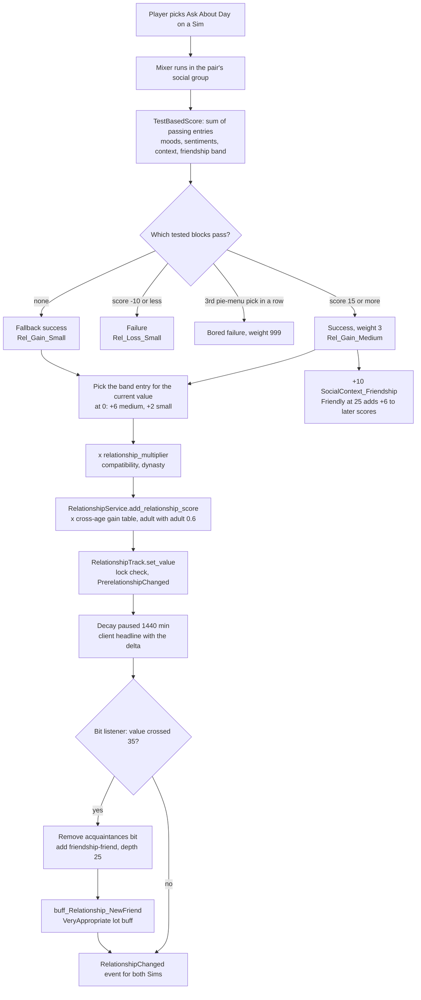
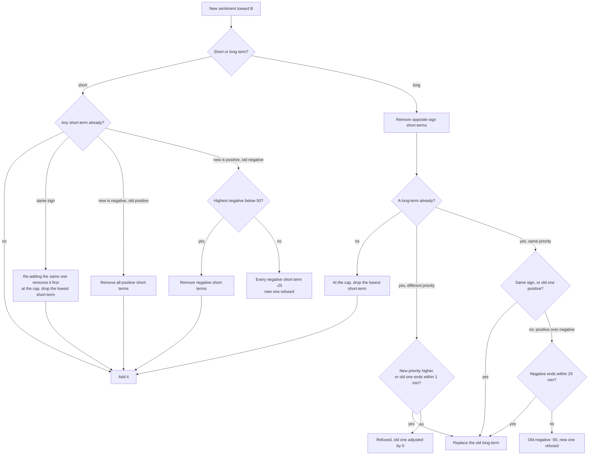

# 3.08 Relationships, socials and memories

*Game version 1.128.90.1030 (Steam, Linux/Proton). Numbers come from the live tuning (the base game's delta build, then each installed pack's delta build, merged) unless a line says full tuning or code default. Packs that supply numbers here: base game, EP04 (Cats & Dogs), EP06 (Get Famous), EP12 (High School Years) and GP12 (Werewolves); EP09 (Eco Lifestyle) and GP04 (Vampires) add 3 relationship bits each to the count; SP01 (Luxury Party) and SP42 (Grunge Revival) are installed but add nothing this chapter cites. Checked 2026-10-12: 136 claims checked, 28 corrected, 2 relabelled, 10 added.*

## In plain words

Every pair of Sims who have met shares one relationship record. It holds the two bars a player sees, friendship
and romance, which both Sims share, so the value is always the same from either side. On top of the bars sit labels
("Friend", "Spouse", "Despised"), each switched on and off by the bar crossing a line or by an event. One-way things live
on each side of the record: what this Sim knows about the other, and up to four feelings about them (sentiments such
as "Hurt" or "Close"), which fade on their own over four to ten Sim days.

Whether a friendly social works comes from a score. The game adds it up from both Sims' moods,
traits, sentiments, the mood of the conversation and the current friendship, then picks among the outcomes whose
conditions that score meets. For the everyday "Ask About Day" chat, any score above -10 and below 15 always succeeds
with a small gain; the chat fails only when the score drops to -10 or lower, or when the player has picked the same
social on that listener three times in a row (socials the Sims choose on their own never count). Gains shrink as the
bar rises: a first good chat with a stranger gives +6 friendship, the same chat between best friends gives +1, and the
pair's ages scale both: two adults get 60% of that, two young adults 120%, two teens double.

Friendship between two Sims you do not play never decays. For a played Sim outside your current household it decays
only while it sits between -20 and 20. Every change to a bar pauses its decay for a full Sim day. Romance between a
teen and an adult, or involving a child, is multiplied by zero at the moment it is added, so even the
`modifyrelationship` cheat cannot raise it.

## Key facts

- One record per unordered pair of Sim ids; friendship and romance are shared values, sentiments, knowledge and some
  labels are one-way. There is no per-Sim limit on how many relationships a Sim holds in the relationship code;
  story progression culls the shallowest ones for played NPCs past 35 (see [4.02](4.02-story-progression-townies.md)).
- Both main bars run -100 to 100, start at 0, converge to 0. Friendship decays 1.0 to 4.0 points per Sim day
  depending on the band; romance decays 1 to 6 per day and decays fastest when it is highest (75 to 100: 6 per day).
- Decay waits 1440 Sim minutes (one day) after every change to the bar before it resumes.
- Friendship labels: Despised at -70, Disliked at -20, Acquaintances near 0, Friend at 35, Good Friends at 60.
  Despised, Disliked, Friend and Good Friends each come off 5 points back toward 0 (Friend added at 35, removed
  below 30).
- Romance labels come from a two-axis table of romance against friendship: Soulmates need romance 75 with friendship
  60; Lovers at romance 50 (friendship 60) or 75 (friendship near 0); Enemies With Benefits at romance 50 with
  friendship -70.
- Friendship gains are banded by the current friendship value: Rel_Gain_Medium gives 8, 6, 2.5, 2, 1.5, 1 across
  six bands from below -40 to above 80. Losses grow with friendship: Rel_Loss_Large is -5 up to 20, -10 from 20 to 80,
  -15 above 80.
- From 0 to Friend (35) takes 14 medium-success chats or 28 small ones at a cross-age multiplier of 1. The friendship
  gain table makes that 25 and 47 for two adults (x0.6), 12 and 24 for two young adults (x1.2), 7 and 14 for two
  teens (x2).
- Romance is multiplied by 0 for every pair involving an infant, toddler or child, and for a teen with a young adult,
  adult or elder (crossAgeTuning_RomanceZero).
- A Sim can hold at most 4 sentiments toward another Sim. Each starts at 100 and loses 0.017 per minute (short-term,
  about 4.1 days) or 0.007 per minute (most long-term, about 9.9 days).
- A strong negative short-term sentiment (value 50 or more) blocks a new positive one and loses 25 instead.
- When Sims with sentiments are near each other, the game rolls the sentiment's effect at most once every 125 Sim
  minutes per direction, drawing one sentiment (or nothing); the "no effect" weight is 1, or 5 when the pair has only
  a neutral history.
- The conversation itself has a mood (social context): +10 per friendly success, "Friendly" at 25, and it does not
  decay while the Sims stay in the group (decay multiplier 0); outside the group it falls 0.55 per minute.
- Compatibility from EP13 (Growing Together), attraction and satisfaction from EP16 (Lovestruck), secrets from EP15 (For Rent) and EP21 (Royalty & Legacy), and matchmaking from EP16 are coded but
  need packs that are not installed here.
- 299 relationship bits, 9 relationship tracks, 71 sentiment tracks, 4 social-context tracks and 38 topics are live.

## How it works

### The relationship record

**Observed** (`relationships/relationship_service.py: RelationshipService._get_key_tuple`): the service keys every
relationship by the two Sim ids sorted low to high, so A-with-B and B-with-A are the same object. It also keeps a
list of relationships per Sim id (`_sim_relationships`) for lookups such as "all of this Sim's relationships".

**Observed** (`relationships/relationship_objects/sim_relationship.py: SimRelationship.get_track_tracker`): a
`SimRelationship` holds one shared part and two one-way parts.

- The shared part (`relationships/data/bidirectional_relationship_data.py`) holds tracks of type RELATIONSHIP
  (friendship, romance, the social-context tracks) and the bidirectional bits. A bidirectional bit is stored once and
  shown on both sides (`BidirectionalRelationshipData._update_client_from_bit_add` updates both Sims' panels).
- Each one-way part (`relationships/data/unidirectional_relationship_data.py`) holds SENTIMENT tracks, UNIDIRECTIONAL
  tracks, one-way bits (for example Widow and Widower), the `SimKnowledge` record and an optional custom label
  (`relationships/data/relationship_label_data.py`: label text and icon).
- `relationships/relationship_enums.py` defines the three track types and bit directionality; a bit defaults to
  BIDIRECTIONAL (`relationships/relationship_bit.py`).

**Observed** (`relationships/data/relationship_data.py: RelationshipData.depth`): relationship depth is the sum of
the `depth` of every bit present; `SimRelationship.get_relationship_depth` adds the shared part and the one-way part
for that Sim. Depth values from live tuning: has_met 1, acquaintances 10, disliked 15, friend 25, HasBeenFriends 25,
despised 35, good_friends 50, Significant_Other 50, Divorced 50, nemesis 75, BFF 100, Engaged 100, Married 100.
Depth is what story progression sorts by when it culls ([4.02](4.02-story-progression-townies.md)).

**Observed** (`relationships/relationship_objects/object_relationship.py`, `relationships/object_relationship_track_tracker.py`):
Sims also hold relationships with objects, keyed by Sim id and object definition id, with a name the player can set.
`ObjectRelationshipTrack.OBJECT_BASED_FRIENDSHIP_TRACKS` maps tracks to object tag sets (live: smart_Hub_Friendship_Main
for TagSet_Smart_Hub and four unresolved pairs). Object relationships always decay (`relationship_track.py:
BaseRelationshipTrack._should_decay`). `relationships/object_relationship_interactions.py` holds the interaction that
lets the player rename one.

### Tracks: values, decay and the bits they drive

Live counts: 9 RelationshipTrack instances (base 8, EP06 1), 4 short-term-context tracks and 1
object relationship track (**Observed**, a count over the live tuning).

**LTR_Friendship_Main** (id 16650, base delta). Range -100 to 100, initial 0, convergence 0. Interval decay in points
per Sim minute, with per-day equivalents (x1440):

| Friendship band | Decay per minute | Per Sim day |
|---|---|---|
| -100 to -70 | 0.002775 | 4.0 |
| -70 to -20 | 0.001735 | 2.5 |
| -20 to 35 | 0.000695 | 1.0 |
| 35 to 60 | 0.00104 | 1.5 |
| 60 to 100 | 0.000695 | 1.0 |

**Observed** (`LTR_Friendship_Main`, delta against full): the full build has the old field name
`_decay_rate_overrides` with values twice as large (0.00555 in the lowest band) and the old
`decay_only_affects_selectable_sims`; the base-game delta tuning replaces them with `_interval_decay_rates` and
`decay_affecting_played_sims`. The full build's romance bands are doubled the same way (0.00278 to 0.00833). Neither
old name appears anywhere in the current code (the live field is `_interval_decay_rates` in
`statistics/continuous_statistic_tuning.py`).

**LTR_Romance_Main** (id 16651, base delta). Base decay 0.001735 per minute (2.5 per day), with bands: -100 to -50 at
2 per day, -50 to 0 at 1, 0 to 25 at 3, 25 to 50 at 4, 50 to 75 at 5, 75 to 100 at 6. It adds HaveBeenRomantic the
first time romance reaches 10 (`_add_bit_on_threshold`). It is visible in the panel when the pair is married,
steady, engaged or getting married, or when romance is 10 or more.

**Observed** (`relationship_track.py: BaseRelationshipTrack._should_decay`, rescued per function from the
pyc): the decision whether a bar decays runs in this order.

1. No decay if the rate is 0 or the track is locked (a lock comes from a bit lock or a buff such as
   `Buff_Trait_Legendary`, see [3.07](3.07-personality-feelings.md)).
2. Object relationships always decay.
3. If the track has `decay_affecting_played_sims` (friendship and romance both do): decay if either Sim is in the
   active household. Otherwise, if either Sim is a played Sim, decay only if the relationship could be culled (no bit
   that prevents culling) and the value is strictly inside the tuned range, -20 to 20 live (code default -20 to 35).
   Otherwise, for two unplayed Sims, no decay.
4. A track without that field always decays.

**Observed** (`relationship_track.py: BaseRelationshipTrack.reset_decay_alarm`, `RelationshipTrack.set_value`): every
`set_value` resets the decay alarm, which turns decay off for `delay_until_decay_is_applied` minutes (1440 live for
friendship and romance). So a pair that talks at least once a day never decays.

**Observed** (`relationship_track.py: RelationshipTrack.set_value`): a value change does the following, in order.
A locked track ignores the change. Otherwise it fires `PrerelationshipChanged` for both Sims, sets the value, updates
visibility, resets the decay alarm, sends the relationship to the client with the delta (which drives the plus or
minus headline over the Sim's head), fires `RelationshipChanged` for both Sims, and writes a telemetry hook.

**Observed** (`relationships/relationship_track_tracker.py`, `relationships/tunable.py`): bits follow the value
through listeners. Each node in `bit_data_tuning` has a bit with an add value and a remove value; the gap between
them stops a label flickering at the boundary. When the value crosses a node, the tracker removes the old bit and adds
the new one. Friendship nodes (add, remove): despised -70/-65, disliked -20/-15, acquaintances -1/-1 below zero and
0/0 above, friend 35/30, good_friends 60/55; the neutral bit is relationshipBits_Friendship_NeutralBit.

**Observed** (`relationships/tunable.py`, the 2D bit data on `LTR_Romance_Main`): romance labels use a two-axis
table, romance on one axis and friendship rows on the other.

| Friendship row (add/remove) | Romance 75 | 50 | 25 | 10 | 0 | -10 | -50 |
|---|---|---|---|---|---|---|---|
| 60 / 55 | Soulmates | Lovers | Lovebirds | RomanticInterest | JustGoodFriends | ItsComplicated | ItsVeryComplicated |
| 35 / 30 | Sweethearts (50) | Sweethearts | Lovebirds | RomanticInterest | JustFriends | AwkwardFriends | BadRomance |
| 0 and -1 / 0 | Lovers | Lovebirds (25) | Lovebirds | RomanticInterest | Acquaintances | ItsAwkward | ItsVeryAwkward |
| -20 / -15 | HotAndCold (50) | HotAndCold | HotAndCold (10) | HotAndCold | Disliked | BadMatch | TerribleMatch |
| -70 / -65 | EnemiesWithBenefits (50) | EnemiesWithBenefits | HotAndCold (10) | HotAndCold | Despised | TerribleMatch | TotalOpposites |

Where a cell names a threshold in parentheses, the label starts at that romance value and covers the higher columns
of its row. Each romance threshold has a remove value 5 points closer to 0 (Soulmates 75/70, RomanticInterest 10/5,
ItsComplicated -10/-5, ItsVeryComplicated -50/-45); the 0 node has no gap.

**Observed** (`LTR_Friendship_Main.tested_initial_modifier`, `TestedSum.get_max_modifier` confirmed in bytecode): a
new friendship starts at 0 plus the largest passing modifier (0 if none pass): werewolf meeting vampire -50, a vampire
with the unpleasant aura -10, and five trait pairs that each need a trait from a pack not installed (+20, -20, +10,
-25, +25), so they never pass here. The full build has no initial modifier at all.

Other tracks (all **Observed**, live tuning):

- LTR_Mischief_Main: no decay, PartnersInCrime at 25 (removed at 20).
- LTR_Feud_Main (EP06): no decay.
- LTR_PetToPet_Friendship_Main: Hostile at -50 (remove -40), Friendly at 50 (remove 40), decays like friendship,
  species dog, cat, fox, horse. LTR_SimToPet_Friendship_Main (base delta): bits at -70, -20, -1, 35, 60; +5
  initial for a Sim with trait_Animal_Attraction (EP04). Its decay bands are the friendship ones under `_interval_decay_rates`
  (0.002775 to 0.000695 per minute); the EP04 full build, which the game does not read, has an older copy with them under
  `_decay_rate_overrides`. Pets are [3.12](3.12-pets-horses.md).
- LTR_SimToAnimalObject_Friendship_Main: friendship-like, for animal objects.
- relationshipTrack_Fear_BeingCheatedOn: converges to 100, decays 0.0174 per minute.
- relationshipTrack_Infant_CheckOn: decays 1 per minute from a maximum of 1440 (a one-day timer).

**Observed** (track `ad_data` curves, read by autonomy in [3.04](3.04-autonomy.md)): the utility curve that makes a
Sim want to socialize with someone is friendship -100 → 0, 0 → 1, 35 → 1.5, 100 → 1.75; romance -100 → 0, 0 → 1,
100 → 1.5; mischief and feud -100 → 0, 100 → 2.

**Observed** (`relationship_track.py: RelationshipTrack._should_initialize_first_same_sex_relationship_callback`,
`filters/sim_template.py: _add_gender_preference`): the first time a played Sim's romance with a same-gender Sim
reaches 2 (`ENABLE_AUTOGENERATION_SAME_SEX_PREFERENCE_THRESHOLD`), a global switch flips so newly generated Sims use
the "enabled" orientation weight tables. **Observed** (`sims.global_gender_preference_tuning`, base delta): both tables
are 50/50 live, so the switch changes nothing in this build.

### Cross-age multipliers

**Observed** (`relationships/relationship_service.py: RelationshipService.add_relationship_score` line 407,
`sim_relationship.py: SimRelationship.add_track_score`): every score added through the service is multiplied by the
track's cross-age table, the gain table when the increment is 0 or more, the loss table otherwise, looked up by
(actor age, target age) in `relationships/cross_age_tuning.py`. Non-Sim participants skip the table.

**Observed** (`crossAgeTuning_RomanceZero`, used for both gain and loss on `LTR_Romance_Main`): every pair that
includes an infant, toddler or child gets 0, and so does a teen with a young adult, adult or elder. Teen with teen and
young adult, adult and elder among themselves get 1. Romance through loot, the `modifyrelationship` cheat and
`relationship.add_score` all pass through the same multiplier.

**Observed** (`LTR_Friendship_Main.cross_age_multipliers`, base delta): friendship has its own tables, read as
(subject age, target age), where the subject is the Sim whose side the loot changes (the listener for Rel_Gain).
Gains: adult with adult 0.6, young adult with young adult 1.2, elder with elder 0.8, teen with teen 2, child with
child 2.5, toddler with toddler 2.25, adult to young adult 1, young adult to adult 0.8, teen to adult or elder 0.5;
toward an infant 1.8 from adults, elders and children, 0.8 from young adults and toddlers, 0.7 from teens. Losses: adult with adult 1.3, young adult with young adult 1.3, elder with elder
1.2, teen with teen 1.5, any infant 0.5. So two adults gain friendship at 60% of the loot tables below and lose it at
130%.

### Bits

**Observed** (a count over the live tuning): 299 RelationshipBit, 21 RelationshipBitCollection (rbc_Family_*, rbc_Friend_*,
rbc_Romantic, rbc_Sentiment_* and others), 18 SocialContextBit, 3 PromRelationshipBit (EP12).

What a bit can carry (**Observed**, `relationships/relationship_bit.py: RelationshipBit` tunables; counts from the
live data):

- `timeout` (39 bits): the bit removes itself after that many Sim minutes (`relationships/bit_timout.py` keeps the
  alarm, `RelationshipData._timeout_alarm_callback` removes it). Examples:
  TryToGreet 30, RecentNegativeSocial 60, InFightWith 240, quick-social hug and kiss 300, InQuarrelWith
  360, RecentFirstKiss 360, askedAboutSentiment 720, JustBrokeUpOrDivorced 2880, HaveDoneWooHoo_Recently 2880,
  DeadSpouse 2880, healedNegativeSentiment 4320.
- `autonomy_multiplier` (40 bits): scales how much autonomy wants to target that Sim. Family 1.25, siblings 1.5,
  parent 1.75, son or daughter and stepchild 2.25, spouse, steady, engaged and promised 1.75, TheyUnderstand 2,
  TwoPeasInAPod 3, situation bits 2 to 4, Dining 10, AlluringVisage 50, infant NotChecked 4.
- `buffs_on_add_bit` (40 bits): friend gives buff_Relationship_NewFriend, good friends Buff_NewGoodFriend, the romantic
  combos RomanticInterest, Lovebirds, Sweethearts, Lovers and Soulmates (and the steady bit) give an NPC
  TalkAboutMarriage buff, engaged, married, steady, divorced and widowed give their relationship buffs. `buffs_to_add_if_on_active_lot` gives the appropriateness buffs that unlock socials:
  friend VeryAppropriate, good friends and BFF Appropriateness_Friends, romantic bits Appropriateness_Lovers.
- `group_id` and `priority`: within a group, a new bit replaces the old one only if its priority is equal or higher.
  SignificantOther group: Significant_Other 1, Engaged 2, Promised 2, Married 3, Divorced 4, Despised_Ex 5,
  Broken_Up 6, Broken_Up_Engaged 7, Frustrated_Ex 8. Widow and Widower carry priority 4 but sit in no group.
- `required_bits` and `remove_on_threshold`: friendship-bff requires good_friends and removes itself when friendship
  falls to 10 or below. friendship-nemesis requires despised.
- `exclusive`: a Sim may hold the bit with one other Sim only (FanStan_Stan, StanCooldown, Feud_Target).
- `relationship_culling_prevention`: PLAYED_AND_UNPLAYED on 34 bits, PLAYED_ONLY on 33, ALLOW_ALL on 1 (the code
  default is ALLOW_ALL). `persisted_tuning` False on 9 bits rebuilt at load, such as neighbor,
  multi_unit_neighbor, GettingMarried, RenewingVows and the caregiver bits.
- `counts_as_incest` (17 family bits, including Cousin, ParentsCousin, CousinsChild, AuntUncle, NieceNephew,
  Grandnibling, GrandPibling, Halfsibling, Ancestor and Descendant).
- `bit_added_loot_list` and `bit_removed_loot_list`, notifications, a `whim_set`.

**Observed** (`relationships/relationship_bit_lock.py`): a bit lock blocks changes inside a bit group for a time. The
only live lock is relationshipBitLock_Pet_to_Pet (EP04): group PetRelationship, timeout 2160 minutes, relock when 75%
of the way (code defaults 360 minutes and 0). `relationships/relationship_lock_change.py` is the loot op that adds or
removes a lock; `relationships/relationship_bit_add.py` and `relationships/relationship_bit_change.py` are the loot ops
that add, remove or swap bits ([0.04](0.04-tests-loot-effects.md)).

**Observed** (`relationships/global_relationship_tuning.py`, module tuning in base delta): the global anchors are
REL_INSPECTOR_TRACK LTR_Friendship_Main (the default track for every command), DEFAULT_SHORT_TERM_CONTEXT_TRACK
SocialContext_Friendship, HAS_MET_RELATIONSHIP_BIT has_met, MARRIAGE romantic-Married, ENGAGEMENT romantic-Engaged,
STEADY romantic-Significant_Other, NEIGHBOR neighbor, DELAY_UNTIL_RELATIONSHIP_IS_CULLED 1440, and
MEANINGFUL_RELATIONSHIP_BITS (friend, good friends and BFF with their Evil variants, the BromanticPartner BFF, and
five romantic combos).
TropeGlobalTuning lists family and romance tropes by relationship type with ids that do not resolve here (a pack not
installed).

**Observed** (`relationships/neighbor_bit_fixup_helper.py`): when the household's home zone changes, neighbor and
multi-unit neighbor bits are checked and fixed.

### Incest prevention

**Observed** (`sims/sim_info.py: incest_prevention_test`, `relationships/relationship_objects/relationship.py`):
romance is blocked if the family tree service says the two are related; otherwise the relationship's
`considered_incest` flag, set by any bit with `counts_as_incest`, decides. The attraction tuning also tests "not
incestuous" (`relationships/attraction_tuning.py`).

### Social context: the mood of the conversation

**Observed** (`ShortTermContextRelationshipTrack` in `relationship_track.py`, live tuning): four short-term-context
tracks run per pair while they talk. All decay 0.55 per minute, with `socialization_decay_modifier` 0, which freezes
them while the two Sims share a social group, and `decay_to_initial_modifier` True, which on leaving the group sets
the convergence point to the tested initial modifier so the context drifts back to the pair's baseline.

| Track | Bits (add value) | Tested initial modifiers |
|---|---|---|
| SocialContext_Friendship | Abhorrent -75, Offensive -50, Distasteful -15, Casual 0/-1, Friendly 25 (remove 20) | -20 for trait 161628 at friendship -1 or lower; sentiments: Positive +10, Bitter -15, Close +20, Furious -50, Hurt -10; NosyNeighbor +10 |
| SocialContext_Fun | InsufferablyTedious -75, Tedious -50, Boring -25, Funny 25, Hilarious 75 | none read |
| SocialContext_Romance | Suggestive 25, Amorous 50, Steamy 75 | Enamored +30, Guilty -10, Hurt -10 |
| SocialContext_Awkwardness | VeryAwkward -50, Awkward -1, Casual 0 | Guilty -10 |

**Observed** (`data/bidirectional_relationship_data.py: get_prevailing_short_term_context_track`): the pair's
prevailing context is the context track with the largest absolute value; with none, SocialContext_Friendship is
added. **Observed** (`socials/social_tests.py: SocialContextTest.get_overall_short_term_context_bit`): for a group,
the game takes every pair's prevailing track, keeps the positive or the negative side (the negative side wins ties),
averages each track type and picks the strongest, then returns the bit at that average. This bit is what
"Friendly", "Tedious" and the others in the UI refer to, and what social scoring reads.

**Observed** (Loot_SocialContext_Friendship_Gain): a friendly success adds +10 to the friendship context, so three
successes move a Casual chat to Friendly. The same loot pulls the other contexts toward 0: Fun and Romance lose 20 at
50 or more and 10 between 15 and 50, and gain 20 at -50 or less and 10 between -50 and -15; Awkwardness gets the same
two gains on its negative side. Loot_SocialContext_Friendship_Gain_setFriendly sets the friendship context to 50 and
the other three to 0.

### Socials: from a click to a change on the bar

**Observed** (`interactions/social/social_mixer_interaction.py: SocialMixerInteraction`,
`interactions/social/social_super_interaction.py: SocialSuperInteraction`): a social is a mixer that runs inside a
social super interaction, which owns the social group. The mixer's outcome is an `InteractionOutcomeTestBased`
(`interactions/utils/outcome.py`, mechanics in [3.05](3.05-interactions-postures-routing.md)). Its decision rule,
confirmed in bytecode: prioritized outcomes, if any, are tested first and the first that passes is taken outright;
otherwise every tested block whose tests pass contributes its weighted outcomes, the fallback is used only when no
block passed, and one outcome is drawn by weight.

The score that the tests read is a `TestBasedScore` (`event_testing/test_based_score.py`): the sum of the scores of
every passing entry plus the numbers returned by batch tests. Relationship-band entries use closed intervals and add
every matching band (**Observed**, bytecode of `RelationshipTestBasedScore`).

Worked example: **mixer_social_AskAboutDay_targeted_Friendly_alwaysOn** (autonomous allowed), scored by
scores_socialoutcomes_friendly_smalltalk (**Observed**, live tuning).

Score entries (points):

- Actor's mood: Happy +5; Confident, Inspired +3; Energized, Flirty, Focused, Playful +2; Fine +1; Bored -2; Angry,
  Embarrassed, Sad, Uncomfortable -3; Dazed, Stressed, Scared -5.
- Listener's mood: Angry -9, Happy +5, any other +1.
- BFF +8. Target recently broken up or divorced (hidden buff) -15.
- Sentiments: Positive +5, Adoring +5, Bitter -8, Close +3, Furious -10, Guilty +5, Hurt -3.
- Lifestyles: opposing -10, shared +5. Fame difference +5 to +20. Socially awkward trait -2, -3 or -7 by charisma.
  Vampire aura -10. A charmer toddler +20.
- Social context: Boring -6, Tedious -10, InsufferablyTedious -15, Friendly +6, Distasteful -5, Offensive -10,
  Abhorrent -14, Awkward -3, VeryAwkward -5, the positive Fun and Romance contexts +1 each; Casual and any context not
  listed score 0 (`socials/social_tests.py: SocialContextTest`, `get(context, 0)`).
- Friendship band: -100 to -70 -8, -70 to -30 -4, -30 to -15 -2, -15 to 25 +1, 25 to 60 +5, 60 to 100 +8.
- Romance band: +1 for each of four bands (-100 to -50, -50 to 0, 0 to 50, 50 to 100) that matches. The bands are
  closed, so a value on a boundary matches two: romance 0 scores +2, friendship exactly 25 scores +6.

Outcome blocks:

| Block | Test | Weight | Result |
|---|---|---|---|
| 0 | score 15 or more | 3 (x1.1 with RegalResidence) | success: Rel_Gain_Medium, +10 friendship context, basic friendly success loot, a crush chance |
| 1 | score -10 or less | 2 | failure: Rel_Loss_Small, friendship context loss, Loot_DidNegativeSocial |
| 2 | score -20 or less | 1 | failure with the SociallyAwkward idle |
| 3 | testSet_SocialBoredom_Low | 999 | bored failure |
| fallback | nothing passed | | success: Rel_Gain_Small |

**Inferred** (arithmetic on the entries as tuned): two strangers in Fine moods in a Casual chat score 5 (+1 mood,
+1 listener, 0 context, +1 friendship band, +2 romance band), which passes no block, so the fallback success runs
every time. A Happy pair in a Friendly chat scores 19 (+5, +5, +6, +1, +2) and gets the medium success every time.
Failure needs a score of -10 or lower, or boredom.

**Inferred** (missing packs change these sums): six entries test for a relationship bit from a pack that is not
installed. The bit list is a pack-safe set, so the loader drops the missing bit (`instance_manager.get` raises
`UnavailablePackSafeResourceError` and `_TunableCollection.load_etree_node` skips the element, both read in bytecode),
and `RelationshipTest` skips the bit check when that set is empty (bytecode of `RelationshipTest.__call__`). The
entries then test the friendship range alone: +3 and +5 always, +20 and +5 at friendship -20 or more, -5 and -20 at
35 or less. In this install every smalltalk score is therefore 8 higher between friendship -20 and 35, 33 higher
above 35 and 17 lower below -20: the strangers above score 13 (still the fallback) and a Happy actor alone (17) is
enough for the medium success. Trait tests behave the other way: a missing whitelist trait stays as an empty slot
and the test fails (`sims/sim_info_tests.py: TraitTest`). Entries whose whole test is a missing test set are dropped.

**Observed** (`socials/group.py: SocialGroup._add_boredom`, `get_boredom`; `event_testing/test_variants.py:
SocialBoredomTest`): the group remembers, per Sim and per listener, how many times each mixer ran, for the last
`BOREDOM_QUEUE_SIZE` distinct mixers. That is 1 (code default; neither the full nor the delta build sets it), so
only the most recent mixer counts and any other counted social in between resets it. Only visible mixers that the
player picked from the pie menu are counted (bytecode of `_add_boredom`: it returns early for super interactions,
hidden ones and any other source), so autonomous socials neither add to the count nor reset it.
testSet_SocialBoredom_Low passes at a count of 3 or more (**Observed**: `TunableThreshold` defaults to
GREATER_OR_EQUAL, bytecode of `TunableThreshold.__init__` in `sims4/tuning/tunable.pyc`). **Inferred**: the count is
taken when the mixer starts (`SocialGroup._on_interaction_start`), so the third pick in a row is the first bored one.

**Observed** (Rel_Gain and Rel_Loss loots, base delta; `statistic_ops.py: StatisticAddRelationship`, a
[0.04](0.04-tests-loot-effects.md) module): each loot lists one entry per friendship band, applied to the listeners.
An entry applies when lower < value <= upper. Points:

| Loot | below -40 | -40 to 0 | 0 to 20 | 20 to 40 | 40 to 80 | above 80 |
|---|---|---|---|---|---|---|
| Rel_Gain_Large | 16 | 12 | 8 | 6 | 4 | 2 |
| Rel_Gain_Medium | 8 | 6 | 2.5 | 2 | 1.5 | 1 |
| Rel_Gain_Small | 4 | 2 | 1.5 | 1 | 0.5 | 0.5 |
| Rel_Loss_Large | -5 | -5 | -5 | -10 | -10 | -15 |
| Rel_Loss_Medium | -5 | -5 | -5 | -7 | -7 | -11 |
| Rel_Loss_Small | -2 | -2 | -2 | -2 | -3 | -4 |
| Loot_LTR_Romance_Large | 18 | 12 | 6 | 4.5 | 3 | 1.5 |
| Loot_LTR_Romance_Medium | 10 | 6 | 4 | 3 | 2 | 1 |
| Loot_LTR_Romance_Small | 6 | 4 | 2 | 1.5 | 1 | 0.5 |

Romance losses are flat: -2 (Small_Loss), -4 (Medium_Loss), -6 (Large_Loss). Romance bands are on the romance value.

**Observed** (`relationship_multiplier` on each Rel_Gain entry, a `TunableMultiplier`: base times the product of
every passing multiplier, `tunable_multiplier.py`): compatibility Amazing x1.5, Good x1.25, Bad x0.75, Awful x0.5;
allied dynasty x1.25, rival dynasty x0.75; on the 20 to 80 bands an infant listener or actor with trait_Infant_Sunny
x1.25 and trait_Infant_Cautious x0.75; and six entries that need a pack not installed, so they never pass here: two
test sets (x1.25, x0.75), a third test set (x1.5), and three x1.5 entries that pair a revealed secret or a buff with a
target trait (some base game, such as Kleptomaniac, Goofball and Evil).
Losses mirror the compatibility multipliers (Amazing x0.5 up to Awful x1.5). Compatibility never applies in this
install (below).

**Observed** (extra entries in the same loots): family get +5 more, up to a friendship of 94; coworkers +8 (Large),
+2.5 (Medium) or +1.5 (Small) to the target; a Day of the Dead buff +2.5; the friendship XP boost buff adds +3 romance
in the romance loots. Medium and Large gains carry randomWeightedLoot_AddSentiment_Socialization_Friendly_veryLowChance:
weight 100 for nothing, 5 for a Close sentiment and 1 for a short-term Adoring one, so about 4.7% and 0.9% before
their multipliers; with an infant listener the "nothing" weight drops to 2. Losses: a Loner listener has a 20% chance
of Embarrassed; -2 more with trait_Reward_Infant_Unhappy; a werewolf with the Prideful temperament may get a
narcissist buff (50%, 25%, 10% on Large, Medium, Small). Medium and Large losses also roll a 5% Bitter grudge
sentiment (x2 if the listener's friendship toward the actor is -25 or lower, x1.25 if the listener is Mean) and a 5%
short-term Hurt sentiment (x1.5 at friendship 60 or more, x2 for family).

**Inferred** (arithmetic on the tables, cross-age multiplier 1, no decay since every chat pauses it): from 0, medium
successes go +6, then six of +2.5 to 21, then seven of +2 to 35, so 14 chats reach Friend; small successes take
1 + 13 + 14 = 28 chats. With the age table: two adults (x0.6) need 25 medium or 47 small, two elders (x0.8) 18 or 35,
two young adults (x1.2) 12 or 24, two teens (x2) 7 or 14, two children (x2.5) 5 or 11 (computed by the checker).

The romantic counterpart, **mixer_social_ComplimentAppearance_targeted_romance_alwaysOn** (score
scores_socialoutcomes_romance_flirtation): success at 50 or more (weight 2), failure at 0 or less (weight 1), bad
failure at -15 or less (weight 3), boredom at testSet_SocialBoredom_Medium (4 repeats, weight 999), fallback success
with Rel_Gain_Small and Loot_LTR_Romance_Small (the 50-or-more success gives the same small gains). Failures add an
Awkwardness context loss, a friendship loss, a romance loss and an Embarrassed commodity. A score of 1 to 49
therefore always succeeds small; 0 or less always fails. Two prioritized outcomes come first: if the target is not
attracted to the actor's gender the flirt is rejected and the actor learns the target's orientation, and when an NPC
flirts with a played Sim who has trait_Loyal and is in a relationship with someone else, the played Sim rejects it
(**Observed**, live tuning).



### Greetings

**Observed** (`interactions/social/greeting_socials/greetings.py`, `social_super_interaction.py:
SocialSuperInteraction._greet_sim`): a social first checks whether the pair has the SpecialBits_Greeted bit. If not,
it adds the bit before the greeting so the greeting cannot repeat, then runs a greeting: a targeted greeting, unless
the target is in a group with more than one member, in which case a group greeting covers every ungreeted member.
Live: 66 TunableTestedGreetingTargeted and 14 group greetings. The module tuning lists the entry points by priority
and the game tries them from the highest down, taking the first whose tests pass (`greetings.py:
_try_push_greeting_for_sim` sorts descending). Of the 10 group entries 6 resolve here (priorities 10 to 60: fallback,
friends, family, romantic, then the two social-override sets); of the 33 targeted entries 19 resolve (priorities 1
to 170, with the EP04 pet greetings at 110 to 170 above the base romantic 50, family 40, best friends 30, friends 20
and acquaintance 10). The greeting needs the actor in a cone of 200 degrees around the target (ideal angle 0.6,
ideal radius 0 to 0.6).

**Observed** (`sims/sim_info_manager.py`, `greetings.py`): the greeted bit is removed when a Sim spawns
(`update_greeted_relationships_on_spawn`) and when the zone spins up, unless both Sims travelled together. So Sims
greet again each visit. `interactions/social/greeting_socials/greeting_commands.py` registers
`greetings.make_sim_ungreeted`, `greetings.make_all_sims_ungreeted` and `greetings.toggle_greeted_rel_bit`.

### Topics

**Observed** (`topics/topic.py`, `topics/tunable.py`, `objects/components/topic_component.py`): a topic is a short
conversation memory on a Sim ("talked about the weather"). It has a `score_bonus` that content scoring adds to socials
that test for it, and a relevancy that is either a count of interactions or a number of minutes. Adding a topic again
resets its relevancy. **Observed** (`interactions/base/interaction.pyc`, bytecode, the module did not decompile):
`Interaction.build_basic_elements` schedules `_decay_topics`, which calls `sim.decay_topics()`, so a counted topic
loses one per interaction the Sim runs. Live: 38 Topic instances, all from the base delta (the base full build's 39 others are not read), and 1
TopicList. `server_commands/topic_commands.py` registers `topic.add_topic`, `topic.remove_topic` and
`topic.remove_all_topics`.

### Knowledge: what one Sim knows about another

**Observed** (`relationships/sim_knowledge.py: SimKnowledge`): each direction of a relationship keeps what Sim A knows
about Sim B: known traits (only trait types in `KNOWLEDGE_TRAIT_TYPES`), career, university major, relationship status,
romantic and woohoo orientation (genders read from the orientation traits, plus whether B is exploring), net worth,
some statistics and relationship tracks, relationship expectations, and secrets (a confronted list and one
unconfronted secret).

**Observed** (`relationships/relationship_knowledge_ops.py`): loot ops write it. `KnowOtherSimTraitOp` learns
specified traits, a random number of traits or all of them, and picks only traits not already known (bytecode
confirmed). The others: career, sexual orientation, relationship expectations, statistic, relationship track, major,
net worth, relationship status, secret and confront secret. `relationships/knowledge_handler.py` is the debug (GSI)
view of the same data.

### Sentiments

**Observed** (a count over the live tuning): 71 SentimentTrack instances are live (base 41,
EP12 18, GP12 12). By archetype: Close 18, Bitter 14, Enamored 9, Hurt 9, Guilty 8, Adoring 6, Furious 5, HasCrushOn 1,
Motivated 1. By duration and sign: 32 short negative, 21 short positive, 14 long positive, 4 long negative. No
age-changing sentiments are live.

**Observed** (`relationships/sentiment_track.py`, live tuning): every sentiment starts at 100 with a minimum of 0 and
converges to 0. Decay rates: 0.017 per minute on 52 tracks (100 points last about 98 hours, 4.1 days), 0.007 on 13
(about 9.9 days), 0.01 on 5 (about 6.9 days: the long-term Bitter cheating, grudge and proposal sentiments, long-term
Hurt generic and short-term Guilty FateDefied), 0 on TwoPeasInAPod. When a sentiment reaches convergence it removes
itself (`data/relationship_data.py: RelationshipData.track_reached_convergence`). Each sentiment's bit is its neutral
bit, present for as long as the track exists.

**Observed** (`relationships/sentiment_track_tracker.py: SentimentTrackTracker.add_statistic` and its helpers, branch
order confirmed in bytecode): adding a sentiment follows these rules. The cap is SENTIMENT_CAP 4 (code default, the
tunable's maximum is also 4).



Module values (base delta): NEGATIVE_SHORT_TERM_VALUE_THRESHOLD 50 (value), SHORT_TERM_VALUE_ADJUSTMENT -25,
NEGATIVE_LONG_TERM_VALUE_THRESHOLD 25 (minutes left), LONG_TERM_VALUE_ADJUSTMENT -50; LONG_TERM_PRIORITY_VALUE_THRESHOLD
1 and PRIORITY_VALUE_ADJUSTMENT 0 are code defaults; MAX_AGE_CHANGING_SENTIMENT_CAP 3. A missing priority counts as -1.
**Inferred** (replace semantics above): a direction never holds more than one long-term sentiment.

**Observed** (`SentimentTrackTracker._on_target_in_proximity`, bytecode confirmed): the tracker registers a callback
on the actor's proximity component. When the target comes near: if the cooldown has not passed, nothing happens.
Otherwise the cooldown is set to now plus PROXIMITY_LOOT_COOLDOWN (125 minutes live, code default 100), and one draw
is made across all of the pair's sentiments, each weighted by its `proximity_loot_chance_weight` (bassinet targets
skip a sentiment unless it opts in, as sibling jealousy does), plus a "nothing" entry. Every loot in the drawn
sentiment's `loot_on_proximity` list then runs. The first cooldown starts 125 minutes after the first sentiment is
added.

Weights (**Observed**, live): `proximity_loot_chance_weight` is 3 on 52 sentiments, 12 on 18, 6 on 1, and x0 while
the actor is asleep, possessed or recharging. The "nothing" weight PROXIMITY_NO_LOOT_CHANCE_WEIGHT is 1, x5 when
friendship is -10 to 10 and the pair has none of HasBeenFriends, HaveBeenRomantic, roommate, family, in-law, in a fight
or quarrel, nemesis, despised or PartnersInCrime. **Inferred**: one weight-3 sentiment and the default "nothing" weight
fire about 75% of the time when they meet (3 of 4); with a neutral history, 3 of 8.

Example payload (**Observed**, random_Sentiment_Buffs_Close_generic): Happy 12, Playful 3, Flirty 3 (Flirty only if
romance is above 15 and the Sim is not Enamored), a Happy contagion buff at 20 when the other Sim is Happy, and a Sad
contagion buff at 100 when the other Sim is Sad, Stressed or Uncomfortable (**Inferred**: then about 85% of these
draws give the sad buff); buff_Sentiment_Close_Happy_Primary_generic is Happy weight 2 for 120 minutes. Sentiments also shift social scores and the initial social context (tables above). The buffs they
grant work like any other moodlet ([3.07](3.07-personality-feelings.md)).

### Compatibility, attraction and satisfaction (packs not installed)

**Observed** (`relationships/compatibility.py: Compatibility.required_packs` EP13): the compatibility score is only
calculated with EP13, which is not installed, so it stays at the code default and the compatibility multipliers on
Rel_Gain and Rel_Loss never fire here. The levels (`relationships/compatibility_tuning.py`, lower bound inclusive):
Awful -100 to -6, Bad -6 to -2, Neutral -2 to 2, Good 2 to 6, Amazing 6 to 100. Toddlers and younger are skipped;
NPC_PREFERENCE_COUNT_MAX defaults to 1; the level-change loots (ids 308871 to 308875) do not resolve.

**Observed** (`relationships/attraction_tuning.py`, `relationships/satisfaction_tuning.py`, both `required_packs`
EP16): attraction is BASE_ATTRACTION_VALUE plus the `attraction_modifier` of each attraction trait the actor has, on
track 358555 (unresolved); it requires romance-allowed ages and humans, not incestuous, and a romantic or woohoo
orientation. Satisfaction uses track 362100 (unresolved). `relationships/attraction_ops.py` holds
`RefreshAttractionLootOp`; `relationships/attraction_commands.py` registers the debug commands
`relationship.attraction.refresh`, `relationship.attraction.set_refresh_enabled` and
`relationship.attraction.show_calculation`.

### Gender, orientation and relationship expectations

**Observed** (`sims/global_gender_preference_tuning.py`, `sims/gender_preference.py`, base delta): romantic interest
per gender is the statistics statistic_GenderPreference_Female and statistic_GenderPreference_Male, attracted at 1 or
more (GENDER_PREFERENCE_THRESHOLD). The orientation traits are trait_GenderOptions_AttractedTo_* (romance) and
trait_SexualOrientation_WooHooInterests_* (woohoo); trait_isGrimReaper is always attractive. A generated Sim who is
exploring gets 50/50 attracted or not per gender, and 50/50 exploring or not. `GenderPreferenceOp` adds to the
preference statistics only for Sims who are exploring, in both directions.

**Observed** (`sims/relationship_expectations_tuning.py`, base delta): chance that a generated Sim gets the "yes"
trait: Physical exclusivity 60%, Emotional exclusivity 50%, Woohoo exclusivity 60%, Open to change 75%.

**Observed** (`sims/sims_pairing_preference.py`): `SimsPairingPreference` pairs Sims greedily by a score, then by the
shortest distance; group paired dances use it.

### Household defaults

**Observed** (`relationships/relationship_tracker_tuning.py: DefaultRelationshipInHousehold`, live): Sims placed in
one household start with: family members friendship 45 and has_met; roommates 15; a steady couple romance 40 with
FirstKiss and HaveBeenRomantic; spouses and fiances romance 75 with FirstKiss, HaveDoneWooHoo and HaveBeenRomantic
(steady couples and spouses also get the Fear_BeingCheatedOn track, fiances do not); a Sim and a pet 33 on the
Sim-to-pet track; two pets 33 with random pet bits.

### Culling: how relationships end

**Observed** (`data/relationship_data.py: RelationshipData.track_reached_convergence`,
`relationship_objects/relationship.py: Relationship._create_culling_alarm`): when a track with
`causes_delayed_removal_on_convergence` (friendship has it) reaches its convergence value and the relationship can be
culled, a 1440-minute alarm starts; when it fires and culling is still allowed, the service destroys the relationship.

**Observed** (`relationship.py: Relationship.can_cull_relationship`, `sim_relationship.py`,
`relationship_data.py`): a relationship is never culled if both Sims share a household, if any bit is
PLAYED_AND_UNPLAYED, or, when either Sim is a played Sim, if any bit is PLAYED_ONLY. With convergence considered,
every culling track must also sit at convergence.

**Observed** (`story_progression_action_relationship_culling.py`, base delta, covered in
[4.02](4.02-story-progression-townies.md)): the culling action runs between 2:00 and 5:00 (the factory default of its
`time_of_day`) and culls the lowest-depth relationships of played NPCs with other NPCs over
PLAYED_NPC_TO_PLAYED_NPC_MAX_RELATIONSHIPS 35 (code default 20), with PLAYED_NPC_REL_DEPTH_CULLING_THRESHOLD 0 (code
default 30) and CULLING_BUFFER_AMOUNT 5 (code default).

### Memories

**Observed** (`memories.py: TunableMemoryTrigger`, `send_memory_trigger_update`): in this build a "memory" is a
client-side trigger. An interaction can carry one; on start it sends `MemoryTriggerUpdate` with a memory id and a
timeout (default 10 seconds), and on finish it sends the "off" message. Nothing about the memory is stored in the
relationship. **Inferred**: the client uses it to prompt a screenshot memory; the client code is not readable here.

### Reputation (EP06)

**Observed** (`reputation/reputation_tuning.py`, EP06 tuning): reputation is the ranked statistic
rankedStatistic_Reputation (id 192283): initial 200, convergence 200, no decay, and only active when the gameplay
option ALLOW_REPUTATION is on. Its event intervals 21, 80, 60, 79, 60, 80, 20 give rank boundaries at 21, 101, 161,
240, 300, 380 and 400, for the seven ranks Terrible, ReallyBad, Bad, Neutral, Good, ReallyGood, Pristine (200 starts
in Neutral). Crossing 300 (Really Good), 380 (Pristine) and reaching 400 also grant civic-policy influence points,
small, medium and large. Loots: gains Tiny 0.25, Small 1, Medium 3, Large 6, Huge 12 (x1.2, x1.4 and up by fame
level); losses -0.375, -1.5, -4.5, -9, -18. The MustBeSeen variants go through a broadcaster: radius 25, line of
sight, up to 20 witnesses, excluding the active household, the actor and the target. `reputation/reputation_commands.py`
registers `reputation.set_allow_reputation` and `reputation.show_allow_reputation` (Automation).

### Social media

**Observed** (`social_media/social_media_service.py: SocialMediaService.calculate_social_media_followers`,
`social_media/social_media_tuning.py`, base delta): followers are commodity_Social_Media_FollowerCount,
recounted daily at 6:00 (code default). The recount is:

```text
lost   = ceil(current * 1 / 100)
base   = regular_posts * 7 + contextual_posts * 10        (posts in the last day)
gain   = int(base * (1 + ln(current)) * posting_modifier) + reactions * 3
new    = int(current - lost + gain)
```

Live values 7, 10 and 3 (code defaults 50, 50 and 10). The posting modifier is the first band with
min <= posts < max: [1, 10) x1, [11, 20) x0.8, [100, 21) x0.5, [101, 1000000) x0.2, otherwise x1. **Observed**: the
third band has its min and max swapped so it can never match, and 10 posts or 20 to 100 posts fall through to x1.
Code caps: 30 feed posts, 30 friends, 10 reactions per post. Friends are tracked with
relationshipBit_Social_Media_ContactList. Post types: DEFAULT, DIRECT_MESSAGE, FRIEND_REQUEST, FOLLOWERS_UPDATE,
PUBLIC_POST (the recount counts PUBLIC_POST as regular and DEFAULT as contextual); 12
narratives from FRIENDLY to PRANK (`social_media/__init__.py`). `social_media/social_media_loot.py` holds post, reaction
and add-friend loot ops; `social_media/social_media_post.py` the post, DM and reaction records;
`social_media/social_media_tests.py` a "new post" test; `social_media/social_media_picker_interaction.py` (4 live) and
`social_media/social_media_multi_picker.py` (3 live) the picker interactions.

### Secrets (EP15 and EP21, not installed)

**Observed** (`sims/secrets/*`, `sims/secrets/sim_secrets_service.pyc` required_packs EP15 and EP21): secrets and scandals
are coded but no SimSecret instance is live here. `sims/secrets/tunable_sim_secret.py` defines the secret,
`sims/secrets/sim_secret_enums.py` severities MINOR, MEDIUM, MAJOR and statuses, `sims/secrets/sim_secret_loot_ops.py`
the create, discover, status and sell loots, `sims/secrets/sim_secret_tunables.py` DAILY_UPDATE_TIME 9:00 (base delta),
and `sims/secrets/sim_secrets_notebook_entries.py` the notebook entry. Knowledge holds secrets per direction (above).

### Matchmaking (EP16, not installed)

**Observed** (`matchmaking/matchmaking_profiles.py`, `matchmaking/matchmaking_enum.py`,
`services/matchmaking_service.pyc` required_packs EP16): profiles are WORLD_NPC, GENERATED_NPC or GALLERY_NPC;
`MatchmakingData` counts contact actions per day; a match adds relationshipBit_Matchmaking_AddedOnMatchmakingApp, which
times out after 2880 minutes. The service did not decompile and is not in this chapter's module list.

## Numbers

| Name | Value | Unit | Where | Source |
|---|---|---|---|---|
| Friendship range, initial, convergence | -100..100, 0, 0 | points | LTR_Friendship_Main | live (base delta) |
| Friendship decay by band | 0.002775 / 0.001735 / 0.000695 / 0.00104 / 0.000695 | points per Sim minute | LTR_Friendship_Main `_interval_decay_rates` | base delta; full build has double values under `_decay_rate_overrides` |
| Romance decay base | 0.001735 | points per minute | LTR_Romance_Main | base delta |
| Romance decay bands | 2, 1, 3, 4, 5, 6 | points per day | LTR_Romance_Main | base delta |
| delay_until_decay_is_applied | 1440 | Sim minutes | friendship, romance | base delta |
| decay_affecting_played_sims range | -20..20 | points | friendship, romance | base delta; code default -20..35 |
| Friendship bits add/remove | -70/-65, -20/-15, -1/-1, 0/0, 35/30, 60/55 | points | LTR_Friendship_Main bit_data | base delta |
| HaveBeenRomantic threshold | 10 | romance | LTR_Romance_Main `_add_bit_on_threshold` | base delta |
| Romance combo thresholds | 75, 50, 25, 10, 0, -10, -50 | romance | LTR_Romance_Main 2D bit data | base delta |
| Friendship rows of the romance table | 60, 35, 0/-1, -20, -70 | friendship | LTR_Romance_Main 2D bit data | base delta |
| Friendship initial modifiers | -50, -10, +20, -20, +10, -25, +25 | points | LTR_Friendship_Main tested_initial_modifier | base delta |
| Autonomy curve friendship | (-100,0) (0,1) (35,1.5) (100,1.75) | utility | LTR_Friendship_Main ad_data | live (same in full) |
| Autonomy curve romance | (-100,0) (0,1) (100,1.5) | utility | LTR_Romance_Main ad_data | base delta |
| Romance cross-age | 0 for child pairs and teen with adult | multiplier | crossAgeTuning_RomanceZero | base delta |
| Friendship cross-age gain | A-A 0.6, YA-YA 1.2, E-E 0.8, T-T 2, C-C 2.5, A to YA 1, YA to A 0.8 | multiplier | LTR_Friendship_Main cross_age_multipliers | base delta |
| Friendship cross-age loss | A-A 1.3, YA-YA 1.3, E-E 1.2, T-T 1.5, any infant 0.5 | multiplier | LTR_Friendship_Main cross_age_multipliers | base delta |
| PartnersInCrime | 25 / 20 | mischief | LTR_Mischief_Main | base delta |
| Pet-to-pet bits | -50/-40, 50/40 | points | LTR_PetToPet_Friendship_Main | base delta |
| Sim-to-pet initial for Animal Attraction | +5 | points | LTR_SimToPet_Friendship_Main | base delta |
| Fear_BeingCheatedOn | convergence 100, decay 0.0174 | per minute | relationshipTrack_Fear_BeingCheatedOn | base delta |
| Infant_CheckOn | max 1440, decay 1 | per minute | relationshipTrack_Infant_CheckOn | base delta |
| Same-sex autogeneration threshold | 2 | romance | GlobalGenderPreferenceTuning | base delta module tuning |
| Orientation generation weights | 50/50 | weight | GENDER_PREFERENCE_WEIGHTS, ENABLED_AUTOGENERATION_* | base delta |
| GENDER_PREFERENCE_THRESHOLD | 1 | statistic | GlobalGenderPreferenceTuning | base delta |
| Relationship expectations yes chance | 60, 50, 60, 75 | percent | RelationshipExpectationsTuning | base delta |
| Social context decay | 0.55 | points per minute | SocialContext_* tracks | base delta |
| socialization_decay_modifier | 0 | multiplier | SocialContext_* | base delta; code default 1 |
| Friendly context | 25 / 20 | points | SocialContext_Friendship | base delta |
| Context gain per friendly success | +10 | points | Loot_SocialContext_Friendship_Gain | base delta |
| AskAboutDay success / failure / bad failure | 15, -10, -20 | score | mixer_social_AskAboutDay_targeted_Friendly_alwaysOn | base delta |
| AskAboutDay weights | 3, 2, 1, 999 | weight | same | base delta |
| Flirt success / failure / bad failure | 50, 0, -15 (weights 2, 1, 3) | score | mixer_social_ComplimentAppearance_targeted_romance_alwaysOn | base delta |
| Boredom threshold | 3 (Low), 4 (Medium) | pie-menu repeats | testSet_SocialBoredom_Low, testSet_SocialBoredom_Medium | base delta |
| Missing-pack score entries | +3, +5; +20, +5 at friendship -20 or more; -5, -20 at 35 or less | score | scores_socialoutcomes_friendly_smalltalk | base delta, Inferred to fire here |
| BOREDOM_QUEUE_SIZE | 1 | mixers | SocialGroup | code default |
| Rel_Gain_Large / Medium / Small | 16..2 / 8..1 / 4..0.5 | points | loots | base delta |
| Rel_Loss_Large / Medium / Small | -5..-15 / -5..-11 / -2..-4 | points | loots | base delta |
| Romance gains Large / Medium / Small | 18..1.5 / 10..1 / 6..0.5 | points | Loot_LTR_Romance_* | base delta |
| Romance losses | -6, -4, -2 | points | Loot_LTR_Romance_*_Loss | base delta |
| Compatibility multipliers on gain | 1.5, 1.25, 0.75, 0.5 | multiplier | Rel_Gain_* | base delta (inactive without EP13) |
| Dynasty multipliers | 1.25, 0.75 | multiplier | Rel_Gain_* | base delta |
| Coworker extra gain | 8, 2.5, 1.5 | points | Rel_Gain_Large, Medium, Small | base delta |
| Close and Adoring sentiment on gain | 5 and 1 of 106 | weight | randomWeightedLoot_AddSentiment_Socialization_Friendly_veryLowChance | base delta |
| Grudge and Hurt sentiment on loss | 5% each (grudge x2, x1.25; hurt x1.5, x2) | chance | Rel_Loss_Medium, Rel_Loss_Large | base delta |
| SENTIMENT_CAP | 4 | sentiments | SentimentTrackTracker | code default |
| MAX_AGE_CHANGING_SENTIMENT_CAP | 3 | sentiments | SentimentTrackTracker | code default |
| NEGATIVE_SHORT_TERM_VALUE_THRESHOLD | 50 | value | SentimentTrackTracker | base delta |
| SHORT_TERM_VALUE_ADJUSTMENT | -25 | value | SentimentTrackTracker | base delta |
| NEGATIVE_LONG_TERM_VALUE_THRESHOLD | 25 | minutes left | SentimentTrackTracker | base delta |
| LONG_TERM_VALUE_ADJUSTMENT | -50 | value | SentimentTrackTracker | base delta |
| LONG_TERM_PRIORITY_VALUE_THRESHOLD, PRIORITY_VALUE_ADJUSTMENT | 1, 0 | minutes, value | SentimentTrackTracker | code default |
| PROXIMITY_LOOT_COOLDOWN | 125 | Sim minutes | SentimentTrackTracker | base delta; code default 100 |
| PROXIMITY_NO_LOOT_CHANCE_WEIGHT | 1 (x5 neutral history) | weight | SentimentTrackTracker | base delta |
| Sentiment initial value | 100 | value | SentimentTrack | live |
| Sentiment decay | 0.017 (52), 0.007 (13), 0.01 (5), 0 (1) | per minute | SentimentTrack | live |
| proximity_loot_chance_weight | 3 (52), 12 (18), 6 (1) | weight | SentimentTrack | live |
| Close proximity buffs | Happy 12, Playful 3, Flirty 3, Happy contagion 20, Sad contagion 100 | weight | random_Sentiment_Buffs_Close_generic | live |
| Compatibility levels | -6, -2, 2, 6 | score | CompatibilityTuning | code default (EP13 missing) |
| Bit timeouts | 3 to 4320 | Sim minutes | 43 RelationshipBit | live |
| Bit autonomy multipliers | 1.25 to 50 | multiplier | 41 RelationshipBit | live |
| Bit depths | 1 to 100 | depth | RelationshipBit | live |
| Pet bit lock | 2160, 75% | minutes, percent | relationshipBitLock_Pet_to_Pet | EP04; code defaults 360, 0 |
| DELAY_UNTIL_RELATIONSHIP_IS_CULLED | 1440 | Sim minutes | RelationshipGlobalTuning | base delta |
| PLAYED_NPC_TO_PLAYED_NPC_MAX_RELATIONSHIPS | 35 | relationships | story progression culling | base delta; code default 20 |
| PLAYED_NPC_REL_DEPTH_CULLING_THRESHOLD | 0 | depth | story progression culling | base delta; code default 30 |
| Culling action window | 2:00 to 5:00 | time of day | StoryProgressionRelationshipCulling time_of_day | code (factory) default |
| Household defaults | 45, 15, 40, 75, 33 | points | DefaultRelationshipInHousehold | live |
| Greeting cone | 200 degrees, ideal 0.6 | angle, radius | greetings | live |
| Greeting priorities | group 10 to 60, targeted 1 to 170 (entries that resolve) | priority | Greetings GROUP_GREETINGS, TARGETED_GREETINGS | base delta module tuning |
| FRIENDSHIP_TRACK_FILTER_THRESHOLD, ROMANCE_TRACK_FILTER_THRESHOLD | 35, 10 | points | RelationshipTrack module | base delta |
| Reputation initial, convergence | 200, 200 | value | rankedStatistic_Reputation | EP06 |
| Reputation rank boundaries | 21, 101, 161, 240, 300, 380, 400 | value | rankedStatistic_Reputation | EP06 |
| Reputation gains / losses | 0.25..12 / -0.375..-18 | value | reputation loots | EP06 |
| Reputation witness broadcaster | 25, 20 | radius, Sims | MustBeSeen loots | EP06 |
| Follower post values | 7, 10, 3 | followers | SocialMediaTunables | base delta; code 50, 50, 10 |
| Follower loss per day | 1 | percent | SocialMediaTunables | code default |
| Follower recount | 6:00 | time of day | SocialMediaTunables | code default |
| Posting modifiers | 1, 0.8, 0.5 (dead band), 0.2 | multiplier | FOLLOWERS_POSTING_MODIFIER | base delta |
| Secret daily update | 9:00 | time of day | SimSecretTunables | base delta |
| Matchmaking bit timeout | 2880 | Sim minutes | relationshipBit_Matchmaking_AddedOnMatchmakingApp | live |
| Memory trigger timeout | 10 | seconds | TunableMemoryTrigger | code default |

## Data shapes

- **RelationshipService** (`relationships/relationship_service.py`): `_relationships` maps (low id, high id) to a
  `Relationship`; `_sim_relationships` maps a Sim id to its relationships; methods `add_relationship_score`,
  `set_relationship_score`, `add_relationship_bit`, `remove_relationship_bit`, `destroy_relationship`.
- **Relationship** (`relationships/relationship_objects/relationship.py`): `_sim_id_a`, `_sim_id_b`,
  `_bi_directional_relationship_data`, `_culling_alarm_handle`, `considered_incest`. **SimRelationship** adds
  `_sim_a_relationship_data` and `_sim_b_relationship_data` (one-way data) and knowledge refresh.
  **ObjectRelationship** keys a Sim against an object definition id and stores a name.
- **RelationshipData** (`relationships/data/relationship_data.py`): `_bits` (bit type to instance), `_bit_timeouts`
  (`BitTimeoutData`: bit, alarm handle, remaining time), cached depth, `_track_tracker`, back pointer to the
  relationship. **BidirectionalRelationshipData** adds bit locks and the prevailing-context lookup.
  **UnidirectionalRelationshipData** adds `sentiment_track_tracker`, `track_tracker`, `knowledge` (`SimKnowledge`) and
  label data.
- **RelationshipTrack** (`relationship_track.py`, rescued): statistic range, `initial_value`, `_default_convergence_value`,
  `decay_rate`, `_interval_decay_rates` (interval, `decay_override`), `bit_data_tuning` (`bit_set` of nodes with
  `bit`, `add_value`, `remove_value`, or a 2D link with `y_axis_track` and `y_axis_content` rows), `_neutral_bit`, `tested_initial_modifier`
  (base value plus tested modifiers, max taken), `decay_affecting_played_sims` (`range_decay_threshold`),
  `delay_until_decay_is_applied`, `causes_delayed_removal_on_convergence`, `persist_at_convergence`,
  `display_priority`, `cross_age_multipliers` (gain and loss tables), `species_requirements`, `_add_bit_on_threshold`,
  `ad_data` curve, `_AB_interval_decay_rates` (per A/B group). **ShortTermContextRelationshipTrack** adds
  `socialization_decay_modifier` and `decay_to_initial_modifier`.
- **SentimentTrack** (`relationships/sentiment_track.py`): `duration` (SHORT, LONG, AGE_CHANGING), `sign` (POSITIVE,
  NEGATIVE), `long_term_priority`, `loot_on_proximity`, `proximity_loot_chance_weight` (a tested multiplier),
  `should_proximity_loot_include_bassinet`, `archetype_name`, `age_up_map`.
- **RelationshipBit** (`relationships/relationship_bit.py`): `depth`, `priority`, `group_id`, `directionality`,
  `timeout`, `exclusive`, `visible`, `invisible_filterable`, `autonomy_multiplier`, `buffs_on_add_bit`,
  `buffs_to_add_if_on_active_lot`, `required_bits`, `remove_on_threshold`, `triggered_track`,
  `relationship_culling_prevention`, `persisted_tuning`, `counts_as_incest`, `collection_ids`, `bit_added_loot_list`,
  `bit_removed_loot_list`, notifications, `whim_set`, `reincarnation_bits`. **RelationshipBitCollection** groups bits
  for tests.
- **SimKnowledge** (`relationships/sim_knowledge.py`): known traits, career, major, relationship status, romantic and
  woohoo preference, net worth, stats, tracks, expectations, secrets.
- **Social outcome**: a mixer's `outcome` (test-based blocks of weighted outcomes plus a fallback), each outcome a
  set of loots; `TestBasedScore` entries (test plus score) and batch tests.
- **SocialMediaPost** (`social_media/social_media_post.py`): author, post type, narrative, content, reactions;
  **SocialMediaDirectMessage**; **SocialMediaPostReaction**.
- Persistence of relationships, bits and tracks in the save is [1.02](1.02-saves-persistence.md) and
  [8.04](8.04-save-file-format.md).

## For modders

Common tweaks:

- **Faster or slower friendship**: edit the six bands of Rel_Gain_Small, Rel_Gain_Medium and Rel_Gain_Large
  (Loot instances). Every friendly social uses one of the three, so this rescales the whole game. To change one age
  pairing only, edit the gain table in `cross_age_multipliers` on LTR_Friendship_Main.
- **Decay**: `_interval_decay_rates` and `decay_affecting_played_sims` on LTR_Friendship_Main and LTR_Romance_Main;
  `delay_until_decay_is_applied` sets how long a change pauses decay.
- **Label thresholds**: `bit_data_tuning` on the track (add and remove values per node).
- **Social difficulty**: the score instances (scores_socialoutcomes_friendly_smalltalk,
  scores_socialoutcomes_romance_flirtation and their siblings) and the block thresholds on the mixer's outcome.
- **Sentiment lifetime**: `decay_rate` on each SentimentTrack; the cap and replacement thresholds are module tuning
  on `relationships.sentiment_track_tracker`.
- **Household start values**: `DefaultRelationshipInHousehold` in `relationships.relationship_tracker_tuning`.

Commands (`server_commands/relationship_commands.py` unless noted). Cheat needs testing cheats on; a command with
no type is DebugOnly, the default in `sims4/commands.py: Command`; Automation and DebugOnly are developer types, see
[1.04](1.04-debug-cheats-telemetry.md).

| Command | Type | What it does |
|---|---|---|
| `modifyrelationship <first last> <first last> <amount> <track>` | Cheat | adds to a track through the service, cross-age multipliers included |
| `relationship.make_all_sims_friends`, `relationships.create_friends_for_sim`, `relationship.introduce_sim_to_all_others`, `relationship.test_marriage` | Cheat | bulk friendships, introductions, marriage test |
| `relationship.create`, `introduce_all_sims`, `clear`, `remove_bit`, `print_depth`, `print_info`, `print_score`, `print_non_reciprocal`, `check_culling_alarms`, `hide_relationship`, `print_hidden_relationships` | DebugOnly | create, clear and inspect relationships |
| `relationship.add_knows_career`, `remove_knows_career`, `add_knows_sexuality`, `remove_knows_sexuality`, `add_knows_relationship_expectations`, `remove_knows_relationship_expectations` | DebugOnly | edit knowledge |
| `relationship.update_compatibilities`, `print_compatibility` | DebugOnly | compatibility (no effect without EP13) |
| `relationships.set_object_relationship`, `relationships.print_object_relationship` | DebugOnly | object relationships |
| `relationship.add_score`, `set_score`, `add_track` (sets to max), `remove_track`, `add_bit`, `destroy`, `bulk_add_reltrack`, `bulk_remove_reltrack`, `set_can_add_reltrack`, `enforce_marriage`, `set_average_relationships`, `qa.relationship.print_info` | Automation | scripted edits |
| `relationships.change_ab_group`, `relationships.clear_ab_group`, `relationship.open_sim_profile_ui`, `relationships.set_object_relationship_name` | Live | A/B decay groups, profile UI, naming an object relationship |
| `relationship.attraction.refresh`, `set_refresh_enabled`, `show_calculation` | DebugOnly | attraction (EP16) |
| `greetings.make_sim_ungreeted`, `make_all_sims_ungreeted`, `toggle_greeted_rel_bit` | DebugOnly | greetings |
| `topic.add_topic`, `remove_topic`, `remove_all_topics` | DebugOnly | topics (`server_commands/topic_commands.py`) |
| `reputation.set_allow_reputation`, `show_allow_reputation` | Automation | reputation option |
| `social_media.create_post`, `create_dm`, `get_posts`, `calculate_followers`, `add_reaction_to_post` | Automation | social media |
| `social_media.show_social_media_dialog`, `social_media_add_friend`, `social_media_remove_friend`, `social_media_mark_posts_seen`, `social_media_mark_messages_seen`, `add_reaction_to_post_ids` | Live | social media UI |
| `sim_secrets.list`, `add`, `confront`, `determine_target`, `generate` and nine untyped ones (`get_sim_secrets`, `create_secret_scandal`, `update_secret_status`, `clear_all_secrets_scandals` and others) | DebugOnly | secrets (EP15/EP21) |
| `sim_secrets.set_blackmail_system_enabled`, `set_scandal_system_enabled` (EP21), `recalculate_scandal_expiration_date` | Live | secrets options |
| `sim_secrets.add_multiple_secrets`, `add_multiple_known_secrets` (EP21) | Automation | bulk test secrets |
| `matchmaking.*` (17 commands) | Live | matchmaking UI (EP16); the three `toggle_*` options are EP16-gated |
| `matchmaking.save_all_candidates`, `get_contacted_sim_ids` (EP16) | Automation | matchmaking test hooks |

Traps:

- **The full build's track XML is stale.** LTR_Friendship_Main and LTR_Romance_Main in the full tuning use
  `_decay_rate_overrides` and `decay_only_affects_selectable_sims` with doubled rates; the base-game delta tuning uses
  `_interval_decay_rates` and `decay_affecting_played_sims`. Start an override from the delta, or the
  old field names do nothing. The EP04 Sim-to-pet track still ships its bands under the old name.
- **Cross-age friendship is not 1.** Every friendship gain is scaled by the age table, so two adults climb at 0.6.
  Rebalancing the Rel_Gain loots without that in mind overshoots for teens (x2) and undershoots for adults.
- **Missing-pack bits loosen score tests.** A relationship test whose `match_any` bits all belong to absent packs
  keeps only its score range and passes; a trait whitelist with absent traits fails. Check a score
  instance for unresolved ids before reading its sums.
- **Cross-age zero applies to cheats too.** `modifyrelationship` and `relationship.add_score` both go through
  `add_relationship_score`, which always applies the cross-age table, so romance for a teen and an adult stays 0.
  `relationship.set_score` and `relationship.add_track` set the value directly.
- **Two NPCs never drift apart.** With `decay_affecting_played_sims` set, NPC-to-NPC friendship does not decay at all;
  removing the field makes every pair in the world decay.
- **Bit group priority blocks downgrades.** A new bit in the SignificantOther group replaces only a bit of equal or
  lower priority, so adding Significant_Other (1) to a married pair (3) does nothing.
- **Compatibility multipliers look live and are not.** They sit in every Rel_Gain entry but the score is only computed
  with EP13.
- **Sentiment cap is not tunable past 4.** SENTIMENT_CAP's tunable maximum is 4.
- **Posting modifier dead band.** The third FOLLOWERS_POSTING_MODIFIER band has min 100 and max 21 and never matches.
- **Social context freeze.** With `socialization_decay_modifier` 0, context only resets after the group breaks up.

## Limits

- `relationships/relationship_track.py` and `relationships/relationship_tracker.py` did not decompile and are not in
  the decompiled source; they were read from the per-function rescues and from disassembly. The
  `RelationshipTrack` class body and `check_relationship_track_display_priorities` failed even per function, so the
  display-priority rule (which track shows first in the panel) is not described.
- `interactions/base/interaction.pyc` and `sims4/tuning/tunable.py` did not decompile. Topic decay, the default
  comparison of `TunableThreshold` (GREATER_OR_EQUAL, used by the boredom test) and the pack-safe drop in tuning
  collections were read from bytecode. The drop was read in the XML loader; that the binary delta tuning goes through
  the same rule is inferred, so the missing-pack score entries are labelled Inferred.
- `services/matchmaking_service.pyc` and `sims/secrets/sim_secrets_service.pyc` exist only as bytecode and their packs
  (EP16, EP15, EP21) are not installed; they were read for their pack gates only.
- Compatibility (EP13), attraction and satisfaction (EP16), secrets (EP15/EP21), matchmaking (EP16), the trope tables
  and the trait pairs in the friendship initial modifiers need packs that are not installed; their ids do not resolve.
- Several decompiled conditions are garbled (`SimRelationship.add_track_score`, `SocialGroup._add_boredom`,
  `SocialContextTest.get_overall_short_term_context_bit`, `BidirectionalRelationshipData.can_cull_relationship`);
  the descriptions above give the evident intent and say so where it matters.
- The client side (relationship panel layout, the memory screenshot prompt, social media UI) lives in the client
  executable, which this book does not read.
- Scores in the worked example add the entries as tuned, then the missing-pack effect separately; per-Sim trait and
  buff entries not listed can move them.

## File index

Modules the book assigns to this chapter (paths under `simulation/` in the decompiled source):

| Module | What it holds | Depth |
|---|---|---|
| `interactions/social/__init__.py` | social interaction helpers (`SocialInteractionMixin` content and greeting hooks) | skim |
| `interactions/social/MountHorseSuperInteraction.py` | mounting a horse as a social super interaction | listed (horses need a pack not installed; see [3.12](3.12-pets-horses.md)) |
| `interactions/social/greeting_socials/__init__.py` | package marker | skim |
| `interactions/social/greeting_socials/greeting_commands.py` | the three greeting commands | deep |
| `interactions/social/greeting_socials/greetings.py` | greeted bit, targeted vs group greeting, spawn reset | deep |
| `interactions/social/social_mixer_interaction.py` | `SocialMixerInteraction`: social test, perform, outcome | deep |
| `interactions/social/social_object_super_interaction.py` | socials that target an object with a jig (touching socials) | skim |
| `interactions/social/social_picker_super_interaction.py` | social that picks a Sim from a list, distance estimates | skim |
| `interactions/social/social_super_interaction.py` | `SocialSuperInteraction`: owns the group, `_greet_sim` | deep |
| `interactions/social/social_throw_mixer_interaction.py` | social mixers that throw an object with impact reactions | skim |
| `matchmaking/__init__.py` | package marker | skim |
| `matchmaking/matchmaking_commands.py` | matchmaking UI commands, EP16 toggles | skim |
| `matchmaking/matchmaking_enum.py` | `ProfileType` | deep |
| `matchmaking/matchmaking_profiles.py` | `MatchmakingProfile`, `MatchmakingData` | skim |
| `memories.py` | `TunableMemoryTrigger`, client memory trigger message | deep |
| `relationships/__init__.py` | package marker | skim |
| `relationships/attraction_commands.py` | attraction debug commands | deep |
| `relationships/attraction_ops.py` | `RefreshAttractionLootOp` | skim |
| `relationships/attraction_tuning.py` | attraction formula, EP16 gate | deep |
| `relationships/bit_timout.py` | `BitTimeoutData`: alarm per timed bit | skim |
| `relationships/compatibility.py` | compatibility score, EP13 gate | deep |
| `relationships/compatibility_tuning.py` | compatibility levels and loots | deep |
| `relationships/cross_age_tuning.py` | age-by-age gain and loss tables | deep |
| `relationships/data/__init__.py` | package marker | skim |
| `relationships/data/bidirectional_relationship_data.py` | shared tracks and bits, prevailing context, culling check | deep |
| `relationships/data/relationship_data.py` | bits, timeouts, depth, convergence culling, culling prevention | deep |
| `relationships/data/relationship_label_data.py` | custom relationship label text and icon | skim |
| `relationships/data/unidirectional_relationship_data.py` | one-way tracks, sentiments, knowledge | deep |
| `relationships/global_relationship_tuning.py` | `RelationshipGlobalTuning`, `TropeGlobalTuning` | deep |
| `relationships/knowledge_handler.py` | GSI view of knowledge | skim |
| `relationships/neighbor_bit_fixup_helper.py` | neighbor bit fix-up on home zone change | skim |
| `relationships/object_relationship_interactions.py` | rename an object relationship | skim |
| `relationships/object_relationship_track_tracker.py` | track tracker for object relationships | skim |
| `relationships/relationship_bit.py` | `RelationshipBit`, collections, bit types | deep |
| `relationships/relationship_bit_add.py` | loot op that adds bits | skim |
| `relationships/relationship_bit_change.py` | loot op that swaps or removes bits | skim |
| `relationships/relationship_bit_lock.py` | `RelationshipBitLock` | deep |
| `relationships/relationship_enums.py` | track types, directionality, culling prevention | deep |
| `relationships/relationship_handlers.py` | GSI relationship view and the add-bit cheat menu | skim |
| `relationships/relationship_knowledge_ops.py` | knowledge loot ops | deep |
| `relationships/relationship_lock_change.py` | loot op that adds or removes a bit lock | skim |
| `relationships/relationship_objects/__init__.py` | package marker | skim |
| `relationships/relationship_objects/object_relationship.py` | `ObjectRelationship` | skim |
| `relationships/relationship_objects/relationship.py` | `Relationship`: scores, culling alarm, incest flag | deep |
| `relationships/relationship_objects/sim_relationship.py` | `SimRelationship`: one-way data, cross-age multiplier | deep |
| `relationships/relationship_service.py` | the service: keys, add score, bits, destroy | deep |
| `relationships/relationship_tests.py` | relationship tests (bits, tracks, intervals) | deep |
| `relationships/relationship_track_bit_data_tuning.py` | per-track bit data containers | skim |
| `relationships/relationship_track_tracker.py` | track tracker, listeners, locks | deep |
| `relationships/relationship_tracker_tuning.py` | household default relationships | deep |
| `relationships/satisfaction_tuning.py` | satisfaction track, EP16 gate | skim |
| `relationships/sentiment_track.py` | `SentimentTrack` tunables | deep |
| `relationships/sentiment_track_tracker.py` | sentiment cap, add rules, proximity roll, balloons | deep |
| `relationships/sim_knowledge.py` | `SimKnowledge` | deep |
| `relationships/tunable.py` | bit set and 2D bit set tunables | deep |
| `relationships/unidirectional_relationship_track.py` | one-way relationship track class | skim |
| `reputation/__init__.py` | package marker | skim |
| `reputation/reputation_commands.py` | reputation option commands | deep |
| `reputation/reputation_tuning.py` | `ReputationTunables` | deep |
| `sims/gender_preference.py` | `GenderPreferenceOp` and helpers | skim |
| `sims/global_gender_preference_tuning.py` | orientation statistics, traits, generation weights | deep |
| `sims/relationship_expectations_tuning.py` | expectation traits and chances | deep |
| `sims/secrets/__init__.py` | package marker | skim |
| `sims/secrets/sim_secret_commands.py` | secret debug commands, EP21 toggles | skim |
| `sims/secrets/sim_secret_enums.py` | severities, statuses | skim |
| `sims/secrets/sim_secret_loot_ops.py` | scandal create, discover, status, sell loots | listed (EP15/EP21 not installed, no live data) |
| `sims/secrets/sim_secret_tunables.py` | `SimSecretTunables` daily update | skim |
| `sims/secrets/sim_secrets_notebook_entries.py` | scandal notebook entry | listed (EP15/EP21 not installed) |
| `sims/secrets/tunable_sim_secret.py` | `SimSecret` | skim |
| `sims/sims_pairing_preference.py` | `SimsPairingPreference` | skim |
| `social_media/__init__.py` | narratives, post types, polarity | deep |
| `social_media/social_media_commands.py` | social media commands | deep |
| `social_media/social_media_loot.py` | post, reaction, add-friend loots | skim |
| `social_media/social_media_multi_picker.py` | multi-Sim picker | skim |
| `social_media/social_media_picker_interaction.py` | picker interaction, content types | skim |
| `social_media/social_media_post.py` | post, DM, reaction records | skim |
| `social_media/social_media_service.py` | feed, DMs, follower recount | deep |
| `social_media/social_media_tests.py` | `NewSocialMediaPostTest` | skim |
| `social_media/social_media_tuning.py` | `SocialMediaTunables` | deep |
| `socials/__init__.py` | package marker | skim |
| `socials/bouquet_toss_group.py` | bouquet toss group | listed (group formation is [3.05](3.05-interactions-postures-routing.md)) |
| `socials/carried_group.py` | group around a carried Sim | listed (3.05 ground) |
| `socials/clustering.py` | object and social group clustering services | listed (3.05 ground) |
| `socials/constraintless_group.py` | group with no position constraint | listed (3.05 ground) |
| `socials/formation_group.py` | formation groups | listed (3.05 ground) |
| `socials/geometry.py` | social geometry scoring | listed (3.05 ground) |
| `socials/group.py` | `SocialGroup`: membership, mixer lockout, boredom registry | skim (boredom read; geometry is 3.05) |
| `socials/group_anchored.py` | group anchored to an object | listed (3.05 ground) |
| `socials/interrogation_group.py` | interrogation group | listed (3.05 ground) |
| `socials/jigs/__init__.py` | package marker | skim |
| `socials/jigs/jig_reserved_space.py` | reserved space per species | listed (jigs are 3.05) |
| `socials/jigs/jig_type_animation.py` | jig from an animation | listed (jigs are 3.05) |
| `socials/jigs/jig_type_definition.py` | jig from an object definition | listed (jigs are 3.05) |
| `socials/jigs/jig_type_explicit.py` | explicit jig offsets | listed (jigs are 3.05) |
| `socials/jigs/jig_type_legacy.py` | legacy jig | listed (jigs are 3.05) |
| `socials/jigs/jig_utils.py` | jig polygons and social distance | listed (jigs are 3.05) |
| `socials/jigs/jig_variant.py` | jig variant tunable | listed (jigs are 3.05) |
| `socials/pet_group.py` | pet social group | listed (3.05 and 3.12 ground) |
| `socials/side_group.py` | side groups, game groups, in-object groups | listed (3.05 ground) |
| `socials/social_focus_manager.py` | who looks at whom in a group | skim |
| `socials/social_game_group.py` | social game group | listed (3.05 ground) |
| `socials/social_scoring.py` | group placement cost functions | listed (3.05 ground) |
| `socials/social_tests.py` | `SocialContextTest`, overall context bit | deep |
| `socials/throwing_group.py` | throwing group | listed (3.05 ground) |
| `topics/__init__.py` | package marker | skim |
| `topics/topic.py` | `Topic`: relevancy, score bonus | deep |
| `topics/tunable.py` | topic tunables and tests | deep |

Also read for this chapter (missing from the decompiled source, or owned by other chapters): `relationships/relationship_track.py`
and `relationships/relationship_tracker.py` (per-function rescues), `interactions/base/interaction.pyc`
(bytecode), `interactions/utils/outcome.py` and `event_testing/test_based_score.py` ([3.05](3.05-interactions-postures-routing.md),
[0.04](0.04-tests-loot-effects.md)), `statistics/statistic_ops.py` and `tunable_multiplier.py`
([0.04](0.04-tests-loot-effects.md)), `objects/components/topic_component.py`, `sims/sim_info_manager.py`,
`filters/sim_template.py`, `event_testing/test_variants.py`, `server_commands/relationship_commands.py`,
`server_commands/topic_commands.py`, `story_progression_action_relationship_culling.py`
([4.02](4.02-story-progression-townies.md)), `sims4/tuning/tunable.pyc` (bytecode: `TunableThreshold`, the pack-safe
drop in `_TunableCollection`), `sims4/tuning/instance_manager.py`, `sims/sim_info_tests.py: TraitTest`,
`statistics/continuous_statistic_tuning.py`, `sims/secrets/sim_secrets_service.pyc` and
`services/matchmaking_service.pyc` (strings only).

Tuning used: LTR_Friendship_Main, LTR_Romance_Main, LTR_Mischief_Main, LTR_Feud_Main, LTR_PetToPet_Friendship_Main,
LTR_SimToPet_Friendship_Main, LTR_SimToAnimalObject_Friendship_Main, relationshipTrack_Fear_BeingCheatedOn,
relationshipTrack_Infant_CheckOn, SocialContext_Friendship, SocialContext_Fun, SocialContext_Romance,
SocialContext_Awkwardness, crossAgeTuning_RomanceZero, Rel_Gain_Large, Rel_Gain_Medium, Rel_Gain_Small,
Rel_Loss_Large, Rel_Loss_Medium, Rel_Loss_Small, Loot_LTR_Romance_Small, Loot_LTR_Romance_Medium,
Loot_LTR_Romance_Large and their _Loss variants, Loot_SocialContext_Friendship_Gain,
Loot_SocialContext_Friendship_Gain_setFriendly, Loot_BestFriendsForever_AddBoth,
randomWeightedLoot_AddSentiment_Socialization_Friendly_veryLowChance,
mixer_social_AskAboutDay_targeted_Friendly_alwaysOn, scores_socialoutcomes_friendly_smalltalk,
mixer_social_ComplimentAppearance_targeted_romance_alwaysOn, scores_socialoutcomes_romance_flirtation,
testSet_SocialBoredom_Low, testSet_SocialBoredom_Medium, random_Sentiment_Buffs_Close_generic,
buff_Sentiment_Close_Happy_Primary_generic, loot_Sentiment_AddSentiment_Bitter_grudge_veryLowChance_ListenersAboutActor,
loot_Sentiment_AddSentiment_Hurt_generic_veryLowChance_ListenersAboutActor, relationshipBitLock_Pet_to_Pet,
rankedStatistic_Reputation, loot_Reputation_Gain_Tiny to _Huge and loot_Reputation_Loss_Tiny to _Huge,
broadcaster_Reputation_SeenLoot_Instant_Gain_Medium, commodity_Social_Media_FollowerCount, smart_Hub_Friendship_Main,
all 299 RelationshipBit, 71 SentimentTrack and 38 Topic
instances (counted), and the module tuning of relationships.global_relationship_tuning, relationships.relationship_track,
relationships.relationship_tracker_tuning, relationships.sentiment_track_tracker, relationships.compatibility_tuning,
relationships.attraction_tuning, relationships.satisfaction_tuning, sims.global_gender_preference_tuning,
sims.relationship_expectations_tuning, social_media.social_media_tuning, sims.secrets.sim_secret_tunables,
reputation.reputation_tuning, socials.group, interactions.social.greeting_socials.greetings and
story_progression.story_progression_action_relationship_culling.
