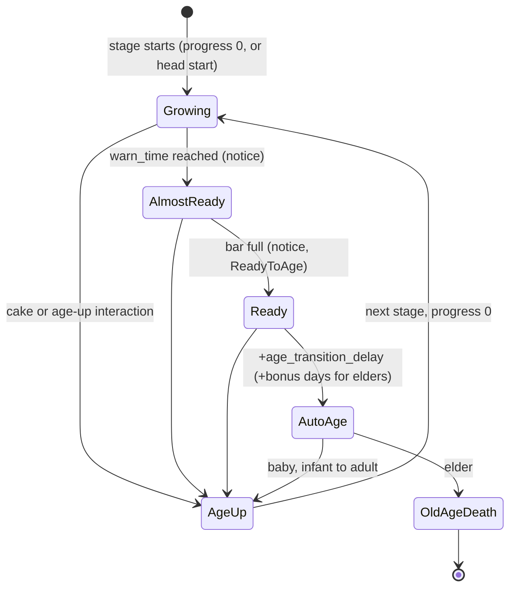
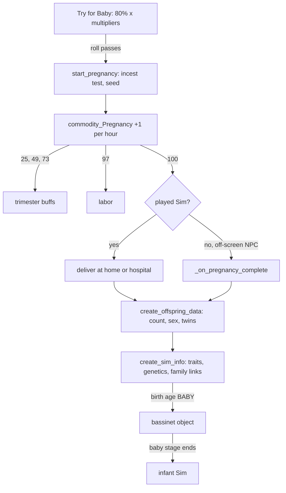

# 3.09 Life cycle: aging, babies, family and death

*Game version 1.128.90.1030 (Steam, Linux/Proton). The numbers are base-game tuning, read from the live tuning unless a row says otherwise, with EP04 (Cats & Dogs), EP06 (Get Famous), EP09 (Eco Lifestyle), EP12 (High School Years), GP04 (Vampires), GP12 (Werewolves), SP01 (Luxury Party) and SP42 (Grunge Revival) installed; installed packs ship no module tuning, so every module value is base game. Systems that need a pack this install lacks are described from code and from `Delta/` patch data, and are labelled so. Checked 2026-10-12: 174 claims checked, 20 corrected, 3 relabelled, 0 removed, 2 added. Deepened 2026-10-13: 7 modules newly explained, 1 failed decompile read. Checked again 2026-10-13: 102 claims checked, 17 corrected, 2 relabelled, 2 removed. Cross-chapter edits 2026-10-13: 4 applied.*

## In plain words

Every Sim carries an age bar that fills by one unit per Sim day. Each life stage has its own bar length, and the lifespan setting picks one of three lengths per stage: Long is exactly four times Normal and Short is exactly half. At Normal a human spends 132 Sim days across the eight stages, and each stage waits one more day after the "ready to age up" notice before it ages on its own. A cake ages a Sim up at once; a Potion of Youth only rewinds the current stage. The end of the elder bar starts the old-age death, and nothing about its timing is random: the only dice in a lifespan are a head start that a Sim gets once (up to about three days at Normal, four times that on Long and half on Short), and it is the same for the same Sim every time.

A newborn is not a person at first. During the baby stage (1 Sim day at Normal, plus the usual extra day if nobody ages it up) it is a bassinet object that holds the Sim's data; at the age-up the bassinet is swapped for an infant Sim standing next to it. Pregnancy is a 0 to 100 bar that rises by one point per Sim hour, so a birth comes about 100 Sim hours (a little over four Sim days) after conception at every lifespan setting. Twins and triplets are decided at the delivery from weights of 89, 10 and 1, with dice that were fixed at conception. A full household cannot get pregnant, and a household that is nearly full cannot have twins at all: a pregnancy reserves a household slot from the start.

Family links come from one family tree that walks parents upward. Two Sims are relatives when they share an ancestor, and what they call each other (sibling, cousin, great-aunt) depends only on how many generations each is from the closest shared ancestor. Romance and babies are refused when those two distances add up to five or less. Adoption draws from a pool of lightweight Sims that the game invents on the spot and forgets whenever a lot loads.

Many family features in the menus belong to packs this install does not have: wills and funerals from EP17 (Life & Death), developmental milestones from EP13 (Growing Together), family recipes from EP18 (Businesses & Hobbies), imaginary friends from EP20 (Adventure Awaits), dynasties and forged family trees from EP21 (Royalty & Legacy), and the parenting curfew from GP05 (Parenthood). Their code is in the base game and some of it runs, but the tuning that would make them do anything is missing here.

## Key facts

- **Age bar:** an `AgeProgressContinuousStatistic` that rises 1 per Sim day; the stage length is `AgingTransition._age_durations[setting]` times every matching lifespan-trait multiplier (`aging_transition.py: AgingTransition.get_age_duration`).
- **Human stage lengths at Normal (Sim days):** baby 1, infant 5, toddler 7, child 14, teen 21, young adult 28, adult 42, elder 14: 132 in total. Long uses 4 times these numbers, Short half (live `agingTransition_Human_*`).
- **Auto aging** fires `age_transition_delay` (1 day, the code default, untuned) after the bar is full; the warning comes `age_transition_warning` days before full (1 for baby to toddler, 2 from child up).
- **First-load head start:** a Sim flagged `needs_age_progress_randomized` starts its stage at `random.Random((age_trait_id, sim_id)).uniform(0, length times limit)`, up to about 1, 2 or 3 days at Normal depending on the stage (the length includes the setting, so four times that on Long and half on Short). It is deterministic per Sim and stage.
- **Old age** has no random roll: the elder dies when the elder bar is full plus 1 day plus bonus days, and the bonus days are multiplied by normal length / current length (so Long shrinks them to a quarter).
- **Elder lifespan traits (live):** `trait_Longevity` 2.175 times, `trait_active` 1.47 times, multiplied together when both apply.
- **Default aging options** before the save's options load: only the active household ages; unplayed Sims do not (`aging_service.py: AgingService.__init__`).
- **Try for Baby** on a bed: 80% base, times 1.5 for `trait_Fertile`, times 0 for several gender-option and age cases (`bed_TryForBaby`).
- **Pregnancy** fills `commodity_Pregnancy` 0 to 100 at `PREGNANCY_RATE` 0.016667 per Sim minute (1 per hour): trimester 1 from 25, trimester 2 from 49, trimester 3 from 73, labor from 97, delivery at 100.
- **Litter size** is rolled at delivery from weights 89 / 10 / 1 (one, two, three babies); `trait_Fertile` on the pregnant Sim multiplies the single-birth weight by 0.4382 (about 78 / 20 / 2). The result is capped at the household's free slots plus one.
- **Identical twins:** each baby after the first copies the previous baby's sex and genetics 33.33% of the time (code default 50).
- **Seeded and unseeded:** litter size, sex and genetics use a per-pregnancy seed drawn at conception; trait picks at birth, NPC age-up traits and aspirations use the shared global random.
- **Relatives:** the closest common ancestor's two depths index a 4 by 4 matrix of family bits; a combined distance of 5 or less counts as incest, which takes in cousins but not second cousins (`family_tree_service.py: FamilyTreeService.is_relationship_incest`).
- **Adoption:** human picker entries ask for 1 to 2 babies, infants and toddlers of each sex and 1 to 3 children of each sex; adopting one costs 1000 Simoleons; the second parent is the adopter's spouse.
- **Developmental milestones** need EP13 (`DevelopmentalMilestoneTracker.required_packs`), so the 14 installed `lifeMilestone_*` records never run here.

## How it works

### The age bar and the lifespan setting

**Observed** (`sims/aging/aging_statistic.py: AgeProgressContinuousStatistic`): the bar is a continuous statistic with minimum 0, convergence at plus infinity and a rate of `decay_modifier / 1440` per Sim minute, which is 1 per Sim day. `set_modifier` has no caller in the scripts, so the rate never changes.

**Observed** (`sims/aging/aging_transition.py: AgingTransition.get_age_duration`): a stage's length is `_age_durations[sim_info._age_speed_setting]` times the product of `trait_age_duration_mutliplier` (EA's spelling) over every trait in that map that the Sim has. `AgeSpeeds` (`aging_enums.py`) is FAST 0, NORMAL 1, SLOW 2, UNKNOWN 3. **Inferred**: these are the Short, Normal and Long lifespan options of the game menu.

**Observed** (live `agingTransition_Human_*`, base delta; the full build has no records by these names):

| Stage | Short | Normal | Long | Head-start limit | Warning (days) |
|---|---|---|---|---|---|
| Baby | 0.5 | 1 | 4 | 0 | 1 (default) |
| Infant | 2.5 | 5 | 20 | 20% | 1 (default) |
| Toddler | 3.5 | 7 | 28 | 14.29% | 1 (default) |
| Child | 7 | 14 | 56 | 14.29% | 2 |
| Teen | 10.5 | 21 | 84 | 9.52% | 2 |
| Young adult | 14 | 28 | 112 | 10.71% | 2 |
| Adult | 21 | 42 | 168 | 7.14% | 2 |
| Elder | 7 | 14 | 56 | 21.43% | 2 |

Totals: 66, 132 and 528 Sim days. `age_transition_delay` is not tuned on any human stage, so the code default of 1 day applies everywhere.

**Observed** (live, trait map on the transitions): elder `trait_Longevity` 2.175 and `trait_active` 1.47 (both base game). The same maps name traits from three packs that are not installed, EP07 (Island Living), EP17 and EP19 (Enchanted by Nature): 199043 (EP07 `trait_OccultMermaid`, elder 3.35), 377826 (EP17 `trait_MovingOn_Hidden_NoRegrets`, 1.25 on young adult, adult and elder) and 414620 (EP19 `trait_OccultFairy_TYAE`: young adult 1.3572, adult 1.31, elder 2.145). Those names come from patch data, pack not installed; the references resolve to nothing here.

**Observed** (`aging_mixin.py: AgingMixin.set_aging_speed`): changing the setting keeps the bar's percentage and rescales the days. `set_last_save_scaled_age_progress` does the same on load when the setting changed since the save.

### Who ages

**Observed** (`sims/aging/aging_service.py: AgingService.is_aging_enabled_for_sim_info`, bytecode-checked): no household means no aging; minimum level of detail means no aging; a species override decides next (only FOX is set, from `creature_aging_enabled`); a Sim in an unplayed household uses the unplayed option; otherwise ACTIVE_FAMILY_ONLY ages only Sims of the active household and ALL_PLAYED ages every played household. The constructor starts with speed NORMAL, ACTIVE_FAMILY_ONLY and unplayed aging off; the saved game options overwrite these on load (`pre_sim_info_load_options`, which is skipped while traveling).

**Observed** (`aging_mixin.py: AgingMixin._is_aging_disabled`): aging also stops when `_auto_aging_enabled` is off, at minimum level of detail, when any trait's `can_age_up(current_age)` is false, while the 20-minute suppression alarm runs (`AGE_SUPPRESSION_ALARM_TIME`, delta 20, code 5; set on newborns by `baby_utils.py`), and for an elder holding any trait with `can_die` false. Disabled aging cancels all three alarms and freezes the bar.

**Observed** (`sims/sim_info.py: SimInfo._generate_sim_protocol_buffer`, bytecode lines 3431 to 3435): a Sim at minimum level of detail is saved without its age bar or pregnancy progress, because the save record returns for a MINIMUM Sim just before it writes `pregnancy_progress` and the age progress. What else such a record keeps is [1.02 Saves and persistence](1.02-saves-persistence.md).

### The head start

**Observed** (`sims/sim_info.py: SimInfo.load`, lines 2660 to 2664; `aging_transition.py: AgingTransition.get_randomized_initial_progress`): when the saved Sim carries `needs_age_progress_randomized`, its progress becomes `random.Random((age_trait.guid64, sim_id)).uniform(0, duration times _initial_age_randomization_limit)` and the flag is cleared. The generator is the Python standard library seeded with a tuple of two integers, which Python 3.7 hashes deterministically, so the same Sim in the same stage always gets the same head start. At Normal the largest head starts are 1 day (infant, toddler), 2 days (child, teen), 3 days (young adult, adult, elder), 0 for babies. **Inferred**: the flag is set outside the scripts when a Sim is generated (Create a Sim or premade households); no script sets it to true.

### The three alarms

**Observed** (`aging_mixin.py: AgingMixin.update_age_callbacks`):
1. Fires `AgeDurationUpdated`, then swaps in the age trait and recomputes `_age_duration`.
2. `age_time` = days until the bar is full; `warn_time` = `age_time` minus the warning; `auto_age_time` = `age_time` + delay + (elders only) bonus days times `get_speed_multiple_relative_to_normal`, which is normal length divided by current length.
3. Sets the "almost ready" alarm (notification), the "ready" alarm (notification and the `ReadyToAge` event) and the auto-age alarm. The auto-age alarm repeats every Sim hour after its first firing (`_create_auto_age_callback`), and a zero or negative delay becomes 1 minute.

**Inferred**: the bonus-day factor runs the wrong way for a player. On Long the elder lasts 56 days but each bonus day is worth a quarter day; on Short each is worth two.

### What auto aging does

**Observed** (`aging_mixin.py: AgingMixin.callback_auto_age`, `age_moment`): a baby goes to `_age_up_baby`, an elder to `_age_up_elder`, everyone else to `_age_up_pctya`.

**Observed** (bytecode of `AgingMixin.age_moment_user_directed`, called by `aging_element.py: AgeUpMomentElement`, the `age_moment` interaction extra): the guard reads `self.can_age_up` without calling it. `can_age_up` is a plain method, so the guard is always true and `age_moment` runs even on an elder, where it starts the old-age death. In installed tuning the only user of the extra is `si_AgeUpBaby` (334301, base delta), where it does no harm: that interaction carries its own age-up test.

**Observed** (`AgingMixin._age_up_pctya`):
- **Teen delay** (`_high_school_student_aging_check`, bytecode; the decompile garbles the career loop). A teen who is not a player Sim, has no home zone and has an active school career, while any played household has a teen, is held back for `TEEN_DELAY_DAYS_TILL_NEXT_AGING_ATTEMPT` days (code default 7; no tuning entry in either build). The tunable's text says it keeps the number of generated high-school Sims down.
- **Push.** An instanced Sim gets `age_up_interaction` (human: `ageUp_AutoAge_checkForInfant`) at Critical priority. If the push fails it retries after `INFANT_HOUR_DELAY` (1 hour) for an infant, otherwise after 1 day.
- **Off-screen.** A Sim that is not instanced calls `advance_age()` directly.

**Observed** (live `ageUp_AutoAge_checkForInfant`): it gives infants `buff_Infant_autoAgeUp_test`, refuses while the actor runs `infant_Sleep_Crib` or `infant_PreSleep_Crib`, and continues into `ageUp_AutoAge`.

### What changes at an age-up

**Observed** (`aging_mixin.py: AgingMixin.change_age`, order checked in bytecode):
1. Progress set to 0, the new age applied.
2. Appearance modifiers and physical attributes resent.
3. The age trait swapped (`_update_age_trait`: the old one is removed only when the current age is given; the new one is always added).
4. Age-up careers added; invalid careers, traits and aspirations removed.
5. Skills updated for the new age; quirks added.
6. For an instanced Sim: telemetry, face and posture, multi-motive, portal locks, rig, business perks, horse tooltip.
7. For every Sim: `reset_age_progress`, whims revalidated (not for NPCs), `developmental_milestone_tracker.on_age_stage_change` (no tracker here, see below), the selectable list notified.

**Observed** (`AgingMixin.advance_age`, bytecode):
1. `change_age`, then school data.
2. For an NPC: a new child or teen gets a random primary aspiration (`random.choice` over the visible, valid tracks); then each empty trait slot gets a random personality trait (global random), skipping traits that cannot be added.
3. For everyone: the next stage's transition loot (`apply_aging_transition_loot`: per-household-member loot, then relationship-bit-chain loot, then single-Sim loot), `_create_additional_statistics`, the `AgedUp` event, life-skill traits, compatibility updates.

**Observed** (live `AgingData`, human): the number of personality trait slots is baby 0, infant 1, toddler 1, child 1, teen 2; young adult, adult and elder leave the field untuned, so the code default 3 applies, and they set `discoverable_personality_trait_count` 3. A played Sim picks traits in the `SimPersonalityAssignmentDialog` that `AgeUp` shows after `advance_age` (`aging_element.py: AgeUp`, not for NPCs). What the slots and dialog mean for traits is [3.07 Personality and feelings](3.07-personality-feelings.md).

**Observed** (`AgingData.get_next_age`, decompile inverted, bytecode read): the next age is the next entry of the sorted age set. With `SEQUENTIAL_VALUE_MAP` the human order is baby, infant, toddler, child, teen, young adult, adult, elder.

### Aging up early and staying young

**Observed** (live `AgeUpInteraction`, `AgeUpInteraction_BlowCandles`, `ageUp_AutoAge`): the cake, the "age up" interaction and auto aging share one `change_age` element and the same loot block, which runs `loot_Infant_AgeUpTraits` and `loot_Trait_Toddler_AgeUp_Traits` and adds `loot_Buff_Add_RecentBirthday`. Only the automatic one adds `loot_Buff_ForgottenBirthday`. The cake interaction's global age test allows infant to elder; it has no "bar full" test.

**Observed** (`interactions/utils/loot_ops.py: LifeExtensionLootOp`): adds `bonus_days` (code default 1) to the Sim's persisted `_additional_bonus_days`, then optionally changes the bar: restore N days, reset to 0, add N days, or fill. Bonus days only count for elders and are never cleared.

| Source (live) | Loot | Bonus days | Bar |
|---|---|---|---|
| `object_drink_PotionofYouth` | `loot_Life_ResetProgress` | 0 | reset current stage to 0 |
| `object_Food_Ambrosia` | `loot_Life_ResetProgress` | 0 | reset |
| `object_Cowplant_Essence_Life` | `loot_Life_Gain010` | 10 | reset |
| `book_Of_Life_Summon_Success` (interaction) | `loot_Life_Gain010_StoredSim` | 10 | reset |

**Observed** (live): `AgingData.bonus_days` (trait to extra elder days) is an empty list for humans. Only `ageDown_Cat` and `ageDown_Dog` (EP04) use `AgeDown`, which refuses to go below infant. The one human age-down interaction, `ageDown_PCTYAE_Debug` (196293, base delta), is flagged `debug`, which retail never shows (`objects/script_object.py: _can_show_affordance`); it runs the `sims.age_down` command.

### Old age

**Observed** (`aging_mixin.py: AgingMixin._age_up_elder`): an instanced elder gets `old_age_interaction` (human `Death_OldAge_TestLocation`) at Critical priority; a failed push re-arms the alarm for 1 day. A non-instanced NPC elder dies off-lot at once: `death_tracker.set_death_type(death type, is_off_lot_death=True)` with the interaction's death type or the fallback "Old Age", then `household.handle_adultless_household()`.

**Observed** (live `Death_OldAge_TestLocation`): the first passing outcome wins.
- Asleep, possessed or recharging, and not on a bunk bed: `SI_DeathInSleep_Start` (420875), which is EP17 patch data and does not resolve here.
- Swimming in the ocean: `Death_OldAge_RoutetoShore`.
- Neither: `death_OldAge`. The fallback is also `death_OldAge`.

Global tests block it while the Sim has `buff_Death_WontDoDeathSoloInteractions` or `buff_Death_WontDoDeathInteractions`, while it runs either of two EP16 (Lovestruck) cuddle-sleep socials (360650, 360644, patch data), and through `testSet_PregnantDisallow`. **Inferred**: with EP17 missing, the sleeping branch points at nothing; the auto-age alarm keeps repeating hourly, so the next try an hour later can catch the elder awake and take the `death_OldAge` branch.

**Observed** (`death_interactions.py: DeathSuperInteraction.test`, bytecode): a death interaction with `death_info` fails when death is switched off globally (`death.toggle`) or when the Sim has a trait with `can_die` false.

**Observed** (live `death_OldAge`; `death_interactions.py: _show_death_option_dialog`): the death options dialog shows only for a human child to elder who is not an NPC and lacks the EP08 (Discover University) trait 218444 (patch data, pack not installed), and it auto-responds FREEROAMING_GHOST. It lists three responses: the default PLAYER_GHOST with four loots, three of them EP17 patch data that resolve to nothing here (the fourth is `loot_Reaction_NewGhost_DelayedReactionBuff`); FREEROAMING_GHOST, whose tooltip and disabled text change when the household holds at most one teen-or-older human; and `deathOptionResponse_Reincarnation` (373347), which is EP17 patch data and does not resolve. A reincarnation confirmation dialog is tuned beside them. `DeathOption` is PLAYER_GHOST, FREEROAMING_GHOST and REINCARNATION (`death.py`).

### The death flow

**Observed** (`interactions/utils/death.py: DeathTracker.set_death_type`, bytecode; the decompile nests it wrongly): kingdom event (household removal only; `handle_set_death_type_event` writes `FamilyTreeNodeKingdomData` to the family tree when the Sim has kingdom data, and removes the Sim from the kingdom only when no noble career level remains; the career check runs whether or not kingdom data was found), careers `on_death`, degree `on_death` (not at minimum detail), business and dynasty `on_death` (off-lot death or household removal only), loans, the inventory dialog, then `_set_death_type`, which in order:
1. finalizes the will (no will service here), dismisses and removes imaginary friends (no service here);
2. moves the Sim to the death zone, removes it from its household (destroying an empty one), then, when a kingdom service exists (EP21), calls `kingdom_service.remove_from_kingdom`, files a pending urnstone for an off-lot death, moves it to a hidden household;
3. culls clubs and clans, stops if the death type is none;
4. for each relationship: the first matching `DEATH_BUFFS` entry, relationship fix-ups, and for a spouse `family_tree_service.handle_death_of_married_sim`, which adds hidden step-family bits so stepchildren keep their link;
5. adds the ghost trait from `DEATH_TYPE_GHOST_TRAIT_MAP`, runs `ON_DEATH_LOOTS`, removes traits marked `remove_on_death`, stores type and time, resets the age bar, fires `SimDeathTypeSet`.

**Observed** (`DeathSuperInteraction._finalize_death`): the urnstone gets the Sim; a chosen reincarnation calls `reincarnation_service.reincarnation`; then `set_death_type`, minimum level of detail when appropriate, the last-Sim dialog, `handle_adultless_household`, daycare.

**Observed** (`interactions/utils/death_interactions.py: DeathSuperInteraction._should_remove_from_household`, bytecode; the decompile returns only from the inner branch): the `remove_from_household` that `set_death_type` receives is true for every death option except PLAYER_GHOST, and true for a PLAYER_GHOST as well when the death sets the Sim to minimum detail (`_should_set_to_min_lod`: the interaction has no `death_info`, its `death_info` turns `set_to_minimum_lod` on, or reincarnation was chosen). So only a player ghost at normal detail stays in its household; any other dead Sim goes to a hidden household and is taken off the client. A PLAYER_GHOST also keeps its inventory: for the other options a Sim that is not an NPC has its inventory moved to the household inventory, and an NPC's is emptied only while the game option `automatic_death_inventory_handling_enabled` is on (`_run_death_behavior`). How the interaction itself runs is [3.05](3.05-interactions-postures-routing.md#death-in-the-interaction-pipeline). Ghost forms and the 36 death types are [3.11 Occults and the supernatural](3.11-occults.md).

**Observed** (`services/reincarnation_service.py`, no pack gate): reincarnation creates an infant of the same sex and name in a new household, copies occult traits, crosses the dead Sim's genetics with themselves using a global-random seed, and carries over traits tagged `TraitReincarnateValid` plus persistable personality traits. Its tracker statistic, interaction and trait (`statistic_ReincarnationTracker`, `movingOn_Reincarnate`, `trait_MovingOn_Reincarnated`) exist only in EP17 patch data, pack not installed. **Observed** (live): the reincarnation response on `death_OldAge` is itself EP17 data that does not resolve, so the base game's old-age death offers no reincarnation choice in this install.

### Trying for a baby

**Observed** (`interactions/utils/success_chance.py: SuccessChance.get_chance`): base chance times every multiplier whose tests pass, capped at 1. The pregnancy extra rolls `random.random() <= chance` once, when the element is built (`interaction_elements.py: XevtTriggeredElement`, global random).

**Observed** (live `bed_TryForBaby`, a `SocialSuperInteraction` reached as a continuation of `mixer_social_TryForBaby_targeted_romance_transition`): base 80% (`success_chance.base_chance` 80) with twelve multipliers. The full build still carries an older layout, `pregnancy_chance_and_modifiers` with `base_value` 0.8 and only two multipliers (0, and Fertile 1.5), which the current code does not read.

| Multiplier | Who is tested | Pack |
|---|---|---|
| 1.5 | actor has `trait_Fertile` | base |
| 1.5 | `buff_WishingWell_TryForBaby` | SP06 (Romantic Garden), patch data, pack not installed |
| 0 | `buff_WishingWell_CantGetPregnant` on either | SP06, patch data |
| 0 | actor cannot be impregnated, unless the target is the Grim Reaper | base |
| 0 | target cannot impregnate | base |
| 0 | an elder who can be impregnated, actor or target | base |
| 100 | `trait_HolidayTradition_FatherWinter` on either | EP05 (Seasons), patch data, pack not installed |
| 0 | the actor is the Grim Reaper | base |
| 1.5 | `buff_WorldPOI_Bay_Swims_NewLife` on either | EP20, patch data |
| 1.5 | the EP21 baby-boom decree buff | EP21, patch data |
| 1.5 | a heart-shaped bed (`Func_HeartBed`) | base |

So a Fertile Sim reaches 1.2 and the cap makes it certain. The pregnancy goes to the Actor with the TargetSim as other parent. Even a passing roll does nothing when the Actor's household has no free slot or the Actor is dying (`pregnancy_element.py: PregnancyElement._do_behavior`, bytecode; the decompile garbles the slot test). **Inferred**: the target runs its own copy of the social, so whichever Sim can carry passes the test. Most variants on other objects (tent, bush, hot tub, outhouse, rocket ship, telescope, EP09 dumpster, EP06 sleeping pod and walk-in safe, EP12 photo booth, GP04 coffin) carry the same extra; `pregnancy_origin` LIGHTHOUSE (EP04 lighthouse) and VAMPIRE_BATS (GP04) tag the origin. Pets use their own socials ([3.12 Pets and horses](3.12-pets-horses.md)).

**Observed** (`sims/pregnancy/pregnancy_tracker.py: PregnancyTracker.start_pregnancy`, bytecode): an unsupported species stops at once (with a `logger.callstack` report, one of the few logger calls that writes anything in retail); an already pregnant Sim is left alone; two parents must pass `incest_prevention_test`, a single parent needs `single_sim_is_allowed`. The seed is `random.randint(1, 2^32 - 1)` from the global random. `enable_pregnancy` adds `PREGNANCY_RATE` to the commodity, a listener at its maximum, the gender statistic, `trait_isPregnant` and any origin traits.

### Pregnancy: the bar and the trimesters

**Observed** (live `commodity_Pregnancy`; the full build has the same range and thresholds but lists `HaveBabyAtHospital` where live has `genericChoose_Hospital_BabyBirth_EP01`): range 0 to 100, decay 0, no lifespan scaling (`_tick_relative_to_age_speed` unset). With `PREGNANCY_RATE` 0.016667 per minute (code default 0.001) it gains 1 point per Sim hour.

| From value | Buff | Hours after conception |
|---|---|---|
| 1 | `buff_Pregnancy_NotShowing` | 1 |
| 25 | `buff_Pregnancy_Trimester1` | 25 |
| 49 | `buff_Pregnancy_Trimester2` | 49 |
| 73 | `buff_Pregnancy_Trimester3` | 73 |
| 97 | `buff_Pregnancy_InLabor` | 97 |
| 100 | `commodity_failure`: `sim_DeliverBaby`, `sim_DeliverBaby_CreateBassinet`, `genericChoose_Hospital_BabyBirth_EP01` | 100 |

**Observed** (live buffs): the pregnancy buffs require young adult, adult or elder. Need decay grows with the stage: trimester 3 multiplies Bladder by 3, Energy 1.5, Hunger 1.5, Fun and Hygiene 0.6; labor multiplies Bladder by 4, Energy and Hunger 1.75, Hygiene 1.2, Fun and Social 0.5. Trimester 3 also runs family-leave, `loot_Commodity_Pregnancy_Fit` and spouse-career loots, and `loot_Pregnancy_FreezeProgress` on addition and on instancing, which gives `buff_Pregnancy_FreezeProgress` to a Sim in a travel group. The needs themselves are [3.03 Needs, statistics and commodities](3.03-needs-statistics.md).

**Observed** (`PregnancyTracker._on_pregnancy_complete`, bytecode): this path is for NPCs only. If the zone is not running or the NPC is instanced, a repeating 1-minute alarm retries; otherwise it creates the offspring, completes and clears the pregnancy. A played Sim's birth goes through the commodity failure above.

**Observed** (`sims/household.pyc: Household.free_slot_count`, bytecode; the module did not decompile): free slots = `MAXIMUM_SIZE` (8) minus, per member, 1 plus `offspring_count` if pregnant plus story-progression reserved slots, minus Sims being adopted. `offspring_count` is `max(len(offspring data), 1)`, so a pregnancy holds one slot from conception.

### Twins, triplets and sex

**Observed** (`PregnancyTracker.create_offspring_data`): `r = random.Random(); r.seed(self._seed)` on every call.
- **Count.** `offspring_count_override` if set, else `pop_weighted` over `MULTIPLE_OFFSPRING_CHANCES`: one baby weight 89, two weight 10, three weight 1, each weight times its multipliers tested on the pregnant Sim. Then `min(free_slot_count + 1, count)`.
- **Sex.** For each baby after the first, `r.random() < 33.33%` copies the previous baby's sex and genetics seed (identical twins). Otherwise FEMALE when `r.random()` is below the gender statistic's position in its range, 0.5 if the statistic is missing; genetics seed `r.randint`.

**Observed** (live multipliers on the one-baby weight; they multiply): `trait_Fertile` 0.4382; GP01 (Outdoor Retreat) fertility potions 0.5, 0.25, 0.125, 0.06; GP02 (Spa Day) massage 0.25, with incense 0.15; an EP03 (City Living) ley-line zone 0.01; SP49 (Crystal Creations) buffs 0.4; EP18 and EP21 buffs 0.25 each. For humans only `trait_Fertile` is installed here; the pack names above come from patch data, pack not installed. For pets the base module tuning multiplies the two-baby weight by 18 and the three-baby weight by 89 for cats and dogs (0 for horses), and EP04's breeding-ground zone modifier (170199, live) multiplies the one-baby weight by 0.001 for cats and dogs; that is [3.12 Pets and horses](3.12-pets-horses.md). With Fertile: 39 / 10 / 1, so about 78% one, 20% two, 2% three.

**Observed** (`DeliverBabySuperInteraction._name_and_create_babies_gen` bytecode; `PregnancyTracker._create_and_name_offspring`): `create_offspring_data` runs at delivery, so the count, the fertility buffs that count and the free-slot cap are all read at delivery. The seed fixes the dice, so the gender statistic only moves the threshold the fixed draw is compared with. **Inferred**: a household that fills up during the pregnancy (another birth, an adoption, a move-in) can no longer get twins from it.

**Observed** (live; the range is the `Statistic` code default): `statistic_Pregnancy_GenderChance` starts at 50 on a 0 to 100 range. `loot_Pregnancy_GenderChance_FavorFemale` adds 25 in trimester 1, 16.67 in trimester 2, 10 in trimester 3, and `FavorMale` subtracts the same; the periodic versions add 0.138, 0.104 and 0.083 per tick. Eating certain harvestables (`gardening_EatHarvestable_genderChance_Female`, `_Male`) and some stereo listen interactions trigger them.

### Birth and the traits a newborn gets

**Observed** (`interactions/utils/pregnancy_interactions.pyc`, bytecode; the module did not decompile): `_pregnancy_completion` puts the first baby in a new bassinet and makes extra bassinets for the rest when the birth age is BABY, otherwise spawns the offspring as Sims; then inherited loots, `complete_pregnancy`, and the birth-traits notification. Hospital births (`HaveBabyAtHospitalInteraction`, live `HaveBabyAtHospital` and `HaveScienceBabyAtHospital`) and surgery-table births (`DeliverBabyOnSurgeryTableInteraction`) have their own completion code in the same module, which also reads `get_offspring_data_gen`.

**Observed** (`PregnancyTracker.select_traits_for_offspring`, bytecode; called without the seeded generator, so global random):
1. Origin traits from `PREGNANCY_ORIGIN_MODIFIERS` (chance, weighted pick).
2. Inherited traits from `TraitTracker.TRAIT_INHERITANCE` (81 entries in the base delta, most of them occult: whitelists and blacklists on each parent and an outcome list; an entry applies when it matches the parents in either order, `traits/trait_tracker.pyc` bytecode). Occult inheritance is [3.11 Occults and the supernatural](3.11-occults.md).
3. Stop if the baby has no personality slot.
4. Otherwise one random trait from all valid ones, then traits both parents share, then traits one parent has, then random traits.

A human newborn is a BABY with 0 personality slots, so for humans the process stops at step 3: newborns get only origin and inherited traits, and the first personality trait arrives at the infant age-up.

**Observed** (`PregnancyTracker.create_sim_info` and `initialize_sim_info`): `validate_partner` sets both parents to the birth parent when `AT_BIRTH_TESTS` fail (not incestuous, partner young adult or older); the Sim is built with `creation_source` "pregnancy", personality traits stripped and the rolled ones added, genetics applied ([3.01 Create a Sim](3.01-create-a-sim.md)). `initialize_sim_info` sets parents, adds the baby to the household, sets the generation (the higher parent's plus 1 when the newborn is a played Sim, otherwise the same), adds the family-tree node and default relationships, then `family_tree_service.set_genealogy_bits`. The birth parent gets `relbit_Pregnancy_Birthparent`. `_get_random_first_name` (bytecode of its `is_valid` closure) keeps drawing until a name is unused in both the household and the litter, with one exception: the counter starts at 10 and drops by one per draw, and the household check is skipped only when it reads exactly 0, so the 10th draw is checked against the litter alone. From the 11th draw the counter is -1, which is true, and both checks apply again.

**Observed** (`PregnancyTracker.refresh_pregnancy_data`): a pregnancy whose origin pack is missing completes automatically; minimum level of detail clears it.

### The bassinet, the infant and the toddler

**Observed** (`sims/baby/baby.py: Baby`): the newborn is a `GameObject` whose object id is the Sim id. `BABY_AGE_UP` names `ageUp_BabySolo`, copies the states `Baby_Status`, `Baby_Cloth`, `Baby_Occult`, spawns the infant 0.5 m in front, and transfers `commodity_Infant_Attachment`. Placement tries objects tagged bed, kid furniture or mailbox, up to `MAX_PLACEMENT_ATTEMPTS` 8 (a code constant) per tag within 10 m, then the lot's default spot, else the household inventory with a notice.

**Observed** (`Baby.REMOVAL_MOMENT_STATES`, live): reaching `babyHunger_Starved` takes the baby away: `buff_Object_Baby_Mourn` for immediate family, an empty-bassinet state, an urgent notice, and the Sim moved to a hidden household at minimum detail. EP01 (Get To Work) adds an alien-return state (patch data, pack not installed).

**Observed** (`sims/baby/baby_aging.py: baby_age_up`, `aging_mixin.py: _age_up_baby`): the bassinet is replaced and the infant spawned with `advance_age` to INFANT, then the age-up affordance runs with `is_baby_age_up`. When no bassinet object exists, an NPC baby just calls `advance_age` and a played baby is left as it is (bytecode). `aging_element.py: ChangeAgeElement` locks saving during a played Sim's age change, but not on this bassinet path: it skips the lock when `is_baby_age_up` is set or the Sim is an NPC.

**Observed** (live loots at the next age-ups): infant to toddler, `loot_Infant_AgeUpTraits` reads `commodity_Infant_Attachment`: 66 or more gives `trait_Reward_Infant_TopNotch`, above 33 and below 66 `trait_Reward_Infant_Happy`, -66 or less `trait_Reward_Infant_Unhappy`, anything between none. Toddler to child, `loot_Trait_Toddler_AgeUp_Traits` turns hidden `trait_Top_Notch_Toddler_Hidden` or `trait_Happy_Toddler_Hidden` into `trait_Top_Notch_Toddler` or `trait_Happy_Toddler`. The child-to-teen transition names two EP13 reward traits (patch data) that do not resolve here.

**Observed** (`developmental_milestones/developmental_milestone_tracker.py: DevelopmentalMilestoneTracker.required_packs` returns EP13): the tracker is not created in this install. The 14 live `DevelopmentalMilestone` records shipped by EP04, EP06, EP12, GP04 and GP12 (such as `lifeMilestone_AdoptedPet`) have nothing to run them. Base-game infant milestones work without it, through hidden traits (`trait_Hidden_InfantMilestones_*`), hidden skills (`statistic_Skill_Hidden_Milestone_Infant_FineMotor`, `GrossMotor`, `Social`) and `loot_InfantMilestone_BG_*` loots. Those loots are plain trait adds tested on `buff_Trait_Infant`, and they skip an infant that holds EP13's `buff_InfantMilestone_Main` (287573, patch data), so the base version stands down when EP13 is installed.

### Adoption and its pools

**Observed** (`adoption/adoption_service.py: AdoptionService`): pools are keyed by (age, gender, species, adoption type) and hold `SimInfoBaseWrapper` objects, light Sims made by native random generation (`generate_random_siminfo`), with a breed for pets and a random first name. `get_sim_infos(interval, ...)`: if the pool plus matching real Sims is below the interval's lower bound, it generates until it reaches the upper bound. `save` writes only the creation times of real Sims (pets put up for adoption); the generated wrappers are never saved and `stop` clears them. `AdoptionService` is a zone service (`zone.py`; `services.get_adoption_service` reads the current zone), so the human pool is made fresh at every lot load. Real Sims leave the catalog after `PET_ADOPTION_CATALOG_LIFETIME` 1440 minutes (code 60).

**Observed** (`add_sim_info`, bytecode): when the entry's trait list is not None, which a tuned empty list is not, every personality trait is stripped and up to the age's trait count is drawn from that list, conflict-checked. The picker always passes the entry's list (`adoption_picker_interaction.py`), and the human entries list no traits, so a human wrapper in the pool carries no personality traits. `create_adoption_sim_info` later builds the full Sim and copies the wrapper's physical attributes, which include its `base_trait_ids` (`sim_info_base_wrapper.py: copy_physical_attributes`, bytecode; the decompile wrongly nests that copy under the pelt check); `set_traits_from_base_sim_info` then adds those wrapper traits, replacing traits of the same type. Whether personality traits that Sim creation gave the new Sim survive depends on native code (see Limits).

**Observed** (live `computer_adoption_picker`, base delta): entries baby female and male, infant male and female, toddler female and male with interval 1 to 2 each, child female and male with 1 to 3 each, all human and ADOPT_RESCUE by default. `max_selectable` follows household size with a static maximum of 1. The continuation is `AdoptPickedChild`, which charges 1000 Simoleons at its start (the picker's own payment is display only).

**Observed** (`adoption_picker_interaction.py`, `adoption_liability.py`, `adoption_interactions.py`): the picker cancels when the household has no free slot and drops a pick that exceeds the free slots; `AdoptionLiability` reserves the slot while the interaction runs. `AdoptionSuperInteraction._name_and_create_adoptee_gen` shows the naming dialog with the adopter's last name, turns the wrapper into a full Sim (`create_adoption_sim_info`, `creation_source` "adoption"), calls `PregnancyTracker.initialize_sim_info(..., is_adopted=True)` with the adopter and the adopter's spouse as parents, puts a baby in a bassinet or spawns an older child beside the adopter, and fires `ChildAdopted`.

**Observed** (live counts): `AdoptionPickerSuperInteraction` 13 (base 2, EP04 9, EP06 2), `AdoptionSuperInteraction` 2 (base `AdoptPickedChild`, EP06 `adoptPickedChild_StarTreatment_Free`). EP04 has its own record named `adoption_Picker_Phone` (172592) beside the base one (330129). Pet adoption is [3.12 Pets and horses](3.12-pets-horses.md).

**Observed** (`adoption/adoption_situation.py`; live: one `SituationComplexAdoptionPet`, EP04's `situation_PetAdoption`). The pet adoption visit is a seven-state situation: an arrival state (one for lots with a front door, one without), then the candidates are spawned at an offset (`spawn_offset`, code default 1.0 m, unset on the live record) in front of the pet crate (found by its tag), the household interacts with them until an interaction of interest completes or the timer runs out (if every candidate leaves first, the visit skips ahead to the crate), the situation waits for every candidate to despawn, the officer picks the crate back up (skipped when there is no crate), and the officer leaves. A crate destroyed in Build mode has its position recorded, and on leaving Build mode the situation creates a new crate near that spot (`_restore_crate`); the pickup state also listens for `OnExitBuildBuy` and goes to leave when it finds no crate. The crate position is written to the situation's custom save data (`pet_crate_x`, `_y`, `_z`) and the crate is restored from it on load. `SituationComplexAdoption` itself only strips the user-facing situation tunables. The waiting and total times are in [3.12](3.12-pets-horses.md).

### The family tree: how relatives are found

**Observed** (`family_tree/family_tree_service.py: FamilyTreeService`, no pack gate): one graph of `FamilyTreeNode` and `FamilyTreeEdge` (`family_tree_data_structures.py`) with edge flags PARENT, CHILD, SPOUSE, FIANCE, STEADY, ADOPTED, FORGED, SECRET_PARENT, SECRET_CHILD (`family_tree_enums.py`). A culled Sim stays as a node marked culled; culled nodes are deleted only when no unculled node is reachable from them (`FamilyTreeGraph.cull_sim`). Premade ancestors (`ancestor_sim.py: TunablePremadeAncestor`, 24 live) become culled nodes with a name, thumbnail and death trait.

**Observed** (`FamilyTreeService.get_family_relationship_bit`, `_get_all_ancestor_depths` in bytecode): each Sim's ancestors are found by a breadth-first walk up parent edges with no depth limit; the common ancestor with the smallest sum of depths is the closest. Its two depths index `CLOSE_FAMILY_MATRIX` (live) as `[depth of B][depth of A]`, and the cell names what B is to A (depth 0 is the ancestor itself; the 0, 0 cell is the spouse bit, used through `get_spouse_relbit`):

| B's depth (rows), A's depth (columns) | 0 | 1 | 2 | 3 |
|---|---|---|---|---|
| 0 | spouse | parent | grandparent | great-grandparent |
| 1 | child | sibling | aunt or uncle | great-aunt or great-uncle |
| 2 | grandchild | niece or nephew | cousin | parent's cousin |
| 3 | great-grandchild | grand-niece or grand-nephew | cousin's child | distant relative |

Depths beyond the matrix give distant ancestor, distant descendant or distant relative; a distant bit whose summed depth is above the incest threshold gives way to a partner bit when the two are partners. A sibling is checked for shared parents (bytecode): when either Sim has two known parents and they share exactly one, the bit is `family_Target_IsHalfsiblingOf_Actor`; otherwise any shared parent gives the full sibling bit. With no common ancestor the order is partner bit, divorced spouse, dead spouse, step-family (a parent's spouse, a spouse's child, children of married parents), then in-laws from `EXTENDED_FAMILY_MATRIX` (3 by 3, from the partner's depths).

**Observed** (`set_genealogy_bits`, bytecode): for each human the tree is walked to depth 8, or 4 in a large save (more than 1250 Sims evaluated, or more than 2000 nodes with more nodes than edges or more than 2.25 edges per node), and the bit is written with `add_family_link`. Distant bits (distant ancestor, descendant, relative, generic in-law) are computed but never written as relationship bits. Parent and child bits also add the adoption bits when an edge is adopted.

**Observed** (`is_relationship_incest`): the depths of the closest common ancestor summing to `COMMON_ANCESTRY_DISTANCE_INCEST_THRESHOLD` 5 or less means incest (the comparison is `<=`, and a Sim is depth 0 of its own walk). That covers cousins (2 plus 2 is 4) and a cousin's child or a parent's cousin (3 plus 2 is 5); second cousins (3 plus 3 is 6) pass. `sim_info.py: incest_prevention_test` also refuses when the relationship's own incest flag is set ([3.08 Relationships, socials and memories](3.08-relationships-socials.md)).

**Observed** (`sims/genealogy_tracker.py: GenealogyTracker`): each Sim stores mother, father and four grandparents (`FamilyRelationshipIndex` 0 to 5) and saves them with its relationship tropes; the tree is built from these. The older `FamilyRelationshipTuning.MATRIX` (3 by 3, live) in the same module is read by no script; only its single bits are used by `genealogy_commands.py`.

### Curfew

**Observed** (`curfew/curfew_service.py: CurfewService`, no pack gate): curfew is per zone, one of `ALLOWED_CURFEW_TIMES` 19, 21 or 23 hours, and lasts until `CURFEW_END_TIME` 6. A warning comes 30 minutes before (code default). `sim_breaking_curfew` (bytecode) returns false for an interaction tagged teen-career rabbit hole or mixer, a Sim in a travel group, a Sim in a situation that disallows it, a Sim outside the active household, no curfew set on the home zone, or a young adult or older. Past curfew it returns true when the Sim is outside the home zone and its visible group has no young-adult-or-older member of the household, or, at home, when the target (or the Sim itself when there is no target) is off the active lot. The break buff and the start and end loots (`buff_Discipline_BrokeCurfew`, `loot_Curfew_Start`, `loot_Curfew_End`) are GP05 patch data, pack not installed. **Observed** (live): no installed record tunes the `curfew` component (GP05 patch data has one object that does), so without GP05 nothing in the world sets a curfew; the `curfew.set_curfew` command still sets one.

### Systems that need packs this install lacks

All of the following are **Observed** in code; their tuning is patch data, pack not installed.

- **Wills (EP17)** (`wills/will_service.py: WillService.required_packs`). A Sim will holds heirloom recipients, burial preference, up to `SIM_WILL_FUNERAL_ACTIVITY_PREFERENCE_MAX` 14 funeral activities, a note and a mood. A household will splits Simoleons by percentage between households and charity and names where dependents go. `finalize_will` runs at death; the household will triggers only when no remaining member can live alone, and takes the inheritance out of the funds at once. Wills are mailed after `DELIVER_WILL_DELAY` 10 minutes.
- **Will tests** (`wills/will_tests.py`, test key `will`, 0 live uses). Twelve variants: the Sim has a will, is a named recipient, has a claim waiting on a finalized Sim or household will (`claim_inheritance`, with the dead Sim read from the target object's stored Sim), the will is finalized, a section is set, a Simoleon percentage still fits the household will (`percentage` default 0.2), burial, funeral-activity and mood choices, an object recipient, a household's Simoleon share against a threshold (`sim_simoleon_recipient`) and a household chosen for dependents (`sim_dependent_recipient`). The last two look the household will up by the dead Sim's id (`get_household_will(will_owner_sim.id)`, bytecode) while household wills are keyed by household id (`will_service.py`); every other lookup in the module passes a household id. **Inferred**: a Sim id is never a household id, so as written neither finds a household will. **Observed** (bytecode) what follows from that: the Simoleon test's result starts true and is left untouched, so it passes (and fails when negated); the dependents test fails (and passes when negated).
- **Funerals** (`grieving_rituals/situations/custom_states_funeral_situation.py: CustomStateFuneralSituation`, 0 live records). The situation swaps the zone director, makes sure the urnstone is on the lot or with the host, and on removal checks the will's funeral activities against buffs: all present gives the success loot, one missing gives the failure loot.
- **Developmental milestones (EP13)**: see the infant section.
- **Family recipes (EP18)** (`sims/family_recipes/family_recipes_tracker.py`). A recipe is a base recipe plus an extra ingredient (fruit, vegetable, herb or flour and sugar) plus one of 11 buffs, owned by its creator and taught to others (`FamilyRecipeTeachTrackElement`). Cost multipliers are 2.55 for a large serving and 1.75 for a small one (1 otherwise).
- **Family recipe pickers** (`sims/family_recipes/family_recipes_picker_interactions.py`; 0 live, 4 of each class in EP18 patch data). `StartCraftingFamilyRecipeSuperInteraction` has a `mode`: creation lists ordinary recipes, preparation lists only the cook's family recipes (matched on the recipe or its base recipe), named after the family recipe. A family recipe's price is the row's normal price plus the extra ingredient's price when the cook carries none of it, plus the buff's `buff_cost` times the serving-size multiplier (that product rounded); the extra ingredient adds one to the matching ingredient requirement, or, when no requirement matches, becomes a new requirement of one if it is among the tuned family-recipe ingredients. `FamilyCreationItemPickerInteraction` is the picker that chooses the extra ingredient and buff when a recipe is created.
- **Imaginary friends (EP20)** (`imaginary_friends/imaginary_friend_service.py`). Statuses ACTIVE, INACTIVE, REAL, ENDED. The friend is visible only while its child is the active Sim; otherwise the doll object shows. ENDED and REAL move the friend's Sim to minimum detail; removal deletes the friend permanently.
- **The imaginary friend visit** (`imaginary_friends/imaginary_friend_situation.py: ImaginaryFriendSituation`; 0 live, 3 in EP20 patch data). Seven states: wait, greet, interact, two motive states (fun and social), leave and dismiss. In wait, when the doll interaction completes (or the timer ends), the doll fades out if the child is the active Sim; a friend whose Sim is not instanced is spawned at the child, while for one already instanced the doll is updated and the creation loot runs (bytecode). Interact moves to leave, the fun state or the social state when that state's test passes, and to leave when its timer runs out; a motive state goes back to interact when its test passes or its timer ends; greet moves on when the initiating Sim completes the interaction or the timer ends; leave moves to dismiss, and dismiss ends the situation when its timer runs out. Summoning an inactive friend skips greet and goes straight to leave.
- **Dynasties (EP21)** (`dynasty/dynasty_service.py`). A newborn joins the dynasty its parent picked, else the parent's dynasty; death removes a member. Unity states CRISIS, NORMAL, STABILITY; head, heir, member and black-sheep traits; a daily prestige update at a tuned time, while unity follows relationship changes as they happen. The rules are in the next subsection.
- **Forged family trees (EP21)** (`family_tree/family_tree_forgery_service.py`). Forged edges and secret children, with checks that a forged parent is old enough and that a forgery creates no incest. Module tuning `family_tree.family_tree_forgery_tuning` (base delta) makes 12 relations forgeable (`FORGEABLE_FAMILY_TYPES`: parent, sibling, descendant, grandparent, grandchild, sibling's child, parent's sibling, cousin, great-grandparent, great-grandchild, grandparent's sibling, sibling's grandchild) and names the forgery and secret-child secrets, the loots on forgery complete, secret child forged and secret child revealed, the secret-parent and secret-child relationship bits, Sim filters for both ends, and premade secret children built from Sim templates.

### Dynasties (EP21): prestige, unity and succession

All of this is **Observed** in the per-function decompile of `dynasty/dynasty.pyc` (the `Dynasty` class body and `add_detailed_dynasty_data` still fail; control flow checked in the bytecode where the decompile nests wrongly), in `dynasty/dynasty_service.py`, and in the module tuning `dynasty.dynasty_tunings`. That module tuning is in the base delta build only (the base full build has none, and no pack, installed or not, ships module tuning), so every number below is base delta unless it says code default. **None of it runs in this install:** `DynastyService.required_packs` is EP21 (Royalty & Legacy), and `ServiceManager.register_service` (`sims4/service_manager.py`) never registers a service whose packs are all missing, so `services.dynasty_service()` returns None. No `DynastyValue` is live; EP21 patch data has 72 (59 `dynastyValue_Skill_*`, 13 `dynastyValue_Ideal_*`).

- **Prestige per member** (`Dynasty.update_individual_prestige`, bytecode). A gain is the raw value times a role multiplier (`HEAD_PRESTIGE_UNITY_MULTIPLIER` 1.2, `HEIR_PRESTIGE_UNITY_MULTIPLIER` 1.1, `BLACK_SHEEP_PRESTIGE_UNITY_MULTIPLIER` 0.33, else 1) times `PRESTIGE_BALANCE_MULTIPLIER` 1, and, for a skill value, times the Sim's skill-level multiplier (`get_skill_prestige_multiplier`: major and vampire-lore skills 0.7 at level 1 rising to 1.35 at 10, and 1.35 for 11 to 15; minor skills 0.7 to 1.2 over levels 1 to 5; any other skill type, a level not in the map or a Sim without the skill, 1). It goes into the member's record for today. A member's prestige is the sum of its records (`DynastyMemberData.get_total_prestige`). At each daily update `remove_oldest_data` drops the oldest record only when more than `DAYS_UNITY_AND_PRESTIGE_ACCUMULATED_INDIVIDUAL` 5 are held (the comparison is `>`), and a new record for the new day is then appended, so the sum covers today's running record plus the five previous days. The rank is the order of those sums, 1 the highest (`update_rankings`).
- **The daily update** (`Dynasty.daily_update`, bytecode; the service's alarm fires at `DAILY_UPDATE_TIME` 10:15, code default 7:00). For each member: the pre-update loot when the dynasty has members in the active household; then only members the player does not control (not selectable) earn passive prestige, from traits (each value's `trait_modifiers`, the trait's value) and from careers. A career on a track a value lists as aligned earns `DAILY_PRESTIGE_UNITY_CAREER_LEVEL_MAP[level]` x 1.3 (`DAILY_PRESTIGE_ALIGNED_CAREER_MULTIPLIER`); failing that, one on a misaligned track earns that x -1.5 (`DAILY_PRESTIGE_MISALIGNED_CAREER_MULTIPLIER`); a career on neither earns nothing. The map runs 13, 20, 27, 34, 41, 48, 54, 58, 63, 68, 73 for levels 1 to 11 (a freelance career uses its overmax level plus 1; a level not in the map gives 0). The day's sum is added to the dynasty total (a statistic on the head); then, for every member, the post-update loot (only when the dynasty has active-household members) and the roll of the day records. The total adds career prestige before the role, balance and skill multipliers and trait prestige after them (`apply_daily_career_prestige` returns the raw value, `apply_daily_trait_prestige` the multiplied one; bytecode).
- **Founding** (`found_dynasty`, `set_head`, `run_dynasty_prestige_pre_founding_simulation`). The founder becomes head (head and founder traits), the spouse a member, and an heir may be named. A new dynasty that is not premade runs `DAYS_SIMULATION_PRESTIGE_ON_FOUND_DYNASTY` 3 simulated days of trait and career prestige for every member, played Sims included; those days go into the members' records (for the ranking), not into the dynasty total, and unity is then computed (`set_dynasty_unity`). A dynasty founded out of an existing one starts at 65% of the old total (`NEW_DYNASTY_START_PRESTIGE_PERCENTAGE_FROM_EXISTING`, code default 0); out of a marriage, each old total is taken at 65% (`NEW_DYNASTY_START_PRESTIGE_PERCENTAGE_FROM_MARRIAGE`, code default 0) and the two are averaged, unless the spouse's share is 0, in which case the founder's 65% stands alone (`Dynasty.set_head`, bytecode). A head handed on inside a dynasty keeps the dynasty's prestige and unity totals; a new head with no unity total to inherit gets `UNITY_ONE_PERSON_DYNASTY_VALUE` 65.
- **Unity** (`set_dynasty_unity`; `dynasty_service.py`). With two or more members of child age or older, unity is the statistic's zero point plus the mean relationship score over every pair of such members (the sum divided by n choose 2); with fewer it is set to `UNITY_ONE_PERSON_DYNASTY_VALUE` 65 (code default, no tuning entry). This full recount runs at founding, when members join or leave, when a member ages into childhood, and on load for repaired dynasties. Between recounts, each relationship change between two child-or-older members of the same dynasty adds the change divided by n choose 2 (`DynastyService.handle_relationship_changed_event`). The daily update does not touch unity.
- **Succession** (`remove_member`, `get_next_head`, bytecode). When the head leaves or dies (other than the whole dynasty being removed), the heir becomes head if there is one; with exactly two members the other one does; with more, the best-ranked member who is a teen or older and not the black sheep, then the best-ranked non-black-sheep of any age, then anyone. When the head dies as the last member, the `DYNASTY_ENDED_HEAD_DEATH_TNS` notice is shown if the head belonged to the active household; for any other household `remove_member` returns at that point, before it removes the member.
- **Encouraged activities** (`Dynasty.get_interaction_score_multiplier`, bytecode; called through `DynastyService` for the scoring Sim's dynasty from `autonomy/autonomy_modes.py`, both in the main interaction score and when a social mixer is picked as a sub-action). An interaction that appears in any value's aligned or misaligned activities is scored x1.1 (`DYNASTY_ENCOURAGEMENT_MULTIPLIER`, code default 1.25) if it is a super interaction and x10 (`DYNASTY_ENCOURAGEMENT_SUBACTION_MULTIPLIER`, code default 100) otherwise. The check reads both lists, so a discouraged activity is boosted as much as an encouraged one. Doing one pays prestige of its rule's `club_bucks_reward` times 0.45 (aligned, `ALLIGNED_ACTIVITIES_MULTIPLIER`) or times -0.55 (misaligned) (`get_interaction_prestige_reward`). While the interaction runs, a liability (`interactions/dynasty_unity_liability.py`) pays that reward after `DYNASTY_PRESTIGE_ENCOURAGED_REWARDS_TIMER_START` 0 Sim minutes and again every `DYNASTY_PRESTIGE_ENCOURAGED_REWARDS_TIMER_REPEATING` 6 Sim minutes (code defaults 10 and 10), through the member multipliers above and into the dynasty total, and only for a dynasty with active-household members.
- **Tests** (`dynasty/dynasty_tests.py`; test keys `dynasty_member`, `dynasty_rank`, `dynasty_value`, `dynasty_is_affordance_encouraged_test`). Value tests compare two dynasties' values, a Sim's traits against one value or all values of its dynasty, or ask whether a value is held; member tests check membership, member count, ally and rival dynasties and relationships with members; rank tests compare two members' ranks, place a Sim in a band of the ranking (`DynastyRankPercentageTest`, `min_percentage` and `max_percentage` as percentages of the member count, counted from the bottom) or compare its running prestige (today plus up to five previous days) with a threshold; `DynastyMilestoneTest` listens for dynasty events; the encouragement test asks whether an affordance is encouraged.
- **Dynasty tests in the live base game.** The tests are wired into tuning that does run here although the service is missing (live merge, shared nodes resolved): 207 live records carry a `dynasty_member` test (110 social mixers, 73 loots, 18 test-based scores, 4 social super interactions, 2 test sets; 144 base, the rest from the installed packs), 10 a `dynasty_value` test (the three `book_read*` interactions and seven `testSet_DynastyBG_*` sets, all `has_dynasty_value`), 2 test sets a `dynasty_is_affordance_encouraged_test`, and none a `dynasty_rank` test. The biggest group is 73 relationship loots (`Rel_Gain_*`, `Rel_Loss_*` and one `loot_Friendly_*`; 68 base, 5 EP06) whose relationship multipliers scale a gain by 1.25 between allied dynasties and by 0.75 between rivals, and a loss the other way round (0.75 allied, 1.25 rival). **Observed** (`dynasty_tests.py`): each test these records use (the ally, rival and same-dynasty member tests, `has_dynasty_value` and the encouragement test) returns false when `services.dynasty_service()` is None, so in this install those multipliers never apply, and a negated test always passes (the five negated `same_dynasty_membership` uses: the four `sim_HaveWedding_*` interactions and `mixer_social_Propose_targeted_romance_relationship`).
- **`DynastyValue`** (`dynasty/dynasty_values.py`, a snippet). Fields: `skill` (a skill value takes its name, description and icon from the skill), `trait_modifiers` (trait, value), `whim_set`, `aligned_activities` and `misaligned_activities` (club interaction groups), `autonomy_aligned_commodity`, `autonomy_misaligned_commodity` and their threshold, `values_matching` and `values_conflicting` (a conflicting value is greyed in the picker with a message), aligned and misaligned career tracks (visible and hidden), loots on add and remove, `aligned_dynasty_member_pose` and `allowed_packs`.

### Household milestones

**Observed** (`household_milestones/household_milestone.py: HouseholdMilestone`): a `Milestone` (objectives with event tests) tracked per household, with an optional completion notice. Three live records: `householdMilestone_Quirk_Fears` and `householdMilestone_Quirk_Obsessions` (EP04) and `householdMilestone_Fame` (EP06).

## Numbers

| Name | Value | Unit | Where | Source |
|---|---|---|---|---|
| `_age_durations` (human, normal) | baby 1, infant 5, toddler 7, child 14, teen 21, YA 28, adult 42, elder 14 | Sim days | `agingTransition_Human_*` | delta (no full-build record) |
| `_age_durations` (fast / slow) | 0.5 and 4 times normal | Sim days | same | delta |
| `_initial_age_randomization_limit` | 0, 20, 14.29, 14.29, 9.52, 10.71, 7.14, 21.43 (code 50) | % of stage | same | delta |
| `age_transition_warning` | 1 (baby to toddler, default), 2 (child to elder) | Sim days | same | delta / code default |
| `age_transition_delay` | 1 | Sim days | `AgingTransition` | code default (untuned) |
| `trait_age_duration_mutliplier` | `trait_Longevity` 2.175, `trait_active` 1.47 (elder) | factor | `agingTransition_Human_Elder` | delta |
| `AGE_PROGRESS_UPDATE_TIME` | 0.1 (code 0.2) | Sim days | `sims.aging.aging_tuning` | delta |
| `AGE_SUPPRESSION_ALARM_TIME` | 20 (code 5) | Sim min | `sims.aging.aging_tuning` | delta |
| `TEEN_DELAY_DAYS_TILL_NEXT_AGING_ATTEMPT` | 7 | Sim days | `AgingMixin` | code default (no tuning entry) |
| `INFANT_HOUR_DELAY` | 1 | Sim hours | `AgingMixin` | code constant |
| `personality_trait_count` | baby 0, infant 1, toddler 1, child 1, teen 2, YA to elder 3 | traits | `AGING_DATA` HUMAN | delta / code default 3 |
| `bonus_days` (human) | empty | | `AGING_DATA` HUMAN | delta |
| `bonus_days` on loots | 0 (`loot_Life_ResetProgress`), 10 (`loot_Life_Gain010`) | Sim days | loots | live |
| Try for Baby base | 80% | | `bed_TryForBaby` | delta (full build: old field, 0.8) |
| Fertile on Try for Baby | 1.5 | factor | `bed_TryForBaby` | delta |
| `PREGNANCY_RATE` | 0.016667 (code 0.001) | per Sim min | `sims.pregnancy.pregnancy_tracker` | delta |
| Pregnancy states | 1, 25, 49, 73, 97; failure 100 | value | `commodity_Pregnancy` | delta (full: same thresholds) |
| `MULTIPLE_OFFSPRING_CHANCES` | 89 / 10 / 1 | weight | `sims.pregnancy.pregnancy_tracker` | delta |
| Fertile on one-baby weight | 0.4382 | factor | same | delta |
| `MONOZYGOTIC_OFFSPRING_CHANCE` | 33.33 (code 50) | % | same | delta |
| `statistic_Pregnancy_GenderChance` | initial 50, range 0 to 100 | | statistic | delta (range: code default) |
| Gender loots | 25, 16.67, 10 per trimester | points | `loot_Pregnancy_GenderChance_*` | delta |
| `MAXIMUM_SIZE` | 8 | Sims | `Household` | delta |
| `MAX_PLACEMENT_ATTEMPTS` | 8 | per tag | `Baby` | code constant |
| `DEFAULT_CORNER_POSTION_TOWARDS_CENTER_SCALE` | 2 (code 1) | | `sims.baby.baby` | delta |
| Infant spawn offset | 0.5 | m | `BABY_AGE_UP` | delta |
| Infant attachment thresholds | -66, 33, 66 | value | `loot_Infant_AgeUpTraits` | delta |
| Adoption picker intervals | 1 to 2 (baby, infant, toddler), 1 to 3 (child) | Sims per pool | `computer_adoption_picker` | delta |
| Adoption cost | 1000 | Simoleons | `AdoptPickedChild` | delta |
| `PET_ADOPTION_CATALOG_LIFETIME` | 1440 (code 60) | Sim min | `adoption.adoption_service` | delta |
| `genealogy` test uses | 23 records, all `required_relationship` PARENTS | uses | `GenealogyTest` | live |
| `COMMON_ANCESTRY_DISTANCE_INCEST_THRESHOLD` | 5 | generations | `FamilyTreeService` | code constant |
| Genealogy walk depth | 8, or 4 in large saves | edges | `FamilyTreeService._determine_optimal_traversal_depth` | code |
| Large-save limits | 1250 Sims, 2000 nodes, 2.25 edges per node | | same | code |
| Family tree UI depth | 10 down to 5 between 600 and 1500 edges | edges | `FamilyTreeService` | code constants |
| `ALLOWED_CURFEW_TIMES` | 19, 21, 23 | hour | `curfew.curfew_service` | delta |
| `CURFEW_END_TIME` | 6 | hour | same | delta |
| `MINUTES_BEFORE_CURFEW_WARNING` | 30 | Sim min | same | code default |
| `DELIVER_WILL_DELAY` | 10 | Sim min | `wills.will_service` | base delta (no full-build entry); the service needs EP17 and never runs here |
| `SIM_WILL_FUNERAL_ACTIVITY_PREFERENCE_MAX` | 14 (code 3) | activities | same | base delta; EP17 service, never runs here |
| Family recipe cost | 2.55 large, 1.75 small, 1 default | factor | `sims.family_recipes.family_recipes_tuning` | base delta (1: code default of the map value); EP18 tracker, never created here |
| `spawn_offset` (pet adoption candidates) | 1.0 | m | `SituationComplexAdoptionPet`; unset on `situation_PetAdoption` | code default (live record leaves it) |
| `will_simoleon_percentage_allowed` `percentage` | 0.2 | fraction | `wills.will_tests` | code default; 0 live uses of the `will` test |
| `FORGEABLE_FAMILY_TYPES` | 12 relations | | `family_tree.family_tree_forgery_tuning` | base delta (no full-build entry); EP21 service, never runs here |
| `DynastyValue` records | 0 live; 72 in EP21 patch data (59 skill, 13 ideal) | records | `dynastyValue_*` | patch data, pack not installed |
| `DAILY_UPDATE_TIME` | 10:15 (code 7:00) | hour:min | `dynasty.dynasty_tunings` | base delta, no full-build entry, nothing in EP21 patch data; the EP21 service never runs here (so for every row below) |
| `DAYS_UNITY_AND_PRESTIGE_ACCUMULATED_INDIVIDUAL` | 5 (code 7) | past days kept beside today | same | base delta |
| `HEAD_` / `HEIR_` / `BLACK_SHEEP_PRESTIGE_UNITY_MULTIPLIER` | 1.2 / 1.1 / 0.33 (code 4 / 2 / 0.5) | factor | same | base delta |
| `PRESTIGE_BALANCE_MULTIPLIER` | 1 (code 1) | factor | same | base delta |
| `SKILL_LEVEL_PRESTIGE_MULTIPLIER_MAP_MAJOR` (also vampire lore) | 0.7, 0.8, 0.9, 1, 1.05, 1.1, 1.15, 1.2, 1.275, 1.35 (levels 1 to 10), 1.35 (11 to 15); 1 off the map (code) | factor | same | base delta |
| `SKILL_LEVEL_PRESTIGE_MULTIPLIER_MAP_MINOR` | 0.7, 0.8, 0.9, 1.05, 1.2 (levels 1 to 5) | factor | same | base delta |
| `DAILY_PRESTIGE_UNITY_CAREER_LEVEL_MAP` | 13, 20, 27, 34, 41, 48, 54, 58, 63, 68, 73 (levels 1 to 11); 0 off the map (code) | prestige per day | same | base delta |
| `DAILY_PRESTIGE_ALIGNED_CAREER_MULTIPLIER` / `MISALIGNED` | 1.3 / -1.5 (code 1 / -1) | factor | same | base delta |
| `DAYS_SIMULATION_PRESTIGE_ON_FOUND_DYNASTY` | 3 (code 3) | Sim days | same | base delta |
| `NEW_DYNASTY_START_PRESTIGE_PERCENTAGE_FROM_EXISTING` / `FROM_MARRIAGE` | 0.65 / 0.65 (code 0 / 0) | fraction | same | base delta |
| `UNITY_ONE_PERSON_DYNASTY_VALUE` | 65 | unity | same | code default (no entry in the module tuning) |
| `DYNASTY_ENCOURAGEMENT_MULTIPLIER` / `SUBACTION` | 1.1 / 10 (code 1.25 / 100) | autonomy score factor | same | base delta |
| `ALLIGNED_ACTIVITIES_MULTIPLIER` / `MISALLIGNED_ACTIVITIES_MULTIPLIER` | 0.45 / -0.55 (code 0 / 0) | times club reward | same | base delta |
| `RANK_LOW_CONTRIBUTION_THRESHOLD_ACTIVE_SIM` / `NPC` | 100 / 40 (code 50 / 50) | prestige | same | base delta |
| `DYNASTY_PRESTIGE_ENCOURAGED_REWARDS_TIMER_START` / `REPEATING` | 0 / 6 (code 10 / 10) | Sim min | same | base delta |

## Data shapes

- **`AgingData`** (`aging_data.py`, one per species in `AgingTuning.AGING_DATA`): `ages` (age to `AgingTransition` snippet, `personality_trait_count`, `discoverable_personality_trait_count`), `age_up_interaction`, `old_age_interaction`, `old_age_npc_death_type_fallback`, `bonus_days` (trait to multiplier of the lifetime). `get_birth_age` is the lowest age (BABY for humans).
- **`AgingTransition`** (snippet): `age_trait`, `_age_durations` (`age_fast`, `age_normal`, `age_slow`), `_legacy_age_duration`, `trait_age_duration_mutliplier`, `_use_initial_age_randomization`, `_initial_age_randomization_limit`, `age_transition_warning`, `age_transition_delay`, `age_transition_dialog` (dialog or notification, post-dialog loots), `age_up_loots` (per household member, relationship-bit chain, single Sim).
- **`AgingMixin` state on `SimInfo`**: `_age_progress`, `_age_duration`, `_age_speed_setting`, `_auto_aging_enabled`, `_additional_bonus_days` (saved), three alarm handles, the suppression alarm.
- **`PregnancyTracker`**: `_seed`, `_parent_ids`, `_offspring_data` (`PregnancyOffspringData`: age, gender, species, genetics, first and last name, traits), `_origin` (`PregnancyOrigin` DEFAULT 0 plus tuned values), `offspring_count_override`, completion alarm. Module tuning: `PREGNANCY_COMMODITY_MAP`, `PREGNANCY_TRAIT`, `PREGNANCY_RATE`, `GENDER_CHANCE_STAT`, `MULTIPLE_OFFSPRING_CHANCES` (size, weight, modifiers, screen slam), `MONOZYGOTIC_OFFSPRING_CHANCE`, `BIRTHPARENT_BIT`, `AT_BIRTH_TESTS`, `PREGNANCY_ORIGIN_MODIFIERS`.
- **`PregnancyElement`** (interaction extra): `pregnancy_subject` (default Actor), `pregnancy_parent` (participant, default TargetSim, or a filter), `pregnancy_origin`, and the `success_chance` (`base_chance`, `multipliers`) it inherits from `XevtTriggeredElement`. `pregnancy_chance_and_modifiers` survives only in the full build's old records.
- **`Baby`** (`GameObject`): id = Sim id; module tuning `BABY_AGE_UP`, `BABY_MOOD_MAPPING`, `BABY_PLACEMENT_TAGS`, `REMOVAL_MOMENT_STATES`, `BASSINET_BABY_TRAIT_STATES`. `BabyTuning`: bassinet definitions per trait and cloth states.
- **`AdoptionService`**: `_sim_infos` (key (age, gender, species, adoption type) to wrapper list), `_creation_times` (real Sim id to time). `_AdoptionSimData`: `age`, `gender`, `species`, `traits` (weight, trait), `adoption_type` (NONE 0, ADOPT_RESCUE 1, BUY 2).
- **`FamilyTreeNode`**: `sim_id`, `is_culled`, names, gender, thumbnail and death-trait overrides, kingdom data, incoming and outgoing edges. **`FamilyTreeEdge`**: source, target, `FamilyRelationBitFlags`.
- **`GenealogyTracker`**: `_family_relations` (`FamilyRelationshipIndex` MOTHER 0 to FATHERS_FATHER 5), relationship and romance tropes, archived and pinned family bits.
- **`CurfewService`**: `_zone_curfew_data` (zone to hour or UNSET -1). **`CurfewComponent`**: state references for not set, warning, past and on, a time to state map, set-curfew affordances.
- **`Dynasty`** (`dynasty.pyc`): head and heir ids, `_members` (Sim id to `DynastyMemberData`), `_values` (`DynastyValue`), alliances and rivalries (dynasty ids), aligned and misaligned buffs and activities caches, a trait encouragement cache, a perk-bucks tracker (`DynastyBucksTracker`), `child_or_older_member_count`, `has_active_household_members`, icon and background, name key, `_total_prestige` (saved; the live total is a statistic on the head, with a total unity statistic beside it). **`DynastyMemberData`**: `prestige` (one number per day: today's running record plus at most 5 past days), `dynasty_rank` (1 = highest), `membership_provenance`.
- **`DynastyValue`** (snippet, `dynasty_values.py`): `skill`, `trait_modifiers`, `whim_set`, aligned and misaligned activities, autonomy commodities and threshold, matching and conflicting values, aligned and misaligned careers (visible and hidden), loots on add and remove, member pose, `allowed_packs`.
- **`WillTest`** (`will_tests.py`, key `will`): a `test` variant of 12 (exists, recipient, claim inheritance, finalized, section set, Simoleon percentage allowed, burial, funeral activity, mood, object recipient, Simoleon recipient threshold, dependent recipient), each with subject and target participants.
- **`SimWill`**, **`HouseholdWill`** (`will.py`); **`FamilyRecipe`** (`recipe_id`, `recipe_name`, `ingredient_id`, `buff_id`, `recipe_owner`); **`ImaginaryFriendStatus`**; **`PremadeDynastyInfo`** (`head`, `heir`, `members`, `black_sheep`); **`DevelopmentalMilestoneStates`** LOCKED -1, ACTIVE 0, UNLOCKED 1.

## For modders

**Common tweaks:**
- *Longer or shorter life stages:* the eight `agingTransition_Human_*` snippets, `_age_durations`. Change all three speeds if players switch the setting. The full build has no such records; edit the live (delta) shape.
- *A trait that lengthens life:* add an entry to `trait_age_duration_mutliplier` on the transitions, or to `AgingData.bonus_days` (empty for humans) for extra elder days that scale with the lifetime.
- *Remove the head start:* `_use_initial_age_randomization` false or `_initial_age_randomization_limit` 0.
- *Easier or harder babies:* the `pregnancy` extra on `bed_TryForBaby` and its variants (`success_chance`: `base_chance`, `multipliers`). Twin odds: `MULTIPLE_OFFSPRING_CHANCES` in `sims.pregnancy.pregnancy_tracker` module tuning. Pregnancy length: `PREGNANCY_RATE` there.
- *More family size:* `Household.MAXIMUM_SIZE` (the UI and other limits are outside this chapter).
- *Relatives:* `CLOSE_FAMILY_MATRIX` and `EXTENDED_FAMILY_MATRIX` in `family_tree.family_tree_service`. The incest threshold is a class constant, so it needs a script mod.

**Commands** (types from `@sims4.commands.Command`; untyped and DebugOnly commands are not registered in retail, nor is a command whose decorator names a pack that is not installed; Live is always available, Cheat with cheats on (or in automation mode), Automation only in automation mode (`server_commands/__init__.py: is_command_available`); see [1.04 Debug tools, cheats and telemetry](1.04-debug-cheats-telemetry.md)):

| Command | Type | What it does |
|---|---|---|
| `sims.set_age_speed_option`, `sims.set_aging_enabled_option`, `sims.set_aging_unplayed_sims`, `sims.request_age_progress_update` | Live | the lifespan menu options and a bar refresh |
| `sims.age_up`, `sims.age_down` | Automation | change age |
| `sims.age_add_progress`, `sims.age_add_progress_percentage`, `sims.set_age_progress_percentage`, `sims.age_max_progress`, `sims.phase_up` | untyped | move the bar |
| `pregnancy.start`, `pregnancy.force_offspring_count` | Automation | start a pregnancy, force the litter size |
| `pregnancy.clear`, `pregnancy.seed`, `pregnancy.roll`, `pregnancy.roll_trait_genetics`, `pregnancy.impregnate_many_npcs` | untyped | debug |
| `death.toggle` | Cheat | turns every death interaction with `death_info` off or on |
| `death.kill_many_npcs`, `death.kill_offlot_npc` | untyped | debug |
| `genealogy.show_family_tree`, `genealogy.show_archived_family_links`, `genealogy.restore_archived_family_link`, `genealogy.unpin_family_link` | Live | family tree UI |
| `family_tree.show_family_tree`, `family_tree.populate_family_tree_ui` | Live | family tree UI |
| `genealogy.print` | DebugOnly | print a Sim's relatives |
| `adoption.remove_sim_info` | Live | remove a Sim from the adoption pool |
| `curfew.set_curfew`, `curfew.print_zones_curfew` | Live | set or print a zone's curfew (19, 21, 23 or -1); the print goes through `sims4.commands.output`, so it shows nothing in retail |
| `dynasty.*` (most), `family_tree_forgery.*`, `wills.destroy_wills`, `wills.create_shady_merchant_will`, `developmental_milestones.mark_*`, `lifetime_milestones.show_lifetime_milestones_panel` | Live | pack features; no service runs without the pack, and `dynasty.set_dynasty_prestige_decay_enabled` names EP21 in its decorator (`pack=`), so it is not even registered here |

**Traps:**
- The `genealogy` test (`sims/sim_info_tests.py: GenealogyTest`) works only for PARENTS: its GRANDPARENTS, SIBLINGS and CHILDREN branches call `sim_info.get_relations` with two arguments where the method takes one, so a test tuned with any of them raises a TypeError when it runs. All 23 live uses (23 records, live merge, shared nodes resolved) ask for PARENTS only.
- The full build's `sims.aging` module is an older layout that the current code does not read; the live module is `sims.aging.aging_tuning` in the delta.
- `bonus_days` on a life-extension loot is multiplied by normal length / current length when the elder alarm is set, so it shrinks on Long.
- Litter size is read at delivery: a buff that must count for twins has to be present at birth, and free slots are counted then.
- The trait list on an adoption picker entry replaces the generated Sim's personality traits; an empty list strips them.
- `FamilyRelationshipTuning.MATRIX` in `sims.genealogy_tracker` looks like the relative table but is not read; edit the family tree service's matrices.
- The `age_moment` extra (`AgeUpMomentElement`) skips the can-age-up check by mistake (a method read as a value), so putting it on an elder interaction kills the elder of old age.
- The will tests `sim_simoleon_recipient` and `sim_dependent_recipient` look a household will up by the dead Sim's id instead of a household id, so as written they never find it: the Simoleon test then passes for anyone (fails when negated) and the dependents test fails (passes when negated). A mod that uses them gets those answers (EP17).
- A dynasty value's misaligned activities raise a member's autonomy score for those interactions (super interactions x1.1, social mixers x10) just as aligned ones do; only the prestige reward is negative (EP21).
- Daily dynasty prestige from careers enters the dynasty total before the head, heir, black-sheep, balance and skill multipliers; trait prestige enters after them (EP21). The three founding days of prestige reach member records only, never the total.

## Limits

- **Failed decompiles.** `sims/household.pyc` and `interactions/utils/pregnancy_interactions.pyc` were read as bytecode only. `traits/trait_tracker.pyc` has no decompiled source; `get_inherited_traits` was read as bytecode. Several functions decompile with wrong nesting (`get_next_age`, `get_lifetime_bonus`, `_update_age_trait`, `advance_age`, `change_age`, `_high_school_student_aging_check`, `start_pregnancy`, `PregnancyElement._do_behavior`, `select_traits_for_offspring`, `set_death_type`, `_set_death_type`, `set_genealogy_bits`, `add_sim_info`, `copy_physical_attributes`); the order and conditions above come from bytecode. `create_sim_info`'s EP21 secret-child branch and `BabyTuning.get_tuned_default_bassinet` stayed unreadable.
- **Native code.** The random Sim behind an adoption wrapper (`generate_random_siminfo`), genetics crossing, and who sets `needs_age_progress_randomized` are outside the Python. Whether an adopted child ends up with personality traits from Sim creation was not traced.
- **Packs not installed.** EP13, EP17, EP18, EP20, EP21 and GP05 systems are described from code and patch data only; nothing of them was observed running. The old-age sleep branch, reincarnation tuning, curfew loots and many fertility modifiers point at such packs.
- **Not read in depth.** The forgery path search. `dynasty/dynasty.pyc` failed whole; it was read function by function, but the `Dynasty` class body and `add_detailed_dynasty_data` still fail, so the UI message layout of a dynasty was not read.

## File index

| Module | What it holds | Depth |
|---|---|---|
| `simulation/adoption/__init__.py` | package marker | skim |
| `simulation/adoption/adoption_commands.py` | `adoption.remove_sim_info` (Live) | skim |
| `simulation/adoption/adoption_interaction_loot.py` | `AddAdoptedSimToFamilyLootOp`: adds the target to the parent's family through `initialize_sim_info` | skim |
| `simulation/adoption/adoption_interactions.py` | `AdoptionSuperInteraction`: naming dialog, full Sim creation, parents, bassinet or spawn | deep |
| `simulation/adoption/adoption_liability.py` | `AdoptionLiability`: reserves household slots while adopting | deep |
| `simulation/adoption/adoption_picker_interaction.py` | `AdoptionPickerSuperInteraction`: picker entries, free-slot checks, continuation or situation action | deep |
| `simulation/adoption/adoption_service.py` | `AdoptionService`: pools, top-up rule, wrappers, conversion to full Sims, save | deep |
| `simulation/adoption/adoption_situation.py` | `SituationComplexAdoption`, `SituationComplexAdoptionPet`: arrival, spawn at the crate, interact, despawn, crate pickup, leave; crate restored after Build mode and on load | deep |
| `simulation/adoption/adoption_tuning.py` | `AdoptionType`, `_AdoptionSimData` | deep |
| `simulation/curfew/__init__.py` | package marker | skim |
| `simulation/curfew/curfew_commands.py` | `curfew.set_curfew`, `curfew.print_zones_curfew` (Live) | skim |
| `simulation/curfew/curfew_component.py` | `CurfewComponent`: object states for the curfew and its alarms | skim |
| `simulation/curfew/curfew_service.py` | `CurfewService`: times, alarms, who breaks curfew, loots | deep |
| `simulation/curfew/curfew_tests.py` | `CurfewTest` | skim |
| `simulation/developmental_milestones/__init__.py` | package marker | skim |
| `simulation/developmental_milestones/developmental_milestone.py` | `DevelopmentalMilestone` instance, categories, panel filters | skim |
| `simulation/developmental_milestones/developmental_milestone_commands.py` | milestone commands (untyped, Automation, Live) | skim |
| `simulation/developmental_milestones/developmental_milestone_enums.py` | `DevelopmentalMilestoneStates`, `MilestoneDataClass` | skim |
| `simulation/developmental_milestones/developmental_milestone_ops.py` | state-change and relationship-goal reevaluation loot ops | skim |
| `simulation/developmental_milestones/developmental_milestone_tests.py` | milestone and completion tests | skim |
| `simulation/developmental_milestones/developmental_milestone_tracker.py` | `DevelopmentalMilestoneTracker` (EP13 gate), milestone data, had-child data | skim |
| `simulation/dynasty/__init__.py` | package marker | skim |
| `simulation/dynasty/dynasty_commands.py` | `dynasty.*` commands, prestige decay switch (`pack=` EP21, so never registered here) | skim |
| `simulation/dynasty/dynasty_enums.py` | `UnityStates`, `RemoveMemberReason` | skim |
| `simulation/dynasty/dynasty_loot_ops.py` | member, head, heir, black sheep, prestige, unity, alliance and rivalry loots | skim |
| `simulation/dynasty/dynasty_service.py` | `DynastyService` (EP21 gate): members, offspring joining, death removal, daily update alarm, unity on relationship change | skim |
| `simulation/dynasty/dynasty_tests.py` | dynasty value, member (ally, rival, relationship), rank, rank band, 5-day contribution, milestone and encouraged-affordance tests | deep |
| `simulation/dynasty/dynasty_tunings.py` | `DynastyTunables`: statistics, traits, loots, picker tests | skim |
| `simulation/dynasty/dynasty_values.py` | `DynastyValue` snippet: skill or ideal, trait modifiers, activities, careers, conflicts | deep |
| `simulation/family_tree/__init__.py` | package marker | skim |
| `simulation/family_tree/ancestor_sim.py` | `TunablePremadeAncestor`, kingdom data | skim |
| `simulation/family_tree/family_tree_commands.py` | `family_tree.*` commands (untyped and Live) | skim |
| `simulation/family_tree/family_tree_data_structures.py` | `FamilyTreeNode`, `FamilyTreeEdge`, `FamilyTreeGraph`: traversal, culling, save | deep |
| `simulation/family_tree/family_tree_enums.py` | `FamilyRelationBitFlags`, traversal modes | deep |
| `simulation/family_tree/family_tree_forgery_command.py` | `family_tree_forgery.*` Live commands | skim |
| `simulation/family_tree/family_tree_forgery_ops.py` | forgery discovery and secret-child elements and loots | skim |
| `simulation/family_tree/family_tree_forgery_service.py` | `FamilyTreeForgeryService` (EP21 gate): forged edges, secret children, incest checks | skim |
| `simulation/family_tree/family_tree_forgery_tuning.py` | `FamilyTreeForgeryTunables`: 12 forgeable relations, secrets, loots, relationship bits, filters, premade secret children | skim |
| `simulation/family_tree/family_tree_service.py` | `FamilyTreeService`: matrices, ancestor walk, bits, incest threshold, step and in-law rules, death of a spouse | deep |
| `simulation/family_tree/family_tree_tests.py` | `AreSimsBloodRelatedTest` | skim |
| `simulation/grieving_rituals/__init__.py` | package marker | skim |
| `simulation/grieving_rituals/situations/__init__.py` | package marker | skim |
| `simulation/grieving_rituals/situations/custom_states_funeral_situation.py` | `CustomStateFuneralSituation`: urnstone, will activity checks, zone director | skim |
| `simulation/household_milestones/__init__.py` | package marker | skim |
| `simulation/household_milestones/household_milestone.py` | `HouseholdMilestone` | skim |
| `simulation/household_milestones/household_milestone_tracker.py` | the household's milestone event tracker | skim |
| `simulation/imaginary_friends/__init__.py` | package marker | skim |
| `simulation/imaginary_friends/imaginary_friend_elements.py` | dismiss and remove elements | skim |
| `simulation/imaginary_friends/imaginary_friend_enums.py` | `ImaginaryFriendStatus` | skim |
| `simulation/imaginary_friends/imaginary_friend_handlers.py` | GSI view of friends and children | skim |
| `simulation/imaginary_friends/imaginary_friend_loot_ops.py` | add, status, name transfer and dismiss loots | skim |
| `simulation/imaginary_friends/imaginary_friend_service.py` | `ImaginaryFriendService` (EP20 gate): maps, visibility, removal | skim |
| `simulation/imaginary_friends/imaginary_friend_situation.py` | `ImaginaryFriendSituation`: seven states: wait (spawn at the child), greet, interact, fun and social states, leave, dismiss | deep |
| `simulation/imaginary_friends/imaginary_friend_tests.py` | exists, instanced, status, ownership, doll tests | skim |
| `simulation/reincarnation/__init__.py` | package marker | skim |
| `simulation/reincarnation/reincarnation_loot_ops.py` | `ReincarnationLootOp`, calls the reincarnation service | skim |
| `simulation/sims/aging/__init__.py` | package marker | skim |
| `simulation/sims/aging/aging_data.py` | `AgingData`: ages, interactions, bonus days, next and birth age | deep |
| `simulation/sims/aging/aging_element.py` | `AgeUp`, `AgeDown`, `ChangeAgeElement`, `AgeUpMomentElement` | deep |
| `simulation/sims/aging/aging_enums.py` | `AgeSpeeds` | deep |
| `simulation/sims/aging/aging_mixin.py` | `AgingMixin`: alarms, auto age, age-up order, bonus days, disabling | deep |
| `simulation/sims/aging/aging_service.py` | `AgingService`: speed and options, who ages | deep |
| `simulation/sims/aging/aging_statistic.py` | `AgeProgressContinuousStatistic` | deep |
| `simulation/sims/aging/aging_transition.py` | `AgingTransition`: durations, trait multipliers, head start, transition loot | deep |
| `simulation/sims/aging/aging_translation.py` | days to progress conversions | skim |
| `simulation/sims/aging/aging_tuning.py` | `AgingTuning`: `AGING_DATA`, speed default, timers | deep |
| `simulation/sims/baby/__init__.py` | package marker | skim |
| `simulation/sims/baby/baby.py` | `Baby` object: age-up, placement, removal, mood mapping | deep |
| `simulation/sims/baby/baby_aging.py` | `baby_age_up`: bassinet to infant | deep |
| `simulation/sims/baby/baby_tuning.py` | `BabyTuning`: bassinets per trait, cloth states | skim |
| `simulation/sims/baby/baby_utils.py` | bassinet assignment, creation, replacement, stale babies | skim |
| `simulation/sims/family_recipes/__init__.py` | package marker | skim |
| `simulation/sims/family_recipes/family_recipes_commands.py` | cost-modifier and picker-validation Live commands | skim |
| `simulation/sims/family_recipes/family_recipes_elements.py` | `FamilyRecipeTeachTrackElement` | skim |
| `simulation/sims/family_recipes/family_recipes_multi_picker.py` | `FamilyRecipeMultiPickerInteraction` | skim |
| `simulation/sims/family_recipes/family_recipes_notebook_entries.py` | `NotebookEntryFamilyRecipe` | skim |
| `simulation/sims/family_recipes/family_recipes_picker_interactions.py` | creation and preparation modes, family recipe price, ingredient count, creation item picker | deep |
| `simulation/sims/family_recipes/family_recipes_tracker.py` | `FamilyRecipe`, `FamilyRecipesTracker` (EP18 gate), cost modifier | skim |
| `simulation/sims/family_recipes/family_recipes_tuning.py` | `FamilyRecipesTuning`: ingredients, buffs, cost modifiers | skim |
| `simulation/sims/genealogy_relgraph_enums.py` | `SimRelBitShift`, `SimRelBitFlags` (relationship graph flags) | skim |
| `simulation/sims/genealogy_tracker.py` | `GenealogyTracker`, `FamilyRelationshipIndex`, the unused `FamilyRelationshipTuning.MATRIX` | deep |
| `simulation/sims/pregnancy/__init__.py` | package marker | skim |
| `simulation/sims/pregnancy/pregnancy_client_mixin.py` | pregnancy progress for the client, clamped 0 to 1 | skim |
| `simulation/sims/pregnancy/pregnancy_element.py` | `PregnancyElement`: the try-for-baby extra | deep |
| `simulation/sims/pregnancy/pregnancy_enums.py` | `PregnancyOrigin` | skim |
| `simulation/sims/pregnancy/pregnancy_offspring_data.py` | `PregnancyOffspringData` | skim |
| `simulation/sims/pregnancy/pregnancy_tracker.py` | `PregnancyTracker`: start, rate, offspring rolls, traits at birth, Sim creation | deep |
| `simulation/sims/pregnancy/pregnancy_tuning.py` | `PregnancyTuning.PREGNANCY_DATA`, naming dialog | skim |
| `simulation/wills/__init__.py` | package marker | skim |
| `simulation/wills/will.py` | `Will`, `SimWill`, `HouseholdWill`: sections, recipients, finalize, inheritance | skim |
| `simulation/wills/will_commands.py` | `wills.*` commands (DebugOnly, two Live) | skim |
| `simulation/wills/will_interactions.py` | `SetWillNoteImmediateInteraction` | skim |
| `simulation/wills/will_loot_ops.py` | create, destroy, set and clear sections, inheritance, urn, notice | skim |
| `simulation/wills/will_service.py` | `WillService` (EP17 gate): finalize at death, mailing, shady merchant will | skim |
| `simulation/wills/will_tests.py` | `WillTest` and its 12 variants; household-id defect in two | deep |
| `simulation/world/premade_dynasty_info.py` | `PremadeDynastyInfo` | skim |

| Module (failed decompile) | What it holds | Depth |
|---|---|---|
| `simulation/dynasty/dynasty.pyc` | `Dynasty`, `DynastyMemberData`: founding, head and heir, succession, members, daily prestige and unity, ranks, encouraged activities, save | deep (per-function decompile; `daily_update`, `get_next_head`, the prestige and score functions checked in bytecode; the class body and `add_detailed_dynasty_data` failed) |

Other modules used: `simulation/interactions/utils/death.py`, `simulation/sims/sim_info_tests.py` (`GenealogyTest`), `simulation/interactions/utils/death_interactions.py`, `simulation/interactions/utils/loot_ops.py`, `simulation/interactions/utils/success_chance.py`, `simulation/interactions/utils/interaction_elements.py`, `simulation/services/reincarnation_service.py`, `simulation/sims/sim_info.py`, `simulation/sims/sim_spawner.py`, `simulation/relationships/relationship_service.py`, `simulation/server_commands/aging_commands.py`, `simulation/server_commands/pregnancy_commands.py`, `simulation/server_commands/death_commands.py`, `simulation/server_commands/genealogy_commands.py`, `simulation/sims/sim_info_tests.py`, `simulation/sims/sim_info_base_wrapper.py`, `simulation/objects/script_object.py`, `simulation/zone.py`, `simulation/statistics/statistic.py`; bytecode of `sims/household.pyc`, `interactions/utils/pregnancy_interactions.pyc`, `traits/trait_tracker.pyc`; `simulation/autonomy/autonomy_modes.py` (where the dynasty score multiplier is applied), `simulation/interactions/dynasty_unity_liability.py` (the encouraged-activity prestige timer) and `core/sims4/service_manager.py` (`register_service` skips a service whose packs are missing).

Tuning used (the live merge; module tuning via the tuning indexer, for the decoded delta and for the full build): modules `sims.aging.aging_tuning`, `sims.pregnancy.pregnancy_tracker`, `sims.pregnancy.pregnancy_tuning`, `sims.baby.baby`, `sims.baby.baby_tuning`, `sims.genealogy_tracker`, `family_tree.family_tree_service`, `adoption.adoption_service`, `curfew.curfew_service`, `wills.will_service`, `sims.family_recipes.family_recipes_tuning`, `imaginary_friends.imaginary_friend_service`, `traits.trait_tracker`, `interactions.utils.death_enums`; snippets `agingTransition_Human_Baby`, `_Infant`, `_Toddler`, `_Child`, `_Teen`, `_YoungAdult`, `_Adult`, `_Elder`, `pregnancy_Human`; interactions `ageUp_AutoAge_checkForInfant`, `ageUp_AutoAge`, `AgeUpInteraction`, `AgeUpInteraction_BlowCandles`, `ageUp_BabySolo`, `si_AgeUpBaby`, `ageDown_PCTYAE_Debug`, `Death_OldAge_TestLocation`, `death_OldAge`, `bed_TryForBaby`, `mixer_social_TryForBaby_targeted_romance_transition`, `sim_DeliverBaby`, `sim_DeliverBaby_CreateBassinet`, `HaveBabyAtHospital`, `computer_adoption_picker`, `adoption_Picker_Phone`, `AdoptPickedChild`; commodity `commodity_Pregnancy`; statistic `statistic_Pregnancy_GenderChance`; buffs `buff_Pregnancy_NotShowing`, `_Trimester1`, `_Trimester2`, `_Trimester3`, `_InLabor`; loots `loot_InfantMilestone_BG_*`, `loot_Infant_AgeUpTraits`, `loot_Trait_Toddler_AgeUp_Traits`, `loot_Life_ResetProgress`, `loot_Life_Gain010`, `loot_Life_Gain010_StoredSim`, `loot_Pregnancy_GenderChance_FavorFemale`, `loot_Pregnancy_GenderChance_FavorMale`, `loot_Pregnancy_FreezeProgress`; objects `object_Baby`, `object_drink_PotionofYouth`, `object_Food_Ambrosia`, `object_Cowplant_Essence_Life`; traits `trait_Fertile`, `trait_isPregnant`, `trait_Longevity`, `trait_active`; records of classes `HouseholdMilestone`, `DevelopmentalMilestone`, `AdoptionPickerSuperInteraction`, `TunablePremadeAncestor`, `SituationComplexAdoptionPet` (`situation_PetAdoption`); modules `dynasty.dynasty_tunings` and `family_tree.family_tree_forgery_tuning` (base delta); patch data (packs not installed) for EP13, EP17, EP18, EP19, EP20, EP21, GP05 and the fertility-modifier packs.
