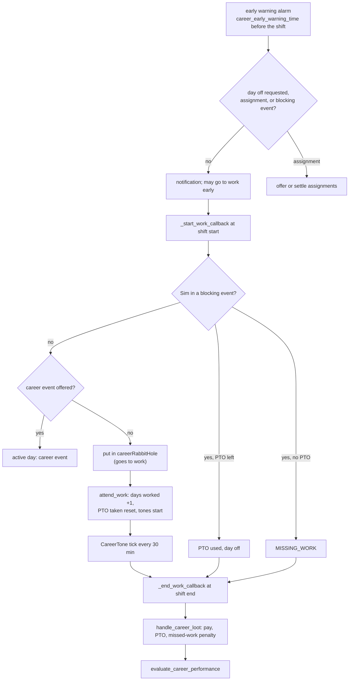
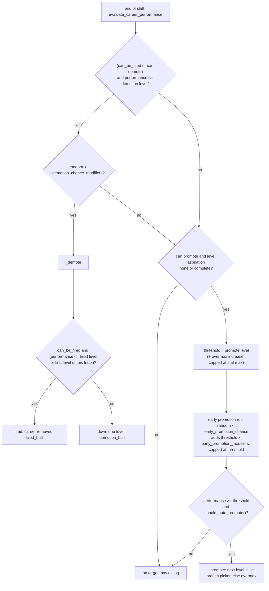
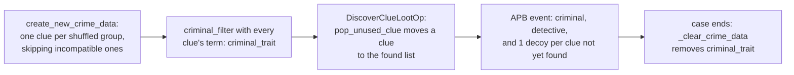

# 3.10 Skills, careers and school

*Game version 1.128.90.1030 (Steam, Linux/Proton). Numbers come from the live tuning as the live merge builds it (the base-game delta build plus the delta builds of EP04 (Cats & Dogs), EP06 (Get Famous), EP09 (Eco Lifestyle), EP12 (High School Years), GP04 (Vampires) and GP12 (Werewolves); SP01 (Luxury Party) and SP42 (Grunge Revival) add no record used here), and from base module tuning, which only the base builds carry. Systems whose pack is not installed (the EP01 (Get To Work) detective, doctor and scientist careers, EP08 (Discover University), EP13 (Growing Together), EP21 (Royalty & Legacy)) are described from code, and from patch data where labelled "patch data, pack not installed". Written 2026-10-12. Checked 2026-10-12: 140 claims checked, 23 corrected, 3 relabelled, 0 removed. Deepened 2026-10-13: 19 modules newly explained, 3 failed decompiles read. Checked again 2026-10-13: 158 claims checked, 14 corrected, 1 relabelled, 0 removed. Cross-chapter edits 2026-10-13: 5 applied.*

## In plain words

A skill is a hidden points counter. Each level costs more points than the last (an adult skill needs 81,580 points to reach level 10), and practising adds a fixed number of points per Sim minute that depends on the Sim's level. For an ordinary activity such as playing the piano, that is the level the Sim had when the activity started, even if the Sim levels up halfway through. Moods and traits then multiply that rate: a Focused Sim learns mental skills 1.4 times as fast, an Inspired one creative skills 1.4 times as fast, and several boosts stack by multiplying. Skills never fall: the code removes the decay setting from every skill.

A job works the same way at a larger scale. Each workday the Sim earns "performance" every half hour it spends at work, at a rate set by the job level plus bonuses for the right mood. The work style you pick (the tone) multiplies only the gains: Work Hard gives 1.5 times as much, Take It Easy gives none at all, while bad moods still drag the score down. At the end of the shift the game pays the Sim, adds a little paid time off, and checks the score: 100 means a promotion (once the level's career goals are done), -80 or lower a demotion, and a Sim being demoted at -95 or lower, or from the first level of a track, is fired instead. A Sim who leaves after 80 percent of the shift still gets a full day's pay and no penalty.

School is a job too. Children and teens have five grades, F to A, and the same performance bar; teens enter high school at C, or at B if they finished grade school with an A. Retired Sims get 60 percent of their last daily pay every morning at 7:00. In this install only two jobs are "active" jobs you can follow to work: High School (its active days come from EP12) and the actor career (from EP06). The detective, doctor and scientist active careers belong to EP01, which is not installed, and University (EP08) is not installed either.

## Key facts

- An adult (MAJOR) skill costs 100, 1,440, 2,160, 3,600, 5,280, 7,200, 10,140, 13,440, 17,100 and 21,120 points for levels 1 to 10 (81,580 in all); a MINOR skill stops at level 5 (12,580 points). Skills have no decay at all (`statistics/skill.py`).
- The common practice rate, `StandardPeriodic`, is 8 points per Sim minute at level 1, rising by 1 per level to 16 at level 9 and above. From level 1 to 10 that is 6,060 Sim minutes (101 Sim hours) with no multipliers.
- In an interaction (and in an object state) the rate is computed once when the activity starts and is not refreshed when the Sim levels up mid-activity (`DynamicSkillLootOp` is `APPLY_AT_START_ONLY`). Away actions, career tones among them, apply the same op every Sim minute instead, so they re-read the level.
- Skill multipliers multiply. A buff that names two of a skill's tags applies twice: Creatively Gifted (1.25 on `Skill_Creative` and 1.25 on `Skill_Musical`) gives piano, violin, guitar and pipe organ 1.5625.
- Work performance ticks every 30 Sim minutes, plus one partial tick when the tone stops: (gains times the tone multiplier, minus losses) times the elapsed time divided by the shift length. Tone multipliers: Normal 1, Work Hard 1.5, Confident 1.25, Angry, Sad and Embarrassed 0.5, Bored and Flirty 0.25, Take It Easy 0.
- Promotion needs performance of at least 100 (the code default; only the drama club's levels 1 to 4 use 50) plus the level's career-goal aspiration, if it has one. Every career rolls a 1% chance of an early boost at each end-of-shift promotion check, and the boost adds only 1% of the threshold: all 69 live careers tune both `early_promotion_chance` and `early_promotion_modifiers` to a base of 0.01 (the code base is 1). The 55 adult careers raise both for Entrepreneurial Sims and two pack-only ids (see Business below); the 14 child, teen and volunteer careers have no multiplier.
- Demotion can happen at -80 or below (code default; only school levels set -100). It needs a roll against `demotion_chance_modifiers` (1 by default, so it always succeeds). A Sim who passes that gate is fired instead of demoted when performance is at or below -95 (school levels set -120, but students cannot be fired) or the Sim is on the first level of its current track, branches included, provided the career can fire. A Business Professional Slacker has a demotion chance of 0, so is never demoted or fired.
- Pay is ceil(hourly rate times shift hours times the attendance factor). The factor is 1 for any attendance of 80% or more; below that the Sim loses the level's `missed_work_penalty` (15 on most levels) and the pay shrinks in proportion. A missed shift pays nothing, and so does any shift the code counts as missed.
- A paid-time-off day pays the whole shift. Any other time-off reason (fake sick, work from home, sick, holiday, family leave, bereavement) also counts as a full shift, and those days still earn paid time off.
- The 69 live careers include 48 work careers, 7 adult part-time, 5 teen part-time, 5 volunteer, 2 school and 2 teen side hustles. Only `career_Teen_HighSchool` (its events come from EP12) and `career_Adult_Active_ActorCareer` (EP06) are active careers.
- Teens start high school at grade C. They start at B if they finished grade school with an A, and at D if they finished it with a D or an F. Grade school and high school cannot be quit, and their students cannot be fired.
- Retirement pays int(daily pay times 0.6) every day at 7:00, where daily pay is the hourly rate times the scheduled weekly hours divided by 7.
- The high-school graduation ceremony (EP12) is a drama node on Sunday at 18:00 that runs 330 Sim minutes. With fewer than 4 graduates on the list it picks a total of 4 or 5 at random and ages up NPC teens to fill it. A Sim marked to graduate less than 1,440 minutes before a scheduled ceremony waits for the next one.
- The career's homework help, a 25% chance for a child and 20% for a teen, never fires in this install. It is limited to one region, the EP07 (Island Living) residential region in patch data, which no installed world provides.
- Without EP08 no Sim has a degree tracker, so every live `university_enrollment_test` fails. Two base-game career buffs are gated on one: the Ambitious trait's "promotion anxiety" buff for a Sim with a job (`Buff_Trait_Ambitious_PromotionAnx`) is never added here, and the Commitment Issues loot never applies its career "feeling trapped" buff.

## How it works

### Skills: points, levels and the level list

- **Observed** (`statistics/skill.py: Skill`, module tuning `statistics.skill` delta). Each skill picks a level list through `skill_level_type`. `SKILL_LEVEL_LIST` holds the points each level costs: MAJOR 100, 1440, 2160, 3600, 5280, 7200, 10140, 13440, 17100, 21120; MINOR 100, 1440, 2160, 3600, 5280; CHILD 100, 1000, 1680, 2350, 2619, 3150, 3410, 3690, 3970, 4230 (26,199 in all); TODDLER 119, 180, 280, 360, 500; POTTY 119, 280, 360; VAMPIRE_LORE has 15 entries (100, 240, 720, 800, 880, 240, 1040, 1260, 1350, 480, 1440, 1440, 480, 1440, 1440). TEEN has no entry. The base full build has the same MAJOR and MINOR lists, a different CHILD list (50, 1000, 1680, 2350, 3023, 4350, 5000, 5700, 6400, 7050) and no toddler, potty or vampire lists, so the delta values are the live ones. No pack ships a `statistics.skill` module.
- **Observed** (`Skill.convert_to_user_value`). The level is found by subtracting the costs in turn, so 100 points is level 1. `max_level` is the length of the list, the maximum value is its sum, and the minimum is 0.
- **Observed** (live tuning, 47 `Skill` records). Every skill sets `skill_level_type` explicitly. `initial_value` is 100 for most skills (a new skill starts at level 1), 120 for the toddler skills and 0 for `Hidden_Milestone_Infant_Social`. Types: MINOR for Photography, DivingBoard, Archery, Entrepreneur (EP12), JuiceFizzing (EP09), MediaProduction (EP06), DogTraining (EP04) and four hidden infant skills; CHILD for the four child skills; TODDLER for four toddler skills; POTTY for one; VAMPIRE_LORE for the GP04 lore skill; MAJOR for the rest, `skill_Fitness` included. The Reaping skill (`statistic_Skill_AdultMajor_Reaping`) is in the base full build only, outside the live set, so it is not one of the 47.
- **Observed** (`Skill.can_add`, bytecode). A skill can be added when it is forced; or when another skill that names it in `skill_unlocks_on_max` is maxed; otherwise the Sim's age must be in the skill's `ages` and the Sim must not carry `prevent_skills_from_being_added`, which only `buff_Scenario_NoSkillsNoProblem` sets live. There is no per-age cap on levels: an age either can hold a skill (to its full list) or cannot.
- **Observed** (live `ages`). Child and up: Charisma, Fishing, Knitting, Logic, Mischief, Papercraft, Photography, Piano, PipeOrgan, VideoGaming, Violin, DivingBoard, MediaProduction, VampireLore, DogTraining and Archery. Archery's `ages` list holds one empty entry where ADULT would sit. **Inferred**: the loader gives an empty entry the tunable's default, which is `Age.ADULT`, so adults can learn it too. Teen and up: Acting, Bartending, Comedy, Fabrication, FlowerArranging, Gardening, Gourmet, Guitar, Handiness, Homestyle, Painting, Programming, RocketScience, Veterinarian, Writing, Entrepreneur, JuiceFizzing and Fitness. The Reaping skill is in the base full build only, outside the live set. The CHILD skills are child only, the TODDLER skills toddler only, the infant skills infant only.

### Skill gain: effectiveness curves

- **Observed** (`statistics/statistic_ops.py: DynamicSkillLootOp._get_change_amount`; `Skill.get_skill_effectiveness_points_gain`; `sims4/math.py: LinearCurve.get`). An interaction's `skill_loot_data` names a skill and an effectiveness. The amount is read from the curve for that effectiveness at the Sim's current level. A tuned `level_range` clamps the level used for the lookup; it does not stop the gain. Curves clamp at both ends, so level 0 reads the level 1 value.
- **Observed** (`SKILL_EFFECTIVENESS_GAIN`, delta, identical in the full build). Periodic curves are points per Sim minute:

| Curve | Level 1 | Level 5 | Level 9 and 10 |
|---|---|---|---|
| `LargePeriodic` | 12 | 18 | 24 |
| `StandardPeriodic` | 8 | 12 | 16 |
| `SmallPeriodic` | 5.33 | 8 | 10.67 |
| `VerySmallPeriodic` | 4 | 6 | 8 (6.5 at 6, then 6 at 7, 7.5 at 8) |
| `TonePeriodic` | 2 | 3 | 4 |
| `ToddlerStandardPeriodic` | 2 | 2 | (toddler levels 1 to 5) |
| `Toddler` | 1 | 1 | (toddler levels 1 to 5) |

  One-shot curves are points per application: `Huge` 1920 to 3840, `Large` 960 to 1920, `STANDARD` 480 to 960, `Small` 160 to 320, `Tiny` 40 to 80. The three horse curves exist in tuning but horses are not installed. `DYNAMIC_SKILL_INTERVAL` is 1 (delta; the code default is also 1).
- **Observed** (every live `effectiveness` value, counted with the live merge over the expanded records: 2,840 values in 2,087 records). StandardPeriodic 1,030, LargePeriodic 402, SmallPeriodic 378, Tiny 278, VerySmallPeriodic 259, Small 221, STANDARD 194, Huge 29, Large 18, Toddler 16, TonePeriodic 13, ToddlerStandardPeriodic 2. Most sit in an interaction's `basic_content` periodic stat change as a `dynamic_skill` op (1,487) or in a top-level `skill_loot_data` (968); the rest are in loot actions (158 plus 19 random), objects (168), away actions (39) and one buff. Recipes hold 346 of them. Example: `piano_Practice` gains Piano at StandardPeriodic; `Chess_Social` gains Logic (or Child Mental) at StandardPeriodic.
- **Observed** (`interactions/utils/statistic_element.py: PeriodicStatisticChangeElement._start_statistic_gains`, `_add_operation_if_valid` in bytecode; `DynamicSkillLootOp.periodic_change_behavior`, `get_value`). While an interaction runs, the rate is (curve value) times the participants' skill-based multiplier divided by `DYNAMIC_SKILL_INTERVAL`, and it is added once as an `AutonomyModifier` rate when the element starts ([3.03](3.03-needs-statistics.md) covers the rate machinery). The op declares `APPLY_AT_START_ONLY`. Object states do the same once per state (`objects/components/state.py: _start_statistic_gains`).
- **Observed** (`away_actions/away_actions_util.py: PeriodicStatisticChange`). An away action applies its ops through a 1-minute alarm instead. Each application calls `DynamicSkillLootOp._apply_to_subject_and_target`, which reads the curve at the current level and adds the points directly, without the skill-based multiplier. `BaseStatistic.add_value` still applies the skill's increase multipliers, so the mood, trait and lot multipliers below count on this path too. Career tones that gain a skill and the `AwayAction_BuildSkill_*` actions therefore speed up as soon as the Sim levels.
- **Inferred** (no caller re-reads the curve on level-up; `statistic_element.py` has no level hook). A Sim who levels up during a long practice interaction keeps the old, slower rate until the interaction restarts.
- **Worked example** (StandardPeriodic, no multipliers, rate re-read each level). Minutes for levels 1 to 2 up to 9 to 10: 1440/8 = 180, 2160/9 = 240, 3600/10 = 360, 5280/11 = 480, 7200/12 = 600, 10140/13 = 780, 13440/14 = 960, 17100/15 = 1140, 21120/16 = 1320. Total 6,060 Sim minutes, or 101 Sim hours. Getting from 0 to level 1 at 8 per minute adds 12.5 minutes.

### Skill gain multipliers

- **Observed** (`statistics/continuous_statistic.py: _get_change_rate_without_decay`; `objects/components/statistic_component.py: add_statistic_modifier, add_modifiers_for_skill, _get_skill_modifiers`). The rate is the sum of the rates times the product of the increase multipliers. Two tunables feed skill multipliers: `skill_tag_modifiers` (by skill tag) and `stat_use_multiplier` (by statistic). Both call `add_statistic_multiplier`, which multiplies, although the `skill_tag_modifiers` tunable text says the values are summed (the `stat_use_multiplier` text makes no such claim). `add_modifiers_for_skill` loops over every (tag, value) pair in the modifier and applies each one whose tag the skill carries, so a modifier that names two of the skill's tags applies twice.
- **Observed** (live hidden mood buffs; each `Mood` names one buff per intensity, for example `Mood_Focused` gives `MoodBuff_Hidden_Focused` and, at the higher intensity, `MoodBuff_Hidden_InTheZone`; `Mood_Stressed` gives Tense then Stressed, `Mood_Uncomfortable` Uncomfortable then Miserable, `Mood_Sad` Sad then Depressed, `Mood_Dazed` Sloshed).

| Mood buff | Skill multiplier |
|---|---|
| Focused / In the Zone | `Skill_Mental` 1.4 / 1.6; VideoGaming 1.25 / 1.5; Charisma 1.1 |
| Inspired / Imaginative | `Skill_Creative` 1.4 / 1.6 |
| Energized / Pumped | `Skill_Physical` 1.4 / 1.6 |
| Happy / Elated | `Skill_All` 1.2 / 1.4 (Charisma 1.1; the toddler skills carry 0.875 on top) |
| Confident / Fearless | `Skill_All` 1.2 / 1.4 (Charisma also 1.16667 / 1.14286) |
| Playful, Silly, Hysterical | Comedy 1.4, 1.6, 1.8 |
| Flirty / Passionate | Charisma 1.32 / 1.54 |
| Bored, Uncomfortable, Tense | `Skill_All` 0.8 |
| Stressed, Miserable | `Skill_All` 0.6 |
| Sloshed | `Skill_All` 0.5 |
| Angry / Furious / Enraged | Creative, Mental and Charisma 0.8 / 0.6 / 0.4, Mischief 1.2 |
| Sad / Depressed | Sad: Creative 1.2, Mental, Physical and Social 0.8; Depressed: Mental, Physical and Social 0.6 |
| Embarrassed / Humiliated / Mortified | `Skill_Social` 0.8 / 0.6 / 0.4 |

- **Observed** (live trait and other buffs). QuickLearner `Skill_All` 1.1; Savant 1.25; Overachiever 1.75; Mentally, Creatively, Socially and Physically Gifted 1.25 on their tag (Creatively Gifted also 1.25 on `Skill_Musical`, so the four instruments, which carry both tags, get 1.5625); the Child trait `Skill_Adult` 0.75 and `Skill_Child` 1.5; SociallyAwkward Charisma 0.6; GreatKisser Charisma 3; MorningPerson and NightOwl, while active, `Skill_All` 1.25; mentoree buffs 1.1 (the adult-skill mentor buffs `buffs_Mentoree_AdultSkill_HiddenMultipliers_Skill6` to `Skill10` give 1.1 to 1.5, and `_MentorTrait` 1.25), or 2.5 from a professional homework mentor (`Buff_Mentoree_ByMentorPro_ChildHomework` on the four child skills and `Buff_Mentoree_ByMentorPro_TeenHomework` on the homework statistics, the two live `ByMentorPro` buffs; the instrument, fitness and other professional-mentor buffs are in full builds only, outside the live set); the Grim Reaper role `Skill_All` 8. Lot traits give 1.5 (for example the science-lair trait for Logic and Rocket Science, high-speed internet for Programming, Video Gaming and Writing), and 22 computer objects carry an object-level `skill_tag_modifiers` of `Skill_Programming` 2. GP12's lunar buffs give 2.5 and EP12's high-school team traits 1.15.
- **Observed** (`Skill.statistic_multipliers`, live). A skill's level can also scale the Sim's changes to other statistics (a curve over the skill level, direction INCREASE by default). Fitness takes fitness fatigue from 1 at level 1 down to 0.5 at 10. Handiness gives object brokenness 2 at level 6 and 3 at 10. Gardening gives infestation and weeds 2 and moisture 2.67 at level 10. Programming takes the Brain Fried commodity to 0 at level 10 (the y value is untuned, and a curve point defaults to 0). Video Gaming takes Gamed Out to 0.5 at level 6 and 0 at 10. Writing takes writer's block to 0.4 at 10. Rocket Science gives rocket progress and the rocket upgrades 2.5 at 10. All four child skills give homework progress 1.7 at level 10. Several curves list points past level 10 (for example 4 at 15 for Handiness), which no Sim reaches.
- **Observed** (`sims/buff_component.py: get_effective_skill_level`). The "effective" skill level that tests and animations read is the level plus any buff's effective-skill modifier for that skill. It does not change the points.
- `Skill.mood_id` only sets the mood icon shown on the skill panel; it does not change any gain.

### No decay

- **Observed** (`Skill`). `REMOVE_INSTANCE_TUNABLES` removes `decay_rate`, `_recalculate_modified_decay_rate` does nothing, `can_decay()` returns False, `remove_on_convergence` is False and the class decay rate is 0. No live skill tunes `delayed_decay_rate`. `ProgressiveStatisticCallbackMixin.refresh_threshold_callback` would add a level-down listener only if decay were enabled, so skills only ever go up (or are set by a cheat).
- **Observed** (`statistics/life_skill_statistic.py: LifeSkillStatistic`). The life-skill class (tunables include `missing_career_decay_rate` and `age_to_remove_stat`, default YOUNGADULT) has no instance in the installed data ([3.03](3.03-needs-statistics.md)).

### Level-up hooks

- **Observed** (`Skill.on_skill_level_up`, `_handle_skill_up`). A level-up runs in this order. First, at the maximum level, every skill in `skill_unlocks_on_max` is added at its initial value. Then the SKLU telemetry hook is written. Then `_handle_skill_up` applies the level's `level_data` entry: the level-up notification (players' Sims only) and screen slam, `skill_level_buff` (which replaces the previous level's buff), the payout (`rewards` through `open_reward`, then `loot` with a `SingleSimResolver`), the affordance caches (`super_affordances`, `target_super_affordances`, `actor_mixers`), then commodity flags. Last, it fires `SkillValueChange`. The `SkillLevelChange` event comes from the value-update path (`set_value`, `_update_value`), not from this method.
- **Observed** (live). Logic level 2 adds the "discuss logical puzzles" mixer to chat. Logic levels carry loot such as `loot_HumanoidRobots_GainEnhancementProgress_LevelN`, `loot_Trait_practiceMakesPerfect_LevelSkill_Whim` and `loot_SkillIUpCheck_NonHoliday`. `statistic_Skill_Child_Mental` names two `skill_unlocks_on_max` ids (217413 and 434909), and neither resolves in this install. Patch data, pack not installed, names them `statistic_Skill_AdultMajor_Robotics` (EP08) and `statistic_Skill_NLS` (EP19 (Enchanted by Nature)).

### Age-up skill transfer

- **Observed** (`Skill.age_up_skill_transition_data`, live). On age-up, the toddler skills Communication, Imagination, Movement and Thinking become the child Social, Creativity, Motor and Mental skills. The value depends on the toddler level: level 1 gives 100 points, 2 gives 550, 3 gives 1000, 4 gives 1840 and 5 gives 2680. With trait 381795 (not installed; patch data names it `trait_MovingOn_BurningSoul_Reincarnated`, EP17 (Life & Death)) the child skill starts at 26,199, its maximum. Infant FineMotor becomes Toddler Thinking and GrossMotor becomes Toddler Movement, at 139, 250, 300, 380 and 520 points for infant levels 1 to 5, or 1439 with that trait. The aging itself is in [3.09 Life cycle](3.09-life-cycle.md).

### Careers, tracks, levels and branches

- **Observed** (`careers/career_tuning.py: Career`, rescued per function; class body from bytecode). A `Career` names a `start_track`, its category, its rabbit hole, its messages and its promotion rules. A `TunableCareerTrack` lists `career_levels` and optional `branches` and `overmax`. `Career._propagate_track_and_level_data` numbers the start track's levels 1 to N for the player, and each branch continues from N+1. `Career.is_active` is true when `active_career_type` is not NON_ACTIVE and the career has `career_events` (or the type is DYNAMIC_EVENTS); `can_quit` is true when `quittable_data` is set.
- **Observed** (live counts with the live merge). 69 `Career` (base delta 46, EP12 9, EP06 8, EP09 3, EP04 2, GP12 1); 95 `TunableCareerTrack` (base 70, EP12 9, EP06 8, EP09 5, EP04 2, GP12 1); 298 `CareerLevel` (base 223, EP12 25, EP06 24, EP09 19, EP04 6, GP12 1). By category: Work 48 (18 player careers and 30 NPC careers: the 29 `career_Adult_NPC_*` records, such as the maid, mail carrier and Grim Reaper, plus `career_Deliveries_FoodDeliveryNPC`), AdultPartTime 7, TeenPartTime 5, Volunteer 5, School 2, TeenSideHustle 2. Every live career is of class `Career`; there is no live `DetectiveCareer`, `NobleCareer`, `WorkFromHomeCareer` or university course career.
- **Observed** (live `active_career_type`). Only two careers are active: `career_Teen_HighSchool` (MULTI_SIM_ACTIVE) and `career_Adult_Active_ActorCareer` (DYNAMIC_EVENTS, EP06). The high-school record is a base-delta record, but its two events, `careerEvent_HighSchool_Active_Main` and `careerEvent_HighSchool_Active_Exam`, are EP12 records, so without EP12 the list would be empty and high school would be an ordinary rabbit-hole career. "Active" here means `Career.is_active`: the type is not NON_ACTIVE and the career has events (or uses DYNAMIC_EVENTS), so the player can follow the Sim to work.
- **Observed** (patch data, pack not installed: the decoded patch tuning of EP01 and others). The other active careers belong to packs that are not installed. EP01 holds `detectiveCareer_1` (class `DetectiveCareer`, ACTIVE, 9 events), `career_Adult_Active_Doctor` (ACTIVE, 18 events, with 19 `DoctorCareerEventZoneDirector` records) and `career_Adult_Active_Scientist` (ACTIVE, 6 events). EP17 holds `careers_Adult_Active_Reaper` (ACTIVE, 16 events) and GP10 (Dream Home Decorator) `careers_Adult_InteriorDecorator` (DYNAMIC_EVENTS). The detective and doctor code itself carries no pack decorator.
- **Observed** (`Career` code defaults, bytecode). `levels_lost_on_leave` 1, `days_to_level_loss` 1, `can_be_fired` True, `initial_pto` 0, `initial_delay` 480 Sim minutes, `early_promotion_chance` and the other `TunableMultiplier` fields multiply from a base value. `CareerLevel` defaults: `promote_performance_level` 100, `demotion_performance_level` -80, `fired_performance_level` -95, `pto_per_day` 0.1, `simoleons_for_assignments_per_day` 10, `stay_late_extension` 120 Sim minutes; performance metrics `base_performance` 1, `missed_work_penalty` 1, `full_work_day_percent` 80, `performance_per_completed_goal` 0, `daily_assignment_performance` 1.
- **Observed** (live `CareerLevel` overrides). `promote_performance_level` is set on 14 levels only (the 10 school levels at 100, `careerLevels_DramaClub_Level1` to `Level4` at 50). Demotion and firing levels are set only on the 10 school levels (-100 and -120). `full_work_day_percent` is never set, `mood_metrics` is empty everywhere and `daily_assignment_performance` is 30 on 230 levels. Every one of the 298 levels sets `missed_work_penalty`, so its code default of 1 never applies: 15 on 275 levels, 30 on the 10 school levels, 20 on the 10 StyleInfluencer branch levels and 18 on StyleInfluencer main levels 3 to 5. `performance_per_completed_goal` is 5 on `career_Painter_Artist_Level3`, 8 on `career_TechGuru_Gaming_Level1` and 0 or unset elsewhere.
- **Observed** (live `CareerLevel` `performance_mod` entries gated by an `is_decree_enacted` test; `kingdom/kingdom_tests.py: KingdomIsDecreeEnacted`). 115 live `CareerLevel` records (base delta 105, EP06 delta 10) carry EP21 decree tests on `performance_mod` entries: +15 under CulturalLegacy (57 entries), HealthyLiving (16) or LocalGastronomy (15), +25 under TechnicalAdvancements (27). They never apply here, because there is no kingdom service and the test then fails ([6.03](6.03-pack-systems.md#kingdom-residue-in-the-live-tuning)).
- **Observed** (`careers/career_scheduler.py`). A level's schedule is a variant: `backwards_compatible` (the level's `work_schedule`), `fixed`, `service_npc` (the service NPC's hours), `shifts` (the shift that covers the join time), `shifts_player` or `no_schedule`. `get_career_schedule_for_level` builds it. Part-time careers offer MORNING and EVENING shifts (`CareerShiftType`).

### The workday: early warning, the carpool and the rabbit hole

- **Observed** (`careers/career_base.py: CareerBase.early_warning_callback`, rescued). Before each shift the career checks drama-node time-off reasons, a child's sickness, `early_work_loot` and assignments, then shows the early-warning notification and lets the Sim leave early if allowed. The lead time `career_early_warning_time` defaults to 1 hour (code); live, only the four freelancer careers set 4 hours and `career_Volunteer_DramaClub` 0.5.
- **Observed** (`CareerBase._start_work_callback`). At the start time, a Sim tied up in a blocking event spends one day of paid time off if any is left, and is marked MISSING_WORK otherwise. A Sim in a situation whose job asks before leaving gets a dialog (go, or take paid time off). Otherwise the career offers its career event, if any, and if none is offered it calls `put_sim_in_career_rabbit_hole`.
- **Observed** (`rabbit_hole/career_rabbit_hole.py: CareerRabbitHole`; live `careerRabbitHole` 234354). All 69 careers share one `CareerRabbitHole`. It has no time limit and no away action of its own. It picks the career's `tested_affordances`, or `career_affordance` when the Sim is at home (for example `si_Career_Business`, `si_Career_HighSchool`), and uses `go_home_to_work_affordance` (`GoHomeAndAttendWork`, `GoHomeAndAttendSchool`) when the Sim must travel home first. When the Sim enters it, `on_activate` calls `attend_work`.
- **Inferred**. The carpool or school bus the player sees is the presentation of that go-to-work interaction leaving the lot; I did not trace a vehicle object.
- **Observed** (`CareerBase.attend_work`). Attending adds 1 to the days-worked statistic, clears the time-off reason, adds back the paid time off that was reserved, cancels the late alarm, shows the start notification, starts the tones and fires `WorkdayStart`. If the Sim has not arrived by the late time, which `get_late_time` puts 20% of the way into the shift (start plus duration times 1 - 0.8), `_late_for_work_callback` shows the missing-work dialog unless the Sim is taking the day off, is on an assignment or is already in the rabbit hole.
- **Observed** (`CareerBase.extend_career_session`). "Stay late" moves the shift end by the level's `stay_late_extension` (120 Sim minutes by default, 0 on 10 live levels), once per shift. The performance tick still divides by `_current_work_duration`, which is set when the session starts and not changed by the extension, so the extra time earns performance at the normal per-minute rate. Pay uses the new end time.

### Tones and the performance tick

- **Observed** (`careers/career_interactions.py: CareerTone`). A tone is an `AwayAction` that a Sim runs while at work, chosen from the level's `tones` (a default list and optional actions). On `run` it sets a repeating alarm every `CAREER_PERFORMANCE_UPDATE_INTERVAL` Sim minutes. That interval is not tuned in either build, so the code default of 30 is live. Each tick, `_update` returns early only for an odd-job gig (bytecode; the decompiler nests the call wrongly). Otherwise it calls `career.apply_performance_change(elapsed, performance_multiplier)` and rolls the tone's periodic loots. `CareerTone.stop` runs `_update` once more, so the minutes since the last tick also count.
- **Observed** (`CareerBase._get_common_performance_change`, `apply_performance_change`). Each tick collects contributions, each sorted into gains (0 or more) or losses:
  - the level's `commodity_metrics` (a threshold on a commodity);
  - `statistic_metrics` (a curve on a statistic's value);
  - `tested_metrics` (a value when tests pass, plus optional multipliers);
  - the completed objectives of the level's career aspiration times `performance_per_completed_goal`;
  - `base_performance`;
  - a `mood_metrics` entry (none live).

  The tick then computes total = gains times the tone multiplier, minus losses, and delta = total times the elapsed ticks divided by the shift's ticks. Tested multipliers apply by direction (INCREASE when delta is positive, DECREASE when negative, BOTH always). Finally `add_work_performance(delta)` adds delta, also to `statistic_Career_Session_Performance_Change` (99886). So every tuned value is "per full shift".
- **Observed** (live `CareerTone` records, 57: base 45, EP12 8, EP06 4). `performance_multiplier` (code default 1): `CareerTone_WorkHard` 1.5, `CareerTone_Confident` 1.25, `CareerTone_Angry`, `_Embarrassed` and `_Sad` 0.5, `_Bored` and `_Flirty` 0.25, `CareerTone_TakeItEasy` and `CareerTone_Playful` 0, `Career_Tone_Normal` and `careerTone_FearConfrontation_PerformanceReview` untuned (1), `CareerTone_School_StudyHard` 1.5 and `_SlackOff` 0. Of the 24 branch tones (three each for Astronaut, Criminal, Culinary, Entertainer, Painter, Tech and Writer, two for Agent, plus `careerTone_DramaClub_FocusOnActing`), 21 are 0; `CareerTone_Agent_Agent`, `_Agent_Main` and `CareerTone_Astronaut_Smuggler` are 1.5. A third Agent tone, `CareerTone_Agent_Villain` (1.5), is in the base full build only, outside the live set. The three `CareerTone_Social_*` tones are 0, the six StyleInfluencer tones run from 0.25 to 1.5, and the EP12 side-hustle tones are 1.25 (Simsfluencer) and 0.75 (streamer). The EP12 team tones are 0.8 to 1.2. The EP06 actor tones are 0.33 (normal), 0.4 (work hard) and 0. A 0 multiplier zeroes every gain, while bad-mood losses still apply.
- **Inferred** (the live `CareerTone` records). The 0-multiplier branch tones swap performance for something else. Some carry a skill gain (`CareerTone_Tech_Gaming` gains Video Gaming at `TonePeriodic`), and others only periodic loots (`CareerTone_Painter_Artist` uses `working_sim_periodic_loots`).
- **Observed** (`CareerTone_WorkHard`, `_periodic_stat_changes`; `away_actions/away_actions_util.py: PeriodicStatisticChange`). Away-action stat changes are applied by an alarm every `STATIC_CHANGE_INTERVAL` (1) Sim minute. Work Hard lowers `motive_Fun` by 0.1 per minute (6 per hour) and moves four statistics that do not resolve here (304271, 304314, 306749 and 306744) under test sets 309704 and 309706. Patch data, pack not installed, names them EP13's burnout commodities (`commodity_Burnout_CreativeTracker`, `_FogCreative`, `_MentalTracker`, `_FogMental`) and test sets (`testSet_Burnout_CreativeCareer`, `_MentalCareer`).
- **Observed** (`CareerBase.end_tones_and_get_hours_worked`, `get_hours_worked`; `TONE_STAT_MOD` 1). Each tone owns a runtime commodity that gains 1 per minute while the tone runs. Hours worked is the sum of those minutes over 60. At the end of the shift the tone with the most minutes applies its `dominant_tone_loot_actions` (for example `Loot_Buff_CareerTone_WorkHard`).
- **Observed** (`CareerLevel.tones`, live Business level 1). The default tone list picks `CareerTone_WorkHard` for trait 161625 and `CareerTone_TakeItEasy` for trait 161626, and otherwise `Career_Tone_Normal`. Neither trait id resolves in this install; patch data, pack not installed, names them `trait_LifeSkills_Responsible` and `trait_LifeSkills_Irresponsible` (GP05 (Parenthood)). A whitelist entry is a `TunablePackSafeReference`: a trait that is not loaded stays in the list as None, which `TraitTest` skips, so a whitelist of only that trait never passes (`sims/sim_info_tests.py: TraitTest`), and every Sim here starts on the Normal tone.
- **Observed** (`away_actions/away_action_tracker.py: AwayActionTracker.is_sim_info_valid_to_run_away_actions`; `CareerBase._end_work_callback`). NPCs and babies never run away actions, and the end-of-shift loot is skipped for NPCs. So NPC jobs earn no performance, pay or promotion through this path. **Inferred**: NPC career changes come from story progression (`careers/career_story_progression.py` multipliers for joining, quitting, retiring and promoting; [4.02 Story progression](4.02-story-progression-townies.md)).

### End of shift: pay, paid time off and missed work

- **Observed** (`CareerBase._end_work_callback`, bytecode). If the Sim is still at work it calls `leave_work`. Otherwise time at work is 0 when the time-off reason is MISSING_WORK or NO_TIME_OFF, and the full shift length for any other reason (PTO, FAKE_SICK, WORK_FROM_HOME, WORK_FROM_HOME_NOBLE, and the delta-added SICK, HOLIDAY, FAMILY_LEAVE, BEREAVEMENT). Then `handle_career_loot` runs (players' Sims only) and the session ends.
- **Observed** (`CareerBase.handle_career_loot`, bytecode). A current gig that was not left early, or an odd-job gig, pays its gig pay. Otherwise `_collect_rewards(hours_worked)` pays the wage. Gig statistics and history are recorded. `process_homework` runs for a university course when hours worked is 0 or less. Then `evaluate_career_performance` runs and its dialog is shown.
- **Observed** (`CareerBase._collect_rewards`, `calculate_worked_data`, `_compute_pto`, `get_hourly_pay`).
  - Attendance is time at work divided by the shift's scheduled hours.
  - Below `full_work_day_percent` (80) the Sim loses `missed_work_penalty` performance, the attendance factor becomes attendance/0.8, and `sim_info.apply_career_changes` gets the missed share, (1 - attendance)/0.8; at 80% or more the factor stays 1.
  - Pay is ceil(hourly pay times the shift's hours times the factor times the event's money multiplier).
  - The hourly pay is the level's `simoleons_per_hour`, plus `overmax.salary_increase` per overmax level, plus `simolean_trait_bonus` percentages for traits the Sim has, truncated to an integer.
  - Unless the day was a paid-time-off day, the Sim earns `pto_per_day` times the factor times any `pto_accrual_trait_multiplier`.
- **Observed** (`Career._create_runtime_commodities`). Paid time off is a runtime commodity from 0 to 99 that starts at `initial_pto` and does not decay.
- **Observed** (`CareerBase.leave_work`). Leaving early ends the career event if there is one. Otherwise it cancels the gig, takes the Sim out of the rabbit hole, stops the tones, pays by hours worked (so attendance under 80% costs the penalty) and resets the away action to the default.
- **Observed** (`CareerBase.calculate_assignment_results`, `_handle_assignment_results`, `get_assignment_pay`). Work-from-home assignments replace the shift. Pay is `simoleons_for_assignments_per_day` times assignments done divided by `active_assignment_amount` (code default 2), scaled by the trait-boosted hourly rate. Performance is (common gains minus losses plus `daily_assignment_performance`) divided by the number of assignments, per assignment. Finishing none costs `missed_work_penalty`.

### Promotion, demotion and firing

- **Observed** (`CareerBase.evaluate_career_performance`, bytecode; the decompiled text nests it wrongly). The order is the one in the diagram: a Sim at or below the demotion level whose demotion roll fails goes on to the promotion check. `should_auto_promote()` returns True in `CareerBase`. When the Sim promotes, a loop subtracts each next level's threshold from the leftover performance and promotes again while the leftover still reaches it. Performance is capped at the statistic's maximum (100), so with the default threshold of 100 the leftover is 0 and the loop stops after one level; only levels with a lower threshold, such as the drama club's 50, can chain.
- **Observed** (`CareerBase._demote`, `_change_level_within_track`). `_demote` runs only after the demotion gate above. With `can_be_fired`, a Sim at or below the firing level, or whose level index within the current track is below `levels_to_demote` (1), is fired. So a Sim on the first level of a branch track (for example Business Management level 1, the player's level 7) is fired instead of going back down the main track. Without `can_be_fired` (school), a Sim at index 0 is not demoted at all. In Business, `demotion_chance_modifiers` multiplies by 0 for `trait_ProfessionalSlacker`, so such a Sim is never demoted or fired.
- **Observed** (`CareerBase.can_change_level`, `is_promotion_blocked`). `block_promotion_tests` can block a promotion (NPCs and tutorials are exempt). A demotion below index 0 is refused. A promotion past the last level is refused unless the track has branches or overmax.
- **Observed** (`CareerBase._promote_to_new_branch`, `_handle_promotion`, `_handle_promotion_reward`). At the end of a track the player picks a branch in the career-selection UI; an NPC gets a random branch. A promotion gives the `promotion_reward` of every newly reached level not reached before (the highest level is kept per track), plays the sting and screen slam, adds `promotion_buff` and returns the new salary.
- **Observed** (`CareerBase.career_stop`, `career_start`). A level change removes and re-adds the performance statistics. **Inferred**: performance restarts at the statistic's initial value, which is 0. **Observed** (the 31 performance statistics the 298 live levels name): 28 tune an initial value of 0, a maximum of 100 and a minimum of -100; `statistic_Career_Performance`, `_Gradeschool` and `_Highschool` tune only the minimum, -100, and take the code defaults for the rest (initial value 0, maximum 100).

### Worked example: the Business career

- **Observed** (live `career_Adult_Business` and its levels, base delta). The Sim must be a young adult, adult or elder. The career gives `initial_pto` 3, `initial_delay` 600 Sim minutes and `days_to_level_loss` 2. Its `early_promotion_chance` base is 0.01, times 10 for Entrepreneurial, 5 for buff 351500 and 10 for test set 425929. Neither id resolves here; patch data, pack not installed, names them `buff_Gemology_Simanite_CareerProgress` (SP49 (Crystal Creations)) and `testSetInstance_LuckSys_GoodLuck` (EP19).

| Level | $/hour | Schedule | base_performance | PTO/day | Ideal mood | Career goals |
|---|---|---|---|---|---|---|
| 1 | 16 | 9:00, 8 h, Mon to Fri | 60 | 0.2 | Energized | none |
| 2 | 20 | same | 50 | 0.2125 | Energized | `aspiration_Business_Level2` |
| 3 | 23 | same | 40 | 0.225 | Energized | yes |
| 4 | 35 | same | 30 | 0.2375 | Energized | yes |
| 5 | 53 | same | 20 | 0.25 | Confident | yes |
| 6 | 75 | same | 15 | 0.2667 | Confident | yes |
| Management 1 to 4 | 90, 134, 201, 375 | 10:00, 8 h (level 4 Mon, Tue, Thu, Fri) | 10, 8, 7, 6 | 0.2833 to 0.3333 | Confident | levels 1 to 3 |
| Investor 1 to 4 | 112, 145, 218, 406 | 8:00, 8 h (level 4 four days) | 10, 8, 7, 6 | 0.2833 to 0.3333 | Focused | levels 1 to 3 |

  The 9:00 start on levels 1 to 6 is the `ScheduleEntry` code default (`scheduler.py`, `default_hour=9`); those entries tune only the days and the duration. Each level carries 48 `tested_metrics`, per full shift, and one `statistic_metrics` entry: `commodity_CareerBenefit_Business` on a curve from 0 to +20 at a value of 120.
  - **Level 1 moods.** -12 for Enraged and Mortified; -8 for Furious, Stressed, Miserable and the like; -4 for Angry, Sad, Tense, Bored, Sloshed and the like; +10 for the mild good moods (Confident, Energized, Flirty, Focused, Happy, Inspired, Playful); +20 for the strong ones (Elated, Fearless, Pumped, In the Zone and the like). The ideal mood adds a further +10 (Energized) or +20 (Pumped).
  - **Level 1 other entries.** +60 with the EP06 Career Hopper fame perk, +60 under the Easy Street fame-perk buffs, -18 for the dead-end-job fear, -10 for the fear of failure, +10 for `trait_Highflier`, +30 for buff 219082 (patch data, pack not installed: `buff_CollegeOrganization_SecretSociety_Sprite_Focused`, EP08), -5 and -15 for revealed medium and major scandals, and +2 or +3 for the EP12 high-school exit traits. Many more entries name ids from packs that are not installed.
  - **Higher levels.** The good-mood values shrink. Management level 1 gives +4 and +8 for good moods, its ideal mood adds +4 (Confident) or +8 (Fearless), and the two fame-perk entries drop to +10.
- **Observed** (`start_level_modifiers` on `career_Adult_Business`). A new hire starts at index 0 (level 1), or 3 levels higher with `trait_Connections`, 2 with `trait_HighSchool_A` or the Career Hopper perk, and 1 with `trait_HighSchool_B`. Only the largest passing modifier counts. The demotion chance has no tuned base (code default 1) and is multiplied by 0 for `trait_ProfessionalSlacker`. Early promotion adds 0.01 of the threshold, times 20 for Entrepreneurial, 10 for buff 351500 and 20 for test set 425929. All 55 live adult careers tune the same chance and modifier multipliers; the 14 child, teen and volunteer careers tune the 0.01 bases with no multiplier.
- **Worked** (from the rules above, with `commodity_CareerBenefit_Business` at 0 and no other tested entry passing). A level 1 Sim who is Energized and on Work Hard earns (60 + 10 + 10) times 1.5 = 120 per full shift. Performance is capped at 100, so the Sim is promoted at the first end of shift, because level 1 has no career goal. On the Normal tone with no mood it earns 60 per shift, and is promoted after the second shift (60 + 60 capped at 100). Pay for a full level 1 shift is ceil(16 times 8) = $128. A Sim who leaves after 4 of the 8 hours loses 15 performance and earns ceil(16 times 8 times 0.5/0.8) = $80. Daily pay for retirement purposes is int(16 times 40/7) = 91, so retiring from level 1 would pay int(91 times 0.6) = $54 a day.

### Rejoining, quitting, retiring and unemployment

- **Observed** (`CareerBase.get_career_entry_level`, `_loses_level_on_rejoin`). A new hire starts at index `start_level_modifiers.get_max_modifier()` (a `TestedSum`: base plus the largest passing modifier) on the start track. A Sim rejoining a career they left gets their old level back, minus `levels_lost_on_leave` (1) and minus one more for every `days_to_level_loss` days away (never below the track's first level), unless they own the fame perk `CAREER_HOPPER_PERK`. That perk belongs to EP06, which is installed.
- **Observed** (`careers/career_tracker.py: CareerTracker.add_career`). Joining a quittable career first asks whether to quit the Sim's other quittable careers in the same category and shift, and joining ends a retirement. `quittable_data` is empty (no quitting) on `career_Child_GradeSchool`, `career_Teen_HighSchool` and `career_Adult_NPC_GrimReaper` only.
- **Observed** (`careers/retirement.py: Retirement`; `careers.retirement` module tuning, delta = full). Retiring (`Loot_Career_Retire`, from the `phone_Retire` interaction) removes every career and starts a daily alarm at `DAILY_PAY_TIME` (7:00, code default) that pays int(`career_history.daily_pay` times `DAILY_PAY_MULTIPLIER`) = 60% of the daily pay recorded in the career history. `CareerBase.get_daily_pay` is the hourly pay times the scheduled weekly hours divided by 7, or times `DAILY_HOURS_WORKED_FALLBACK` (5, code) when the level has no schedule. Money goes to [5.01 Money, bills, perks and rewards](5.01-money-bills-rewards.md).
- **Observed** (`careers/career_unemployment.py: CareerUnemployment`, delta). A Sim with no career shows `CareerTracks_Unemployed`, or `careerTracks_StayAtHome` when a teen-or-younger child of theirs lives in the household.
- **Observed** (`careers/coworker.py`, delta). Careers with `has_coworkers` give everyone in the same career the `relationshipbit_CoWorkers` bit.
- **Observed** (`CareerTracker.add_ageup_careers`). A level with `ageup_branch_career` moves the Sim into that career at the same user level when they age up (teen part-time jobs into adult ones), defaulting to the evening shift.

### Active careers and career events

- **Observed** (`careers/career_event.py: CareerEvent`; `careers/career_event_manager.py: CareerEventManager._get_career_event_payout_info_from_medal`). An active workday is a `CareerEvent`: a required zone (`career_event_zone_requirement.py`: any, home, a lot description, the customer's lot), an optional zone director, a scorable `CareerEventSituation` and four medal payouts (tin, bronze, silver, gold), each a performance multiplier and a money multiplier. The medal is the situation's score level ([4.01 Situations](4.01-situations-npcs.md)).
- **Observed** (`CareerBase._end_regular_career_event`, bytecode). At the end of an active day, performance changes by `base_performance` times the medal's performance multiplier. A positive result is scaled by hours worked over shift length; a negative one applies in full. Then `_collect_rewards` pays with the medal's money multiplier. A multi-Sim career (high school) evaluates at once; others build the end-of-day screen first.
- **Observed** (live, 24 `CareerEvent`: EP06 21, EP12 3). `careerEvent_HighSchool_Active_Main` pays tin 0.15 money and -0.5 performance, bronze 0.8 and -0.1, silver 1 (code default) and 1.5, gold 1.3 and 3. With base performance 10, a gold day adds 30 performance. The 21 actor events (commercial, TV and movie sets) pay tin 0 money and -0.5 performance, and money 0.5, 0.75 and 1 for bronze, silver and gold (performance 1). These are only the base values. Tested multipliers raise the bronze, silver and gold money with the user level on commercials (1.1 at levels 4 and 5, 1.3 at 6 and 7, 1.5 at 8 to 10), low-budget TV (1.3 from level 6, 1.5 from 8) and high-budget TV (1.25 from 8), but not on movies, and double it on all 21 for `trait_Hidden_CareerPayBoosts_2x`. They also cut the bronze performance to 0.35 at levels 1 to 3, and further at higher levels except on movies (down to 0.1 at levels 8 to 10 on commercials). Five events (three high-budget TV sets and two movies) add a money multiplier for `trait_Hidden_ActorCareer_Agency_WellSuited`.
- **Observed** (`careers/career_event.py: CareerEvent.on_career_event_requested`, `on_career_event_stop`; `careers/career_service.py: start_career_event_subvenue`, `stop_career_event_subvenue`; `venues/venue_service.py: VenueGameService.restore_venue_type`; live `careerEvent_HighSchool_Active_CareerDay` 281994, EP12). Career day is the one live `CareerEvent` that enables `subvenue`. When it is requested, and the required lot's venue belongs to the same variable venue as the sub-venue, the lot switches to `subVenue_Auditorium_CareerDay` (292915). When the last event using that sub-venue stops, the lot returns to its source venue after the tuned `delay` (live 2 hours, code default 1 hour) if it is the active zone, and at once otherwise. After a load, a lot whose sub-venue no longer has a running event is restored with a fixed 30-minute delay (`CareerService` restore pass). Prom switches the same auditorium without a career event: `services/prom_service.py: PromService.on_prom_situation_created` changes the zone to `PROM_SUBVENUE` (live 281068, `subVenue_Auditorium_FormalDance`), and `cleanup_prom` restores it after `RESTORE_VENUE_DELAY` (live 10 minutes, code default 1), again delayed only on the active zone; the cleanup alarm fires one minute after the prom situation's duration. How a venue swap works is in [2.01 Lots, venues and rooms](2.01-lots-venues-rooms.md#civic-policies-on-venues); the prom guest list is in [4.01 Situations, roles and NPC scheduling](4.01-situations-npcs.md#other-drama-node-types).
- **Observed** (`careers/acting/*`, EP06 records). The actor career's set uses `ActingStudioZoneDirector` (21 live) to place stage marks, run pre-performance, performance and post-performance object states, and end with a "that's a wrap" timer. Co-stars run `ActingEmployeeSituation` (12 live).
- **Observed** (no live `CareerSituation`: the 10 records, for example `careerSituation_AstronautTraining` and `careerSituation_HostArtShow`, are in the base full build only, outside the live set). These are an older "career situation" type with no caller read in this chapter.

### Gigs and prep tasks

- **Observed** (`careers/career_gig.py: Gig`). A gig is a scheduled job inside a career, with `gig_time` (a weekly schedule), `gig_prep_time`, `gig_prep_tasks`, `gig_pay` (an interval), result-based pay, performance and loot (`GigResult` GREAT_SUCCESS, SUCCESS, FAILURE, CRITICAL_FAILURE, CANCELED) and an optional `odd_job_tuning` with tips.
- **Observed** (live, 138 gigs: 87 `HomeAssignmentGig` base delta, 30 `HomeAssignmentGig` EP09, 21 `ActiveGig` EP06; no live `RabbitholeGig`, `DecoratorGig`, `MissionGig` or `QuestGig`).
  - **Freelancer jobs** are `HomeAssignmentGig` (`home_assignment_career_gig.py`). Completing no objective of the assignment aspiration is a critical failure, completing some is a failure (or a critical failure when `critical_failure_test` passes), and completing all is a success. Finishing with more than `great_success_remaining_time` left, or completing a bonus objective (which rolls `great_success_chance`), is a great success.
  - **Actor gigs** are `ActiveGig` (`active_career_gig.py`), which pay ceil((upper minus lower) times the payout multiplier) plus lower. For `Gigs_ActorCareer_Commercial_Pirate` that is 170 to 500, with 1 day of prep time and three possible 8-hour slots every day.
- **Observed** (`careers/prep_tasks/prep_task.py`, `linked_statistic_updater.py`, `prep_tasks_tracker.py`). A prep task is a statistic that counts as done at its maximum. `linked_statistics` copy a share of another statistic's gains into it (a delta watcher times `multiplier`). The actor gigs link Acting and Charisma skill gains into `statistic_ActorCareer_PrepTask_Skill_Acting` and `_Charisma`: at 0.2 on the 5 commercial and 5 low-budget TV gigs, 0.09 on the 5 high-budget TV gigs (`gigs_ActorCareer_TVHigh_*`) and 0.067 on the 6 movies (`gigs_ActorCareer_Movie_*`).
- **Observed** (`careers/rabbithole_career_gig.py: RabbitholeGig`). Code only here (patch data, pack not installed, holds 20 `RabbitholeGig` records in EP07): a rabbit-hole gig fails or succeeds from a negative-mood roll and the gap between the Sim's skill and a recommended level.
- **Observed** (`careers/career_small_business.pyc`, rescued per function; the class body and `get_persistable_sim_career_proto` read in bytecode). `SmallBusinessCareer` declares no tunables of its own. It keeps one level per business owner (`_levels_per_owner`), so one Sim can work for several small businesses; joining sets that owner's level to 1, and the owner's position in that map is also the index of the Sim's work outfit in the `SMALL_BUSINESS` outfit category, which `remove_business` deletes. `is_valid_career` drops owners whose business manager is gone and is valid while one owner is left. The only record is `career_SmallBusiness_Employee` (EP18 (Businesses & Hobbies) patch data, pack not installed: `can_be_fired` False, cannot quit, hidden from the join picker). The businesses themselves are in [5.02](5.02-businesses.md).
  - Defect (bytecode). `get_persistable_sim_career_proto` adds a `small_business_career_data` entry before it checks the owner's business manager, and on a missing manager it skips to the next owner without filling the entry. The empty entry loads back as owner 0 at level 0, which `is_valid_career` then never removes (it skips owner 0).
  - **Inferred** (`is_valid_career` is a `flexmethod` that reads `inst._levels_per_owner`). Called on the class, as story progression, `CareerAvailabilityTestFactory`, `CareerFilterTerm`, the Sim-info career fixup and the `careers.set_avg_careers` command do with careers from `get_career_list()`, it would raise AttributeError once the availability and selectable tests pass. Story progression skips this career, because it tunes no joining data; the other callers were not traced. EP18 is not installed, so none of this runs here.
- **Observed** (`careers/pick_career_by_agent_interaction.pyc`, rescued per function; the class body and `picker_rows_gen` read in bytecode). `PickCareerByAgentInteraction` is a `TraitPickerSuperInteraction` with one tunable, `pickable_careers`. For each listed career the Sim lacks it offers the `agents_available` traits of the career's entry level. A row is disabled when the Sim already has that agent trait (`already_equipped_tooltip`) or when the career fails `career_selectable_tests` (that test's tooltip); a career that fails with no tooltip is left out (the code's `logger.error` call there writes nothing in retail). Picking a row joins the career whose agent list holds the trait. The one live record, `freelancer_PickCareerByAgentInteraction` (base delta), lists 6 careers: `career_Adult_Freelancer_Artist`, the programmer and writer agencies, EP09's `careers_Adult_Freelancer_Agency_Maker`, and two that do not load here (patch data, pack not installed: the fashion photographer agency of SP15 (Moschino) and the paranormal investigator agency of SP18 (Paranormal)); the list's references are pack safe, so the missing two are not an error. 15 live `CareerLevel` records carry agents: the five freelancer levels (one agent each, 6 for `careerLevels_Freelancer_No_Agency`) and the ten EP06 actor levels (2 or 4 each).

### Pack careers present only as code

- **Observed** (code; no live instance of any of these classes; owners from patch data, pack not installed, by class name in the decoded patch tuning). `careers/detective/*` (EP01): `DetectiveCareer`, explained under Detective cases below. `careers/doctor/doctor_zone_director.py` (EP01, 19 `DoctorCareerEventZoneDirector` records): emergencies per shift with a lockout, a cooldown and a percent chance. `careers/missions/*`: `MissionGig` (a `HomeAssignmentGig` subclass; 69 records in GP09 (Journey to Batuu)) and `QuestGig` (EP11 (Cottage Living), EP17, EP19 and EP20 (Adventure Awaits)) with weighted mission objectives, object state changes and lot-specific situations. `careers/decorator_career_gig.py` and `decorator_gig_picker_interaction.py`: room and level renovation gigs, explained under Decorator gigs below. `careers/noble_career.py`: `NobleCareer` (EP21 per `careers.set_noble_career_auto_promotion_enabled`, and one record in EP21's patch data). It never offers assignments the normal way, skips the early-warning step, rebuilds its alarms on every load (`force_create_alarms_on_restore`) and resets itself at the end of every session (`should_reset_career_on_end_session`). Joining a travel group clears the current assignments, and leaving one requests new ones. It counts a work day as 24 hours, pays hourly pay times 24, marks a shift day `PTO` during a blocking event and `WORK_FROM_HOME_NOBLE` otherwise, follows `noble_career_auto_promotion_enabled`, and requests and auto-accepts assignments at each shift start that is not PTO and finds no assignment running, and after every promotion or demotion (`offer_assignments` is empty; `_start_work_callback` read in bytecode, because the decompiler nests its block wrongly). Defect: `NobleCareer.join_career` stores `_waiting_for_first_assignment` with `STORE_FAST`, a local, so the attribute never becomes True. Defect: the `can_be_promoted` test (`CareerCanBePromotedTest`, used by the live `testSet_Career_Promotable_Actor` and `_PickedSim`) calls `kingdom_service.sim_can_promote(sim_info)` with one argument for a noble Sim; the method takes two, so with EP21 it raises TypeError. Here the kingdom service is None and the call is skipped. More in [6.03](6.03-pack-systems.md#kingdoms-the-noble-career-bridge). `careers/work_from_home_career.py`: `WorkFromHomeCareer` with client visits (one record, `workFromHomeCareer_Naturopath`, in EP19). `careers/odd_job_picker_interaction.py` and `gig_picker_interaction.py`: pickers for odd jobs and gigs. None of these runs in this install.

### Detective cases (EP01, not installed)

- **Observed** (`careers/detective/detective_career.py: DetectiveCareer.create_new_crime_data`, `pop_unused_clue`, `_create_criminal`; `detective_clue.py: Clue`). A case is a list of clues and a criminal. `create_new_crime_data` shuffles the career's `text_clues` groups and takes one random clue from each, leaving out any clue that `clue_incompatibility` rules out against one already taken (the map is made two-way at load). It takes one clue per group however many groups there are; `number_of_clues` is only checked at load, where fewer groups than that reaches a `logger.error` call, which writes nothing in retail. The criminal is the first Sim that `criminal_filter` returns with every clue's filter term added (a CAS tag, a trait and so on), and that Sim gets `criminal_trait`. A new case starts from the `NewCrimeLootOp` loot (`interactions/utils/loot_ops.py`), which calls `create_new_crime_data`; the crime-scene career event is picked at random once per case (`get_crime_scene_career_event`, called from `career_event_liabilities.py`). Clues are found through `DiscoverClueLootOp`: `pop_unused_clue` moves a random unfound clue to the found list, and the loot shows the clue's notification, unlocks its notebook entry and writes a telemetry hook; with no clue left it runs its `fallback_actions` instead.
- **Observed** (`DetectiveCareer.get_decoy_sim_ids_for_apb`; `detective_career_apb.py: ZoneDirectorApb.create_situations_during_zone_spin_up`). The APB ("all points bulletin") day starts a neutral situation and an APB situation holding the criminal, the detective and `number_of_decoys_per_undiscovered_clue` decoys for every clue not yet found, all at `EVENT_VIP` priority. Decoys come from `decoy_filter` with the found clues' terms, each relaxed to a minimum filter score of 1 minus the clue's `decoy_importance` (`RelaxedFilterTermProxy`). The zone director saves the decoys' ids and asks for the same Sims after a load, and a missing criminal is regenerated from all clues (`create_criminal_fixup`). Telemetry hook `APBC` records how many clues were found.
- **Inferred** (from those two methods). The fewer clues the detective has found, the more decoys stand on the street, and the decoys share the clues already found, so the clues still missing are what tells them apart from the criminal.
- **Observed** (`detective_crime_scene.py: CrimeSceneZoneDirector`; `detective_career_event_zone_director.py: DetectiveCareerEventZoneDirector._did_sim_overstay`). A crime-scene lot discards the Sims saved on it and every Sim injected into it, except when it is restoring its own saved state. At the station, a Sim with the criminal trait or the holding-cell buff never counts as overstaying, so the event's cleanup does not send it away. Quitting the career removes the criminal trait and clears the clues (`quit_career`, `_clear_crime_data`); case start and end write telemetry `DCAS` and `DCAE` with the case length in Sim minutes.
- **Observed** (patch data, pack not installed, EP01). `detectiveCareer_1` tunes 6 clue groups, `number_of_clues` 6 (code 5), 1 decoy per undiscovered clue (code 2) and 4 incompatibility entries. Its 36 `Clue` records set `decoy_importance` 0.9 (20 clues) or 0.3 (16; code 1); `clue_Detective_CasTag_HairBlond`, for example, matches blond, dirty-blond or platinum hair at 0.9. Seven zone directors use these classes: `zoneDirector_Detective_Apb`, two `DetectiveCareerEventZoneDirector` (the station and the chief's) and four `CrimeSceneZoneDirector` (arson, theft, vandalism, mayhem). `detective.create_new_crime_data` is an Automation command and `detective.test_criminal_generation` is untyped.

### Decorator gigs (GP10, not installed)

- **Observed** (`careers/decorator_career_gig.py: DecoratorGig`, an `ActiveGig`; `set_up_gig` read in bytecode, because the decompiled text wrongly nests most of it under the commercial branch). A decorator gig is an active gig at a client's home or at a commercial venue, with a budget and the client's preferences. On setup it registers two build-mode exit callbacks (tag the new objects with `new_object_tags`, fire `OnExitBuildBuy` on the client lot), moves a commercial gig to its `commercial_venue_zone`, reserves the lot, draws `preferences_number` likes and dislikes from the client household (`get_household_decorator_preferences`, native), and gives the decorator the `current_client_rel_bit` with the client. Preferences are revealed one at a time, at random (`reveal_client_preference`), and a revealed one can be swapped for another of the same category that conflicts with none of the others.
- **Observed** (`create_gig_budget`, `update_budget_spent`). The budget is a random integer in `gig_budget_range`, rounded down to a multiple of `gig_budget_modulo` (code 1). Spending adds to the spent total; a refund that would take the total below 0 raises the budget instead.
- **Observed** (`calculate_gig_result`, `get_gig_score_for_preferences`). A decorator who never attended gets CRITICAL_FAILURE, and a gig resolved from the rabbit hole gets SUCCESS at the base score. Otherwise the score is `base_score` × (1 + preference score) + budget score:
  - The preference score adds, over the client's preferences, the native count of changed objects that carry each preference's tags (`build_buy.get_gig_tag_changes`), times the `preference_scoring_weight` of its trait type. Likes and dislikes always count; other preference types count only when their weighted total exceeds 1.
  - The budget score is the `budget_scoring` band (minimum inclusive, maximum exclusive) that holds the share of the budget spent, or `budget_over_score` above 100%.
  - The result is the first `scoring_results` band, in tuned order, that holds the score; a score in no band stays SUCCESS.
- **Observed** (patch data, pack not installed, GP10: 55 `DecoratorGig` records of `careers_Adult_InteriorDecorator`). Every gig tunes `base_score` 5, a 12-hour slot on any day and 3 to 5 preferences. Prep time is 4 hours, or 1 day and 4 hours on the seven `LevelRenovation_Commercial_*` gigs. Budgets are $1,000 to $10,000 on most gigs, $2,000 to $7,000 or $8,000 on the four "High" gigs, $25,000 to $30,000 on the commercial bar and $2,000 to $10,000 on the other commercial gigs. The base pay is a flat amount, from $450 (`RoomRenovation_Followup_Negative`) to $6,000 (`LevelAddition_High`), with result-based pay multipliers on top; `DecoratorGig.get_pay` skips `ActiveGig`'s formula and uses the plain `Gig` one. `RoomRenovation_High` sets the budget bands +10 for 50% to 90% spent, +5 for 90% to 100% and -10 over budget; weights 1 for likes and 2 for dislikes; and results GREAT_SUCCESS from 51, SUCCESS from 10 to 50, FAILURE from 1 to 10 and CRITICAL_FAILURE below 1.
- **Inferred** (that formula with those values). With no preference met the score is 5 plus at most 10, a SUCCESS at best, and spending under half the budget earns no budget points. A great success needs a preference score above 7 with the best budget band (5 × 8.2 + 10 = 51).
- **Observed** (`careers/career_gig_history.py: GigHistory`; `CareerTracker.add_gig_history`). A gig with `save_history` leaves a `GigHistory`, keyed by customer for a residential gig and by lot for a commercial one: result, score, project title, client household name, lot type, the before and after photos the Sim took (`crafting/take_photo.py` adds the entry), their high and low resolution pairs, and the before-and-after pairs picked for the portfolio. A newer gig for the same key keeps the older photos; `update_photo_difference` prunes photos marked for deletion from every list. Tests and the photo picker read it back by key, customer or lot.
- **Observed** (`decorator_gig_picker_interaction.py: UiDecoratorPicker`, `DecoratorGigPickerInteraction`; `gig_picker_interaction.py: DecoratorCareerGigPickerInteraction`). The gig picker filters rows by `DecoratorGigType` (tabs) and by `DecoratorGigLotType` (a second filter, optionally a dropdown). Each row shows the client household, the gig type, start and end time, the pay and the budget (`DecoratorGig.create_picker_row`).

### School as a career

- **Observed** (live `career_Child_GradeSchool` 12895 and `career_Teen_HighSchool` 9541, base delta). Both are in the School category with `is_school_career`, `can_be_fired` False, `quittable_data` empty, `initial_pto` 3 and `initial_delay` 600. Each has one track of five levels: F, D, C, B, A (`GradeSchool_Track`, `HighSchool_Track`). Every level is unpaid (0 per hour), runs Monday to Friday from 8:00 for 7 hours, earns 0.25 paid time off a day, has an ideal mood of Focused and a missed-school penalty of 30, and uses promote 100, demote -100 and fire -120. `base_performance` is 25 for grade school and 10 for high school.
- **Observed** (`start_level_modifiers`, `TestedSum.get_max_modifier`). Grade school starts at index 2 (C). High school starts at 2 (C), plus 1 with `trait_GradeSchool_A` and minus 1 with `trait_GradeSchool_D` or `trait_GradeSchool_F`, so a teen starts at B, C or D.
- **Observed** (level `aspiration`). Promotion from C needs `aspiration_GradeSchool_LevelC` (or the high-school one), and promotion from B needs the LevelB one. F and D have no goal, and A is the top.
- **Observed** (level `statistic_metrics`). The homework commodity (`commodity_Career_Homework`, -100 to 100, no decay) adds up to 20 per day in grade school (curve -10 at -100, 0 at 0, 20 at 100) and up to 35 in high school (-20 at -100, 15 at 0, 35 at 100). Extra-credit, make-up and overachiever statistics are listed too. High-school `tested_metrics` give -15, -10 and -5 for bad moods, +5 for the mild good moods, +10 for the strong ones, +5 more each for Focused and In the Zone, +10 for EP12's `trait_Highflier`, -5 and -15 for revealed scandals, and +30 for unresolved buff 219082 (EP08 in patch data) and for a zone-modifier test on `zoneModifier_pro_NearGoodSchools` (137223; patch data, pack not installed, EP03 (City Living)), so neither +30 entry can pass here.
- **Worked** (rules above). A focused teen at C with homework at 100 on Study Hard earns (10 + 35 + 5 + 5) times 1.5 = 82.5 per school day, so two days reach 100. They still need the C career goal to move up to B.
- **Observed** (`careers/school/school_tuning.py: SchoolTuning`; `sims/sim_info.py: update_school_data`; `sims/aging/aging_mixin.py: advance_age`). The Sim object's `_school` data maps an age to its school career and homework object. On load, and on age-up (with a new homework object), a Sim of that age is enrolled if `school_data_tests` pass, and the school careers of other ages are removed. Its tunable text says the tests keep EP12 dropouts and early graduates out.
- **Observed** (`careers/career_ops.py`, delta). `CareerTimeOffReason` gains FAMILY_LEAVE, SICK, HOLIDAY and BEREAVEMENT from the delta build. A sick child is kept home by `early_warning_callback`, which applies `SicknessTuning.LOOT_ACTIONS_ON_CHILD_CAREER_AUTO_SICK`.

### Homework help

- **Observed** (`CareerBase.should_get_homework_help`, bytecode; `HOMEWORK_HELP_MAPPING`, delta). Once a school day, a school-career Sim may get homework help: a child at a 25% chance (`base_chance`) and a teen at 20%, which sets homework progress to 50% (child, the code default) or 33% (teen). The help needs the current region to be in `eligible_regions`. The tunable text says an empty list means every region, but the code returns no help when the list is empty or when no entry matches.
- **Observed** (`world.region` delta module, live regions). The one region description tuned, 216823, maps to region 208308, which is not in this install's tuning, so homework help never fires here. Patch data, pack not installed, names 208308 `region_Residential_IslandWorld` in EP07.

### High-school graduation (EP12)

- **Observed** (`high_school_graduation/graduation_service.py: GraduationService`, `required_packs` EP12; bytecode for `add_sim_info_as_graduating`). The service keeps current graduates, waiting graduates and one valedictorian per ceremony. A Sim becomes a current graduate when a ceremony is running and the Sim is an NPC, or when one is scheduled at least `MIN_TIME_REQUIRED_BEFORE_GRADUATION` (1,440 Sim minutes, code) away. Otherwise they wait for the next ceremony. After a ceremony the waiting list moves up.
- **Observed** (`graduation_ops.py: GraduationUpdateSims`; live `loot_HSExit_AddGraduation` 281152 and the `loot_HSExit_ReportCard_Graduate`, `_Honors` and `_Valedictorian` loots, EP12). Loot adds, removes and crowns the valedictorian. `GraduationTest` (`graduation_tests.py`) tests graduating or valedictorian status.
- **Observed** (live `graduationVenueEventDramaNode_Graduation` 279912, EP12; module `GRADUATION_DRAMA_NODE`). The ceremony is a venue-event drama node on Sunday at 18:00. It lasts 330 Sim minutes, is announced 1 minute ahead, uses the `subVenue_Auditorium_Graduation` sub-venue and runs `zoneDirector_HSGraduation`. The high-school lot and its director are in [2.01 Lots, venues and rooms](2.01-lots-venues-rooms.md).
- **Observed** (`venues/graduation_venue_event_drama_node.py: GraduationVenueEventDramaNode._setup_graduation`, `graduate_sims`; live `range_of_graduating_sims_allowed`). When the event's venue behaviour starts or resumes after a load (`_run_venue_behavior` and `_resume_venue_behavior` both call `_setup_graduation`) and fewer than 4 Sims are graduating (the tuned lower bound; the upper bound is untuned, so the code default 5 applies), it picks a random total from 4 to 5, asks `filter_HSStudent_GraduatingNPC` for the missing number of teens and calls `advance_age` on each. It then picks a random valedictorian if none is set.
- **Observed** (live EP12 names). Early graduation, dropping out and the GED are computer interactions (`computer_HSExit_GraduateEarly`, `computer_HSExit_DropOutOfHighSchool`, `computer_HSExit_WorkTowardsGED`). An expulsion track statistic is moved by `loot_HSExit_ExpulsionTrack_*`. The Business career's tested metrics reward the exit traits: +2 for Graduate Early or Honors and +3 for Valedictorian, per shift.

### University (EP08, not installed)

- **Observed** (`sims/university/*`; commands carry `pack=Pack.EP08`). In EP08 each enrolled course is a career, `UniversityCourseCareerSlot` (`university_career_tuning.py`), whose performance statistic is the course grade. `DegreeTracker.get_grade_performance` returns the course performance plus `GRADE_SKILL_MODIFICATION` of the skill points gained since the course began, plus `GRADE_SKILL_MAX_MODIFICATION` if that skill is maxed, capped at the statistic's maximum.
- **Observed** (`sims.university.degree_tracker`, base delta module tuning; the system does not run here). `CREDITS_REQUIRED` 12, `CREDITS_RETAINED` 3, `COURSE_GRADE_FAIL_THRESHOLD` 0.5, `GPA_PROBATION_THRESHOLD` 1.835, `DROPOUT_DURATION` 5 days, `DIPLOMA_MAIL_DELAY` 1 day, `GRADE_SKILL_MAX_MODIFICATION` 9. The skill curve runs 0 at 0 points, 1 at 650, 3 at 2,000, 6 at 5,000, 12 at 7,000, 20 at 9,000, 26 at 11,000, 29 at 14,910 and 33 at 29,820. Grade bands: A+ 97 to 101, A 93 to 97, A- 90 to 93, B+ 87 to 90, and so on down to F below 60.
- **Observed** (`statistics/skill_loot_data.py: CareerSkillLootData`). Interactions can gain "the skill of this course" through `from_career`, which reads the degree tracker. It returns nothing without EP08.

### University scholarships, housing and tests (EP08 code)

The code below ships with the base game; the records it reads are EP08 patch data, and `DegreeTracker.required_packs` is EP08, so without the pack no Sim gets a degree tracker (`sims/sim_info.py`: a tracker is created only when one of its `required_packs` is available).

- **Observed** (`sims/university/university_scholarship_tuning.py`; `display_snippet_tuning.pyc: Scholarship`, per-function rescue made for [4.03](4.03-groups-factions.md)). A scholarship is a `Scholarship` snippet with an `amount` (a fixed sum, code default $50, or the value of its evaluation), an `evaluation_type` and a `maintenance_type` (ACADEMIC, or ACTIVITY with a career to join). The three evaluations score the Sim's chance out of 100:
  - **merit**: 100 when the Sim was accepted into any of its `prestige_majors`, else 0; no score while the Sim has no acceptances.
  - **need**: a `TunableMultiplier` (`success_chance`).
  - **other**: `base_chance` (code 20%) times 100, plus a test-based score.
- **Observed** (`university_loot_ops.pyc: ApplyForScholarshipLoot`, per-function decompile; `degree_tracker.py: process_scholarship_application`, `evaluate_scholarship`, `grant_scholarship`, `reject_scholarship`). Applying sets a cross-zone alarm `APPLICATION_RESULT_DELAY_TIME` Sim hours ahead (24 in the base delta; the code default is 1440, in hours). Then the Sim wins when `random.randrange(0, 100) <= score`, so a score of 0 still wins 1 time in 100 and 100 always wins. A granted scholarship runs `accepted_beyond_value_threshold` when its value is above `value_threshold` (399, delta; code 1) and `accepted_below_value_threshold` otherwise; a refused one runs `rejected`. Reward objects in those loots get a `ScholarshipLetterComponent` that stores the applicant and the scholarship, so the letter can show name, amount and description; the merit scholarship skips the reward object.
- **Observed** (`MeritEvaluation.get_value`, bytecode; `DEGREES_EARNED_TO_VALUE_OF_MERIT_SCHOLARSHIP`, base delta). The merit amount comes from the number of prestige degrees the Sim was accepted into: $100 for 2 or 3, $200 for 4 to 6, $300 for 7 to 10, $500 for 11 to 13. The loop returns the value of the last key the count is strictly greater than, as soon as it meets a key the count does not exceed.
  - Defect: one prestige acceptance is worth $0, because 1 is not greater than the first key, 1.
  - The table is therefore shifted by one: N acceptances pay the value tuned for key N-1, so key 13's $500 is never paid (key 12 pays the same).
  - Latent defect: a count above the last key, 13, runs off the end of the loop and returns $0 as well. With the shipped data it cannot happen: the merit record lists 13 prestige majors in all (patch data, pack not installed: 7 at `ArtsUniversity` and 6 at `ScienceUniversity`), so the count tops out at 13.
- **Observed** (`DegreeTracker.generate_enrollment_information`, `handle_scholarships_after_enrollment`). The enrolment wizard shows every active and accepted scholarship worth more than 0, plus the merit scholarship when its score is non-zero. After enrolment the merit scholarship is evaluated at once (no delay) if it is not already active. If the active and accepted scholarships are worth more than the tuition they covered, the household gets the surplus (`FUNDS_SCHOLARSHIP_SURPLUS`) and `FULL_RIDE_LOOT` runs. An ACTIVITY scholarship puts the Sim in its career. Accepted scholarships become active, and the rejected list is cleared.
- **Observed** (the other loot ops in `university_loot_ops.pyc`, per-function decompile; their loot keys from the strings of `interactions/utils/loot.pyc`, matched by name). `scholarship_show_high_chance_loot` lists the `SCHOLARSHIP_AMOUNT_DISPLAYED` (code 3) scholarships with the highest score, leaving out scores of 0 and merit. `scholarship_get_status_loot` lists the active, pending, accepted and rejected ones, or a "no scholarships" notification when all four lists are empty. `scholarship_show_info_sign` opens a sign of six scholarship kinds (by their icons: merit, need, skill, career, conditional, location). `scholarship_action_loot` grants or takes away one scholarship. `university_course_grade_notification` shows a course's grade report, the course coming from a reference, the career interaction or a participant. `university_loot` runs one of five operations: `acceptance_result` (`process_acceptance`: prestige degrees by the degree's acceptance score, the others by its basic tests), `cheated_on_homework` (a success-chance roll marks the course CHEATING_SUCCESS or CHEATING_FAIL), `dynamic_sign_view` (the university brochure sign), `enrollment_status_change` and `update_final_requirement_completion`.
- **Observed** (patch data, pack not installed, EP08: 36 `Scholarship` records). One merit scholarship (`University_Scholarships_Merit`, all 13 majors), two need scholarships (`HelpingHand` $250 at a base of 75, `EducationForAll` $500 at 50, before their multipliers), two activity scholarships at $450 (Athletics joins `careers_Volunteer_SoccerTeam`, eSport joins `career_Volunteer_E-Sports`), 29 more from $175 to $400 for skills, careers and home worlds, and the two world scholarships added for EP19 and EP20, which leave the amount at its $50 default. All 33 that are neither merit nor need use the "other" evaluation with `base_chance` 0, so their chance is the test-based score alone.
- **Observed** (`university_utils.py: UniversityUtils.validate_household_sims`, the household loop read in bytecode; `university_housing_tuning.py`; `venues/venue_service.py: run_venue_preparation_operations`). On an owned university-housing lot (venue 208182) of the active household, an alarm every `UNIVERSITY_HOUSING_VALIDATION_CADENCE` (5 Sim minutes, delta) checks the household unless the kick-out already ran or a situation tagged `Situation_UniversityHousingKickoutBlocker` is running. Babies come first: a baby and its parent are kicked out with reason BABY. Otherwise the first Sim with a reason is taken: a stored immediate reason (with its destination lot), pregnancy (`UNIVERSITY_HOUSING_PREGNANCY_TEST`: pregnant and in the third trimester or labour), or an enrolment status of none, not enrolled, suspended or dropped out. Only that one Sim's `UNIVERSITY_HOUSING_KICK_OUT_SITUATION` starts per check. A Sim whose tracker is marked `is_immune_to_kickout` gets no common reason. A candidate roommate must pass the same reasons and the lot's roommate rules, built from four filter-term templates: university, gender, organisation (a ranked statistic) and club.
- **Observed** (`university_tests.py`, registered in `event_testing/tests.py`). Five test types:

| Test key | Passes when |
|---|---|
| `university_enrollment_test` | the Sim's major (any, specific or none), university and enrolment status match; fails for a Sim with no degree tracker (bytecode of `is_valid`) |
| `university_classroom` | the target object carries the course's classroom tag at the student's university, optionally only during the course's office hours |
| `university_professor_test` | the target holds the professor trait of one of the student's courses, of a picked course, or of one course slot; `negate` turns a fail into a pass |
| `university_housing_configuration_test` | the current lot has a university-housing configuration, optionally for one university |
| `university_test` | one of ten checks: accepted prestige degree count, can still apply, course slot, course grade (known or final), final requirement type or completion, GPA (threshold, default 3.5), has a degree to enrol in, same major, same university |

- **Observed** (a live scan of every node of every live record). Four live records use these tests, all base delta: two use `university_enrollment_test` and two `university_professor_test`, and none uses `university_test`, `university_classroom` or `university_housing_configuration_test`. `Buff_Trait_Ambitious_PromotionAnx` (the Ambitious trait's promotion anxiety for a Sim with a job: `Mood_Stressed`, 240 Sim minutes) puts a `university_enrollment_test` (status not ENROLLED, GRADUATED or PROBATION) in its only `_add_test_set` group, and `Loot_Buff_Trait_Commodity_CommitmentIssues_Career` gates its "feeling trapped" career buff on the same test. Without a degree tracker the test fails, so in this install that buff is never added and that loot never applies its buff (`buffs/buff.py: Buff.can_add`); the base full build has neither test. The other two, `mixer_social_Propose_targeted_romance_relationship` and `mixer_social_AskMoveIn_targeted_Friendly_alwaysOn`, use a negated `university_professor_test`, which passes when the inner test fails, so they are unaffected.
- **Observed** (the remaining modules). `university_elements.py: UniversityEnrollmentElement` opens the enrolment wizard (or re-enrolment) on an animation event. `university_constraint_helper.py` supplies spawn-point tags for a course: from a course slot, from the university (a tag set per university), from the career interaction's `career_uid` or from a participant. `university_scholarship_enums.py` holds `ScholarshipStatus` (ACTIVE, PENDING, ACCEPTED, REJECTED). `university_telemetry.py` writes group `UNIV` with hooks `UNHO` (on-campus housing), `UNAC` (acceptance, by age), `UNEN` (enrolment, major), `UNTE` (term GPA), `UNCO` (course grade) and `UNTU` (tuition and loan). `university_handlers.py` is the GSI view `sim_university_view`: university, major, status, GPA, credits, term day, and the accepted, not-yet-accepted (with score requirement), completed, previous and current degrees and courses.

### Away actions

- **Observed** (`away_actions/away_actions.py: AwayAction`; live 48 `AwayAction` and 57 `CareerTone`). An away action is what an off-lot or uninstantiated Sim in the player's household is doing, shown on the Sim's portrait. It has tests, exit conditions, periodic stat changes, preroll commodities and `_available_when_instanced` (True only for special cases such as career tones). `ApplyAwayActionInteraction` and `AwayActionSimPickerInteraction` (`away_actions_interactions.py`) let the player pick one from the portrait.
- **Observed** (`AwayActionTracker.reset_to_default_away_action`; `sims/sim_info.py: get_default_away_action`; `sims.sim_info` delta `DEFAULT_AWAY_ACTION`). When an away action ends, the tracker applies the current action's `override_default_away_action`. Failing that, it picks the away action mapped to the commodity that advertises most. The delta map has 12 entries: Bladder, Energy, Fun, Hunger, Hygiene, Social, Toddler Attention and the GP04 vampire Thirst and Power resolve here; three do not, and patch data, pack not installed, names them `motive_Robots_Charge` and `motive_Robots_Durability` (EP08) and `commodity_Motive_FairyOccult_EmotionalAppetite` (EP19). The full build maps only four (Bladder, Fun, Hunger, Hygiene).

### Rabbit holes

- **Observed** (`rabbit_hole/rabbit_hole.py: RabbitHole`). A rabbit hole hides a Sim off-lot for a while. It has an affordance (or tested affordances), an away action, a travel affordance, loot on begin and end, exit conditions and a time policy (COUNT_ACTIVE_TIME by default, COUNT_ALL_TIME or NO_TIME_LIMIT). The duration is a uniform random time between the affordance's time-based exit condition's `min_time` and `max_time`. `TwoSimRabbitHole` (`multi_sim_rabbit_hole.py`) holds two Sims. The service that runs them is in [0.02 Architecture](0.02-architecture.md) and the interaction in [3.05](3.05-interactions-postures-routing.md).
- **Observed** (live, 25 rabbit-hole records). 24 `RabbitHole` (EP12 15, base 3, EP09 3, EP04 2, EP06 1) and the one `CareerRabbitHole`. EP12's are the 14 "openable window" outings (party, hangout, loitering, concert, movie, school game, sleepover, each with a sneak-out twin) and `rabbitHole_SideHustle_AppearOnLlamasLair`. EP09 has two community events and a trash run, EP04 `rabbitHole_Familiar` and `rabbitHole_Forage`, EP06 the actor's audition, and base `rabbitHole_Freelancer`, lifestyle-removal therapy and a debug one.
- **Observed** (`rabbit_hole/rabbit_hole_interactions.py`). `RabbitHoleLeaveEarlyInteraction` pulls a Sim out early, and `GoHomeForRabbitHoleInteraction` sends a Sim home first.
- **Observed** (`rabbit_hole/rabbit_hole_test.py: RabbitHoleTest`, test key `rabbit_hole` in `event_testing/tests.py`; live scan). The test passes when every subject is in a rabbit hole or, with `negate`, when none is; it asks the rabbit-hole service by Sim id. Two live records use it, both base delta: `loot_CostumeBox_RemoveCostume_FromRabbitHole` removes the costume-box appearance buffs only from a Sim in a rabbit hole, and `testSet_AskOut_RelPanel_Tooltips` carries it negated, with a tooltip, so a picked Sim who is away in one fails that test set with an explanation.

## Numbers

| Name | Value | Unit | Where | Build |
|---|---|---|---|---|
| `SKILL_LEVEL_LIST` MAJOR | 100, 1440, 2160, 3600, 5280, 7200, 10140, 13440, 17100, 21120 | points per level | `statistics.skill` | delta (full same) |
| `SKILL_LEVEL_LIST` MINOR | 100, 1440, 2160, 3600, 5280 | points per level | `statistics.skill` | delta (full same) |
| `SKILL_LEVEL_LIST` CHILD | 100, 1000, 1680, 2350, 2619, 3150, 3410, 3690, 3970, 4230 | points per level | `statistics.skill` | delta (full: 50, 1000, 1680, 2350, 3023, 4350, 5000, 5700, 6400, 7050) |
| `SKILL_LEVEL_LIST` TODDLER / POTTY | 119, 180, 280, 360, 500 / 119, 280, 360 | points per level | `statistics.skill` | delta only |
| `SKILL_LEVEL_LIST` VAMPIRE_LORE | 15 levels, 13,350 total | points | `statistics.skill` | delta only |
| `DYNAMIC_SKILL_INTERVAL` | 1 | Sim min | `statistics.skill` | delta (code 1) |
| `StandardPeriodic` | 8 to 16 | points per Sim min by level | `SKILL_EFFECTIVENESS_GAIN` | delta (full same) |
| `LargePeriodic` / `SmallPeriodic` / `VerySmallPeriodic` / `TonePeriodic` | 12 to 24 / 5.33 to 10.67 / 4 to 8 / 2 to 4 | points per Sim min | `SKILL_EFFECTIVENESS_GAIN` | delta (full same) |
| `Toddler` / `ToddlerStandardPeriodic` | 1 / 2 | points per Sim min | `SKILL_EFFECTIVENESS_GAIN` | delta only |
| `Huge` / `Large` / `STANDARD` / `Small` / `Tiny` | 1920-3840 / 960-1920 / 480-960 / 160-320 / 40-80 | points per application | `SKILL_EFFECTIVENESS_GAIN` | delta (full same) |
| Skill `initial_value` | 100 (toddler 120, infant social 0) | points | `Skill` records | live |
| Focused, Inspired, Energized multiplier | 1.4 (strong 1.6) | rate factor | `MoodBuff_Hidden_*` | live |
| Creatively Gifted on instruments | 1.25 x 1.25 = 1.5625 | rate factor | `Buff_Trait_CreativelyGifted` | live |
| `CAREER_PERFORMANCE_UPDATE_INTERVAL` | 30 | Sim min | `Career` | code |
| `WORK_SESSION_PERFORMANCE_CHANGE` | 99886 | statistic | `careers.career_tuning` | delta and full |
| `NUM_CAREERS_PER_DAY` | 0 | careers in the join picker | `careers.career_tuning` | delta and full |
| `promote_performance_level` | 100 (drama club levels 1 to 4: 50) | performance | `CareerLevel` | code; 14 live overrides |
| `demotion_performance_level` / `fired_performance_level` | -80 / -95 (school -100 / -120) | performance | `CareerLevel` | code; school live |
| `full_work_day_percent` | 80 | % of shift | `TunableWorkPerformanceMetrics` | code (never tuned) |
| `missed_work_penalty` | 15 (school 30, StyleInfluencer 20 or 18) | performance | `CareerLevel` (all 298 levels) | live (code 1, never used) |
| `performance_per_completed_goal` | 0 (5 on `career_Painter_Artist_Level3`, 8 on `career_TechGuru_Gaming_Level1`) | performance per goal | `CareerLevel` | code; 2 live non-zero |
| `daily_assignment_performance` | 30 | performance | `CareerLevel` (230 levels) | live (code 1) |
| `stay_late_extension` | 120 (0 on 10 levels) | Sim min | `CareerLevel` | code |
| `career_early_warning_time` | 1 (freelancers 4, drama club 0.5) | hours | `career_messages` | code; 5 live |
| Tone `performance_multiplier` | Normal 1, Work Hard 1.5, Take It Easy 0 | gain factor | `CareerTone` | live (code 1) |
| Work Hard fun drain | -0.1 | per Sim min | `CareerTone_WorkHard` | live |
| `TONE_STAT_MOD` | 1 | minutes per minute | `CareerBase` | code |
| `STATIC_CHANGE_INTERVAL` | 1 | Sim min | `StatisticOperation` | code |
| Business level 1 pay / base performance / PTO | 16 / 60 / 0.2 | $/h / per shift / days | `careerLevels_Business_Level1` | live |
| Business `initial_pto`, `initial_delay`, `days_to_level_loss` | 3, 600, 2 | days, Sim min, days | `career_Adult_Business` | live (code 0, 480, 1) |
| `early_promotion_chance`, `early_promotion_modifiers` base | 0.01 each | chance per evaluation; share of the threshold | all 69 `Career` records | live (code base 1) |
| `levels_lost_on_leave` | 1 | levels | `Career` | code |
| `DAILY_PAY_MULTIPLIER` | 0.6 | of daily pay | `careers.retirement` | delta (full same) |
| `DAILY_PAY_TIME` / `DAILY_HOURS_WORKED_FALLBACK` | 7:00 / 5 | time / hours | `Retirement` | code |
| School `base_performance` | 25 (grade) / 10 (high) | per day | school `CareerLevel` | live |
| School PTO | 0.25 per day, 3 initial | days | school records | live |
| High-school start level | 2 (C), +1 grade A, -1 grade D or F | track index | `start_level_modifiers` | live |
| Homework curve, high school | -20 to 35 | per day | `career_HighSchool_Level*` | live |
| High-school medal performance | tin -0.5, bronze -0.1, silver 1.5, gold 3 | x base | `careerEvent_HighSchool_Active_Main` | live (EP12) |
| Homework help chance | child 25%, teen 20% | per day | `HOMEWORK_HELP_MAPPING` | delta |
| Homework help progress | child 50%, teen 33% | homework done | `HOMEWORK_HELP_MAPPING` | child code, teen delta |
| `MIN_TIME_REQUIRED_BEFORE_GRADUATION` | 1440 | Sim min | `GraduationService` | code |
| Graduation ceremony | Sunday 18:00, 330 min, filled to 4 or 5 graduates | | `graduationVenueEventDramaNode_Graduation` | live (EP12); upper bound 5 is the code default |
| Career day `subvenue.delay` | 2 (code default 1) | Sim hours, active zone only | `careerEvent_HighSchool_Active_CareerDay` (sub-venue 292915) | live (EP12) |
| Sub-venue restore after a load | 30 | Sim min | `CareerService` restore pass | code |
| `PROM_SUBVENUE`, `RESTORE_VENUE_DELAY` | 281068 (`subVenue_Auditorium_FormalDance`); 10 (code default 1) | id; Sim min, active zone only | module `services.prom_service` | delta |
| `CREDITS_REQUIRED` / `GPA_PROBATION_THRESHOLD` | 12 / 1.835 | credits / GPA | `sims.university.degree_tracker` | base delta; EP08 not installed |
| `GRADE_SKILL_MAX_MODIFICATION` | 9 | grade points | `sims.university.degree_tracker` | base delta; EP08 not installed |
| Actor commercial gig pay | 170 to 500 | $ | `Gigs_ActorCareer_Commercial_Pirate` | live (EP06) |
| Prep task link | 0.2 (10 commercial and low-TV gigs), 0.09 (5 high-TV), 0.067 (6 movies) | of skill gain | actor gigs | live (EP06) |
| Agent picker careers / levels with agents | 6 (4 load) / 15 | records | `freelancer_PickCareerByAgentInteraction`, `CareerLevel.agents_available` | live |
| `number_of_clues` | 6 (code 5) | clue groups | `detectiveCareer_1` | patch data, EP01 not installed |
| `number_of_decoys_per_undiscovered_clue` | 1 (code 2) | decoys per clue | `detectiveCareer_1` | patch data, EP01 not installed |
| `decoy_importance` | 0.9 (20 clues), 0.3 (16) (code 1) | minimum score = 1 - value | 36 `Clue` records | patch data, EP01 not installed |
| Decorator `base_score` | 5 (code 100) | score | 55 `DecoratorGig` records | patch data, GP10 not installed |
| Decorator budget | $1,000 to $10,000 (High gigs $2,000 to $7,000 or $8,000; bar $25,000 to $30,000) | simoleons | `gig_budget_range` | patch data, GP10 not installed |
| Decorator budget bands | +10 at 50% to 90% spent, +5 at 90% to 100%, -10 over | score | `RoomRenovation_High` | patch data, GP10 not installed |
| Decorator result bands | great success 51+, success 10 to 50, failure 1 to 10, critical below 1 | score | `RoomRenovation_High` | patch data, GP10 not installed |
| Decorator preference weights | likes 1, dislikes 2 | factor | `RoomRenovation_High` | patch data, GP10 not installed |
| Decorator gig pay / slot / prep | $450 to $6,000 / 12 h / 4 h (1 day 4 h on the 7 commercial level renovations) | flat pay, hours | 55 `DecoratorGig` | patch data, GP10 not installed |
| `TOP_FLOOR_VALUE` / `BOTTOM_FLOOR_VALUE` | 999 / -999 | floor index | `DecoratorGig` | code |
| `APPLICATION_RESULT_DELAY_TIME` | 24 (code 1440) | Sim hours | `ApplyForScholarshipLoot` | base delta; EP08 not installed |
| `SCHOLARSHIP_AMOUNT_DISPLAYED` | 3 | scholarships | `ShowHighChanceScholarshipsLoot` | code |
| `value_threshold` | 399 (code 1) | simoleons | `ScholarshipTuning.APPLICATION_RESPONSE_TUNING` | base delta |
| `DEGREES_EARNED_TO_VALUE_OF_MERIT_SCHOLARSHIP` | keys 1 to 13: 100, 100, 200, 200, 200, 300, 300, 300, 300, 500, 500, 500, 500 | simoleons | `MeritEvaluation` | base delta |
| `OtherEvaluation.base_chance` | 20% (code) | chance x 100 | scholarship tuning | code; EP08 records set 0 |
| Scholarship fixed amount | $175 to $500 (code default $50) | simoleons | 36 `Scholarship` records | patch data, EP08 not installed |
| Need scholarship base value | 75 / 50 | out of 100 | `university_Scholarships_Need_HelpingHand` / `_EducationForAll` | patch data, EP08 not installed |
| `UNIVERSITY_HOUSING_VALIDATION_CADENCE` | 5 | Sim min | `UniversityHousingTuning` | base delta |
| `GPATest` default threshold | 3.5 | GPA | `university_tests.py` | code |

## Data shapes

- **`Skill`** (`statistics/skill.py`, a `TunedContinuousStatistic` with `ProgressiveStatisticCallbackMixin`).
  - Tunables: `skill_level_type`, `ages`, `tags`, `initial_value`, `level_data` (per level: notification, screen slam, `skill_level_buff`, `rewards`, `loot`, `super_affordances`, `target_super_affordances`, `actor_mixers`), `skill_unlocks_on_max`, `age_up_skill_transition_data`, `statistic_multipliers`, `success_chance_multipliers`, `mood_id`, `hidden`.
  - Module: `SKILL_LEVEL_LIST` (type to list of costs), `SKILL_EFFECTIVENESS_GAIN` (effectiveness to curve), `DYNAMIC_SKILL_INTERVAL`.
- **Skill loot data** (`statistics/skill_loot_data.py`): `level_range`, `stat`, `effectiveness` (`SkillEffectiveness`, a dynamic enum: STANDARD plus 14 delta entries, three of them for horses). The variant form picks the skill from a university course (`from_career`), the picked statistic or a dynasty.
- **`Career`** (`careers/career_tuning.py` on `CareerBase`).
  - Identity and placement: `career_category`, `career_panel_type`, `start_track`, `career_location`, `career_affordance`, `go_home_to_work_affordance`, `career_rabbit_hole`.
  - Joining and leaving: `levels_lost_on_leave`, `days_to_level_loss`, `start_level_modifiers`, `quittable_data`, `can_be_fired`.
  - Promotion: `promotion_buff`, `demotion_buff`, `fired_buff`, `early_promotion_modifiers`, `early_promotion_chance`, `demotion_chance_modifiers`, `block_promotion_tests`.
  - Paid time off: `initial_pto`, `disable_pto`, `initial_delay`.
  - Active careers: `active_career_type`, `career_events`.
  - Other: `career_messages` (`career_early_warning_time` and about 25 dialogs), `has_coworkers`, `is_school_career`, `early_work_loot`, `career_story_progression`, `remove_on_death`.
- **`TunableCareerTrack`**: `career_levels`, `branches`, `overmax` (`salary_increase`, `performance_threshold_increase`, rewards), `assignments`, `active_assignment_amount`, `assignment_chance`, `outfit_generation_type`, name and icon strings.
- **`CareerLevel`**.
  - Pay and schedule: `pay_type` (`simoleons_per_hour`), `work_schedule` or `schedule`, `wakeup_time`, `stay_late_extension`, `simoleons_for_assignments_per_day`.
  - Performance: `performance_stat`, `performance_metrics` (`base_performance`, `missed_work_penalty`, `full_work_day_percent`, `commodity_metrics`, `statistic_metrics`, `tested_metrics`, `mood_metrics`, `performance_per_completed_goal`, `daily_assignment_performance`), `promote_performance_level`, `demotion_performance_level`, `fired_performance_level`.
  - Paid time off: `pto_per_day`, `pto_accrual_trait_multiplier`.
  - Work style: `tones` (`default_action_list`, `optional_actions`, `leave_work_early`), `ideal_mood`.
  - Rewards: `aspiration` (career goals), `promotion_reward`, `end_of_day_loot`, `simolean_trait_bonus`, `ageup_branch_career`, `screen_slam`.
- **Runtime career state** (`CareerBase`): `_level`, `_user_level`, `_overmax_level`, `_current_track`, `_join_time`, `_current_work_start/end/duration`, `_at_work`, `_taking_day_off_reason`, `_requested_day_off_reason`, `_pto_taken`, `_rabbit_hole_id`, `_current_gigs`, `_active_assignments`, `_career_event_manager`. Paid time off and days worked are runtime commodities and statistics.
- **`CareerHistory`** (`career_history.py`), keyed by (career, track): level, user level, overmax level, highest level, time of leave, daily pay, days worked, active days worked, deferred rewards, shift type.
- **`CareerTone(AwayAction)`**: `performance_multiplier`, `dominant_tone_loot_actions`, `working_sim_periodic_loots`, `sim_filter_periodic_loots`; a generated runtime commodity counts its minutes.
- **`AwayAction`**: `_exit_conditions`, `override_default_away_action`, `_periodic_stat_changes`, `_tests`, `_available_when_instanced`, `_preroll_commodities`, `_apply_on_load_tags`, `mood_list`, display fields.
- **`CareerEvent`**: `required_zone`, `zone_director`, `scorable_situation` (situation and four `MedalPayout` entries: `work_performance`, `money`, `text`, `additional_loots`), `tests`, loot on request, start, end and cleanup, `cooldown`, `subvenue`, `end_of_day_reports`.
- **`Gig`**: `career`, `gig_time`, `gig_prep_time`, `gig_prep_tasks` (`PrepTask`: `statistic`, `linked_statistics`, thresholded text), `gig_pay`, result-based pay, performance, loot and reputation, `odd_job_tuning`, `tip`, picker fields.
- **`RabbitHole`**: `affordance`, `away_action`, `go_home_and_attend`, `on_begin_loot_list`, `loot_list`, `exit_conditions`, `time_tracking_policy`, `tested_affordances`; `RabbitHolePhase` STARTING, ACTIVE, TRANSITIONING, TRAVELING, QUEUED, ACTIVE_PERSISTED.
- **`GraduationService`** save data: graduating and waiting Sim ids, current and waiting valedictorian.
- **`SmallBusinessCareer`** (no tunables of its own): `_levels_per_owner` (owner Sim id to level; the order is the outfit index), `on_business_removed`; saved as `small_business_career_data` entries (`owner_id`, `career_level`).
- **`PickCareerByAgentInteraction`** (`TraitPickerSuperInteraction`): `pickable_careers` (a list of `TunableReference(pack_safe=True)` careers, so a career from a missing pack is dropped from the list).
- **`DetectiveCareer`** (EP01): tunables `crime_scene_events`, `text_clues` (a list of clue groups), `clue_incompatibility`, `number_of_clues`, `number_of_decoys_per_undiscovered_clue`, `criminal_filter`, `criminal_trait`, `decoy_filter`; saved `detective_data`: criminal id, unused and used clue ids, crime-scene event id, case start minute. **`Clue`** (instance type `DETECTIVE_CLUE`): `filter_term`, `notebook_entry`, `notification`, `decoy_importance`. **`ZoneDirectorApb`**: `detective_career`, `apb_situation`, `apb_neutral_situation` and the detective, decoy and criminal jobs; saves `decoy_sim_ids`.
- **`DecoratorGig`** (GP10, an `ActiveGig`): `gig_picker_localization_format`, `gig_assignment_aspiration`, and `_decorator_gig_tuning` with `decorator_gig_type` (room or level renovation or addition), `decorator_gig_lot_type` (RESIDENTIAL, COMMERCIAL), `client_filter.current_client_rel_bit`, `commercial_venue_zone`, `dependent_situation_tag`, `preferences_number`, `restricted_to_level` (a floor from -4 to 3, top floor 999 or bottom floor -999), `tiles_number_restriction`, `gig_budget_range`, `gig_budget_modulo`, `new_object_tags`, `preference_scoring_weight`, `budget_scoring`, `budget_over_score`, `base_score`, `scoring_results`, `individual_gig_score_stat`, `gig_short_title`. Runtime: client preferences and the revealed ones, client household name, budget, spent total, score.
- **`GigHistory`**: customer id, lot id, gig id, career id, result, score, customer household name, project title, lot type, before and after photos, high-to-low resolution map, selected before-after pairs, photos pending deletion.
- **`Scholarship`** (snippet): `amount` (fixed `amount` or evaluation), `evaluation_type` (merit `prestige_majors`; need `success_chance`; other `base_chance`, `additive_chance_scores`), `maintenance_type` (academic, or activity with a career). Module `ScholarshipTuning`: `APPLICATION_RESPONSE_TUNING` (`value_threshold` and three loots), `FULL_RIDE_LOOT`, `MERIT_SCHOLARSHIP`. Degree tracker lists: active, accepted, pending (with alarm handles) and rejected scholarship ids. `ScholarshipLetterComponent` saves `scholarship_id` and `applicant_sim_id`.
- **University housing**: `UniversityHousingTuning` (kick-out situation, roommate filter-term templates by criteria, housing venue, pregnancy test, validation cadence, blocker tag); `KickoutPayload` (reason, Sim id, extra Sim ids, destination zone); enums `UniversityHousingKickOutReason` (NONE, GRADUATED, SUSPENDED, DROPOUT, MOVED, NOT_ENROLLED, PREGNANT, BABY) and `UniversityHousingRoommateRequirementCriteria` (UNIVERSITY, GENDER, ORGANIZATION, CLUB).

## For modders

**Common tweaks.**

- Faster or slower skills: change the curves in `SKILL_EFFECTIVENESS_GAIN` (module tuning `statistics.skill`, base delta), or the costs in `SKILL_LEVEL_LIST`. Both are module tuning, so a mod overrides the base module, and packs never override it.
- Mood effects on learning: edit the `skill_tag_modifiers` of the `MoodBuff_Hidden_*` buffs. Remember that a buff naming two of a skill's tags applies twice.
- Career pay: change `pay_type` `simoleons_per_hour` per `CareerLevel`.
- Promotion speed: change `base_performance` or `promote_performance_level` (and the demotion and firing levels) on the `CareerLevel`, or the tone's `performance_multiplier`.
- Retirement: `DAILY_PAY_MULTIPLIER` in `careers.retirement`.
- Grade start: `start_level_modifiers` on `career_Teen_HighSchool`.
- Homework help: put an installed region description in `HOMEWORK_HELP_MAPPING.eligible_regions` (module `careers.career_tuning`).

**Commands** (types read from each `@Command` decorator; untyped means DebugOnly, which retail does not register).

| Command | Type | What it does |
|---|---|---|
| `stats.set_skill_level stat_type level [sim]` | Cheat | sets a skill to a level |
| `stats.set_all_skills_max [sim]` | Automation | maxes every skill |
| `stats.clear_skill [sim]` | untyped | removes skills |
| `careers.add_career career [sim]`, `careers.remove_career` | Cheat | join or leave a career |
| `careers.promote career [sim] [check_can_change_level]`, `careers.demote career [sim]` | Cheat | change level |
| `careers.add_performance [sim] amount [career]`, `careers.set_performance career amount [sim]`, `careers.set_performance_percentage career percent [sim]` | Cheat | change performance |
| `careers.retire career [sim]` | Cheat | retire |
| `careers.select`, `careers.send_to_work`, `careers.leave_work`, `careers.stay_late` | Live | UI and pie-menu actions |
| `careers.lay_off`, `careers.set_career_lay_off_enabled` | Cheat / Live, `pack=EP13` | never registered here (EP13 not installed) |
| `qa.careers.info` | Automation | career info for tests |
| `careers.pay_retirement`, `careers.add_pto` | untyped / DebugOnly | not registered in retail |
| `rabbit_hole.complete_current_rabbit_hole`, `rabbit_hole.send_sim_to_rabbit_hole`, `rabbit_hole.send_household_to_rabbit_hole` | untyped | not registered in retail |
| `graduation.set_current_graduate`, `set_waiting_graduate`, `set_current_valedictorian`, `set_waiting_valedictorian` | untyped | not registered in retail (their "without EP12 installed" refusal is a one-argument `output` call that would raise `TypeError`, but EP12 is installed here, so the graduation service exists and that branch is not taken) |
| `detective.create_new_crime_data` | Automation | pack not installed |
| `university.enroll`, `dropout`, `withdraw` and others | Live, Automation (`university.degree_info`) and untyped, all `pack=EP08` | never registered here: `is_valid_command` refuses a command whose pack is not installed |
| `detective.test_criminal_generation` | untyped | pack not installed |

**Loot ops and tests these modules register** (keys from `interactions/utils/loot.pyc` strings and `event_testing/tests.py`). Loot: `university_loot`, `university_course_grade_notification`, `scholarship_apply_loot`, `scholarship_action_loot`, `scholarship_get_status_loot`, `scholarship_show_high_chance_loot`, `scholarship_show_info_sign`, `graduation` (`GraduationUpdateSims`). Tests: `rabbit_hole`, `university_enrollment_test`, `university_classroom`, `university_professor_test`, `university_housing_configuration_test`, `university_test`.

The career command module (`server_commands/career_commands.py`) is covered in [1.04 Debug tools, cheats and telemetry](1.04-debug-cheats-telemetry.md).

**Traps.**

- The code defaults carry most of the rules. Demotion -80, firing -95, promotion 100, the 80% full-day line, the 30-minute performance tick and the 120-minute stay-late are not in any live tuning record except where noted above, so a mod that "sets" them on one level changes only that level.
- `skill_tag_modifiers` and `stat_use_multiplier` multiply; the `skill_tag_modifiers` tunable text says they sum.
- A skill-gain rate in an interaction is fixed when the interaction starts. Testing a new curve by watching a long session cross a level shows the old rate. Career tones and other away actions re-read the level every minute and skip the skill-based multiplier, so the same curve behaves differently there.
- The CHILD level list differs between the full and the delta build. Read the delta.
- High school is only active because EP12 supplies its events. A mod that adds events to it must keep them pack safe.
- A tone default keyed to a trait from a missing pack never matches (a missing whitelist trait loads as None and counts for nothing in `TraitTest`).
- The `eligible_regions` text promises "all regions when empty"; the code gives no help instead.
- Any `university_*` test without EP08 sees no degree tracker. `university_enrollment_test` then always fails, even when it only blacklists statuses, so a base-game record that means "not a student" switches itself off; a negated `university_professor_test` always passes. Wrap such a test so the base game does not depend on EP08.
- The merit scholarship pays $0 for exactly 1 prestige acceptance and pays the key N-1 value for N acceptances (`MeritEvaluation.get_value`). A count above the last key would also pay $0, but the shipped data has only 13 prestige majors, so that needs a mod that adds majors (and then keys up to the new total). No tuning makes exactly 1 pay, because a previous key of 0 counts as "no threshold reached".
- `APPLICATION_RESULT_DELAY_TIME` is in Sim hours; its code default, 1440, is 60 days. The base delta sets 24.
- Do not trust the decompiled `DecoratorGig.set_up_gig`, `NobleCareer._start_work_callback`, `UniversityUtils._get_household_sims_to_kickout` or `UniversityEnrollmentTest.is_valid` either; their bytecode order is the one given here.
- Do not trust the decompiled `evaluate_career_performance`, `_demote`, `can_change_level`, `handle_career_loot` or `CareerTone._update`: the decompiler mis-nests their branches. The bytecode order is the one given here.

## Limits

- `careers/career_base.pyc` and `careers/career_tuning.pyc` failed to decompile. Their functions were rescued one at a time with the per-function decompiler. The class bodies (tunable defaults) and a few closures did not rescue and were read from `pydisasm` bytecode. `careers/career_small_business.pyc`, `careers/pick_career_by_agent_interaction.pyc` and `sims/university/university_loot_ops.pyc` failed too; their methods were rescued one at a time, and what still failed (the three class bodies, `get_persistable_sim_career_proto`, `picker_rows_gen`, and `ShowScholarshipDynamicSignLoot` with its `display_scholarship_info`) was read in bytecode.
- `interactions/utils/loot.pyc` failed to decompile. Its loot-op keys were read from the strings of the `.pyc` (the key list and the imported class list) and matched by name, for example `graduation` to `GraduationUpdateSims` and `university_loot` to `UniversityLootOp`; the dictionary that pairs them was not decoded.
- `display_snippet_tuning.pyc` (owned by another chapter) holds the `Scholarship` snippet; the per-function rescue made for [4.03](4.03-groups-factions.md) was used for `amount` and `get_value`.
- Native code: the decorator's preference score counts changed objects through `build_buy.get_gig_tag_changes` and the client preferences come from `get_household_decorator_preferences`; neither is visible in Python, so whether a removed object counts negative is unknown.
- `server_commands/statistic_commands.py` is not in the decompiled tree. Its command types come from bytecode.
- EP01 (the detective, doctor and scientist careers), EP08 (university), EP13 (career lay-offs), EP21 (noble career) and the other packs named here are not installed. I describe their code, and cite their records only from patch data, which does not run here. University numbers come from base module tuning that ships with the base game but has nothing to run.
- I did not run the game. Timings in the worked examples follow the code, with no frame or alarm jitter. The carpool vehicle, the active high-school day's tone behaviour and NPC career progression were not traced.
- Ids that do not resolve in this install were looked up by the checker in the decoded patch data: traits 161625 and 161626 (GP05), 381795 (EP17), buffs 219082 (EP08) and 351500 (SP49), test set 425929 (EP19), the two Child Mental unlocks (EP08, EP19), region 208308 (EP07) and three default-away-action commodities (EP08, EP19). None of them runs here.

## File index

| Module | What it holds | Depth |
|---|---|---|
| `simulation/away_actions/__init__.py` | empty package marker | listed (empty: only `pass`) |
| `simulation/away_actions/away_action_tracker.py` | `AwayActionTracker`: start, stop, default away action, save and load; NPCs and babies excluded | deep |
| `simulation/away_actions/away_actions.py` | `AwayAction` tunables, run and stop, participants, tests | deep |
| `simulation/away_actions/away_actions_interactions.py` | apply-away-action, picker and default-away-action interactions | skim |
| `simulation/away_actions/away_actions_util.py` | `PeriodicStatisticChange` (1-minute alarm), away-action conditions | deep |
| `simulation/careers/__init__.py` | empty package marker | listed (empty: only `pass`) |
| `simulation/careers/acting/__init__.py` | empty package marker | listed (empty: only `pass`) |
| `simulation/careers/acting/acting_employee_situation.py` | co-star situation states (pre-performance, marks, performance, post) | skim |
| `simulation/careers/acting/acting_studio_zone_director.py` | actor set director: stage marks, performance objects, wrap timers | skim |
| `simulation/careers/acting/acting_tuning.py` | `ActingTuning` constants holder | skim |
| `simulation/careers/acting/performance_object_data.py` | object states per performance phase | skim |
| `simulation/careers/acting/stage_mark_component.py` | `StageMarkComponent` supplying performance interactions | skim |
| `simulation/careers/active_career_gig.py` | `ActiveGig`: cast roll, pay from interval and payout | deep |
| `simulation/careers/career_custom_data.py` | custom career name and description | skim |
| `simulation/careers/career_enums.py` | `CareerCategory`, panel types, `GigResult`, `CareerShiftType`, homework help enum | deep |
| `simulation/careers/career_event.py` | `CareerEvent`, `MedalPayout`, event states, sub-venue switch and restore | deep |
| `simulation/careers/career_event_liabilities.py` | travel liabilities for starting and switching events | skim |
| `simulation/careers/career_event_manager.py` | event requests, travel, payout from medal | deep |
| `simulation/careers/career_event_ops.py` | `CareerEventLootOp` | skim |
| `simulation/careers/career_event_situation.py` | `CareerEventSituation` base | skim |
| `simulation/careers/career_event_zone_director.py` | `CareerEventZoneDirector`, background and desired situations | skim |
| `simulation/careers/career_event_zone_requirement.py` | required-zone variants (any, home, lot, customer lot) | skim |
| `simulation/careers/career_gig.py` | `Gig`: schedule, prep, pay, results, pickers | deep |
| `simulation/careers/career_gig_history.py` | `GigHistory`: per-gig record (result, score, title, lot type) with before and after photos, keyed by customer or lot; save and load | deep |
| `simulation/careers/career_gig_ops.py` | `AddCareerGigOp` | skim |
| `simulation/careers/career_gig_tests.py` | `GigVisibilityTest` and gig selectors | skim |
| `simulation/careers/career_history.py` | `CareerHistory` fields, save and load | deep |
| `simulation/careers/career_interactions.py` | `CareerTone`, career super interactions, periodic loots | deep |
| `simulation/careers/career_location.py` | company name, venue and service-NPC locations | skim |
| `simulation/careers/career_mixins.py` | `CareerKnowledgeMixin` | skim |
| `simulation/careers/career_ops.py` | `CareerTimeOffReason`, `CareerLevelOp`, `CareerLootOp`, `CareerStayLateOp` | deep |
| `simulation/careers/career_scheduler.py` | schedule variants and `get_career_schedule_for_level` | deep |
| `simulation/careers/career_service.py` | career list, event offers, restore, career-event sub-venue switch and restore, gig buckets | skim |
| `simulation/careers/career_story_progression.py` | join, retire, quit, promote multipliers | skim |
| `simulation/careers/career_base.py` (failed decompile) | `CareerBase`: workday, tones, pay, promotion, demotion, assignments, gigs | deep (per-function decompile; class body and mis-nested methods in bytecode) |
| `simulation/careers/career_small_business.py` (failed decompile) | `SmallBusinessCareer`: one level per business owner, outfit per owner, a save defect (EP18) | deep (per-function decompile; class body and save in bytecode) |
| `simulation/careers/career_tracker.py` | `CareerTracker`: add, remove, age-up careers, history, retire, death | deep |
| `simulation/careers/career_tuning.py` (failed decompile) | `Career`, `TunableCareerTrack`, `CareerLevel` tunables and defaults | deep (per-function decompile; class bodies in bytecode) |
| `simulation/careers/career_unemployment.py` | unemployed and stay-at-home tracks | deep |
| `simulation/careers/coworker.py` | coworker relationship bit | deep |
| `simulation/careers/decorator_career_gig.py` | `DecoratorGig`: client preferences, budget, score formula and result bands (GP10 per patch data, not installed) | deep (setup in bytecode) |
| `simulation/careers/decorator_gig_picker_interaction.py` | `UiDecoratorPicker` filters by gig type and lot type; `DecoratorGigPickerInteraction` (GP10, not installed) | deep |
| `simulation/careers/detective/__init__.py` | empty package marker | listed (empty: only `pass`) |
| `simulation/careers/detective/detective_career.py` | `DetectiveCareer` tunables (EP01 per patch data, not installed) | skim |
| `simulation/careers/detective/detective_career_apb.py` | `ZoneDirectorApb`: APB situation with criminal, detective and decoys, decoy ids saved (EP01, not installed) | deep |
| `simulation/careers/detective/detective_career_event_zone_director.py` | `DetectiveCareerEventZoneDirector`: criminals and held Sims never overstay (EP01, not installed) | deep |
| `simulation/careers/detective/detective_clue.py` | `Clue` instances (filter term, notebook entry, notification, decoy importance) and the relaxed decoy filter term (EP01, not installed) | deep |
| `simulation/careers/detective/detective_commands.py` | detective commands and their types | skim |
| `simulation/careers/detective/detective_crime_scene.py` | `CrimeSceneZoneDirector`: discards saved and injected Sims unless restoring its own save (EP01, not installed) | deep |
| `simulation/careers/doctor/__init__.py` | empty package marker | listed (empty: only `pass`) |
| `simulation/careers/doctor/doctor_zone_director.py` | emergency frequency per shift (EP01 per patch data, not installed) | skim |
| `simulation/careers/gig_picker_interaction.py` | gig, odd-job and decorator gig pickers | skim |
| `simulation/careers/home_assignment_career_gig.py` | `HomeAssignmentGig` outcome rules | deep |
| `simulation/careers/lot_statistic_based_career_event_situation.py` | event situation scored from a lot statistic | skim |
| `simulation/careers/missions/__init__.py` | empty package marker | listed (empty: only `pass`) |
| `simulation/careers/missions/mission_gig.py` | `MissionGig` (GP09), `QuestGig` (EP11, EP17, EP19, EP20), per patch data | skim |
| `simulation/careers/missions/mission_objective_data.py` | weighted mission objectives | skim |
| `simulation/careers/noble_career.py` | `NobleCareer` (EP21, not installed): 24-hour day, PTO or work-from-home days, auto-accepted assignments, kingdom hooks | deep; kingdom side in [6.03](6.03-pack-systems.md#kingdoms-the-noble-career-bridge) |
| `simulation/careers/odd_job_picker_interaction.py` | odd-job picker | skim |
| `simulation/careers/pick_career_by_agent_interaction.py` (failed decompile) | `PickCareerByAgentInteraction`: join a career by picking its agent trait | deep (per-function decompile; class body and `picker_rows_gen` in bytecode) |
| `simulation/careers/prep_tasks/__init__.py` | empty package marker | listed (empty: only `pass`) |
| `simulation/careers/prep_tasks/linked_statistic_updater.py` | copies a share of a statistic's gains | deep |
| `simulation/careers/prep_tasks/prep_task.py` | `PrepTask` statistic and completion | deep |
| `simulation/careers/prep_tasks/prep_task_tracker_mixin.py` | prep time start and end | deep |
| `simulation/careers/prep_tasks/prep_tasks_tracker.py` | listeners and UI updates for prep tasks | skim |
| `simulation/careers/rabbithole_career_gig.py` | `RabbitholeGig` outcome by mood and skill (EP07 per patch data) | deep |
| `simulation/careers/retirement.py` | `Retirement`: daily pay alarm and amount | deep |
| `simulation/careers/school/__init__.py` | empty package marker | listed (empty: only `pass`) |
| `simulation/careers/school/school_tuning.py` | `SchoolTuning`: enrol by age, homework object | deep |
| `simulation/careers/work_from_home_career.py` | `WorkFromHomeCareer`, client visits (EP19 per patch data) | skim |
| `simulation/high_school_graduation/__init__.py` | empty package marker | listed (empty: only `pass`) |
| `simulation/high_school_graduation/graduation_commands.py` | four untyped graduation commands; each refuses with a one-argument `output` call when there is no graduation service | skim |
| `simulation/high_school_graduation/graduation_handlers.py` | GSI view of graduates | skim |
| `simulation/high_school_graduation/graduation_ops.py` | `GraduationUpdateSims` loot | deep |
| `simulation/high_school_graduation/graduation_service.py` | `GraduationService` lists and timing | deep |
| `simulation/high_school_graduation/graduation_tests.py` | `GraduationTest` | skim |
| `simulation/rabbit_hole/__init__.py` | empty package marker | listed (empty: only `pass`) |
| `simulation/rabbit_hole/career_rabbit_hole.py` | `CareerRabbitHole`: affordance, travel, attend and leave | deep |
| `simulation/rabbit_hole/multi_sim_rabbit_hole.py` | `TwoSimRabbitHole` | skim |
| `simulation/rabbit_hole/rabbit_hole.py` | `RabbitHole` tunables, phases, duration | deep |
| `simulation/rabbit_hole/rabbit_hole_commands.py` | three untyped rabbit-hole commands | deep |
| `simulation/rabbit_hole/rabbit_hole_element.py` | elements that put Sims in rabbit holes | skim |
| `simulation/rabbit_hole/rabbit_hole_interactions.py` | leave-early and go-home interactions | skim |
| `simulation/rabbit_hole/rabbit_hole_test.py` | `RabbitHoleTest` (`rabbit_hole`): subjects in a rabbit hole, or none with `negate`; 2 live uses | deep |
| `simulation/rabbit_hole/tunable_rabbit_hole_condition.py` | stat-based exit condition variant | skim |
| `simulation/sims/university/__init__.py` | empty package marker | listed (empty: only `pass`) |
| `simulation/sims/university/degree_tracker.py` | `DegreeTracker` tunables and grade performance (EP08) | skim |
| `simulation/sims/university/university_career_tuning.py` | course career slot, track and schedule (EP08) | skim |
| `simulation/sims/university/university_commands.py` | university commands, `pack=EP08` | skim |
| `simulation/sims/university/university_constraint_helper.py` | spawn-point tag sources for a course: slot, university, career interaction, participant (EP08) | skim |
| `simulation/sims/university/university_elements.py` | `UniversityEnrollmentElement`: opens the enrolment or re-enrolment wizard (EP08) | skim |
| `simulation/sims/university/university_enums.py` | grade, enrolment status, housing enums | skim |
| `simulation/sims/university/university_handlers.py` | GSI view `sim_university_view`: status, GPA, credits, degrees and courses (EP08) | skim |
| `simulation/sims/university/university_housing_tuning.py` | `UniversityHousingTuning`: kick-out situation, roommate filter templates, venue, pregnancy test, 5-minute cadence (EP08) | deep |
| `simulation/sims/university/university_loot_ops.py` (failed decompile) | scholarship loots (apply, action, status, high chance, info sign), `UniversityLootOp` (five operations), course grade notification (EP08) | deep (per-function decompile; the sign loot in bytecode) |
| `simulation/sims/university/university_scholarship_enums.py` | `ScholarshipStatus`: ACTIVE, PENDING, ACCEPTED, REJECTED | skim |
| `simulation/sims/university/university_scholarship_letter_component.py` | `ScholarshipLetterComponent`: stores applicant and scholarship on the letter object (EP08) | deep |
| `simulation/sims/university/university_scholarship_tuning.py` | `ScholarshipTuning`, merit, need and other evaluations, merit value table (a defect and a latent one), maintenance types (EP08) | deep (merit value in bytecode) |
| `simulation/sims/university/university_telemetry.py` | telemetry group `UNIV`: housing, acceptance, enrolment, term, course, tuition hooks (EP08) | skim |
| `simulation/sims/university/university_tests.py` | five university test types and the ten `university_test` checks; fail without a degree tracker (EP08) | deep (`is_valid` in bytecode) |
| `simulation/sims/university/university_tuning.py` | `University`, `UniversityCourseData`, `UniversityMajor` | skim |
| `simulation/sims/university/university_utils.py` | `UniversityUtils`: housing kick-out checks (babies first, first Sim only), roommate filter terms, `KickoutPayload` (EP08) | deep (household loop in bytecode) |
| `simulation/statistics/life_skill_statistic.py` | `LifeSkillStatistic` (no live instance) | skim |
| `simulation/statistics/skill.py` | `Skill`: level lists, gain curves, no decay, level-up, age-up transfer | deep |
| `simulation/statistics/skill_loot_data.py` | `SkillEffectiveness`, skill loot data variants | deep |
| `simulation/statistics/skill_picker_interaction.py` | `SkillPickerSuperInteraction` | skim |
| `simulation/statistics/skill_tests.py` | skill threshold, range, tag and maxed tests | skim |

Also read (owned by other chapters, or not in the manifest; the failed career modules have rows above): `simulation/server_commands/career_commands.py` (1.04), `simulation/server_commands/statistic_commands.pyc` (bytecode), `simulation/statistics/statistic_ops.py`, `simulation/objects/components/statistic_component.py`, `simulation/sims/sim_info.py`, `simulation/sims/sim_info_tests.py`, `simulation/sims/aging/aging_mixin.py`, `simulation/tunable_multiplier.py`, `simulation/interactions/utils/statistic_element.py`, `simulation/services/prom_service.py` (0.02), `simulation/venues/venue_service.py` (2.01, `restore_venue_type`). The checker also read `simulation/careers/career_small_business.pyc` and `pick_career_by_agent_interaction.pyc` (rescued per function), `simulation/objects/components/state.py`, `simulation/autonomy/autonomy_modifier.py`, `simulation/statistics/continuous_statistic.py`, `simulation/statistics/progressive_statistic_callback_mixin.py`, `simulation/venues/graduation_venue_event_drama_node.py`, `simulation/scheduler.py`, `simulation/sims/sickness_tuning.py` and `simulation/objects/components/buff_component.py`. The deepening pass also read `simulation/sims/university/degree_tracker.py` (acceptance, enrolment wizard, scholarship methods), `simulation/sims/university/university_enums.py`, `simulation/sims/university/university_commands.py` (`create_kick_out_situation`), `simulation/venues/venue_service.py` (housing validation alarm), `simulation/buffs/buff.py` (`can_add`), `simulation/event_testing/tests.py` (test keys), `simulation/crafting/take_photo.py` and `simulation/careers/career_tracker.py` (gig history), the callers of `is_valid_career`, `simulation/distributor/rollback.py`, the strings of `interactions/utils/loot.pyc`, and the `Scholarship` part of `display_snippet_tuning.pyc` (per-function rescue made for [4.03](4.03-groups-factions.md)).

**Tuning names used.**

- Module tuning: `statistics.skill`, `statistics.skill_loot_data` (`SkillEffectiveness`), `careers.career_tuning`, `careers.career_enums`, `careers.career_ops`, `careers.career_unemployment`, `careers.coworker`, `careers.retirement`, `high_school_graduation.graduation_service`, `sims.sim_info` (`DEFAULT_AWAY_ACTION`), `world.region`, `sims.university.degree_tracker`.
- Careers and tracks: `career_Adult_Business`, `careerLevels_Business_*`, `career_Child_GradeSchool`, `career_Teen_HighSchool`, `career_GradeSchool_Level*`, `career_HighSchool_Level*`, `GradeSchool_Track`, `HighSchool_Track`, `career_Adult_Active_ActorCareer`, `career_Volunteer_DramaClub`, `careerLevels_DramaClub_Level1` to `Level4`, `career_Adult_NPC_GrimReaper`, `CareerTracks_Retired`, `CareerTracks_Unemployed`, `careerTracks_StayAtHome`.
- Tones and away actions: `CareerTone_WorkHard`, `CareerTone_TakeItEasy`, `Career_Tone_Normal`, `CareerTone_School_StudyHard`, `CareerTone_School_SlackOff`, the other 52 `CareerTone` records, `AwayAction_Restore*`.
- Career events and gigs: `careerEvent_HighSchool_Active_Main`, `careerEvent_HighSchool_Active_Exam`, `careerEvent_ActorCareer_*`, `Gigs_ActorCareer_Commercial_Pirate`, `statistic_ActorCareer_PrepTask_Skill_Acting`.
- Rabbit holes: `careerRabbitHole`, the 24 `RabbitHole` records (for example `rabbitHole_Familiar`, `rabbitHole_Forage`, `rabbitHole_SideHustle_AppearOnLlamasLair`, `rabbitHole_Freelancer`).
- Graduation: `graduationVenueEventDramaNode_Graduation`, `loot_HSExit_AddGraduation`, `loot_HSExit_ReportCard_*`, `computer_HSExit_*`.
- Career day and prom sub-venues (EP12): `careerEvent_HighSchool_Active_CareerDay`, `subVenue_Auditorium_CareerDay`, `subVenue_Auditorium_FormalDance`, module `services.prom_service`.
- Retirement: `Loot_Career_Retire`, `phone_Retire`.
- Statistics: `statistic_Career_Performance`, `statistic_Career_Performance_Business`, `statistic_Career_Performance_Gradeschool`, `statistic_Career_Performance_Highschool`, `statistic_Career_Session_Performance_Change`, `commodity_Career_Homework`.
- Traits, buffs and moods: `trait_GradeSchool_A`, `trait_GradeSchool_D`, `trait_GradeSchool_F`, `trait_Highflier`, `trait_ProfessionalSlacker`, `famePerks_SkillCareer_CareerHopper`, `MoodBuff_Hidden_*`, `Mood_*`, `Buff_Trait_CreativelyGifted`, `buff_Scenario_NoSkillsNoProblem`; the computer objects (`object_Computer*`) for their `skill_tag_modifiers`.
- Patch data, pack not installed: `detectiveCareer_1`, `career_Adult_Active_Doctor`, `career_Adult_Active_Scientist` (EP01), `careers_Adult_Active_Reaper` (EP17), `careers_Adult_InteriorDecorator` (GP10), `region_Residential_IslandWorld` (EP07), and the ids named under Limits.
- Skill records and interactions: `piano_Practice`, `Chess_Social`, the 47 `Skill` records, `commodity_CareerBenefit_Business`.
- Deepening pass, live: `freelancer_PickCareerByAgentInteraction`, `careerLevels_Freelancer_*`, `careers_Adult_Freelancer_Agency_Maker`, `Buff_Trait_Ambitious_PromotionAnx`, `Loot_Buff_Trait_Commodity_CommitmentIssues_Career`, `mixer_social_Propose_targeted_romance_relationship`, `mixer_social_AskMoveIn_targeted_Friendly_alwaysOn`, `loot_CostumeBox_RemoveCostume_FromRabbitHole`, `testSet_AskOut_RelPanel_Tooltips`; module tuning `sims.university.university_scholarship_tuning`, `sims.university.university_loot_ops`, `sims.university.university_housing_tuning`, `sims.university.university_commands`, `sims.university.university_tuning`, `sims.university.university_enums`.
- Deepening pass, patch data, pack not installed: `detectiveCareer_1`, the 36 `Clue` records, `zoneDirector_Detective_Apb`, `careerEventZoneDirector_Detective`, `careerEventZoneDirector_Detective_Chief`, `crimeSceneZoneDirector_*` (EP01); `careers_Adult_InteriorDecorator` and its 55 `decoratorGig_Career_InteriorDecorator_*` records (GP10); the 36 `university_Scholarships_*` records, `careers_Volunteer_SoccerTeam`, `career_Volunteer_E-Sports` (EP08); `career_SmallBusiness_Employee` (EP18); `careers_Adult_Freelancer_Agency_Fashion_Photographer` (SP15), `careers_Adult_Freelancer_Agency_ParanormalInvestigator` (SP18).
