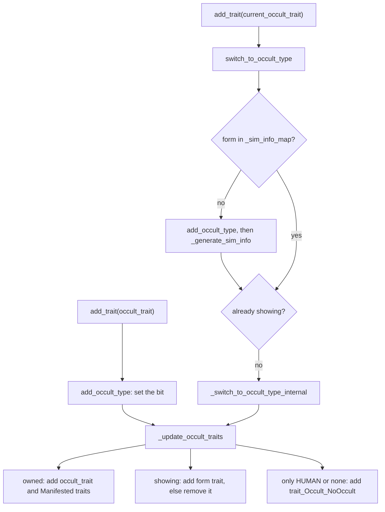
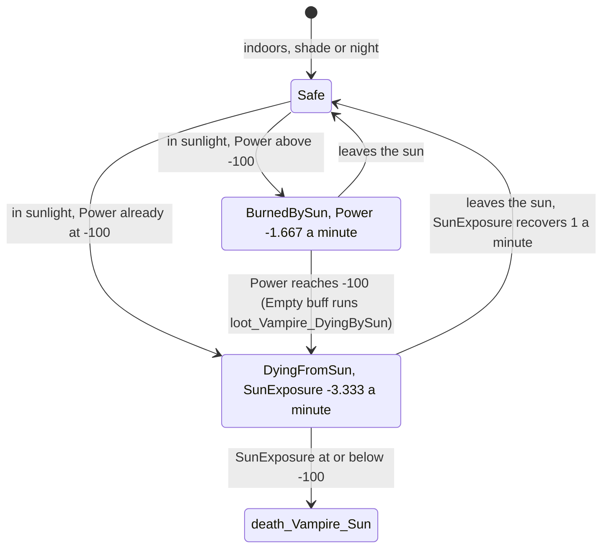
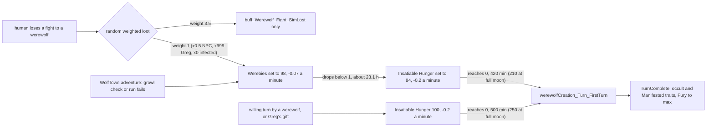

# 3.11 Occults and the supernatural

*Game version 1.128.90.1030 (Steam, Linux/Proton). Numbers come from the live tuning with EP04 (Cats & Dogs), EP06 (Get Famous), EP09 (Eco Lifestyle), EP12 (High School Years), GP04 (Vampires), GP12 (Werewolves), SP01 (Luxury Party) and SP42 (Grunge Revival) installed: vampire numbers are GP04 tuning, werewolf numbers GP12 tuning, ghost and framework numbers base-game delta tuning. The occult module tuning exists only in the base delta build. Spellcasters and familiars (GP08 (Realm of Magic)), mermaids (EP07 (Island Living)), aliens (EP01 (Get To Work)), fairies (EP19 (Enchanted by Nature)) and ghost powers (EP17 (Life & Death)) are described from code and from `Delta/` patch data, labelled "patch data, pack not installed". Checked 2026-10-12: 120 claims checked, 16 corrected, 3 relabelled, 1 removed.*

## In plain words

An occult is a supernatural Sim. The game stores it as a set of flags (human, alien, vampire, mermaid, spellcaster, werewolf, fairy) plus one saved appearance per form, so a vampire has a human look and a vampire look and a werewolf has a human look and a wolf look. Traits do the real work. Giving a Sim the vampire trait makes it a vampire; a second trait says which form is showing; and a third, "Manifested" trait carries the gameplay: the new needs, the sun, the powers. Switching form swaps the stored look and outfits, then puts the traits right again.

Vampires lose Hunger, Energy and Bladder and get Power (vampire energy) and Thirst (plasma) instead. Power never drains by itself: powers spend it and the sun burns it, and sleep (a coffin is best) or dark meditation brings it back. Plasma falls about 6 points an hour and slows once it is low. An unprotected vampire in the sun loses all 200 points of Power in two hours, then dies an hour later. Vampire experience runs over 17 levels in 5 ranks; the 41 powers cost 161 points, but only 46 points come from the start and levels 1 to 16, and after that every 106 experience gives 2 more.

Werewolves have Fury, which rises by itself about 6 points an hour and much faster under the full moon; at 499 out of 500 they rampage. A werewolf may hold one temperament per rank, up to four. A lost fight with a werewolf gives a played human about a 22% chance of a bite; after about 23 hours of "werebies" and 7 hours of insatiable hunger, the Sim turns.

Ghosts are Sims with one of 36 ghost traits, one per way of dying. Ghost traits stop aging and stop a second death, and urnstones let ghosts walk the neighbourhood at night. Spellcasters, mermaids, aliens, fairies and ghost powers have code and module tuning in this install, but the traits and statistics they point to live in packs that are not installed. The game drops their framework entries when it loads, so nothing here can create one, and a save that brings one in loses it. Spells and familiars are GP08 systems whose code ships with every install.

## Key facts

- **Seven occult types as bit flags:** HUMAN 1, ALIEN 2, VAMPIRE 4, MERMAID 8, WITCH 16, WEREWOLF 32, FAIRY 64. A Sim's `occult_types` is the set it owns; `current_occult_types` is the form on screen.
- **Traits drive everything.** Adding a type's occult trait adds the type; adding its form trait switches to that form; every change re-applies the occult, form and "Manifested" traits, and `trait_Occult_NoOccult` marks a plain human.
- **Six module entries, two live:** ALIEN, FAIRY, MERMAID, VAMPIRE, WEREWOLF and WITCH all have `OCCULT_DATA` entries in the base delta, but each entry's occult trait is a pack-safe reference, and the four whose traits are not installed are dropped when the module loads. Live, only VAMPIRE and WEREWOLF remain, and loading a save clears the other four bits.
- **Vampire Power:** range -100 to 100, decay 0. It is spent by powers (25, 34 or 50 points at Potent Power 0) and burned by the sun at 1.667 a minute; sleep gives back 0.27 to 0.55 a minute, dark meditation 4 or 6.
- **Vampire Thirst:** 0.1042 a minute (6.25 an hour), cut to a third from just below -50 down to -99; about 47.7 hours from 100 to -100 with nothing else acting.
- **Sun death:** about 120 minutes to burn 200 Power, then 60 minutes of sun exposure (100 to -100 at 3.333 a minute) before `death_Vampire_Sun`. Perks and weaknesses scale both.
- **Vampire ranks:** 17 experience levels (27 to 1,593 points), ranks 2 to 5 at 202, 630, 1,058 and 1,486 points; 46 power points (2 at the start, 44 from levels 1 to 16) and 5 weakness points through level 16; level 17 repeats, giving 2 points per 106 experience.
- **Turning a vampire:** 36 hours of `commodity_BecomingVampire` (2,160 minutes) after an accepted offer. The offer's outcome has no chance roll: it succeeds when the friendly social score reaches -5.
- **Werewolf Fury:** 0 to 500, rising 0.1 a minute on its own; full moon +10 a minute (+0.1 with Lunar Resistance); rampage at 499.
- **Werewolf ranks:** 9 levels (100 to 3,700 points), ranks 2 to 5 at 200, 700, 1,600 and 3,000; 10 ability points through level 8 for 25 one-point perks; level 9 repeats, giving 1 point per 699 experience.
- **Temperaments:** a werewolf may gain one only while holding fewer than its rank (1 below 200 points, up to 4 at 1,600 and above).
- **Werewolf turning:** a played human who loses a fight to a werewolf gets werebies with weight 1 against 3.5 (22.2%; 12.5% for an NPC). Werebies lasts about 23.1 hours, then insatiable hunger starts at 84 and lasts 7 hours; a willing turn starts the hunger at 100, 8 hours 20 minutes. The full moon halves the hunger.
- **Ghosts:** 36 death types, each mapped to a live ghost trait (35 base, 1 EP09). Ghost traits set `can_die` false and stop aging at every age.
- **Familiars and spells** are GP08 code: 13 familiar types (cat, dog and 11 object familiars) and a spellbook of 24 spells and 15 potions in the module tuning, but 0 live `Spell` instances here.

## How it works

### Types, forms and the occult tracker

- **Observed** (`sims/occult/occult_enums.py: OccultType`). `OccultType` is an `IntFlags`: HUMAN 1, ALIEN 2, VAMPIRE 4, MERMAID 8, WITCH 16, WEREWOLF 32, FAIRY 64.
- **Observed** (`sims/occult/sim_info_with_occult_tracker.py: SimInfoWithOccultTracker`). Every `SimInfo` carries `occult_types` (the owned set), `current_occult_types` (the form shown) and an `OccultTracker`. Setting `occult_types` also copies the value into every stored form (`OccultTracker.on_set_occult_types`).
- **Observed** (`sims/occult/occult_tracker.py: OccultTracker`). The tracker keeps `_sim_info_map`, one `SimInfoBaseWrapper` per form, holding that form's physical data and outfits. `has_occult_type` tests the bit; `is_occult_form_available` and the animation parameter `hasOccultForm` (`get_anim_overrides`) expose whether the Sim may change form.
- **Observed** (`OccultTracker.add_occult_type`). Adding a type only sets the bit and re-applies traits. It does not build a form: a form is built the first time the Sim switches to it.

### Traits make the occult

**Observed** (bytecode of `SimInfoWithOccultTracker.add_trait` and `remove_trait`; the decompile of both is wrong). For each `OCCULT_DATA` entry:

1. Adding the entry's `occult_trait` while loading (`from_load`) when the tracker lacks that type removes the trait again and fails. Otherwise it calls `add_occult_type`, and a baby also gets the form trait when `add_current_occult_trait_to_babies` is set.
2. Adding the entry's `current_occult_trait` calls `switch_to_occult_type`.
3. Then trait effects update, and `trait_Occult_NoOccult` is removed if any occult or part-occult trait is present.
4. Removing an `occult_trait` removes the type; removing a `current_occult_trait` switches to HUMAN; `NoOccult` comes back when nothing is left.

**Observed** (`OccultTracker._update_occult_traits`). After any change, for each entry: an owned type gets its `occult_trait` and every `additional_occult_traits` entry (the "Manifested" traits), plus its `current_occult_trait` when that form is showing (removed otherwise); a type not owned loses all three. `NO_OCCULT_TRAIT` (`trait_Occult_NoOccult`, 154191, module `sims.occult.occult_tuning`) is added when `occult_types` is empty or exactly HUMAN.

**Inferred.** Because the gameplay lives on the Manifested trait, anything that adds the type through the tracker (a turning loot, CAS, `occult.add_occult`) gives the full vampire or werewolf package; the form trait only says which look is on.

### Switching form

- **Observed** (`OccultTracker._switch_to_occult_type_internal`). In order: save the Sim's current outfits into the old form; set `current_occult_types`; copy shared attributes into the new form (physique, gender-option trait ids, and merged hidden outfit categories unless a blacklist forbids them); copy the new form's physical data onto the Sim and load its outfits; keep the current outfit if the new form has it, otherwise (unless it is BATHING) fall back to the type's `fallback_outfit_category` at index 0; then appearance modifiers, outfit change callbacks, resends, suntan, jewelry buffs, tattoos and hair growth.
- **Observed** (`sims/occult/switch_occult_element.py: SwitchOccultElement`). An `XevtTriggeredElement` that switches a Sim who owns the tuned type, optionally tying the form to the current posture. **Observed** (live tuning, scan of every record holding a `switch_occult` node): 12 records, all base delta. The 9 `divingBoard_Jump_*` interactions use `SwitchOccultElement` in their `basic_extras` (MERMAID at xevt 200, tied to the posture, chance multiplied by 0 for children). The postures `posture_Swim`, `posture_BathTubTakeBath` and `posture_BathTub_BubbleBath` use the `Posture` class's own `switch_occult` field instead: MERMAID on the entry xevt 200, HUMAN on the exit xevt 201 (bytecode of `Posture.add_switch_occult_entry_event` and `add_switch_occult_exit_event`; `postures/posture.py` did not decompile). **Inferred**: these are the mermaid tail changes; with EP07 absent nobody owns MERMAID, so they never switch anyone here.
- **Observed** (`OccultTracker.validate_appropriate_occult`). A mermaid in human form on a pool surface switches to the mermaid form if it was a mermaid before a reset; a mermaid off the pool switches to human. `on_sim_ready_to_simulate` calls it with no previous form, so only the second rule can fire there; `Posture._reset_occult` (bytecode) calls it with the form held before the reset, so both can.
- **Observed** (`sims/occult/occult_tests.py: OccultFormAvailabilityTest`). The test checks `has_occult_type` and `is_occult_form_available`, with a negate option.

### Building a form and passing it to children

**Observed** (bytecode of `OccultTracker._generate_sim_info`; the decompile nests it wrongly):

1. If the map is empty and the type is not HUMAN, it first builds the HUMAN form, passing `generate_new_human_form_on_add` as `generate_new`.
2. It always creates a wrapper (keeping the skin tone unless `generate_new`) and stamps the form's types.
3. With `generate_new`: copy trait ids, call the native `generate_occult_siminfo`, then FAIRY copies the Sim's own outfits while every other type generates each regular outfit category its blacklist allows; then shared attributes; WEREWOLF and FAIRY also copy `pelt_layers` to the HUMAN form.
4. The wrapper goes into the map.

**Observed** (module tuning `sims.occult.occult_tracker`, base delta). Every entry except ALIEN sets `generate_new_human_form_on_add` to False, so a new vampire or werewolf keeps its current look as its human form. **Inferred**: what `generate_occult_siminfo` changes is native and not visible in Python.

**Observed** (`OccultTracker.apply_occult_genetics`). A child's genetics use a `random.Random` seeded with the pregnancy seed; with probability 0.5 the parents swap order. Each owned type takes genetics from the parents' matching forms (or their base look). A child with a part-occult trait (ALIEN is the only entry with one, 102784) mixes the occult parent's form with the other parent's human form. **Inferred**: the ALIEN entry does not survive loading here (see the `OCCULT_DATA` table below), so no part-occult genetics run in this install.

### Saving and loading

- **Observed** (`OccultTracker.save`). `PersistableOccultTracker` stores `occult_types`, `current_occult_types`, `occult_form_available`, `pending_occult_type`, and per form its type, outfits and physical attributes. WITCH forms are skipped.
- **Observed** (bytecode of `OccultTracker.load`). For every type that is not HUMAN and has no `OCCULT_DATA` entry, the bit is cleared, the current form falls back to HUMAN and a matching pending type is cleared. Saved forms are rebuilt without new data; FAIRY and MERMAID forms also reload genetic data. **Inferred**: only VAMPIRE and WEREWOLF keep their entries here (next section), so a Sim from a fuller install loses its alien, fairy, mermaid and spellcaster bits when the save loads, and a later save stores the loss.
- **Observed** (`OccultTracker.on_all_traits_loaded`, `post_load`). With forms present, traits are re-applied and the current form is switched in again; with none, `NoOccult` is added. A pending type (set by CAS commands) is switched to after load.
- **Observed** (`filters/tunable.py: OccultRankFilterTerm`; `SimInfoWithOccultTracker._set_desired_initial_occult_rank_from_occult_rank_filter`). A Sim filter can ask for an occult rank in an interval (code default 1 to 1); the chosen rank is held in `desired_occult_rank` and turned into experience with `points_to_rank` when the ranked statistic is added.

### The six OCCULT_DATA entries, and the two that load

**Observed** (module tuning `sims.occult.occult_tracker`, base delta only; references resolved through the live merge; names of missing ids from the decoded patch tuning):

| Type | Occult trait | Form trait | Additional (Manifested) | Experience statistic | Other settings | Live |
|---|---|---|---|---|---|---|
| ALIEN | 102785 | 103230 | none | none | part-occult 102784; other fields code default | no: EP01 traits, entry dropped |
| FAIRY | 433287 | 414621 | 414620 | 437331 | CAS defaults to the fairy form; min UI age TEEN | no: EP19 traits, entry dropped |
| MERMAID | `trait_OccultMermaid` 199043 | 199044 | 211545 (`trait_OccultMermaid_TYAE`) | none | fallback SWIMWEAR; blacklist of 9 named categories plus EVERYDAY; CAS defaults to the tail; min TEEN | no: EP07 traits, entry dropped |
| VAMPIRE | `trait_OccultVampire` 149527 | `trait_OccultVampire_DarkForm` 149528 | `trait_OccultVampire_Manifested` 153867 | `rankedStatistic_Occult_VampireXP` 150071 | CAS may delete the dark form; min TEEN | yes (GP04) |
| WEREWOLF | `trait_OccultWerewolf` 289780 | `trait_OccultWerewolf_WereForm` 276222 | `trait_OccultWerewolf_Manifested` 276221 | `rankedStatistic_Werewolf_Progression` 276388 | CAS defaults to the wolf form; min TEEN | yes (GP12) |
| WITCH | 213050 | disabled | 213061 | 213064 | no alternate look; min TEEN | no: GP08 traits, entry dropped |

**Observed** (`occult_tracker.py`): `occult_trait` is a `TunableReference` with `pack_safe=True`. A pack-safe reference to a record that is not loaded raises up to the nearest list, set or mapping, which drops that element ([0.03 The tuning system](0.03-tuning-system.md)). **Inferred** (from that rule and the four missing traits): the live `OCCULT_DATA` holds only VAMPIRE and WEREWOLF. Every loop over it (`add_trait`, `_update_occult_traits`, genetics, `load`) sees two types, and `load` treats ALIEN, FAIRY, MERMAID and WITCH as types without an entry.

All entries except ALIEN set `add_current_occult_trait_to_babies` False. The mermaid blacklist names FORMAL, ATHLETIC, SLEEP, PARTY, CAREER, SITUATION, SPECIAL, HOTWEATHER and COLDWEATHER plus one empty entry. **Observed** (bytecode of `_to_tunable` in `sims4/tuning/tunable.pyc`; `outfit_enums.py`): an enum element without a value takes `enum(0)`, and `OutfitCategory` 0 is EVERYDAY, the category the field's own description says mermaids cannot wear. `VAMPIRE_DAYWALKER_PERK` pairs `trait_OccultVampire` with `vampirePerks_PersonaPowers_ResistanceSolis_Level3` (151504); `filters/tunable.py: CanBeOutside` reads it ([2.05 The sky and the moon](2.05-sky-and-moon.md)).

### How occults replace needs

**Observed** (live `trait_OccultVampire_Manifested`, GP04; `trait_OccultWerewolf_Manifested`, GP12). The vampire Manifested trait lists `initial_commodities` Power (150238), Thirst (149541) and `commodity_Vampire_SunExposure` (151449), and blacklists `motive_Hunger`, `motive_Energy` and `motive_Bladder`. The werewolf one adds `commodity_Motive_Werewolf_Fury` (276223) and keeps the human needs. How blacklists and initial commodities work is in [3.03 Needs, statistics and commodities](3.03-needs-statistics.md).

**Observed** (live `trait_OccultVampire`). The base vampire trait (all ages) adds `buff_Temperature_Immune_To_Temperature` and a hidden social buff, and sets `disable_aging` with allowed ages BABY, INFANT, TODDLER, CHILD and TEEN. **Observed** (bytecode of `Trait.can_age_up` in `traits/traits.pyc`): a Sim may age out of a stage only if that stage is in `allowed_ages`, so a vampire grows up to young adult and then stops aging. The age gate itself is in [3.09 Life cycle](3.09-life-cycle.md).

### Vampires: Power and Thirst

- **Observed** (live `commodity_Motive_Visible_Vampire_Power`, GP04 delta; same decay in the GP04 full build). Range -100 to 100, convergence -100, `decay_rate` 0: Power does not change unless something sets a rate or spends it. The initial value comes from a range with lower bound 75 (the upper bound is left at its code default, 100). States at -100 (band buff `buff_Motives_Vampire_Power_Empty`, added at or below -100, whose `_loot_on_addition` is `loot_Vampire_DyingBySun`), -99, -75, -50, 0, 25, 50 and 75; panel distress at -25.
- **Observed** (live `commodity_Motive_Visible_Vampire_Thirst`, GP04 delta; same decay in the full build). Range -100 to 100, decay 0.1042 a minute toward -100. States at -100 (`IrresistibleThirst`), -99 (`Parched`), -75 (`NeedToFeed`), -50, 0, 25, 50 and 75; a state runs from its value up to the next one ([3.03](3.03-needs-statistics.md)), so `NeedToFeed` covers -75 to -50 and `Parched` -99 to -75. Both multiply decay by 0.333333; `IrresistibleThirst`, below -99, by 1. At -100 a distress pushes `si_Vampire_ShowDarkForm`; there is no failure. Panel distress at -50.
- **Inferred** (from the rates; starting at 100 with no other modifier). 100 to -50 takes 1,439.5 minutes (24.0 h); -50 to -99 at a third of the rate takes 1,410.7 minutes (23.5 h); the last point takes 9.6 minutes: about 47.7 hours in all. Weakness `InsatiableThirst` multiplies decay by 2.5, Nocturnal Affinity levels 1 to 3 by 0.75, 0.5 and 0.25 (and Fun, Hygiene and Social by the same), a new vampire's `Buff_VampireCreation_StrangeThirst` by 1.5, and coffin hibernation by 0. Decay modifiers multiply ([3.03](3.03-needs-statistics.md)).
- **Observed** (live tuning, every reference to the two commodities). Power gains: bed sleep and naps 0.27, 0.33 or 0.41 a minute, coffin sleep and hibernation 0.33, 0.41 or 0.55 (three tiers each; the tier tests were not decoded; the four `coffin_*` sleep and nap interactions are base-game delta tuning, not GP04 records); the autonomous sleep variants (six bed interactions and `coffin_Autonomous_Sleep`) a flat 0.311; passing out or fainting 0.1 to 0.25; dark meditation 4 or 6, an away action 0.2778, the new moon +0.5 ([2.05](2.05-sky-and-moon.md)), and +50 from `loot_Commodity_Motive_Vampire_Power_Gain_Moonpetal`. Thirst gains while drinking: 6.25 a minute (casually or with permission), 8.823 (deeply, uncontrollably), 13.235 (drain life spirit); single items such as a plasma pack 37.5, fish or frog 28.125, PlasmaJane 25, plasmafruit salad 30.
- **Observed** (live `loot_VampirePowerCost_*` by Potent Power level 0 to 3). Small powers cost 25, 17, 9 or 5 Power; medium 34, 25, 13 or 10; large 50, 34, 25 or 20. Each cost loot also runs its own daytime loot, `loot_Weakness_DayTime_Add_Small`, `_Med` or `_Large`, which takes an extra 5, 10 or 18 (small), 9, 21 or 24 (medium) and 16, 36 or 36 (large) while the Daytime weakness buff of level 1, 2 or 3 is on.

### Vampires: the sun

**Observed** (live `trait_OccultVampire_Manifested`, `day_night_tracking`). The trait lists 4 day buffs (`buff_Vampire_DayTime` and the three `Weaknesses_DayTime` levels), 3 night buffs (Nocturnal Affinity 1 to 3), 27 sunlight buffs and two force-refresh buffs: `buff_Vampire_SunlightReversalCocktail` and 271562 (`buff_FacialMask_Bonus_UV_Vampire`, GP02 (Spa Day) patch data), which the pack-safe set drops, so one is live. **Observed** (bytecode of `traits/trait_tracker.pyc`; `buffs/buff.py`; `bucks/sim_info_bucks_tracker.py`): `TraitTracker.update_day_night_tracking_state` adds them when the tracking trait is applied, when the Sim becomes ready to simulate, when its location changes, when an interaction starts, when a perk changes and when a force-refresh buff is removed; "in sunlight" means the sun is out, the Sim is outside and not in shade ([2.05](2.05-sky-and-moon.md)). Each buff's add test runs only when it is added.

**Observed** (live buffs, GP04 delta). Sunlight buffs set change rates, which replace decay:

- `buff_Vampire_BurnedBySun`: Power -1.66667 a minute; Uncomfortable weight 2. Needs Power above -100, the Manifested trait, no ghost trait, and both perk families locked (`bucks_perks_test` with `test_if_unlocked` False passes while the perk is locked).
- Variants: Resistance Solis 1 and 2 at -0.833333 and -0.555556; Weakness Sunlight 1 to 3 at -3.333333, -6.666667 and -13.333333; ghost vampires use separate buffs at -2.22222, -1.111111, -0.666667, -6.666667, -10 and -20.
- `buff_Vampire_DyingFromSun`: `commodity_Vampire_SunExposure` -3.33333 a minute; Uncomfortable weight 10; needs Power at or below -100. Variants: Resistance Solis 1 and 2 at -2.22222 and -1.66667; Weakness Sunlight 1 to 3 at -6.66667, -13.333333 and -40.
- `buff_Vampire_SunlightReversal`: Power +0.55 (from 0.1375 with Weakness Sunlight 3 up to 0.9625 with Resistance Solis 3).
- Resistance Solis 3 has no BurnedBySun or DyingFromSun variant.

**Observed** (live `buff_Motives_Vampire_Power_Empty` and `loot_Vampire_DyingBySun`). When the Empty band buff is added, this loot gives the matching DyingFromSun variant to a vampire that has any BurnedBySun variant, choosing by which perk is unlocked. **Inferred**: this is how a vampire already in the sun moves to dying without waiting for the next day/night refresh.

**Observed** (live `commodity_Vampire_SunExposure`). Range -100 to 100, initial 100, converging to 100 at 1 a minute. Its failure (at or below -100; the value is the code default) pushes `death_Vampire_Sun`, falling back to `oceanSwimming_Reactions_Drown_WaterVehicleExit`, with repeat interval 5.

**Inferred** (from the add tests above). A vampire that steps into the sun with Power already at -100 fails BurnedBySun's test and passes DyingFromSun's, so it starts dying at once. **Inferred** (from the rates; Power 100, sun exposure 100, unbroken sun, no daytime weakness). With no perks: 200 Power burns in 120 minutes, then 200 sun exposure in 60 minutes, so a vampire at full Power dies after 3 hours of unbroken sun. Weakness Sunlight 3 cuts that to 15 plus 5 minutes; Resistance Solis 2 stretches it to 360 plus 120 minutes. Daytime weakness levels 1 to 3 also drain 0.0625, 0.125 or 0.25 Power a minute all day, indoors too.

### Vampires: rank, points and perks

- **Observed** (live `rankedStatistic_Occult_VampireXP`, GP04 delta). `event_intervals` 27, 40, 54, 81 and then 107 thirteen times: 17 levels at 27, 67, 121, 202, 309, 416, 523, 630, 737, 844, 951, 1,058, 1,165, 1,272, 1,379, 1,486 and 1,593 points. `rank_up` at levels 4, 8, 12 and 16; `initial_rank` is untuned (code default 1), so ranks 2 to 5 arrive at 202, 630, 1,058 and 1,486. Decay 0.
- **Observed** (the level loots `loot_VampireProgression_*`). Power points (`VampirePowerBucks`): 1 at each of levels 1 to 3, 2 at levels 4 to 7, 3 at 8 to 11, 4 at 12 to 15 and 5 at 16; weakness points (`VampireWeaknessBucks`) 1 at levels 4, 8 and 12 and 2 at 16. The initial loot gives 2 power points and 1 experience when experience is 0. That is 46 power points (2 at the start, 44 from the levels) and 5 weakness points through level 16.
- **Observed** (`loot_VampireProgression_5_1`, the level 17 `loot_always`). Each time level 17 is reached it gives 2 power points and takes 106 experience, landing on 1,487, one point above level 16. A load-time loot `loot_VampireProgression_5_1_bugfix` runs too. **Inferred**: every further 106 experience buys 2 points.
- **Observed** (live perks). 41 `VampirePowerBucks` perks cost 161 points in total and 16 `VampireWeaknessBucks` perks cost 1 each. Forty power perks are named `vampirePerks_*`; the 41st is `VampirePerks_MindPowers_NeedsNaughtiness` (150746, 5 points), so a search on the lowercase prefix finds 40. Examples: Resistance Solis 1 to 3 cost 5 each and conflict with the Sunlight weaknesses; Potent Power 1, 2 and 3 cost 1, 2 and 3; Mist Form 6, Bat Form 2, Vampire Run 5, Vampire Creation 3, Emotional Burst 6 a level. No vampire perk record tunes `progression_statistic` or `available_for_puchase_tests`.
- **Observed** (live experience sources). Lore books give 1 or 2.5 experience a minute and drinking 1.5 a minute; `loot_VampireXP_Small` and `_Med` give 10 and 25 (the 50-point `loot_VampireXP_Large` is in the GP04 full build only, outside the live set); a sire gets 20 to 100 for turning someone (by tests); fight winners 10, 25 or 50 by relative rank.

### Vampires: turning and night visits

**Observed** (live `mixer_social_VampireCreation_OfferToTurn`, GP04 delta). The user-directed mixer needs the perk `vampirePerks_SpiritPowers_VampireCreation` and `testSet_Vampires_CanTurn`. Its outcome is test based: when `scores_socialoutcomes_friendly` reaches -5 (`TunableThreshold` defaults to GREATER_OR_EQUAL), the success outcome continues into `vampireCreation_TurnIntoVampire`; otherwise a failure outcome with a small relationship loss. The outcome itself has no chance roll; the three 20% `success_chance` entries in the mixer sit in its `basic_extras`, side loots that run beside the outcome.

**Observed** (live `vampireCreation_OfferToTurn`, the autonomous social used by NPC vampire invites). It pushes the target's response, refuses targets that are already occult, ghosts or turning, and continues into `vampire_ChangeIntoDarkForm_TurnIntoVampire` when the vampire can change form and is not already in it, else straight into `vampireCreation_TurnIntoVampire`.

**Observed** (live `loot_VampireCreation_GiveCommodity`, `commodity_BecomingVampire`, `loot_VampireCreation_NewVampire`). The target gets `commodity_BecomingVampire`: range 0 to 2,160, rising 1 a minute (it converges on 2,160 at decay 1), time-elapsed fixup. States at 1 (`StrangelyHungry`), 721 (`DisgustedByFood`, 12 h) and 1,441 (`AppetiteLost`, 24 h); at 2,160 (36 h) its failure pushes `VampireCreation_TransformIntoVampire`. The new-vampire loot adds `Buff_VampireCreation_StrangeThirst`, adds `trait_OccultVampire`, sets Thirst to 0, removes the commodity, schedules `dialogDramaNode_IntroToVampire_Call1`, and strips plant-Sim buffs and `trait_isPlantSimNPC`.

The night visit in which a vampire breaks in and bites a sleeping Sim is a situation, worked through in [4.01 Situations, roles and NPC scheduling](4.01-situations-npcs.md).

### Werewolves: Fury and the rampage

- **Observed** (live `commodity_Motive_Werewolf_Fury`, GP12 delta). Range 0 to 500, convergence 500, `decay_rate` 0.1: Fury climbs 6 points an hour with nothing else acting. Initial value random 100 to 150; best value is the minimum. States: 0 Low, 150 Medium, 300 High (runs `loot_Werewolf_NPCFuryReset`), 450 Extreme, 499 Rampage (runs `loot_Werewolf_RampageStart` on entry). Panel distress at or above 450.
- **Observed** (live change rates on Fury, each replacing the passive climb while active). Full moon `FuryRate` +10 a minute ([2.05](2.05-sky-and-moon.md)), added only while Lunar Resistance is locked; with it unlocked `FuryRate_Resistance` gives +0.1, the same as the passive climb; temperament triggers +0.5, +0.85 or +1; `buff_Werewolf_TransformationMastery` +0.2; `buff_Werewolf_Abilities_LunarHowl` +500; `buff_Drink_Moonpetal_Stillness` -0.06. Decay modifiers: the four lunar temperaments multiply by 0.2.
- **Observed** (live loots). Fury gains of 2.5 or 5, 10 or 20, and 75 or 150; losses of 5, 25 and 150; rampage end and Pacify set Fury to its minimum; a completed turning sets it to the maximum.
- **Observed** (live `loot_Werewolf_RampageStart`). Adds `buff_Werewolf_Rampage` (or `buff_Werewolf_Rampage_FirstTime` for a werewolf without `trait_OccultWerewolf_HadFirstTransformation`), pushes `werewolf_Transform_Rampage` at Critical priority unless the Sim is about to fight, adds 50 experience, and adds two cooldown buffs (`buff_Werewolf_RabbitholeCooldown`, `buff_Werewolf_ZoomiesCooldown`) behind an NPC-status test. The Rampage band buff switches to the werewolf run walkstyle.
- **Inferred** (from the rates; starting from the initial 100 to 150 with no other rate). Reaching 499 takes 3,490 to 3,990 minutes of passive climb (58.2 to 66.5 hours); under the full moon's +10, 35 to 40 minutes.

### Werewolves: rank, temperaments and packs

- **Observed** (live `rankedStatistic_Werewolf_Progression`). Intervals 100, 100, 250, 250, 450, 450, 700, 700, 700: levels at 100, 200, 450, 700, 1,150, 1,600, 2,300, 3,000 and 3,700. `rank_up` at levels 2, 4, 6 and 8, so ranks 2 to 5 at 200, 700, 1,600 and 3,000. Levels 1 to 8 give 1 `WerewolfAbilityBucks` each and the initial loot 2 plus 1 experience; levels 2, 4 and 6 add a temperament; levels 2, 4, 6 and 8 add pack value (`loot_WerewolfPackValue_Gain_Large_SelfImprovement`) and pack rank (`loot_WerewolfPack_RankB_Gain_Large`); level 8 adds the Apex buff. Level 9's `loot_always` gives 1 point, takes 699 experience (landing on 3,001) and adds the pack value again (an `Overmax_Bugfix` loot runs on load).
- **Observed** (live perks). 25 `WerewolfAbilityBucks` perks at 1 point each (through `available_for_puchase_tests`, Hunting Party needs Hunter, Immortal Wolf needs Natural Healing and Tunneler needs Scavenger; no werewolf perk tunes `required_unlocks`) and 6 `WerewolfQuestAbilityBucks` perks at 0.
- **Observed** (live `loot_Werewolf_TemperamentAdd`; `sims/sim_info_tests.py` trait test, which fails when the count of blacklisted traits exceeds `num_blacklist_allowed`). The loot runs `randomWeightedLoot_Werewolf_AddTemperaments` if one of four test groups passes: experience at least 1,600 and at most 3 of the 22 temperament traits held; 700 to 1,599 and at most 2; 200 to 699 and at most 1; below 200 and none. **Inferred**: a werewolf holds at most one temperament per rank, up to 4. The Manifested trait runs this loot 4 times on add, so a new werewolf starts with one and a Sim created at a higher rank fills up at once.
- **Observed** (live GP12 records). Two packs, each with a trait (`trait_WerewolfPackA`, `trait_WerewolfPackB`), leader and member traits, and a ranked statistic. `rankedStatistic_WerewolfPackA` has intervals 0, 150, 300, 450, 0; levels 2 to 4 promote (with demotion loots on the way down) and level 5's `loot_always` runs `loot_WerewolfPack_Rank_Promoted_Leader`. The last interval is 0, so level 5 (leader) sits at the same total as level 4: 900 points for Pack A (Pack B: intervals 0, 200, 350, 500, 0, total 1,050). Ordinary members cannot reach it: every `loot_WerewolfPack_RankA_Gain_*` change caps the statistic at 899 points (`RankB` at 1,049). Only `loot_WerewolfPack_Module_PromoteLeaderA`/`B` gets there, with `statistic_set_rank` 4, which `RankedStatistic.points_to_rank` turns into the full total, so the leader reads as level 5 and gets `buff_WerewolfPack_NewAlphaInTown`; the demote loot sets rank 3 (450 points for Pack A). Who leads is recorded by `ClanService`, see [4.03 Clubs, organizations, clans and factions](4.03-groups-factions.md) (`statistics/ranked_statistic.py: points_to_rank`; live GP12 loots; confirmed by the 4.03 checker). Five pack-value commodities (Diplomacy, Expand and Explore, Pack Participation, Self Improvement, Self Sufficiency) track standing; alliance, feud and discipline are traits.

### Werewolves: turning

- **Observed** (live `randomWeightedLoot_Werewolf_Fight_HumanLost_Target` and `_Actor`; the pick picks one entry by weight, see [0.04](0.04-tests-loot-effects.md)). The werebies entry has weight 1, multiplied by 0 if the Sim already has werebies, 999 if the werewolf is `trait_WolfTown_Greg`, and 0.5 for an NPC target; the alternative, `buff_Werewolf_Fight_SimLost`, has 3.5. **Inferred**: 1 / 4.5 = 22.2% for a played Sim, 0.5 / 4 = 12.5% for an NPC, 999 / 1,002.5 = 99.7% against Greg (99.3% for an NPC). The werebies loot also refuses pregnant Sims, Sims younger than teen, and Sims who are already occult. **Inferred** (from the pick rule in [0.04](0.04-tests-loot-effects.md)): a refused werebies pick is dropped and the draw falls to the other entry.
- **Observed** (live `commodity_WerewolfCreation_Werebies`). Initial value 100, decay 0.07 a minute toward 0, time-elapsed fixup. States 0, 1 (`Werebies2`, Stressed 3) and 85 (`Werebies1`, Angry 3); entering the bottom state, which begins below 1, runs `loot_WerewolfCreation_InsatiableHunger_FromWerebies`. `buff_WerewolfCreation_WerebiesPaused` puts a decay modifier on it with no value, so the code default 0 applies and the countdown stops. **Observed** (live `loot_WerewolfCreation_Werebies_Targetsim` and `_Actor`): the bite loot adds the commodity and then, when it reads 99 or more (`TunableThreshold` default GREATER_OR_EQUAL), sets it to 98. **Inferred** (no pause, no removal): every infection starts at 98 and drops below 1 after 97 / 0.07 = 1,386 minutes (about 23.1 hours), when the hunger loot runs; the value itself would reach 0 at 1,400.
- **Observed** (live `loot_WerewolfCreation_InsatiableHunger_FromWerebies`, `_Actor`, `_TargetSim`). The werebies loot adds the hunger commodity, sets it to 84 and removes werebies; the willing-turn loots (from `werewolfCreation_Actor_TurnIntoWerewolf_Cont` and Greg's gift) add it at its initial 100. **Inferred**: after a bite the hunger lasts 84 / 0.2 = 420 minutes (7 hours), after a willing turn 500 minutes; the full moon halves both.
- **Observed** (live `commodity_WerewolfCreation_InsatiableHunger`). Initial value 100, decays 0.2 a minute; states 85 `PainfulBite`, 30 `InsatiableHunger1` (Hunger decay x10), 1 `InsatiableHunger2` (x15), and at the bottom NPC and inactive-Sim completion loots; the full-moon `InsatiableHungerSpeedup` doubles decay. The failure at or below 0 pushes `werewolfCreation_Turn_FirstTurn`.
- **Observed** (live `loot_WerewolfCreation_TurnComplete`). For a Sim without the Manifested trait: adds `buff_Werewolf_DontResetFury`, `trait_OccultWerewolf` and `trait_OccultWerewolf_Manifested`, removes the hunger commodity, sets Fury to its maximum, and removes both interest traits (`trait_WerewolfInterest_Want` and `_DontWant`).

### Ghosts: death types and ghost traits

- **Observed** (module tuning `interactions.utils.death_enums`, base delta; `interactions/utils/death_enums.py: DeathType`). `DeathType` is a partitioned `DynamicEnumLocked` with NONE 0 and 36 tuned values: Hunger, Old Age, Cowplant, Electrocution, Anger, Laughter, ElderExhaustion, Embarrassment, Fire, Drown, Steam, Pufferfish, Sun, Poison, RodentDisease, Frozen, Overheat, Lightning, DeathFlowerArrangement, MotherPlant, WitchOverload, MurphyBed, Flies, VendingMachine, ClimbingRoute, KillerRabbit, KillerChicken, Meteorite, StinkBomb, UrbanMyth, MoldSystem, BrokenHeart, Crow, SecretPassageway (values 64 to 97), Beetles (67585) and EmotionalStarvation (129025).
- **Observed** (module tuning `interactions.utils.death`, `DEATH_TYPE_GHOST_TRAIT_MAP`, resolved live). All 36 types map to a ghost trait, and all 36 traits load: 35 from the base delta and `trait_Ghost_Beetle` (235995) from EP09. Sun maps to `trait_ghost_Vampire_Sun`, UrbanMyth to `trait_Ghost_UrbanMyth_EP12Death`, Crow to `trait_Ghost_PetCrow`. **Observed** (live scan of every `Trait`): 38 traits have trait type GHOST, two more than the map uses: `trait_Ghost_UrbanMyth` (284363) and `trait_Ghost_R3Event` (385224), both base delta. [3.07](3.07-personality-feelings.md) counts 37.
- **Observed** (`DeathTracker.is_ghost`, `get_ghost_trait`). A Sim is a ghost when it holds any trait from the map's values; the death flow adds the trait for the stored death type ([3.09](3.09-life-cycle.md)).
- **Observed** (live `trait_ghost_Fire`, `trait_ghost_Vampire_Sun`, `trait_ghost_OldAge`). A ghost trait has trait type GHOST, `can_die` False, `disable_aging` enabled with no allowed ages (the `TunableSet` defaults to empty, so no stage can be aged out of), the always-on `buff_Trait_IsGhost`, a per-death buff (`buff_BeGhost_Fire`), buff replacements (`Buff_Motives_Hunger_Starving` becomes a ghost version), urnstone leave-lot interactions, the `ghostvox` voice effect and a CAS effect. `trait_ghost_Fire` allows child to elder and any occult; `trait_ghost_Vampire_Sun` allows teen to elder, vampires only, CAS pack GP04.
- **Observed** (`sims/ghost.py: Ghost.remove_ghost_from_sim`, `make_ghost_if_needed`). Removing a ghost strips every GHOST-type trait, clears the death type, turns off ghost routing and updates age callbacks. **Observed** (per-function decompile of `traits/trait_tracker.pyc`): removing any ghost trait also removes the module's `GHOST_ONLY_TRAITS` and runs the ghost outfit fixup; on load, ghost-only traits on a Sim with no GHOST-type trait are removed. Live `GHOST_ONLY_TRAITS`: `trait_IsGhost` (381402, base delta) and 384623, which does not resolve (`trait_GhostPowers_Manifested` in EP17 patch data, pack not installed).

### Ghosts: urnstones and walk-bys

- **Observed** (`Ghost.create_urnstone`; module tuning `sims.ghost`). Death creates an urnstone from `URNSTONE_DEFINITION`, a tested weighted list of object definitions whose tests look at species, occult traits and pools, with a plain fallback (definition 18590), and stores the Sim in its stored-Sim-info component.
- **Observed** (bytecode of `Ghost._check_urnstone_validity` and of the generator in `get_valid_urnstones`; the decompile drops the filter). An urnstone can send its ghost out only if it holds a Sim; when an uninstanced ghost is required, the ghost must not be instanced, must be off cooldown, and must lack `WALKBY_BLOCKING_TRAIT` (`trait_GhostHasRebirthedIntoNewSim`, 412517). The cooldown runs from the stored Sim's `time_sim_was_saved` (set when it is uninstantiated), and a ghost with no such time counts as on cooldown. `WALKBY_COOLDOWN` is 2,880 Sim minutes live (code default 48).
- The ambient ghost source, its 23:45 one-hour window and the per-urnstone counts are in [4.01](4.01-situations-npcs.md).

### Ghost powers (patch data, pack not installed)

- **Observed** (`sims/ghost_powers/ghost_powers_tuning.py`; module tuning, base delta). `GhostPowersTunables` names a ranked statistic (384633), a mana commodity (384632), good and evil "ultimate" statistics (384631, 384630), the bucks type `GhostPowersAbilityBucks` and two icons. None of the four ids resolves live; EP17 patch data names them `rankedStatistic_GhostPowers_GhostXP`, `commodity_GhostPowers_Stamina`, `statistic_GhostPowers_Good` and `statistic_GhostPowers_Evil`.
- **Observed** (`ghost_powers_commands.py`). `ghost_powers.get_ultimate_progress` (Live, `pack=EP17`) reports the two ultimate values to the UI; with EP17 absent it is not registered.
- **Observed** (`ghost_powers_loot_ops.py: GhostBurnoutCooldownShaderLootOp`). A loot that sends `MSG_SIM_GHOST_BURNOUT_TOGGLE` with an edge colour multiplier (0 to 1, default 1).
- **Observed** (patch data, pack not installed: the decoded patch tuning of EP17). `commodity_GhostPowers_Stamina` is 384632 and 27 records are named `ghostPowersPerks_*` (Haunting Shriek, Levitate Sim, Give Nightmare and others).

### Spellcasters, spells and familiars (GP08 code; tuning is patch data, pack not installed)

- **Observed** (`spells/spells.py: Spell`). Instance type SPELL; tunables `locked_description`, `ingredients` (an `ItemCost`) and `tags`; `unlock_as_new` is a class property that always returns True; spells provide super affordances. **Observed** (live count): 0 `Spell` instances load here.
- **Observed** (`spells/spellbook.py`). `SpellbookHelper` builds a WITCH-style book from `ui.spellbook_tuning`: a front page, then categories; spell categories list spells, potion categories list recipes. A category that ends on an odd page gets a blank page (`MAX_VISIBLE_PAGES` 2), so each category starts on a fresh two-page spread, and a category's progress is 100 when everything is unlocked, else the integer percentage unlocked. **Observed** (module tuning `ui.spellbook_tuning`, base delta): 9 practical, 7 mischief and 8 untamed spells and 15 potions; `CATEGORY_FRONT_PAGE_ENTRY_COUNT` 3 (code default 2); `CATEGORY_ENTRY_COUNT` untuned (code default 4).
- **Observed** (`spells/spell_commands.py`). Unlocking a spell is an entry in the Sim's unlock tracker (`add_unlock`, marked new).
- **Observed** (patch data, pack not installed: the decoded patch tuning of GP08). 24 `Spell` records (`spells_Practical_*`, `spells_Mischief_*`, `spells_Untamed_*`), the same ids the spellbook lists. `rankedStatistic_WitchOccult_WitchXP` (213064) has intervals 50, 300, 500, 700, 800, 500 and `initial_rank` 0. `commodity_Motive_WitchOccult_Charge` (213024) runs 0 to 300 with decay 0.208.
- **Observed** (`familiars/familiar_enums.py`; module tuning `familiars.familiar_enums`). `FamiliarType` is a `DynamicEnumLocked` with CAT 0 and DOG 1 in code, and the module tuning adds Bunnerfly 64, Dragon 65, Fairy 66, Frog 67, Owl 68, Phoenix 69, Raven 70, Skull 71, Voidcritter 72, VoodooDoll 73 and Bat 74: 13 types.
- **Observed** (`familiars/familiar_tracker.py: FamiliarTracker`; module tuning `familiars.familiar_tracker`). `FAMILIAR_DATA` gives each object familiar an object, a token object, a follow interaction and a name list; cats and dogs are real pets marked with a relationship bit. Binding picks a random name (object familiars) or records the pet; `set_active_familiar` creates and places the object (or summons the pet), pushes the follow or set-active interaction at Critical priority, and adds the owner's buff. Below LOD ACTIVE the familiar is dismissed; above, it reloads. The tracker's buff, bit and interaction ids all point at GP08 records that do not resolve here.
- **Observed** (bytecode of `FamiliarTracker.on_household_member_removed`). When a household member leaves, the loop unbinds the first pet familiar now in another household and returns. **Inferred**: a second departed pet stays bound until `on_all_sim_infos_loaded` cleans it up; reaching this needs GP08 binding interactions, absent here.
- **Observed** (`familiar_elments.py`, `familiar_interactions.py`, `familiar_tests.py`, `familiar_handlers.py`). Elements bind a pet or object familiar (the object one shows a rename dialog), bind generically and dismiss; a picker lists every familiar and disables pets that are in a rabbit hole or in an incompatible region; tests check for an active or any familiar; a GSI view lists them.

### Mermaids, aliens and fairies (patch data, pack not installed)

- **Mermaids (EP07).** **Observed**: the MERMAID entry above (dropped at load here), the pool rule in `validate_appropriate_occult`, and the 12 swim and bath records that use `switch_occult`. The EP07 patch data names `trait_OccultMermaid`, `trait_OccultMermaid_MermaidForm`, `trait_OccultMermaid_TYAE` and `trait_OccultMermaidAndGhost` (381404).
- **Aliens (EP01).** **Observed**: the only entry with a part-occult trait and the only one that leaves `generate_new_human_form_on_add` and `add_current_occult_trait_to_babies` at their True defaults; like the mermaid entry it is dropped at load here. The EP01 patch data has abduction and brain-power commodities.
- **Fairies (EP19).** **Observed** (`fairy/fairy_tuning.py: WingTuning`; module tuning `fairy.fairy_tuning`, base delta): wings may not pass pool and ocean-ladder portals; a route segment must be at least 0.75 m (code default 10) for the fairy to take wings out or put them away; the put-down radius is 0.5 (the code default); the interrupt radius is untuned (code default 0.2). **Observed** (`fairy/fairy_wing_ops.py: SetFairyWingsOnSim`): the loot replaces the WINGS body part on the Sim and on the stored FAIRY form and copies pelt layers to the HUMAN form. The EP19 patch data has `commodity_Motive_FairyOccult_EmotionalAppetite` and 33 records named `fairyPerks_*`.

## Numbers

| Name | Value | Unit | Where | Source |
|---|---|---|---|---|
| `OCCULT_DATA` entries | 6 tuned (ALIEN, FAIRY, MERMAID, VAMPIRE, WEREWOLF, WITCH); 2 after load (VAMPIRE, WEREWOLF) | entries | `sims.occult.occult_tracker` | delta only; the load count is inferred from `pack_safe` |
| `NO_OCCULT_TRAIT` | `trait_Occult_NoOccult` 154191 | trait | `sims.occult.occult_tuning` | delta |
| `switch_occult` users | 12 (3 postures with the posture field, 9 diving-board jumps with `SwitchOccultElement`) | records | live scan | live, base delta |
| Vampire Power range, decay | -100 to 100, 0 | points, per minute | `commodity_Motive_Visible_Vampire_Power` | live (GP04 delta; full build same decay) |
| Vampire Thirst decay | 0.1042 | per minute | `commodity_Motive_Visible_Vampire_Thirst` | live (GP04 delta; full build same) |
| Thirst band modifiers | x0.333333 below -50 down to -99 (NeedToFeed, Parched), x1 below -99 (IrresistibleThirst) | multiplier | `buff_Motives_Vampire_Thirst_*` | live |
| Thirst, 100 to -100 | about 47.7 (no modifiers) | hours | derived | live rates |
| Power cost small / medium / large | 25 / 34 / 50 (Potent Power 0) to 5 / 10 / 20 (level 3) | Power | `loot_VampirePowerCost_*` | live |
| BurnedBySun | -1.66667 | Power per minute | `buff_Vampire_BurnedBySun` | live |
| DyingFromSun | -3.33333 | sun exposure per minute | `buff_Vampire_DyingFromSun` | live |
| Sun exposure recovery | +1 toward 100 | per minute | `commodity_Vampire_SunExposure` | live |
| Sun exposure failure | at or below -100 | points | same | code default threshold |
| Daytime weakness drain | 0.0625 / 0.125 / 0.25 | Power per minute | `buff_Vampire_Weaknesses_DayTime_Level1-3` | live |
| Coffin / bed Power gain | 0.33, 0.41, 0.55 / 0.27, 0.33, 0.41 (autonomous sleep 0.311) | per minute | sleep interactions | live |
| BecomingVampire | 0 to 2,160, +1 a minute | minutes | `commodity_BecomingVampire` | live |
| Vampire XP levels | 27, 67, 121, 202, ..., 1,486, 1,593 | points | `rankedStatistic_Occult_VampireXP` | live |
| Vampire `initial_rank` | 1 | rank | same | code default |
| Vampire points to level 16 | 46 power (2 initial, 44 from levels), 5 weakness | points | level loots | live |
| Vampire overmax | +2 power, -106 XP | per repeat | `loot_VampireProgression_5_1` | live |
| Vampire perks | 41 power (161 points), 16 weakness (1 each) | perks | `vampirePerks_*` | live |
| Offer to Turn threshold | -5 on `scores_socialoutcomes_friendly` | score | mixer outcome | live |
| Fury range, decay | 0 to 500, 0.1 | points, per minute | `commodity_Motive_Werewolf_Fury` | live (GP12 delta) |
| Fury initial | 100 to 150 | points | same | live |
| Rampage state | 499 | points | same | live |
| Full moon Fury rate | +10 (+0.1 with Lunar Resistance) | per minute | `buff_LunarCycle_Werewolves_4_FullMoon_FuryRate`, `_FuryRate_Resistance` | live |
| Werewolf XP levels | 100, 200, 450, 700, 1,150, 1,600, 2,300, 3,000, 3,700 | points | `rankedStatistic_Werewolf_Progression` | live |
| Werewolf overmax | +1 point, -699 XP | per repeat | level 9 loot | live |
| Werewolf ability perks | 25 at 1 point; 6 quest perks at 0 | perks | `werewolfPerks_*` | live |
| Temperament caps | 1 / 2 / 3 / 4 at 0 / 200 / 700 / 1,600 XP | traits | `loot_Werewolf_TemperamentAdd` | live |
| Werebies weight | 1 (x0.5 NPC, x999 Greg) vs 3.5 | weight | `randomWeightedLoot_Werewolf_Fight_HumanLost_*` | live |
| Werebies decay | 0.07, from 98 after a bite; hunger starts below 1 (about 1,386 minutes) | per minute | `commodity_WerewolfCreation_Werebies` | live |
| Insatiable hunger decay | 0.2 from 84 after werebies (420 minutes) or 100 after a willing turn (500); x2 at full moon | per minute | `commodity_WerewolfCreation_InsatiableHunger`, `loot_WerewolfCreation_InsatiableHunger_FromWerebies` | live |
| Pack rank intervals | 0, 150, 300, 450, 0 | points | `rankedStatistic_WerewolfPackA` | live |
| Death types | 36 (+ NONE) | values | `interactions.utils.death_enums` | delta |
| Ghost `WALKBY_COOLDOWN` | 2,880 | Sim minutes | `sims.ghost` | delta (code 48) |
| Familiar types | 13 | types | `familiars.familiar_enums` + code | delta + code |
| Spellbook | 24 spells, 15 potions; front page 3 entries | entries | `ui.spellbook_tuning` | delta (front page code 2) |
| Live `Spell` instances | 0 | records | live count | live |
| Fairy wing segment minimum | 0.75 | metres | `fairy.fairy_tuning` | delta (code 10) |
| Witch XP intervals | 50, 300, 500, 700, 800, 500 | points | `rankedStatistic_WitchOccult_WitchXP` | patch data, pack not installed |

## Data shapes

- **`OccultTracker.OCCULT_DATA`** (`occult_tracker.py`): a map from `OccultType` to a tuple of `fallback_outfit_category`, `occult_form_outfit_category_blacklist`, `occult_name`, `occult_trait`, `current_occult_trait` (optional), `part_occult_trait`, `additional_occult_traits`, `add_current_occult_trait_to_babies` (default True), `generate_new_human_form_on_add` (default True), `experience_statistic`, several CAS strings, `cas_default_to_alternative_form`, `cas_can_delete_alternative_form` and `min_age_for_occult_ui` (default BABY). Beside it, `VAMPIRE_DAYWALKER_PERK` (trait, perk).
- **`PersistableOccultTracker`** (save): `occult_types`, `current_occult_types`, `occult_form_available`, `pending_occult_type`, and `occult_sim_infos` (each `occult_type`, `outfits`, physical attributes). Save layout in [8.04](8.04-save-file-format.md).
- **Familiar save** (`FamiliarTracker.save`): `active_familiar_uid` and `familiars`, each `familiar_uid`, `familiar_type`, `familiar_name` and `pet_familiar_id`.
- **`Spell`** (instance type SPELL): `locked_description`, `ingredients`, `tags` (the class property `unlock_as_new` is always True), plus display and super-affordance provider mixins.
- **`Ghost`** (module `sims.ghost`): `GHOST_ONLY_TRAITS`, `URNSTONE_TAG`, `URNSTONE_STORAGE_TAG`, `URNSTONE_DEFINITION`, `URNSTONE_RELEASE_VFX`, `WALKBY_COOLDOWN`, `WALKBY_BLOCKING_TRAIT`. `DeathTracker.DEATH_TYPE_GHOST_TRAIT_MAP` maps `DeathType` to a trait.
- **Bucks perks** (vampire and werewolf powers): `associated_bucks_type`, `unlock_cost`, `next_level_perk`, `conflicting_perks`, `required_unlocks`, `buffs_to_award`, `loots_on_unlock`, `traits_to_award`, `available_for_puchase_tests` (EA's spelling).

**Main tuning records per occult:**

| Occult | Pack, status | Traits | Progress | Key commodities |
|---|---|---|---|---|
| Vampire | GP04, live | `trait_OccultVampire`, `_DarkForm`, `_Manifested` | `rankedStatistic_Occult_VampireXP` | Power 150238, Thirst 149541, `commodity_Vampire_SunExposure`, `commodity_BecomingVampire` |
| Werewolf | GP12, live | `trait_OccultWerewolf`, `_WereForm`, `_Manifested`, 22 temperaments, pack traits | `rankedStatistic_Werewolf_Progression`, `rankedStatistic_WerewolfPackA`/`B` | Fury 276223, Werebies 288816, Insatiable Hunger 288817, 5 pack values |
| Ghost | base and EP09, live | 36 mapped ghost traits, `trait_IsGhost` | none | none in the base game |
| Spellcaster | GP08, patch data | 213050, 213061 | `rankedStatistic_WitchOccult_WitchXP` | `commodity_Motive_WitchOccult_Charge` |
| Mermaid | EP07, patch data | `trait_OccultMermaid`, `_MermaidForm`, `_TYAE` | none | none named in the module |
| Alien | EP01, patch data | 102785, 103230, part 102784 | none | abduction commodities |
| Fairy | EP19, patch data | 433287, 414621, 414620 | 437331 | `commodity_Motive_FairyOccult_EmotionalAppetite` |

## For modders

**Common tweaks:**

- *Gentler sun:* the change rates on `buff_Vampire_BurnedBySun` and `buff_Vampire_DyingFromSun` (and their perk variants), or the failure threshold on `commodity_Vampire_SunExposure`.
- *Slower plasma:* `decay_rate` on `commodity_Motive_Visible_Vampire_Thirst`, or the band buffs' decay modifiers.
- *More power points:* the level loots `loot_VampireProgression_*`, or the level 17 overmax amounts; for werewolves the level loots and the level 9 overmax.
- *Calmer werewolves:* `decay_rate` on `commodity_Motive_Werewolf_Fury` (the passive climb) and the full-moon `FuryRate` buff.
- *Turning odds:* weights on `randomWeightedLoot_Werewolf_Fight_HumanLost_Target`; the threshold in the Offer to Turn mixer outcome; the 2,160 on `commodity_BecomingVampire`.
- *New death type:* add a `DeathType` value in `interactions.utils.death_enums` and a map entry in `DEATH_TYPE_GHOST_TRAIT_MAP` (module tuning, so it needs a script or module override).

**Commands** (types from `@sims4.commands.Command`; untyped and DebugOnly commands are not registered in retail, Automation needs automation mode, see [0.02](0.02-architecture.md)):

| Command | Type | What it does |
|---|---|---|
| `occult.add_occult <type> [sim]` | Automation | sets the bit and re-applies traits; no form is built |
| `occult.remove_occult <type> [sim]` | DebugOnly (untyped) | switches to human if needed, clears the bit, deletes the form |
| `occult.switch_to_occult <type> [sim]` | DebugOnly (untyped) | switches form, building it if missing |
| `occult.set_all_sims_to_occult <type> [form]` | DebugOnly (untyped) | every instanced Sim without an occult trait |
| `occult.occult_form_available [sim]` | Automation | prints the form flag |
| `sims.switch_to_werewolf [sim]` | DebugOnly | stores the pending form and switches to WEREWOLF (`cas_commands.py`) |
| `sims.modify_disguise_in_cas` | Live | stores the current form as pending, switches to human, opens CAS |
| `spells.generate_spell_book`, `spells.generate_spell_book.ui`, `spells.mark_spellbook_entry_as_viewed` | Live | spellbook UI |
| `spells.unlock_spell <spell> [sim]` | Automation | adds the spell unlock |
| `ghost_powers.get_ultimate_progress <sim_id>` | Live, `pack=EP17` | not registered here |

**Traps:**

- Gameplay lives on the Manifested trait. Adding only `trait_OccultVampire_DarkForm` switches form (and adds the type through `switch_to_occult_type`), which in turn adds the Manifested trait; removing `trait_OccultVampire` removes the type and everything with it.
- A vampire's Power does not drain on its own (`decay_rate` 0). A mod that expects "energy" to fall over time must add a rate.
- Change rates replace decay ([3.03](3.03-needs-statistics.md)): any Fury rate, even a tiny positive one, stops the 0.1 passive climb while it lasts.
- Day/night buffs refresh only when the tracking trait is applied, the Sim becomes ready to simulate, its location changes, an interaction starts, a perk changes or a force-refresh buff is removed ([2.05](2.05-sky-and-moon.md) names three of these). **Inferred**: none is tied to the clock, so a vampire that starts no interaction and does not move when the sun rises keeps its night buffs until one of those happens, and the Power Empty loot is what carries a burning vampire on to dying.
- `buff_WerewolfCreation_WerebiesPaused` has no value in its decay modifier and relies on the code default 0. Copying it and adding a value changes its meaning.
- Occult module tuning is delta-only; the base full build has no `sims.occult.occult_tracker`, `sims.ghost` or `fairy.fairy_tuning` record.
- Loading a save strips every type with no `OCCULT_DATA` entry, and the pack-safe `occult_trait` drops the ALIEN, FAIRY, MERMAID and WITCH entries when their pack is missing. **Inferred**: a mermaid, alien, fairy or spellcaster from another install comes back human here, and saving keeps it that way. A mod that adds an occult needs its trait to load, or its entry vanishes the same way.

## Limits

- The tests that choose between the three Power gain tiers of each sleep interaction were not decoded.
- The native `generate_occult_siminfo` is not visible in Python; what it changes in a generated form is unknown.
- Only seven decay rates were compared with the GP04 and GP12 full builds (Power, Thirst, sun exposure, BecomingVampire, Fury, werebies, insatiable hunger; all match); other GP04 and GP12 values are the live (delta) ones without a full-build comparison.
- The `OCCULT_DATA` load count (2 of 6) follows from the pack-safe rule in [0.03](0.03-tuning-system.md); it was not observed in a running game.
- Whether the vampire perk tree gates powers by rank is not in the perk records; any rank gate lives elsewhere (UI or interaction tests) and was not traced.
- Patch data for GP08, EP07, EP01, EP19 and EP17 covers only the records this update ships, so counts drawn from it (24 spells, 33 fairy perks, 27 ghost perks) may not be the packs' full totals.
- Vampire powers, werewolf abilities, the vampire and werewolf social mixers, and the GP12 world's situations were not walked one by one.

## File index

| Module | What it holds | Depth |
|---|---|---|
| `simulation/fairy/__init__.py` | package marker | listed |
| `simulation/fairy/fairy_tuning.py` | `WingTuning`: wing interactions, blocked portals, distances, carry proxy, fixup rules | deep |
| `simulation/fairy/fairy_wing_ops.py` | `SetFairyWingsOnSim` loot and `WingStateChangePathInterruptType` | deep |
| `simulation/familiars/__init__.py` | package marker | listed |
| `simulation/familiars/familiar_elments.py` | bind pet, bind object (rename dialog), bind and dismiss elements | deep |
| `simulation/familiars/familiar_enums.py` | `FamiliarType` (CAT, DOG; 11 more in tuning) | deep |
| `simulation/familiars/familiar_handlers.py` | GSI "familiar_view" | skim |
| `simulation/familiars/familiar_interactions.py` | familiar picker (set active, unbind) and rename interaction | deep |
| `simulation/familiars/familiar_tests.py` | `FamiliarTest`, `HasFamiliarTest` | skim |
| `simulation/familiars/familiar_tracker.py` | `FamiliarTracker` and `FamiliarInfo`: bind, summon, dismiss, LOD, save | deep |
| `simulation/sims/ghost.py` | `Ghost`: urnstones, walk-by validity, ghost removal, ghost-only traits | deep |
| `simulation/sims/ghost_powers/__init__.py` | package marker | listed |
| `simulation/sims/ghost_powers/ghost_powers_commands.py` | `ghost_powers.get_ultimate_progress` (Live, EP17) | deep |
| `simulation/sims/ghost_powers/ghost_powers_loot_ops.py` | `GhostBurnoutCooldownShaderLootOp` | skim |
| `simulation/sims/ghost_powers/ghost_powers_tuning.py` | `GhostPowersTunables` | deep |
| `simulation/sims/occult/__init__.py` | package marker | listed |
| `simulation/sims/occult/occult_commands.py` | the five `occult.*` commands | deep |
| `simulation/sims/occult/occult_enums.py` | `OccultType` flags | deep |
| `simulation/sims/occult/occult_tests.py` | `OccultFormAvailabilityTest` | deep |
| `simulation/sims/occult/occult_tracker.py` | `OccultTracker`: forms, switching, traits, genetics, save and load | deep |
| `simulation/sims/occult/occult_tuning.py` | `OccultTuning.NO_OCCULT_TRAIT` | deep |
| `simulation/sims/occult/sim_info_with_occult_tracker.py` | trait hooks that add, switch and remove occults; desired rank | deep |
| `simulation/sims/occult/switch_occult_element.py` | `SwitchOccultElement` | deep |
| `simulation/spells/__init__.py` | package marker | listed |
| `simulation/spells/spell_commands.py` | spellbook and unlock commands | deep |
| `simulation/spells/spellbook.py` | `SpellbookHelper`, category pages and progress | skim |
| `simulation/spells/spells.py` | `Spell` instance class | deep |

Other modules used: `simulation/interactions/utils/death.py`, `simulation/interactions/utils/death_enums.py`, `simulation/traits/traits.py` (bytecode of `Trait.can_age_up`), `simulation/traits/trait_tracker.py`, `simulation/sims/sim_info_tests.py`, `simulation/filters/tunable.py`, `simulation/server_commands/cas_commands.py`, `simulation/statistics/tunable.py`, `simulation/ui/spellbook_tuning.py`, `simulation/event_testing/test_based_score_threshold.py`, `simulation/statistics/commodity.py`, `simulation/autonomy/autonomy_modifier.py`, `simulation/traits/trait_day_night_tracking.py`, `simulation/buffs/buff.py`, `simulation/bucks/sim_info_bucks_tracker.py`, `simulation/sims/outfits/outfit_enums.py`, `simulation/postures/posture.py` (bytecode), `core/sims4/tuning/tunable.py` (bytecode of `_to_tunable`).

Tuning used (the live merge; module tuning from the base delta; patch data from the decoded patch tuning): modules `sims.occult.occult_tracker`, `sims.occult.occult_tuning`, `sims.ghost`, `sims.ghost_powers.ghost_powers_tuning`, `interactions.utils.death`, `interactions.utils.death_enums`, `familiars.familiar_tracker`, `familiars.familiar_enums`, `familiars.familiar_elments`, `fairy.fairy_tuning`, `ui.spellbook_tuning`; vampire `trait_OccultVampire`, `trait_OccultVampire_Manifested`, `trait_OccultVampire_DarkForm`, `commodity_Motive_Visible_Vampire_Power`, `commodity_Motive_Visible_Vampire_Thirst`, `commodity_Vampire_SunExposure`, `commodity_BecomingVampire`, `rankedStatistic_Occult_VampireXP`, `loot_VampireProgression_*`, `loot_Vampire_initial_power_points`, `loot_VampirePowerCost_*`, `loot_Weakness_DayTime_Add_Small`, `_Med`, `_Large`, `loot_Vampire_DyingBySun`, `buff_Vampire_BurnedBySun*`, `buff_Vampire_DyingFromSun*`, `buff_Vampire_SunlightReversal*`, `buff_Vampire_Weaknesses_DayTime_Level1-3`, `buff_Motives_Vampire_Thirst_*`, `buff_Object_Coffin_Hibernate`, `mixer_social_VampireCreation_OfferToTurn`, `vampireCreation_OfferToTurn`, `loot_VampireCreation_GiveCommodity`, `loot_VampireCreation_NewVampire`, `vampirePerks_*`, `VampirePerks_MindPowers_NeedsNaughtiness`; werewolf `trait_OccultWerewolf`, `trait_OccultWerewolf_Manifested`, `trait_OccultWerewolf_WereForm`, `trait_OccultWerewolf_Temperaments_*`, `commodity_Motive_Werewolf_Fury`, `rankedStatistic_Werewolf_Progression`, `loot_Werewolf_TemperamentAdd`, `loot_Werewolf_RampageStart`, `buff_Werewolf_Fury_High`, `buff_Werewolf_Fury_Rampage`, `commodity_WerewolfCreation_Werebies`, `commodity_WerewolfCreation_InsatiableHunger`, `buff_WerewolfCreation_*`, `loot_WerewolfCreation_*`, `randomWeightedLoot_Werewolf_Fight_HumanLost_Target`, `randomWeightedLoot_Werewolf_Fight_HumanLost_Actor`, `buff_LunarCycle_Werewolves_4_FullMoon_InsatiableHungerSpeedup`, `rankedStatistic_WerewolfPackA`, `commodity_WerewolfPackValue_*`, `werewolfPerks_*`, `loot_WerewolfProgression_*`, `buff_LunarCycle_Werewolves_4_FullMoon_FuryRate_Resistance`; ghosts `trait_ghost_*` and `trait_Ghost_*` (36 mapped), `trait_IsGhost`, `posture_Swim`, `posture_BathTubTakeBath`, `posture_BathTub_BubbleBath`, `divingBoard_Jump_*`; patch data `spells_*`, `rankedStatistic_WitchOccult_WitchXP`, `commodity_Motive_WitchOccult_Charge`, `trait_OccultMermaid*`, `commodity_Motive_FairyOccult_EmotionalAppetite`, `fairyPerks_*`, `commodity_GhostPowers_Stamina`, `ghostPowersPerks_*`.
