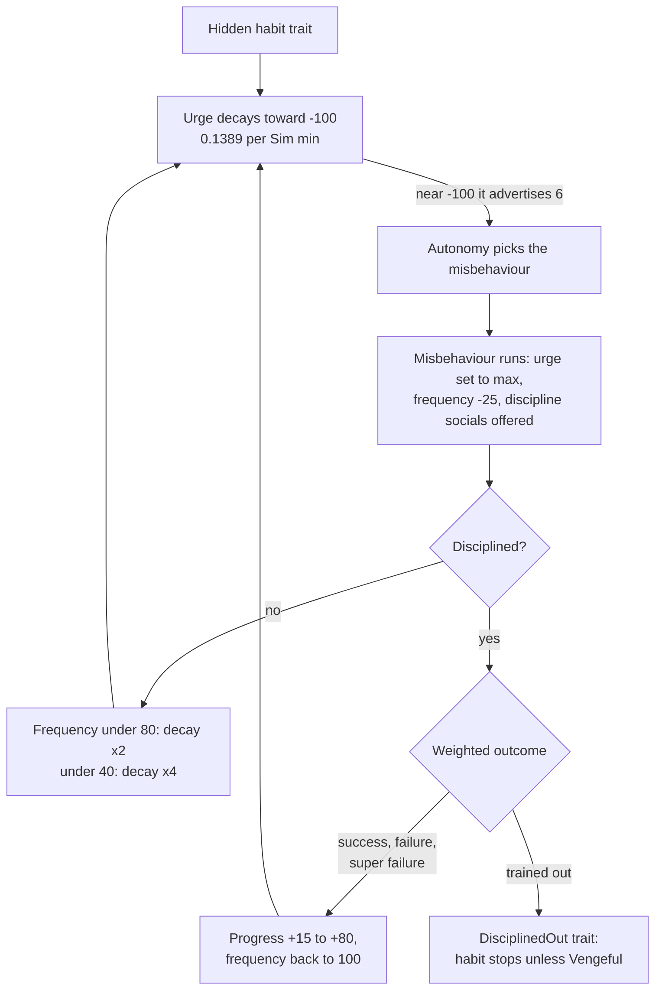
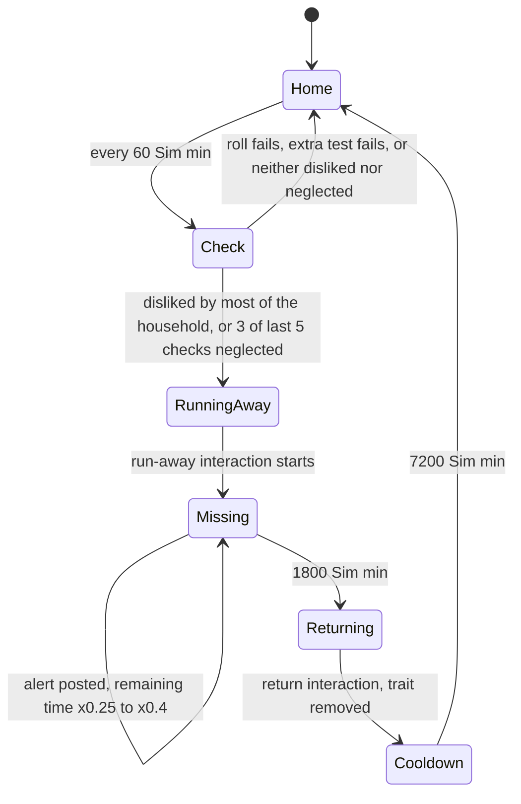

# 3.12 Pets and horses

*Game version 1.128.90.1030. Pet numbers come from the live tuning of the base game plus EP04 (Cats & Dogs), and every module value from the base delta. Horse-competition records are EP14 (Horse Ranch) patch data; the animal-object module tuning is base delta, but the records it points at are EP11 (Cottage Living) patch data; neither pack is installed. Checked 2026-10-12: 164 claims checked, 24 corrected, 5 relabelled, 0 removed. Deepened 2026-10-13: 0 modules newly explained, 2 failed decompiles read. Checked again 2026-10-13: 214 claims checked, 21 corrected, 1 relabelled, 0 removed. Cross-chapter edits 2026-10-13: 4 applied.*

## In plain words

Cats and dogs are Sims. They have needs, moods, personality traits and relationships like people do, and they live in the household. What sets them apart is a layer of hidden traits that the player never picks: fears, obsessions, sleeping styles, and a set of bad habits (scratching furniture, drinking from the toilet, barking at nothing). The game hands these out from a dice roll that is seeded with the pet's own id, and it rolls again every time the save loads and every time the pet ages. Because each roll starts the same dice over but uses them in a different order once some quirks are already in place, a pet can pick up an extra fear or habit at a later load; once a load adds nothing, every later load with the same traits adds nothing too.

Bad habits work like a hidden need. Each habit has an urge that slowly runs down; when it is low enough the pet goes and misbehaves, which resets the urge. Every misbehaviour that goes unpunished makes the next one come sooner. Scolding, lecturing or begging the pet to stop pushes a hidden "training" score up, and once that score is high the next discipline almost always ends the habit for good. Teaching tricks is a separate track: each training session adds to a per-trick score, failed sessions count too, and the trick is learned at 100.

Neglect has consequences. Once an hour the game rolls for every adult or elder pet in the active household; a pet that most of the family dislikes, or that has been starved of affection or play on several recent checks, can run away for 30 hours, less if someone posts a missing-pet alert. Pets also catch silly illnesses (glowing noses, rainbow poop) from a daily roll that, in this install, only cats and dogs are eligible for. The vet diagnoses them by raising a hidden discovery meter until the symptoms and the cure are revealed.

Horses and their competitions belong to EP14, which is not installed here. The competition code still ships and still starts with every game, but with no competitions to offer. Its tuning shows how placing works: the rider's and the horse's skills are pushed through steep curves and multiplied. A beginner pair with the recommended skills and a happy horse wins gold about 63% of the time; a pair with no skills almost never places.

## Key facts

- **Quirks are seeded per pet.** `TraitQuirkSet.add_quirks` builds `random.Random(sim_id)` afresh and runs on every trait-tracker load and every age change. At its first roll a typical adult cat or dog takes 1 to 2 fears from each of two fear sets and 1 to 2 obsessions from each of two obsession sets (2, 3 or 4 of each at 25%, 50%, 25%), plus one doorbell fear or obsession; Skittish and Curious add more. The counts are redrawn at each later call from a shifted point in the same stream, so a pet can gain quirks at later loads.
- **Most pets start with several bad habits.** The quirk sets ask for all five of PuddlesDrink, PottyTraining, EatPeopleFood, Scratching and JumpOnCounters on a cat, and all four of PuddlesDrink, PottyTraining, EatPeopleFood and Bark on a dog, plus two from a list of trash, begging and attack habits. A Smart pet gets none from either list; a Naughty pet asks for every habit on both. Trait rules trim this: a kitten or a Lazy cat cannot take JumpOnCounters.
- **Aging adds habits too.** Every pet aging transition runs `loot_Trait_Pet_AgeUp_ForgetTrainingAndMisbehavior`, which, despite its name, only runs `randomWeightedLoot_Pet_AddMisbehavior` twice (chances 10% to 75% per habit). Each run adds at most one habit, and an ordinary adult cat gains nothing from a run 73% to 84% of the time, an ordinary dog 40% to 67% (**Inferred**).
- **A misbehaviour urge** (`commodity_Discipline_Need_*`) decays 0.1389 per Sim minute toward -100 (Scratching 0.185) and advertises 6 at -100. Each misbehaviour lowers `commodity_Discipline_Frequency_*` by 25; below 80 the urge decays twice as fast, below 40 four times as fast. Any discipline short of training the habit out resets frequency to 100.
- **Discipline outcomes for an untrained dog** (progress 0, not Smart, ordinary trainer): success 20%, failure 60%, super failure 20%. At progress 26 to 49: 25% for each of the four outcomes. At 50 to 74: trained out 37.5%. At 75 or more: trained out more than 99.9% (a cat 98.7%).
- **Tricks:** 8 commands, learned when `commodity_Dog_Training_*` reaches 100. Sit, Speak, LieDown, RollOver and PlayDead add 8 per qualifying loot entry (base, trainer Pet Training skill 5, Animal Whisperer trainer) and Fetch 12; Shake and Heel give the dog only a base 8 plus 8 (Shake) or 10 (Heel) for a skill-5 trainer, because their Animal Whisperer and Smart entries land on the trainer. A Smart dog doubles every gain it gets. Failed sessions still add progress.
- **Personality:** 17 pet traits per species; the server's trait count for every pet age is 3 (code default; the CAS limit is client-side and was not read). Active pets' Energy never decays, Lazy pets' Play never decays, Independent pets' Affection never decays (decay multiplier 0).
- **Running away:** hourly 20% roll per eligible pet; then the pet leaves if more than half of the household's instanced humans have it at Disliked or Despised, or if 3 of its last 5 recorded checks found Affection at or below -80 or Play at or below -75. It returns after 1800 Sim minutes; an alert cuts the remaining time by 60% to 75%; the household then has a 7200-minute cooldown.
- **Illness roll:** daily at 04:45, adult and elder cats and dogs of the active household only, base 3%, +12 elder, +25 after eating spoiled food, +2 Lazy, -2 after exercise.
- **Played pets draw from 14 of the 29 illnesses**: 15 carry a -1000 weight for non-NPC Sims. The weight is clamped at 0 and the last illness is remembered, so the daily roll never gives the same illness twice in a row (a loot that names an illness ignores this). The ten "debug" illnesses, golden and rainbow poop among them, are in the EP04 full build only, outside the live set, so no pet draws them.
- **Vet money:** exam treatment costs the clinic 25, surgery 50 (x0.5 or x1.5 by quality setting); spay or neuter 100; correct treatment of an NPC pays a difficulty bonus of 100, 200 or 300 for difficulty 1, 5 and 10. The Medium illnesses carry no difficulty in tuning and fall back to the code default 5.
- **Adoption:** the adoption fee shown is 200; 80% of generated adoptable pets cannot reproduce (weights 4 to 1); strays are adopted for free once the Sim is at least a Friend. Selling a pet pays 50 times the product of up to seven trait multipliers (0.7 to 1.8).
- **Horses (patch data, pack not installed):** 17 competitions in 5 categories, entry fees 100 to 2000, prizes up to 6000. The no-medal weight is a flat constant per tier (50 for beginner, 5E+27 for the Ultimate Championship), so with every skill at 10 and a happy horse the championship still ends without a medal 16.6% of the time (**Inferred** from that patch data; 18.6% with a neutral horse).

## How it works

### Pets as Sims: species, breeds and ages

**Observed** (live counts through the live merge): 72,956 live records, 7,248 of them won by EP04. Live `Breed` records: 176, all EP04 (DOG 75, SMALLDOG 51, CAT 50). Pet object definitions are `object_Cat` (120621), `object_Dog` (120620) and `object_smallDog` (174619), class `Sim`, each with its own `trait_quirks` block.

**Observed** (`sims/pets/breed_tuning.py: Breed`): a breed is an instance of type BREED with a display name and description, a species (any extended species except HUMAN and INVALID), one tag with the `breed` prefix, a set of breed traits, voice options (voice actor index 0 to 3, pitch -1 to 1) and a list of young-adult `.siminfo` resources. `_tuning_loaded_callback` builds a map from breed tag to breed id. `all_breeds_gen(species)` keeps breeds whose species matches (or all when species is None); `get_breed_tag_from_tag_set` returns a breed tag only when exactly one tag of the set is a known breed tag, else INVALID (bytecode). `try_conform_sim_info_to_breed` sets the breed name key, picks a random `sim_info_resource`, loads its model, picks a random variation, copies physical attributes and merges the outfits from EVERYDAY 0. **Observed** (client data, the live delta copies, counted with the package reader, as in [8.03](8.03-sim-cas-files.md)): all 478 pet SIMINFO records are EP04's (cat 180, dog 164, small dog 134), and every one has skin tone 0; a pet's coat is its pelt layers, 1,509 across those records. Live pelt resources: 350 PELT_LAYER (EP04 299, GP12 51) and 120 PELT_BRUSH, every one in the base delta (EP04's own 91 brushes are deleted by markers in its delta build). The formats are [8.03](8.03-sim-cas-files.md). **Observed**: `breed_traits` has no Python reader; the string appears in the client and engine binaries, so **Inferred**: the client or native code applies it. The adoption service, the Sim filter and the Sim spawner call into this module. CAS and genetics of pets are [3.01 Create a Sim](3.01-create-a-sim.md).

**Observed** (`sims/pets/breed_picker.py: BreedPickerSuperInteraction`; live record `picker_CreateBreed`, EP04 delta): an item picker listing the breeds of every extended species that maps to the interaction's `species` parameter, which creates the chosen breed with creation source `cheat: BreedPickerSuperInteraction` and spawns it through `SimSpawner.spawn_sim(..., is_debug=True)`.

**Observed** (live `agingTransition_Cat_*`, `agingTransition_Dog_*`, EP04 delta): life-stage lengths in Sim days, normal, fast and slow:

| Stage | Dog | Cat |
|---|---|---|
| Child | 2, 1, 8 | 2, 1, 8 |
| Adult | 25, 12.5, 100 | 30, 15, 120 |
| Elder | 9, 4.5, 36 | 11, 5.5, 44 |

Every one of the six transitions lists `loot_Trait_Pet_AgeUp_ForgetTrainingAndMisbehavior` as `single_sim_loot`. **Observed** (`sims/aging/aging_mixin.py: AgingMixin.advance_age`): that loot is applied for the age being entered. **Inferred**: the child entry never fires, because a pet starts life as a child. Aging rules in general are [3.09 Life cycle](3.09-life-cycle.md).

### Personality traits

**Observed** (live traits, EP04 delta; `AgingTuning.AGING_DATA` for cat and dog omits `personality_trait_count`, so the code default 3 applies at every age, `aging_data.py`; the server reads it when it gives traits to generated adoptable pets and to offspring): each species has 17 personality traits tagged `TraitGroup_Emotional`, in species pairs (`trait_Pet_Active_Cat`, `trait_Pet_Active_Dog`, and so on). Each trait carries a hidden buff whose effects are below. A decay multiplier of 0 means the need stops decaying. Active's Energy and Independent's Affection zeros are written as explicit 0 values; Lazy's two Play keys (157718, 158699) are written with no value in both the delta and the full build, which reads as the mapping's code default 0 (`statistics/tunable.py: CommodityDecayModifierMapping`).

| Trait | Effect of its buff (live) | Conflicts |
|---|---|---|
| Active | Energy decay x0, Play decay x2; adds `commodity_Trait_Pet_Active`; 3 interactions (two run-arounds and `debug_pet_ChaseTail`); walkstyle | Lazy |
| Lazy | Energy decay x2, Play decay x0; walkstyle (the trait itself, through `buff_replacements`, swaps the low-energy buff for a `_Lazy` version) | Active |
| Independent | Affection decay x0 | Loyal |
| Loyal | `buff_Trait_Pet_Protective`: Affection decay x2 | Independent |
| Friendly | Affection decay x2 | Aggressive |
| Playful | Play decay x2 | |
| Naughty | discipline urges decay x2 (x2.5 for BegEating, Bark, JumpOnCounters; x1 for PottyTraining) | |
| Smart | training gains x2 on all 8 `commodity_Dog_Training_*` (`stat_use_multiplier`) | Scratching, PottyTraining, PuddlesDrink habits |
| Aggressive | 5 targeted interactions; gives the Attack habit, and the Bark habit to dogs | Friendly |
| Curious, Glutton, Hairy, Hunter, Skittish, Stubborn, Vocal, Wanderlust | each adds its `commodity_Trait_Pet_*` urge and 0 to 6 interactions (Glutton and Stubborn none; Wanderlust starts its urge at 50 to 100) | |

**Observed**: Aggressive, Friendly, Loyal, Naughty, Playful, Smart and Stubborn also add a `commodity_Pets_SellValue_*` (see Adoption). `Buff_Trait_Pet_Active` and `buff_Trait_Pet_Active_cat` run `loot_Buff_Trait_GiveMisbehavior_Active` on addition, which gives dogs the `Dog_PuddlesPlay` habit. Feelings and moods of pets (20 live EP04 `Mood` records such as `mood_Mopey_Dog`, `mood_Hyper_Pets`) follow [3.07 Personality and feelings](3.07-personality-feelings.md).

### Quirks: fears, obsessions and hidden habits

**Observed** (`traits/trait_quirks.py: TraitQuirkSet.add_quirks`, bytecode): the Sim definition of the pet's extended species holds a list of quirk sets. For each set (skipping sets whose `required_age` does not match) the code computes a target count, counts the set's traits the pet already has, and while it is short adds traits drawn with `pop_weighted` from the entries the trait tracker would accept. The generator is `random.Random(sim_info.sim_id)`, created afresh on every call. The count is either fixed (default 1) or dynamic: `randint(lower, upper)` on an interval (default 0 to 1) shifted by a modifier for every listed trait the pet has; when lower ends up above upper, lower is used and nothing is drawn.

**Observed** (`traits/trait_tracker.pyc: TraitTracker.load`, bytecode, the module failed to decompile; `aging_mixin.py: change_age`): `add_quirks` runs during every trait-tracker load (after the default gender-option traits are added) and on every age change, up or down. **Inferred** from the bytecode: every dynamic count draws a `randint` and every pick draws a `uniform` from the one stream, so once a set is full it no longer draws picks and every later set's count comes from a different point in the stream than at the first call. Counts are redrawn at every call, and a set whose new count is higher than what it holds gains a quirk. The same quirks come back only when a call adds nothing; from then on every call with the same traits repeats it. A quirk removed by a loot is replaced only if the redrawn count is short, and by whatever trait the stream picks.

Live quirk sets (`object_Cat`, `object_Dog`, `object_smallDog`, EP04 delta; the two dog definitions are identical):

| Set | Cat | Dog | Count |
|---|---|---|---|
| Fixed style | sleep style Back or Curl (1:1) | barker Loud 2, Neutral 5, Quiet 1 | exactly 1 |
| Stand watch (cat) | True or False | | 0 to 1; Curious: always True |
| Jump on counters (dog) | | JumpOnCounters | 0; Glutton or Curious +1 each |
| Play habits | TrashPlay, Dog_PuddlesPlay (dog-only, so a cat cannot take it) | same | 0; Playful +2 |
| Core habits | PuddlesDrink, PottyTraining, EatPeopleFood, Scratching, JumpOnCounters | PuddlesDrink, PottyTraining, EatPeopleFood, Bark | 5 (cat) or 4 (dog); Smart -5/-4; Naughty +5/+4 |
| Trash and begging | TrashPlay, TrashEat, BegEating, Attack | those four plus EatPoop, PuddlesPlay, Toilet, JumpOnCounters | 2; Smart -2; Naughty +8 (cat) or +12 (dog) |
| Music obsessions | Stereo, Instrument | same | 0; Vocal +2 |
| Fears A | TV, Stereo, Stove, Computer, Toilet, Shower | same | 1 to 2; Skittish +1/+2; child 1 to 1 |
| Fears B | 10 appliances and activities | same | as Fears A |
| Obsessions A | Fridge, TV, Stereo, Cooking, Computer, Toilet, Shower | same | 1 to 2; Curious +1/+2; child 1 to 1 |
| Obsessions B | 11 (cat) or 12 (dog) appliances | same | as Obsessions A |
| Doorbell | obsessed or afraid | same | exactly 1 |
| Kitchen | Fridge, Cooking, Microwave obsessions | same | 0; Glutton +1/+3 |
| Wake up Sims | WakeUpSims habit | same | 0 to 1; Smart: 0; Naughty: 1 to 2 |
| Pregnancy vomiting | Yes 3, No 2 | same | 0; female +1 |
| Bed spin | PetBedSpin | same | 0 to 1 |
| Heel (dog) | | `trait_Pets_TrainingCommand_Heel` | 0; Loyal +1 (the Loyal key has no value, so both bounds take the code default +1) |

So a Loyal dog starts life knowing Heel, a Curious cat always stands watch, and a female pet has a 60% chance of the pregnancy-vomiting quirk (**Observed** in tuning, probabilities **Inferred** from the weights).

**Observed** (live habit traits, EP04 delta): every habit trait is HIDDEN. `trait_Misbehavior_Cat_JumpOnCounters` and `trait_Misbehavior_Dog_JumpOnCounters` exclude the child age; the cat one conflicts with Lazy, and the dog JumpOnCounters and Toilet habits conflict with `trait_SpeciesExtended_SmallDogs`. **Inferred**: because the quirk code only draws traits the tracker accepts, a kitten gets four of the five core cat habits and the fifth at its next age change, and small dogs never get those two habits.

### Misbehaviour and discipline

Each habit is a hidden trait `trait_Misbehavior_*` (or `trait_Discipline_Pet_PottyTraining`, `trait_Misbehaviors_Pet_*`) with three commodities behind it.

**Observed** (live `commodity_Discipline_Need_*`, EP04 delta): the urge runs from -100 to 100, starts at a random value from -75 to 25, decays 0.1389 per Sim minute toward -100 (Cat_Scratching 0.185), has autonomy weight 0.15 and advertises 6 at -100, 2 at -90 and nothing above 1 (TrashPlay 4, BatKnockTrash 1 at -100). **Inferred**: from a fresh 100 the urge reaches -90 in about 1368 Sim minutes (22.8 hours) at the base rate.

**Observed** (live `autonomousSimPicker_Bark_Misbehavior` and the other habit pickers): the autonomous picker advertises setting the urge to its maximum and is allowed when the pet has the Vengeful buff or lacks the matching `trait_DisciplinedOut_*`. So a trained-out pet still misbehaves while Vengeful. The picker also refuses a dog with `buff_Dog_Heel`. The misbehaviour interaction (for example `dog_Bark_DisciplineBehavior_Aggressive`) periodically sets the urge back to maximum (`loot_Pets_Discipline_Traits_Reset_*`). The Scold, Lecture and BegToStop discipline socials are offered to Sims as template affordances by a provider: for barking that is `buff_Sim_Pets_Misbehavior_Barking`, which the interaction adds (that interaction's own `provided_template_affordances` is disabled); other habits use a similar buff or the misbehaviour interaction itself. The provider keeps offering them for its post-run time after it ends: all 47 live records that offer the pet discipline socials (every one EP04 delta) set 60 Sim minutes. `DEFAULT_POST_RUN_DURATION` (30 in code, no live value) applies only to a provider that leaves the time unset, which none of the pet discipline providers does (the template machinery is [4.02](4.02-story-progression-townies.md)).

**Observed** (`commodity_Discipline_Frequency_*`, `loot_Pets_Discipline_Frequency_Change_*`, `buff_Pet_Discipline_Frequency_Medium_*`, `_High_*`): frequency runs 0 to 100, starts at 100 and never decays. Each misbehaviour lowers it by 25. In [40, 80) the Medium buff doubles the urge's decay, in [0, 40) the High buff quadruples it. Success, failure and super failure set it back to maximum (the trained-out loot does not touch it). **Inferred**: undisciplined habits accelerate, one misbehaviour drops the pet into the Medium band and three into the High band.

**Observed** (live `discipline_Pets_Barking_Scold`, the same weights for Lecture and BegToStop and for the other habits checked): four outcomes per species group, each a `TunableMultiplier` with base 1:

| Outcome | Multipliers | Loot |
|---|---|---|
| Trained out | x10000 (dogs) or x100 (cats) at progress 75 or more; x0 at 25 or less unless Smart; x3 at 50 or more; x4 trainer Animal Whisperer; x10000 Smart pet; x2 with buff 323866 | `loot_Pets_DisciplinedOut_Trait_*` |
| Success | x3 at 50 or more; x4 Animal Whisperer; x2 with buff 323866 | progress +80 (a Stubborn pet +30 instead, a Naughty one +50) |
| Failure | x0 at 75 or more; x3 at 25 or less; x0.5 Independent | progress +60 (a Stubborn pet +15 instead, a Naughty one +50) |
| Super failure | x2 Independent; x3 Stubborn | Vengeful buff, `loot_SimToPet_Rel_Loss_Large`, progress +30 plus 15 more for a Stubborn pet or 30 more for a Naughty one |

"Naughty" here means Naughty and not Stubborn. The other three outcomes remove the Vengeful buff. Success and failure also give the pet `hidden_buff_Pet_Stubborn_Scolded` behind `testSetInstance_PetTraits_Actor_Whitelist_Stubborn`, a trait test on its default subject, the actor. **Observed** (the socials' `test_globals`; the Stubborn traits' species): the actor of a discipline social is the human who owns the pet, and both Stubborn traits are limited to CAT or DOG, so that entry never applies. Buff 323866 is `buff_Object_RanchNectar_Trash` in EP14 patch data; it has no live record here, so that multiplier never applies. **Observed** (`loot_Pets_DisciplinedOut_Trait_*`): trained out adds `trait_DisciplinedOut_*` and removes the progress commodity; it leaves the habit trait in place. Progress (`commodity_Discipline_Dog_Bark` and its siblings) runs 0 to 100 and does not decay.

**Inferred** from those weights (test-based outcomes pick by weight, [0.04](0.04-tests-loot-effects.md)): an ordinary dog at progress 0 to 25 gives success 20%, failure 60%, super failure 20%; at 26 to 49, 25% each for trained out, success, failure and super failure; at progress 50 to 74, trained out 37.5%, success 37.5%, failure 12.5%, super failure 12.5%; at 75 or more, trained out 99.99% (a cat, with x100, 98.7%). A Smart pet is trained out on almost every discipline. These assume no Animal Whisperer, no Independent or Stubborn pet, and no buff 323866.

**Observed** (`randomWeightedLoot_Pet_AddMisbehavior`, EP04 delta and full): nine entries, each weight 1 (x0 when the pet already has that trait), each a `trait_add` with a chance: Attack 10%, BegEating 25%, PuddlesDrink 25%, TrashEat 10%, TrashPlay 10%, Cat_Scratching 10%, PottyTraining 75%, Dog_PuddlesPlay 10%, Dog_Toilet 25%. **Observed** (`interactions/utils/loot.pyc: RandomWeightedLoot.get_loot_ops_gen` and `loot_basic_op.py: BaseLootOperation.test_resolver`, bytecode): this is neither nine independent rolls nor one weighted pick. The loot picks an entry by weight, removes it from the pool and rolls its chance (`random.random() > chance` fails it); on a fail it picks again from what is left. The first entry whose chance passes is the only one applied ([0.04](0.04-tests-loot-effects.md)), and `add_trait` may still refuse it (wrong species, or a conflicting trait such as Smart), in which case that run adds nothing.

**Inferred** (computed by the checker): a pet that held none of the nine and could take all nine would come away empty-handed only when all nine chances fail, 0.9^5 x 0.75^3 x 0.25 = 6.2%, but no pet fits that: cats cannot take the two dog habits and dogs cannot take Scratching. For real pets one run adds nothing 73% to 84% of the time for an ordinary adult cat (which already holds its core and trash habits), 40% to 67% for an ordinary dog, 77% for a Smart cat and 62% for a Smart dog; both runs of one age-up add nothing 53% to 71% of the time for the cat and 16% to 45% for the dog.

### Training commands

**Observed** (live `mixer_Dog_Training_Human_*`, `mixer_Dog_Training_Dog_*`, `loot_Dog_Training_Trait_*`, EP04 delta): eight commands, Fetch, Heel, LieDown, PlayDead, RollOver, Shake, Sit and Speak, each with a progress commodity `commodity_Dog_Training_*` (0 to 100, no decay) and a trait `trait_Pets_TrainingCommand_*` added when the commodity reaches 100. The human mixers need Pet Training (`statistic_Skill_DogTraining`) level 1 for Sit, Speak, LieDown, RollOver and Fetch and level 2 for PlayDead and Heel; Shake has no skill test in its global tests. Each needs the target not to know the command and not to be in water.

**Observed** (`mixer_Dog_Training_Dog_Sit` outcomes): two untested groups give success weight 6 (x2 Smart dog, x2 if the dog knows 3 or more commands) and failure weight 2 (x0 Smart). Each of Speak, RollOver, PlayDead and LieDown that the dog already knows adds a tested group with another success 6 and failure weights of its own (one of them x0 unless the dog is Smart). Both outcomes run `loot_Dog_Training_Trait_Sit`, whose last entries add 7 Affection and a 10% chance of a Happy buff, so a failed session gives those too; failure also gives the dog a Mopey buff (unless it has `buff_Dog_Training_BoredProtection`) and the trainer `buff_Dog_Training_Tense`. **Inferred** (the passing groups pool by weight): 75% success for an ordinary dog that knows none of those four, 80% if it knows Speak; a Smart dog never fails while it knows none of them, and succeeds 92% of the time once it knows Speak.

**Observed** (the trick loots): per run, Sit, Speak, LieDown, RollOver, Shake and PlayDead carry four entries of 8 (always; trainer skill 5 or more; trainer has `trait_Animal_Whisperer`; and an entry gated by `testSetInstance_PetTraits_Target_Whitelist_Smart`). Fetch uses 12 for the first three entries and 8 for the Smart-gated one; Heel uses 8 for the base entry, 10 for skill 5, 8 for Animal Whisperer and 10 for the Smart-gated one. The Smart trait doubles every gain through `stat_use_multiplier` (the autonomy modifier's statistic multiplier, which `add_value` applies to gains).

**Observed**: Sit, Speak, LieDown, RollOver and PlayDead run from the dog mixers (`mixer_Dog_Training_Dog_*` and their practice variants) and Fetch from `toyBallPet_Dog_Fetch_Training` (four other ball interactions also run the Fetch loot; their orientation was not checked), so the actor is the dog and `TargetSim` is the trainer; their entries go to the actor and the skill, Animal Whisperer and Smart entries test `TargetSim`. The Smart test set therefore checks a human, and the Smart traits are CAT or DOG only, so that entry never applies; the Smart doubling still does. Shake runs from `mixer_Dog_Training_Human_Shake` and Heel from `training_Heel_Walk_Dog`, where the actor is the human: their base and skill entries name `TargetSim` (the dog) and test the actor's skill, but the Animal Whisperer and Smart entries keep the default subject, the human, and test `TargetSim`. So for Shake and Heel the Animal Whisperer entry never passes (a dog cannot have the trait) and a Smart dog's entry adds to the trainer's copy of the commodity, not the dog's. **Inferred**: with base gains a dog learns Sit in 13 runs, a Smart dog in 7, an ordinary dog with a level-5 Animal Whisperer trainer in 5, and a Smart dog with that trainer in 3. The Pet Training skill itself is [3.10](3.10-skills-careers-school.md).

### Pet relationships with Sims

**Observed** (live `LTR_SimToPet_Friendship_Main`, base-game delta tuning; [3.08](3.08-relationships-socials.md) has the decay details): -100 to 100, bits Despised at -70 (removed at -65), Disliked -20 (-15), Acquaintance around 0, Friend 35 (30), GoodFriend 60 (55), neutral bit Indifferent. `simToPet_RelationshipBit_05_Companion` is outside the track: `petSocial_SimToPet_PetCompanion` adds it (with `buff_Relationship_NewBFF`) when the Sim owns the pet (`relationshipBit_Target_IsDogOwnedBy_Actor` or `_IsCatOwnedBy_Actor`), the track is at 80 or more and the bit is not already set. Pet-to-pet bits are Hostile, Neutral and Friendly (`petToPet_RelationshipBit_Target_Is*With_Actor`).

**Observed**: human traits `trait_CatLover`, `trait_DogLover`, `trait_Animal_Attraction` (+5 initial Sim-to-pet friendship) and `trait_Animal_Whisperer` (training and discipline bonuses above) are EP04.

### Running away: the missing-pet tracker

**Observed** (`pets/missing_pets_tracker.py: MissingPetsTracker`, a household tracker; module tuning `pets.missing_pets_tracker` in the base delta). A repeating cross-zone alarm runs `_run_tests` every `TEST_INTERVAL` (absent in live tuning, code default 60 Sim minutes). Bytecode order of `_run_tests`:

1. Return if a pet is already missing or running away, or the household is not the active household on its home zone.
2. For each instanced pet: skip unless it is adult or older and its extended species is in `ELIGIBLE_SPECIES` (live: a blank entry, CAT, SMALLDOG; **Inferred**: the blank reads as the code default DOG).
3. Roll `random() <= RUN_AWAY_CHANCE` (live 20%, code 50%).
4. `ADDITIONAL_RUNAWAY_TESTS` must pass. Live: the pet has no relationship with bit 215119 (`relationshipBit_Familiar`, GP08 (Realm of Magic) patch data, not installed).
5. Relationship test: if more than half of the instanced human household members pass `RELATIONSHIP_TESTS` (Sim-to-pet bit Despised or Disliked), the pet runs away.
6. Otherwise the motive test result (1 or 0) is appended to a deque of length `MOTIVE_TESTS_NUM_RESULTS_STORE` (live 5, code 10); the pet runs away when the sum reaches `MOTIVE_TESTS_NUM_RESULTS_PASS` (live 3, code 5). Live motive tests: cat Affection (151038) at or below -80 or Play (157718) at or below -75; dog Affection (151034) at or below -80 or Play (158699) at or below -75.

**Observed** (`run_away`, `run_away_succeeded`, `_return_pet`, bytecode): `run_away` refuses when a pet is missing or running, the household is not active at home, the cooldown alarm is active, the pet is not instanced, or there is no route to a spawn point. It pushes `rabbitHole_Pet_Missing` (high priority, at the end of the queue) and shows `notification_MissingPets_RunAway`. When the interaction starts, `MissingPetLiability` calls `run_away_succeeded`: the pet gets `trait_Pet_Missing_Pet`, is hidden (with no away action: `DEFAULT_AWAY_ACTIONS` is absent from live tuning, so `hide_sim` gets `None`), is globally blacklisted, the test alarm stops, the return alarm (`RETURN_INTERVAL`, live 1800 Sim minutes, code 1000) starts, and every other household member gets `loot_Buff_has_missing_pet`. When the alarm fires the run-away interaction is cancelled (or, off the home lot, the return is flagged for the next home load), and `_return_pet` pushes `missing_pet_returnChooser`, removes the trait, unhides and unblacklists the pet and starts the cooldown alarm (`COOLDOWN_INTERVAL`, live 7200, code 1000), after which testing restarts.

**Observed** (`post_alert`): the remaining return time is multiplied by `1 - U(0.6, 0.75)` (live `POST_ALERT_EFFECTIVENESS`). The computer and phone interactions (`computer_Missing_Pet_PostAlert`, `phone_missing_pets_post_alert`) require `HouseholdCanPostAlertTest`, which fails once an alert was posted, until the pet comes back (`event_testing/test_variants.py`).

**Observed** (`missing_pet_tuning.py: MakePetMissing`): the loot op `make_pet_missing` calls `run_away` directly, skipping the roll and the tests but not `run_away`'s guards. Live users: `loot_missing_pet_go_missing` (the attacker in `petSocials_PetToPet_Attack` and its `_Madnip`, `_Pushed` and `_Pushed_Eating` variants on a failure outcome, `wanderlust_missing_pet` and `debug_PetGoMissing`) and `loot_Pets_MissingPet_GoMissing_Target` (the attacked pet on a success outcome); the attack outcomes are 50/50 (default weights) in the tested group that requires the attacker to have `buff_Sim_Pets_Attacking_Hidden`; without that buff the other group's single outcome carries no loot. **Observed**: no installed tuning file (base full and delta, every installed pack's builds) references the id of `wanderlust_missing_pet` (173678), so nothing in tuning pushes it.

**Observed** (`_run_tests`, `save_data`, `load_data`): the motive history is never cleared when a pet runs away or returns. It is written to the save but `load_data` never reads it back, and only the tracker's constructor and a household cleanup reset it. **Inferred**: after a reload the history starts empty; in the same session, a pet that ran away from neglect still has its three passing results, so after the cooldown its first recorded check usually sends it off again whether or not it is still neglected (always when the deque was not full, or when its oldest entry was a 0).

**Inferred** timing (each check is a 20% roll; this assumes the household stays at home, the neglect is continuous and the history starts empty): a neglected pet needs three passing rolls, about 15 hours on average; a pet disliked by most of the family leaves on the first passing roll, about 5 hours on average. An alert posted at once brings the pet back after 7.5 to 12 hours instead of 30.

### Illness and the vet

The sickness system is [3.13](3.13-health-luck-fame.md) and the vet clinic business is [5.02](5.02-businesses.md); this section covers what their tuning means for pets.

**Observed** (`sickness/sickness_service.py: SicknessService.trigger_sickness_distribution`; module tuning `sickness.sickness_tuning`, base delta): at `SICKNESS_TIME_OF_DAY` 04:45 every day, each member of the active household with a sickness tracker is tested. `SICKNESS_TESTS` require age adult or elder, species cat or dog (consolidated, so small dogs count), not already sick, none of `buff_Pet_Sickness_TemporaryBlockSickness`, `buff_Pet_Sickness_WellnessTreatBlockSickness`, `buff_Vet_ConeOfShame`, not a ghost, and not trait 218444 (`trait_Humanoid_Robots_MainTrait`, EP08 (Discover University) patch data). Chance = `SICKNESS_CHANCE` / 100: base 3, +25 `buff_Sickness_Pet_AteSpoiledFood`, -2 `buff_Sickness_Exercised`, +2 Lazy (`testSetInstance_PetTraits_Actor_Whitelist_Lazy`), +12 elder.

**Observed** (`Sickness.get_sickness_weight`, bytecode): weight = `max(weight.get_modified_value, 0)` after `restrictions`; the pick is `pop_weighted` over sicknesses not marked `distribute_manually`. `PREVIOUS_SICKNESSES_TO_TRACK` is absent from live tuning (code default 1).

**Observed** (live, EP04): 33 `Sickness` records: 29 illnesses (9 Easy at difficulty 1, 11 Medium with difficulty absent so the code default 5 applies, 8 Hard at 10, 1 SuperEasy Fleas at 1), 3 Positive check-ups (manual) and the manual `pet_Exam_debug_AllGood`. The 10 `pet_Sicknesses_debug_*` records (base weight 0) are in the EP04 full build only, outside the live set. 35 `Symptom` records (11 major, 24 minor, 7 of those positive). All 29 illnesses have -1000 when the illness was the pet's last one (`check_history`); 15 of them (and the 3 check-ups) also have -1000 when the Sim is not an NPC (`is_npc` means not in the active household, which every Sim the daily roll tests is), and 17 have -1000 when at a vet venue the active household does not own. **Inferred** from that: played pets can only draw DerpyDoggy (dog only; the species test is consolidated, so small dogs too), MildRepugnitis, PrismaticPoopPlague, WinterfestFever, Woozykittyitis (cat only), FrozenMange, GildedGutsDisorder, MagmafiedOrgans, OverheatedSniffer, Sizzlepaw, SquirrelFever, SuperRepugnitis, SuperSwampMouth and Fleas, each at weight 1. In the EP04 full build, `pet_Sicknesses_debug_GoldenPoo` and `_RainbowPoo` (base 0, +5 for `trait_Pet_Glutton_Cat`, not manual) would be candidates for Glutton cats, but that build is outside the live set.

**Observed** (a sickness record, for example `pet_Sicknesses_Easy_IceFur`): each illness lists 1 to 5 symptoms, one or two correct treatments (usually one exam-table and one surgery; SlurryFur, SnortnoseFever, SuperRepugnitis and SuperSwampMouth list a surgery only) and threshold actions on `statistic_Vet_Treatment_Discovery`: Easy at 15, 30, 45, 60, Medium at 25, 45, 60, 80, Hard at 25, 45, 60, 80, 100, check-ups at 10 to 50. Each threshold reveals a symptom, rules out treatments or, at the last one, reveals the illness. Exams add standard or high discovery (high when the exam fits the illness) and stress (`statistic_Vet_Treatment_Stress`); the skill bands, the stress aids and how stress stops exams are in [3.13](3.13-health-luck-fame.md#diagnosis-exams-treatments-and-thresholds). Other causes: `loot_BushPet_SquirrelFail` (30% SquirrelFever), `loot_Vet_SeedExam`, `loot_Vet_CheckUp_Sickness`, and `loot_PetSickness_CauseSick_1` to `_5`, which the special treats run (`food_Consume_Pet_EatSpecialTreat`, whose outcomes test the treat's object definition, and `petSocial_SimToPet_GiveSpecialTreat`). **Observed** (live, EP04 delta): `_1` gives GildedGutsDisorder at 50% and, when the pet does not have it after that, PrismaticPoopPlague; `_2` to `_5` give FrozenMange, MagmafiedOrgans, SuperRepugnitis and SuperSwampMouth. Every one of these ops skips a pet with `buff_Pet_Sickness_TemporaryBlockSickness`, `buff_Pet_Sickness_WellnessTreatBlockSickness` or `buff_Vet_ConeOfShame`, or a ghost (`testSet_TargetIsNotGhost`). [3.13](3.13-health-luck-fame.md#other-ways-in-and-out) lists every loot that gives an illness.

**Observed** (prices): `vet_Treatment` payment 25 and `vet_Payment_Surgery` 50, both paid by the business from RESTOCKING funds, x0.5 at LOW and x1.5 at HIGH quality setting; `vet_Payment_SpayNeuter` 100 from the household; player owner choices `vet_Player_PetOwner_TreatmentSelections_Deduct*Payment` 150 (cheap), 750 (expensive), 200 (preventative shot). `VetClinicTuning.DIFFICULTY_BONUS_PAYMENT` 100, 200, 300 at difficulty 1, 5, 10, read in reverse with the default at-or-above comparison (`vet_clinic_utils.py: get_bonus_payment`). **Inferred**: Medium illnesses earn the 200 bonus only through the code default difficulty.

### Adoption, strays and selling

**Observed** (`adoption/adoption_service.py: AdoptionService.add_sim_info`; [3.09](3.09-life-cycle.md) has the pool mechanics): a generated pet gets a random breed of its species and one gender-option trait from `PET_ADOPTION_GENDER_OPTION_TRAITS` by weight: `trait_PregnancyOptions_Pet_canNotReproduce` 4, `_CanReproduce` 1. **Inferred**: 80% of adoptable pets are spayed or neutered.

**Observed** (live EP04 pickers): `adopt_Picker_Cat` and `_Cat_Phone` list cat children 1 to 3 per sex and adults 1 to 2 per sex; the dog pickers list large and small dog children 1 to 2 per sex and adults exactly 1 per sex. `max_selectable` follows household size with a cap of 3. The paid pickers display a fee of 200; the `_Free` variants show none. Adoption goes through `situation_PetAdoption` (an officer brings a crate; the state in which the household meets the candidates times out after 200 Sim minutes and the wait for them to despawn after 30; the situation lasts 400; the visit's states are in [3.09](3.09-life-cycle.md#adoption-and-its-pools)), and the fee is paid in `petSocial_SimToPet_Hug_Adopt_LargePet` and `petSocials_SimToPet_Hug_Adopt_SmallPet` (200 each; their `_Service_Free` variants charge nothing).

**Observed** (strays): 9 live EP04 open-street situations `openStreetsAutonomySituation_PetWorld_Stray_*` (cat and dog wanderers, in-heat strays, ghosts, a cat fisher, jungle strays; the two on-lot wanderers are in the EP04 full build only, outside the live set), `do_stuff_timeout` 360 Sim minutes, templates `template_PetWorld_Stray_*`, and `trait_Hidden_isNativeStray`. The stray adopt socials (`petSocial_SimToPet_Hug_Adopt_LargePet_Stray`, `petSocials_SimToPet_Hug_Adopt_SmallPet_Stray`) need Sim-to-pet Friend, GoodFriend or Companion (`testSetInstance_SimToPet_RelLevel_FriendsPlus`) and household room, and carry no payment. Open-street situations are [4.01](4.01-situations-npcs.md); NPC pet adoption arcs are [4.02](4.02-story-progression-townies.md).

**Observed** (`Loot_Simoleon_SellPet`, `interactions/money_payout.py`): selling pays 50 Simoleons to the active household, rounded, times each `commodity_Pets_SellValue_*` its actor has (the multipliers keep their default subject, the actor). The loot runs in `sell_GiveUp_Pet_Sale_Continuation_child`, which both sale paths push on the pet: `computer_Pets_Adoption_SellPet` as a continuation with actor PickedSim, and `phone_Picker_Pet_SellPet` as a picked continuation, which `_push_continuations` pushes with the picked Sim as actor (`interactions/base/picker_interaction.py`). The multipliers: Smart 1.8, Playful 1.6, Friendly 1.4, Loyal 1.4, Naughty 0.8, Stubborn 0.8, Aggressive 0.7 (min, max and initial all equal). A missing commodity counts as 1. **Inferred**: a Smart, Playful, Friendly pet sells for 202 (50 x 1.8 x 1.6 x 1.4 = 201.6).

### Pet autonomy hooks

**Observed** (live `commodity_Trait_Pet_*`): each personality urge is a hidden commodity from -100 to 100 converging to -100, autonomy weight 0.15 (Active 0.075, Friendly 0.5, Protective 0.0167), most decaying 0.833 per Sim minute (a full swing in 4 hours) and advertising 6 at -100 (Friendly and Glutton 2, Protective 3, Lazy and Naughty 4; Aggressive also 8 at 0). Slow ones: Hunter, Independent and Wanderlust 0.06945, Hairy 0.111, Naughty 0.417. Quirk urges `commodity_Trait_Pet_Quirk_Fear_*` and `_Obsess_*` decay 0.556 with weight 0.143 and advertise 4 at -100. The traits' buffs add the interactions that satisfy these urges, so pet personality acts through ordinary commodity scoring ([3.04](3.04-autonomy.md)). Pet needs and their decay are [3.03](3.03-needs-statistics.md); the urge commodities above are the pet-only statistics beyond them.

### Horses and horse competitions (patch data, pack not installed)

**Observed** (`horse/horse_tuning.py: HorseTuning`, module tuning in the base delta): `PAIRED_HORSE_MINIMUM_ROUTE_NEARBY_DISTANCE` 3 (code 5.0), `ROUTE_NEARBY_DISMOUNT_RADIUS` code default 5.0, `HORSE_FIRST_PLAY_NOTIFICATION`, and `REINS_DOWN_TRAIT` 348818 (`trait_Rider_Gameplay_Mounted_ReinsDown`, EP14 patch data). `horse/horse_handlers.py` is a GSI archive of reins animation state per Sim. EP14 patch data adds 36 horse breeds and the horse skills Agility, Endurance, Jumping and Temperament.

**Observed** (`horse_competitions/hc_service.py`, bytecode). `HorseCompetitionService` declares no required pack, so it starts in this install too; its categories point at EP14 snippets that do not exist here (**Inferred**: the lists resolve empty). `start_competition` ignores a repeat of an already running (competition, Sim, horse) triple, calls `funds.try_remove_amount(entry_fee)` and discards the result (the fee goes before the rabbit hole is known to exist), applies `COMPETITION_START_LOOT_ACTIONS`, sends rider and horse into one shared two-Sim rabbit hole, and registers an expiry callback. `_end_competition` returns on cancel; otherwise it builds a `DoubleSimResolver(rider, horse)`, weights each placement by `weight.get_multiplier` times every `skill_multipliers` curve (rider skills on Actor, horse skills on TargetSim, curve on the skill level), picks with `weighted_random_index`, saves the best placement per horse and competition (lower index is better), pays `simoleon_amount`, applies loots, and shows the results dialog, which names one competition that this result newly unlocked (the first found, or none). `has_medaled` means any placement except the last. Picker exclusion: a Sim or horse is offered when it is an instanced member of the active household of the right species and its exclusion tests fail (as tuned in the base delta: horses that just competed, are pregnant, in labour or a foal, through buffs that are EP14 patch data, so here those whitelists resolve empty and exclude no one; Sims who are baby, infant, toddler or child).

**Observed** (EP14 patch data, `horseCompetitionCategory_*`, `horseCompetition_*`): categories barrel racing, endurance race, show jumping and western pleasure, each beginner, intermediate, expert and master, plus the ultimate championship. Fees 100, 250, 500, 1000 and 2000; availability requires household funds of at least the fee (the championship also has a day-and-time test that enables Saturday); every tier above beginner has a prerequisite (the horse holds the hidden "completed" trait of the tier below; the championship needs all four master ones). Recommended rider Equestrian skill 3, 5, 7, 9 and 10. Prizes for gold, silver and bronze: 300/250/200, 750/625/500, 1500/1250/1000, 3000/2500/2000 and 6000/5000/4000. Gold weight x1.3 when a skill test passes and x1.3 for a confident or happy horse, x0.7 for a negative mood; silver x0.7 negative mood; bronze x0.7 for each of the skill test, happy and negative. Only barrel racing's gold skill test uses each tier's recommended levels; its bronze skill test, and both skill tests of endurance race, show jumping, western pleasure and the championship, use the beginner levels (3 and 2 on two horse skills, Equestrian 3) at every tier, so the gold bonus is easy to get above beginner in those four. The no-medal placement is a constant: 50, 140,000, 280,000,000, 399,000,000,000 and 5E+27 by tier.

**Inferred** (weights computed from that data by the checker; a skill the Sim lacks counts as 1, as `get_multiplier` returns 1.0 for it): beginner barrel racing with recommended skills and a happy horse: gold 62.9%, silver 27.2%, bronze 9.7%, none 0.13%; with every skill at 1 and a neutral horse: 1.9% each medal and 94.3% none. Master barrel racing with every curve at its top and a happy horse: gold 62.6%, none 0.74%. Ultimate championship with every skill at 10 and a happy horse: gold 57.5%, silver 20.1%, bronze 5.8%, none 16.6%; with a neutral horse none rises to 18.6%, with a negative mood to 24.6%.

### Animal objects (`objects/animals`)

**Observed** (`objects/animals/animal_service.pyc`, which failed to decompile: per-function rescues, and `required_packs` re-read in bytecode): `AnimalService.required_packs` is (EP11, EP14), so the service is not created in this install. Its module tuning still loads from the base delta: `AGING_STATISTIC` `commodity_AnimalObjects_Age`, auto-assignment of new inhabitants to 3 to 5 homes, 1 to 3 per home, on Wednesday and Saturday unless `DISABLE_RABBIT_SPAWNERS` is set, and gardening-help states for rabbits, goats and sheep. **Inferred**: these are the EP11 farm and wild animals (chickens, rabbits, goats, sheep) and the EP14 ranch animals, which are objects with an animal component, unlike pets.

**Observed** (`animal_loot_ops.py`): `AnimalLootOp` (loot variant `animal_loot`) assigns the subject animal to a home or unassigns it, and does nothing without the service; live base-delta loots `loot_AnimalObjects_Management_Assign*`, `_ClearAssignment`, `_Unassign*` and `loot_animalObjects_Chickens_Purchase` use it, so they are inert here. `UpdateAnimalPreferenceKnowledgeLootOp` (`update_animal_preference_knowledge`) records that an animal's preference for a `Func`-tagged item is known, through the target's animal preference component, and by default starts that preference's gifting cooldown. `AnimalDeathLootActions` is a loot instance holding a buff or notification list; one record exists, EP11 patch data (`animalDeathLootActions_AnimalObjects_Rabbits`). `animal_telemetry.py` defines hook AADD in group ANML (fields: object definition, animal id). `animal_handlers.py` is the GSI "Animal Management" view of home occupancy.

**Observed** (`animal_commands.py: AnimalCommandTuning`, base delta): bird toggling uses global flag BIRDS, tags `Func_AnimalObject_Wild_BirdHome_AnimatedBird` and `Func_AnimalObject_Wild_BirdHome`, and states 270880 and 270881, which are EP11 patch data.

### The animal service: homes, assignment and upkeep (EP11, EP14; not running here)

Everything in this subsection is **Observed** in the per-function decompile of `objects/animals/animal_service.pyc` (the class body, which failed, and `save`, which failed, read in bytecode; the nesting of `load` and `on_cleanup_zone_objects` checked in bytecode) and in the base-delta module tuning. None of it runs in this install, because the service needs EP11 (Cottage Living) or EP14 (Horse Ranch).

- **Registry.** The service keeps every animal object it knows (`_registered_animals`, object id to creature type), every home (`_registered_homes`, object id to `AnimalHomeData`) and a map from animal to home, or to nothing for a homeless animal. A home's record holds its capacity, the creature types it takes, current occupancy in total and per type, the owning household, zone and street, and whether its assignments survive the home going into the household inventory. An animal added to the world is registered as homeless (`on_animal_added`); assigning it to a home that already moved it updates both homes' occupancy and tooltips, and an animal with no owning household takes the home's owner (`_move_animal_home`).
- **Who may live where** (`_is_valid_for_assignment`). The home must be registered, the animal's creature type must be one the home takes, and occupancy must be below capacity. Assigning to no home always succeeds. `transfer_animal_assignment` moves a home from one animal id to another, so a replacement object keeps its predecessor's home.
- **Empty homes fill themselves.** When the last inhabitant leaves, the home's component is asked to repopulate (`try_populate_on_last_inhabitant_removed`). On zone load up to 5 empty homes, and on leaving Build mode up to 5 homes placed during that Build session, are asked to populate (`MAX_EMPTY_HOMES_TO_POPULATE`, `on_zone_load` and `on_new_homes`, both code default 5, maximum 5). What a home spawns is the home component's business.
- **Scheduled arrivals** (`AUTO_ASSIGN_NEW_INHABITANTS`). One entry in the base delta: on Wednesday and Saturday, unless the global flag `DISABLE_RABBIT_SPAWNERS` is set, the service picks 3 to 5 homes at random among those that take the creature type and have room, and gives each 1 to 3 new inhabitants (the lower bound is the code default 1), capped by free room. Homeless animals of that type are moved in first; the rest are created by the home (`create_inhabitant`). The entry leaves `animal_type` at its code default, `Rabbit`, so in the shipped tuning only rabbit homes fill this way.
- **Gardening help** (`_on_plant_object_state_changed`). Plants register for weed watching. When a plant enters one of five weed or infestation states (`GARDENING_HELP_WEED_STATES`: two weed stages and three infestation stages), the service takes the animals whose gardening-help state is enabled and, by the order of `GARDENING_HELP_ANIMAL_STATES`, sends one random animal of the first matching type and state to the Searching state: rabbits from Free, asleep in a slot, or Missing; goats and sheep from Free. Only one animal reacts per change.
- **Aging switch.** An option saved with the game (`creature_aging_enabled`, default on) turns decay of `AGING_STATISTIC` (`commodity_AnimalObjects_Age`) on or off for every registered animal, in the world or in an inventory.
- **Build mode.** Objects destroyed and re-added during a Build session are counted, not acted on at once; on exit, assignments to homes destroyed in Build mode are cleared, a non-persisting assignment whose animal or home was moved and is now missing is cleared, homes placed and then deleted in the same session are forgotten, and animals and homes that stay deleted lose their records (`fixup_objs_destroyed_in_bb`). `save`, while Build mode is open, leaves out an animal destroyed in the current Build session and writes an animal as homeless when its home was destroyed in that session (bytecode).
- **Cleanup on zone load** (`on_cleanup_zone_objects`, bytecode). For assignments on this lot or street: a homeless animal whose object is gone loses its entry; a homeless animal still present stays if the lot has an owning household and is residential, and is otherwise destroyed when it has no owning household ("homeless unowned animals"). An animal with a home keeps it when both objects exist, or when the missing one sits in the owning household's inventory and the home persists assignments; otherwise the assignment is removed. Empty registered homes of this lot or street whose object no longer exists are dropped. A homeless animal whose object is gone leaves the map but, because `remove_animal_assignment` returns early when there is no home, stays in `_registered_animals`.
- **Price.** `get_animal_cost_obj` prices an animal as its catalog price (or current value) times the animal component's `catalog_price_modifier` multiplier times its tested multipliers, as an integer, or 0 when the animal has no modifier.
- **Saved data.** Per animal: object id, creature type, and for an animal with a home the home id, owning household, zone and street. Loading rebuilds a home's record from that, with capacity and creature types left empty until the home object itself loads (`AnimalHomeData.update`).

### Animal tests

**Observed** (`objects/animals/animal_tests.pyc`, per-function decompile; the `AnimalTest` class body and `__call__` in bytecode). Test key `animal_test` (`event_testing/tests.py`). `AnimalTest` has a `test_type` variant and a `negate` flag; `__call__` passes `negate` into the variant's own evaluation, so each variant decides what negation means.

| Variant | Class | What passes | Needs the service |
|---|---|---|---|
| `animal_assigned_to_target_home` | `AssignedToTargetHomeTest` | every subject animal is assigned to the target home | yes |
| `animal_is_homeless` | `HomelessTest` | every subject animal has no home | yes |
| `home_is_at_max_capacity` | `HomeMaxCapacityTest` | the subject home, or the subject animal's home, is full | yes |
| `animal_gifting_is_ready` | `AnimalGiftingCooldownTest` | the target's general or per-category (`Func` tag) gifting cooldown for the subject's household is over | no |
| `animal_has_matching_preference` | `AnimalPreferenceTest` | the target likes, dislikes or favours a `Func` tag (`PreferenceTypes` DISLIKE 0, LIKE 1, FAVORITE 2) | no |
| `sim_has_animal_preference_knowledge` | `AnimalPreferenceKnowledgeTest` | the subject's household knows the target's preference for a tag | no |
| `are_all_preferences_known` | `AllAnimalPreferencesKnownTest` | the subject's household knows all the target's preferences | no |

The first three return false with "Animal Service does not exist" before negation is considered, so a negated home test also fails here. The four preference tests read the target's animal preference component (a Sim target is resolved to its instance) and work without the service. Live use (live merge): 4 records. `loot_AnimalObjects_Management_Assign_Chickens` (base delta) uses negated `animal_assigned_to_target_home`, so it is blocked twice over in this install. EP09 (Eco Lifestyle) ships three insect-farm gift pickers (`critterGifting_GiveGift_ToFox_Picker_InsectFarm`, `_ToBird_`, `_ToRabbit_`) that test favourite, liked and disliked `Func_Insect_Farmed`, the household's knowledge of each, and both cooldowns. **Inferred**: their targets are EP11 wild animals, so the pickers have nothing to offer to here. EP11 patch data holds 342 `animal_test` nodes in 119 records (862 uses once shared nodes are resolved), 202 of the nodes (414 uses) preference matches.

## Numbers

| Name | Value | Unit | Where | Build |
|---|---|---|---|---|
| Live records, EP04-won records | 72,956; 7,248 | records | the live merge | live |
| `Breed` records | 176 (DOG 75, SMALLDOG 51, CAT 50) | records | EP04 | live |
| Pet SIMINFO records; pelt layers in them | 478 (cat 180, dog 164, small dog 134), all skin tone 0; 1,509 | records; layers | EP04 client data | live (delta copies) |
| PELT_LAYER, PELT_BRUSH | 350 (EP04 299, GP12 51); 120 (base) | resources | client data | live (delta copies) |
| Pet personality traits | 17 per species; server trait count 3 | traits | `trait_Pet_*`, `AGING_DATA` | delta; count code default |
| Dog stages normal/fast/slow | child 2/1/8, adult 25/12.5/100, elder 9/4.5/36 | Sim days | `agingTransition_Dog_*` | delta |
| Cat stages normal/fast/slow | child 2/1/8, adult 30/15/120, elder 11/5.5/44 | Sim days | `agingTransition_Cat_*` | delta |
| Discipline urge decay | 0.1389 (Scratching 0.185) | per Sim min | `commodity_Discipline_Need_*` | delta |
| Discipline urge start | -75 to 25 | value | same | delta |
| Discipline urge advertise | 6 at -100, 2 at -90, 0 above 1 | ad weight | same | delta |
| Frequency change per misbehaviour | -25 | value | `loot_Pets_Discipline_Frequency_Change_*` | delta |
| Frequency bands | [40, 80) x2, [0, 40) x4 | decay multiplier | `buff_Pet_Discipline_Frequency_*` | delta |
| Discipline progress | success 80, failure 60, super failure 30 (Stubborn 30/15/45, Naughty 50/50/60) | points | `loot_Pets_Discipline_Trait_*` | delta |
| Trained-out multipliers | x10000 dog, x100 cat at 75; x0 at 25 or less; x3 at 50 | multiplier | `discipline_Pets_*` | delta |
| Habit chances on age-up | 10, 25, 25, 10, 10, 10, 75, 10, 25 | percent | `randomWeightedLoot_Pet_AddMisbehavior` | delta and full |
| Naughty urge decay | x2 (x2.5 BegEating, Bark, JumpOnCounters) | multiplier | `buff_Trait_Pet_Naughty` | delta |
| Trick threshold | 100 | points | `loot_Dog_Training_Trait_*` | delta |
| Trick gain per entry | 8 (Fetch 12; Heel 8 base, 10 for a skill-5 trainer) | points | same | delta |
| Training outcome weights | success 6, failure 2 (untested groups; each known basic trick adds a group) | weight | `mixer_Dog_Training_Dog_Sit` | delta |
| Training skill gates | 1 (Sit, Speak, LieDown, RollOver, Fetch), 2 (PlayDead, Heel) | skill level | `mixer_Dog_Training_Human_*` | delta |
| Personality urge decay | 0.833 typical; 0.06945 Hunter, Independent, Wanderlust | per Sim min | `commodity_Trait_Pet_*` | delta |
| Quirk urge decay | 0.556 | per Sim min | `commodity_Trait_Pet_Quirk_*` | delta |
| Sim-to-pet bits | -70, -20, -1 and 0, 35, 60 (remove -65, -15, -1 and 0, 30, 55) | track value | `LTR_SimToPet_Friendship_Main` | delta |
| Companion threshold | 80 | track value | `petSocial_SimToPet_PetCompanion` | delta |
| `RUN_AWAY_CHANCE` | 20 (code 50) | percent | `pets.missing_pets_tracker` | delta |
| `TEST_INTERVAL` | 60 | Sim min | same | code default |
| Motive store, pass | 5, 3 (code 10, 5) | checks | same | delta |
| Motive thresholds | Affection -80, Play -75 | value | same | delta |
| `RETURN_INTERVAL` | 1800 (code 1000) | Sim min | same | delta |
| `COOLDOWN_INTERVAL` | 7200 (code 1000) | Sim min | same | delta |
| `POST_ALERT_EFFECTIVENESS` | 0.6 to 0.75 (code 0 to 1) | fraction cut | same | delta |
| Attack outcomes | 50, 50 | percent | `petSocials_PetToPet_Attack` | delta |
| `SICKNESS_TIME_OF_DAY` | 04:45 | clock | `sickness.sickness_tuning` | delta |
| `SICKNESS_CHANCE` | 3, +25 spoiled food, -2 exercised, +2 Lazy, +12 elder | percent | same | delta |
| `PREVIOUS_SICKNESSES_TO_TRACK` | 1 | illnesses | same | code default |
| Special treat illness | 50 (GildedGutsDisorder; else PrismaticPoopPlague) | percent | `loot_PetSickness_CauseSick_1` | delta |
| Sickness difficulty | Easy 1, Medium 5, Hard 10 | rating | `pet_Sicknesses_*` | delta; Medium code default |
| Not-NPC weight modifier | -1000 on 15 illnesses and 3 check-ups | weight | `pet_Sicknesses_*` | delta |
| Discovery thresholds | 15/30/45/60; 25/45/60/80; 25/45/60/80/100 | discovery | `pet_Sicknesses_*` | delta |
| Treatment cost | 25 (exam), 50 (surgery), x0.5 LOW, x1.5 HIGH | Simoleons | `vet_Treatment`, `vet_Payment_Surgery` | delta |
| Spay or neuter | 100 | Simoleons | `vet_Payment_SpayNeuter` | delta |
| Owner treatment choices | 150, 750, 200 | Simoleons | `vet_Player_PetOwner_TreatmentSelections_Deduct*` | delta |
| `DIFFICULTY_BONUS_PAYMENT` | 100, 200, 300 at 1, 5, 10 | Simoleons | `vet.vet_clinic_tuning` | delta |
| Adoption fee | 200 | Simoleons | `adopt_Picker_*`, `petSocial_SimToPet_Hug_Adopt_LargePet`, `petSocials_SimToPet_Hug_Adopt_SmallPet` | delta |
| Gender option weights | cannot reproduce 4, can 1 | weight | `adoption.adoption_service` | delta |
| Adoption situation | 400 total, meet the candidates 200, despawn wait 30 | Sim min | `situation_PetAdoption` | delta |
| Stray stay | 360 | Sim min | `openStreetsAutonomySituation_PetWorld_Stray_*` | delta |
| Sale base and multipliers | 50; 0.7 to 1.8 | Simoleons; multiplier | `Loot_Simoleon_SellPet`, `commodity_Pets_SellValue_*` | delta |
| Horse route distances | 3 (code 5.0); 5.0 | metres | `horse.horse_tuning` | delta; code default |
| Competition fees | 100, 250, 500, 1000, 2000 | Simoleons | `horseCompetition_*` | EP14 patch data |
| Competition prizes | gold 300 to 6000 | Simoleons | same | EP14 patch data |
| No-medal weight | 50, 1.4e5, 2.8e8, 3.99e11, 5e27 | weight | same | EP14 patch data |
| Animal auto-assign | 3 to 5 homes, 1 to 3 each, Wed and Sat, rabbits | count | `objects.animals.animal_service` `AUTO_ASSIGN_NEW_INHABITANTS` | delta (lower bound 1 and `animal_type` Rabbit: code defaults); service absent |
| `MAX_EMPTY_HOMES_TO_POPULATE` | 5 on zone load, 5 after Build mode (range 0 to 5) | homes | same | code default (untuned); service absent |
| `GARDENING_HELP_WEED_STATES` | 5 states (2 weed, 3 infestation) | | same | delta; service absent |
| `GARDENING_HELP_ANIMAL_STATES` | rabbit 3 source states, goat 1, sheep 1, all to Searching | | same | delta; service absent |
| `creature_aging_enabled` | on | option | `AnimalService` | code default |
| `animal_test` live uses | 4 records (1 base loot, 3 EP09 pickers) | records | live merge | live |

## Data shapes

- **`MissingPetsTracker`** (household tracker): `missing_pet_id`, test, return and cooldown alarms, `return_pet_on_zone_load`, `running_away`, `alert_posted`, `motive_test_results` (deque). Saved as remaining ticks of each alarm plus the flags and the motive results; `load_data` never reads the results back. Module tunables: `RUN_AWAY_CHANCE`, `TEST_INTERVAL`, `MOTIVE_TESTS_CAT`, `MOTIVE_TESTS_DOG`, `MOTIVE_TESTS_NUM_RESULTS_STORE`, `MOTIVE_TESTS_NUM_RESULTS_PASS`, `RELATIONSHIP_TESTS`, `ADDITIONAL_RUNAWAY_TESTS`, `RETURN_INTERVAL`, `COOLDOWN_INTERVAL`, `POST_ALERT_EFFECTIVENESS`, `ELIGIBLE_SPECIES`, `MISSING_PET_TRAIT`, `RUN_AWAY_INTERACTION`, `RUN_AWAY_INTERACTION_TAG`, `RETURN_INTERACTION`, `RUN_AWAY_LOOT_FOR_HOUSEHOLD`, `RUN_AWAY_NOTIFICATION`, `DEFAULT_AWAY_ACTIONS`, `SKEWER_NOTIFICATION` (shown by `intercept_skewer_command` when the Sim skewer's whistle is used on a missing pet).
- **`MissingPetLiability`**: token `MissingPetLiability`, participant (default Actor), not transferable; `on_run` calls `run_away_succeeded`, `release` calls `run_away_interaction_released`.
- **Loot ops**: `MakePetMissing` (`make_pet_missing`), `PostMissingPetAlert` (`post_missing_pet_alert`), `AnimalLootOp` (`animal_loot`: assign_to_home or unassign_from_home), `UpdateAnimalPreferenceKnowledgeLootOp` (`tag_to_test`, `should_trigger_cooldown`), `AnimalDeathLootActions` (instance: buff or dialogs).
- **`Breed`**: `breed_display_name`, `breed_description`, `breed_species`, `breed_tag`, `breed_traits`, `breed_voices`, `sim_info_resources`.
- **`TraitQuirkSet`** (on the Sim definition, `trait_quirks`): `_quirk_sets` list of (`count`: fixed or dynamic interval with `trait_modifiers`, `entries`: (`quirk_trait`, `quirk_relative_weight`), `required_age`).
- **`HorseCompetition`** (snippet): `title`, `show_title`, `description`, `entry_fee`, `sim_skill_requirements` and `horse_skill_requirements` (skill, recommended level), `placements`, `availability_tests`, `prerequisite_tests`, hero images, icon, `rabbit_hole`. **`HorseCompetitionPlacement`**: name, narrative, icons, `simoleon_amount`, `loots`, `weight` (`TunableMultiplier`), `skill_multipliers` (curves), medal name, results title, frame name, associated horse trait. **`HorseCompetitionCategory`**: competitions list. `_ActiveCompetitionInformation`: competition id, Sim id, horse id, rabbit hole id (not compared).
- **`HorseTuning`**: `PAIRED_HORSE_MINIMUM_ROUTE_NEARBY_DISTANCE`, `ROUTE_NEARBY_DISMOUNT_RADIUS`, `HORSE_FIRST_PLAY_NOTIFICATION`, `REINS_DOWN_TRAIT`.
- **`AnimalService`** (EP11 or EP14): `_registered_animals` (id to creature type), `_registered_homes` (id to `AnimalHomeData`), `_animal_assignment_map` (animal id to home record or none), weed-eligible plants, Build-mode destroy counts and homes placed in Build mode, weekly schedules, the aging option. Module tunables `AGING_STATISTIC`, `AUTO_ASSIGN_NEW_INHABITANTS` (`animal_type`, `weekly_schedule`, `num_assignments_per_home`, `max_homes_to_assign`, `tests`), `MAX_EMPTY_HOMES_TO_POPULATE` (`on_new_homes`, `on_zone_load`), `GARDENING_HELP_STATE`, `GARDENING_HELP_WEED_STATES`, `GARDENING_HELP_ANIMAL_STATES` (`animal_type`, `states`: `from_state`, `to_state`).
- **`AnimalHomeData`**: `id`, `max_occupancy`, `animal_types`, `current_occupancy`, `current_occupancy_by_type`, `persist_assignment_in_household_inventory`, `owner_household_id`, `zone_id`, `open_street_id`.
- **`AnimalTest`** (`animal_test`): `test_type` (seven variants, see Animal tests), `negate`.
- **`AnimalCommandTuning`**: `DISABLE_BIRDS_GLOBAL_FLAGS`, `DISABLE_BIRDS_TAG`, `DISABLE_BIRDS_HOME_TAG`, `DISABLE_BIRD_HOME_STATE`, `ENABLE_BIRD_HOME_STATE`.
- **Pet habit triple** (tuning convention): `trait_Misbehavior_X`, `commodity_Discipline_Need_X` (urge), `commodity_Discipline_Frequency_X`, progress `commodity_Discipline_X`, end state `trait_DisciplinedOut_X`, socials `discipline_Pets_X_{Scold,Lecture,BegToStop}`.

## For modders

**Common tweaks**

- Running away: module tuning `pets.missing_pets_tracker` in the base delta (`RUN_AWAY_CHANCE`, the motive tests, `RETURN_INTERVAL`, `COOLDOWN_INTERVAL`). There is no instance to override; a mod has to replace the module tuning.
- Habit frequency: `commodity_Discipline_Need_*` (`decay_rate`, `ad_data`), the Frequency buffs, and the Naughty buff's decay modifiers. Ease of training out: the `discipline_Pets_*` outcome multipliers and `loot_Pets_Discipline_Trait_*` amounts.
- Starting quirks and habits: the `trait_quirks` block of `object_Cat`, `object_Dog` and `object_smallDog`. Age-up habits: `randomWeightedLoot_Pet_AddMisbehavior`.
- Trick speed: `loot_Dog_Training_Trait_*` amounts and the 100 threshold inside each loot's `trait_add` test.
- Illness: `sickness.sickness_tuning` `SICKNESS_CHANCE`; per illness `weight` and `difficulty_rating`.
- Adoption: `adopt_Picker_*` entries; `PET_ADOPTION_GENDER_OPTION_TRAITS`. Sale value: `commodity_Pets_SellValue_*` (set min, max and initial together).

**Commands** (type from each `@sims4.commands.Command`; a command with no type defaults to DebugOnly, and DebugOnly commands are never registered in a retail build. Live commands are always available; Automation commands only in automation mode, so not to a player)

| Command | Type | What it does |
|---|---|---|
| `pets.toggle_selectable_pets` | Automation (automation mode only) | toggles whether pets are selectable |
| `pets.create_pet_with_breed` | DebugOnly | creates a pet of a breed, gender and age; uses the position only when x, y and z are all non-zero |
| `pets.return_pet` | DebugOnly | returns the household's missing pet |
| `pets.post_alert` | DebugOnly | posts a missing-pet alert |
| `horse_competition.show_ui` | Live | opens the competition UI |
| `horse_competition.pick_new_assignee` | Live | changes the rider or horse in the UI |
| `horse_competition.start_competition` | Live | starts a competition for a rider and horse |
| `horse_competition.print_highest_placement_index`, `print_available_competitions`, `print_placement_weights` | DebugOnly (untyped) | debug prints |
| `animals.assign_to_home` | DebugOnly (untyped) | assigns an animal to a home, or clears it when no home is given |
| `animals.set_creature_aging_enabled` | Live, pack EP11 or EP14 | not registered in this install |
| `animals.remove_all` | Automation (automation mode only) | removes every animal of a creature type |
| `animals.set_birds_allowed` | Automation (automation mode only) | toggles birds and bird-home states |

The GSI views ("Missing Pets", "Animal Management", "Horse Reins Animation Archive") are developer tools; the Missing Pets view's buttons call the DebugOnly `pets.return_pet` and `pets.post_alert`.

**Traps**

- A decay-modifier key written without a value is a multiplier of 0, so the need stops decaying (`trait_Pet_Lazy_*` Play). Write the value you mean.
- The Medium illnesses carry no `difficulty_rating`, so they get the code default 5 (and the 200 bonus); an Easy or Hard override that drops the field silently becomes difficulty 5 too.
- 15 illnesses are blocked for played Sims by a -1000 modifier with an `npc` test; raising their base weight to a normal value does not make them reach a played pet.
- Quirk sets are redrawn on every load (**Inferred** from `add_quirks` in `TraitTracker.load`): a fear or habit removed with a loot is replaced at the next load only if that load's redrawn count is higher than what the set still holds, and then by whatever trait the stream picks, which need not be the one removed. Loads can also add quirks the pet never lost. Block the trait (a conflict, or a trait the tracker refuses) to keep it out.
- `ELIGIBLE_SPECIES` in live tuning contains an empty entry that reads as the code default DOG.
- The Smart-gated training entries test `TargetSim`, which in the dog mixers' and Fetch's loots is the human trainer, so they never apply; in Shake and Heel they test the dog but add to the human. Edit the test set reference (and, for Shake and Heel, the subject) if you want Smart pets to gain from them. The same subject slip makes the Animal Whisperer entry of Shake and Heel dead.
- `HorseCompetitionService` and the Live competition commands exist without EP14 and do nothing useful; the pack-gated animal command is simply absent.
- `negate` on an `animal_test` home variant does not turn "no animal service" into a pass: the variant fails before it looks at the flag. The preference and gifting variants do not need the service.
- The only scheduled arrival entry leaves `animal_type` unset, so it is the code default `Rabbit`; a new entry for another creature type must set it, and two entries with the same type are both kept: `_verify_tunable_callback` only calls `logger.error`, which does nothing in a retail build.
- On a non-residential lot, or one with no owning household, a homeless animal with no owning household is destroyed at zone load.

## Limits

- `objects/animals/animal_service.pyc` and `animal_tests.pyc` failed to decompile; both were read function by function, and what still failed (the `AnimalService` class body, `save`, the `AnimalTest` class body and `__call__`) in bytecode. The animal home, animal object and animal preference components they call were not read, so how a home spawns an inhabitant, and how preferences and gift cooldowns are stored, is not covered. `traits/trait_tracker.pyc` failed too: only the `add_quirks` call in `TraitTracker.load` was read, in bytecode. `interactions/base/interaction.pyc` failed, so how a treatment's `get_simoleon_cost` is computed was not read.
- EP14 (horses, ranch animals), EP11 (farm animals, bird homes) and GP08 (familiars) are not installed: their numbers are patch data and nothing of them runs here. How horses route, mount and train was not covered beyond `HorseTuning`.
- `breed_traits` and the random Sim behind an adoptable pet are applied outside the Python (client or engine).
- Not traced: pet-to-pet socials, pet CAS, pet pregnancy and litters ([3.09](3.09-life-cycle.md)), dog walking ([4.01](4.01-situations-npcs.md)), and the vet clinic as a business ([5.02](5.02-businesses.md)).
- All probabilities and timings marked Inferred are computed from tuning and code; none was measured in a running game.

## File index

| Path | What it holds | Depth |
|---|---|---|
| `simulation/horse/__init__.py` | package marker | skim (empty) |
| `simulation/horse/horse_handlers.py` | GSI archive of reins animation state (Sim, reins state, source interaction) | skim |
| `simulation/horse/horse_tuning.py` | `HorseTuning` module tunables for paired routing, dismount radius, first-play notification, reins-down trait | deep |
| `simulation/horse_competitions/__init__.py` | package marker | skim (empty) |
| `simulation/horse_competitions/hc_service.py` | competition, placement and category snippets; `HorseCompetitionService` start, end, weights, unlocks, save | deep |
| `simulation/horse_competitions/horse_competition_commands.py` | three Live and three DebugOnly competition commands | deep |
| `simulation/objects/animals/__init__.py` | package marker | skim (empty) |
| `simulation/objects/animals/animal_commands.py` | `AnimalCommandTuning`; home assignment, aging, remove-all and bird commands | deep |
| `simulation/objects/animals/animal_handlers.py` | GSI "Animal Management" view of animal homes | skim |
| `simulation/objects/animals/animal_loot_ops.py` | `AnimalLootOp`, `UpdateAnimalPreferenceKnowledgeLootOp`, `AnimalDeathLootActions` | deep |
| `simulation/objects/animals/animal_telemetry.py` | telemetry group ANML, hook AADD | skim |
| `simulation/pets/__init__.py` | package marker | skim (empty) |
| `simulation/pets/missing_pet_handlers.py` | GSI "Missing Pets" view with return and alert buttons | skim |
| `simulation/pets/missing_pet_tuning.py` | `MakePetMissing` and `PostMissingPetAlert` loot ops | deep |
| `simulation/pets/missing_pets_liability.py` | `MissingPetLiability` linking the run-away interaction to the tracker | deep |
| `simulation/pets/missing_pets_tracker.py` | `MissingPetsTracker`: tests, run away, return, alert, cooldown, save | deep |
| `simulation/pets/pet_commands.py` | `pets.*` commands | deep |
| `simulation/sims/pets/__init__.py` | package marker | skim (empty) |
| `simulation/sims/pets/breed_picker.py` | `BreedPickerSuperInteraction` debug picker | deep |
| `simulation/sims/pets/breed_tuning.py` | `Breed` instance, breed tag map, breed conforming | deep |

| Path (failed decompile) | What it holds | Depth |
|---|---|---|
| `simulation/objects/animals/animal_service.pyc` | `AnimalService`, `AnimalHomeData`: registry, assignment, scheduled arrivals, empty-home filling, gardening help, aging switch, Build-mode fixups, zone cleanup, save and load | deep (per-function decompile; class body and `save` in bytecode, `load` and `on_cleanup_zone_objects` checked in bytecode) |
| `simulation/objects/animals/animal_tests.pyc` | `AnimalTest` and its seven variants (home, homeless, capacity, gifting cooldown, preference, preference knowledge, all known) | deep (per-function decompile; `AnimalTest` class body and `__call__` in bytecode) |

Also read for this chapter: `traits/trait_quirks.py`, `traits/trait_tracker.pyc` (bytecode), `sims/aging/aging_mixin.py`, `sims/aging/aging_data.py`, `sickness/sickness.py`, `sickness/sickness_service.py`, `sickness/sickness_tracker.py`, `sickness/sickness_tests.py`, `sickness/sickness_tuning.py`, `vet/vet_clinic_tuning.py`, `vet/vet_clinic_utils.py`, `adoption/adoption_service.py`, `adoption/adoption_picker_interaction.py`, `event_testing/test_variants.py: HouseholdCanPostAlertTest`, `sims/sim_info_tests.py`, `interactions/money_payout.py`, `interactions/base/picker_interaction.py`, `interactions/utils/tunable.py`, `adoption/adoption_tuning.py`, `tunable_multiplier.py`, `core/sims4/commands.py`, `core/sims4/service_manager.py`, `core/sims4/common.py`, `game_services.py`, `sickness/sickness_utils.py`, `statistics/tunable.py`, `interactions/utils/loot.pyc` (bytecode, `RandomWeightedLoot`), `interactions/utils/loot_basic_op.py`, `event_testing/tests.py` (`CompoundTestList`, bytecode).

**Main tuning records**

| Record | Class | Source | Role |
|---|---|---|---|
| `object_Cat`, `object_Dog`, `object_smallDog` | Sim | EP04 delta | quirk sets |
| `trait_Pet_*_Cat`, `trait_Pet_*_Dog` | Trait | EP04 delta | personality |
| `randomWeightedLoot_Pet_AddMisbehavior` | RandomWeightedLoot | EP04 delta | age-up habits |
| `loot_Trait_Pet_AgeUp_ForgetTrainingAndMisbehavior` | LootActions | EP04 delta | runs the above twice |
| `commodity_Discipline_Need_*`, `_Frequency_*`, `commodity_Discipline_*` | Commodity | EP04 delta | habit urge, frequency, progress |
| `discipline_Pets_*` (34), `discipline_SSI_Pets_*` (14) | DisciplineTemplateSocialSuperInteraction (48) | EP04 delta | discipline outcomes |
| `loot_Dog_Training_Trait_*`, `commodity_Dog_Training_*` | LootActions, Commodity | EP04 delta | trick progress |
| `LTR_SimToPet_Friendship_Main` | RelationshipTrack | base delta | Sim-to-pet friendship |
| `pets.missing_pets_tracker` | module | base delta | running away |
| `sickness.sickness_tuning` | module | base delta | daily illness roll |
| `pet_Sicknesses_*`, `majorSymptom_*`, `minorSymptoms_*` | Sickness (33), Symptom (35) | EP04 | illnesses |
| `vet.vet_clinic_tuning`, `vet_Treatment`, `vet_Payment_*` | module, Payment | base delta, EP04 delta | vet money |
| `adopt_Picker_*`, `situation_PetAdoption` | AdoptionPickerSuperInteraction (9 EP04), SituationComplexAdoptionPet | EP04 delta | adoption |
| `adoption.adoption_service` | module | base delta | gender option traits |
| `Loot_Simoleon_SellPet`, `commodity_Pets_SellValue_*` | LootActions, Commodity | EP04 delta | selling |
| `horse_competitions.hc_service`, `horseCompetition_*`, `horseCompetitionCategory_*` | module, snippets (17, 5) | base delta; EP14 patch data | competitions |
| `objects.animals.animal_service`, `objects.animals.animal_commands` | module | base delta | animal objects |

Tuning names used: `object_Cat`, `object_Dog`, `object_smallDog`, `agingTransition_Cat_Child`, `agingTransition_Cat_Adult`, `agingTransition_Cat_Elder`, `agingTransition_Dog_Child`, `agingTransition_Dog_Adult`, `agingTransition_Dog_Elder`, `trait_Pet_age_Child`, `trait_Pet_Active_Cat`, `trait_Pet_Active_Dog`, `Buff_Trait_Pet_Active`, `buff_Trait_Pet_Active_cat`, `buff_Trait_Pet_Lazy`, `buff_Trait_Pet_Naughty`, `buff_Trait_Pet_Smart`, `buff_Trait_Pet_Protective`, `trait_Pet_Smart_Cat`, `trait_Pet_Smart_Dog`, `trait_Pet_Glutton_Cat`, `trait_Pets_TrainingCommand_Heel`, `trait_Misbehavior_Dog_Bark`, `trait_DisciplinedOut_*`, `commodity_Discipline_Need_*`, `commodity_Discipline_Frequency_Dog_Bark`, `commodity_Discipline_Dog_Bark`, `loot_Pets_Discipline_Frequency_Change_Dog_Bark`, `loot_Pets_Discipline_Traits_Reset_Dog_Bark`, `buff_Pet_Discipline_Frequency_High_Dog_Bark`, `buff_Pet_Discipline_Frequency_Medium_Dog_Bark`, `autonomousSimPicker_Bark_Misbehavior`, `dog_Bark_DisciplineBehavior_Aggressive`, `discipline_Pets_Barking_Scold`, `loot_Pets_Discipline_Trait_Success_Dog_Bark`, `loot_Pets_Discipline_Trait_Failure_Barking`, `loot_Pets_Discipline_Traits_Failure_Super_Barking`, `loot_Pets_DisciplinedOut_Trait_Dog_Bark`, `randomWeightedLoot_Pet_AddMisbehavior`, `loot_Trait_Pet_AgeUp_ForgetTrainingAndMisbehavior`, `mixer_Dog_Training_Human_Sit`, `mixer_Dog_Training_Human_Shake`, `mixer_Dog_Training_Dog_Sit`, `loot_Dog_Training_Trait_Sit`, `loot_Dog_Training_Trait_Fetch`, `loot_Dog_Training_Trait_Heel`, `commodity_Dog_Training_Sit`, `testSetInstance_PetTraits_Target_Whitelist_Smart`, `statistic_Skill_DogTraining`, `LTR_SimToPet_Friendship_Main`, `petSocial_SimToPet_PetCompanion`, `loot_RelationshipBit_Pets_BecomeCompanion`, `testSetInstance_SimToPet_RelLevel_FriendsPlus`, `pets.missing_pets_tracker`, `rabbitHole_Pet_Missing`, `missing_pet_returnChooser`, `trait_Pet_Missing_Pet`, `loot_Buff_has_missing_pet`, `notification_MissingPets_RunAway`, `loot_missing_pet_go_missing`, `loot_Pets_MissingPet_GoMissing_Target`, `petSocials_PetToPet_Attack`, `wanderlust_missing_pet`, `computer_Missing_Pet_PostAlert`, `phone_missing_pets_post_alert`, `sickness.sickness_tuning`, `pet_Sicknesses_Easy_IceFur`, `pet_Sicknesses_Easy_SwampMouth`, `pet_Sicknesses_debug_GoldenPoo`, `pet_Sicknesses_debug_RainbowPoo`, `loot_BushPet_SquirrelFail`, `loot_PetSickness_CauseSick_1`, `loot_PetSickness_CauseSick_2`, `loot_PetSickness_CauseSick_3`, `loot_PetSickness_CauseSick_4`, `loot_PetSickness_CauseSick_5`, `food_Consume_Pet_EatSpecialTreat`, `petSocial_SimToPet_GiveSpecialTreat`, `testSet_TargetIsNotGhost`, `loot_Vet_SeedExam`, `loot_Vet_CheckUp_Sickness`, `statistic_Vet_Treatment_Discovery`, `statistic_Vet_Treatment_Stress`, `vet.vet_clinic_tuning`, `vet_Treatment`, `vet_Payment_Surgery`, `vet_Payment_SpayNeuter`, `vet_Player_PetOwner_TreatmentSelections_DeductCheapPayment`, `vet_Player_PetOwner_TreatmentSelections_DeductExpensivePayment`, `vet_Player_PetOwner_TreatmentSelections_DeductPreventativeShotPayment`, `adoption.adoption_service`, `adopt_Picker_Cat`, `adopt_Picker_Dog`, `situation_PetAdoption`, `petSocial_SimToPet_Hug_Adopt_LargePet`, `petSocial_SimToPet_Hug_Adopt_LargePet_Stray`, `openStreetsAutonomySituation_PetWorld_Stray_Cat_Wanderer`, `Loot_Simoleon_SellPet`, `commodity_Pets_SellValue_*`, `commodity_Trait_Pet_*`, `horse.horse_tuning`, `horse_competitions.hc_service`, `horseCompetitionCategory_*`, `horseCompetition_barrel_racing_beginner`, `horseCompetition_barrel_racing_master`, `horseCompetition_ultimate_championship`, `objects.animals.animal_service`, `objects.animals.animal_commands`, `objects.components.animal_preference_component`, `animalDeathLootActions_AnimalObjects_Rabbits`, `loot_AnimalObjects_Management_Assign`, `loot_animalObjects_Chickens_Purchase`.
