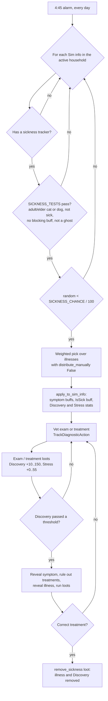
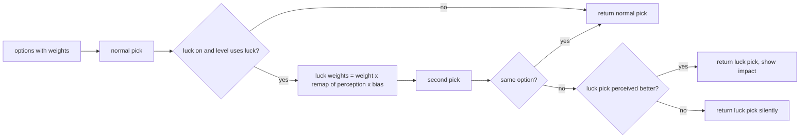
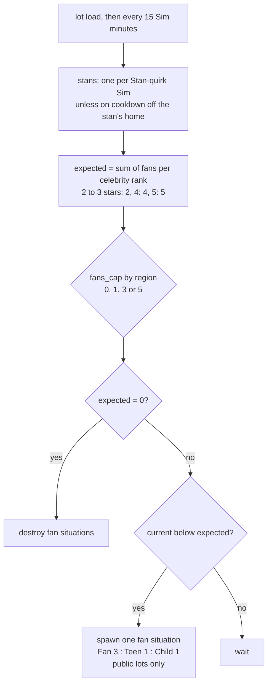

# 3.13 Sickness, luck, fame and other Sim states

*Game version 1.128.90.1030 (Steam, Linux/Proton). Instance numbers come from the live tuning as the live merge builds it (the base-game delta build plus the delta builds of the installed packs), mainly EP04 (Cats & Dogs), EP06 (Get Famous) and EP09 (Eco Lifestyle). Module tuning (the class-level constants) exists only in the base delta build for every module in this chapter, so it is the live value. EP01 (Get To Work) and EP19 (Enchanted by Nature) values are patch data, pack not installed. Written 2026-10-12. Checked 2026-10-12: 143 claims checked, 22 corrected, 0 relabelled, 0 removed. Checked again 2026-10-13: 158 claims checked, 22 corrected, 0 relabelled, 0 removed. Cross-chapter edits 2026-10-13: 9 applied.*

## In plain words

The game has one illness engine, and in this install it is used only by pets. Every morning at a quarter to five, each adult or elder cat and dog in your household gets one dice roll to fall ill: about 3 in 100 on an ordinary day, much more for an old pet or one that just ate spoiled food. A sick pet keeps its illness until someone cures it; illnesses have no timer. At the vet, each exam fills a hidden "diagnosis" bar and also stresses the pet, and as the bar passes fixed marks the vet learns a symptom, rules out a wrong medicine, or finally names the illness. A pet that gets too stressed can no longer be examined. Human colds and flus belong to the Get to Work expansion, which is not installed; they are a separate system of moodlets and counters that never touches the illness engine.

Luck belongs to Enchanted by Nature, which is not installed, so the luck code here never runs. With the pack, each human Sim would roll a hidden luck score every night at 2:00. For a Sim with good or bad luck, fishing catches and some random loot tables get a second roll whose odds lean toward good outcomes (or bad ones). That second roll is the one kept, and the game tells you when it landed on something the plain roll would not have, in the direction of the Sim's luck. The base game already carries the hooks for it in fishing and collecting tuning; they sit unused.

Fame is a star rating from zero to five. The first time a Sim reaches each star it earns perk points (ten in all), and some stars give "quirk" points that let bad habits like "No Touching" stick. Losing a star takes quirk points back and can take a quirk with them. Fans and paparazzi come from the lot: public lots check every 15 minutes how famous the Sims on them are and add fans, up to five; at home only "stans" turn up, never ordinary fans. Paparazzi come in four slots a day, more often for four and five star celebrities (the beach has none). A celebrity's home is mostly safe: only about one paparazzo pick in 21 actually sends one.

## Key facts

- The illness engine's daily roll (`sickness` package) runs only for the active household: one roll per Sim per day at 4:45, with chance `SICKNESS_CHANCE`/100 = 3% base, +25 after spoiled food, -2 after exercise, +2 for a lazy pet, +12 for an elder. Only adult and elder cats and dogs that are not sick, not ghosts and not under a sickness-blocking buff can roll. Other pets fall ill only through loots (special treats, check-ups) and the sick-patient filters of the vet clinic.
- All 33 live `Sickness` and 35 `Symptom` instances are EP04 pet ones. There is no human instance of the illness engine in this install.
- A household pet can catch 14 of the 29 real pet illnesses, 13 for each species (one of the 14 is dogs only, one cats only); the other 15 carry a -1000 weight for a playable Sim and are given only to NPC patients at the vet. The illness just recovered from is excluded (the history keeps exactly 1).
- Diagnosis is a 0 to 100 statistic. Exams add 10 to 30 points by vet skill (20 to 60 when the illness marks that exam as a good one), each exam once per illness, and 33, 25, 17 or 8 stress by the same skill bands (about half with Calming Agent, Simulation Gel or the stress perk, a quarter with the perk and one of those buffs, none under Relaxation Serum or right after a soothe); thresholds at 15/30/45/60 (easy), 25/45/60/80 (medium) or 25/45/60/80/100 (hard) reveal symptoms, rule out wrong treatments and finally reveal the illness.
- An exam's success weight falls with the pet's stress: 100% at stress 25 or less, 90%, 75%, then 50% up to 99; at 100 no exam is offered. A failed exam still runs its loots (more stress) but is not recorded as an exam.
- Each illness has one exam-table cure and one surgery cure, except four hard ones that only surgery cures. Two of those four (Super Repugnitis, Super Swamp Mouth) can strike household pets.
- Luck (EP19) uses three levels from a uniform roll on -100 to 100 every day at 2:00: Bad up to -55, Neutral -55 to 55, Good from 55. That is 22.5%, 55% and 22.5% before charms (+15 per lucky charm, -15 per unlucky one).
- `LuckService.choose_with_luck` has a latent NameError: when the luck participant is missing, building the error message reads an undefined global, `subject_participant` (bytecode offset 62). Nothing reaches it in this install: the service needs EP19 and every caller checks for it first.
- Fame perk points: +1, +2, +2, +2, +3 at stars 1 to 5, first time only (10 in all); 21 perks in five trees cost 1 each (Squad also needs five stars). Quirk points: +1 at star 1, +1 at star 3, +2 at star 5, every time, and taken back (with forced refunds) when a star is lost.
- The `famepoints` cheat adds perk points (FamePerkBucks) and leaves the Fame statistic alone.
- Fans: 27 zone directors enable the fan manager (two residential switch directors never run as themselves); a celebrity of 2 to 3 stars wants 2 fans, 4 stars 4, 5 stars 5; the lot caps the total at 5 (3, 1 or 0 in listed regions) and adds at most one fan situation per 15 Sim minutes. Only the 17 public-lot directors have a fan pool: home directors never spawn fans, only stans.
- Paparazzi: four walk-by slots a day (8, 12, 16, 20 h; the 20 h slot runs until 8 h) for a lot with a three-star or better Sim, on 26 of those directors (not the beach; the two switch directors never run as themselves); the count is doubled for four stars, tripled for five, doubled again by the Paparazzi Darling quirk, cut to 0, 0.5 or 0.25 in listed regions, then rounded half to even, so a three-star Sim draws none in a x0.5 or x0.25 region.
- Lifestyle brand pays once a day at 10:00, by days active on a per-market, per-product curve (from 150 down to 15 simoleons, or wavier curves with +-40% noise). The x1.5 bonus for Established Name is read only when the brand is set or changed and is not saved, so it is lost on reload until the brand is changed.
- The Sim info fire meter runs every 120 Sim minutes and calls the max-population story action once the save holds int(cap x 1.15) Sim infos.

## How it works

### Who can get sick in this install

**Observed** (`game_services.py`, `sickness/sickness_tracker.py: SicknessTracker`, `sims/sim_info_tracker.py`): the engine is base-game code. `SicknessService` is always registered, and `SicknessTracker` keeps the default `required_packs` (BASE_GAME) and the default LOD threshold (BACKGROUND), so every Sim info carries one; it is cleared when the Sim info drops to MINIMUM. It holds the current illness, a list of previous illnesses (newest first, trimmed to `PREVIOUS_SICKNESSES_TO_TRACK`), discovered symptoms, exams and treatments done, treatments ruled out, the last diagnosis progress and a discovered flag. What makes it a pet system is data: the tests below and the instances.

**Observed** (live tuning): the 33 live `Sickness` instances all come from the EP04 delta build (9 easy, 11 medium, 8 hard, 1 "super easy" fleas, 3 check-up records, 1 "all good" exam record); the 10 debug illnesses are in the EP04 full build only, outside the live set. All 35 `Symptom` instances are EP04 pet symptoms. No pack in this install defines a human `Sickness`, and the decoded patch data of the uninstalled packs holds no `Sickness` or `Symptom` record either (patch data carries only instances that patches changed, so this is the weaker test).

**Observed** (`sickness.sickness_tuning` module tuning, base delta): `SICKNESS_TESTS` is one test list that must all pass: Actor age ADULT or ELDER and species CAT or DOG; an inverted `sickness_test` (the Actor is not sick now); a buff blacklist of `buff_Pet_Sickness_TemporaryBlockSickness` (169691), `buff_Pet_Sickness_WellnessTreatBlockSickness` (171998) and `buff_Vet_ConeOfShame` (171707); `testSet_ActorIsNotGhost`; and a trait blacklist naming trait 218444, which no installed pack defines (it is `trait_Humanoid_Robots_MainTrait` in EP08 (Discover University) patch data, pack not installed).

**Observed** (`sickness/sickness_tests.py: SicknessTest.__call__`, bytecode): with no illness named and history off, the "is sick" test calls `sim_info.is_sick()`, which is true only for an illness whose `considered_sick` is set (`sims/sim_info.py: SimInfo.is_sick`). The three check-up records (`pet_Sicknesses_Positive_Healthy`, `_Healthy2`, `_FakeHealthy`) leave `considered_sick` at its code default True, so a pet carrying one counts as sick. Only `pet_Exam_debug_AllGood` sets it False.

### The daily pet sickness roll

**Observed** (`sickness_service.py: SicknessService.on_client_connect`, `_initialize_alarm`): when the zone reaches RUNNING, the service sets an alarm for the next `SICKNESS_TIME_OF_DAY`, repeating daily, and cancels it at zone shutdown. Live value 4:45 (code default 3:00).

**Observed** (`SicknessService.trigger_sickness_distribution`, bytecode offsets 0 to 84): for each Sim info in the active household, it skips Sims without a sickness tracker, builds a `SingleSimResolver`, calls `_should_sim_become_sick`, and on success calls `_choose_sickness_for_sim` with a filter that keeps only illnesses whose `distribute_manually` is False, then `apply_to_sim_info`. There is no other filter: NPC households, townies and pets on other households never roll (they get illnesses only from the loots and filters below).

**Observed** (`SicknessService._should_sim_become_sick` and `get_sickness_chance`): the chance is 0 unless `SICKNESS_TESTS` pass; otherwise it is `max(0, SICKNESS_CHANCE)/100`, and the Sim falls ill when `random.random()` is below it. `SICKNESS_CHANCE` is a `TestedSum`: the base plus every modifier whose test passes (`tunable_multiplier.py: TestedSum.get_modified_value`, bytecode).

**Observed** (live): base 3; +25 with `buff_Sickness_Pet_AteSpoiledFood`; -2 with `buff_Sickness_Exercised`; +2 with `testSetInstance_PetTraits_Actor_Whitelist_Lazy`; +12 for an ELDER.

**Inferred** (from those numbers): a healthy adult pet has a 3% chance a day, an elder 15%, an adult that ate spoiled food 28%, an exercised adult 1%, and an elder that ate spoiled food and is lazy 42%.

**Observed** (bytecode, offsets 50 to 74): the result of `_choose_sickness_for_sim` is used without a None check. `sims4.random.pop_weighted` returns None for an empty list (`core/sims4/random.py`), so a pet that passes the roll while every eligible illness weighs 0 would raise AttributeError. **Inferred**: unreachable with the live tuning (at least 7 illnesses weigh 1 for a household pet, even on a vet clinic lot it does not own), reachable for a mod that empties the pool.

### Choosing an illness: weights and the pool

**Observed** (`sickness/sickness.py: Sickness.get_sickness_weight`, bytecode): the weight is 0 when `restrictions` fail, otherwise `max(weight.get_modified_value(resolver), 0)`. `sickness_utils.py: all_sickness_weights_gen` drops 0 weights, and `pop_weighted` picks among the rest.

**Observed** (live): every non-debug illness has base weight 1 and -1000 when the same illness is in the Sim's history (`sickness_test` with `check_history`). With one remembered illness, only the last one is excluded. Two more penalties appear on many records:

- -1000 when the Sim is playable (`sim_info` test, `npc` enabled and False). "NPC" here means not currently selectable (`sims/sim_info_tests.py` description).
- -1000 when the active household does not own the current lot and the lot is a vet clinic (`lot_owner` with `owns_lot` False, plus a venue test for 158847).

**Observed** (live): the restrictions limit `pet_Sicknesses_Easy_DerpyDoggy` to dogs and `pet_Sicknesses_Easy_Woozykittyitis` to cats. The debug illnesses are not live: in the EP04 full build they have base weight 0, and `pet_Sicknesses_debug_GoldenPoo` and `_RainbowPoo` get +5 with `trait_Pet_Glutton_Cat`, which would let a glutton cat roll them if that build were read.

**Inferred** (from the weights): a household dog or cat draws from 13 illnesses with equal weight (14 minus the one for the other species), minus the last illness it had: a 1 in 12 or 1 in 13 chance for each. The glutton trait changes nothing here, because the two debug illnesses it favours are not live.

### Other ways in and out

**Observed** (`sickness/sickness_loot_ops.py: GiveSicknessLootOp`, loot key `give_sickness`): gives a random auto-distributable illness, a named one, or one matching criteria (tags and a difficulty range; that path passes `only_auto_distributable=False`). `reset_diagnosis_progress` defaults True and clears the diagnosis data afterwards. `RemoveSicknessLootOp` (key `remove_sickness`) calls `SicknessService.remove_sickness`, which calls `Sickness.remove_from_sim_info` and so also removes the diagnosis statistic.

**Observed** (`SicknessService.make_sick`): removes the current illness first, then applies the new one. The daily roll does not call it and applies the new illness directly; its tests already require the Sim not to be sick in the `is_sick` sense.

**Observed** (live, 8 `give_sickness` loots, all EP04): `loot_PetSickness_CauseSick_1` to `_5`, used by `food_Consume_Pet_EatSpecialTreat` and `petSocial_SimToPet_GiveSpecialTreat`; `loot_Vet_CheckUp_Sickness` (from `buff_Role_Vet_CheckUp`); `loot_Vet_SeedExam` (from the debug interaction `debug_setupExam`); `loot_BushPet_SquirrelFail`. `CauseSick_1` gives Gilded Guts Disorder at 50% and, when the pet does not have Gilded Guts after that, Prismatic Poop Plague; both ops skip a pet with any of the three blocking buffs or a ghost (`testSet_TargetIsNotGhost`). `CauseSick_2` to `_5` give Frozen Mange, Magmafied Organs, Super Repugnitis and Super Swamp Mouth.

**Observed** (live, 13 `remove_sickness` loots): `loot_Vet_RemoveSickness_Target` is the correct-treatment loot of every illness and is also used by the special-treat social, the exam-table and surgery treatment mixers, the Cone of Shame and the preventative shot (48 live referrers: 32 illnesses and 16 interactions); `loot_Vet_RemoveSickness_Actor` runs in `death_OldAge_Cat` and `death_OldAge_Dog`; eleven `loot_Vet_RemoveSickness_Actor_*` loots run from the `buff_Pet_Sickness_CriticalFailure_*` buffs.

**Observed** (code and live reverse search): no `Sickness` field holds a duration, and the 13 `remove_sickness` loots are reached only from treatments, the special-treat social, the critical-failure buffs and old-age death. **Inferred**: an illness has no clock of its own; a pet stays ill until one of those removes it. Pet-side gameplay (how a sick pet behaves, the critical failures) belongs to [3.12 Pets and horses](3.12-pets-horses.md).

**Observed** (live): `buff_Sickness_IsSick` (on every illness) resets `statistic_Sickness_DaysSinceLastSick` to its minimum and refills `commodity_Sickness_SinceLastSick_Timer` (1,440, decaying 1 per minute); each time the timer empties, `loot_PetSickness_SinceLastSick_ResetAndIncrement` refills it and adds 1 day (maximum 10). While the pet is ill the same buff holds the timer still (a decay modifier on it with the code-default value 0). A reverse search of the live tuning finds nothing else that reads the day counter.

**Observed** (`filters/tunable.py: SickSimFilterTerm`, filter key `is_sim_sick`): a Sim filter can make the NPC it creates sick, optionally within a difficulty range. 8 live filters use it: `filter_SickCat`, `filter_SickDog`, their `_MidLevel` and `_HighLevel` variants, and `filter_CheckUp_Cat` and `_Dog`. Vet clinic patients come from these ([5.02 Businesses](5.02-businesses.md)).

### Diagnosis: exams, treatments and thresholds

**Observed** (`sickness/sickness_elements.py: TrackDiagnosticAction._do_behavior`, bytecode): an XEVT-timed element on the exam or treatment interaction. When the result is not FAILED_TOO_STRESSED, it records the affordance as an exam or a treatment on the target. Then, whenever the target has an illness (`has_sickness_tracking` only checks `current_sickness`), it calls `Sickness.apply_loots_for_action` with the action type and result, failed or not.

**Observed** (`Sickness.apply_loots_for_action`, bytecode; `sickness.py: _DiagnosticActionLoots.apply_loots`): picks `examination_loots[result]` or `treatment_loots[result]` if present and applies its `default_loots`, or the `interaction_overrides` entry for the running affordance instead, then always calls `update_diagnosis`. `DiagnosticActionResultType` is a dynamic enum: DEFAULT 0, CORRECT_TREATMENT 1, INCORRECT_TREATMENT 2, FAILED_TOO_STRESSED 3 in code, plus SURGERY_SCAN 4, which the base delta module tuning `sickness.sickness_enums` adds. 32 of the 33 live records (all but `pet_Exam_debug_AllGood`) key exam loots on SURGERY_SCAN.

**Observed** (`Sickness.update_diagnosis`, bytecode offsets 36 to 114): reads the diagnosis statistic; returns if it equals the stored last progress; otherwise walks the threshold actions in ascending order, skips thresholds at or below the last progress, stops at the first threshold above the current value, runs every action of each threshold in between, and stores the current value. Thresholds crossed together all fire in one call.

**Observed** (`sickness.py`, threshold actions):

- `discover_symptom` reveals the one symptom it names, so symptoms surface in threshold order (`get_ordered_symptoms` only returns that order, for display).
- `discover_sickness` marks the illness known and rules out every applicable treatment that is not correct.
- `rule_out_treatment` takes the applicable treatments (`available_treatments` plus the `available_treatment_lists`), removes those already done or ruled out and the correct ones, and rules out one at random. With an interaction and no `rule_out_reason`, it keeps only treatments whose category tags share a tag with the exam's `EXAM_TYPES_TAGS` (`Interaction_ExamTable_Exam`, `Interaction_SurgeryStation_Exam`), so an exam-table exam rules out exam-table treatments (generator filter checked in bytecode).
- `apply_loots` runs loots.

**Observed** (live, EP04): every illness uses `statistic_Vet_Treatment_Discovery` as its diagnosis statistic and adds `statistic_Vet_Treatment_Stress`; both are plain statistics with the code-default range 0 to 100. Exam DEFAULT loots are `loot_Vet_DiscoveryGain_Standard` (+10, +15, +20, +30 for vet skill 2 or less, 3 to 6, 7 to 9, 10, skill `statistic_Skill_AdultMajor_Veterinarian`) and `loot_Vet_StressGain_Standard`: +33, +25, +17, +8 by the same bands with no clinic medicine buff and the vet perk `vetPerks_ReducePetStress` locked; +17, +13, +9, +4 with Calming Agent or Simulation Gel (`buff_Object_VetMedicineStation_*`) and the perk locked, or with the perk and no medicine buff; +9, +7, +5, +2 with the perk and Calming Agent or Simulation Gel; nothing under Relaxation Serum, which every stress op blacklists. Every stress op also needs `statistic_Vet_Treatment_PreventStress` present and at 0 or below (`must_have_stat` True; the statistic starts at 1 with a maximum of 1), and each stress loot ends by taking 1 from it. `vet_Examine_SoothePet` runs `loot_Vet_StressNegate` (+1), so the next stress loot adds nothing. Each stress op is mirrored on `statistic_Vet_Treatment_StressCumulative`, which `loot_Vet_Stress_StressRating_OnCorrectTreatment` reads. Each illness has its own per-interaction overrides: `loot_Vet_DiscoveryGain_High` (+20, +30, +40, +60) comes from Take Temperature on 17 of the 33 records, Skin and Fur 13, Listen to Heart 11, Examine Mouth 10, Listen to Breathing 7, Eye Exam and Test Ears 4 each; some overrides add `loot_Vet_StressGain_High` (+55, +41, +28, +14, scaled down by the same buffs and perk) instead. Surgery scans use `loot_Vet_DiscoveryGain_Surgery_Standard` (+20, +30, +40, +60; +25 to +75 with Calming Agent or Simulation Gel), `_Surgery_High` (+40, +60, +80, +120; +50 to +150 with those buffs) and `loot_Vet_StressGain_Low` (+15, +11, +8, +4). `vet_Examine_Exam_MarkChart` gives standard discovery with no stress. A correct treatment runs `loot_Vet_RemoveSickness_Target` and two more loots; an incorrect one adds stress; FAILED_TOO_STRESSED adds stress, plus a too-many-fails loot on all 32 records that tune that outcome (every live record except `pet_Exam_debug_AllGood`). The last threshold of each illness runs `discover_sickness` together with `loot_Vet_DiscoveryGain_Max` and `loot_Reaction_Vet_DiagnosisDiscovered`.

**Observed** (live, `vet_Examine_Exam_TakeTemperature`, the same on the other six stress-weighted exams: Test Ears, Eye Exam, Listen to Breathing, Skin and Fur, Examine Mouth, Listen to Heart): the success outcome weighs 100 times a stress multiplier of 1 (stress 25 or less), 0.9 (25 to 50), 0.75 (50 to 75), 0.5 (75 to 99) and 0 (100); the FAILED_TOO_STRESSED outcome weighs 100 times 0, 0.1, 0.25, 0.5 and 1. Listen to Breathing has an extra success variant for bad breath. All eight exams (the seven plus Mark Chart) carry the same `test_globals`: stress below 100 and an inverted `diagnostic_action_test` on the performed exam, so each exam is offered once per illness. **Inferred**: success odds of 100%, 90%, 75% and 50%; at 100 the exam is not offered.

**Inferred** (from the gains): an unskilled vet without aids adds 33 stress per exam, so stress is 99 after three stress-adding exams and 100 after the fourth, and exams stop there. Four standard exams and Mark Chart give 50 points, short of the 60 an easy illness needs, so the vet needs the illness's high-discovery exams, surgery scans, the clinic's stress aids or more skill. If the pet does not yet hold `statistic_Vet_Treatment_PreventStress`, the first stress loot adds nothing (its test needs the statistic; the closing -1 then adds it at its initial 1 and takes it to 0), which allows a fifth stress-adding exam and 60 points; this depends on how a statistic op adds a missing statistic and was not traced further. Mark Chart adds no stress. Stress is a plain statistic with no decay in its tuning, and it is removed with the illness (it is one of the illness's `associated_statistics`). A skill 10 vet (+30 points, +8 stress) reaches 60 in two standard exams.

Diagnosis needs only EP04: the Doctor career and its human patients are EP01 (Get To Work) content and do not exist here.

### The pet illness catalogue

**Observed** (live, EP04 delta; "home" = no playable-Sim penalty, so a household pet can roll it):

| Illness (`pet_Sicknesses_...`) | Difficulty | Home | Exam-table cure | Surgery cure | Major symptoms |
|---|---|---|---|---|---|
| Easy_BlazingTootsies | 1 | no | Spray_ParasiteKiller | ReadjustmentSurgery | HotFeet |
| Easy_CommonLavaNose | 1 | no | Spray_OrganicDisinfectant | RefillNose | GlowingNose |
| Easy_DerpyDoggy (dogs) | 1 | yes | Spray_Antifungal | RefillNose | ExtremeLethargy |
| Easy_IceFur | 1 | no | Shot_AntiviralPayload | ExtractCuteness | IceyFur |
| Easy_MildRepugnitis | 1 | yes | Spray_ParasiteKiller | UnblockChute | MouthMoths, Drooling, StinkyFur |
| Easy_PrismaticPoopPlague | 1 | yes | Pill_MedicineX | UnblockChute | RainbowPoop |
| Easy_SwampMouth | 1 | no | Pill_EssenseOfPlacebo | ReadjustmentSurgery | Barfing, Drooling |
| Easy_WinterfestFever | 1 | yes | Pill_FixitolTreat | UnblockChute | GlowingNose, IceyFur |
| Easy_Woozykittyitis (cats) | 1 | yes | Shot_EudemoniaConcentrate | ExtractCuteness | ExtremeLethargy |
| SuperEasy_Fleas | 1 | yes | Spray_ParasiteKiller | UnblockChute | Fleas |
| Medium_AdvancedLavaNose | 5 (default) | no | Pill_FixitolTreat | RefillNose | GlowingNose, RainbowPoop |
| Medium_AdvancedSwampMouth | 5 | no | Pill_MedicineX | ReadjustmentSurgery | Barfing, Drooling |
| Medium_FrostyFurFlu | 5 | no | Pill_EssenseOfPlacebo | UnblockChute | IceyFur |
| Medium_FrozenMange | 5 | yes | Spray_OrganicDisinfectant | RefillNose | IceyFur, StinkyFur |
| Medium_GildedGutsDisorder | 5 | yes | Pill_EssenseOfPlacebo | ReadjustmentSurgery | GoldenPoop |
| Medium_MagmafiedOrgans | 5 | yes | Shot_AntiviralPayload | RefillNose | GlowingNose, HotFeet |
| Medium_OverheatedSniffer | 5 | yes | Spray_Antifungal | LubricateJoint | GlowingNose, RainbowPoop |
| Medium_Pyrotoes | 5 | no | Spray_Antifungal | ExtractCuteness | HotFeet |
| Medium_Repugnitis | 5 | no | Spray_OrganicDisinfectant | ReadjustmentSurgery | StinkyFur, Fleas, MouthMoths, Drooling |
| Medium_Sizzlepaw | 5 | yes | Pill_FixitolTreat | UnblockChute | HotFeet |
| Medium_SquirrelFever | 5 | yes | Shot_FeelgoodSerum | ExtractCuteness | Drooling, ExtremeLethargy |
| Hard_CriticalHotfoot | 10 | no | Shot_AntiviralPayload | LubricateJoint | HotFeet |
| Hard_CriticalLavaNose | 10 | no | Shot_EudemoniaConcentrate | RefillNose | GlowingNose, RainbowPoop |
| Hard_FierceFrostyFlu | 10 | no | Pill_MedicineX | LubricateJoint | IceyFur |
| Hard_SlurryFur | 10 | no | none | ReadjustmentSurgery | IceyFur |
| Hard_SnortnoseFever | 10 | no | none | UnblockChute | GlowingNose, RainbowPoop |
| Hard_SuperRepugnitis | 10 | yes | none | ReadjustmentSurgery | Barfing, Fleas, MouthMoths, StinkyFur, Drooling |
| Hard_SuperSwampMouth | 10 | yes | none | ReadjustmentSurgery | Barfing, Drooling, ExtremeLethargy |
| Hard_ThrobpawDisease | 10 | no | Shot_FeelgoodSerum | RefillNose | HotFeet |

**Observed** (live): an illness also lists zero to four minor symptoms from temperature, breath, eyes, skin, heartbeat, ears, nose and cuteness (4 illnesses have none, 2 one, 13 two, 6 three, 4 four). All symptoms apply the moment the illness does (`Sickness.apply_to_sim_info`); diagnosis only reveals them. Major symptoms add a `buff_Pet_Sickness_*` buff; minor symptoms add nothing, except the three breath ones, which share `buff_Vet_BadBreath` (170079). Each illness adds the hidden `buff_Sickness_IsSick` and carries the tags `Sickness_Illness`, `Sickness_CuredBy_ExamTable` and `Sickness_CuredBy_SurgeryStation` (all three on every illness). Exam-table cures are `vet_Examine_Treatment_*`; surgery cures are `vet_Surgery_Treatments_*`. The three check-up records are manual-only, carry `Sickness_CheckUp` with both CuredBy tags, use thresholds 10 to 50, and the two Healthy ones are "cured" by `vet_Examine_Treatment_PreventativeShot` (FakeHealthy by `vet_Examine_Treatment_Pill_FixitolTreat` or `vet_Surgery_Treatments_ExtractCuteness`). They leave `track_in_history` at its code default True, so a removed check-up record enters the illness history (`SicknessTracker.remove_sickness`); only `pet_Exam_debug_AllGood` sets it False. **Inferred**: with a history of one, a check-up record pushes the last real illness out of the history.

### Human illness: EP01 patch data, and what is left without it

**Observed** (patch data, pack not installed: the decoded patch tuning of EP01, 184 records with `SicknessSystem` in the name, 204 with `Sickness`): human illness is a commodity and buff system, separate from the `sickness` package. `commodity_SicknessSystem_IllnessDuration` runs from -100 to 100, converges to 0 at 0.0334 per minute, starts at 55, and has states Immune (-100), Remove (-5), Remission (2), Mild (7) and Severe (56). Its `communicable_by_interaction_tag` passes the illness on chats at 5%, flirty socials at 10% and WooHoo at 50%; catching it from a Severe Sim sets the commodity to 100, from a Mild one to 55. `loot_Buff_SicknessSystem_ContractIllness_School_exit`, `_Work_exit` and `_Sleep_exit` give a 1% chance to start at 55. Child to elder only; immunity, remission and `trait_SicknessImmunity` block it. The illnesses are BloatyHead, BurningTummy, GasAndGiggles, ItchyPlumbob, LlamaFlu, StarryEyes, SweatyShivers and TripleThreat. Doctor diagnosis uses `commodity_SicknessSystem_PatientDiagnosis` (stages 0 to 4).

**Inferred** (from the decay rate and the state bounds): an illness that starts at 55 is Mild at once, reaches Remission (below 7) after about 24 Sim hours (48 points at 0.0334 per minute) and the Remove band (below 2) after about 26 hours. A value of -100 (Immune) takes about 47 hours to climb back to -5.

**Observed** (live, base game): what the base game keeps is `Buff_Sickness_Immunity_General`, `trait_SicknessImmunity` with `loot_SicknessImmunity_Add`, the nausea buff `Buff_Sickness_NeedToPuke` and `commodity_Motive_Nausea`, and pregnancy's `Buff_Sim_MorningSickness` ([3.09 Life cycle](3.09-life-cycle.md)).

EP19 patch data also defines "Ailments" (230 records with "Ailment" in the name: buffs, incubation timer commodities such as `commodity_Ailments_IncubationTimer_LuckSuck`, cures). None of them is a `Sickness` instance, so they do not use the `sickness` package; they are out of scope here.

### Sick children and the school day

**Observed** (`sims/sickness_tuning.py: SicknessTuning`): `SICKNESS_BUFFS_PLAYER_FACED` and `LOOT_ACTIONS_ON_CHILD_CAREER_AUTO_SICK`; `is_child_sim_sick` is true for a child with any listed buff. Live (base delta module tuning): 18 EP01 SicknessSystem symptom buffs and loot 115827 (`loot_Career_ChildAutoSick`, EP01 patch data); none exist in this install.

**Observed** (`careers/career_base.pyc: early_warning_callback`, bytecode lines 2162 to 2166): after the paid-time-off and day-off checks, a sick child gets the auto-sick loot and the callback returns before the early work loot. **Inferred**: with the list empty here, the branch never runs.

### Luck (EP19): pack gating

**Observed** (`luck/luck_service.py: LuckService`, `luck/luck_tracker.py: LuckTracker`): both require EP19 (`required_packs`), so `services.get_luck_service()` returns None and `sim_info.luck_tracker` stays None in this install. With the pack, the on/off option starts on (`LuckService.__init__`) and is saved with the gameplay options (`luck_enabled`).

**Observed** (live hooks with no effect here): `luck_config` on 3 fishing catch mixers (`FishingLocation_Catch`, `FishingLocation_Catch_IslandCanoe`, `mixer_Ponds_Fishing_Catch`, base delta) and inline `luck_tuning` on 24 LootActions (23 base delta, 1 EP04: microscope, telescope, collectible, frog and feather pile loots). The standalone random tables with `_luck_tuning` are counted in [0.04 Tests, loot and effects](0.04-tests-loot-effects.md). Code that asks the luck service: `fishing/fishing_data.py`, `fishing/fishing_interactions.py`, `fishing/fish_trap_interactions.py`, `interactions/object_rewards.py` and `interactions/utils/loot.pyc` (`RandomWeightedLoot.get_loot_ops_gen` and `_get_luck_actions`, which failed to decompile; read from bytecode), each checking first that the service exists and otherwise making its plain choice; `fishing/fish_object.py`, `objects/object_creation.py`, `notebook/notebook_entry_ops.py` and `interactions/utils/localization_tokens.py` carry luck tuning or pass luck results along ([6.02 Gardening, fishing and collecting](6.02-gardening-fishing-collecting.md)).

### Luck levels and the daily luck roll

**Observed** (`luck.luck_tuning` module tuning, base delta; it references EP19 instances):

- `LUCK_LEVELS`: Bad (interval upper -55, lower at the code default -100; perceived bias -1; impact loot `loot_LuckSys_BadLuck`); Neutral [-55, 55] (`should_show_impacts` False, `should_use_luck` False); Good (lower 55, upper default 100; bias 2; impact loot `loot_LuckSys_GoodLuck`). Each level also names a `loot_LuckSys_OnLevel_*` enter loot.
- `LUCK_STAT` 424777 `statistic_LuckSys_Luck` (EP19 patch data: range -100 to 100).
- `LUCK_MODIFIERS`: +15 per Freezer Bunny Foot (definition 486070) and -15 per Cowplant Horn (486069) in inventory with state `luckInfusedObjects_LuckSys_Values_Active_Yes`, counted (`multiply_by_count`).
- `LUCK_REFRESH_SCHEDULE`: every day at 2:00. `SHOULD_HAVE_LUCK_TESTS`: species HUMAN.
- `NORMALIZED_LUCK_WEIGHT_RANGE` is not tuned, so the code default 0.01 to 1 applies; `PERCEPTION_RANGE` is fixed at -100 to 100.

**Observed** (`LuckTracker.refresh_luck_value`, bytecode): returns if `LUCK_STAT` is missing or the Sim should not have luck; with luck disabled, it notes a missed refresh and clears the level; otherwise it sets the statistic to `uniform(min, max)` and recalculates. `_try_get_luck_value` clamps the statistic plus `LUCK_MODIFIERS` into the statistic's range. `_recalculate_luck_level` ignores object changes outside an inventory, and when the level changes it stores it, applies `loot_on_enter` and refreshes the luck display (`_send_luck_to_ui`). The tracker (LOD INTERACTED) listens for aging up, inventory changes and object state changes. Turning luck back on refreshes only if a refresh was missed; turning it off sends "OPTL" telemetry.

**Observed** (EP19 patch data, pack not installed): Good luck's enter loot adds the hidden `buff_LuckSys_SkillRate_GoodLuck` (skill modifier 1.1 on `Skill_All`) and removes the bad one, Bad luck's does the reverse (0.9), and Neutral's removes both. The Good and Bad impact loots show a notification and play the `ep19_luck_good` or `ep19_luck_bad` effect on the head; Neutral's impact loot is empty.

**Inferred** (uniform roll, levels checked in list order): Bad 22.5%, Neutral 55%, Good 22.5% with no charms. One Freezer Bunny Foot shifts the line, so Good becomes 30% and Bad 15%.

### Choosing with luck

**Observed** (`LuckService.choose_with_luck`, bytecode):

1. Drop options with weight 0 or less; make a normal weighted choice from the base weights.
2. If luck is off, the tracker or level is missing, or the level has `should_use_luck` False, return the normal choice. A missing participant does not reach this fallback: it hits the NameError below.
3. Otherwise build luck weights: `weight x remap(perception x bias, -100..100 to 0.01..1)`. `remap_range` is linear and unclamped (`core/sims4/math.py`), so a Good bias of 2 can push values outside 0.01 to 1; if the smallest is 0 or less, every weight gets `abs(min) + 0.01` added.
4. Make a second, independent pick with those weights. Same option as the normal pick: return it, no impact. Luck pick with a higher level-weighted perception (`perception x bias`, so a worse outcome for Bad luck) than the normal pick: return it with `did_impact` True and the level. Otherwise return the luck pick silently.

**Observed**: impacts are shown only when `did_impact`, the level, `level.should_show_impacts` and the option's `show_luck_impacts` are all true; `choose_with_luck_and_apply_loots` then applies the level's `impact_loot` and the config's loots. `_log_archive_entry` returns at once, so the GSI luck archive records nothing.

**Observed** (bug, bytecode offset 62 of `choose_with_luck`): when `resolver.get_participant(luck_config.participant)` is None, the error call loads the global `subject_participant`, a name the module never defines, so the code raises NameError before the error call runs and never falls back to the normal pick (the error call would write nothing in retail anyway: `Logger.error` has an empty body there). **Inferred**: latent until EP19 is installed and a luck config names a participant the resolver cannot supply. In this install nothing reaches it: `LuckService` is never registered, every caller checks for a missing service and makes its plain choice instead (`interactions/object_rewards.py` line 149, the three fishing modules, `RandomWeightedLoot` in `interactions/utils/loot.pyc`), and `luck.test_luck` is a DebugOnly command.

### Fame: earning, freezing and opting out

The ranked statistic itself (levels at 162, 837, 1,917, 3,334, 5,021 and 5,262 points, the delayed decay bands, the decay floors, decay only for played Sims) is in [3.03 Needs, statistics and commodities](3.03-needs-statistics.md#ranked-statistics). This section adds what is fame-specific.

**Observed** (live census of ops on `rankedStatistic_Fame`): 118 live records (94 EP06 delta, 22 base delta, 1 GP04 (Vampires) delta, 1 EP12 (High School Years) delta) change fame points with 219 `statistic_change` ops (187, 29, 2 and 1 of them). Every amount is a plain number from 0.2 to 459, and none is negative. 12 ops set the rank outright (`statistic_set_rank`), all in the cheat loots `loot_Fame_Cheat_RankUp` and `_RankDown`. 82 more `statistic_change` ops in 11 records change social media followers or job performance and read Fame only as a `statistic_multipliers` input, a curve over the star level (for example x1 to x2 for follower gains, x0 to x2 for `loot_Career_SocialMedia_JobPerformance_Gain_PickedSim_FameBoost`, which raises the job performance of the picked Sim in whichever of about 20 adult and teen careers they hold, not only the social media one). The largest single gains: `loot_Fame_Actor_FameOpportunity_Large` 459, `loot_Fame_Actor_FameOpportunity` 378, `Loot_ProgrammingSkill_MadeGame` and `loot_FamePerk_EstablishedName_MakeAVideoGame` 303.45, `loot_Fame_Actor_FameOpportunity_Small` 297, app loots 265.2, `loot_Fame_Actor_VeryLarge` and `loot_Fame_Actor_PowerShifts_Sword` 192, and licensed songs 146.6.

**Observed** (`fame/fame_tuning.py: FameTunables`, base delta module tuning): `FAME_RANKED_STATISTIC` 188229, `FAME_PERKS_BUCKS_TYPE` FamePerkBucks, `FAME_MOMENT_EVENT` `fame_moment_complete`, `PARENT_FAME_AGE_UP_BONUS` 0, 32, 65, 97, 130, 162 points for a parent-child rank gap of 0 to 5, `CHANCE_TO_WEAR_TRAILBLAZER_OUTFIT` 12% (code default 50%; a `TunablePercent`, divided by 100 on load).

**Observed** (`fame/fame_commands.py: award_parent_fame_bonus`): the child's fame is raised by `PARENT_FAME_AGE_UP_BONUS[max(0, best parent rank - child rank)]`.

**Observed** (`sims/sim_info.py: SimInfo.set_freeze_fame`, `allow_fame`): freezing sets the FREEZE_FAME option and locks Fame with DO_NOT_CHANGE_VALUE; unfreezing unlocks it. Setting `allow_fame` False unfreezes first, then locks Fame with USE_MIN_VALUE_TUNING; True unlocks it. `force_allow_fame` also sets FORCE_CURRENT_ALLOW_FAME_SETTING.

**Observed** (`sims/sim_info_manager.py: try_set_sim_fame_option_to_global_option`, called from `SimInfo._post_load` and when the global option changes): the "start all Sims opted out of fame" option touches only Sims without a forced setting, not frozen, and with fame within 1 point of the minimum. A Sim with any fame keeps their own setting. `situations/custom_states/semi_permanent_clone_situation.py` turns fame off for its clones.

**Observed** (`careers/career_interactions.py: CareerSuperInteraction._should_run_fame_moment`): a career level with a `fame_moment` rolls `chance_to_occur` at work unless the career already completed its moment; 127 live CareerLevels have one. Details are in [3.10 Skills, careers and school](3.10-skills-careers-school.md).

### Perks and quirks

**Observed** (live, the 33 `famePerks_*` `BucksPerk`s; EP06 delta has 35 live BucksPerks, the other two being the club perks `clubPerks_SkillBoost_AdultMajor_Acting` and `_AdultMinor_MediaProduction`): 21 FamePerkBucks perks and 12 FameQuirkBucks quirks, every one with `unlock_cost` 1. The perks form five chains, each perk requiring the previous one:

| Tree | Chain (first to last) | Extra gate |
|---|---|---|
| Skill and career | Noticeable, CelebuSerum, EstablishedName, CareerHopper, EasyStreet | none |
| Relationship game | Networking, PRPerson, FanFavorite, InstantBesties, Squad | Squad: five stars (Fame rank 5 or more) |
| Brand | CorporatePartnership, Influencer, AllNighter, Trailblazer, LifestyleBrand | none |
| Good reputation | GivingBack, Rally, StarTreatment | reputation rank 4 or more, 5 or more, 6 |
| Bad reputation | WhosBad, PlayTheVillain, FeudBringer | reputation rank 2 or less, 1 or less, 0 |

**Observed**: the reputation gates are `ranked_statistic` tests on `rankedStatistic_Reputation` comparing its rank (`event_testing/statistic_tests.py: RankedStatThresholdTest`). FeudBringer's threshold tunes only the comparison, so its value is the `TunableThreshold` code default 0 (`core/sims4/tuning/tunable.py`, bytecode: value `Tunable(float, 0)`, comparison GREATER_OR_EQUAL). Squad's gate is the same test on `rankedStatistic_Fame` with only the value 5 tuned, so it needs rank 5 or more. Reputation ranks 0 to 6 run Terrible to Pristine ([3.08 Relationships, socials and memories](3.08-relationships-socials.md#reputation-ep06)). Fame also scales reputation: each of the 27 live `loot_Reputation_Gain_*` and `loot_Reputation_Loss_*` loots (EP06 delta) carries one op per star level, x1.2 at one star up to x2 at five (for example `loot_Reputation_Loss_Large` -9, then -10.8 to -18), so a famous Sim's reputation moves faster both ways (same section of 3.08).

**Observed** (live loots): perk points come from the first-time `loot` lists: `loot_Fame_Progression_RankUp_1` +1, `_2` +2, `_3` +2, `_4` +2, `_5` +3. `loot_Fame_Progression_BonusActorPoints` adds +2 more on joining each of the ten Actor career levels (`loot_on_join`) for a Sim with `trait_Reward_ChildhoodInspiration_BeAStar`.

**Inferred**: a Sim reaching five stars once holds 10 perk points, enough for 10 of the 21 perks, unless the actor bonus applies.

**Observed** (`bucks/bucks_loot_op.py: _PerkProgressStrategy.try_unlock_perk`): a quirk grows only while the perk is locked and the Sim holds at least its cost in FameQuirkBucks; then its `progression_statistic` gains the tuned progress and the statistic is removed once the perk unlocks. Example: `loot_Fame_Quirks_PaparazziDarling_Add` adds 1.4 progress. `_UnlockPerkStrategy` unlocks for free by default; with `unlock_for_free` False it needs and spends the cost (`pay_for_and_unlock_perk`).

**Observed** (live, `rankedStatistic_Fame` `loot_always` and `level_down_loot`): quirk points `loot_Fame_Quirk_Points_RankUp_1` +1, `_3` +1, `_5` +2, given every time the star is reached; the matching rank-down loots `loot_Fame_Progression_RankDown_0`, `_2` and `_4` take -1, -1 and -2 with `force_refund`.

**Observed** (`bucks/bucks_tracker.py: BucksTrackerBase.try_modify_bucks`, `lock_perk`): when a change would leave the balance below 0 and `force_refund` is set, the tracker walks the Sim's quirks newest first (by unlock timestamp), adds each one's `unlock_cost` back to the new balance and locks it without a refund, stopping once the balance reaches 0 or more. If it runs out of quirks first, it returns False and changes nothing; the loot's error call writes nothing in retail. The walk also passes quirks that were already locked (they keep an entry with timestamp 0, so they come last): their cost counts toward the balance, while `lock_perk` on them only returns.

**Inferred**: quirk points track the current star count (1 at one or two stars, 2 at three or four, 4 at five), and a celebrity who loses a star while every point is spent loses their most recent quirk.

**Observed** (live, EP06 delta; `bucks/bucks_picker_interaction.pyc`, bytecode, which failed to decompile): quirks can also be removed by hand. `fameQuirks_QuirkBeGone_Picker` and `fameQuirks_CrystalHelmet_Picker` are `BucksPerkPickerSuperInteraction`s on FameQuirkBucks with `is_add` False; `on_choice_selected` calls `lock_perk(perk, True)`, which refunds the quirk's cost (1 point), and then pushes the continuation. Quirk-Be-Gone continues to `consumable_Drink_Nonbar_QuirkBeGone`, whose `loot_Fame_Quirks_QuirkBeGone` adds `buff_Fame_QuirkBeGoneCooldown`; the Crystal Helmet picker needs `testSet_Fame_HasQuirk` and one of seven crystal buffs (Alexandrite, Crandestine, Jet, Jonquilyst, Nitelite, Plumbite, Rainborz), and continues to `CrystalHelmet_RemoveQuirk` (`loot_CrystalHelmet_RemoveCrystal_StoredObject`). The cheat `fameQuirks_ShippingCheat_Remove` removes the same way; `fameQuirks_Debug_Add` adds a quirk and pays for it. The helmet's 24 crystal traits are not persistable, and its Jet buff (`buff_Object_CrystalHelmet_Traits_Jet`) carries a x3 `satisfaction_point_multiplier`.

### Fame rank-up and rank-down loots

**Observed** (live, `rankedStatistic_Fame` event data):

- Every time a star is reached, `loot_Fame_Progression_RankUp_Trait_*` swaps the hidden `fameTrait_Level1` to `_Level5` traits. The perk-point loots of the first time also add a `buff_Fame_Progression_RankUp_*` buff and a notification. The rank-down loots swap the trait back and add `buff_Fame_Progression_RankDown_*`.
- Reaching five stars also adds 174 fame points every time (`loot_Fame_Progression_RankUp_Trait_5`). **Inferred**: it lifts a fresh five-star Sim from 5,021 to 5,195, a cushion above the line.
- Four stars add the celebrity walk style (`loot_Buff_CelebrityWalkstyle_On` adds `fameTraits_CelebrityWalk_On`, 204539; removed below four) and `fameTraits_Shine_On_Rank4` (199155, `loot_Fame_Shine_RankUp_4`), which five stars swap for `fameTraits_Shine_On_Rank5` (199223); a Sim with `fameTraits_Shine_Off` (199156) gets neither.
- Dropping below five stars runs `loot_FamePerk_FeudBringer_EndFeud_Perk`, which ends the Sim's feud.
- The first time each star is reached (these sit in the first-time `loot` lists), stars 1 to 5 also give EP09 civic-policy influence points (small, small, medium, medium, large), stars 2 to 5 queue `loot_DramaNode_Fame_RankUp_Situation` ([2.07 Neighbourhood systems](2.07-neighbourhood-systems.md)), and star 5 sends the celebrity tile notification.

**Observed** (`sims/sim_info.py: SimInfo.on_sim_added_to_skewer`): when a Sim joins the played household and their feud target is in the same household, `END_FEUD_LOOT` (193875) ends the feud.

### Lifestyle brand

**Observed** (`fame/lifestyle_brand_tracker.py: LifestyleBrandTracker`, LOD FULL): stores product, target market, logo, name and `days_active`. Changing any of the four resets `days_active` to 0 and re-evaluates `BRAND_PAYMENT_MULTIPLIERS`.

**Observed** (`sims/royalty_tracker.py: RoyaltyAlarmManager._lifestyle_brand_alarm_tick`): on `PAYMENT_SCHEDULE` (live: every day at 10:00) it pays each active-household Sim with an active brand.

**Observed** (`LifestyleBrandTracker.payout_lifestyle_brand`, bytecode): the brand is cleared if the Sim has no FamePerkBucks tracker or the LifestyleBrand perk is locked. Otherwise the payout is computed, added to household funds as FUNDS_LIFESTYLE_BRAND with a notification when above 0, and `days_active` goes up by 1.

**Observed** (`get_payout_amount`, bytecode; the decompile mis-nests the return): `days_active` is capped at the curve's last x (and stored back); the payout is `curve(days_active) x multiplier`, then `int(uniform(p - p x deviation, p + p x deviation))`, a uniform float truncated to whole simoleons (`_apply_deviation_calculation`). `LinearCurve.get` clamps below the first point and above the last (`core/sims4/math.py`).

**Observed** (base delta module tuning `fame.lifestyle_brand_tracker`): 25 market and product curves built from five shapes, in simoleons per payment by days active:

| Shape | Points (day: amount) | Deviation |
|---|---|---|
| Fast fade | 1: 150, 5: 75, 10: 15, 15: 15 | 10% |
| Steady fade | 1: 100, 5: 60, 10: 45, 15: 15 | 10% |
| Slow fade | 1: 60, 5: 55, 10: 50, 15: 20 | 10% |
| Wave A | 1: 40, 5: 80, 10: 12, 15: 36, 16: 12 | 40% |
| Wave B | 1: 44, 5: 20, 10: 48, 15: 40, 16: 16 | 40% |

Fast fade covers 10 of the 25 market and product pairs (two per market, for example Children with Accessories or Clothing), steady fade and wave A 5 each (one per market), wave B 3 (Children with Wellness, Early Adopters with Clothing, Millenials with Accessories) and slow fade 2 (Families with Children with Beauty and Skin Care, Mass Market with Mystical). `BRAND_PAYMENT_MULTIPLIERS` is x1.5 when the Sim owns the EstablishedName perk (193734).

**Observed** (bytecode): `_active_multiplier` is set only in `__init__` (1) and `_start_multipliers`, which only `_restart_days_active` calls, from the four setters; `save` writes product, market, logo, name and days, and `load` sets those fields directly without the setters. **Inferred**: after any reload a brand pays at x1 until its name, logo, product or market changes; a Sim who unlocks Established Name after setting up the brand is also paid at x1 until a change. This contradicts the tunable's own description and is reached in normal play.

**Inferred** (from the curves): once `days_active` reaches 16 (the 17th daily payment, since the first is paid at 0), every brand settles at 12 to 20 simoleons a day before the +-10% or +-40% noise; at 15 wave A still pays 36.

### Squads, trailblazer and feuds

**Observed** (`fame/squad_situation.py: SquadSituation`, live `situation_squad_gathering`, 120 minutes): when the leader takes the leader job, each id in the leader's `squad_members` is requested for the member job at BACKGROUND_HIGH. Each member who arrives joins the squad ensemble and, when the member job has no uniform, gets an outfit merged from the leader's current one (the leader's first everyday outfit if the leader is in a BATHING outfit). Children, other species and other clothing genders keep their own clothes. `fame/fame_loot_ops.py: SquadLootOp` (key `squad_loot`) is used by 5 EP06 loots (`loot_FamePerk_Squad_AddToSquad`, `_AddToSquad_Picker`, `_RemoveFromSquad`, `_RemoveFromSquad_Picker`, `_RemoveFromSquad_TargetSim`).

**Observed** (`situations/base_situation.py: try_apply_trailblazer_outfit`): when `TRAILBLAZER_EFFECT_AVAILABLE_TESTS` pass, a situation Sim older than a child copies the everyday outfit of an instanced active-household Trailblazer of the same species and clothing gender, at `CHANCE_TO_WEAR_TRAILBLAZER_OUTFIT` (12%) per qualifying Trailblazer; the first success ends the loop. The test blacklists region 231104, which no installed pack defines (`region_Destination_Batuu` in GP09 (Journey to Batuu) patch data, pack not installed).

**Observed** (bug, bytecode offsets 194 to 218 of `try_apply_trailblazer_outfit` in the disassembly of its module): the outfit index is `random.randrange(number_of_outfits - 1)` when the Trailblazer has more than one everyday outfit, else 0. `randrange(n - 1)` returns 0 to n - 2, so the Trailblazer's last everyday outfit is never copied: with two outfits, the copy is always the first. **Inferred**: reached in normal play with EP06, whenever a qualifying Trailblazer has two or more everyday outfits.

### Fans and stans

**Observed** (`celebrity_fans/fan_zone_director_mixin.py`): a zone director with `fan_situation_support` enabled owns a `FanSituationManager`; with it disabled, the director destroys any fan situations at startup. 27 live directors enable it: 21 base delta (park, bar, beach, club, forest park, gym, library, lounge, museum, pool, wedding, and the apartment, penthouse, rentable and residential directors), 2 EP06 lounge events and 4 EP09 sub-venues. Two of the 21, `zone_director_residential_switch` and `_rentable_switch`, return the player or NPC director from `__new__` (`venues/zone_director_residential.py`), so their own copies never run. Fan and stan situation ids are saved.

**Observed** (`fan_situation_manager.py: FanSituationManager`): on creation it starts the container situation `situation_FanStan_CelebritySims` (`FannableCelebritySimsSituation`, which tags each member `Func_CelebrityFanTargetable`) and an alarm every `fan_situation_interval` (not tuned on any director: code default 15 Sim minutes). `request_situations` runs once when the manager is created, again when the loading screen ends (`FanZoneDirectorMixin.on_loading_screen_animation_finished`) and on every tick:

1. Remove stale fan situations.
2. For each instanced active-household Sim who owns the Stan quirk (`famePerks_Quirks_Stan`, the `STAN_PERK`; the generator filter was checked in bytecode) and is not already stanned, find one Sim with `filter_FanStan_Stan`. Off the stan's home lot, a stan who has `relationshipBit_FanStan_StanCooldown` with the target is skipped. Otherwise a `StanSituation` is created at EVENT_VIP priority, with a zero duration override on the stan's own lot.
3. Expected fans: for each container member not leaving, `fan_count_by_fame_level` at the nearest tuned key at or below the Sim's fame rank, summed, stopping early at `fans_cap`, then capped. 0 destroys all fan situations.
4. If the current count (the larger of the Sims in `Situation_CelebrityFan` situations and the fan plus stan situation ids) is below the expected count, pick one situation from `fan_situations` and create it. An empty pick creates nothing (`situations/situation_curve.py: _DesiredSituations.get_situation_and_params` returns no situation when the total weight is 0).

**Observed** (live, identical on all 27 directors): `fan_count_by_fame_level` 2: 2, 4: 4, 5: 5; `fans_cap` is a tested variant: 0 with `testSet_FamousSimEntourage_FansNotAllowed` (6 regions, including `region_Residential_WolfTown`, `region_Hidden_ForgottenGrotto` and `region_Hidden_SlyvanGlade`), 3 with `_FansSlightlyDiscouraged` (7 regions, including Newcrest, Oasis Springs, Willow Creek, `region_Residential_PetWorld` and `region_Residential_EcoWorld`), 1 with `_FansDiscouraged` (4 regions, including `region_Residential_VampireWorld`), otherwise 5. The first matching record wins (`interactions/utils/tested_variant.py`). The unnamed regions in these sets resolve in the patch data of packs not installed (Strangetown, the jungle and camping destinations, and the university, cottage, island, mountain, northern European and city worlds). The 17 public directors carry a fan pool, a situation curve with the same weights at 8, 12 and 16 h: `situation_FanStan_Fan` 3, `fanSituation_FanStan_FanTeen` 1 and, on 12 of them, `situation_FanStan_FanChild` 1. The 10 home directors (residential, apartment, penthouse and rentable, player and NPC) leave `fan_situations` as an empty shiftless list. Fan and stan situations last 240 Sim minutes.

**Inferred**: on a public lot a one-star Sim draws no fans (no key at or below 1); two or three stars draw 2, four stars 4, five stars 5. Two five-star Sims still get 5 fans in total. Each call adds at most one fan situation, so a crowd of 5 needs five calls, two of them at lot load. At home no fan situation is ever created; the stan step still runs there.

### Paparazzi

**Observed** (live, 26 of the 27 fan-supporting directors; the base delta `zoneDirector_Beach` has none; the residential and rentable switch directors are among the 26 but never run as themselves, as above, so 24 run it): each carries a paparazzi shift: a situation curve with entries at 8, 12, 16 and 20 h, each with a desired count of 1. Its `desired_sim_count_multipliers` (all passing entries multiply, `tunable_multiplier.py: TunableMultiplier.get_multiplier_and_tooltip`):

- x1 if an instanced Sim has `fameTrait_Level3` and none has Level 4 or 5 (the multiplier is left at its default 1);
- x2 if one has Level 4 and none Level 5;
- x3 if one has Level 5;
- x2 if the active household has `buff_Fame_Quirk_PaparazziDarling`;
- x0, x0.5 or x0.25 in the regions of `testSet_FamousSimEntourage_PaparazziNotAllowed` (8 regions), `_PaparazziSlightlyDiscouraged` (7) and `_PaparazziDiscouraged` (3).

**Observed** (`situations/situation_curve.py: SituationCurve._get_sim_count_for_desired_situations`, bytecode: the builtin `round` on each bound of the count after the multipliers). Python 3's `round` rounds halves to even, so with the tuned count of 1 the desired paparazzi per slot are:

| Fame of the instanced Sims | No region cut | x0.5 region | x0.25 region |
|---|---|---|---|
| three stars | 1 | 0 (0.5) | 0 (0.25) |
| four stars | 2 | 1 | 0 (0.5) |
| five stars | 3 | 2 (1.5) | 1 (0.75) |
| three stars, Darling quirk | 2 | 1 | 0 (0.5) |
| four stars, Darling quirk | 4 | 2 | 1 |
| five stars, Darling quirk | 6 | 3 | 2 (1.5) |

**Observed** (live `zoneDirector_Bar`, the same on the other public venues): the shift picks `paparazziSituation_Paparazzi_Unlocked` only if some instanced Sim has the three, four or five star trait, with weight 0 while situation 381372 runs (`Situation_Funeral` in EP17 (Life & Death) patch data, pack not installed, so never here). `ZoneDirector_Wedding` adds one more x0 multiplier while `situation_custom_state_wedding` or one of six GP11 (My Wedding Stories) party situations runs (patch data, pack not installed). `zoneDirector_Gym` also has a second shift at the same four hours that picks the plain `paparazziSituation_Paparazzi` with no tests and no multipliers. **Inferred**: the gym's curve asks for one paparazzo per slot whatever the fame of the Sims there.

**Observed** (live `zone_director_residential_player`, the same on the residential, rentable and apartment directors): the pick is `emptyLotSituation_NoPaparazzi` at weight 20 against `paparazziSituation_Paparazzi_Locked` at weight 1, both only if the lot is not No Trespassing (`zoneModifier_lotTrait_NoTrespassing`) and the active household has a three-star or better Sim. Paparazzi situations last 240 Sim minutes; the empty-lot placeholder (`situations/empty_lot_situation.py: EmptyLotSituation`) reports one expected Sim, so it fills the slot, and keeps the code-default duration of 60 Sim minutes.

**Inferred** (the churn rule in [4.01](4.01-situations-npcs.md#job-churn-and-shifts-inside-a-situation) and the live durations): at home each draw sends a paparazzo 1 time in 21, but a slot is drawn more than once. The empty-lot placeholder ends after 60 minutes and the next 10-minute churn tick draws again, until a paparazzo (240 minutes) is drawn or the next entry starts. The 8, 12 and 16 h entries last 4 hours, about four draws each, so about 18% of them bring at least one paparazzo to a three-star household; the 20 h entry runs until 8 h (the curve wraps), about twelve draws, about 44%. Each further desired Sim (four stars, five stars, the quirk) runs its own chain of draws. On a public lot every draw sends one, except on the beach, which has no shift. How a desired count turns into walk-by Sims is the situation curve's job ([4.01 Situations, roles and NPC scheduling](4.01-situations-npcs.md)). `situation_Walkby_Ambient_FameWorld_Paparazzi` is a separate ambient walker on the EP06 commercial walk-by director.

### Meet and greet

**Observed** (live `situation_FanMeetAndGreet`, `FanMeetAndGreetSituation`): cost 250, 360 Sim minutes, at most 20 participants, jobs celebrity, bartender and fan; the host needs Fame user value 2 or more (default comparison GREATER_OR_EQUAL). `celebrity_fans/fan_meet_and_greet_situation.py` auto-fills the fan job up to `rank_to_fan_count` at the celebrity's rank of `fan_count_statistic` (Fame), minus fans already on the guest list: 2, 3, 6, 8 and 10 for stars 1 to 5, none at rank 0 (exact key lookup). `compatible_venues` lists 14 venue types; 11 load here, because the pack-safe references to three EP02 (Get Together) venues (`venue_ChaletGardens`, `venue_OceanBluff`, `venue_Ruins`, patch data, pack not installed) resolve to nothing.

### The Sim info fire meter

**Observed** (`sims/sim_info_firemeter.py: SimInfoFireMeter`, no module tuning in either build, so code defaults apply): a repeating alarm every `FIREMETER_FREQUENCY` 120 Sim minutes (sleep time not used). When the Sim info count exceeds `SIM_INFO_CAP` and reaches `int(cap x (1 + 0.15))`, it calls the `StoryProgressionActionMaxPopulation` action with the SIM_INFO_FIREMETER flag. The live cap of 1,041 gives 1,197 ([4.02 Story progression, households and townies](4.02-story-progression-townies.md)).

## Numbers

| Name | Value | Unit | Where | Source |
|---|---|---|---|---|
| `SICKNESS_TIME_OF_DAY` | 4:45 | Sim time | `sickness.sickness_tuning` | base delta module tuning (code default 3:00; absent from the full build) |
| `SICKNESS_CHANCE` base | 3 | % per day | `sickness.sickness_tuning` | base delta module tuning |
| `SICKNESS_CHANCE` modifiers | +25 spoiled food, -2 exercised, +2 lazy, +12 elder | % | `sickness.sickness_tuning` | base delta module tuning |
| `PREVIOUS_SICKNESSES_TO_TRACK` | 1 | illnesses | `sickness_tuning.py` | code default |
| Illness weight | 1, -1000 per penalty | weight | `pet_Sicknesses_*` | EP04 delta |
| Debug illness weight | 0, +5 with `trait_Pet_Glutton_Cat` (two of them) | weight | `pet_Sicknesses_debug_*` | EP04 full (not live) |
| `difficulty_rating` | 1 easy, 5 medium (code default), 10 hard | rating | `pet_Sicknesses_*` | EP04 delta, code default |
| Diagnosis thresholds | easy 15/30/45/60; medium 25/45/60/80; hard 25/45/60/80/100; fleas 20; check-ups 10/20/30/40/50 | points | `pet_Sicknesses_*` | EP04 delta |
| Discovery and stress range | 0 to 100 | points | `statistic_Vet_Treatment_Discovery`, `_Stress` | code default |
| Discovery gain | +10/15/20/30 standard, +20/30/40/60 high, by vet skill 2 or less, 3 to 6, 7 to 9, 10; surgery +20/30/40/60 and +40/60/80/120 (up to +75 and +150 with Calming Agent or Simulation Gel) | points | `loot_Vet_DiscoveryGain_Standard`, `_High`, `_Surgery_Standard`, `_Surgery_High` | EP04 delta |
| Stress gain | +33/25/17/8 by vet skill; +17/13/9/4 with Calming Agent or Simulation Gel, or with `vetPerks_ReducePetStress`; +9/7/5/2 with both; 0 under Relaxation Serum or with `statistic_Vet_Treatment_PreventStress` missing or above 0; high +55/41/28/14; surgery +15/11/8/4 | points | `loot_Vet_StressGain_Standard`, `_High`, `_Low` | EP04 delta |
| Exam success by stress | 1, 0.9, 0.75, 0.5, 0 (stress 25, 50, 75, 99, 100); exam offered only below 100 and once per illness | multiplier on weight 100 | `vet_Examine_Exam_*` (seven exams; Mark Chart has no stress weighting) | EP04 delta |
| Since-last-sick timer | 1,440, decay 1 | Sim minutes | `commodity_Sickness_SinceLastSick_Timer` | EP04 delta |
| Days since last sick | max 10 | days | `statistic_Sickness_DaysSinceLastSick` | EP04 delta |
| Special treat illness | 50 | % (Gilded Guts) | `loot_PetSickness_CauseSick_1` | EP04 delta |
| Human illness commodity | -100 to 100, start 55, decay 0.0334 | points, per Sim minute | `commodity_SicknessSystem_IllnessDuration` | patch data, pack not installed (EP01) |
| Human illness states | Immune -100, Remove -5, Remission 2, Mild 7, Severe 56 | points | same | patch data, pack not installed (EP01) |
| Contagion | 5 chat, 10 flirty, 50 WooHoo | % | same | patch data, pack not installed (EP01) |
| Catch at school, work, sleep | 1 | % per exit | `loot_Buff_SicknessSystem_ContractIllness_*_exit` | patch data, pack not installed (EP01) |
| Child auto-sick buffs | 18 buffs, loot 115827 (all EP01) | instances | `sims.sickness_tuning` | base delta module tuning |
| Luck level bounds | Bad up to -55, Neutral -55 to 55, Good from 55 | luck | `luck.luck_tuning` | base delta module tuning (lower and upper ends: code default -100, 100) |
| Perceived bias | Bad -1, Good 2 | factor | `luck.luck_tuning` | base delta module tuning (code default 1) |
| `NORMALIZED_LUCK_WEIGHT_RANGE` | 0.01 to 1 | factor | `luck_tuning.py` | code default |
| `PERCEPTION_RANGE` | -100 to 100 | perception | `luck_tuning.py` | code (fixed) |
| `LUCK_MODIFIERS` | +15 per Freezer Bunny Foot, -15 per Cowplant Horn | luck | `luck.luck_tuning` | base delta module tuning |
| `LUCK_REFRESH_SCHEDULE` | daily 2:00 | Sim time | `luck.luck_tuning` | base delta module tuning |
| Luck statistic | -100 to 100 | luck | `statistic_LuckSys_Luck` | patch data, pack not installed (EP19) |
| Luck skill buffs | x1.1 good, x0.9 bad | skill gain | `buff_LuckSys_SkillRate_*` | patch data, pack not installed (EP19) |
| `PARENT_FAME_AGE_UP_BONUS` | 0, 32, 65, 97, 130, 162 | fame points for rank gap 0 to 5 | `fame.fame_tuning` | base delta module tuning |
| `CHANCE_TO_WEAR_TRAILBLAZER_OUTFIT` | 12 | % | `fame.fame_tuning` | base delta module tuning (code default 50) |
| Perk points per star | 1, 2, 2, 2, 3 (first time) | FamePerkBucks | `loot_Fame_Progression_RankUp_1` to `_5` | EP06 delta |
| Actor bonus | +2 per Actor level joined | FamePerkBucks | `loot_Fame_Progression_BonusActorPoints` | EP06 delta |
| Quirk points | +1 at 1 star, +1 at 3, +2 at 5; -1, -1, -2 below them | FameQuirkBucks | `loot_Fame_Quirk_Points_RankUp_*`, `loot_Fame_Progression_RankDown_*` | EP06 delta |
| Perk and quirk cost | 1 each (33 perks; refunded when a quirk picker removes a quirk) | bucks | `famePerks_*` | EP06 delta |
| Reputation by fame | x1.2, 1.4, 1.6, 1.8, 2 at stars 1 to 5, gains and losses | factor | 27 `loot_Reputation_*` loots | EP06 delta |
| Reputation gates | 4, 5, 6 (good); 2, 1, 0 (bad) | reputation rank | `famePerks_GoodReputation_*`, `_BadReputation_*` | EP06 delta (FeudBringer 0 is the code default) |
| Paparazzi Darling progress | 1.4 | per loot | `loot_Fame_Quirks_PaparazziDarling_Add` | EP06 delta |
| Five-star cushion | +174 | fame points | `loot_Fame_Progression_RankUp_Trait_5` | EP06 delta |
| Largest fame gains | 459, 378, 303.45, 297, 265.2, 192, 146.6 | fame points | actor, programming, music loots | EP06 delta, base delta |
| Brand curves | five shapes, 12 to 150 | simoleons per day | `fame.lifestyle_brand_tracker` | base delta module tuning |
| Brand deviation | 0.1 or 0.4 | fraction | same | base delta module tuning |
| Brand multiplier | x1.5 with EstablishedName | factor | same | base delta module tuning |
| Brand payment | daily 10:00 | Sim time | same | base delta module tuning |
| `fan_situation_interval` | 15 | Sim minutes | `FanSituationManager` | code default (no director tunes it) |
| `fan_count_by_fame_level` | 2: 2, 4: 4, 5: 5 | fans by rank | 27 zone directors | base delta, EP06 delta, EP09 delta |
| `fans_cap` | 0, 3, 1 by region test, else 5 | fans | 27 zone directors | base delta, EP06 delta, EP09 delta (code default 3) |
| Fan situation weights | Fan 3, Teen 1, Child 1 (Child on 12); home directors: none | weight | 17 public zone directors | base delta, EP06 delta, EP09 delta |
| Fan, stan, paparazzi duration | 240 (empty-lot placeholder: 60, code default) | Sim minutes | `situation_FanStan_*`, `paparazziSituation_*`, `emptyLotSituation_NoPaparazzi` | EP06 delta |
| Paparazzi slots | 8, 12, 16, 20 h (the 20 h slot runs until 8 h), count 1 | Sim time, Sims | 26 zone directors (not the beach; 24 run as themselves) | base delta, EP06 delta, EP09 delta |
| Paparazzi multipliers | x2 four stars, x3 five stars, x2 Darling, x0/x0.5/x0.25 regions, then rounded half to even | factor | 26 zone directors | base delta, EP06 delta, EP09 delta |
| Residential paparazzi | 20 empty : 1 paparazzo | weight | `zone_director_residential_player` and kin | base delta |
| Meet and greet | cost 250, 360 min, 20 max, fans 2/3/6/8/10, 14 venues listed (11 load) | simoleons, Sim minutes, Sims | `situation_FanMeetAndGreet` | EP06 delta |
| Squad gathering | 120 | Sim minutes | `situation_squad_gathering` | EP06 delta |
| `FIREMETER_FREQUENCY` | 120 | Sim minutes | `sim_info_firemeter.py` | code default |
| `SIM_INFO_ALLOWED_PERCENTAGE_ABOVE_CAP` | 15 | % | `sim_info_firemeter.py` | code default |

## Data shapes

- **`Sickness`** (instance type SICKNESS): `diagnosis_stat`, `threshold_actions` (threshold to a list of `discover_symptom`, `discover_sickness`, `rule_out_treatment`, `apply_loots`), `display_name`, `difficulty_rating` (0 to 10, default 5), `symptoms`, `associated_buffs`, `associated_statistics`, `restrictions`, `weight` (`TestedSum`), `examination_loots` and `treatment_loots` (result type to loots), `available_treatments`, `available_treatment_lists`, `correct_treatments`, `sickness_tags`, `track_in_history` (True), `considered_sick` (True), `distribute_manually` (False). Class methods: `apply_to_sim_info` (restrictions, symptoms, buffs with the display name as reason, statistics at default, then the tracker), `remove_from_sim_info`, `update_diagnosis`, `apply_loots_for_action`.
- **`Symptom`**: `display_name`, `associated_buffs`, `associated_statistics`.
- **`SicknessTracker`** (`SimInfoTracker`, saved as `PersistableSicknessTracker`): current illness, previous illnesses (saved from a frozenset of the list), discovered symptoms, exams, treatments, ruled-out treatments and the discovered flag are saved; last progress is not, and on load `Sickness.on_sim_info_loaded` sets it from the diagnosis statistic.
- **`SicknessService`**: the 4:45 alarm, `make_sick`, `remove_sickness`, `clear_diagnosis_data`, `trigger_sickness_distribution`; `add_sickness_event` is a `pass` stub.
- **Sickness loots and tests**: `GiveSicknessLootOp` (`sickness` variant: random, specific, criteria; `reset_diagnosis_progress`), `RemoveSicknessLootOp`, `TrackDiagnosticAction` (`action_type` EXAM 0 or TREATMENT 1, `result_type`), `DiagnosticActionTest` (performed exam, performed treatment, ruled out, available, correct, illness known), `SicknessTest` (any, white/blacklist, by tag; `check_history`; `invert`), `SickSimFilterTerm`.
- **`LuckLevel`**: `interval` (default -100 to 100), `perceived_value_bias` (1), `impact_loot`, `should_show_impacts` (True), `should_use_luck` (True), `loot_on_enter`, and UI fields (`icon`, `background`, `description_text`, `tooltip`, `name`). **`LuckTuning`**: `LUCK_LEVELS`, `LUCK_STAT`, `SHOULD_HAVE_LUCK_TESTS`, `LUCK_MODIFIERS`, `LUCK_REFRESH_SCHEDULE`, `NORMALIZED_LUCK_WEIGHT_RANGE`, `PERCEPTION_RANGE`.
- **`LuckConfig`** (`participant`, `loot_actions`) and **`TunableLuckOptionData`** (`player_perception` -100 to 100, default 0; `show_impacts`, default True). `LuckTest`: `participants`, `luck_level_indices` (any listed level passes), `test_individual` (any participant instead of all), `invert`.
- **`FameTunables`**: the module constants in the Numbers table, plus `LifestyleBrandTargetMarket` (EarlyAdopters 64, FamiliesWithChildren 65, MassMarket 66, Millenials 67, Children 68) and `LifestyleBrandProduct` (Accessories 64, BeautyAndSkinCare 65, Clothing 66, Mystical 67, Wellness 68).
- **`LifestyleBrandTracker`**: product, market, logo, name, `days_active` (saved), `_active_multiplier` (not saved); module constants `LIFESTYLE_BRAND_PAYOUT_MAPPING` (market to product to curve and `payment_deviation_percent`), `BRAND_PAYMENT_MULTIPLIERS`, `PAYMENT_SCHEDULE`, `LIFESTYLE_BRAND_EARNINGS_NOTIFICATION`.
- **Fame loots and tests**: `SquadLootOp`, `LifestyleBrandTest` (key `lifestyle_brand`, 7 uses), `FameMomentTest` (key `fame_moment_test`, 19 career interactions); `SquadSituation` (`leader_job`, `squad_member_job`, ensemble).
- **`FanTuning`**: `FANNABLE_CELEBRITY_SITUATION`, `FAN_TARGETTING_TAG`, `FAN_SITUATION_TAG`, `STAN_DISABLING_BITS`, `STAN_FILTER`, `STAN_PERK`. **`FanSituationManager`** (factory on the zone director): `fan_situation_interval`, `fan_count_by_fame_level`, `fans_cap`, `fan_situations` (situation curve or shiftless), `stan_situation`. `FanSituation`, `StanSituation` (`cooldown_bit`), `FannableCelebritySimsSituation`, `FanMeetAndGreetSituation` (`rank_to_fan_count`, `fan_count_statistic`).
- **`SimInfoFireMeter`**: `FIREMETER_FREQUENCY`, `SIM_INFO_ALLOWED_PERCENTAGE_ABOVE_CAP`, one alarm.

## For modders

- *More or fewer sick pets:* `SICKNESS_CHANCE` in the `sickness.sickness_tuning` module tuning (base delta). Edit the delta copy; the full build has no copy of this module.
- *Let household pets catch NPC-only illnesses:* remove the `sim_info` -1000 modifier from that illness's `weight`. Keep at least one auto-distributable illness with positive weight, or the daily roll can raise AttributeError (no None check).
- *Faster diagnosis:* the gains in `loot_Vet_DiscoveryGain_*` or the illness's `threshold_actions` keys.
- *More fans:* `fans_cap` and `fan_count_by_fame_level` are tuned separately on each of the 27 zone directors. `fan_situation_interval` is untuned (15 minutes); add it to a director to change it. Fans at home need a `fan_situations` pool on the residential, apartment, penthouse and rentable directors, which ship with an empty one.
- *Fewer paparazzi at home:* raise the `emptyLotSituation_NoPaparazzi` weight on the residential, rentable and apartment directors.
- *Lifestyle brand income:* `LIFESTYLE_BRAND_PAYOUT_MAPPING` in the `fame.lifestyle_brand_tracker` module tuning.

Commands, by type (`core/sims4/commands.py: Command.is_valid_command` and the gate `server_commands/__init__.py: is_command_available`, which replaces the `lambda: True` stub in `sims4/commands.py`; both read from bytecode because the decompile nests the branches wrongly): a decorator with no `command_type` defaults to DebugOnly, and DebugOnly commands are never registered in the shipped game, nor is a command whose `pack=` names a pack that is not installed (none of the rows below names one). Live commands are always available, Cheat commands with cheats on (or in automation mode), and Automation commands only in automation mode, so the Automation rows below are not usable from a normal console session.

| Command | Type | What it does |
|---|---|---|
| `sickness.make_sick` | Automation | give a random auto-distributable illness |
| `sickness.add` | Automation | give a named illness |
| `sickness.remove` | Automation | remove the current illness |
| `sickness.distribute_sicknesses` | untyped (DebugOnly) | run the daily roll now; not registered in retail |
| `sickness.update_diagnosis` | untyped (DebugOnly) | re-run thresholds; not registered in retail |
| `sickness.clear_diagnosis` | untyped (DebugOnly) | clear diagnosis data; not registered in retail |
| `luck.set_luck_enabled` | Live | luck option on or off (does nothing without EP19) |
| `luck.get_luck` | Automation | a Sim's luck breakdown, sent to the automation channel (its `output` copy is empty in retail; returns at once without EP19) |
| `luck.refresh_luck`, `luck.set_luck` | untyped (DebugOnly) | reroll or set luck; not registered in retail |
| `luck.test_luck`, `luck.test_weights` | DebugOnly | luck test harnesses; not registered in retail |
| `fame.set_start_all_sims_opted_out_of_fame` | Live | global opt-out option |
| `fame.set_allow_fame` | Live | per-Sim fame on or off (forced) |
| `fame.turn_off_lifestyle_brand` | Live | clear a Sim's brand. For an instanced Sim with no brand tracker (the tracker exists only at LOD FULL and above, and a BACKGROUND Sim can be instanced) it calls `output` with one argument (bytecode offset 66), which raises TypeError in retail, and `invoke_command` re-raises (every such command: [1.04](1.04-debug-cheats-telemetry.md#unregistered-and-refused-commands)); **Inferred**: not reached when the UI sends it for a played Sim |
| `fame.award_parent_fame_bonus` | Live | the parent-gap fame bonus for a child |
| `fame.set_freeze_fame` | Cheat | freeze or unfreeze fame |
| `famepoints` | Cheat | adds perk points (FamePerkBucks); the Fame statistic is unchanged |
| `fame.force_fame_moments` | Cheat | a fame moment on every work shift until the career has completed one |
| `fame.show_allow_fame` | Automation | formats the setting through `output`, whose body is empty in retail, so nothing is shown |
| `fame.add_sim_to_squad`, `fame.remove_sim_from_squad` | Automation | edit a squad |
| `fame.debug_force_fame_moments` | DebugOnly | fame moments even after completion; not registered in retail |

Traps:

- Every module tuning in this chapter exists only in the base delta build. A mod that copies the full build's module file finds nothing to copy.
- The luck hooks already in base-game loots and fishing mixers do nothing without EP19; adding `luck_tuning` elsewhere has no effect here either.
- `considered_sick` defaults True. A "healthy check-up" illness counts as sick for `SicknessTest` and blocks the daily roll for that Sim.
- `force_refund` on the quirk rank-down loots can remove a quirk the player chose.
- The lifestyle brand x1.5 multiplier is not saved, and it is read only when the brand is set or changed. After a reload, or after buying Established Name later, rename the brand to get it back.
- The luck service's NameError path needs a resolver without the configured participant. Test new luck configs with the participant present.
- Trait 218444 (sickness blacklist, EP08's `trait_Humanoid_Robots_MainTrait`) and region 231104 (trailblazer blacklist, GP09's `region_Destination_Batuu`) point at content from packs not installed. Both are `TunableReference(pack_safe=True)` entries in a list or set (`sims/sim_info_tests.py: TraitTest.blacklist_traits`, `event_testing/test_variants.py: RegionTest.blacklist`), so each entry drops out at load and its blacklist excludes nobody here.
- With two or more everyday outfits, the Trailblazer copy never uses the last one (`randrange(n - 1)`). Put the look meant for copying anywhere but last.
- `famepoints` grants perk points. To change the star rating, use a loot with `statistic_change` on `rankedStatistic_Fame`. Without a target Sim (no instanced active Sim, or an id that names none) it hands its error message to `output` and then raises AttributeError, because nothing returns after the message (bytecode offsets 38 to 70 of `add_fame_points`: the `sim is None` branch falls through to `sim.id`). `invoke_command` passes an "Error:" line to the same `output` and re-raises. `output`'s body is empty in retail, so no text from Python reaches the console (`core/sims4/commands.py: output`, `invoke_command`); **Inferred**: whatever the player sees comes from the native side, which was not read.

## Limits

- EP01 and EP19 are not installed. Their numbers come from decoded patch data and could differ from a live install of those packs; their records were read as data only, and nothing from those packs ran.
- `core/sims4/tuning/tunable.py` did not decompile; the `TunableThreshold` default and the `TunablePercent` conversion were read from its bytecode. Several functions in this chapter decompile with broken nesting (`Sickness.get_sickness_weight`, `TrackDiagnosticAction._do_behavior`, `SicknessTest.__call__`, `LuckTracker.refresh_luck_value`, `LifestyleBrandTracker.payout_lifestyle_brand` and `get_payout_amount`, the fan manager's generator filter); each claim above was checked against the bytecode. `interactions/utils/loot.pyc` (the `RandomWeightedLoot` luck path) and `bucks/bucks_picker_interaction.pyc` (the quirk pickers) were read from disassembly only.
- Which Sims join the celebrity container situation is decided by its job (`job_FanStan_CelebritySim`, 193805) and was not traced. How a curve re-picks when a situation ends is in [4.01](4.01-situations-npcs.md#job-churn-and-shifts-inside-a-situation); the paparazzi odds above are worked out from that rule and the live durations, not watched in play.
- Pet behaviour while ill (symptom animations, critical failures) and vet clinic business rules are left to [3.12 Pets and horses](3.12-pets-horses.md) and [5.02 Businesses](5.02-businesses.md).
- The client side (luck impact effects, fame UI) is native and was not read.

## File index

| Module | What it holds | Depth |
|---|---|---|
| `simulation/sickness/__init__.py` | the package logger only | skim |
| `simulation/sickness/sickness.py` | `Sickness`, threshold actions, diagnosis update, weights | deep |
| `simulation/sickness/sickness_commands.py` | three Automation and three untyped sickness commands | deep |
| `simulation/sickness/sickness_elements.py` | `TrackDiagnosticAction` | deep |
| `simulation/sickness/sickness_enums.py` | `SicknessDiagnosticActionType`, `DiagnosticActionResultType` | deep |
| `simulation/sickness/sickness_handlers.py` | GSI views of sick and non-sick Sims and the sickness event archive | skim |
| `simulation/sickness/sickness_loot_ops.py` | `GiveSicknessLootOp`, `RemoveSicknessLootOp` | deep |
| `simulation/sickness/sickness_service.py` | `SicknessService`: daily roll, make and remove | deep |
| `simulation/sickness/sickness_tests.py` | `DiagnosticActionTest`, `SicknessTest` | deep |
| `simulation/sickness/sickness_tracker.py` | `SicknessTracker`: per-Sim illness state and save | deep |
| `simulation/sickness/sickness_tuning.py` | `SicknessTuning`: roll time, chance, tests, exam tags, history size | deep |
| `simulation/sickness/sickness_utils.py` | `all_sicknesses_gen`, `all_sickness_weights_gen` | deep |
| `simulation/sickness/symptom.py` | `Symptom` | deep |
| `simulation/luck/__init__.py` | empty package marker | skim |
| `simulation/luck/luck_archiver.py` | GSI "Luck Archive" entries | skim |
| `simulation/luck/luck_commands.py` | luck commands (Live, Automation, untyped, DebugOnly) | deep |
| `simulation/luck/luck_config.py` | `LuckConfig` | deep |
| `simulation/luck/luck_option.py` | `TunableLuckOptionData` | deep |
| `simulation/luck/luck_service.py` | `LuckService`: luck-weighted choice and impacts | deep |
| `simulation/luck/luck_tests.py` | `LuckTest` | deep |
| `simulation/luck/luck_tracker.py` | `LuckTracker`: daily roll, modifiers, level changes | deep |
| `simulation/luck/luck_tuning.py` | `LuckLevel`, `LuckTuning` | deep |
| `simulation/fame/__init__.py` | empty package marker | skim |
| `simulation/fame/fame_commands.py` | fame, squad and brand commands | deep |
| `simulation/fame/fame_handlers.py` | GSI "Lifestyle Brand" view | skim |
| `simulation/fame/fame_loot_ops.py` | `SquadLootOp` | deep |
| `simulation/fame/fame_tests.py` | `LifestyleBrandTest`, `FameMomentTest` | deep |
| `simulation/fame/fame_tuning.py` | `FameTunables` and the brand enums | deep |
| `simulation/fame/lifestyle_brand_multi_picker_interaction.py` | brand picker with the name text input | skim |
| `simulation/fame/lifestyle_brand_tracker.py` | `LifestyleBrandTracker`: payout curve and save | deep |
| `simulation/fame/squad_situation.py` | `SquadSituation` | deep |
| `simulation/celebrity_fans/__init__.py` | empty package marker | skim |
| `simulation/celebrity_fans/fan_meet_and_greet_situation.py` | `FanMeetAndGreetSituation` | deep |
| `simulation/celebrity_fans/fan_situation.py` | `FanSituation`, `StanSituation` | deep |
| `simulation/celebrity_fans/fan_situation_manager.py` | `FanSituationManager`: fan and stan spawning | deep |
| `simulation/celebrity_fans/fan_tuning.py` | `FanTuning` | deep |
| `simulation/celebrity_fans/fan_zone_director_mixin.py` | `FanZoneDirectorMixin`: per-director fan support and save | deep |
| `simulation/celebrity_fans/fannable_celebrities_situation.py` | `FannableCelebritySimsSituation` | deep |
| `simulation/sims/sickness_tuning.py` | child auto-sick buffs and loot | deep |
| `simulation/sims/sim_info_firemeter.py` | `SimInfoFireMeter` | deep |

Other modules used: `sims/sim_info.py`, `sims/sim_info_manager.py`, `sims/sim_info_tests.py`, `sims/royalty_tracker.py`, `careers/career_interactions.py`, `careers/career_base.pyc` (bytecode), `filters/tunable.py`, `event_testing/statistic_tests.py`, `interactions/utils/tested_variant.py`, `tunable_multiplier.py` (bytecode), `situations/situation_curve.py`, `situations/situation.py`, `situations/empty_lot_situation.py`, `venues/zone_director_residential.py`, `situations/base_situation.py` (and its bytecode), `situations/complex/paparazzi_situation.py`, `situations/custom_states/semi_permanent_clone_situation.py`, `game_services.py`, `sims/sim_info_tracker.py`, `luck` callers in `fishing/`, `interactions/object_rewards.py` and `interactions/utils/loot.pyc` (bytecode), `bucks/bucks_loot_op.py`, `bucks/bucks_tracker.py`, `bucks/bucks_picker_interaction.pyc` (bytecode), `statistics/ranked_statistic.py`, `statistics/statistic.py`, `core/sims4/math.py`, `core/sims4/random.py`, `core/sims4/tuning/tunable.py` (bytecode).

Tuning used (the live merge; module tuning from the base delta build): module tuning `sickness.sickness_tuning`, `sims.sickness_tuning`, `luck.luck_tuning`, `fame.fame_tuning`, `fame.lifestyle_brand_tracker`, `celebrity_fans.fan_tuning`; all 33 live `Sickness` and 35 `Symptom` instances (`pet_Sicknesses_*`, `pet_Exam_debug_AllGood`); `statistic_Vet_Treatment_Discovery`, `statistic_Vet_Treatment_Stress`, `commodity_Sickness_SinceLastSick_Timer`, `statistic_Sickness_DaysSinceLastSick`, `commodity_Sickness_Behavior`, `buff_Sickness_IsSick`, `buff_Sickness_Pet_AteSpoiledFood`, `buff_Sickness_Exercised`, `buff_Pet_Sickness_TemporaryBlockSickness`, `buff_Pet_Sickness_WellnessTreatBlockSickness`, `buff_Vet_ConeOfShame`, `testSetInstance_PetTraits_Actor_Whitelist_Lazy`, `testSet_ActorIsNotGhost`, `trait_Pet_Glutton_Cat`; loots `loot_PetSickness_CauseSick_1` to `_5`, `loot_PetSickness_SinceLastSick_ResetAndIncrement`, `loot_PetSickness_SinceLastSick_ResetValues`, `loot_Vet_CheckUp_Sickness`, `loot_Vet_SeedExam`, `loot_BushPet_SquirrelFail`, `loot_Vet_RemoveSickness_Target`, `loot_Vet_RemoveSickness_Actor` and its 11 variants, `loot_Vet_DiscoveryGain_Standard`, `_High`, `_Max`, `_Surgery_Standard`, `_Surgery_High`, `loot_Vet_StressGain_Standard`, `_High`, `_Low`, `statistic_Vet_Treatment_PreventStress`, `statistic_Vet_Treatment_StressCumulative`, `loot_Vet_StressNegate`, `loot_Vet_Stress_StressRating_OnCorrectTreatment`, `vet_Examine_SoothePet`, the eight `vet_Examine_Exam_*` exams, `vet_Surgery_Treatments_ExtractCuteness`, the `buff_Object_VetMedicineStation_*` buffs, `vetPerks_ReducePetStress`, `testSet_TargetIsNotGhost`, `loot_Vet_SymptomDiscovery`, `loot_Reaction_Vet_DiagnosisDiscovered`; interactions `vet_Examine_Exam_TakeTemperature`, `vet_Examine_Exam_MarkChart`, `vet_Examine_Treatment_PreventativeShot`, `debug_setupExam`, `bushPet_Interactions_Continuation_SquirrelFail`, buff `buff_Role_Vet_CheckUp`, buffs `buff_Pet_Sickness_CriticalFailure_*`, `food_Consume_Pet_EatSpecialTreat`, `petSocial_SimToPet_GiveSpecialTreat`, `death_OldAge_Cat`, `death_OldAge_Dog`; filters `filter_SickCat`, `filter_SickDog`, `filter_CheckUp_Cat`, `filter_CheckUp_Dog`; base game `Buff_Sickness_Immunity_General`, `trait_SicknessImmunity`, `loot_SicknessImmunity_Add`, `Buff_Sickness_NeedToPuke`, `commodity_Motive_Nausea`, `Buff_Sim_MorningSickness`; EP01 patch data `commodity_SicknessSystem_IllnessDuration`, `commodity_SicknessSystem_PatientDiagnosis`, `loot_Buff_SicknessSystem_ContractIllness_School_exit`, `_Work_exit`, `_Sleep_exit`; EP19 patch data `statistic_LuckSys_Luck`, `loot_LuckSys_BadLuck`, `loot_LuckSys_GoodLuck`, `loot_LuckSys_NeutralLuck`, `loot_LuckSys_OnLevel_BadLuck`, `_GoodLuck`, `_NeutralLuck`, `commodity_Ailments_IncubationTimer_LuckSuck`, `buff_LuckSys_SkillRate_GoodLuck`, `buff_LuckSys_SkillRate_BadLuck`, `luckInfusedObjects_LuckSys_Values_Active_Yes`; fishing mixers `FishingLocation_Catch`, `FishingLocation_Catch_IslandCanoe`, `mixer_Ponds_Fishing_Catch`; `rankedStatistic_Fame`, `rankedStatistic_Reputation`, the 27 `loot_Reputation_Gain_*` and `_Loss_*` loots, the 33 `famePerks_*` BucksPerks, `clubPerks_SkillBoost_AdultMajor_Acting`, `_AdultMinor_MediaProduction`, `fameQuirks_QuirkBeGone_Picker`, `fameQuirks_CrystalHelmet_Picker`, `fameQuirks_ShippingCheat_Remove`, `fameQuirks_Debug_Add`, `consumable_Drink_Nonbar_QuirkBeGone`, `loot_Fame_Quirks_QuirkBeGone`, `CrystalHelmet_RemoveQuirk`, `buff_Object_CrystalHelmet_Traits_Jet`, `loot_FamePerk_Squad_*`, `loot_Fame_Progression_RankUp_1` to `_5`, `loot_Fame_Progression_RankUp_Trait_1` to `_5`, `loot_Fame_Progression_RankDown_0` to `_4`, `loot_Fame_Cheat_RankUp`, `_RankDown`, `loot_Statistic_SocialNetwork_Followers_*`, `loot_Career_SocialMedia_JobPerformance_Gain_PickedSim_FameBoost`, `fameTraits_Shine_On_Rank4`, `_Rank5`, `_Shine_Off`, `fameTraits_CelebrityWalk_On`, `loot_Fame_Quirk_Points_RankUp_1`, `_3`, `_5`, `loot_Fame_Progression_BonusActorPoints`, `loot_Fame_Shine_RankUp_4`, `_5`, `loot_Fame_Shine_RankDown_3`, `_4`, `loot_Buff_CelebrityWalkstyle_On`, `_Off`, `loot_FamePerk_FeudBringer_EndFeud_Perk`, `loot_Fame_Quirks_PaparazziDarling_Add`, `_Unlock`, `_Photographed`, `buff_Fame_Quirk_PaparazziDarling`, `fameTrait_Level1` to `_Level5`, `trait_Reward_ChildhoodInspiration_BeAStar`, `careerLevels_Active_ActorCareer_01` to `_10`, `loot_Fame_Actor_FameOpportunity_Large`, `loot_Fame_Actor_FameOpportunity`, `Loot_ProgrammingSkill_MadeGame`, `loot_FamePerk_EstablishedName_MakeAVideoGame`, `loot_CivicPolicy_InfluencePoints_Small`, `_Medium`, `_Large`, `Loot_ProgrammingSkill_MadeApp`, `loot_DramaNode_Fame_RankUp_Situation`; situations `situation_FanStan_CelebritySims`, `situation_FanStan_Fan`, `situation_FanStan_FanChild`, `fanSituation_FanStan_FanTeen`, `situation_FanStan_Stan`, `situation_FanMeetAndGreet`, `situation_squad_gathering`, `paparazziSituation_Paparazzi`, `paparazziSituation_Paparazzi_Locked`, `paparazziSituation_Paparazzi_Unlocked`, `paparazziLockOutSituation`, `emptyLotSituation_NoPaparazzi`, `situation_Walkby_Ambient_FameWorld_Paparazzi`, `zoneModifier_lotTrait_NoTrespassing`; `filter_FanStan_Stan`, `relationshipBit_FanStan_StanCooldown`; test sets `testSet_FamousSimEntourage_FansNotAllowed`, `_FansDiscouraged`, `_FansSlightlyDiscouraged`, `_PaparazziNotAllowed`, `_PaparazziDiscouraged`, `_PaparazziSlightlyDiscouraged`; the 27 fan-supporting zone directors (for example `zoneDirector_Bar`, `zoneDirector_Gym`, `zone_director_residential_player`, `ZoneDirector_Wedding`, `zoneDirector_LoungeEvent_MeetACelebrity`, `zoneDirector_SubVenue_Market`), `situation_custom_state_wedding`; EP02 patch data `venue_ChaletGardens`, `venue_OceanBluff`, `venue_Ruins`; GP11 patch data `situation_CustomGoals_PrePostWeddingParties_*`.
