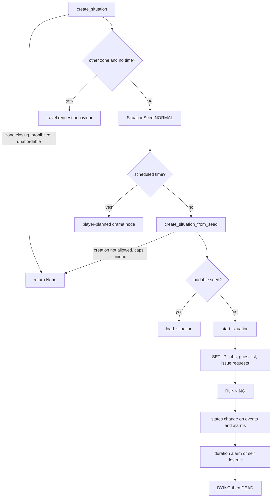
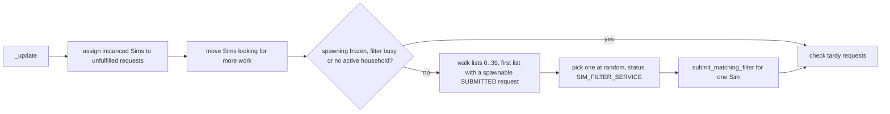
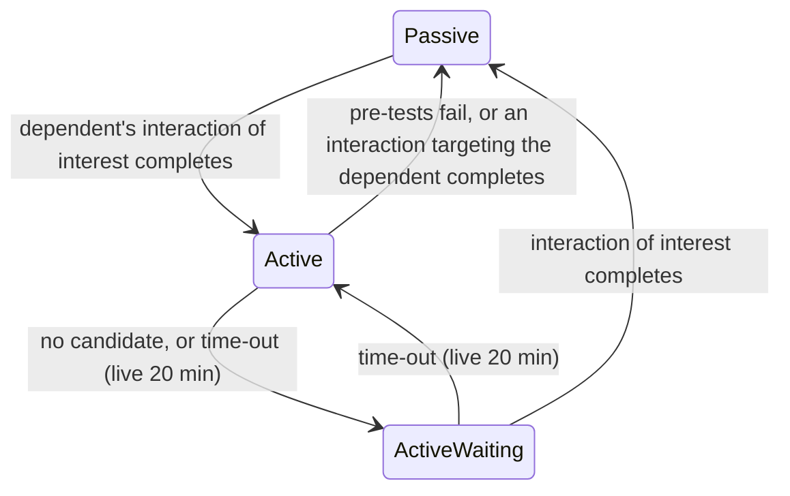

# 4.01 Situations, roles and NPC scheduling

*Game version 1.128.90.1030 (Steam, Linux/Proton). Live values come from the merged tuning (the base-game delta build plus the delta build of each installed pack: EP04 (Cats & Dogs), EP06 (Get Famous), EP09 (Eco Lifestyle), EP12 (High School Years), GP04 (Vampires), GP12 (Werewolves), SP01 (Luxury Party) and SP42 (Grunge Revival)), read through the live merge; module tuning comes from the base delta build, since the packs ship none. Written 2026-10-12. Checked 2026-10-12: 157 claims checked, 27 corrected, 5 relabelled, 1 removed. Deepened 2026-10-13: 181 modules newly explained, 2 failed decompiles read. Checked again 2026-10-13: 346 claims checked, 42 corrected, 3 relabelled, 0 removed. Cross-chapter edits 2026-10-13: 10 applied.*

## In plain words

Almost every Sim you see who is not in your household is on screen because a **situation** asked for them. A situation is a small script with a guest list, a set of **jobs** (bartender, guest, walker, maid) and, for each job, a **role state** that tells the Sim what to want and what to do. A party, a walk-by neighbour, the mail carrier, a ghost rising from an urn and a vampire tapping on your window at night are all situations. The **situation manager** creates them, keeps the user-facing ones under a cap, saves the ones that should survive a save, and destroys them when they end.

A situation never picks Sims itself. It files a **request** with the **bouncer**, a matchmaker that keeps 40 ordered lists of open requests, hands instanced Sims to the most important request they can fill and asks the Sim filter for a new Sim when nobody fits; the Sim spawner then creates at most one new NPC every five Sim minutes. When the lot gets crowded it pushes the least important NPCs off the lot so that a more important request can be filled.

Above the manager sit the schedulers. The **ambient service** keeps the street populated with walk-bys and, at night, ghosts. Zone directors run **shifts** of situations through the day (see [2.01 Lots, venues and rooms](2.01-lots-venues-rooms.md) for which director runs where). The **service NPC service** books maids, gardeners, repair people and deliveries on a weekly calendar and bills the household. The **drama scheduler** scores a pool of "drama nodes" (phone calls, invitations, events) every night at 03:00 and schedules the winners, and that is how NPCs invite you to things. The **welcome wagon** is a one-off NPC-hosted visit to a new household.

The chapter ends with the special cases the core relies on: visiting and the doorbell, custom states situations, custom schedules, group dancing, going dancing, breaking and entering, and three worked examples from installed packs.

## Key facts

- Every running situation is either a `SituationSimple` (phases, 34 live records) or a `SituationComplex` (states); 667 live situation records, with 562 jobs, 844 role states, 2,326 goals and 598 goal sets behind them.
- The bouncer sorts open requests into 40 lists: every request that names a Sim comes before every request that does not, whatever the priority; then priority (10 levels from `GAME_BREAKER` to `LEAVE`); then elevated importance. Spawning works through one list at a time, needs an active household and keeps only one Sim filter query in flight.
- The NPC soft cap is `NPC_SOFT_CAP` 20 (untuned, so the code default is live) minus a cap modifier minus the active household size. At or above it only game breakers and selectable Sims spawn; above it NPCs are told to leave.
- Only one global user-facing situation of each display type runs at a time unless the type allows several (cap 3, `LIVE_EVENT` 2, `SIM_SPECIFIC` or a type flagged `allow_multiple_instances` the household size); starting a new one destroys other global user-facing situations that do not allow multiples.
- The ambient service runs every 5 Sim minutes and starts at most one walk-by or ghost situation per run; the source furthest below its target wins. A lot whose walk-by tuning is a `SchedulingWalkbyDirector` (33 live) also runs its own situation shifts. Live ghosts may start only from 23:45 for one hour (code default 21:00 for five hours).
- Service NPCs charge `cost_up_front` plus `cost_hourly` times hours worked; the household pays what its funds allow and the rest is added to the next bill. Live maid: 40 plus 20 per hour, weekdays from 10:00 for six hours. Two traits make every hireable service free.
- Ringing a doorbell needs at least one non-pet, instanced, not-hidden occupant at home; then it succeeds when any owner passes the relationship test with the ringer. When none does, the code that should show the "bad relationship" notification raises a `NameError` instead (bytecode reads an undefined global `resolver`); the three shipped records use a relationship test every owner passes, so only a modded test reaches it.
- The drama scheduler scores at 03:00 every day. Of 98 bucket rules, 91 schedule a fixed number of nodes, 2 (including `DEFAULT`) schedule `1 + floor(household size / 2)`, and 5 have no value tuned. 677 drama nodes are live, 340 of them scored.
- Custom schedules are gated on `Pack.EP20` and the service registers only when that pack is available, so the whole `custom_schedules` package is inert on this install: `services.custom_schedule_service()` returns None and the one live getaway drama node refuses to schedule (Observed: `ServiceManager.register_service`, `PlayerPlannedGetawayDramaNode.schedule`).
- Live tuning differs from code defaults in places that change behaviour: walk-by socials start at 50% (code 100%), last 20 minutes (code 60), most walk-bys have a 10% flavor chance (code 1%), jobs use the instance spawn action 50% of the time (code 90%), and the welcome wagon waits 120 minutes (code 60).
- Group dancing, going dancing and breaking and entering are mostly script with no live records here: the only live records are one `DanceTogetherSituation` (EP12) and five `DancerSituation` records.
- Bugs visible in bytecode that live tuning reaches: the drama node LOD run test compares a `SimInfo` with an enum, the bouncer compares each reservation with itself, and `WalkDogSituation` never calls the base removal handler. Bugs that shipped tuning never reaches or that change nothing here: the doorbell `NameError`, the butler's zero-cost `UnboundLocalError`, the service guest list comparing an id with a `Household`, the welcome wagon `stop()` that never cancels its alarm, and `start_missed_shifts` returning at the first shift with churn enabled.
- `situations.create` and `situations.destroy` carry no command type, so they are DebugOnly and never registered in the shipping game; `situations.make_greeted` is Live and `service_npc.request_service` is Cheat.

## How it works

### The cast: situations, jobs and role states

**Situation.** A tuned class in the `situation` instance manager. Code defaults in `situation.py: Situation`: `duration` 60 minutes, `duration_randomizer` 0, `max_participants` 16 (Observed). The actual duration is `duration + randint(0, duration_randomizer)` minutes, and a duration of 0 sets no time-out alarm, so the situation runs until something ends it (Observed: `situation.py: Situation._get_duration`, `_set_duration_alarm`). Live: 202 situations have duration 0, the common tuned values are 300 (44 records), 180 (41), 240 (37) and 360 (36), and `max_participants` is 20 on 147 records (Observed, live tuning). `max_participants` caps nothing in the simulation: its only Python reader is the Live command `situations.get_situation_data`, which sends it to the event-planning UI as the number of Sims the player may invite (Observed: `server_commands/situation_commands.py: get_situation_data`).

**Job.** `SituationJob` (562 live) names a Sim filter, spawner tags, an auto-invite priority, what to do when the job holder does not show (`no_show_action`) or dies or leaves (`died_or_left_action`), optional churn and shifts, and an optional blacklist time (Observed: `situation_job.py: SituationJob`). Both actions default to DO_NOTHING (value 2) (Observed: `situation_job.py`). Live: `no_show_action` END_SITUATION 204, REPLACE_THEM 87, DO_NOTHING 14, default 257; `died_or_left_action` END_SITUATION 237, REPLACE_THEM 42, DO_NOTHING 17, default 266; `elevated_importance` True on 58; `game_breaker` True on 5 (Observed, live tuning).

**Role state.** `RoleState` (844 live) holds the buffs, autonomy modifiers and on-activate behaviour of a job. `RolePriority` is LOW 0, NORMAL 1, HIGH 2 (Observed: `role/role_state.py`). Live `_on_activate`: push_affordance 175, autonomy_ping 81, parameterized_autonomy_ping 80 (Observed, live tuning). A Sim's `RoleStateTracker` keeps one list per priority; only the roles in the highest non-empty priority are active, plus any `always_active` role (2 live). Adding a role at or above the active priority activates it, deactivates the old priority's roles and cancels the Sim's running full autonomy request (Observed: `role/role_tracker.py: RoleStateTracker.add_role`).

**Exclusivity.** Each situation has a `BouncerExclusivityCategory` (34 flags, from `LEAVE` 2 up to `TOURNAMENT`) that decides which situations a Sim can be in at once (Observed: `bouncer/bouncer_types.py`). Live tuned values: VENUE_GOER 26, SERVICE 13, NEUTRAL 8, VENUE_EMPLOYEE 6, WALKBY 6, DATE 4, NORMAL 4 (Observed, live tuning; the other 584 records leave the default).

### Creating a situation

`SituationManager.create_situation` runs in this order (Observed, bytecode of `situation_manager.py: SituationManager.create_situation`):

1. Return nothing if the zone is shutting down.
2. Ask the narrative service for a replacement situation type.
3. Return nothing if a zone modifier prohibits the type on the target zone.
4. Build an empty guest list if none was given and read its hire cost.
5. If there is a host and no existing drama node, take `cost()` plus the hire cost from the host household; return nothing if the funds cannot cover it.
6. Generate the situation id and send creation telemetry.
7. If the target zone is another zone and no time is scheduled, hand over to the travel path (see "What persists").
8. Build a `SituationSeed` with purpose `NORMAL` and apply any custom init data.
9. If an existing drama node id was passed, cancel that node.
10. If a time was scheduled, schedule a player-planned drama node instead of starting now (`SITUATION_CATEGORY_PLAYER_PLANNED_DRAMA_NODE` by category, else `DEFAULT_PLAYER_PLANNED_DRAMA_NODE`, live 182428).
11. Otherwise call `create_situation_from_seed`.

`create_situation_from_seed` then applies the user-facing caps (Observed, bytecode of `create_situation_from_seed`):

- First it returns nothing if the seed's `allow_creation` is False.
- If the seed is user facing, it works out the display type and whether the type allows several instances (`MULTI_INSTANCE_SITUATION_DISPLAY_TYPES`, live PIVOTAL_MOMENT, SIM_SPECIFIC and LIVE_EVENT, or the type's `allow_multiple_instances`, True on 1 live record).
- "Replacing" means the type `can_be_replaced`, exactly one of its display type runs, and multiples are not allowed. When not replacing, it refuses if one already runs and multiples are not allowed, or if the count has reached `max_number_situation_instances`: 3 by default, 2 for LIVE_EVENT, the household size for SIM_SPECIFIC or a type whose own `allow_multiple_instances` is set (a multi-instance display type such as PIVOTAL_MOMENT without that flag gets 3).
- For a globally linked, single-instance seed it then destroys every running global user-facing situation that does not allow multiples, of any display type. When replacing and none of the same display type was destroyed, it refuses.
- For every seed, user facing or not, a unique type (`_is_unique`, True on 98 live records) is refused if one is already running.
- It constructs the situation, then calls `load_situation` for a loadable seed or `start_situation` otherwise; a situation that reaches `DYING` during start is removed. User-facing situations, and any with `distribution_override`, are added to the distributor.



### Starting, states and ending

`BaseSituation.start_situation` sets stage `SETUP`, creates the job data, expands the guest list from tuning (auto-invite jobs), verifies role objects for user-facing situations, issues bouncer requests, notifies guests, records the start time, sets stage `RUNNING`, applies automatic bronze medals and fires the `SituationStarted` test event (Observed: `base_situation.py: BaseSituation.start_situation`). `AUTOMATIC_BRONZE_TRAITS` holds two live traits (Observed, module tuning).

`_issue_requests` walks the guest list: a reservation guest gets a reservation request and nothing else; any other guest gets a normal request unless the job is `do_not_spawn`. If the situation has a resident job and the host lives on the lot, it adds a host request at priority `EVENT_HOSTING`. Last, if the guest list is not invite only and a default job exists, it adds an uninvited fallback request at `EVENT_DEFAULT_JOB` (Observed, bytecode of `BaseSituation._issue_requests`; priorities from `bouncer_request.py: BouncerHostRequestFactory`, `BouncerFallbackRequestFactory`).

Complex situations move between `SituationState` objects. `SituationComplexCommon._change_state` sets the new state's owner, calls its `on_pre_activate`, deactivates the old state (which unregisters its test events and cancels its alarms; the call sits in a `finally`), then calls the new state's `on_activate` (Observed, bytecode of `situation_complex.py: SituationComplexCommon._change_state`; `SituationState.on_deactivate`; the decompile wraps this in debug-only guards). `CommonSituationState` adds tuned job and role changes and an optional `time_out`, off unless tuned and 15 minutes when switched on, whose remaining time is saved with the state (Observed: `situation_complex.py: CommonSituationState`, `SituationState.save_state`).

A situation ends when its duration alarm fires or a state calls `_self_destruct`. Jobs can end it too. When a job holder is unassigned, END_SITUATION in `died_or_left_action` destroys the situation, REPLACE_THEM files a replacement request, and DO_NOTHING just removes the Sim (Observed: `base_situation.py: BaseSituation.on_sim_unassigned_from_request`). When a request is tardy, only END_SITUATION in `no_show_action` does anything; when a spawn fails, END_SITUATION destroys the situation and REPLACE_THEM resubmits a clone, but only for a request that named a Sim (Observed: `BaseSituation.on_tardy_request`, `on_failed_to_spawn_sim_for_request`). Ending runs `on_remove`, which removes every Sim, releases their requests and moves them to leaving (Inferred from `BaseSituation.on_remove` and the leave helpers).

**Leaving.** The manager has three exits. `make_sim_leave` invites a Sim into the running system leave situation, falling back to leave-now-must-run if it is missing; its type is `DEFAULT_LEAVE_SITUATION` (live `situation_leave`, exclusivity LEAVE, jobs leaving_soon and leaving_now). `make_sim_leave_now_must_run` uses `DEFAULT_LEAVE_NOW_MUST_RUN_SITUATION` (live `Situation_SingleSimLeave`, exclusivity LEAVE_NOW, duration 0, with delay, imprisoned and leave roles). `create_visit_situation` puts a Sim into `DEFAULT_VISIT_SITUATION` (live `Situation_GreetedNPCVisitingPlayerSituation`) and makes the Sim leave if that fails (Observed: `situation_manager.py`; live values from module tuning and the two leave records). Why a visitor decides to go home on its own (the NPC leave interaction runs autonomously only once Hunger, Energy or Bladder is at -80 or lower, so homesickness alone never sends a visitor home) is in [4.02 Why visitors leave](4.02-story-progression-townies.md#why-visitors-leave).

**Goals.** User-facing situations offer goals from goal sets through a goal tracker (simple, dynamic, activity or graphed). Live: 2,326 goals, the largest classes `SituationGoalObjectInteraction` 710, `SituationGoalActor` 490, `SituationGoalRanInteractionOnTargetedSim` 449, `SituationGoalCraftObject` 158; 598 goal sets (Observed, live tuning). The goal classes, the graphed tracker, medals and scoring are under "Situation goals by class" and "Goal trackers, medals and scoring" below.

### What persists

The class property `situation_serialization_option` decides what is saved: DONT 0, LOT 1, OPEN_STREETS 2, HOLIDAY 3, PIVOTAL_MOMENT 4, PIVOTAL_MOMENT_ACCT_LEVEL 5, PIVOTAL_MOMENT_HOUSEHOLD_LEVEL 6 (Observed: `situation_types.py`). Live tuned values of `persistence_option` (the custom states field): PIVOTAL_MOMENT_ACCT_LEVEL 62, PIVOTAL_MOMENT 13, OPEN_STREETS 9, PIVOTAL_MOMENT_HOUSEHOLD_LEVEL 6, LOT 2, DONT 1 (Observed, live tuning). A saved situation is a seed with a `SeedPurpose`: NORMAL 0, TRAVEL 1, PERSISTENCE 2, PERSISTED_TRAVEL 3 (Observed: `situation_serialization.py`). Save formats are in [1.02 Saves and persistence](1.02-saves-persistence.md).

On load, `BaseSituation.should_seed_be_loaded` drops DONT seeds and does not load the HOLIDAY or pivotal moment options through this path. A LOT seed loads only if its time jump rule allows it, the active household is unchanged since the save (a check skipped when the type `survives_active_household_change`, True on 20 live records), and the venue and the lot owner household are unchanged; those last two checks run for every LOT seed. An open-street seed is dropped if world time has passed since the open-street save, if it invites a Sim of the lot owner household, or if it invites a selectable Sim (unless the caller allows that) (Observed, bytecode of `base_situation.py: BaseSituation.should_seed_be_loaded`; the decompiled branch structure is partly mangled, so the order above was read from the bytecode).

**Time jump.** `time_jump` is a variant: disallow (default, never load after time passed), allow (load and regenerate the guest list if time passed), simulate (call `should_load_after_time_jump`, which custom states situations implement by subtracting the elapsed time), and gig based (Observed: `situation_time_jump.py`, `custom_states/custom_states_situation.py`). Live: default 592, allow 66, simulate 8, disallow 1 (Observed, live tuning).

**Travel.** When `create_situation` targets another zone, `_create_situation_and_travel` looks at the user-facing situations linked to invited Sims and lets the most restrictive one's `travel_request_behavior` decide: disallow (default, with an optional dialog) or allow (with an optional confirmation) (Observed: `situation_manager.py: SituationManager._create_situation_and_travel`, `situation_travel_behavior.py`). Live: allow on 124 records; 22 keep disallow but tune its dialog (21 EP06 acting career situations and the EP12 `situation_HighSchool_Active_Player_Main`); the other 521 leave the field alone (Observed, live tuning). The zone side of travel is in [2.06 Worlds, regions and travel](2.06-worlds-regions-travel.md).

### The bouncer: requests, priorities and order of operations

A `BouncerRequest` moves through INITIALIZED 0, SUBMITTED 1, SIM_FILTER_SERVICE 2, SPAWN_REQUESTED 3, FULFILLED 4, DESTROYED 5 (Observed: `bouncer_types.py: BouncerRequestStatus`). Its priority is one of ten `BouncerRequestPriority` values: GAME_BREAKER 0, EVENT_VIP 1, EVENT_HOSTING 2, VENUE_REQUIRED 3, EVENT_AUTO_FILL 4, BACKGROUND_HIGH 5, BACKGROUND_MEDIUM 6, BACKGROUND_LOW 7, EVENT_DEFAULT_JOB 8, LEAVE 9 (Observed). Live job auto-invite priorities: BACKGROUND_LOW 112, BACKGROUND_MEDIUM 92, BACKGROUND_HIGH 29, VENUE_REQUIRED 24, EVENT_AUTO_FILL 11 (Observed, live tuning).

**The 40 lists.** Each request gets an unfulfilled index when it is built: 0 if it names a specific Sim ("explicit"), else 20; plus `priority × 2`; plus 1 unless the job or the request has elevated importance (Observed: `bouncer_request.py: BouncerRequest.__init__`, `BOUNCER_PRIORITY_INDEX_MULTIPLIER` 2). The bouncer allocates `10 × INDEXES_PER_BOUNCER_REQUEST_PRIORITY` = 40 lists (Observed: `bouncer.py: Bouncer`). So every explicit request, even a LEAVE request (index 18 or 19), is served before any request that leaves the Sim open, even a GAME_BREAKER one (index 20 or 21) (Inferred from the index formula).

**Klout** ranks requests for the soft cap: `priority × 4`, plus 1 if not elevated, plus 2 if not user facing; lower is more important, and a situation flagged `has_no_klout` returns none (Observed: `bouncer_request.py: BouncerRequest._get_request_klout`).

**The update.** `Bouncer._update` does nothing while offline, then runs four steps inside a delayed-destruction block (Observed: `bouncer.py: Bouncer._update`):



Spawning needs an active household and sends at most one filter query: it walks the lists in order, skips empty ones and those with no request that can spawn now and is SUBMITTED, picks one request at random from the first usable list, applies the common blacklists (Sims spawning, the active household, the active lot household, as the job asks) and submits a one-Sim filter query; the callback either assigns the found Sim or asks the spawner to create it (Observed: `bouncer.py: Bouncer._spawn_sim_for_next_request`, `_sim_filter_service_callback`). A request is tardy when it is not fulfilled `TARDY_SIM_TIME` minutes after submission: 30, untuned, so the code default is live; the situation's `on_tardy_request` runs and, if the request survives, the clock restarts (Observed: `bouncer.py: Bouncer._check_for_tardy_requests`, `bouncer_request.py`; module tuning has no value). What the situation does then is set by the job's `no_show_action` (see "Starting, states and ending").

**Exclusivity rules.** `Bouncer.EXCLUSIVITY_RULES` is a hard-coded list of 189 pairs: option NONE 139, EXPECTATION_PREFERENCE 35, ALREADY_ASSIGNED 15, over 34 categories, with no duplicate keys (Observed: `bouncer.py`). A pair with no rule may share a Sim. With NONE the first category in the rule wins; with EXPECTATION_PREFERENCE the request that expects the Sim wins, and if both do, the newer request; with ALREADY_ASSIGNED the current assignment wins (Observed: `bouncer_request.py: exclusivity_compare`). Ten categories have a rule with themselves, all ALREADY_ASSIGNED: WALKBY, SERVICE, LEAVE_NOW, VENUE_EMPLOYEE, CLUB_GATHERING, FESTIVAL_GOER, FESTIVAL_EMPLOYEE, VENUE_GOER, INSTRUCTED_CLASS, HOBBY_CLASS (Observed).

**The reservation self-compare.** `_check_request_against_reservation_request` loops `for request in self._reserved_sims[sim_id]` and tests `request.exclusivity_compare(request)`, so the loop variable hides the new request and each reservation is compared with itself (Observed, bytecode of `bouncer.py`: `STORE_FAST request`, `LOAD_FAST request`, `LOAD_METHOD exclusivity_compare`, `LOAD_FAST request`). A self comparison has a rule only for the ten self-rule categories above, and ALREADY_ASSIGNED then returns 1. So a reserved Sim whose reservation is in one of those ten categories is refused for every other request while exclusivity is checked, and a reservation in any other category never blocks anything (Inferred).

**Clients and named-Sim requests.** Whatever submits requests implements `IBouncerClient`, six callbacks the bouncer makes: a Sim assigned to a request, a Sim unassigned, a Sim replaced by another, a failed spawn, a tardy request, and the end of the first assignment pass (Observed: `bouncer/bouncer_client.py`). Situations are the usual clients. `SpecificSimRequestFactory` builds requests that are never user facing and only ever assign the one Sim id they were given (Observed: `bouncer/specific_sim_request_factory.py`); the paparazzi lock-out and possession situations use it to claim exactly one known Sim (see "Odd NPCs, patients and pack-gated situations").

### Spawning and the NPC soft cap

`SimSpawnerService.npc_soft_cap` is `NPC_SOFT_CAP` (20 by default, untuned in both builds, so 20 is live) or a cheat override, minus `floor` of the cap modifier, minus the active household size; with no active household it is 0 (Observed: `sims/sim_spawner_service.py`). A household of four therefore leaves room for 16 instanced NPCs. When the number of instanced NPCs is at or above the cap, only game breakers and selectable Sims spawn; otherwise one spawn is allowed every `SPAWN_COOLDOWN_MINUTES` = 5 Sim minutes, except selectable Sims, game breakers and batch spawning, which skip the wait (Observed: `sims/sim_spawner_service.py: SimSpawnerService`). The bouncer declares its own `SPAWN_COOLDOWN_MINUTES` 5 but never reads it; the five-minute spacing is the spawner's (Observed: `bouncer.py`).

The bouncer's soft-cap monitor runs only with an active household in a running zone, and not while the soft cap cheat is on (Observed: `bouncer.py: Bouncer._monitor_npc_soft_cap`):

1. If instanced NPCs exceed the cap, it calls `expedite_leaving`, which moves every Sim in the leave situation to leave-now-must-run.
2. If NPCs that are not already leaving still exceed the cap, it sends that many away with leave-now-must-run, worst klout first.
3. If they sit exactly at the cap, it compares the best unfulfilled NPC request with the worst fulfilled one held by a non-resident NPC who is not leaving; if the unfulfilled one has lower klout, the holder is sent away with leave-now-must-run.

When a job's spawn action is chosen, `SituationJob.ALTERNATIVE_SPAWN_BEHAVIOR` decides how often the instance spawn action is used: live 50% (code default 90%) for the whitelisted jobs, with a land vehicle as the alternative (Observed, module tuning; `situation_job.py`).

### Job churn and shifts inside a situation

`SituationJobData` adds a repeating 10-minute alarm when a job has churn or shifts (the 10 is hard-coded) (Observed: `situation_job_data.py: SituationJobData.__init__`). Churn reads the desired population for the hour from `auto_populate_by_time_of_day`: below the minimum (counting Sims on the way) it adds one, above the maximum it removes one, otherwise with `chance_to_add_or_remove_sim` (default 20%) it adds or removes one at random where room allows. A removed Sim is picked at random among NPCs on the lot longer than `min_duration` (default 60 minutes); only when none qualifies and the job is over its maximum is the longest-staying NPC picked instead. The removed Sim is put on the auto-fill blacklist and told to leave (Observed: `SituationJobData._churn`, `_choose_random_npc_over_min_duration`). Shifts work the same way against `get_shift_staffing`, always removing the longest-staying NPC, and at each shift change request the shift's staff minus those coming (Observed: `SituationJobData._shift_churn`, `_shift_change`). Live: churn is enabled on 1 job (`debug_multi_guest_job`) and shifts on 2 (`job_venue_masterfisherman`, `job_venue_mastergardener`) (Observed, live tuning).

### Zone director shifts

Zone directors that schedule situations through the day use `SituationShifts` (the director side is in [2.01 Lots, venues and rooms](2.01-lots-venues-rooms.md)). Each shift has a `shift_curve` (curve based or shiftless), a `shift_strictness` DESTROY 0 (default) or OVERLAP 1, `additional_sources` (holiday walk-bys, zone modifier situations, narrative situations) and `count_based_on_expected_sims` (default False); the director also has `churn_alarm_interval` (default 10 minutes) and `set_host_as` (active Sim or Sim from object) (Observed: `situation_shifts.py`, `situation_shifts_enums.py`, `additional_situation_sources.py`).

- **Start-up.** `on_startup` adds a repeating churn alarm per shift and a one-shot alarm at the next shift time (Observed: `SituationShifts.on_startup`).
- **Can it start?** `can_schedule_situation` checks in order: in super speed 3 the situation must be `allowed_in_super_speed_3`; when the count is limited by Sims, `can_start_walkby(active lot, desired)` must pass; then `situation_meets_starting_requirements` and no zone modifier prohibition (Observed, bytecode of `SituationShifts.can_schedule_situation`, lines 176 to 182). The decompiled text nests the walk-by and requirement checks inside the super speed 3 branch, so read literally it would return nothing outside super speed 3 and no shift would ever start a situation; the bytecode runs the four checks in sequence at every speed.
- **Shift change.** The desired count is `random_int()` of the curve's interval for the hour (a count of Sims when `count_based_on_expected_sims` is set). DESTROY destroys every running situation of that shift; OVERLAP subtracts the running count. Then situations are started until the count is used up, and a failed start still uses up one (Observed: `SituationShifts._shift_change_alarm_callback`).
- **Churn.** If the desired count exceeds the running count, start one; else if it is lower and the shift is not OVERLAP, destroy the oldest. One operation per tick, and none while the shift's current curve entry disables churn (Observed: `SituationShifts.handle_situation_shift_churn`, checked in bytecode). The one it starts is a fresh weighted pick from the current curve entry through the same `can_schedule_situation` filter, so when a shift's situation ends before the next entry, the next tick (every `churn_alarm_interval`, 10 minutes) draws again. The desired count is drawn once and kept for the shift, except on a curve with `desired_sim_count_multipliers`, where it is redrawn, multipliers applied, on every tick (Observed: `_situation_shift_ideal_situations` is written only when the curve has no multipliers). No live director tunes `disable_churn` on the zone directors checked here (bar, pool, gym, wedding, residential player) (Observed, live tuning). Example: the residential paparazzi shift (see [3.13](3.13-health-luck-fame.md#paparazzi)) keeps a one-Sim slot from 8, 12, 16 and 20 h; its usual pick, `emptyLotSituation_NoPaparazzi`, ends after its 60-minute default duration, so the slot is drawn again about once an hour until a paparazzo (240 minutes) is drawn or the next shift change destroys the running situations (Inferred from the churn code and the live durations).
- **Creation.** Situations get their own predefined guest list if they have one; otherwise an invite-only list hosted by `set_host_as` (the active Sim by default, or the Sim from the object). They are created with `spawn_sims_during_zone_spin_up=True` and `creation_source` set to the director's name (Observed: `SituationShifts._create_situation_with_params`).
- **Missed shifts.** `start_missed_shifts` is meant to fill shifts whose start time passed while the zone was not loaded, but in bytecode the `return` sits inside the loop, so the whole function returns at the first shift whose churn is enabled and later shifts are never checked (Observed, bytecode; a `continue` was probably meant, Inferred). Its only caller is the object-based zone director path for shifts flagged `schedule_immediate`; live, that is the two EP12 thrift store directors, and none of their shift entries disables churn, so the function returns at once and starts nothing either way (Observed, live tuning).

`SituationCurve` picks the entry with the latest start hour at or before the current hour, and wraps to the day's last entry before the first one (Observed: `situation_curve.py: SituationCurve._get_desired_situations`). Example, live `Walkby_GardenDistrict_Nbhd` (base-game delta tuning), which tunes Sunday, weekdays and Saturday separately: on Sunday it wants 2 Sims from 02:00, 5 from 06:00, 18 from 12:00, 10 from 17:00 and 4 from 20:00, and the 20:00 entry also covers midnight to 02:00 (Observed, live tuning).

**Packs add to base shifts.** EP04's 22 `AggregateSingleStateSituation` pet-owner records (`situation_Venue_PetOwner_{Cat,Dog}_*`) are weighted entries, weight 1, in the shifts of eight base-delta directors (bar, club, gym, library, lounge, museum, park and pool) and of EP06's `zoneDirector_LoungeEvent_MeetACelebrity`, each behind a test for EP04's cat-friendly or dog-friendly lot trait (`zoneModifier_PetWorld_CatFriendly`, `_DogFriendly`); the six arts center, cafe and karaoke records sit in no live director (Observed, live tuning). The pool director also places each arriving player Sim in its `user_sim_arrival_situation`, `poolVenueSwimmerSituation_PlayerSwimmer`, whose duration is 0, so it never times out (Observed: live `zoneDirector_Pool`; `venues/visitor_situation_on_arrival_zone_director_mixin.py`). The venue side is in [2.01 Lots, venues and rooms](2.01-lots-venues-rooms.md).

### Ambient population: walk-bys and ghosts

`AmbientService.begin_walkbys` creates two sources, street and ghost, each with priority multiplier `DEFAULT_PRIORITY_MULTIPLIER` 2.1, then adds a repeating 5-minute update alarm and a repeating 1-minute flavor alarm (Observed: `ambient/ambient_service.py`). Each source's priority is `(desired − current) × 2.1`; since both sources use the same multiplier, it never changes which one wins (Inferred).

**Update.** Every 5 Sim minutes, with a client connected, the sources are sorted by priority and only the top one may act, and only if its priority is above 0 (Observed: `AmbientService._update`). So the ambient update starts at most one situation every 5 minutes. A lot whose `walkby_schedule` is a `SchedulingWalkbyDirector` (33 live) also runs its own situation shifts, started by `begin_scheduled_walkbys` and at zone spin-up, outside this limit (Observed: `ambient_service.py`, `walkby_tuning.py`; live tuning).

- **Street source.** Desired is the lower bound of the lot's walk-by curve for the hour; when it acts, it asks for `random_int()` of that interval minus the current Sims and starts one situation picked by weight from the curve, with any holiday walk-bys added (Observed: `_AmbientSourceStreet`, `walkby_tuning.py: WalkbyTuning.get_ambient_walkby_situation`). The candidate filter is sequential: in super speed 3 the situation must be `allowed_in_super_speed_3`; then `can_start_walkby(lot, free slots)` (Observed, bytecode of `can_start_situation`).
- **Ghost source.** Active only inside the walk window: live `WALKBY_ALLOWED_START_TIME` 23:45 and `WALKBY_ALLOWED_DURATION` 1 hour (code defaults 21:00 and 5); the duration is the window in which a ghost may start. Desired comes from `DESIRED_GHOST_COUNT_PER_URNSTONE`, live points (1, 1), (4, 2), (10, 3); it picks a random valid urnstone and tries the `GHOST_SITUATIONS` entries in order, each behind its own tests, with that urnstone's ghost (Observed: `_AmbientSourceGhost`; module tuning). The list has 6 entries, of which 3 resolve here: `situation_Ghost` for humans and `situation_Ghost_Pets` twice, for cats and dogs (EP04); the horse ghost (EP14) and the cemetery day and night ghosts (EP17) are patch data, pack not installed (Observed, module tuning). When a street override exists it replaces the start time, duration and count curve; none is tuned (Observed: `street_overrides` in the same class; module tuning).

**Flavor and socials.** Every Sim minute the service gathers walk-by Sims free for a social and Sims free for a flavor action. Pairs that can socialise (within `SOCIAL_MAX_START_DISTANCE`, in the view cone) start one social with `random_chance(pairs × SOCIAL_CHANCE_TO_START)`; live `SOCIAL_CHANCE_TO_START` is 50 (code 100), so one pair starts with 50% a minute and two pairs always do. Live `SOCIAL_MAX_DURATION` is 20 minutes (code 60). Then, whether or not a social started, the first situation in the flavor list that passes its own `flavor_chance_to_start` starts one flavor interaction (Observed: `AmbientService._flavor_alarm_callback`, bytecode). A walk-by Sim waits 10 minutes after starting before its first flavor action and `flavor_cooldown` after each one (Observed: `walkby_ambient_situation.py: WalkbyAmbientSituation`). Live: `flavor_cooldown` 20 on 63 of 64 walk-by records and 40 on one; `flavor_chance_to_start` 10% on 49, 2% on 6, 5% on 5, 30% on 2, 66% on 1 and 100% on 1 (Observed, live tuning).

Live walk-by data: 64 `WalkbyAmbientSituation` records (base 39, EP06 10, EP04 4, EP09 3, GP04 3, GP12 3, EP12 2), 56 `walk_by` instances (33 `SchedulingWalkbyDirector`, 23 `WalkbyTuning`) (Observed, live tuning).

### Ambient and open-street situation types

Walk-by curves, scheduling directors and venues start more than the plain walk-by. The `ambient` package holds the other NPC situation classes; each is a small state machine over the generic states (Observed: the modules named in the table; live counts by class, live tuning). Timeouts are in Sim minutes.

| Module | What it adds | Tunables that matter | Live records |
|---|---|---|---|
| `open_streets_autonomy_situation.py` | One Sim runs free autonomy on the open street, then switches to its leave role. WALKBY exclusivity, saved with the open street, duration 0 | `do_stuff_timeout` 180; live 360 on 9 records, 180 on 8, 240 on 3, 120 on 3, 60 on 2, untuned on 10 | 35: base 22, EP04 9, EP06 3, EP12 1 |
| `anchored_open_streets_autonomy_situation.py` | A group from a group filter is anchored to a random tagged object that is not on the active lot: arriving, then do stuff with the anchor set, then leave | `wait_for_arrival_timeout` 30, do stuff 180 | 4 base (grill and picnic table, two or three Sims) |
| `walkby_nobody_situation.py` | A walk-by that expects one Sim and spawns nobody; one state | none | 1 base (`situation_walkby_nobody`) |
| `walkby_consumer_situation.py` | Creates a recipe or object for the walker, who consumes it, waits around and repeats until the leave timer | leave timer 10 to 100, wait-around 5 to 10 | 1 base (a commuting bookworm) |
| `walkby_pet_owner.py` | Owner and pet from one group filter, outside the bouncer; get Sims, walk, leave now | live walk 180, leave 120 | 1 EP04 |
| `walkby_magic_duel_situation.py` | Two Sims go to a dueling ground (a favourite object) and duel | none | 1 GP12 (`Situation_WolfTown_Spar`) |
| `busker_situation.py` | Creates a random instrument for the busker on a performance space; the instrument is made transient when the Sim leaves | instrument list | 1 EP06 |
| `tend_object_situation.py` | Arrive, tend an object, self-destruct. VENUE_EMPLOYEE exclusivity | tend `time_out`; live 245 on the hired vendor stall | 5: base 2, EP12 3 |
| `sales_table_vendor_situation.py` | Set up a sales table, tend it, tear it down | `number_of_sale_objects` 7 to 10; live tend 255 | 2 EP09 (staffed); the unstaffed class has EP03 (City Living) and GP06 (Jungle Adventure) records, patch data, pack not installed |
| `yard_sale_situation.py`, `yard_sale_customer_situation.py` | The player's yard sale and its customers (below) | customers per sale | 2 base each |
| `soaker_family_situation.py` | One sub-situation per soaker; ends when they all end. LEAVE exclusivity | none | 0; EP10 (Snowy Escape) record, patch data, pack not installed |
| `walkby_horseback.py` | Get the Sims, mount, ride off | none | 0; EP14 (Horse Ranch) 2 records, patch data, pack not installed |
| `walkby_tandem_sledding_situation.py` | Get two Sims, go to a sport slope, sled together | none | 0; EP10 2 records, patch data, pack not installed |

**Yard sales.** `YardSaleSituation` runs `ManageCustomersState`: it draws a target from `number_of_expected_customers` (code 0 to 10; live 2 to 5 on both base records), and every `time_between_customer_checks` (10 minutes) it tops the running customer situations up toward that target, at most 2 new ones per check, so customers keep arriving for as long as the sale runs. It records each sale for the end notification, and it ends if the selling platform is removed (Observed: `ambient/yard_sale_situation.py`; live tuning). A customer browses, then optionally consumes what it bought, under NORMAL exclusivity (Observed: `yard_sale_customer_situation.py`). In that module the `REMOVE_INSTANCE_TUNABLES` line sits at module level after the class (Observed, bytecode: `STORE_NAME REMOVE_INSTANCE_TUNABLES` after `STORE_NAME YardSaleCustomerSituation`), so the customer class keeps the user-facing tunables it was meant to hide (Inferred); nothing breaks.

**Wildlife encounters.** `WildlifeEncounterDirectorMixin` is part of `SchedulingWalkbyDirector` (Observed: `ambient/walkby_tuning.py`). A director with `wildlife_encounter_tuning` lists encounter objects, each with a `chance_of_activation` and a group (Observed: `ambient/wildlife_encounter_director.py`). Every day at `DAILY_ROLL_TIME` (live 03:00, code 04:00) it shuffles the list and, for each placed object with a state component, sets the inactive state if its group is already over its cap, else rolls the chance and sets the active or inactive state (Observed). Module tuning names seven groups with caps: GiantHornet 1, Bat 2, GiantCentipede 3, Denkimushi 4, Kodama 5, Firefly 6, Onibi 7; each cap equals the group's own enum number (Observed, base delta module tuning). Four details from the bytecode: `on_shutdown` calls `on_shutdown` on the built-in `super` itself, which would raise `AttributeError`, and in `SchedulingWalkbyDirector` the scheduling mixin's `on_shutdown` comes first and ends with `super().on_shutdown()`, so the call would reach it; it stays unreached only because nothing in the scripts calls `on_shutdown` on a walk-by director (the ambient service's `stop` only cancels its own alarms) (Observed: `LOAD_GLOBAL super`, `LOAD_METHOD on_shutdown` in the wildlife mixin, the chained call in `venues/scheduling_zone_director.py: SchedulingZoneDirectorMixin.on_shutdown`; unreachable, Inferred from finding no caller); the cap test is `count > max`, so one more object than the cap can become active (Observed: `COMPARE_OP >`; effect Inferred); the daily alarm is only set when start-up rolls a new day, so a zone loaded again on the day it last rolled never re-rolls that session (Observed, bytecode of `on_startup`; effect Inferred); and after a load the group counts become a plain `dict`, so the next roll's first count lookup on the cleared dict would raise `KeyError` (Inferred from `_load_custom_zone_director` and `roll_active_encounters`). None of this runs here: no live director tunes wildlife encounters, and the only user is an EP10 director, patch data, pack not installed (Observed, live tuning and patch data). `WildlifeEncounterTestByGroup` tests a group's active count (Observed).

### The ring-doorbell walk-by

`WalkbyRingDoorBellSituation` has states RingDoorBell 2, Mailbox 3, WaitForInvitation 4, Leave 5 (Observed: `ambient/walkby_ring_doorbell_situation.py`). It can start only on the active household's lot. A ring that finishes goes straight to waiting for an invitation; a ring that fails goes to the mailbox, and the mailbox always ends in waiting; the wait lasts `wait_for_invitation_delay`, default 60 minutes, and all 5 live records use the default (Observed; live tuning). It saves on open streets, uses WALKBY exclusivity and expects one Sim. Through `SituationSupportKeyMixin`, if `support_given_keys` is set, a walker who holds a key to the active household is summoned with `SUMMONING_PURPOSE`, live `Invite_In_Self_Keyholder`, so the keyholder lets themselves in (Observed: `visiting/situation_support_key_mixin.py`; module tuning). The summon runs once for each household member the walker holds a key from (Observed: the loop in `_on_set_sim_job`). No live ring-doorbell record sets `support_given_keys`, so this path is unused here (Observed, live tuning). Live records: 3 base, 2 GP04 (Observed, live tuning). Summoning purposes are listed in [2.01 Lots, venues and rooms](2.01-lots-venues-rooms.md).

### Service NPCs: tuning and cost

A `ServiceNpc` (the `service_npc` manager, 11 live: 10 base, 1 EP09) names a situation, a weekly `work_hours` schedule, `request_offset` (default 10 minutes), `_min_duration_left_for_arrival_on_lot` (default 0), `_work_duration_min_max` (default 60 to 240 minutes), `full_time_npc` (False), `exclusive_to_household` (False) and an optional `additional_culling_immunity` (default 10) (Observed: `service_npcs/service_npc_tuning.py: ServiceNpc`).

- **Hireable** (`ServiceNpcHireable`): `cost_up_front` (default 0), `cost_hourly` (default 50), `free_service_traits`, `bill_source` (default Miscellaneous), `_fake_perform_minutes_per_object` (default 10), a hire interaction and `bill_time_of_day` (default hour 12). `get_cost(hours) = int(hours × cost_hourly) + cost_up_front` (Observed).
- **Charging.** `try_charge_for_service` makes the cost 0 if any household Sim has a free-service trait; otherwise it takes what the funds allow and passes the rest to `bills_manager.add_additional_bill_cost(bill_source)`; if taking the funds fails, the whole amount is billed (Observed: `ServiceNpcHireable.try_charge_for_service`).
- **Deliverable** charges the picker total plus the up-front cost when the hire interaction finishes. **Crafter** shows a recipe picker. **NonRequestable** is `always_scheduled`, is auto-scheduled on client connect, and is free (Observed).

Live service NPCs (Observed, live tuning):

| Record | Class | Up front | Hourly | Schedule | Other |
|---|---|---|---|---|---|
| `ServiceNpc_Maid` | Hireable | 40 | 20 | Mon to Fri, 10:00 for 6 h | work max 360, min left 60, bill `Maid_Service` |
| `ServiceNpc_Repair` | Hireable | 100 | 10 | every day, two 18 h entries from 08:00 and 00:00 | work max 600, min left 60 |
| `serviceNpc_Gardener_Service` | Hireable | 50 | 30 | Mon to Fri, 09:00 for 6 h | work max 360, min left 60 |
| `serviceNpc_Nanny` | Hireable | 60 | 10 | every day, 04:00 for 24 h | work 0 to 0, min left 30 |
| `ServiceNpc_PizzaDelivery` | Crafter | 25 | 0 | every day, 08:00 for 24 h | request offset 20, work max 360 |
| `serviceNPC_Deliveries_FoodDelivery_New` | Deliverable | 10 | 0 | every day, 08:00 for 24 h | request offset 15, sub-total 10, work max 120 |
| `ServiceNpc_Mailman` | NonRequestable | free | free | Mon to Sat, 08:00 for 4 h, random start | work max 120 |
| `serviceNpc_EcoInspector` (EP09) | Hireable | 225 | 0 | Mon to Fri, 09:00 for 8 h | work max 300 |

Free variants `serviceNpc_Maid_Free`, `serviceNpc_Repair_Free` and `serviceNpc_PizzaDelivery_free` set both costs to 0. The ten hireable records list the same two free-service traits, 32110 `trait_FreeServices` (base) and 196358 `trait_Hidden_Fame_Quirk_StarTreatment` (EP06); the mailman, free anyway, has none (Observed, live tuning).

### Service NPCs: request, arrival and work

`ServiceNpcService.request_service` (Observed, bytecode):

1. If the service is already in the household's request list, do nothing.
2. If the record says `hired` and this is not a load, do nothing.
3. Set the record (hired, recurring, user data).
4. The first alarm may not fire sooner than `request_offset`, except on load.
5. Create the `work_hours` scheduler with callback `_send_service_npc` and `_min_duration_left_for_arrival_on_lot` as the minimum time remaining.
6. If `bill_time_of_day` is set, add a daily bill alarm at that hour.

`_send_service_npc` runs at each scheduled window (Observed, bytecode):

1. Auto-scheduled types are skipped while auto services are disabled.
2. If the NPC already started in this window, a part-time NPC returns, and a full-time NPC returns if its situation is running.
3. Record the start time, unless a full-time NPC already has one; the duration is the window end minus now.
4. If less than `_min_duration_left_for_arrival_on_lot` remains and there is no scheduler, or the scheduler is not inside a window now, the job is faked (`fake_perform`) and nothing spawns.
5. Clamp the duration to the work min and max.
6. Build the guest list: the preferred Sim with purpose PREFERRED and expectation preference, else a filter request that blacklists fired Sims, roommates and, if the service is exclusive, other households' preferred Sims.
7. Write household id, hiring Sim id, service type, user data, selections and the recurring flag into the custom init data.
8. A full-time NPC gets duration 0 (no time-out) and is not recreated while running.
9. `create_situation(user_facing=False, duration_override=…)`.

In `_generate_situation_guest_list`, the exclusivity filter compares `household.id == hiring_household`, an integer against a `Household` object (Observed, bytecode of `service_npc_manager.py`). `Household` and its one base class define no `__eq__` (Observed, class bodies in the pyc), so the comparison is never true and the hiring household's own preferred Sims would be blacklisted too (Observed). The branch runs only for a service with `exclusive_to_household`, which no live record sets, so nothing reaches it here (Observed, live tuning). With the Nanny's work range of 0 to 0, the clamp yields duration 0, so the nanny situation has no time-out and runs until dismissed or cancelled (Inferred from the clamp and `Situation._set_duration_alarm`).

`ServiceNpcSituation` has states ArrivingOnLot 1, Working 2, Leave 3 (Observed: `complex/service_npc_situation.py`). If the game is in super speed 3 when it starts, it pushes a speed request for normal speed 3; it adds the job holder as the household's preferred Sim for the service. On starting work it runs `preroll_autonomy`: if the NPC finds nothing to do, it leaves with NO_WORK_TO_DO and no charge (Observed). Live: four `ServiceNpcSituation` records, all base; the gardener's, for example, uses SERVICE exclusivity and `max_participants` 20 and allows time jumps and travel (Observed, live tuning).

**Leaving and payment.** `_on_leaving_situation` (Observed, bytecode): if there was preroll work it charges; any billed amount turns the reason into NOT_PAID; it shows the notification and records the finish time; FIRED adds the Sim to the fired list and clears the preferred Sim; FIRED or NOT_PAID cancels the service; and in a `finally` block a non-recurring service is cancelled. The Leave state then routes by reason: ASKED_TO_HANG_OUT turns the NPC into a visitor (`create_visit_situation`), FIRED and DISMISSED use leave-now-must-run, others use the tuned finish role state or a plain leave (Observed). End reasons: NO_WORK_TO_DO 0, FINISHED_WORK 1, FIRED 2, NOT_PAID 3, ASKED_TO_HANG_OUT 4, DISMISSED 5 (Observed: `service_npcs/__init__.py`).

**Bills, cancel and fake work.** `_run_bill_collection` charges the up-front cost only if the service never finished, plus the hours since the last start; if the household cannot pay and any utility is delinquent, the NPC quits: a notification, the running service Sim is fired and the service is cancelled; otherwise a fail-to-pay notification (Observed, bytecode). `cancel_service` resets the record (hired False) and, for a full-time NPC, destroys the running situation and the bill alarm (Observed). On zone load, `_fake_perform_services_if_necessary` fakes the work of services whose window passed since the last save: objects are modified by the `fake_perform_job`, the time is `objects × _fake_perform_minutes_per_object` and the household is charged for it (Observed: `ServiceNpcHireable.fake_perform`). The culling score of a service Sim is the largest `additional_culling_immunity` across services (Observed: `get_culling_npc_score`).

### The butler

`ServiceNpcButlerSituation` has states Default 1, Cleaning 2, Gardening 3, Childcare 4, Repair 5, Leave 6 (Observed: `service_npcs/butler/service_npc_butler_situation.py`). A timer moves through default, cleaning, gardening, repair, childcare and back to default, skipping states the player has locked with the `ButlerSituationStateChange` loot; DEFAULT cannot be locked (Observed: `butler_loot_ops.py`). Every `SituationStateData` entry uses the default state's factory, so a loaded butler resumes in the default state (Inferred). In `_on_leaving_situation`, `paid_amount` is assigned only when `get_cost` is above 0; on the zero-cost path the later read raises `UnboundLocalError`, which the method's own handler catches, skipping the leave notification and the fired and restriction handling, while the `finally` still cancels the service for any reason but FINISHED_WORK (Observed, bytecode). Free-service traits do not lead there, because they zero the charge later, inside `try_charge_for_service`. No live butler records exist on this install. In patch data (packs not installed) the SP09 (Vintage Glamour) butler costs 175 up front and 12 an hour, and EP14 (Horse Ranch) reuses the class for its ranch hand (`ranchHand_situation` 304722, service `serviceNpc_RanchHand`, 100 up front and 12 an hour), so the zero-cost path is not reached by shipped tuning (Observed, live tuning and patch data).

**A generic custom-state service NPC.** `ServiceNPCCustomSituation` generalises the butler: tuned `_managed_states` keyed by a locked dynamic enum (DEFAULT 0 plus whatever a pack adds), each optionally enabled or disabled by an interaction or a buff; a state's timer or `transition_out_interaction` asks for a next state, and `try_set_next_state` decides: a missing or locked request becomes DEFAULT; from DEFAULT the situation goes to the first managed state; from a managed state it goes to the next one in tuning order, which overrides even a named `state_specific_transitions` target, and only from the last managed state does a named target win (a DEFAULT request wraps round to the first). Locked states are therefore not skipped in the cycle; the lock only turns an explicit request into DEFAULT (Observed, bytecode of `try_set_next_state`); a `finish_job_states` test switches to the leave state with that reason (Observed: `service_npcs/service_npc_custom_situation.py`). The leave code is copied from the butler but the class never defines `service_sim`, `_service_npc_type`, `_hiring_household` or `_service_start_time` (Observed: the module defines none of them and its only base is `SituationComplexCommon`). The leave state calls `self.owner.service_sim()` before anything else, outside any handler, so leaving would raise `AttributeError` (Inferred). No live or patch record uses the class, so nothing reaches it (Observed, live tuning and patch data).

### Visiting, greeting and the doorbell

On a venue that `requires_visitation_rights` (a home lot), an NPC on someone else's lot is either greeted or waiting to be greeted. `get_npc_greeted_status_during_zone_fixup` returns NOT_APPLICABLE elsewhere and for Sims who live there; otherwise GREETED if any seed says so, WAITING if any seed says that, and NOT_APPLICABLE when none does (Observed: `situation_manager.py`, `base_situation.py`).

The visiting classes share `VisitingNPCSituation` (Observed: `visiting/*.py`):

| Class | Exclusivity and status | Notes | Live |
|---|---|---|---|
| `UngreetedNPCVisitingNPCSituation` | UNGREETED, WAITING | summoned with PLAYER_BECOMES_GREETED when the player is greeted | 1 |
| `GreetedNPCVisitingNPCSituation` | VISIT, implies greeted | | 2 |
| `UngreetedPlayerVisitingNPCSituation` | UNGREETED, duration 0 | selectable Sim request; keeps walls up while ungreeted | 1 |
| `GreetedPlayerVisitingNPCSituation` | VISIT, implies greeted | scold count and send away | 1 |
| `GreetedNPCVisitingPlayerSituation` | VISIT, implies greeted | `DEFAULT_VISIT_SITUATION` | 18 (base 11, EP12 6, EP06 1) |

`make_waiting_player_greeted` first calls every running situation's `_on_make_waiting_player_greeted` (so waiting NPC visitors are summoned in), then creates the venue's `player_greeted_situation_type` if none is running (Observed: `situation_manager.py`). Live `Situation_GreetedPlayerVisitingNPC`: `inappropriate_behavior_threshold` is LESS 3, so the first two scolding interactions give a notification and the third sends the player Sim away; the leave-house state has `time_out` 60, after which the Sim is ungreeted again (Observed: live tuning and `_handle_scolding_interaction`). A zone director that auto-greets keeps every scold at the notification (Observed). Live `ALWAYS_WELCOME_TRAITS` holds one trait, 149527 `trait_OccultVampire` (GP04) (Observed, module and live tuning).

**Ringing the doorbell.** `RingDoorbellSuperInteraction` adds an exit function, `_try_to_be_invited_in` (Observed, bytecode of `visiting/visiting_interactions.py`):

1. `_always_allow_greeting` set: greeted.
2. No owner household (or travel group): "nobody home" notification.
3. Count the occupants, minus pets, minus Sims who are not instanced or are hidden in a rabbit hole. Zero: "nobody home".
4. If any occupant passes `_relationship_test` against the ringer: greeted, and the ringer becomes always welcome if they have an `ALWAYS_WELCOME_TRAITS` trait.
5. Otherwise it should show the bad-relationship notification, but the call reads `resolver` with `LOAD_GLOBAL`; the module never binds that name, so it raises `NameError` and no notification appears (Observed, bytecode: `LOAD_ATTR sim`, `LOAD_GLOBAL resolver`, `CALL_METHOD 2`). All three live records keep the default `_relationship_test` (full score range, no required bits, incest test off), which every owner passes, so step 4 always greets and step 5 is reached only by a mod that tightens the test (Observed, live tuning). Note that step 4 iterates every owner, including pets and hidden Sims, since the count in step 3 does not filter the list (Observed).

Live: 3 `RingDoorbellSuperInteraction` records, all base (Observed, live tuning).

**Keyholders.** `KeyholderVisitSituation` is a one-state visit locked to VISIT exclusivity with implied greeted status, for a Sim who holds a key and lets themselves in (Observed: `visiting/keyholder_visiting_situation.py`). Its tunable is `greeted_keyholder_sims`, but `_get_tuned_job_and_default_role_state_tuples` and `default_job` read `greeted_npc_sims`, a name the class never defines (Observed), so using the class would raise `AttributeError` (Inferred). No live or patch record uses it (Observed, live tuning and patch data).

### NPC-hosted events: the welcome wagon

`NPCHostedSituationService` schedules the welcome wagon when all households are loaded: skipped with the `--no_welcome_wagon` launch argument, when the household does not `needs_welcome_wagon`, when this is not the home zone, or when the venue does not `supports_welcome_wagon`. The alarm fires after `minimum_time_to_start_situation` if inside the window, else at the next window start (Observed: `npc_hosted_situations.py: NPCHostedSituationService._schedule_welcome_wagon`). Live tuning: window 16:00 to 18:00, minimum 120 minutes (code 60), situation `preWelcomeWagon` 156258, start tests "lot statistic 233831 equals 0" and "no small business open" (Observed, module tuning).

`_start_welcome_wagon` (Observed, bytecode): an incompatible user-facing situation or no instanced Sim who can live alone reschedules it; failed start tests set the household's `needs_welcome_wagon` to False, so it never comes; a narrative replacement, else the region's `welcome_wagon_replacement`, may swap the situation; no predefined guest list clears the flag; super speed 3 drops to normal; and the flag is cleared when creation fails or when the created situation does not `sets_welcome_wagon_flag` (the decompile inverts this last test; the bytecode is as stated). `stop()` reads `self._cancel_alarm` without calling it (LOAD_ATTR then POP_TOP), so the alarm is not cancelled on stop (Observed, bytecode). Nothing visible follows, since the alarm belongs to the zone that is shutting down (Inferred).

`PreWelcomeWagon` builds its own guest list: a door knocker (filter, then a random pick, at EVENT_VIP), a fruitcake bearer and other neighbours (live `_number_of_neighbors` 2), and splits into front-door and no-front-door starting states (Observed: `npc_hosted/welcome_wagon.py`; live tuning). Live: one `PreWelcomeWagon` (duration 0, blocks super speed 3) and one `WelcomeWagon`, both base (Observed, live tuning). The rest of the `npc_hosted` package (Observed: the modules named; live tuning and patch data):

- **Island welcome wagon** (`island_welcome_wagon.py`): the pre-situation adds a lei carrier to the door knocker and a kava carrier (who fills the fruitcake bearer job), and the main situation gives the lei carrier a job. No live or patch record uses the classes.
- **Strange welcome wagon** (`strange_welcome_wagon.py`, GP07 (StrangerVille) 1 + 1 + 1 records, patch data, pack not installed): the pre-situation's guests (door knocker, fruitcake bearer, one guaranteed infected Sim and `_extra_infected` − 1 more, code 1) all get `_possession_source` as their role is set, and they bake a fruitcake. `StrangeWelcomeWagon` waits up to its `timeout` (code 10 minutes) for its interaction of interest and ends if it does not come; then, with a front door, each NPC guest pushes the infecting interaction, and if at least one infection completed, leaving that state starts `StrangePostWelcomeWagon`. That one locks saving, waits, requests `secret_agents_to_create` agents (code 1) at GAME_BREAKER, cleans up, and closes with a notification while every Sim in it leaves at once. The guest list takes the first filter result of each job without checking that one came back (Observed).
- **NPC-hosted birthday party** (`npc_hosted_birthday_party.py`, 1 base record): preparation, then the host's age-up, then the post-age-up state. A backup alarm at situation start plus the backup state's `time_out` (live 260 minutes, code 1; duration 360) switches to a backup age-up state unless the party is already past age-up; on load an overdue backup switches at once (Observed).
- **Need something fixed** (`need_something_fixed.py`, EP07 1 record, patch data): a neighbour from a filter arrives at the front door (or without one), waits to be let in, repairs, and leaves. Each arrival or wait state's time-out sends them away at once. Each `repair_job_done_tests` entry ends the work with a reason: FINISHED_WORK 0 turns the neighbour into a visitor, ASKED_TO_LEAVE 1 sends them away at once (Observed).

### The drama scheduler: life of a node

A drama node is a tuned instance (`drama_node` manager) that runs once at a chosen time. `DramaScheduleService` keeps scheduled nodes, active nodes and cooldowns (Observed: `drama_scheduler/drama_scheduler.py`). The base class lives in `drama_scheduler/drama_node.py`, which did not decompile and was read per function and in bytecode.

- **Scheduling.** `schedule_node` checks the node's cooldown, calls `schedule()` and, for ON_SCHEDULE cooldowns, starts the cooldown (Observed). `BaseDramaNode.schedule` runs setup, `_test` with the run-time part skipped (participant presence and `pretests` only), `_select_time` and `_schedule_alarm` (Observed, bytecode).
- **Running.** When the alarm fires, `_run_node` cleans the node up if the scheduler is disabled or a non-ON_SCHEDULE cooldown is active; otherwise it runs the node. SUCCESS_NODE_INCOMPLETE moves it to the active list, RESCHEDULED keeps it scheduled, anything else cleans it up (Observed: `DramaScheduleService._run_node`).
- **`BaseDramaNode.run`** runs `_test` without skipping the run-time part: for a node that is not simless, the receiver must be instanced if required, the sender must pass the LOD and instancing checks, the receiver must not be at work unless allowed, and then `run_tests` must pass (Observed, bytecode of `BaseDramaNode._test`). On failure it applies `tests_failed_loot`, and if `reschedule_on_failed_tests` is set and a new time and alarm succeed it returns RESCHEDULED, else FAILURE. On success it starts ON_RUN cooldowns and calls `_run()` (Observed, bytecode).
- **The LOD test bug.** `_test` compares the sender `SimInfo` object with `SimInfoLODLevel.MINIMUM` instead of comparing its `lod` (Observed, bytecode: `LOAD_ATTR _sender_sim_info`, `LOAD_GLOBAL SimInfoLODLevel`, `LOAD_ATTR MINIMUM`, `COMPARE_OP ==`). The check sits in the run-time part of `_test`, so it is reached whenever a node that is not simless and has a sender runs; 558 of the 677 live nodes have a sender option other than none (Observed, live tuning). An object never equals the enum, so a node whose sender has dropped to minimum LOD is not rejected and runs anyway (Inferred).
- **Choosing the time.** `_select_time` takes a specific time if one is passed; otherwise the window is `min_and_max_times` (hours from now, less any modifier) split at week boundaries (Observed, per-function decompile of `BaseDramaNode._select_time` and `_get_min_max_start_times_in_week_time_blocks`). A SINGLE_TIME node picks at random among the weeks in that window whose copy of its one week time falls inside it. A SCHEDULE node builds every enabled day of each tuned block as a span; unless it is simless or `allow_during_work_hours` is set, it cuts the receiver's career busy periods out of those spans; it clips the rest to the window and draws a time uniformly over the total remaining length, so longer free spans are proportionally likelier (Observed: `get_final_times_based_on_schedule`, `_select_time_based_on_schedule`). No span left means the node is not scheduled (Observed).

Enums (Observed: `drama_enums.py`, `drama_node_types.py`): `DramaNodeRunOutcome` FAILURE, RESCHEDULED, SUCCESS_NODE_COMPLETE, SUCCESS_NODE_INCOMPLETE; `CooldownOption` ON_RUN 0, ON_DIALOG_RESPONSE 1, ON_SCHEDULE 2; `DramaNodeType` 16 values; `DramaNodeUiDisplayType` 0 to 11. Module tuning adds 107 scoring buckets, 28 weekly scheduling groups and 12 cooldown groups as dynamic enum entries (Observed, module tuning).

**Drama node tests.** `drama_scheduler/drama_node_tests.py` also failed to decompile; four of its five tests came back whole per function, and the fifth was read in bytecode (Observed):

- `DramaNodeTest` passes when a node of the listed types exists (or, with `exists` off, does not). It looks among scheduled nodes, active nodes or both (both on by default). It can also require the node's situation seed to match a situation type, a host Sim or a special object; a receiver Sim or household; and a time-to-run threshold pair (default "at least zero").
- `DramaNodeBucketTest` passes when some node in the listed scoring buckets would make a picker row for the participant, with visibility tests on by default. With `use_only_scheduled` on (the default) it looks at the scheduler's `all_nodes_gen`, which yields the scheduled nodes, the active ones and the node being processed, not only scheduled ones; when it is off it makes a fresh instance of every node type.
- `FestivalRunningTest` (bytecode): some active festival node matches (a type, or any listed one), optionally only on or off the festival street (contest sub nodes skipped), and is in a tuned time block, pre-festival or running.
- `NextFestivalTest` checks the soonest festival: the running one unless `ignore_current_festival`, else the scheduled one or ones with the least time left.
- `TimeUntilFestivalTest` passes when the soonest scheduled festival (of one type, if set) is less than `max_time` hours away (code 18).

Every test has `negate` or `exists` to flip it (Observed). Tests in general are in [0.04 Tests, loot and effects](0.04-tests-loot-effects.md).

### The drama scheduler: scoring and buckets

The daily scoring alarm fires at `SCORING_TIME` 03:00 and the weekly scheduling alarm at `WEEKLY_SCHEDULING_TIME` 03:00 (Observed: constants in `DramaScheduleService`). Scoring (Observed, bytecode of `_score_and_schedule_drama_nodes_gen` and `score_and_schedule_nodes_gen`):

1. Choose buckets. Outside start-up, a bucket is scored when today is one of its `days`, or when `score_if_no_nodes_are_scheduled` is set and no node from that bucket is scheduled. Start-up buckets are scored once at zone start with a time modifier that backdates them to the last valid day. Venue event nodes use `VENUE_BUCKET_DAYS`, live Monday only (see 2.01).
2. Work out how many to schedule: `based_on_household` gives `1 + floor(active household size / 2)`; `fixed_amount` gives `number_of_nodes` (default 1). Zero skips the bucket.
3. If `refresh_nodes_on_scheduling` is set, cancel every scheduled node of that bucket first.
4. For each node type in the bucket, skip it if on cooldown; for each active household Sim as receiver, build the node, run setup for scoring and score it. Score = `base_score` × the receiver filter score (1 when no filter) × the sender score (1); 0 rejects the node.
5. Draw with `pop_weighted` until the count is used up, at most one node per type, schedule it and start its ON_SCHEDULE cooldown. A node that fails to schedule does not use up the count.

Live bucket rules: 98 entries in `BUCKET_SCORING_RULES`, 91 `fixed_amount`, 2 `based_on_household` (`DEFAULT` and one EP21 key, patch data, pack not installed) and 5 with no value at all (Observed, module tuning). Many keys name packs that are not installed (patch data, pack not installed); their nodes do not exist here, so those rules do nothing. `SpecialScoring` has no days and `number_of_nodes` 0, so its 28 nodes are never drawn by the daily loop and are scheduled by other code (Observed for the rule; Inferred for the other code).

**Live census** (Observed, live tuning): 677 drama nodes, base 294, EP06 251, EP09 66, EP12 45, GP04 9, EP04 6, GP12 6.

| Class | Live | With scoring |
|---|---|---|
| `DialogDramaNode` | 270 | 83 |
| `PickerDramaNode` | 201 | 201 |
| `PivotalMomentDialogDramaNode` | 81 | 0 |
| `SituationDramaNode` | 32 | 13 |
| `NPCInviteSituationDramaNode` | 23 | 18 |
| `AuditionDramaNode` (EP06) | 21 | 0 |
| `RunAffordanceDramaNode` | 14 | 9 |
| `VenueEventDramaNode` | 9 | 9 |
| `DoNothingDramaNode` (EP12) | 7 | 3 |
| `PlayerPlannedDramaNode` | 5 | 0 |
| `FestivalContestDramaNode` (EP12) | 4 | 0 |
| `MultiUnitEventDramaNode` (EP04) | 2 | 0 |
| `CalendarEventDramaNode` (EP12) | 2 | 1 |
| six classes with one record each | 6 | 3 |

340 nodes have scoring enabled, spread over 42 buckets; the largest are `SpecialScoring` 28, `Freelancer_Agency_Artist` 25, `Freelancer_Agency_Maker` 25, `Freelancer_Agency_Programmer` 24, `Freelancer_Agency_Writer` 24 and `CommunityClosenessCalls` 17, and 37 scored nodes use the default bucket (33 by leaving it untuned, 4 by naming `DEFAULT`). `time_option` is `schedule` on 661 (658 tuned, 3 left at the default, which is `schedule`) and `single_time` on 16; `reschedule_on_failed_tests` is set on 58; `cooldown_data` sets a node cooldown on 284 and a group cooldown on 22. Common tuned `base_score` values: 1 (67), 2 (46), 100 (27), 50 (24); 114 scored nodes leave it at the default (Observed, live tuning). How nodes become careers' gigs is in [3.10 Skills, careers and school](3.10-skills-careers-school.md); festivals and holidays are in [4.04 Holidays, festivals, live events and competitions](4.04-events-holidays-festivals.md).

`NPCInviteSituationDramaNode` is the drama-side hook for NPC-hosted events: an NPC asks the player to an event and the node creates the situation if accepted. `SituationDramaNode` starts a situation when it runs (Observed: class names and tunables in `npc_invite_situation_drama_node.py`, `situation_drama_node.py`; the dialog flow is Inferred).

### Other drama node types

| Module | Class | What it does | Live records |
|---|---|---|---|
| `drama_node_do_nothing.py` | `DoNothingDramaNode` | Simless; `_run` returns SUCCESS_NODE_COMPLETE and does nothing | 7 EP12 |
| `drama_node_picker_interaction.py` | `DramaNodePickerInteraction` | An interaction that lists PICKER drama nodes to choose from | 6: base 4, EP06 1, EP09 1 |
| `tutorial_drama_node.py` | `TutorialDramaNode` | The first-play tutorial's setup and teardown (below) | 1 base |
| `multi_unit_drama_node.py` | `MultiUnitEventDramaNode` | Loot and outcome bookkeeping for a multi-unit event (below) | 2 EP04 |
| `prom_invite_drama_node.py` | `PromInviteDramaNode`, `PrePromInviteDramaNode` | Guest lists for the prom and the pre-prom party (below) | 1 + 1 EP12 |
| `stayover_drama_node.py`, `player_planned_stayover_drama_node.py` | `StayoverDramaNode`, `PlayerPlannedStayoverDramaNode` | Guests who come to stay (below) | 0; EP13 (Growing Together) 9 + 1, patch data, pack not installed |
| `club_gathering_drama_node.py`, `club_invite_drama_node.py` | club gathering, invite and invite-request nodes | Club events and invitations, see [4.03](4.03-groups-factions.md) | 0; EP02 (Get Together) 1 + 4, patch data, pack not installed |
| `festival_drama_node.py` and the four `festival_contest_*` modules | festivals and their contests | See below and [4.04](4.04-events-holidays-festivals.md) | 1 base + 4 EP12 |

(Observed: the modules; live counts by class, live tuning; pack records from patch data.)

**Do-nothing and picker nodes.** The seven EP12 do-nothing nodes are `dramaNode_HighSchool_Active_NoBackgroundEvent`, the fire drill and school fight background events, and four debug nodes (career day, exam, fire drill, school fight) (Observed, live tuning). Running them does nothing, so whatever a fire drill does must come from code that looks for the scheduled node, and the no-event node lets a bucket draw "no event today" like any other node (Inferred). `DramaNodePickerInteraction` collects PICKER nodes, by default only those already scheduled (`use_only_scheduled` True), optionally only from chosen buckets and in bucket order, runs `loot_when_empty` if there is nothing to show, and writes telemetry hook DPCK (Observed: `drama_node_picker_interaction.py`). The live users are the freelancer gig pickers and the actor career's gig picker ([3.10](3.10-skills-careers-school.md)) (Observed, live tuning).

**The tutorial node.** `TutorialDramaNode` has type TUTORIAL and stays saved while active (Observed: `tutorial_drama_node.py`). When it runs it disables the drama scheduler, suspends the welcome wagon, turns bill autopay on, equalises the age progress of the player Sim and the housemate (the node's sender), adds `friendship_value` (code 20) and `romance_value` (code 0) between them and locks their long-term tracks, forces `weather_to_force` and disables fire (Observed). The live `weather_to_force` is 182339, an EP05 (Seasons) weather event that is patch data, pack not installed, so no weather is forced here (Inferred). `end()` undoes it: autopay off, the housemate moved into a new hidden household and out of the player's, tracks unlocked, the welcome wagon resumed, the tutorial situation destroyed, forecasts reset, fire enabled again, then `end_loots` (Observed). The live record leaves both relationship values at the code defaults (Observed, live tuning). How the tutorial itself advances is in [7.01](7.01-ui-dialogs-tutorials.md).

**Multi-unit events (EP04).** `MultiUnitEventDramaNode` is simless with type MULTI_UNIT_EVENT. Its `_run` cancels the node itself: the event's situation is started separately through `run_situation`, and the node only keeps the outcome (Observed: `multi_unit_drama_node.py`). At cleanup the active household gets the success, failure, lapsed or fallback loot that matches the outcome. Two nodes of the same type on the same unit share one outcome: the active household's outcome wins, otherwise SUCCESS beats FAILURE (Observed). Tunables include contractor costs (code 400 experienced, 200 inexperienced) and `property_owner_event` (code True; live False on `dramaNode_muEvent_PetDay`), and the node's resolver adds the RandomZoneId and AllUnitZoneIds participants (Observed; live tuning). Both live records are the pet day event.

**Prom invites (EP12).** `PromInviteDramaNode` builds the prom's guest list: the other prom-going teens outside the player's pact at EVENT_AUTO_FILL, an award presenter found by filter at EVENT_VIP, and `prom_chaperones` (live `number_to_find` 1); it adds calendar entries for the teens and has the prom service clean up when it ends (Observed: `prom_invite_drama_node.py`; live tuning). When no presenter is found it calls `logger.error`, which writes nothing in the shipped build, and then reads the first element of the empty result anyway (Observed, bytecode: `POP_JUMP_IF_TRUE` past the error call falls through to `LOAD_CONST 0`, `BINARY_SUBSCR`); on an empty result that raises `IndexError` (Inferred). `PrePromInviteDramaNode` blacklists `set(guest_list.guest_info_gen())` joined with the pact's Sim ids: the first set holds guest-info objects, so Sims already on the guest list are not blacklisted by id (Observed in source; Inferred effect: the party filter can pick a Sim who is already a guest).

**Stayovers (EP13, patch data).** `StayoverDramaNode` (type STAYOVER) invites either a participant or a newly generated relative who takes genetics from the source Sim and gets a family bit to blood kin up to `relationship_depth` (code 3). Its tests require household plus guests plus roommates to fit `TravelGroupStayover.HOUSEHOLD_AND_GUEST_MAXIMUM`; the dialog shows one random passing choice; accepting creates a stayover travel group at the home zone for `duration` days (code 1) at cost 0 (Observed: `stayover_drama_node.py`). `PlayerPlannedStayoverDramaNode` validates the plan, lists conflicting vacations and stayovers in an error dialog and ends them on OK, has a go-home response, waits 5 minutes before the travel dialog and adds a calendar entry (Observed: `player_planned_stayover_drama_node.py`). How the relative is generated is in [3.01](3.01-create-a-sim.md).

**Festival and club nodes.** `FestivalDramaNode` requests the festival's open-street director, with a pre-festival period (`pre_festival_duration`, code 120 minutes), a `fake_duration` (code 60) and a `delay_timeout` (code 120); the live music festival tunes pre-festival 20 and fake duration 720, and the four EP12 contests 1 and 300 (Observed, live tuning); `MajorOrganizationEventDramaNode` reuses it for EP08 (Discover University) organization events and `ShowFestivalInfoSuperInteraction` opens a festival's info panel (Observed: `festival_drama_node.py`; EP08 13 records, patch data, pack not installed). `FestivalContestDramaNodeMixin` adds contests: a score every `_score_update_frequency` (code 30 minutes; 20 on all four live contests) during `_contest_duration` (code 60; 240 live), winners ranked from the top `_scores_to_consider` (code 3) or drawn weighted at random, submissions hidden and locked until returned (Observed: `festival_contest_drama_node_mixin.py`). `festival_contest_ops.py` holds the submit element, the award-winners loot and the score-multiplier loot (Observed). `FestivalContestDramaNode` only combines the mixin with `FestivalDramaNode`; its 4 live records are EP12 science fair and sports day contests (Observed). `FestivalContestSubDramaNode` (EP11 (Cottage Living) 4 records, patch data, pack not installed) is simless and persists; on resume it completes itself if the contest time is over and then still tries to start the festival, since there is no return between the two calls (Observed, bytecode of `resume`). The club nodes wrap club gatherings and invitations (Observed); what they do is in [4.03](4.03-groups-factions.md).

### Custom states situations

`CustomStatesSituation` (76 live: EP12 57, EP09 7, GP12 7, base 3, EP04 2) is a data-driven complex situation whose states are string-keyed snippets (Observed: `custom_states/custom_states_situation.py`; live tuning). Each state has job and role changes and triggers: duration, time of day or a test event; each trigger runs effects: change state, end the situation, apply loot or replace the situation (Observed: `effect_triggering_situation_state.py`). The starting state is either random weighted or time based (Observed: `custom_states_common_tuning.py`). `persistence_option` defaults to LOT and HOLIDAY is not allowed; the save stores the current state's string key. Custom states situations can start as walk-bys (`_can_start_walkby` True) and implement the simulate time jump by subtracting the elapsed time (Observed). Related live classes: `SpecificSimCustomStatesSituation` 9 (EP09 8, EP12 1), `PivotalMomentSituation` 81 (base; see [4.05 Scenarios and moments](4.05-scenarios-moments.md)), `MultiUnitEventSituation` 1 (EP04) (Observed).

The smaller custom-state classes (Observed: the modules in `custom_states/`; live tuning and patch data):

| Class | What it adds | Records |
|---|---|---|
| `MultiUnitEventSituation` | Keeps the drama node id and start time it was created with, and allows non-prestige events | 1 EP04 (`situation_muEvent_PetDay`) |
| `CustomStateWeddingSituation` | The custom-state wedding: collects the betrothed, pushes `move_in_together_interaction` from one to the other when it ends (only with two), and offers outfit tags only for the jobs in `player_outfit_tags_jobs` | 1 base (`situation_custom_state_wedding`) |
| `AmbientSimSpecificCustomStatesSituation` | Requests its guest-list Sim at EVENT_DEFAULT_JOB through a specific-Sim request | 0; EP13 10 (stayover behaviours), patch data |
| `ExcursionSituationState` | An empty subclass of the state snippet, defined as its own snippet type for excursions (below) | 0 |
| `TemporaryCloneSituation` | Holds a clone. Once the clone leaves the lot, the clone's destruction ends it; it also ends if a Sim in it joins a household that is not hidden. On destroy, outside zone shutdown, a clone in no household or a hidden one is deleted permanently | 0; GP08 (Realm of Magic) 3, patch data |
| `SemiPermanentCloneSituation` | A temporary clone tied to its original by a relationship bit. It notes every skill the clone gains and, on destroy, raises the original's skill to the clone's value where that is higher. After a time jump it loads only if its remaining duration has not run out | 0; EP18 1, patch data |

`custom_states_welcome_wagon_situation.py` decompiles to an empty module (Observed).

### Custom schedules

`CustomScheduleService` sets `required_packs = (Pack.EP20,)`, and service registration skips a service whose required pack is not available (Observed: `custom_schedules/custom_schedule_service.py`; `core/sims4/service_manager.py: ServiceManager.register_service` returns False before registering when none of the `required_packs` is available). EP20 is not installed, so the service never registers, `services.custom_schedule_service()` returns None (`services/__init__.py`), and `PlayerPlannedGetawayDramaNode.schedule` returns a failed `TestResult` when it finds no service, so no getaway is scheduled and no schedule runs on this install (Observed). When it does run, `CustomSchedule.start` sets an hourly alarm at ten minutes past the next hour; each Sim gets its own `SCHEDULE_SIMULATION_SITUATION` background situation (live 464260), created when the Sim is added to the schedule (`add_sim_to_schedule`) or spawns into its time slot (`fixup_sim_for_timeslot`) (Observed: `custom_schedule.py`; module tuning). Module tuning (base delta) still carries the values: encouragement multipliers 4.25 for assignments and fallbacks, `MAX_ROLE_COUNT_TO_PRE_FILL` 4, `GETAWAY_ELIMINATION_MINIMUM_START` 2 hours, `MINIMUM_CRITERIA_SKILL_LEVEL` 5 (Observed). The one live `PlayerPlannedGetawayDramaNode` is base game (Observed, live tuning); it cannot schedule here (above). Commands: most `custom_schedule.*` commands are Live and carry no pack argument, so they register, but the schedule commands read `services.custom_schedule_service()`, which is None here, so they cannot do their job (Observed: `custom_schedule_commands.py`); `schedule_tuning_preset`, `start_tuning_preset`, `shutdown_active_schedule`, `get_assignment_from_sim`, `get_sims_in_each_assignment` and `getaway_reward.show_progress` are DebugOnly (Observed: `custom_schedule_commands.py`).

**The rest of the package (all EP20 (Adventure Awaits), so inert here).** A schedule's state round-trips through plain dataclasses: `CustomScheduleData` holds time slots (`ScheduleTimeSlotData`), each slot's assignments (`TimeSlotAssignmentData`, `ScheduleAssignmentData`) and the getaway challenge groups and preselected challenges; on load, assignment ids are renumbered (Observed: `custom_schedule_data_classes.py`). Outfits per assignment are `CustomScheduleOutfitSetting` NO_OUTFIT 0, CATEGORY 1, STYLE_COLOR 2, OVERRIDE 3 (a uniform from mannequins); swimwear and bathing categories ignore the setting (Observed: `custom_schedule_outfit_tuning.py`). `GetawayIsAffordanceEncouragedTest` passes when the subject is in the active schedule's current time slot and the affordance is among that slot's assignment affordances (Observed: `custom_schedule_tests.py`). The `RemoveFromSchedule` loot lowers the schedule's Sim count, charges the host's profit penalty when hosting at home, and can stop the Sim from returning (Observed: `custom_schedule_ops.py`). `GetawayPlayerFacingSituation` is the user-facing GETAWAY situation, one state, not saved, with telemetry (Observed: `getaway_player_facing_situation.py`). `RecurringGetawayMixin` schedules the next occurrence on the next recurring day as a player-planned node of type SCHEDULE_PLAYER_FACING_SITUATION (Observed: `recurring_getaway.py`).

**Getaway challenges.** `getaway_challenge_tuning.py` defines the `getaway_challenge` instances (Observed). Challenges with a daily timer set an alarm each day at `daily_timer`; on a new getaway the first alarm moves to the next day if it would come sooner than `GETAWAY_ELIMINATION_MINIMUM_START` (2 hours) (Observed). In bytecode the alarm is always set, and `_should_run_daily_timer` returns False only when blocking tests are tuned and pass, True otherwise (Observed, bytecode). The kinds:

- Elimination, each removing one Sim a day from the travel group into `elimination_situation` (a single-Sim leave) or leave-now: `PlayerElimination` (the player picks), `TrackEliminationChallenge` (the worst change in `GETAWAY_TRACK_CHALLENGE_STAT`), `SkillElimination`, and `FriendshipElimination` and `RomanceElimination` (the lowest average relationship with Sims holding `GETAWAY_SIMS_OF_INTEREST_BUFF`). Candidates need `GETAWAY_ELIMINATION_CANDIDATE_BUFF` (Observed).
- `ActivityShuffle` reshuffles the fallback activities by category every day; `BuffChallenge` applies a buff (Observed).

EP20 patch data has `getawayRules_*` records for these: 1 player-choice, 4 skill, 1 friendship and 1 romance elimination, 1 activity shuffle and 6 buff challenges (patch data, pack not installed).

### Going dancing and group dances

**Go dancing.** `GoDancingSituation` uses NORMAL exclusivity, cannot target the current zone and requests a SOCIAL_EVENT zone director (Observed: `go_dancing/go_dancing_situation.py`). `GoDancingZoneDirector` keeps a `GoDancingBackgroundSituation` (PRE_VISIT exclusivity, duration 0) whose only request is a selectable-Sim request; each selectable Sim it receives gets its own invite-only party-goer situation (Observed: `go_dancing_zone_director.py`, `go_dancing_background_situation.py`). Live: only `DancerSituation` has records (5: base 3, GP04 1, GP12 1); the go-dancing classes themselves have none here (Observed, live tuning). `DjAudienceSituation` and `PartyPooperSituation` are one-state club situations, each with one job and role (EP02 2 and 1 records, patch data, pack not installed). Their `default_job` returns `dj_audience_job_and_role.situation_job` and `party_pooper_job_and_role.situation_job`, while the tuple's field is `job` (Observed: `go_dancing/dj_audience_situation.py`, `party_pooper_situation.py`, bytecode `LOAD_ATTR situation_job`; the field name in `situation_complex.py: SituationJobAndRoleState`), so any caller of `default_job` would raise `AttributeError` (Inferred).

**Group dance.** `GroupDanceSituation` is a base for subclasses only. Its pre state registers for the start of `constraint_affordance` and sets a persisted timeout (`time_out`, default 15 minutes); when it expires it moves to the subclass's dance state (Observed: `complex/group_dance/group_dance_situation.py`). On start it reserves the dance floor named by the seed's `default_target_id`. It creates a jig object and places it on the dance floor's transform (or on the leader's, if no floor), either exactly or through a find-good-location search that ignores the dancers. It routes each Sim to a jig part with a High-priority `SCRIPT_WITH_USER_INTENT` constraint interaction. The situation does not serialize (DONT) (Observed). `DanceBattleSituation` adds dance, watch and react states with `number_of_battles` default 1; `GroupPairedDanceSituation` adds paired choreography (Observed). No live records use these two.

### Breaking and entering

`BreakingAndEnteringZoneDirector` always discards injected Sims; unless it is set to load Sims, it also discards zone-saved Sims who are not user controlled and open-street-saved residents. Residents are the lot owner household on residential and multi-unit venues, or the travel group on a rental (Observed: `breaking_and_entering/breaking_and_entering_zone_director.py`). The player group's situation is locked to VISIT exclusivity with implied greeted status and requests a SOCIAL_EVENT zone director. Its pre state travels the host to the zone if that director is not running yet; once it is, the state forces walls up, has the director save the group's guest list and makes sure the group is instanced. When the player is greeted (the door is opened), every group member gets `post_breakin_role` and the active state puts walls down. When the situation times out, the director requests the residents' return situation (NORMAL exclusivity). On removal before that, the director returns all residents early, sends the group home and pauses the clock; after it, the director marks the break-in finished and adds a restrictive buff (Observed: `breaking_and_entering_situation.py`, `BreakingAndEnteringZoneDirector.send_player_group_home`). No live records use these classes on this install (Observed, live tuning).

### Complex situations by kind

The `situations/complex` package holds 103 module files (99 at the top level and 4 in `group_dance`), two of them empty package markers, so 101 modules with code; 44 have live records here (Observed: the decompiled tree; live tuning). Grouped by what they do:

- **Generic building blocks:** `single_job_situation.py` (69 live), `aggregate_single_state_situation.py` (29), `sim_backgroud_situation.py`, `selectable_sim_background_situation.py`, `basic_trait_situation.py`, the object-bound, staffed-object, favourite-object and give-job-object mixins, `base_pose_state.py`, `complex_experiment.py`.
- **Leaving and travel:** `leave_situation.py`, `leave_now_must_run_situation.py`, `single_sim_leave_situation.py`, `invite_to_situation.py`, `travel_teleport_situation.py`.
- **Service and work NPCs:** `service_npc_situation.py`, `service_npc_nanny_situation.py`, `pizza_delivery_situation.py`, `worker_npc_situation.py`, `staff_member_situation.py`, `security_bouncer_situation.py`, `repo_situation.py`, `burglar_situation.py`, `fire_brigade_situation.py`, `eco_inspector_situation.py`, `civic_inspector_situation.py`, `pet_care_situation.py`, `caregiver_situation.py`, `prisoner_escort_situation.py`, the three eviction modules.
- **Parties and gatherings:** `birthday_party.py`, `wedding_situation.py`, `family_meal.py`, `charity_benefit_party.py`, `lampoon_party_situation.py`, `star_placement_ceremony.py`, `spooky_party_situation.py`, `kava_party.py`, `sleepover_situation.py`, `toddler_play_date.py`, `university_mixer_situation.py`, `university_graduation_situation.py`, `holiday_visitor_situation.py`, `single_sim_visitor_situation.py`, `island_spirits_visit_situation.py`, `hot_pot_eat_situation.py`, `blanket_picnic_situation.py`, `group_cooking_situation.py`.
- **Venue and class activity:** `bowling_venue.py` (module tuning `MAX_SIMS_ON_VENUE` 3), `gym_situation.py`, `guided_meditation_situation.py`, `spin_class.py`, `yoga_class.py`, `hobby_class_situation.py`, `instructed_class_situation_mixin.py`, `relaxation_center_visitor_situation.py`, `restaurant_event_situation.py`, `obstacle_course_situation.py`, `music_performance_situation.py`, `multi_serve_situation.py`, `hospital_patient_situation.py`, `patient_situation_base.py`, `patient_emergency_situation.py`.
- **Night visitors and odd NPCs:** `vampire_nighttime_situation.py`, `paparazzi_situation.py`, `paparazzi_lock_out_situation.py`, `infected_situation.py`, `possessed_situation.py`, `skeleton_npc_situation.py`, `spectral_stalker_situation.py`, `scarecrow_situation.py`, `mother_plant_battle.py` and its ops, `protest_situation.py`, `voodoo_summon_situation.py`, `spellcaster_situation.py`, `suntanner_situation.py`, `village_vendor_situation.py`, `stormtrooper_inspection_situation.py` (patch data, pack not installed), `roommate_situation.py`, `fire_situation.py`, `university_housing_kick_out_situation.py`.
- **Group mechanics:** the `group_dance` package, `dance_together.py`, `group_interaction_situation.py`, `group_waypoint_situation.py`, `everyone_take_turn_once.py`, `wait_in_line_together_situation.py`, `ensemble_group_situation.py`, `looping_interaction_situation.py`, `reveal_situation.py`, `explore_with_situation.py`, `kids_bike_practice_situation.py`, `moving_objects_situation.py`, `walk_dog_situation.py`.

Modules without a subsection of their own are in the tables under "Group mechanics and building blocks" and "More complex situation types".

Live classes defined outside the situation packages include `VetCustomerGroupSituation` 22 and `CareerEventSituation` 22 (careers, see [3.10](3.10-skills-careers-school.md)), festival attendee situations (see [4.04](4.04-events-holidays-festivals.md)) and venue situations such as bartenders and barflies (see [2.01](2.01-lots-venues-rooms.md)) (Observed, live tuning).

The vet clinic director starts one customer group per check while it is below its desired count. At or above that count it starts one more only while fewer customer groups than the exam-table waiting cap (0, 1, 1, 2 for 1, 2, 3, 4 or more tables, live on EP04 `zoneDirector_VetClinic`) have not yet been seen, that is, are not yet receiving treatment or done (Observed, bytecode of `VetClinicZoneDirector._on_customer_situation_request`; live tuning). When a business closes, `BusinessSituationMixin._on_business_closed` sends the non-selectable Sims home and ends the situation for vet customer groups, vending-machine visitors, retail shoppers and every business employee situation (vet, retail, small business, chef, host, waitstaff; the small business employee also gives its end-of-shift loot) (Observed: `business/business_situation_mixin.py`). `SmallBusinessCustomerSituation` overrides `_on_business_closed` without calling the base: it moves to its say-goodbye or leave state instead (Observed: `small_business/small_business_situation.py`). Restaurant diner situations do not use the mixin ([5.02](5.02-businesses.md)).

### Caregivers

A `CaregiverSituation` exists per care dependent (the guest list's host Sim). It is locked to CAREGIVER exclusivity, duration 0, and is not in the creation UI (Observed: `complex/caregiver_situation.py`). Live: `caregiverSituation_Infants`, `caregiverSituation_Toddler` and `caregiverNewbornSituation`, all base (Observed, live tuning). It recomputes who may look after the dependent whenever a situation starts or the available daycare Sims change (`SituationStarted`, `AvailableDaycareSimsChanged`) (Observed: `CAREGIVER_EVENTS`, `handle_event`).

**Who counts as a caregiver** (`_is_valid_caregiver`, Observed): the caregiver must be in the dependent's zone (unless the check ignores zones), must be older than a toddler and must not be a pet. On a small business lot, the owner is always valid, and a customer is not when the business leaves dependents unsupervised. If the dependent is in a travel group, the caregiver must share its vacation or home zone and, when a bit is required, hold one of the `caregiver_relationships` bits with it. In the same household, a caregiver needs one of those bits too, and a daycare NPC who is available to the household also counts. If nobody qualifies, `_update_caregiver_status` retries the travel group without the bit requirement and then falls back to the household's available caretakers (Observed, bytecode). Everyone who qualifies joins with the passive job; the caregiver gets `caregiver_bit` toward the dependent and the dependent gets `care_dependent_bit` toward them, and both bits are removed when the Sim drops out or the situation ends (Observed; live bits 155918 and 155923 on the infant record).



**Picking the active caregiver** (Observed: `on_enter_active_state`). The dependent (the bassinet object for the newborn variant) must pass `care_dependent_pre_tests`. Every Sim in the situation who passes `caregiver_tests` becomes a candidate, weighted by `caregiver_preference_multiplier`, and one is drawn at random by weight and given the active job. The infant record's weights (Observed, live tuning): base 1; ×3 for `trait_FamilyOriented`; ×0.25 for `trait_HatesChildren`; ×0.5 for `trait_SelfAbsorbed` (EP06) or a GP05 (Parenthood) trait that does not resolve here; ×10 when the infant's hunger is at or below -50 and the infant has the body-feeding preference trait and the caregiver can body-feed; ×100 when a has-parent-object test passes and ×100 for the nanny job (`jobs_nanny`); ×0.25 from a distance test at 10 m. So a nanny on duty is about 100 times likelier than anyone else to be picked (Inferred from the weights). The toddler record tunes the same weights without the ×10 feeding entry; the newborn record tunes them without the ×100 has-parent-object entry, and its ×10 entry tests the bassinet's occupant: baby hunger (`commodity_Motive_Baby_Hunger`) at or below 33 and the body-feeding preference trait on the Object participant, plus the same body-feed test set. All three records use 20-minute timeouts (Observed, live tuning).

**Leaving with the dependent.** When a Sim starts a travel interaction away from a lot that is not the dependent's home, `get_care_dependent_if_last_caregiver` returns the dependent if this Sim is the last caregiver holding the care bit (other caregivers already travelling do not count), and the travel interaction adds the dependent as a required Sim (Observed: `sims/self_interactions.py: TravelInteraction._find_care_dependents`). So a parent who leaves a community lot last takes the baby along (Inferred).

### Inspectors (EP09)

**The civic inspector.** `CivicInspectorSituation` (1 live, EP09) runs Wait 1, Entry 2, Inside 3, Outside 4, FinalChecks 5, Leave 6 (Observed: `complex/civic_inspector_situation.py`). Entry waits to be let in for `timeout` (code 10, live 60 minutes); being let in leads Inside, timing out leads Outside. Inside pushes `interaction_to_push` on the inspector only when the lot has a front door. Both inspection states last 40 minutes (live) and lead to FinalChecks, which lasts 10 (live) (Observed; live tuning). If the household succeeds at the overlook-issues interaction during an inspection, the result is set to fully followed and the inspector leaves at once; a failed attempt goes straight to FinalChecks (Observed: `_BaseInspectionClass.handle_event`).

FinalChecks walks `civic_policy_follow_rules`. A rule is skipped when its skip test passes on the inspector or its street policy is not in force; otherwise it counts, and it is followed if any object matching its whitelist filter passes its test (Observed, bytecode of `check_if_policies_followed`). No counted rule means fully followed; a followed fraction of 0 is NOT_FOLLOWED, below 1 is PARTIAL_FOLLOWED, 1 is FULL_FOLLOWED (`PolicyFollowing` FULL 0, PARTIAL 1, NOT 3) (Observed). On leaving, NOT_FOLLOWED sets the lot commodity `commodity_notfollow` to its maximum and shows the failure notice listing the unfollowed policies; PARTIAL only shows a notice; FULL sets `commodity_follow` to its maximum (Observed: `notify_result_and_push_bill_modifier`). Those lot commodities drive the bill multipliers described in [5.01](5.01-money-bills-rewards.md).

**The eco inspector.** `EcoInspectorSituation` (1 live, EP09) is the situation of the hireable `serviceNpc_EcoInspector` (225 simoleons, see "Service NPCs: tuning and cost"). It runs Wait, Inspect (with an arrival notice), ExpellingSmog and Leaving (Observed: `complex/eco_inspector_situation.py`). At construction it stores the street's eco footprint value. If the household runs the expel-smog social (`ecoInspector_Social_AsktoPollute`), the ExpellingSmog state lasts 20 minutes (live) and then sets the street footprint to the stored value plus `delta_expel` (code 0, live 50), shows a notice and leaves (Observed; live tuning). On a scale from -500 (green) to +500 (industrial) ([2.07](2.07-neighbourhood-systems.md)), that undoes whatever the visit changed and adds 50 toward industrial (Inferred). When the service is done off-screen, `fake_perform_job` lowers the street value in steps of `fake_perform_vacuum_delta` (code 1, live 50) until it is at or below `fake_perform_pollution_limit` (code 0, live -200); a street already below the limit is left alone (Observed: `fake_perform_job`; live tuning). Each visit is one-off: setting the job cancels the recurring service and records when it finished (Observed).

### Fires and the fire brigade

`FireSituation` (1 live, base) is created once per affected Sim on the lot (Sims already in the fire brigade excepted), invite-only and not user facing (Observed: `services/fire_service.py: _create_fire_situation_on_sim`), under FIRE exclusivity with no klout and duration 0 (Observed: `complex/fire_situation.py`). Its states are Panic 1, Unaware 2, Safe 3, PostFire 4 and SaveInfantOrToddler 5. It starts Unaware and asks the fire service for a panic callback; in Panic, a Sim who still has an infant or toddler to save moves to SaveInfantOrToddler, which cancels the child's interactions and pushes the rescue interaction, otherwise reaching safety moves it to Safe; when the fire is out, PostFire runs for `TIME_POST_FIRE_IN_SIM_MINUTES` (code 60, live 10) and then the situation ends (Observed; live tuning). The fire service itself is outside this chapter.

`FireBrigadeSituation` (2 live, base) brings `number_of_volunteers` neighbours (code 2, and 2 on `situation_Firefighter`), found by filter at EVENT_VIP with the active household blacklisted; if fewer are found, there is no predefined guest list. They find the fire, and when it is out, if any of them ran a fire-fighting interaction that passes the tuned test, the active household gets `neighbor_saved_me_buff`; with `visit_afterwards` the volunteers then start visit situations (Observed: `complex/fire_brigade_situation.py`, bytecode of the fire-out state; live tuning).

### Pet care and the obstacle course (EP04)

**Pet care.** `PetCareSituation` (3 live, EP04: adoption and selling to the pet care worker) locks saving while it runs (Observed: `complex/pet_care_situation.py`). When both the worker and the pet are in it, it tests routing connectivity between them and starts the accessible or the inaccessible arrival state; either moves on to the pet routing to its crate, and when the pet leaves the situation it is added to the adoption pool if `add_pet_to_adoption_pool` is set (live True on `petCareSituation_SellAdopt` and `petCareSituation_SellAdopt_Sell`); the worker then leaves now (Observed; live tuning).

**The obstacle course.** `ObstacleCourseSituation` (1 live, EP04) pairs a coach and an athlete (the pet) and is offered only when at least `obstacles_required` (code 4) objects tagged `Func_PetObstacleCourse` exist (Observed: `complex/obstacle_course_situation.py`). It sets every obstacle connected to the athlete to its setup state and unreachable ones to teardown, and ends if fewer than 4 are reachable, also after build mode or when an obstacle is destroyed. When the run starts it cancels other Sims' interactions on the obstacles. Each step is an autonomy request limited to the obstacles and the tuned obstacle affordances (full autonomy, lockouts ignored, zero scores allowed); when autonomy finds nothing left, the course is finished. The athlete's `failure_commodity` value picks the first matching `finish_notifications` threshold, which shows the failures and the time taken; ending early shows the unfinished notice (Observed). Teardown runs on removal in every case (Observed, bytecode of `on_remove`; the decompile nests it under the coach-and-athlete test). The course saves with the lot, but the progress field starts at NOT_STARTED again after a load while the saved start time is kept (Observed: `__init__`, `start_course`).

### Gatherings, parties and meals

| Module | Flow and what matters | Live records |
|---|---|---|
| `birthday_party.py` | Gather; after `guests_become_impatient_timeout` (code 120, live 180) the guests switch to the impatient gather role; reception starts when the celebrant starts `start_reception` | 1 base |
| `family_meal.py` | Trying to cook (`trying_to_cook_timeout` 30), cook (`cooking_timeout` code 60, live 240); when the chef crafts the dish it pushes the call to the meal and the situation ends at once, as it does when the cook interaction is cancelled by the user. The eat state is listed in `_states` but never entered, and `meal_timeout` (30) is never read (Observed, bytecode) | 1 base |
| `group_cooking_situation.py` (`GroupCraftingSituation`) | The head crafter runs a holder interaction while the other crafters gather, each in a helper holder interaction; crafting starts when every other crafter has run the interaction of interest or the gather time-out passes; not saved during the gather state; live gather and craft time-outs 120. Started by three base `StartGroupCraftingSuperInteraction` records (fridge, stove, off-the-grid stove), whose `_handle_begin_crafting` builds a guest list hosted by the crafter: the crafter as head crafter at EVENT_HOSTING and each picked Sim as other crafter at EVENT_VIP, all CANNOT_SPAWN with expectation preference, and creates the situation not user facing (Observed, per-function decompile and bytecode of `crafting/crafting_interactions.pyc`, lines 1943 to 1967) | 1 base (`groupCraftingSituation_GroupCooking_CookTogether`) |
| `charity_benefit_party.py` | One state, five jobs | 2 EP06 |
| `lampoon_party_situation.py` | One roast state setting five jobs (bartender, host, entertainer, guest, guest of honour) | 2 EP06 |
| `blanket_picnic_situation.py` | Gather on the blanket, place food from the basket into the blanket's slots, eat; the host must be a young adult or older; ends if the blanket changes state, moves or is removed | 0; EP16 (Lovestruck) 7, patch data, pack not installed |
| `hot_pot_eat_situation.py` | Gather at the hot pot, the first teen or older becomes host, wait for the ready state, eat; ends on the empty state or when the pot is removed or picked up | 0; EP10 1, patch data |
| `kava_party.py` | Before and after the kava is served; auto-fills island guests up to `min_number_of_guests` (8) unless the lot has a listed lot trait | 0; EP07 (Island Living) 1, patch data |
| `holiday_visitor_situation.py` | Arrive, push an interaction on a random tagged object or a random instanced household Sim for `iterations` rounds, hang out, leave. WORKER exclusivity; holidays are in [4.04](4.04-events-holidays-festivals.md) | 0; EP05 (Seasons) 1, patch data |
| `island_spirits_visit_situation.py` | One visit state; adds an island elemental at EVENT_VIP when the host passes `spawn_tests` | 0; EP07 1, patch data |
| `invite_to_situation.py` | PRE_VISIT exclusivity, duration 1, issues no requests; on arrival it summons the invited NPCs with `purpose` (live `Invite_In`); greeted when an NPC invitee lives on the lot | 1 base |

(Observed: the modules; live tuning; patch data.)

**The family meal save bug.** `TryingToCookState` saves its remaining time under the key `try_and_cook_timeout` and loads it from `trying_to_cook_timeout` (Observed, bytecode). The load never finds the saved value, so after a save and load the trying-to-cook timer restarts from its full length (Inferred).

**Other pitfalls in this group.** `HotPotEatSituation` reacts to the done state in the eat state by entering the eat state again, so the state-level check does not end the meal; the situation-level empty-state callback does (Observed: `_EatHotPot._hot_pot_empty_state_change`). A holiday visitor tuned with no target tags picks `random.choice` over the instanced household Sims, which raises `IndexError` if none is instanced (Inferred from `get_random_target`). `IslandSpiritsVisitSituation` calls `logger.error`, which writes nothing in the shipped build, for an invalid host and then builds a resolver from `None` anyway (Observed).

### Classes: instructed, gym and hobby

`InstructedClassSituationMixin` runs a taught class (Observed: `complex/instructed_class_situation_mixin.py`). The pre-class state ends only when two flags are both set: its own time-out (`time_out`, code 15) and the instructor in position. It adds `number_of_npc_class_members` NPCs (code 1 to 3), sampled at random from non-selectable Sims instanced on the active lot who are not in a blacklisted or mutually exclusive situation and who pass the member job's filter and test. After class, the post-class loots apply to every class member (and to the instructor with `should_apply_post_class_loots_to_instructor`); `num_picked_sim_participants_for_post_class_loots` members, drawn by `picked_sim_weights`, are set as the PickedSim participant. The post state lasts 15 by default (Observed). `GuidedMeditationSituation` uses it: the 2 live base records (`situation_FreeWeights_Class_Public_Free`, `_Paid`) tune pre-class, class and post-class minutes of 30, 30, 15 (`_Free`) and 5, 30, 10 (`_Paid`), and no NPC members (Observed, live tuning). `GymVisitorSituation` runs exercise, shower, do stuff (code 60 and 60; live 90 to 120 and 30 to 60) and `GymTrainerSituation` is a staff member (Observed: `complex/gym_situation.py`; 3 live base). `HobbyClassSituation` (EP18 (Businesses & Hobbies), 124 records, patch data, pack not installed) sizes the class as ceil(percent / 100 × customers), the percent interpolated from 20 to 70 by the small business's rank (Observed: `complex/hobby_class_situation.py`).

**The exclusivity lock leak.** The mixin locks `exclusivity` to INSTRUCTED_CLASS on itself, which also removes `exclusivity` from the tuning of every class built on it. `hobby_class_situation.py` then calls `lock_instance_tunables(InstructedClassSituationMixin, exclusivity=HOBBY_CLASS)` at module level, on the mixin rather than on `HobbyClassSituation` (Observed: `lock_instance_tunables` sets the attribute on the class it is given, `sims4/tuning/instances.py`). Once that module is imported, every instructed class (meditation, yoga, spin, hobby) reads HOBBY_CLASS (Inferred from import order; whether the module is imported without EP18 was not traced). The two categories have parallel rules except that a VENUE_EMPLOYEE request has a rule against INSTRUCTED_CLASS and none against HOBBY_CLASS, so with the leak a venue employee and a class member can share a Sim (Observed: `bouncer.py` rules; effect Inferred).

`MusicPerformanceSituation` is a festival situation: artist enter, perform, exit (live headliner: enter 1 minute, exit 25), FESTIVAL_EMPLOYEE exclusivity; the artist is marked ready to be culled, and audience members are requested at BACKGROUND_HIGH under FESTIVAL_GOER_SNATCHER (Observed: `complex/music_performance_situation.py`; 3 live base plus 1 `GenericOneStateMusicPerformanceSituation`). Festivals are in [4.04](4.04-events-holidays-festivals.md).

### Group mechanics and building blocks

| Module | What it adds | Tunables that matter | Live records |
|---|---|---|---|
| `aggregate_single_state_situation.py` | One shared state; a group filter fills one job per filter tag; blacklists instanced Sims, the household and the auto-fill blacklist; can force leaving on exit | group filter | 29: EP04 22, EP09 5, GP12 1, base 1 |
| `basic_trait_situation.py` | One job and role for Sims with a trait; NEUTRAL exclusivity, not saved | job, role | 3 EP09 (eco personality traits) |
| `base_pose_state.py` | `BasePoseState`, a shared state for posing groups: members join after a random delay | delay 1 to 2 min, miss time-out 30 | 0 (used by other situations) |
| `favorite_object_situation_mixin.py` | Gives each Sim a random favourite object per tag for the situation's life, cleared on removal | tags | 0 (mixin; used by the magic duel) |
| `give_job_object_situation_mixin.py` | Hands each Sim a job object; on load it zips `read_uint64s(token, None)`, which fails when nothing was saved (Inferred) | object per job | 0 (mixin) |
| `object_bound_situation_mixin.py`, `object_bound_complex_situation.py` | Ends the situation when its bound object is destroyed; the complex class runs do stuff, then leave, for one Sim. NORMAL exclusivity | do stuff time-out | 0; EP17 (Life & Death) 1, patch data |
| `complex_experiment.py` | A test situation with angry and friendly states and a 10-minute angry timer | none | 1 base |
| `ensemble_group_situation.py` | One group state; each member also gets an individual situation | `num_sims` 2 to 3 | 0 |
| `everyone_take_turn_once.py` | Gather, then each ready Sim takes a turn through a sub-situation; the last turn ends it | none | 0; EP05 1 + GP07 (StrangerVille) 1, patch data |
| `group_interaction_situation.py` | Pre state, then the leader pushes one interaction with picked followers; not saved | pre `time_out` 15 | 0; EP05 5 (group singing), patch data |
| `group_waypoint_situation.py` | A formation group walks between waypoints chosen by tag or from a predefined graph, interacting at each; a solo variant; NPC members are sent home at the end | `min_waypoints` 2, `max_waypoints` 0 (no limit), `max_waypoints_per_route` 4 | 0; EP10 50 + EP13 47 (hiking trails), patch data |
| `looping_interaction_situation.py` | Runs one interaction on each part of a target in turn (below) | `max_retry_attempts` 3 | 0; GP05 2 (set the table), patch data |
| `explore_with_situation.py` | Prepare, then explore together once `threshold` Sims are ready; relationship loot per pair | `threshold` 2 | 0; EP18 1, GP09 (Journey to Batuu) 6, GP11 (My Wedding Stories) 1, patch data |
| `kids_bike_practice_situation.py` | Pick up the bike, place it in a practice jig, practise riding (mentor cheering), celebrate, ride off | jig, interactions | 0; EP13 1, patch data |
| `moving_objects_situation.py` | Creates objects, then every waiting time-out moves all tagged objects to a weighted placement with a fade out and in (1 minute each) and effects, while its tests pass | live wait 60 | 1 EP09 (`situation_EcoFootprint_SunRays`) |
| `multi_serve_situation.py` | The actor takes servings one at a time until `_total_servings` (code 1) or the object's servings statistic runs out; saved with the lot, with a recovery state after load | `_total_servings` | 0; EP14 4, patch data |

(Observed: the modules; live tuning; patch data.)

**Bugs in this group.** `everyone_take_turn_once.py` calls `lock_instance_tunables` twice on `EveryoneTakeATurnOnceSituation`, the second time with `duration=0`, where the sub-situation class was probably meant (Observed); the main situation therefore has no time-out and the sub-situation keeps the default creation option and greeted status (Inferred). In `explore_with_situation.py`, if no preparation interaction is found, the cancel path reads `prep_interaction` before it is ever assigned and raises `UnboundLocalError` (Observed, bytecode). In `looping_interaction_situation.py`, targets that fail the situation's tests are dropped (Observed, bytecode: `POP_JUMP_IF_TRUE` past the `remove`), a failed push is retried up to 3 times before moving to the next part, and the state's `timer_expired` calls `advance_to_next_object` without its required `targets` argument (Observed, bytecode: `CALL_FUNCTION_KW` with one keyword), so a tuned state time-out would raise `TypeError` (Inferred).

### Odd NPCs, patients and pack-gated situations

**Paparazzi (EP06).** `PaparazziSituation` (3 live) has one main state; when its Sim's role is set and `lock_doors_situation` is tuned (live on `paparazziSituation_Paparazzi_Locked`), it starts a `PaparazziLockOutSituation` for the same Sim, which uses PRE_VISIT exclusivity, is not saved and claims exactly that Sim through `SpecificSimRequestFactory`; ending the paparazzi situation destroys the lock-out (Observed: `complex/paparazzi_situation.py`, `paparazzi_lock_out_situation.py`; live tuning). Paparazzi arrive through zone director shifts at 8, 12, 16 and 20 h, scaled by fame multipliers ([3.13](3.13-health-luck-fame.md#paparazzi)). Two directors differ: `zoneDirector_Gym` (base delta) has a second shift at the same four hours that asks for one plain `paparazziSituation_Paparazzi` with no tests and no count multipliers, so the gym gets one whatever the fame of the Sims there, and `ZoneDirector_Wedding` adds a x0 count multiplier while `situation_custom_state_wedding` or one of six GP11 party situations runs (patch data, pack not installed) (Observed, live tuning).

**Possession (GP07, patch data, pack not installed).** `InfectedSituation` (1 record) watches an infected Sim's buffs. Every day at `possessed_start_time` it adds `possession_time_buff` and sets its commodity to `possessed_duration_hours` × 60 minutes (a tested sum), less the time already elapsed when the zone loads inside the window (Observed: `complex/infected_situation.py`). Each buff tagged `possessed_buff_tag` is a possession source; while any exists, a `PossessedSituation` sub-situation runs. The source used is the one with the longest remaining time, or one without a commodity, which counts as permanent (Observed, bytecode of `get_possession_source`). `PossessedSituation` (1 record) animates the possession, then keeps `possessed_buff` in step with the source; it ends when the buff goes (Observed: `complex/possessed_situation.py`). Its animate-timeout state, if a source still exists when it ends, calls `self.animate_possession_state()` on the state instead of the situation (Observed, bytecode of `_end_state`), which would raise `AttributeError` (Inferred). `MotherPlantBattleSituation` (1 record) locks saving; it shows two meters (mother plant health and player health); every `zombie_fight_interaction_timer` (code 30 minutes) a random zombie attacks if the current state allows it; the loot op `MotherplantBattleSituationStateChange` switches between the attack, inspire, rally and warbling warcry states, each timing back to the base battle; the victory interaction grants `victory_reward`, and the retreat interaction or completing the health goal pushes the loss (Observed: `complex/mother_plant_battle.py`, `mother_plant_battle_ops.py`). The zombie attack builds its interaction context from the last Sim of the loop rather than the chosen zombie (Observed: `_zombie_attack`).

**Patients (EP01 (Get to Work), patch data, pack not installed).** `PatientSituationBase` runs Arriving, Waiting, then the subclass's states, then Treated (Observed: `complex/patient_situation_base.py`). Waiting has a saved `waiting_timeout` (code 180 minutes); when it runs out the patient shows a notice, `waiting_timedout_performance_penalty` (code 0) is added to the work performance of the career in its career event, and the patient leaves. A patient created while the zone is still spinning up skips ahead (pre-roll): to Waiting, or for hospital patients to Admitted. After a time jump, arriving and treated patients are dropped, and the other states load only if less time than their timeout passed (Observed). `HospitalPatientSituation` (10 records) adds Admitted and Diagnosed (each 180 for time jumps; `pre_diagnosed` skips to Diagnosed); `PatientEmergencySituation` (3 records) adds a Procedure state, can force the patient to be the active career Sim, and writes telemetry group EMER on success and failure (Observed: `hospital_patient_situation.py`, `patient_emergency_situation.py`). Doctor careers are in [3.10](3.10-skills-careers-school.md).

**Eviction (EP15 (For Rent), patch data, pack not installed).** `EvictionSituation` is a base for the tenant and property-owner situations; `EvictionTrigger` lists TENANT_AGREEMENT 1, TENANT_INTERACTION 2, UNIT_INSPECTION 3, WORLD_MAP 4, EVICTION_CHEAT 5 (Observed: `complex/eviction_situation.py`). Both lock saving while they run. The tenant situation (1 record) picks a reason in the order RULE_BROKEN, UNPAID_RENT (overdue rent above 0), LEASE_EXPIRED (in the grace period), else UNJUST_EVICTION, and shows that reason's dialog (Observed: `eviction_tenant_situation.py`). The property-owner situation (2 records) can ask for confirmation first and moves the tenant household out to the household bin; a household moved out of its home is paid its furnishing value as lot-sale funds (Observed: `eviction_property_owner_situation.py`, `EvictionSituation.move_household`). Rent and lot sales are in [5.01](5.01-money-bills-rewards.md).

### Weddings, the prom and staffed objects

**The wedding.** `WeddingSituation` (1 base record, `situation_Wedding`, duration 600) runs Gather 1, ImpatientGather 2, Ceremony 3, PreCakeReception 4, PostCakeReception 5 and FailedReception 6 (Observed: `complex/wedding_situation.py`; live tuning). The betrothed are the starting Sim and the Sim they share the `engaged_bit` with. Gather becomes impatient after `guests_become_impatient_timeout` (code 60, live 300 minutes). Impatient guests wait `guests_start_reception_timeout` more (code and live 120), after which the situation skips the ceremony and jumps to the post-cake reception with the caterer serving. A betrothed Sim starting the `ceremony` interaction moves either gather state to Ceremony. During the ceremony, every 3 minutes (a code constant) each guest not yet watching has their interactions cancelled and runs full autonomy limited to the watch-wedding static commodity, aimed at the betrothed, until all are watching (Observed: `CeremonyState._make_guests_watch`). The `kiss` interaction leads to the pre-cake reception, where bartender and caterer serve and a move-in is armed. `cold_feet`, or the ceremony interaction ending cancelled, leads to the failed reception. `cut_cake` leads to the post-cake reception. A betrothed Sim removed early also forces the failed reception, and a save made during the ceremony reloads into Gather with the default roles (Observed). When the situation ends with the move-in armed, the first betrothed Sim pushes `move_in_together_interaction` on the second (Observed: `on_remove`).

**The prom (EP12).** `PromSituation` (`situation_HSProm`, duration 240) dances, then hands out two titles, royalty and jester (Observed: `formal_dances_situation.py`; live tuning). States: gather and dance (live `time_out` 120), presenter to the podium (35), prepare (25), present (30), accept, then more dancing; if a winner cannot route to the podium, announce and accept states for the route-fail case take over (announce 25). Each prom-going teen or player Sim gets a weight per title. A Sim with votes weighs `votes × per_vote_weight × multiplier`, where `per_vote_weight` is live 100 (code 1.2); a Sim without votes weighs just the multiplier. The live multiplier is 1.5 for a Charisma-tagged skill (royalty) or a Comedy-or-Mischief-tagged skill (jester) at threshold 3, else 1 (Observed, live tuning). Royalty is drawn by weight, then the jester is drawn from everyone else (Observed: `generate_prom_winners`). When the prom times out it schedules `post_prom_drama_node` for the active Sim after `post_prom_schedule_delay` (live 5, code 10 minutes) (Observed: `_situation_timed_out`). The prom invite node is under "Other drama node types" above. When the prom situation is created, `PromService` switches the prom's lot to the formal-dance sub-venue and restores it 10 minutes after cleanup ([3.10 Skills, careers and school](3.10-skills-careers-school.md#active-careers-and-career-events)).

**Staffed objects.** `StaffedObjectSituationMixin` gives a situation one object to staff: on start it claims an object matching `_object_to_staff_filter` by adding an object relationship with the staff Sim, and with `_unowned_objects_only` it skips objects a household owns (Observed: `complex/staffed_object_situation_mixin.py`). It can start only when such an object has a free relationship slot beyond those already reserved by other starts. If the object is destroyed, the situation ends; in build/buy it waits for the exit, then tries to claim again (Observed). `StaffMemberSituation` (3 live: base 1, EP06 2) uses it. Arriving runs an optional arrival interaction, then working. Each work interaction that starts cancels the `actively_working_timeout` (code 60); finishing one restarts it; running out moves to bored. In the bored state a new work interaction returns to working. If `bored_timeout` (code 60; live 120 on the hired free-weights instructor, untuned on the two EP06 stylists) runs out, the Sim shows a notice, releases the object, leaves if `force_sim_to_leave_lot_on_completion` (code True) and the situation ends (Observed: `complex/staff_member_situation.py`; live tuning).

### More complex situation types

The rest of the `situations/complex` package, plus a few situation modules outside it. Timeouts are in Sim minutes (Observed: the modules named; live tuning; patch data for packs not installed). Live classes first.

| Module | What it does | Tunables that matter | Records |
|---|---|---|---|
| `selectable_sim_background_situation.py` | One job filled by a selectable-Sim request, so the player's Sims carry a background role on a venue; not saved | job and role | 8: base 6, EP06 1, EP12 1 (`situation_playerBarfly`, `situation_playerParkDefault`, ...) |
| `sim_backgroud_situation.py` | One job filled at BACKGROUND_LOW, not user facing, not saved | job and role | 3: base 2, EP06 1 (shoe-removal signs, celebrity) |
| `security_bouncer_situation.py` | A tend-object situation with loot on create, job set, removal and destroy. It saves which Sim ids the object's front-side player lock lets through and re-applies them when the same Sim returns after a load | loot lists | 1 EP06 (`situation_VIPRope_Bouncer`, duration 480) |
| `relaxation_center_visitor_situation.py` | Arriving, do stuff, change clothes and leave; remembers whether the visitor wore the situation outfit. The anchored variant keeps a group near a tagged object | arrival 60, do stuff 60 to 60, departing 60 (code); live 90, 180 to 240, 60 | 2 EP06 (celebrity spa guests); GP02 (Spa Day) 7 more, and anchored GP02 3, patch data |
| `star_placement_ceremony.py` | The crowd gathers, grows impatient, and the ceremony starts when the honoree places the star; an impatient time-out shows a notice and ends it | gather `time_out` | 1 EP06 (gather 30, duration 120) |
| `voodoo_summon_situation.py` | The summoned Sim gets the come-to-me role and pushes `come_here_affordance` on the summoner; the situation ends when that interaction finishes | come-here affordance | 1 base (`Situation_VoodooSummon`) |
| `wait_in_line_together_situation.py` | A Sim waiting in an object's line brings companions: get Sims, route to the line, wait, run the stored interaction; companions follow in a routing formation, and a cancelled interaction ends it | line key, companion jobs | 1 base |
| `worker_npc_situation.py` | One working state; when the job holder runs an `_end_work_test` interaction, a worker on the active lot becomes a visitor for `_visit_duration`, otherwise leaves. Refuses to be asked to leave | `_end_work_test`, `_visit_duration` | 1 base (`situation_GrimReaper`: specific duration, code 60) |
| `empty_lot_situation.py` | One empty state, expects one Sim, can start as a walk-by, saved with the lot, never offered in the UI | none | 1 EP06 (`emptyLotSituation_NoPaparazzi`) |
| `create_and_use_object_situation.py` | Creates an object from the target, claims it, runs initial and final multi-interaction states; on end the object is destroyed, or made transient while still in use | object creation, relationships | 0; SP15 (Moschino) 10, patch data |
| `prisoner_escort_situation.py` | Escort and prisoner route off together, then despawn (NPCs leave at once if `npc_despawn`). Saving is locked while a player Sim is involved | `npc_despawn` | 0; GP09 (Journey to Batuu) 4, patch data |
| `stormtrooper_inspection_situation.py` | Two NPCs start at random in flee or fight; with a player Sim it locks saving and starts in fight. Flee leads to surrender, surrender to fight, and knocking out the inspector to the fallback | states | 0; GP09 1, patch data |
| `protest_situation.py` | Picks a cause trait by weight, then 3 to 5 protesters with that trait from a filter (blacklisting the household and, unless allowed, instanced Sims); each pushes a create-sign interaction at a tagged attractor point holding the cause's sign | `number_of_protesters` 3 to 5, causes, signs | 0; EP03 (City Living) 1, EP15 1, patch data |
| `restaurant_event_situation.py` | One simple state with tuned jobs | state | 0; GP03 (Dine Out) 3, EP03 1, patch data |
| `reveal_situation.py` | A group-waypoint walk for a decorator gig: the active Sim leads the client (commercial gig) or the household; toddlers and pets get a non-member job; a failed anchor route force-completes the reveal goal | `decorator_career` | 0; GP10 (Dream Home Decorator) 2, patch data |
| `roommate_situation.py` | One state holding a roommate's job and role; not saved | job and role | 0; EP08 (Discover University) 1, patch data |
| `scarecrow_situation.py` | Bound to the object its Sim's spawn affordance targets; do stuff, then leave; a leave time-out sends everyone away at once | spawn affordance, reset loot | 0; EP05 (Seasons) 3, EP19 (Enchanted by Nature) 2, patch data |
| `single_sim_visitor_situation.py` | Front-door or no-front-door arrival, visit, leave; walk-by limiting tags; saved on open streets | states | 0; EP05 1 (trick-or-treater), patch data |
| `skeleton_npc_situation.py` | A service skeleton spawned at a dynamic spawn point; its SimInfo is deleted permanently when the situation ends. After a time jump past its duration it fakes the work (`fake_perform_job`) and does not load | spawn point, fake job | 0; GP06 3, patch data |
| `sleepover_situation.py` | Requests a zone director. Pre-sleep hands each guest (or all) a sleeping bag (toddler bags for toddlers), owned by the active Sim; bedtime and wake-up interactions move the states; bags are made transient when a guest leaves or the situation ends | bag definitions, interactions | 0; EP13 1, patch data |
| `spectral_stalker_situation.py` | Enter, then chase and idle in turns until `time_to_chase` runs out; the target resetting or dying moves to exit | `time_to_chase` 30 to 120 | 0; GP08 1, patch data |
| `spellcaster_situation.py` | A single-job situation with favourite objects | none | 0; GP08 7, patch data |
| `spin_class.py` | An instructed class alternating smooth and intense riding up to `maximum_riding_state_swaps` times, then post-class | swaps 5 | 0; EP20 3, patch data |
| `spooky_party_situation.py` | Party time for `timeout`, then wind down | `timeout` 10 | 0; SP04 (Spooky Stuff) 1, patch data |
| `suntanner_situation.py` | One state; the give-job-object mixin hands the Sim a job object | job object | 0; EP07 1, patch data |
| `toddler_play_date.py` | Host toddler and parent, guest toddler and parent; the host household's toddlers and one adult per guest household join; zones: the host's home if residential, else matching venues | four jobs | 0; SP12 (Toddler) 1, patch data |
| `travel_teleport_situation.py` | Gather at a teleporter, then teleport; ends when the target object goes or everyone has gathered and teleported | host and guest jobs | 0; EP19 1, patch data |
| `university_graduation_situation.py` | Gather, ceremony, celebration; also requests household members who graduated from the host's university, at EVENT_VIP | states | 0; EP08 2, patch data |
| `university_housing_kick_out_situation.py` | Locks saving and shows a reason dialog. On time-out a dialog, then the Sim moves out: through the household split panel when others share the household or the destination is occupied, else the household moves to the destination zone (or is evicted when there is none); the split panel closing ends it | dialogs by reason | 0; EP08 1, patch data |
| `university_mixer_situation.py` | Set up the juice keg, party, clean up; the keg is claimed; with no keg the clean-up state ends it | keg tag | 0; EP08 2, patch data |
| `village_vendor_situation.py` | A tend-object vendor; the specific-Sim variant fills the tender from its job filter | job filter | 0; EP11 2 + 2, EP19 2, patch data |
| `yoga_class.py` | An instructed class whose states follow `class_pose_states` through a pose map (16 poses); the lead instructor keeps the mat, others get the alternate job; `YogaClassScheduleMixin` starts classes on a schedule from the idle instructor situation | pose list, instructor search | 0; GP02 20, patch data |
| `situation_water_scooter_walkby.py` | Deploy a water scooter (created for the Sim), get on, ride around, put it away, leave; each time-out skips ahead; the scooter is destroyed on end | object, states | 0; EP07 2, EP20 1, EP21 (Royalty & Legacy) 1, patch data |
| `special_npc_situations/ranger_greeting_situation.py` | The ranger greets the lot, then waits once the greeting interaction ends | greet interaction | 0; GP01 (Outdoor Retreat) 1, patch data |

**Bugs in these modules.** Read in the bytecode, with no live record reaching any of them except where said (Observed: the modules' bytecode; effects Inferred):

- `StarPlacementCeremonySituation.display_dialog` ignores its argument and always shows `impatient_notification`, so the timed-out notice never appears. On the one EP06 record both notifications carry the same text, so nothing visible changes.
- `WaitInLineTogether._destroy` returns early when `route_nearby_affordance` is set and the line Sim is gone. It then skips cancelling the stored interaction and the base `_destroy`.
- `FailedReceptionState` writes `should_push_move_in = False` on the state object, where the wedding's own flag was meant. A wedding that reached the kiss and then lost a betrothed Sim still pushes the move-in at the end. `on_remove` also reads the first two betrothed Sims without a length check, so a wedding with one betrothed Sim would raise `IndexError`.
- `PromSituation.generate_prom_winners`, when both winners are already set (after a load), reads `prom_royalty_winnerharvestid`, an attribute that does not exist, and would raise `AttributeError`.
- `UniversityHousingKickOutSituation` compares the enrolled Sim id with `is`, and `UniversityMixerPartySituation` does the same with the keg owner's id. Large integers are usually distinct objects, so these checks usually fail: enrolling does not end the kick-out early, and the keg is not found by its owner. With no keg, the mixer's clean-up state ends at once.

### The multiple-Sims relationship goal

`SituationGoalMultipleSimsInRelationship` (13 live, base: scenario goals such as `scenarioGoal_MultipleSimsInRelationship_Divorced_PrimarySim`) completes when enough ordered pairs among the Sims the goal is interested in satisfy every listed bit rule, each bit required or prohibited (Observed: `situations/SituationGoalMultipleSimsInRelationship.py`; live tuning). Pairs come from `itertools.permutations`, so each unordered pair is counted twice, once per direction; pairs with a species outside `allowed_species` (default human) are skipped. The target is either all possible pairs, n × n − n for n Sims, or a tuned number (code 1), compared with `comparison` (default EQUAL). It re-checks on every relationship bit added or removed between two Sims of interest and runs once (`_iterations` locked to 1) (Observed). Scenarios are in [4.05](4.05-scenarios-moments.md).

### Situation goals by class

Goal classes not covered elsewhere, each a subclass of `SituationGoal` (Observed: the modules named; live tuning). Goals count "iterations" toward a maximum; most complete on a test event that passes the goal's tests.

| Module | Completes when | Tunables that matter | Live records |
|---|---|---|---|
| `situation_goal_compound.py` | ANY: one sub-goal completes (progress is the most advanced sub-goal). ALL: every sub-goal completes (progress counts the finished ones). Post tests run on the compound | `situation_goals`, `evaluation_mode` (code ANY) | 60 base: ALL 37, ANY 23 (1 tuned, 22 default) |
| `situation_goal_craft_object.py` | A crafted item passes `crafted_item_test` and the actor post tests | crafted item test | 158 base |
| `situation_goal_purchased_object.py` | An object purchase passes `purchased_object_test` | purchase test | 86: base 73, EP04 10, SP01 2, EP06 1 |
| `situation_goal_object_criteria.py` | `SituationGoalObjectCount`: an object-criteria count test passes; re-tested on its events | criteria test | 40 base |
| `situation_goal_zone_loaded.py` | A zone loads (or the Sim travels) and the actor post tests pass | post tests | 39: base 37, EP06 2 |
| `situation_goal_multi_sim.py` | Enough Sims run an affordance together, share a mood or have a buff; the count is fixed or "all Sims in the situation" (optionally by job) | `sim_count` (fixed, code 2) | interaction 23 (count 3 ×12, 2 ×11), mood 16 (3 ×11, 2 ×5; base 15, EP06 1), buff 1 |
| `situation_goal_simoleons_earned.py` | Earnings with matching tags reach `amount_to_earn` | amount (code 10) | 17 base: 100 ×9, 10,000 ×2, 500 ×2, 1, 50, 250, 1,000 |
| `situation_goal_interaction_time.py` | The tuned affordance has run for `duration` Sim hours in total; time is credited per Sim running it, so two Sims fill it twice as fast | `duration` (code 10) | 12 base: 1 hour ×8, 6 ×2, 3, 2 |
| `situation_goal_multiple_sim_completed.py` | A test passes `_iterations_per_sim` times (code 1) for each of the chosen Sims, or for `_number_of_sims_that_must_complete_test` of them; Sims can be all instanced Sims or scenario roles | per-Sim iterations, Sim count | 7 base: per-Sim 3 on 2 records, Sim count 3 and 2 on one each |
| `situation_goal_ui_interaction.py` | The player clicks a UI element (`UiElementInteracted`); the element id also goes into the goal message | `_ui_element` | 7 base (open the phone, the career panel, ...) |
| `situation_goal_lot_tile_count.py` | The home lot's tile count changes past `tile_count_threshold` from the count recorded on entering build/buy | threshold | 1 base (threshold 1) |
| `situation_goal_simoleons_collected.py` | Simoleons from tuned test events (a fixed sum per event or the event's own amount) reach `amount_to_collect` | events, amount (code 100) | 1 EP06 (charity benefit, 10,000) |
| `situation_goal_time.py` | The goal has been active `duration` Sim hours (code 5), one iteration per hour | duration | 0; EP01 1, patch data |
| `situation_goal_death.py` | A Sim of interest dies; the death type is saved for the goal text | dead test | 0; EP13 1, patch data |
| `situation_goal_proxy.py` | Script sets the count with `set_count`; complete at the iteration target | none | 0; GP07 1, SP18 (Paranormal) 1, patch data |

`SituationGoalTest` (`situation_goal_tests.py`) passes when a participant is in a situation whose active goals include one of the listed goals (Observed). The decompiled ALL-mode progress counts every sub-goal; the bytecode filters on `is_completed` (Observed, bytecode of `_EvalModeAll.get_completed_iterations`). `SituationGoalMultipleSimsInMood.max_iterations` has its blueprint test inverted relative to its two sibling classes: an instance asks the count for the UI value and the blueprint asks with its situation (Observed, bytecode: `POP_JUMP_IF_TRUE` on `is_blueprint`). All 16 live mood goals use a fixed count, which ignores both arguments, so nothing changes here (Observed, live tuning; effect Inferred).

### Goal trackers, medals and scoring

**Tracker types.** `goal_tracker_type` on a situation picks one of five trackers: the default situation goal tracker, dynamic, simple, activity and graphed; the simple tracker forces user-facing goals even without a main goal or chains (Observed: `situation_goal_tracker_tuning.py`, `situation.py: allow_user_facing_goals`). Live: 7 base situations use the graphed tracker (live events such as `eventSituation_EV008_Quest02`), 1 the simple tracker (`situation_custom_state_wedding`), and the prom names the default explicitly; every other situation keeps the default (Observed, live tuning). The tunables that feed a tracker (`main_goal`, `minor_goal_chains`, sub text, button text, `offer_completed_goals`, `activity_goals`) come from `SituationGoalTuningMixin` (Observed: `situation_goal_tuning_mixin.py`).

**The graphed tracker.** `GoalGraph` turns the minor goal chains into a graph: the first goal of each goal set is a node, and each chained set is a successor (Observed: `goal_graph.py: _create_graphs`). A goal unlocks when every goal leading to it is complete (Observed: `_try_add_new_unlocked_goals_ids`). `SituationGraphedGoalTracker` keeps at most 3 minor goals live at once (`MAX_MINOR_GOALS`, and `RealizedGoalManager.MAX_GOALS` 3). It offers unlocked goals that are not already live, in unlock order, if they pass `can_be_given_as_goal`. When one completes, it is removed, its successors are unlocked, its target Sim is inherited by the next goal and the tracker refreshes (Observed: `situation_graphed_goal_tracker.py`, `realized_goal_manager.py`).

**Medals.** `_level_data` holds tin, bronze, silver and gold, each a `score_delta` (code: tin 0, the others 30) and rewards; the thresholds are cumulative, so the defaults give 0, 30, 60 and 90 (Observed: `situation_level_data_tuning_mixin.py: get_aggregated_situation_level_data`). Gold must have a reward with a description, checked at tuning load (Observed). `SituationScoringMixin.get_level` returns the highest medal whose threshold the score reaches. A score update never takes the score below 0. When a visible update skips a medal, one update message is sent per skipped medal so the UI steps through each; a negative change to a displayed score calls `logger.error`, which writes nothing in the shipped build, and still applies (Observed: `situation_scoring_mixin.py: score_update_internal`).

### Excursions and situation activities

An excursion is a custom-state situation that runs a chain of activities, each with its own goals, medal and lot (Observed: `situation_excursion.py`, `situation_excursion_activity.py`). The only record is EP10's `situation_Excursion_Mountain`, patch data, pack not installed (Observed, patch data).

- **Activities.** `ExcursionActivity` mixes goal tuning, medal level data and scoring. Each has a location (a lot or a venue type), its own states and starting state, `duration` (code 600 minutes) plus a random 0 to `duration_randomizer`, rewards per job, and cancellation rewards (Observed).
- **Setups.** Before an activity, each cluster in `activity_setups` applies `num_setups` (code 1 to 1) setups drawn by weight without repeats. A setup can request conditional layers, modify lot items and add goal chains; setups are undone when the activity ends (Observed: `_choose_activity_setups`, `_apply_activity_setup`).
- **Moving on.** When the activity's time runs out, the excursion offers the timer-expired dialog if the activity's medal has reached `next_activity_required_level` (code BRONZE). Accepting, or having no dialog, advances: rewards for the activity, then the next activity drawn by weight from `next_activity`. No next activity completes the excursion. Declining ends it, and a medal below the required level ends it too (Observed: `_situation_timed_out`, `try_advance_to_next_activity`, `_get_next_activity_key`). Quitting early gives the cancellation rewards once (Observed).
- **State type.** `ExcursionSituationState` is the custom-state snippet under its own snippet type (Observed: `custom_states/custom_states_situation_state_excursion.py`).

`SituationActivity` is a holiday tradition with the holiday-only fields removed (holiday buffs, drama nodes, walk-bys, preference, lifecycle actions, events, decoration tags, business cost multiplier), used as an activity a planned event can include (Observed: `situation_activity.py`; `situation_edit.py: get_situation_activity_ids`). Records: EP16 27, GP11 (My Wedding Stories) 17, EP17 15, all patch data, pack not installed (Observed, patch data). Traditions are in [4.04](4.04-events-holidays-festivals.md).

### Situation plumbing

Small modules the rest of the system leans on (Observed: the modules named):

| Module | What it holds |
|---|---|
| `situation_liabilities.py` | Interaction liabilities: `AutoInviteLiability` makes the target a visitor while the interaction runs and drops the visit when it ends if the target left the lot; `CreateSituationLiability` creates a situation when the interaction runs; `RunningSituationLiability` binds to the actor's running situation of a type. Both end their situations when the interaction ends and, with `cancel_interaction_on_situation_end` (code True), cancel the interaction when the situation ends. `RemoveFromSituationLiability` removes the Sim on release, and a participant-provider liability maps situation jobs to participant types |
| `sub_situation_mixin.py` | Owner and child: a child created by its owner is not saved by the manager, reports its end to the owner, and is destroyed with it |
| `situation_zone_director_mixin.py` | A situation that requests its own zone director (`_zone_director`), used by the sleepover |
| `situation_sim_providers.py` | Supplies participants from matching situations' instanced Sims or guest list, optionally by job |
| `situation_by_definition_or_tags.py` | Finds situations by type set or by tags (any match), for a Sim or across the zone |
| `situation_guest_info_factory.py` | Builds a guest info for one job with priority (code EVENT_DEFAULT_JOB) and spawning option (code DONT_CARE) |
| `situation_meter.py` | Meters shown with a situation: value-based (code 0 to 100) or bound to a statistic, with threshold colours; stat meters update the UI on change |
| `situation_ops.py` | Loot ops: set a running situation's special object, and cancel listed goals in situations with a tag |
| `situation_phase.py` | A simple situation's phase: jobs, exit conditions and duration |
| `situation_sim.py` | `SituationSim`, a Sim's record inside a situation: job, role state, score and the emotional buff for debugging |
| `situation_tuning.py` | `SituationStyleData` (CAS-edit job and outfit, customizable guest attire colours and styles; 1 base record, `situationStyleData_Wedding`, with 11 colours and 2 styles) and `LotPriority` DEFAULT 0, HIGH 1 |
| `situation_edit.py` | `SituationEditable`, the read interface for editing a planned or running situation, and a wrapper over a seed |
| `situation_goal_tracker_tuning.py`, `situation_goal_tuning_mixin.py`, `situation_level_data_tuning_mixin.py`, `situation_scoring_mixin.py`, `realized_goal_manager.py`, `goal_graph.py`, `situation_graphed_goal_tracker.py` | Trackers, medals and scoring, above |

### Worked example 1: walking the dog (EP04)

`WalkDogSituation` has four live records, all EP04 (Observed, live tuning). It is locked to NEUTRAL exclusivity, is not available in the creation UI, does not imply greeted status, and requires walk nodes to start (Observed: `complex/walk_dog_situation.py`, `lock_instance_tunables`, `has_walk_nodes`).

1. **Path.** Once both the walker and the dog are assigned, `_build_walking_path` collects attractor objects by `search_tags`, or by `fallback_tags` if none exist. The nearest object to the Sim is the start. With search tags, only objects sharing a search tag with the nearest one are used; with fallback tags, all of them. The objects are sorted by `atan2` angle around their centre (descending) (Observed).
2. **Length.** With search tags the walk visits every node in the list; with fallback tags it visits `walk_nodes` nodes, default interval 5 to 6, drawn with `randrange(lower, upper)`, which excludes the upper bound, so 5 by default (Observed). Live intervals are 4 to 5 for `situation_WalkDog_Long` and `situation_WalkDog_GoForJog`, 2 to 3 for `situation_WalkDog_Short` and 3 to 4 for `walkDogSituation`, so the fallback paths visit 4, 4, 2 and 3 nodes (Observed, live tuning).
3. **Direction.** `clockwise = 1 if randint(2, 4) % 2 else -1`: the index steps +1 with probability 1/3 and −1 with probability 2/3 (Observed). The path wraps around the list and ends back at the start node (Observed).
4. **Walking.** The Walk state pushes the attractor affordance at High priority as the next interaction and retries on an alarm every `time_between_attempts` (default 5) minutes; after more than `max_attempts` (default 3) pushes it moves to the next node (Observed: `WalkState.push_walk_affordance`).
5. **Waiting.** When the walk interaction completes, WaitAround sets a statistic on the dog to its initial value (default 5) and waits until it reaches its convergence value, then walks on (Observed: `WaitAroundState`). Live, the statistic is `commodity_WalkDog_WaitAround` with initial value 9, or 0 on the jog (Observed, live tuning).
6. **Finish.** After the last node the FinishWalk state pushes `go_home_affordance`, then the situation self-destructs (Observed).

The situation does not serialize. If the walker or dog is removed it self-destructs, but `_on_remove_sim_from_situation` names `super()._on_remove_sim_from_situation` without calling it, so the base removal handling is skipped (Observed, bytecode: `LOAD_GLOBAL super`, `CALL_FUNCTION 0`, `LOAD_ATTR _on_remove_sim_from_situation`, `POP_TOP`). All four live records reach it; what the skipped base handling would have done for the removed Sim is not visible from here (Inferred).

**How it starts.** Four EP04 interactions create the four records: `dogWalking_Situation_GoForWalk` creates `walkDogSituation`, and `dogWalking_Situation_GoForWalk_Long`, `_GoForWalk_Short` and `dogWalking_Situation_GoForJog` create the matching `situation_WalkDog_*` record (Observed, live tuning).

### Worked example 2: the nighttime vampire (GP04)

`VampireNighttimeSituation` has two live records, both GP04, is locked to WALKBY_SNATCHER exclusivity and expects one Sim; it uses the walk-by limiting tags check (Observed: `complex/vampire_nighttime_situation.py`; live tuning). Two paths start it. `Situation_VampireNighttime` (152610) is a weighted entry in the street walk-by curves of 13 base `WalkbyTuning` records (the Garden District, Desert Oasis and Newcrest open streets) and of GP04's `Walkby_VampireWorld_OpenStreet`, so the ambient street source can pick it like any other walk-by; `situation_VampireNighttime_Initial` (155503) is run by the GP04 drama node `situationDramaNode_Vampire_HomeInvasion` (Observed, live tuning). GP04 also adds two ring-doorbell walk-bys named for vampires (`situation_walkby_RingDoorbell_Vampires_Initial`, `situation_walkby_RingDoorbell_Vampire`) (Observed, live tuning).

1. **Arrival.** When the arrival interaction completes, the state walks the household's instanced Sims. If any of them is awake, the vampire leaves at once. If none passes `household_sim_tests`, the vampire leaves. Otherwise it moves to BreakIn (Observed, bytecode of `_VampireArrivalState._on_interaction_of_interest_complete`).
2. **Break-in.** The state locks saving (with `save_lock_tooltip`), adds an uncancelable liability to every household Sim's running sleep interaction (by `sleep_category_tag`), and gives the vampire a temporary buff for each unlocked power perk (Observed: `_BreakInState.on_activate`). The target is the Sim targeted by the break-in interaction of interest when it completes (Observed: `_BreakInState.handle_event`).
3. **Bite.** It cancels all the target's interactions and pushes `bite_interaction` from the vampire at High priority as the next interaction; if the push fails it leaves (Observed: `_BiteState.on_activate`).
4. **Discovery.** During BreakIn and Bite, any `vampire_discovered_buffs` buff moves it to LeaveStartled, which then leaves (Observed: `VampireInterruptableStateMixin`).
5. **Leave.** Leave-now-must-run and self-destruct (Observed: `_LeaveState`).

States: Arrival 1, BreakIn 2, Bite 3, Leave 4, LeaveStartled 5 (Observed).

### Worked example 3: dancing together (EP12)

`DanceTogetherSituation` is a `GroupDanceSituation` subclass with one live record, EP12 `situation_CheerMat_Group_01`, which the cheer mat interaction `si_CheerMat_Group_StartSequence_01` and its `_Display` twin create (Observed: `complex/dance_together.py`; live tuning).

1. **Start.** After the base start (which reserves the dance floor), it builds the geometry: the group is the initiating Sim's ensemble rally, run through the `dance_member_job` filter; the number of Sims picks the jig from `jig_map`; an unsupported count calls `logger.error` (silent in the shipped build), finds no jig, and the situation self-destructs (Observed: `get_jig_definition`, `_create_situation_geometry`).
2. **Routing.** Each Sim gets a jig index as its job is set: the leader always gets 0, the others 1, 2 and so on, and is routed to that jig part (Observed: `get_and_increment_sim_jig_index`).
3. **Dance.** When the pre state ends, `_DanceState` removes any Sim not running the constraint affordance, then pushes `dance_affordance` on the leader at jig part 0 with `SCRIPT_WITH_USER_INTENT` and High priority (Observed: `_DanceState.on_activate`).
4. **End.** When the dance interaction completes, the situation self-destructs; removing a Sim or destroying the situation cancels that Sim's constraint interaction (Observed).

## Numbers

| Name | Value | Unit | Where | Source |
|---|---|---|---|---|
| `MAX_SITUATION_INSTANCES_OF_SAME_TYPE` | 3 | situations | `situation_manager.py` | code constant |
| `MAX_LIVE_EVENT_QUEST_SITUATION_INSTANCES_OF_SAME_TYPE` | 2 | situations | `situation_manager.py` | code constant |
| SIM_SPECIFIC or `allow_multiple_instances` cap | household size | situations | `max_number_situation_instances` | code |
| `Situation.duration` | 60 | Sim minutes | `situation.py` | code default; live 0 on 202 records |
| `Situation.duration_randomizer` | 0 | Sim minutes | `situation.py` | code default |
| `Situation.max_participants` | 16 | Sims | `situation.py` | code default; live 20 on 147 |
| `CommonSituationState.time_out` | 15 | Sim minutes | `situation_complex.py` | code default when switched on; off unless tuned |
| Job churn alarm | 10 | Sim minutes | `situation_job_data.py` | hard-coded |
| `SituationJobChurn.min_duration` | 60 | Sim minutes | `situation_job.py` | code default |
| `SituationJobChurn.chance_to_add_or_remove_sim` | 20 | percent | `situation_job.py` | code default |
| `SituationShifts.churn_alarm_interval` | 10 | Sim minutes | `situation_shifts.py` | code default |
| Bouncer priorities | 10 | levels | `bouncer_types.py` | code |
| `INDEXES_PER_BOUNCER_REQUEST_PRIORITY` | 4 | lists | `bouncer.py` | code constant (40 lists) |
| `BOUNCER_PRIORITY_INDEX_MULTIPLIER` | 2 | | `bouncer_request.py` | code constant |
| `TARDY_SIM_TIME` | 30 | Sim minutes | `bouncer_request.py` | code default, untuned (live) |
| Bouncer `SPAWN_COOLDOWN_MINUTES` | 5 | Sim minutes | `bouncer.py` | code constant, declared but never read |
| `NPC_SOFT_CAP` | 20 | NPCs | `sims/sim_spawner_service.py` | code default, untuned (live) |
| Spawner `SPAWN_COOLDOWN_MINUTES` | 5 | Sim minutes | `sims/sim_spawner_service.py` | code constant |
| Exclusivity rules | 189 | rules | `bouncer.py` | code |
| Ambient update | 5 | Sim minutes | `ambient_service.py` | hard-coded |
| Ambient flavor tick | 1 | Sim minute | `ambient_service.py` | hard-coded |
| `DEFAULT_PRIORITY_MULTIPLIER` | 2.1 | | `ambient_service.py` | code constant |
| `SOCIAL_CHANCE_TO_START` | 50 | percent per pair | `AmbientService` | delta (code 100) |
| `SOCIAL_MAX_DURATION` | 20 | Sim minutes | `AmbientService` | delta (code 60) |
| `SOCIAL_COOLDOWN` | 60 | Sim minutes | `AmbientService` | code default, untuned (live) |
| Ghost `WALKBY_ALLOWED_START_TIME` | 23:45 | time of day | `_AmbientSourceGhost` | delta (code 21:00) |
| Ghost `WALKBY_ALLOWED_DURATION` | 1 | hours | `_AmbientSourceGhost` | delta (code 5) |
| Ghosts per urnstone count | (1,1) (4,2) (10,3) | curve | `_AmbientSourceGhost` | delta |
| `GHOST_SITUATIONS` | 6 | entries | `_AmbientSourceGhost` | delta; 3 resolve on this install |
| Walk-by first flavor wait | 10 | Sim minutes | `walkby_ambient_situation.py` | hard-coded |
| `flavor_cooldown` | 20 | Sim minutes | walk-by records | full and pack tuning, 63 of 64 (code 5) |
| `flavor_chance_to_start` | 10 | percent | walk-by records | full and pack tuning, 49 of 64 (code 1) |
| `wait_for_invitation_delay` | 60 | Sim minutes | ring-doorbell walk-by | code default, all 5 records |
| `ALTERNATIVE_SPAWN_BEHAVIOR.chance_of_using_instance_spawn_action` | 50 | percent | `SituationJob` | delta (code 90) |
| `AUTOMATIC_BRONZE_TRAITS` | 2 | traits | `BaseSituation` | delta |
| Service `request_offset` | 10 | Sim minutes | `ServiceNpc` | code default; pizza 20, food 15 |
| Service work duration | 60 to 240 | Sim minutes | `ServiceNpc` | code default |
| Service `cost_hourly` | 50 | simoleons per hour | `ServiceNpcHireable` | code default |
| Service `bill_time_of_day` | 12 | hour | `ServiceNpcHireable` | code default |
| `_fake_perform_minutes_per_object` | 10 | Sim minutes | `ServiceNpcHireable` | code default; pizza 0 |
| `additional_culling_immunity` | 10 | | `ServiceNpc` | code default |
| Maid cost | 40 + 20/h | simoleons | `ServiceNpc_Maid` | delta |
| Repair cost | 100 + 10/h | simoleons | `ServiceNpc_Repair` | delta |
| Gardener cost | 50 + 30/h | simoleons | `serviceNpc_Gardener_Service` | delta |
| Nanny cost | 60 + 10/h | simoleons | `serviceNpc_Nanny` | delta |
| Eco inspector cost | 225 | simoleons | `serviceNpc_EcoInspector` | EP09 delta |
| `inappropriate_behavior_threshold` | LESS 3 | scolds | `Situation_GreetedPlayerVisitingNPC` | delta |
| Leave NPC house `time_out` | 60 | Sim minutes | `Situation_GreetedPlayerVisitingNPC` | delta |
| Welcome wagon window | 16:00 to 18:00 | time of day | `NPCHostedSituationService` | delta |
| `minimum_time_to_start_situation` | 120 | Sim minutes | `NPCHostedSituationService` | delta (code 60) |
| `_number_of_neighbors` | 2 | Sims | `preWelcomeWagon` | delta |
| `SCORING_TIME` | 3 | hour | `DramaScheduleService` | code constant |
| `WEEKLY_SCHEDULING_TIME` | 3 | hour | `DramaScheduleService` | code constant |
| `BUCKET_SCORING_RULES` | 98 | rules | `DramaScheduleService` | delta |
| Household-based node count | 1 + floor(n/2) | nodes | `DramaScheduleService` | code |
| `fixed_amount.number_of_nodes` | 1 | nodes | `DramaScheduleService` | code default |
| `VENUE_BUCKET_DAYS` | Monday | day | `DramaScheduleService` | delta |
| Group dance pre-state `time_out` | 15 | Sim minutes | `GroupDanceSituation` | code default |
| `number_of_battles` | 1 | battles | `DanceBattleSituation` | code default |
| Walk dog `walk_nodes` | 5 to 6 | nodes | `WalkDogSituation` | code default (5 in effect); live 4 to 5, 2 to 3, 3 to 4 |
| Walk dog `max_attempts` | 3 | pushes | `WalkState` | code default |
| Walk dog `time_between_attempts` | 5 | Sim minutes | `WalkState` | code default |
| Custom schedule encouragement | 4.25 | multiplier | `CustomScheduleTuning` | delta (inert, EP20 gate) |
| `MAX_ROLE_COUNT_TO_PRE_FILL` | 4 | roles | `CustomScheduleTuning` | delta (inert) |
| `MAX_SIMS_ON_VENUE` | 3 | Sims | `BowlingVenueMixin` | delta |
| `do_stuff_timeout` | 180 | Sim minutes | `OpenStreetsAutonomySituation` | code default; live 360 on 9, 180 on 8, 240 on 3, 120 on 3, 60 on 2 of 35 |
| `wait_for_arrival_timeout`, do stuff | 30, 180 | Sim minutes | `AnchoredOpenStreetsAutonomySituation` | code default |
| Walk-by consumer leave timer, wait-around | 10 to 100, 5 to 10 | Sim minutes | `WalkbyConsumerSituation` | code default |
| Dog walker walk, leave time-outs | 180, 120 | Sim minutes | `walkbyDogWalker_walk_TYAE` | EP04 delta |
| `number_of_sale_objects` | 7 to 10 | objects | sales table vendor | code default |
| Tend time-out | 245, 255 | Sim minutes | `situation_HiredNPC_VendorStall`, `situation_Venue_CraftSalesTable_Vendor` | base delta, EP09 delta |
| `time_between_customer_checks` | 10 | Sim minutes | `YardSaleSituation` | code default |
| New customers per check | 2 | situations | `ManageCustomersState._check_customers` | hard-coded |
| `number_of_expected_customers` | 2 to 5 | customers | both yard sale records | base delta (code 0 to 10) |
| `DAILY_ROLL_TIME` | 03:00 | time of day | `WildlifeEncounterDirectorMixin` | delta (code 04:00); inert here |
| `WILDLIFE_ENCOUNTER_GROUPS` caps | 1 to 7 | active objects | same | delta; inert here |
| `friendship_value`, `romance_value` | 20, 0 | track points | `TutorialDramaNode` | code default, untuned live |
| Contractor costs | 400, 200 | simoleons | `MultiUnitEventDramaNode` | code default (experienced, inexperienced) |
| `prom_chaperones.number_to_find` | 1 | Sims | `promInviteDramaNode_HSProm` | EP12 delta |
| `relationship_depth`, `duration` | 3, 1 | generations, days | `StayoverDramaNode` | code default; inert (EP13) |
| `pre_festival_duration`, `fake_duration`, `delay_timeout` | 120, 60, 120 | Sim minutes | `FestivalDramaNode` | code default; live music festival 20, 720; EP12 contests 1, 300 |
| `_score_update_frequency`, `_contest_duration` | 30, 60 | Sim minutes | `FestivalContestDramaNodeMixin` | code default; live 20, 240 on all four EP12 contests |
| `_scores_to_consider` | 3 | scores | ranked contest winners | code default |
| Caregiver active, waiting time-outs | 20, 20 | Sim minutes | all three caregiver records | base delta |
| Caregiver preference weights | 1 base; ×3, ×0.25, ×0.5, ×10, ×100, ×100, ×0.25 | multiplier | `caregiverSituation_Infants` | base delta |
| Civic inspector entry `timeout` | 60 | Sim minutes | `civicInspectorSituation` | EP09 delta (code 10) |
| Civic inside, outside, final checks | 40, 40, 10 | Sim minutes | `civicInspectorSituation` | EP09 delta |
| `delta_expel` | 50 | footprint points | `ecoInspectorSituation` | EP09 delta (code 0) |
| Expelling smog time-out | 20 | Sim minutes | `ecoInspectorSituation` | EP09 delta |
| `fake_perform_vacuum_delta`, `fake_perform_pollution_limit` | 50, -200 | footprint points | `ecoInspectorSituation` | EP09 delta (code 1, 0) |
| `TIME_POST_FIRE_IN_SIM_MINUTES` | 10 | Sim minutes | `situation_fire` | base delta (code 60) |
| `number_of_volunteers` | 2 | Sims | `FireBrigadeSituation` | code default and `situation_Firefighter` |
| `obstacles_required` | 4 | obstacles | `ObstacleCourseSituation` | code default |
| `guests_become_impatient_timeout` | 180 | Sim minutes | `situation_birthday_party` | base delta (code 120) |
| Family meal trying to cook, cooking, meal | 30, 240, 30 | Sim minutes | `situation_family_meal` | code 30, 60, 30; cooking 240 in base delta |
| Group cooking gather, craft | 120, 120 | Sim minutes | `groupCraftingSituation_GroupCooking_CookTogether` | base delta |
| `min_number_of_guests` | 8 | Sims | `KavaPartySituation` | code default; inert (EP07) |
| Instructed class pre, post time-outs | 15, 15 | Sim minutes | `InstructedClassSituationMixin` | code default |
| `number_of_npc_class_members` | 1 to 3 | Sims | `InstructedClassSituationMixin` | code default; live 0 to 0 on both meditation records |
| Meditation pre, class, post | 5, 30, 10 (`_Paid`); 30, 30, 15 (`_Free`) | Sim minutes | `situation_FreeWeights_Class_Public_Paid`, `_Free` | base delta |
| Gym exercise, do stuff | 90 to 120, 30 to 60 | Sim minutes | `situation_Gym_Visitor` | base delta (code 60, 60) |
| Hobby class size | 20 to 70 | percent of customers | `HobbyClassSituation` | code default; inert (EP18) |
| Headliner enter, exit time-outs | 1, 25 | Sim minutes | `musicPerformanceSituation_Headliner` | base delta |
| Pose member delay, miss time-out | 1 to 2, 30 | Sim minutes | `BasePoseState` | code default |
| `num_sims` | 2 to 3 | Sims | `EnsembleGroupSituation` | code default |
| Waypoints min, max, per route | 2, 0 (no limit), 4 | waypoints | `GroupWaypointSituation` | code default |
| `max_retry_attempts` | 3 | pushes | `LoopingInteractionSituation` | code default |
| Explore-with `threshold` | 2 | Sims | `ExploreWithSituation` | code default |
| Moving objects fade out, in; wait | 1, 1; 60 | Sim minutes | `situation_EcoFootprint_SunRays` | code default; wait EP09 delta |
| `_total_servings` | 1 | servings | `MultiServeSituation` | code default |
| Patient `waiting_timeout`, time-jump limits | 180 | Sim minutes | `PatientSituationBase` and subclasses | code default; inert (EP01) |
| `zombie_fight_interaction_timer` | 30 | Sim minutes | `MotherPlantBattleSituation` | code default; inert (GP07) |
| Relationship goal tuned count | 1 | pairs | `SituationGoalMultipleSimsInRelationship` | code default |
| Experiment angry timer | 10 | Sim minutes | `SituationComplexExperiment` | hard-coded |
| Drama node time window | `min_and_max_times` | Sim hours from now | `BaseDramaNode` | per node (delta and pack tuning) |
| `max_time` | 18 | Sim hours | `TimeUntilFestivalTest` | code default |
| `guests_become_impatient_timeout` | 300 (code 60) | Sim minutes | `situation_Wedding` | base delta |
| `guests_start_reception_timeout` | 120 | Sim minutes | `situation_Wedding` | base delta, same as code |
| Wedding `duration` | 600 | Sim minutes | `situation_Wedding` | base delta |
| Make guests watch interval | 3 | Sim minutes | `WeddingSituation` `CeremonyState` | code constant |
| Prom `per_vote_weight` | 100 (code 1.2) | weight per vote | `situation_HSProm` | EP12 delta |
| Prom title multipliers | 1.5 at skill threshold 3 | multiplier | `situation_HSProm` (Charisma tag, Comedy-or-Mischief tag) | EP12 delta |
| Prom state time-outs | gather 120, podium 35, prepare 25, present 30, announce on route fail 25 | Sim minutes | `situation_HSProm` | EP12 delta |
| Prom `duration`; `post_prom_schedule_delay` | 240; 5 (code 10) | Sim minutes | `situation_HSProm` | EP12 delta |
| `actively_working_timeout`, `bored_timeout` | 60, 60 | Sim minutes | `StaffMemberSituation` | code default; bored 120 on `staffMemberSituation_Freeweights_HiredInstructor` (base delta) |
| VIP rope bouncer `duration` | 480 | Sim minutes | `situation_VIPRope_Bouncer` | EP06 delta |
| Spa guest arrival, do stuff, departing | 90; 180 to 240; 60 (code 60; 60 to 60; 60) | Sim minutes | `situation_NPC_SpaGuest_Celebrity_*` | EP06 delta |
| Star ceremony gather `time_out`; `duration` | 30; 120 | Sim minutes | `CelebrityTile_PlacementCeremonySituation` | EP06 delta |
| Grim Reaper visit after work | 60 | Sim minutes | `situation_GrimReaper` (`_visit_duration` specific duration) | code default, enabled in base delta |
| `number_of_protesters` | 3 to 5 | Sims | `ProtestSituation` | code default; inert (EP03, EP15) |
| `time_to_chase` | 30 to 120 | Sim minutes | `SpectralStalkerSituation` | code default; inert (GP08) |
| `maximum_riding_state_swaps` | 5 | swaps | `SpinClassSituation` | code default; inert (EP20) |
| Spooky party `timeout` | 10 | Sim minutes | `SpookyParty` | code default; inert (SP04) |
| Strange welcome wagon wait; `_extra_infected`; `secret_agents_to_create` | 10; 1; 1 | Sim minutes; Sims; Sims | `strange_welcome_wagon.py` | code default; inert (GP07) |
| NPC-hosted birthday backup `time_out`; `duration` | 260 (code 1); 360 | Sim minutes | `situation_NPChosted_Birthday_Party` | base delta |
| Excursion activity `duration`; required medal | 600; BRONZE | Sim minutes; medal | `ExcursionActivity` | code default; inert (EP10) |
| Activity setups per cluster | 1 to 1 | setups | `ActivitySetupCluster` | code default |
| Medal `score_delta` | tin 0, bronze 30, silver 30, gold 30 (cumulative 0, 30, 60, 90) | points | `SituationLevelDataTuningMixin` | code default |
| Graphed tracker live minor goals | 3 | goals | `SituationGraphedGoalTracker`, `RealizedGoalManager` | code constant |
| Interaction-time goal `duration` | 1 ×8, 6 ×2, 3, 2 (code 10) | Sim hours | `SituationGoalInteractionTime` (12 records) | base delta |
| `amount_to_earn` | 100 ×9, 10,000 ×2, 500 ×2, 1, 50, 250, 1,000 (code 10) | simoleons | `SituationGoalSimoleonsEarned` (17 records) | base delta |
| `amount_to_collect` | 10,000 (code 100) | simoleons | `situationGoalSimoleonsCollected_CharityBenefit` | EP06 delta |
| Multi-Sim goal counts | interaction 3 ×12, 2 ×11; mood 3 ×11, 2 ×5 (code 2) | Sims | `SituationGoalMultipleSimsInInteraction`, `...InMood` | base and EP06 delta |
| Multiple-Sims-completed counts | per Sim 3 on 2 records; Sims 3 and 2 on one each (code 1) | iterations; Sims | `SituationGoalMultipleSimsCompleted` | base delta |
| `tile_count_threshold` | 1 | tiles | `pivotalMomentsGoal_N7_expandHouse` | base delta |
| `SituationGoalTime.duration` | 5 | Sim hours | `SituationGoalTime` | code default; inert (EP01) |
| Situation meter range | 0 to 100 | value | `ValueBasedSituationMeterData` | code default |

"Delta" means the base delta build's module tuning, which is what the game loads; "full and pack tuning" means the instance records of the live merge.

## Data shapes

**Seed.** `SituationSeed(situation_type, purpose, situation_id, guest_list, user_facing, duration_override, zone_id, start_time, scoring_enabled, spawn_sims_during_zone_spin_up, main_goal_visibility, creation_source, linked_sim_id, …)` plus custom init data written by the creator, the current state's saved data and the goal tracker seedlings (Observed: `situation_serialization.py`).

**Guest list.** `SituationGuestList(invite_only, host_sim_id)` holding `SituationGuestInfo(sim_id, job_type, spawning_option, request_priority, expectation_preference, reservation)`. Invitation purposes: INVITED 1, HIRED 2, PREFERRED 3, CAREER 4, WALKBY 5, HOSTING 6, AUTO_FILL 100, DEFAULT 101, LEAVE 102 (Observed: `situation_guest_list.py`).

**Bouncer request.** Situation, job, priority, user facing flag, exclusivity category, requested Sim id (0 for open), spawning option (MUST_SPAWN 1, CANNOT_SPAWN 2, DONT_CARE 3), blacklist, expectation preference, creation id, unfulfilled index and tardy time (Observed: `bouncer_request.py`).

**Service record.** `ServiceNpcRecord`: service id, household, preferred Sim ids, fired Sim ids, `hired`, `recurring`, time last started and finished, user-specified data id and selections, hiring Sim id (Observed: `service_npcs/service_npc_record.py`).

**Drama node tunables.** `min_and_max_times`, `time_option` (schedule or single time), `allow_during_work_hours`, `receiver_sim`, `sender_sim_info` (with `sender_sim_info_type` UNINSTANCED_ONLY 0 or INSTANCED_ALLOWED 1), `picked_sim_info`, `scoring` (base score, bucket, receiver scoring filter), `weekly_scheduling_rules`, `pretests`, `run_tests`, `tests_failed_loot`, `reschedule_on_failed_tests`, `cooldown_data`, `ui_display_type` and data (Observed, per-function rescue of `drama_node.py`). A typical live record, `DialogDramaNode_MoveOut`: scoring base 50 in `SpecialScoring`, sender from a Sim filter, reschedule within 24 hours on failed tests, and a run time 5 to 17 hours after it is scheduled, inside a daily window from 08:00 for 12 hours (Observed, live tuning).

**Caregiver situation.** Passive and active job-and-role pairs; passive, active and active-waiting states, the active one with `care_dependent_pre_tests`, `caregiver_tests` and `caregiver_preference_multiplier` (a base value and a list of multiplier-and-tests entries); `caregiver_data` (`caregiver_bit`, `care_dependent_bit`); `caregiver_relationships`, the bits that qualify a household or travel-group Sim (Observed: `caregiver_situation.py`).

**Civic follow rule.** `civic_policy_follow_rules` entries: `street_civic_policy_test`, `skip_test_condition`, `whitelist_filter` (an object filter) and `test` (Observed: `civic_inspector_situation.py: _FinalChecksState`). Results: `PolicyFollowing` FULL_FOLLOWED 0, PARTIAL_FOLLOWED 1, NOT_FOLLOWED 3.

**Wildlife encounter entry.** On a `SchedulingWalkbyDirector`: `wildlife_encounter_tuning`, a list of (`encounter_object` definition, `chance_of_activation`, `group_name`); module level: `ACTIVE_STATE`, `INACTIVE_STATE`, `DAILY_ROLL_TIME`, `WILDLIFE_ENCOUNTER_GROUPS` (group to cap). The director saves the active area ids, the group names and counts, and the last roll day (Observed: `wildlife_encounter_director.py`).

**Custom schedule data.** `CustomScheduleData` → `ScheduleTimeSlotData` → `TimeSlotAssignmentData` → `ScheduleAssignmentData`, plus `GetawayChallengeGroupData` and `PreselectedGetawayChallengeData`, each with a proto round trip (Observed: `custom_schedule_data_classes.py`; EP20 only).

**Medal level data.** `_level_data`: `tin`, `bronze`, `silver`, `gold`, each a `TunableSituationLevel` with `medal`, `score_delta`, `level_description`, `reward`, `audio_sting_on_end` and `icon`; plus `challenge_reward_override` (per-medal rewards for one job). Aggregated thresholds are running sums of the deltas (Observed: `situation_level_data_tuning_mixin.py`).

**Goal graph.** `GoalGraph`: `_goals` (goal id to goal), `_graph_unlocks` (goal id to the goals it unlocks), `_graph_requires` (goal id to the goals it needs), `_unlocked_goals_ids` and `_completed_goals_ids`, both saved through the tracker's seedling (Observed: `goal_graph.py`, `situation_graphed_goal_tracker.py: save_to_seed`).

**Excursion activity.** `ExcursionActivity`: `excursion_location` (lot or venue type), `next_activity` (weighted keys), `next_activity_required_level`, `_situation_states`, `_starting_state`, `activity_job_rewards`, `duration`, `duration_randomizer`, `timer_expired_dialog`, `move_on_dialog`, `activity_setups` (clusters of `num_setups` and weighted `ActivitySetup`s with `conditional_layers`, `item_modifications`, `additional_goal_chains`), `cancellation_rewards`, plus the goal tuning and medal fields. The excursion saves the current activity key, its score, whether rewards were given, and the applied setups by cluster and setup key (Observed: `situation_excursion_activity.py`, `situation_excursion.py`).

**Drama node test fields.** `DramaNodeTest`: `drama_nodes`, `check_scheduled_nodes`, `check_active_nodes`, `exists`, `situation_type`, `situation_host_sim`, `situation_special_object_exists`, `receiver_sim`, `receiver_household`, `time_to_run` (`threshold`, `additional_threshold`). `DramaNodeBucketTest`: `participant`, `buckets`, `use_only_scheduled`, `run_visibility_tests` (Observed, per-function decompile of `drama_node_tests.pyc`).

**Live tuning shape of a service NPC** (abridged, `ServiceNpc_Maid`, base delta):

```xml
<I c="ServiceNpcHireable" i="service_npc" n="ServiceNpc_Maid" s="15923">
  <T n="_min_duration_left_for_arrival_on_lot">60</T>
  <U n="_work_duration_min_max"><T n="upper_bound">360</T></U>
  <E n="bill_source">Maid_Service</E>
  <T n="cost_hourly">20</T>
  <T n="cost_up_front">40</T>
  <L n="free_service_traits"><T>32110</T><T>196358</T></L>
  <T n="situation">16188</T>
  <U n="work_hours"><L n="schedule_entries">...</L></U>
</I>
```

## For modders

**Tuning that matters most**

- To change how often a walk-by appears, edit the lot's walk-by curve (`WalkbyTuning`) or the street override; the situation's own tuning does not set the rate. The curve's lower bound is the target and the ambient update starts at most one situation per 5 minutes; a `SchedulingWalkbyDirector` schedule runs its own shifts on top.
- To make a hired NPC cheaper or free, edit `cost_up_front` and `cost_hourly`, or give a household Sim one of the two `free_service_traits`.
- To make an NPC appear more reliably at a crowded lot, raise its job's auto-invite priority or make the job `elevated_importance`; a named-Sim request beats every open request regardless of priority.
- To keep a situation across saves, set its serialization or `persistence_option` and a `time_jump` that allows loading; the default time jump drops it when any time passes.
- Drama node frequency is set by the bucket's days and node count, the node's `base_score` relative to its bucket mates, and its cooldown. A score of 0 removes it from the draw.
- To change who looks after a baby, edit `caregiver_preference_multiplier` on the caregiver situation records; the nanny job's ×100 entry is why a hired nanny nearly always takes the active role.
- To make the civic inspector stricter or kinder, edit `civic_policy_follow_rules` on `civicInspectorSituation`; the bill effect itself comes from the two lot commodities it maxes ([5.01](5.01-money-bills-rewards.md)).
- To change how much the eco inspector cleans when the visit happens off-screen, edit `fake_perform_pollution_limit` and `fake_perform_vacuum_delta`; `delta_expel` sets the penalty for asking it to pollute.
- To lengthen how long open-street Sims linger, raise `do_stuff_timeout` on the `OpenStreetsAutonomySituation` records.

**Commands and their types** (Observed, from the decorators: `server_commands/situation_commands.py`, `server_commands/drama_commands.py`, `server_commands/service_npc_commands.py`, `situations/bouncer/bouncer_commands.py`, `situations/ambient/ambient_situation_commands.py`, `custom_schedules/custom_schedule_commands.py`)

| Command | Type |
|---|---|
| `situations.make_greeted` | Live |
| `situations.destroy_user_facing_situation`, `situations.end_tagged_situations`, `situations.travel_situation_to_other_zone`, `situations.change_situation_duration_by_amount` | Live |
| `situations.create_gl`, `situations.get_situation_ids`, `situations.get_situation_data` | Live |
| `situations.set_npc_soft_cap` (alias `sim_spawner_service.set_npc_soft_cap`) | Automation |
| `situations.enable_perf_cheats`, `situations.enable_welcome_wagon`, `qa.situations.create` | Automation |
| `situations.create`, `situations.destroy`, `situations.churn_jobs`, `situations.shift_change`, `situations.blacklist` | untyped, DebugOnly |
| `situations.push_make_sim_leave_now_situation`, `situations.change_user_facing_situation_duration` | DebugOnly |
| `drama.run_node`, `drama.enable_drama_scheduler`, `drama.disable_drama_scheduler` | Automation |
| `drama.cancel_scheduled_node`, `drama.travel_to_event` | Live |
| `drama.schedule_node`, `drama.score_nodes`, `drama.print_scoring_info`, `drama.show_scheduled_nodes` | untyped, DebugOnly |
| `service_npc.request_service` | Cheat |
| `service_npc.cancel_service`, `service_npc.toggle_auto_scheduled_services` | Automation |
| `service_npc.fake_perform_service` | untyped, DebugOnly |
| `bouncer.print_exclusitivity_options`, `walkby.print_lot_tuning`, `walkby.print_desired_sim_count`, `walkby.pick_ambient_walkby_situation` | untyped, DebugOnly |

DebugOnly commands are never registered in the shipping game, so a script mod that needs `situations.create` must call `SituationManager.create_situation` itself.

**Traps**

- `create_situation` returns `None` quietly for a prohibited, unaffordable or capped situation; check the return value.
- A new global user-facing situation without `allow_multiple_instances` ends other global user-facing situations. Use a multi-instance display type for side quests.
- `_is_unique` blocks a second instance even when the first is not user facing.
- Setting `duration` to 0 removes the time-out entirely; the situation must end itself.
- A service NPC whose work range is 0 to 0 never times out (as with the nanny).
- Exclusivity is hard-coded in `bouncer.py`. A new situation must reuse an existing category, and a reservation in one of the ten self-rule categories likely blocks the reserved Sim from every other request (Inferred, see "The reservation self-compare").
- A butler record whose `get_cost` comes to 0 (for example with both costs set to 0) raises the `UnboundLocalError` described under "The butler" when the butler leaves; the free-service traits are the safe way to make it free.
- Script code that overrides `_on_remove_sim_from_situation` must call the super method; `WalkDogSituation` shows what happens when it does not.
- Drama nodes in `SpecialScoring` are never picked by the daily loop.
- Anything under `custom_schedules` needs EP20; without it the service is not registered at all.
- `lock_instance_tunables` on a mixin changes every class built on it. `hobby_class_situation.py` does this to `InstructedClassSituationMixin`, so a script mod that relies on a class situation's exclusivity should read it at run time rather than trust the INSTRUCTED_CLASS lock.
- Saved state keys must match on save and load: the family meal's trying-to-cook timer is lost on every load because the two keys differ.
- A `LoopingInteractionSituation` run state must not tune a time-out: its `timer_expired` calls `advance_to_next_object` with a missing argument.
- An `ExploreWithSituation` whose preparation interaction cannot be found raises `UnboundLocalError` on cancel; make sure the prep affordance can always be pushed.
- `PrePromInviteDramaNode` does not blacklist current guests by id; a tuned filter that should exclude them needs its own test.
- A `HolidayVisitorNPCSituation` without `target_filter_tags` needs at least one instanced household Sim, or the target pick likely raises `IndexError` (Inferred).
- `TunableSituationJobAndRoleState` is tuned as `situation_job` but stored as `job`; script code must read `.job` and `.role_state`. `DjAudienceSituation` and `PartyPooperSituation` read `.situation_job` and break.
- `KeyholderVisitSituation`, `ServiceNPCCustomSituation` and the go-dancing DJ and party-pooper situations would raise `AttributeError` if used; no shipped record uses them, so a mod that adds one needs a script fix first.
- The decompiled source of `situation_goal_compound.py` drops the `is_completed` filter from ALL-mode progress; trust the bytecode, not the `.py`, there.
- An interaction-time goal advances once per Sim running the affordance, so a group finishes it faster than the tuned hours suggest.
- A wedding that lost a betrothed Sim after the kiss still pushes the move-in when it ends (`FailedReceptionState` sets its flag on itself).
- Sub-situations created through `SubSituationOwnerMixin._create_sub_situation` are not saved by the manager; the owner must recreate them on load.
- Compare Sim ids with `==`: the kick-out and mixer situations use `is` and usually fail the match.

## Limits

- `drama_scheduler/drama_node.py` and `drama_node_tests.py` did not decompile as whole files. Per-function rescue recovered every function but the `BaseDramaNode` class body, `BaseDramaNode.load`, the `FestivalRunningTest` class body and `FestivalRunningTest.__call__`; `FestivalRunningTest.__call__` was read in bytecode; `BaseDramaNode.load` (restoring a saved node) was not read for this chapter. Fine detail inside long rescued functions (nesting of `if` chains) is less reliable than the method names.
- Several decompiled methods have mangled branches (`should_seed_be_loaded`, `exclusivity_compare`, `_change_state`, `create_situation`); where the text above gives an order, it was checked in bytecode unless marked Inferred.
- Live counts include only installed packs. Bucket rules and some situations reference packs that are not installed; they are patch data and are not counted.
- Many situation and drama node classes read for this chapter serve packs that are not installed (EP01, EP02, EP05, EP07, EP08, EP10, EP11, EP13 to EP18, EP20, GP05, GP07, GP09, GP11). Their behaviour comes from the code and their record counts from patch data; none of it runs on this install.
- The part b modules were read whole. Their bugs were checked in bytecode where the decompile could mislead (three apparent bugs were decompile artifacts and are not claimed: the staffed-object claim order, the excursion setup loop, `RealizedGoalManager.__len__`). Excursions, situation activities and most part b complex situations serve packs that are not installed (EP01 to EP03, EP05, EP07, EP08, EP10, EP11, EP13, EP15 to EP21, GP01 to GP03, GP06 to GP11, SP04, SP12, SP15, SP18), so their behaviour comes from code and their counts from patch data.
- Some defects in the long tail were read in the decompile only and are marked Inferred: the give-job-object load and the holiday visitor target pick. The prom presenter read and the possession timeout state were checked in bytecode; only the exceptions they would raise are Inferred. Whether `hobby_class_situation.py` is imported when EP18 is missing (which decides the exclusivity leak) was not traced.
- Nothing here was observed in a running game; "Observed" means read in code, bytecode or tuning.
- Venue zone directors, background situations, special events, summoning and zone fixup are in [2.01](2.01-lots-venues-rooms.md); story progression in [4.02 Story progression and townies](4.02-story-progression-townies.md); clubs in [4.03 Groups and factions](4.03-groups-factions.md); autonomy scoring of role affordances in [3.04 Autonomy](3.04-autonomy.md); interaction queues, priorities and jigs in [3.05 Interactions, postures and routing](3.05-interactions-postures-routing.md).

## File index

Depth: deep (read in full, bytecode where needed), skim (read the classes and the methods that matter), listed (names only). Live records are the live tuning records whose module attribute names that module, by pack.

| Module | What it holds | Depth | Live records |
|---|---|---|---|
| `simulation/custom_schedules/custom_schedule_background_situation.py` | `CustomScheduleBackgroundSituation`, the per-Sim background situation a running schedule creates | skim | 0 |
| `simulation/custom_schedules/custom_schedule_commands.py` | `custom_schedule.*` and `getaway_reward.show_progress` commands; types listed in For modders | skim | 0 |
| `simulation/custom_schedules/custom_schedule_data_classes.py` | dataclasses for a schedule's slots, assignments and getaway challenges; proto round trip, ids renumbered on load (EP20) | skim | 0 |
| `simulation/custom_schedules/custom_schedule_ops.py` | `RemoveFromSchedule` loot: lowers the Sim count, host profit penalty, can block the Sim's return (EP20) | skim | 0 |
| `simulation/custom_schedules/custom_schedule_outfit_tuning.py` | outfit settings NO_OUTFIT 0 to OVERRIDE 3 (uniforms); swimwear and bathing ignore them (EP20) | skim | 0 |
| `simulation/custom_schedules/custom_schedule_preset_tuning.py` | `CustomSchedulePreset`, `CustomScheduleAssignment` and the Sim assignment criteria | skim | 0 |
| `simulation/custom_schedules/custom_schedule.py` | `CustomSchedule`: hourly alarm at ten past the hour, one background situation per Sim | skim | 0 |
| `simulation/custom_schedules/custom_schedule_service.py` | `CustomScheduleService`, gated on `required_packs = (Pack.EP20,)`, so inert on this install | skim | 0 |
| `simulation/custom_schedules/custom_schedule_tests.py` | `GetawayIsAffordanceEncouragedTest`: affordance is in the current time slot's assignments (EP20) | skim | 0 |
| `simulation/custom_schedules/custom_schedule_tuning.py` | `CustomScheduleTuning` module tuning (encouragement multipliers 4.25, pre-fill cap 4) | skim | 0 |
| `simulation/custom_schedules/getaway_challenge_tuning.py` | getaway challenges: daily timer, five elimination kinds, activity shuffle, buff challenge (EP20 patch data) | deep | 0 |
| `simulation/custom_schedules/getaway_player_facing_situation.py` | `GetawayPlayerFacingSituation`: user-facing GETAWAY situation, one state, not saved (EP20) | skim | 0 |
| `simulation/custom_schedules/__init__.py` | empty package marker | listed (empty package marker) | 0 |
| `simulation/custom_schedules/player_planned_getaway_drama_node.py` | `PlayerPlannedGetawayDramaNode`, the drama node that starts a planned getaway | skim | 1 (base 1) |
| `simulation/custom_schedules/recurring_getaway.py` | `RecurringGetawayMixin`: schedules the next recurring getaway as a player-planned node (EP20) | skim | 0 |
| `simulation/drama_scheduler/audition_drama_node.py` | `AuditionDramaNode` (EP06 only, never scored) | skim | 21 (EP06 21) |
| `simulation/drama_scheduler/calendar_event_drama_node.py` | `CalendarEventDramaNode`, a calendar entry with no run payload of its own | skim | 2 (EP12 2) |
| `simulation/drama_scheduler/club_gathering_drama_node.py` | club gathering node (EP02 patch data); club events are in 4.03 | skim | 0 |
| `simulation/drama_scheduler/club_invite_drama_node.py` | club invite and invite-request nodes (EP02 patch data); see 4.03 | skim | 0 |
| `simulation/drama_scheduler/dialog_drama_node.py` | `DialogDramaNode` and `PivotalMomentDialogDramaNode`, the commonest node classes (dialog, notification, loot) | skim | 351 (EP04 4 EP06 124 EP09 22 EP12 18 GP04 7 GP12 6 base 170) |
| `simulation/drama_scheduler/drama_enums.py` | run outcomes, UI display types, scoring buckets, scheduling groups, cooldown options | deep | 0 |
| `simulation/drama_scheduler/drama_node.py` | `BaseDramaNode`: schedule, run tests, time selection, cooldowns (failed decompile; rescued) | deep (per-function decompile, bytecode) | 0 |
| `simulation/drama_scheduler/drama_node_do_nothing.py` | `DoNothingDramaNode`: simless, completes without doing anything (EP12 school background events) | deep | 7 (EP12 7) |
| `simulation/drama_scheduler/drama_node_ops.py` | loot ops that schedule or cancel a drama node | skim | 0 |
| `simulation/drama_scheduler/drama_node_picker_interaction.py` | `DramaNodePickerInteraction`: lists scheduled PICKER nodes, bucket filter and order, loot when empty | deep | 6 (EP06 1 EP09 1 base 4) |
| `simulation/drama_scheduler/drama_node_tests.py` | drama node, bucket and festival tests (failed decompile; rescued) | deep (per-function decompile, bytecode) | 0 |
| `simulation/drama_scheduler/drama_node_types.py` | `DramaNodeType`, the 16 node type values | skim | 0 |
| `simulation/drama_scheduler/drama_scheduler.py` | `DramaScheduleService`: daily scoring at 03:00, buckets, cooldowns, run and reschedule | deep | 0 |
| `simulation/drama_scheduler/festival_contest_drama_node_mixin.py` | contest scoring (every 30 min for 60 min), ranked top 3 or weighted random winners; see 4.04 | skim | 0 |
| `simulation/drama_scheduler/festival_contest_drama_node.py` | only combines the contest mixin with `FestivalDramaNode` (EP12 science fair, sports day) | skim | 4 (EP12 4) |
| `simulation/drama_scheduler/festival_contest_ops.py` | contest submit element, award-winners and score-multiplier loots; see 4.04 | skim | 0 |
| `simulation/drama_scheduler/festival_contest_sub_drama_node.py` | simless contest sub node; resume completes and still starts the festival (bytecode); EP11 patch data | skim | 0 |
| `simulation/drama_scheduler/festival_drama_node.py` | `FestivalDramaNode` (pre-festival 120, fake duration 60), organization events (EP08), festival info interaction; see 4.04 | skim | 1 (base 1) |
| `simulation/drama_scheduler/__init__.py` | empty package marker | listed (empty package marker) | 0 |
| `simulation/drama_scheduler/interaction_drama_node.py` | `RunAffordanceDramaNode`: pushes an affordance when the node runs | skim | 14 (EP06 9 EP09 1 base 4) |
| `simulation/drama_scheduler/multi_unit_drama_node.py` | `MultiUnitEventDramaNode`: cancels itself on run, outcome loot, one shared outcome per unit, contractor costs | deep | 2 (EP04 2) |
| `simulation/drama_scheduler/npc_invite_situation_drama_node.py` | `NPCInviteSituationDramaNode`: an NPC invites the player to an event | skim | 23 (EP06 6 EP12 1 GP04 1 base 15) |
| `simulation/drama_scheduler/picker_drama_node.py` | `PickerDramaNode` and its behaviours (schedule a node, schedule a career gig) | skim | 201 (EP06 84 EP09 30 base 87) |
| `simulation/drama_scheduler/player_planned_drama_node.py` | `PlayerPlannedDramaNode`, the node a future planned event waits in | skim | 5 (base 5) |
| `simulation/drama_scheduler/player_planned_stayover_drama_node.py` | planned stayover: conflict dialog ends clashing trips, 5-minute travel delay, calendar (EP13 patch data) | skim | 0 |
| `simulation/drama_scheduler/prom_invite_drama_node.py` | prom and pre-prom guest lists; presenter `IndexError`, guest-info blacklist slip (EP12) | deep | 2 (EP12 2) |
| `simulation/drama_scheduler/situation_drama_node.py` | `SituationDramaNode`: starts a situation when the node runs | skim | 32 (EP06 2 EP09 13 EP12 6 GP04 1 base 10) |
| `simulation/drama_scheduler/stayover_drama_node.py` | stayover invitee or generated relative, household size cap, stayover travel group (EP13 patch data) | deep | 0 |
| `simulation/drama_scheduler/tutorial_drama_node.py` | `TutorialDramaNode`: scheduler off, autopay, housemate friendship 20 and locked tracks, all undone at the end | deep | 1 (base 1) |
| `simulation/role/__init__.py` | empty package marker | listed (empty package marker) | 0 |
| `simulation/role/role_state_base.py` | `RoleStateBase`: buffs, commodities and autonomy modifiers a role adds | skim | 0 |
| `simulation/role/role_state.py` | `RoleState`, `RolePriority` (LOW 0, NORMAL 1, HIGH 2) and the on-activate push and ping options | skim | 844 (EP04 94 EP06 68 EP09 55 EP12 136 GP04 9 GP12 25 base 457) |
| `simulation/role/role_tracker.py` | `RoleStateTracker`: one list per role priority; only the highest non-empty priority plus always-active roles are active | deep | 0 |
| `simulation/situations/additional_situation_sources.py` | extra shift situations from holidays, zone modifiers and narratives | skim | 0 |
| `simulation/situations/ambient/ambient_service.py` | `AmbientService`: street and ghost sources, the 5-minute update and the 1-minute flavor tick | deep | 0 |
| `simulation/situations/ambient/ambient_situation_commands.py` | `walkby.*` debug commands, all untyped (DebugOnly) | skim | 0 |
| `simulation/situations/ambient/anchored_open_streets_autonomy_situation.py` | group anchored to a random tagged off-lot object: arrive (30), do stuff (180), leave | skim | 4 (base 4) |
| `simulation/situations/ambient/busker_situation.py` | busker on a performance space with a generated instrument, made transient on leaving (EP06) | skim | 1 (EP06 1) |
| `simulation/situations/ambient/ghost_situation.py` | `GhostSituation`, started by the ghost source from an urnstone | skim | 2 (EP04 1 base 1) |
| `simulation/situations/ambient/guest_list_no_bouncer_mixin.py` | builds an invite-only guest list straight from a group filter, skipping instanced and household Sims; all or nothing | skim | 0 |
| `simulation/situations/ambient/__init__.py` | empty package marker | listed (empty package marker) | 0 |
| `simulation/situations/ambient/open_streets_autonomy_situation.py` | open-street Sim runs autonomy for `do_stuff_timeout` (180), then leaves; WALKBY, duration 0 | skim | 35 (EP04 9 EP06 3 EP12 1 base 22) |
| `simulation/situations/ambient/sales_table_vendor_situation.py` | sales table set up, tend, tear down; 7 to 10 sale objects (EP09 staffed records) | skim | 2 (EP09 2) |
| `simulation/situations/ambient/soaker_family_situation.py` | one sub-situation per soaker, LEAVE exclusivity (EP10 patch data) | skim | 0 |
| `simulation/situations/ambient/tend_object_situation.py` | arrive, tend an object, self-destruct; VENUE_EMPLOYEE | skim | 5 (EP12 3 base 2) |
| `simulation/situations/ambient/walkby_ambient_situation.py` | `WalkbyAmbientSituation`: leave, flavor and social states; flavor cooldown and chance | deep | 64 (EP04 4 EP06 10 EP09 3 EP12 2 GP04 3 GP12 3 base 39) |
| `simulation/situations/ambient/walkby_consumer_situation.py` | walk-by that gets a created recipe or object, consumes it, waits, repeats until leaving | skim | 1 (base 1) |
| `simulation/situations/ambient/walkby_horseback.py` | mounted walk-by: get Sims, mount, ride off (EP14 patch data) | skim | 0 |
| `simulation/situations/ambient/walkby_limiting_tags_mixin.py` | `WalkbyLimitingTagsMixin`: the limiting tags check in `can_start_walkby` | skim | 0 |
| `simulation/situations/ambient/walkby_magic_duel_situation.py` | two Sims go to a dueling ground and duel (GP12) | skim | 1 (GP12 1) |
| `simulation/situations/ambient/walkby_nobody_situation.py` | a walk-by slot that spawns nobody | skim | 1 (base 1) |
| `simulation/situations/ambient/walkby_pet_owner.py` | owner and pet from one group filter outside the bouncer: walk, then leave now (EP04) | skim | 1 (EP04 1) |
| `simulation/situations/ambient/walkby_ring_doorbell_situation.py` | `WalkbyRingDoorBellSituation`: door, mailbox, wait for invitation, keyholder summons | deep | 5 (GP04 2 base 3) |
| `simulation/situations/ambient/walkby_tandem_sledding_situation.py` | two Sims sled together on a sport slope (EP10 patch data) | skim | 0 |
| `simulation/situations/ambient/walkby_tuning.py` | `WalkbyTuning` curves and `SchedulingWalkbyDirector`; the SS3 gate on walkbys | deep | 56 (EP04 12 EP06 4 EP09 3 EP12 3 GP04 2 GP12 1 base 31) |
| `simulation/situations/ambient/wildlife_encounter_director.py` | daily wildlife encounter roll with group caps; off-by-one cap, no same-day reroll, load and shutdown slips (EP10 only) | deep | 0 |
| `simulation/situations/ambient/yard_sale_customer_situation.py` | browse then consume; module-level `REMOVE_INSTANCE_TUNABLES` slip (bytecode) | deep | 2 (base 2) |
| `simulation/situations/ambient/yard_sale_situation.py` | the player's yard sale: customer top-up every 10 min (2 per check), sales record, end dialog | deep | 2 (base 2) |
| `simulation/situations/base_situation_goal_tracker.py` | base class of every goal tracker | skim | 0 |
| `simulation/situations/base_situation.py` | `BaseSituation`: start, load, `should_seed_be_loaded`, request issuing, add and remove Sims | deep | 0 |
| `simulation/situations/bouncer/bouncer_client.py` | `IBouncerClient`: the six callbacks a request owner receives | skim | 0 |
| `simulation/situations/bouncer/bouncer_commands.py` | `bouncer.print_exclusitivity_options`, untyped (DebugOnly) | skim | 0 |
| `simulation/situations/bouncer/bouncer.py` | `Bouncer`: the 40 request lists, assignment, spawning, tardiness, soft cap, 189 exclusivity rules | deep | 0 |
| `simulation/situations/bouncer/bouncer_request.py` | `BouncerRequest`, klout, `exclusivity_compare`, the request factories, `TARDY_SIM_TIME` | deep | 0 |
| `simulation/situations/bouncer/bouncer_types.py` | request status, the ten priorities, spawning options, 34 exclusivity categories | deep | 0 |
| `simulation/situations/bouncer/__init__.py` | empty package marker | listed (empty package marker) | 0 |
| `simulation/situations/bouncer/specific_sim_request_factory.py` | request factory that only ever assigns one named Sim, never user facing | skim | 0 |
| `simulation/situations/breaking_and_entering/breaking_and_entering_situation.py` | player group pre, active and return states; resident return situation | deep | 0 |
| `simulation/situations/breaking_and_entering/breaking_and_entering_zone_director.py` | zone director that drops saved and injected Sims and finds residents by venue type | deep | 0 |
| `simulation/situations/breaking_and_entering/__init__.py` | empty package marker | listed (empty package marker) | 0 |
| `simulation/situations/complex/aggregate_single_state_situation.py` | one shared state; group filter fills a job per tag; blacklists and force-leave option | skim | 29 (EP04 22 EP09 5 GP12 1 base 1) |
| `simulation/situations/complex/base_pose_state.py` | `BasePoseState`: posing group members join after 1 to 2 min, miss time-out 30 | skim | 0 |
| `simulation/situations/complex/basic_trait_situation.py` | one job and role, NEUTRAL, not saved (EP09 eco personality records) | skim | 3 (EP09 3) |
| `simulation/situations/complex/birthday_party.py` | gather, impatient gather after 180 (live), reception on the celebrant's start interaction | skim | 1 (base 1) |
| `simulation/situations/complex/blanket_picnic_situation.py` | gather on blanket, place basket food in slots, eat; ends if the blanket changes (EP16 patch data) | skim | 0 |
| `simulation/situations/complex/bowling_venue.py` | `BowlingVenueSituation`; module tuning `MAX_SIMS_ON_VENUE` 3 | skim | 0 |
| `simulation/situations/complex/burglar_situation.py` | `BurglarSituation`: wait, find object, steal, leave | skim | 1 (base 1) |
| `simulation/situations/complex/caregiver_situation.py` | caregiver eligibility, care bits, weighted active pick, waiting retry, last-caregiver travel hook | deep | 3 (base 3) |
| `simulation/situations/complex/charity_benefit_party.py` | one state, five jobs (EP06) | skim | 2 (EP06 2) |
| `simulation/situations/complex/civic_inspector_situation.py` | entry, inside, outside, final checks, leave; policy-follow fraction sets lot bill commodities (EP09) | deep | 1 (EP09 1) |
| `simulation/situations/complex/complex_experiment.py` | test situation with angry and friendly states and a 10-minute timer | skim | 1 (base 1) |
| `simulation/situations/complex/dance_together.py` | `DanceTogetherSituation`, worked example 3 (EP12) | deep | 1 (EP12 1) |
| `simulation/situations/complex/eco_inspector_situation.py` | inspect, expel smog (+50), off-screen clean-up to -200 in steps of 50 (EP09) | deep | 1 (EP09 1) |
| `simulation/situations/complex/ensemble_group_situation.py` | one group state plus an individual situation per member, 2 to 3 Sims | skim | 0 |
| `simulation/situations/complex/everyone_take_turn_once.py` | gather, then each Sim takes one turn via a sub-situation; second lock hits the wrong class | deep | 0 |
| `simulation/situations/complex/eviction_property_owner_situation.py` | owner-side eviction: confirmation, tenant to household bin, save lock (EP15 patch data) | skim | 0 |
| `simulation/situations/complex/eviction_situation.py` | eviction base: `EvictionTrigger`, household move-out with furnishing value as funds (EP15) | skim | 0 |
| `simulation/situations/complex/eviction_tenant_situation.py` | tenant eviction reason order RULE_BROKEN, UNPAID_RENT, LEASE_EXPIRED, UNJUST (EP15 patch data) | skim | 0 |
| `simulation/situations/complex/explore_with_situation.py` | prepare then explore together (threshold 2); `UnboundLocalError` when no prep interaction (bytecode) | deep | 0 |
| `simulation/situations/complex/family_meal.py` | try to cook, cook (240 live), end when the dish is crafted (eat state and `meal_timeout` unused); trying-to-cook save key mismatch (bytecode) | deep | 1 (base 1) |
| `simulation/situations/complex/favorite_object_situation_mixin.py` | random favourite object per tag for the situation's Sims, cleared on removal | skim | 0 |
| `simulation/situations/complex/fire_brigade_situation.py` | volunteer neighbours (2), saved-me buff if they fought the fire, optional visit afterwards | deep | 2 (base 2) |
| `simulation/situations/complex/fire_situation.py` | one per affected Sim: unaware, panic, save infant or toddler, safe, post fire (10 live) | deep | 1 (base 1) |
| `simulation/situations/complex/give_job_object_situation_mixin.py` | hands each Sim a job object; load zips a possibly missing id list | skim | 0 |
| `simulation/situations/complex/group_cooking_situation.py` | head crafter (EVENT_HOSTING) and picked helpers (EVENT_VIP) gather, then craft; not saved while gathering | skim | 1 (base 1) |
| `simulation/situations/complex/group_dance/dance_battle_situation.py` | `DanceBattleSituation`: dance, watch, react; `number_of_battles` default 1 | skim | 0 |
| `simulation/situations/complex/group_dance/group_dance_situation.py` | `GroupDanceSituation`: pre state, jig placement on the floor or leader, constraint interactions | deep | 0 |
| `simulation/situations/complex/group_dance/group_paired_dance_situation.py` | `GroupPairedDanceSituation`: paired choreography | skim | 0 |
| `simulation/situations/complex/group_dance/__init__.py` | empty package marker | listed (empty package marker) | 0 |
| `simulation/situations/complex/group_interaction_situation.py` | pre state (15), then the leader's shared interaction; not saved (EP05 patch data) | skim | 0 |
| `simulation/situations/complex/group_waypoint_situation.py` | formation group walks tagged or graph waypoints (2 to unlimited, 4 per route) (EP10, EP13 patch data) | skim | 0 |
| `simulation/situations/complex/guided_meditation_situation.py` | instructed class with one meditation state (live `_Paid` pre 5, class 30, post 10; `_Free` 30, 30, 15) | skim | 2 (base 2) |
| `simulation/situations/complex/gym_situation.py` | gym visitor exercise, shower, do stuff; gym trainer staff member | skim | 3 (base 3) |
| `simulation/situations/complex/hobby_class_situation.py` | hobby class sized 20 to 70 percent of customers by rank; locks the shared mixin to HOBBY_CLASS (EP18) | deep | 0 |
| `simulation/situations/complex/holiday_visitor_situation.py` | holiday visitor: arrive, push interaction rounds, hang out, leave; WORKER (EP05 patch data); see 4.04 | skim | 0 |
| `simulation/situations/complex/hospital_patient_situation.py` | patient admitted and diagnosed states, time-jump limits (EP01 patch data) | skim | 0 |
| `simulation/situations/complex/hot_pot_eat_situation.py` | gather, start, wait for ready, eat; teen host; ends on empty pot (EP10 patch data) | skim | 0 |
| `simulation/situations/complex/infected_situation.py` | daily possession window and possession sources, longest source wins (GP07 patch data) | deep | 0 |
| `simulation/situations/complex/__init__.py` | empty package marker | listed (empty package marker) | 0 |
| `simulation/situations/complex/instructed_class_situation_mixin.py` | taught class: two-flag pre state, 1 to 3 NPC members, post-class loot for all members with weighted picked Sims | deep | 0 |
| `simulation/situations/complex/invite_to_situation.py` | `InviteToSituation`: PRE_VISIT, no requests, summons NPC invitees on arrival | skim | 1 (base 1) |
| `simulation/situations/complex/island_spirits_visit_situation.py` | one visit state, optional island elemental (EP07 patch data) | skim | 0 |
| `simulation/situations/complex/kava_party.py` | kava party, island guests auto-filled to 8 (EP07 patch data) | skim | 0 |
| `simulation/situations/complex/kids_bike_practice_situation.py` | bike pickup, practice jig, riding, celebrate (EP13 patch data) | skim | 0 |
| `simulation/situations/complex/lampoon_party_situation.py` | one roast state over five jobs (EP06) | skim | 2 (EP06 2) |
| `simulation/situations/complex/leave_now_must_run_situation.py` | `LeaveNowMustRunSituation`: drives Sims off the lot at once | skim | 1 (base 1) |
| `simulation/situations/complex/leave_situation.py` | `LeaveSituation`: collects unclaimed NPCs and sends them away | skim | 1 (base 1) |
| `simulation/situations/complex/looping_interaction_situation.py` | runs one interaction over a target's parts; retries 3; time-out call missing an argument (bytecode) | deep | 0 |
| `simulation/situations/complex/mother_plant_battle_ops.py` | loot op switching the battle to attack, inspire, rally or warcry (GP07) | skim | 0 |
| `simulation/situations/complex/mother_plant_battle.py` | mother plant battle: meters, zombie attacks every 30 min, win reward, save lock (GP07 patch data) | deep | 0 |
| `simulation/situations/complex/moving_objects_situation.py` | creates and periodically moves tagged objects with fades (EP09 sun rays) | skim | 1 (EP09 1) |
| `simulation/situations/complex/multi_serve_situation.py` | takes servings one at a time until done; recovery after load (EP14 patch data) | skim | 0 |
| `simulation/situations/complex/music_performance_situation.py` | artist enter, perform, exit; audience as festival goers | skim | 4 (base 4) |
| `simulation/situations/complex/object_bound_complex_situation.py` | one Sim does stuff then leaves, ends with its object (EP17 patch data) | skim | 0 |
| `simulation/situations/complex/object_bound_situation_mixin.py` | ends the situation when its bound object is destroyed | skim | 0 |
| `simulation/situations/complex/obstacle_course_situation.py` | pet obstacle course: 4 reachable obstacles, autonomy-driven steps, failure-count notices (EP04) | deep | 1 (EP04 1) |
| `simulation/situations/complex/paparazzi_lock_out_situation.py` | PRE_VISIT lock-out for one named paparazzo, not saved (EP06) | skim | 1 (EP06 1) |
| `simulation/situations/complex/paparazzi_situation.py` | paparazzo main state, optional lock-out sub-situation (EP06) | skim | 3 (EP06 3) |
| `simulation/situations/complex/patient_emergency_situation.py` | emergency patient procedure state, telemetry EMER (EP01 patch data) | skim | 0 |
| `simulation/situations/complex/patient_situation_base.py` | patient arriving, waiting (180), treated; time-out penalty and time-jump rules (EP01) | deep | 0 |
| `simulation/situations/complex/pet_care_situation.py` | pet care worker arrival by connectivity, crate route, adoption pool on two of three records, save lock (EP04) | deep | 3 (EP04 3) |
| `simulation/situations/complex/pizza_delivery_situation.py` | `PizzaDeliverySituation`: ring the bell, wait for customer, tip, failure, leave | skim | 2 (base 2) |
| `simulation/situations/complex/possessed_situation.py` | possession animation and buff sync; timeout state calls a missing method (bytecode) (GP07) | deep | 0 |
| `simulation/situations/complex/prisoner_escort_situation.py` | escort and prisoner route off, then despawn; save lock with a player Sim (GP09 patch data) | skim | 0 |
| `simulation/situations/complex/protest_situation.py` | protesters chosen by a weighted cause trait, signs at attractor points (EP03, EP15 patch data) | skim | 0 |
| `simulation/situations/complex/relaxation_center_visitor_situation.py` | spa visitor: arrive, do stuff, change and leave; GP02 7 and anchored group variant GP02 3 (patch data) | skim | 2 (EP06 2) |
| `simulation/situations/complex/repo_situation.py` | `RepoSituation`: find object, repossess, leave | skim | 1 (base 1) |
| `simulation/situations/complex/restaurant_event_situation.py` | one simple state with tuned jobs (GP03, EP03 patch data) | skim | 0 |
| `simulation/situations/complex/reveal_situation.py` | decorator gig reveal walk: client or household, route-fail completes the goal (GP10 patch data) | skim | 0 |
| `simulation/situations/complex/roommate_situation.py` | one state for a roommate job, not saved (EP08 patch data) | skim | 0 |
| `simulation/situations/complex/scarecrow_situation.py` | object-bound scarecrow: do stuff, leave, leave-now on time-out (EP05, EP19 patch data) | skim | 0 |
| `simulation/situations/complex/security_bouncer_situation.py` | tend-object bouncer with loot hooks; saves the lock exception Sim ids | skim | 1 (EP06 1) |
| `simulation/situations/complex/selectable_sim_background_situation.py` | one job filled by a selectable-Sim request; not saved | skim | 8 (EP06 1 EP12 1 base 6) |
| `simulation/situations/complex/service_npc_nanny_situation.py` | `ServiceNpcNannySituation`, the nanny service situation | skim | 1 (base 1) |
| `simulation/situations/complex/service_npc_situation.py` | `ServiceNpcSituation`: arrive, work, leave; preroll autonomy; charging and end reasons | deep | 4 (base 4) |
| `simulation/situations/complex/sim_backgroud_situation.py` | one job requested at BACKGROUND_LOW; not saved | skim | 3 (EP06 1 base 2) |
| `simulation/situations/complex/single_job_situation.py` | `SingleJobSituation` (69 live), the simplest one-job complex situation | skim | 69 (EP04 5 EP06 7 EP09 13 EP12 7 GP12 1 base 36) |
| `simulation/situations/complex/single_sim_leave_situation.py` | `SingleSimLeaveSituation`: delay, imprisoned and leave states | skim | 1 (base 1) |
| `simulation/situations/complex/single_sim_visitor_situation.py` | front-door or no-door arrival, visit, leave; saved on open streets (EP05 patch data) | skim | 0 |
| `simulation/situations/complex/skeleton_npc_situation.py` | service skeleton: SimInfo deleted at end, fake work after a long time jump (GP06 patch data) | skim | 0 |
| `simulation/situations/complex/sleepover_situation.py` | sleeping bags per guest, bedtime and wake-up states, zone director (EP13 patch data) | skim | 0 |
| `simulation/situations/complex/spectral_stalker_situation.py` | enter, chase and idle until `time_to_chase` 30 to 120 ends (GP08 patch data) | skim | 0 |
| `simulation/situations/complex/spellcaster_situation.py` | single-job situation with favourite objects (GP08 patch data) | skim | 0 |
| `simulation/situations/complex/spin_class.py` | instructed class alternating smooth and intense riding, 5 swaps (EP20 patch data) | skim | 0 |
| `simulation/situations/complex/spooky_party_situation.py` | party time 10 minutes, then wind down (SP04 patch data) | skim | 0 |
| `simulation/situations/complex/staffed_object_situation_mixin.py` | claims an object to staff by object relationship; build/buy re-claim; start requirement | deep | 0 |
| `simulation/situations/complex/staff_member_situation.py` | arriving, actively working, bored; work interactions reset the timer | deep | 3 (EP06 2 base 1) |
| `simulation/situations/complex/star_placement_ceremony.py` | gather, impatient gather, ceremony; `display_dialog` always shows the impatient notice (bytecode) | deep | 1 (EP06 1) |
| `simulation/situations/complex/stormtrooper_inspection_situation.py` | flee, surrender, fight, fallback; save lock with a player Sim (GP09 patch data) | skim | 0 |
| `simulation/situations/complex/suntanner_situation.py` | one state with a job object (EP07 patch data) | skim | 0 |
| `simulation/situations/complex/toddler_play_date.py` | host and guest toddlers and parents; zone choice (SP12 patch data) | skim | 0 |
| `simulation/situations/complex/travel_teleport_situation.py` | gather at a teleporter, then teleport (EP19 patch data) | skim | 0 |
| `simulation/situations/complex/university_graduation_situation.py` | gather, ceremony, celebration; graduated housemates at EVENT_VIP (EP08 patch data) | skim | 0 |
| `simulation/situations/complex/university_housing_kick_out_situation.py` | save lock, reason dialog, split or move out; `is` id compare (bytecode) (EP08 patch data) | deep | 0 |
| `simulation/situations/complex/university_mixer_situation.py` | juice keg set-up, party, clean-up; `is` owner compare (bytecode) (EP08 patch data) | deep | 0 |
| `simulation/situations/complex/vampire_nighttime_situation.py` | `VampireNighttimeSituation`, worked example 2 (GP04) | deep | 2 (GP04 2) |
| `simulation/situations/complex/village_vendor_situation.py` | tend-object vendor and specific-Sim variant (EP11, EP19 patch data) | skim | 0 |
| `simulation/situations/complex/voodoo_summon_situation.py` | summoned Sim walks to the summoner; ends when the come-here interaction finishes | skim | 1 (base 1) |
| `simulation/situations/complex/wait_in_line_together_situation.py` | companions follow a Sim waiting in line; `_destroy` early return (bytecode) | deep | 1 (base 1) |
| `simulation/situations/complex/walk_dog_situation.py` | `WalkDogSituation`, worked example 1 (EP04) | deep | 4 (EP04 4) |
| `simulation/situations/complex/wedding_situation.py` | gather, impatient, ceremony, receptions; watch push every 3 min; move-in flag bug (bytecode) | deep | 1 (base 1) |
| `simulation/situations/complex/worker_npc_situation.py` | one working state; end-work test, then a visit or leave (Grim Reaper) | skim | 1 (base 1) |
| `simulation/situations/complex/yoga_class.py` | instructed class through a 16-pose map; instructor reassignment; class schedule mixin (GP02 patch data) | skim | 0 |
| `simulation/situations/create_and_use_object_situation.py` | creates an object from the target, uses it, destroys it at the end (SP15 patch data) | skim | 0 |
| `simulation/situations/custom_states/ambient_sim_specific_custom_state_situation.py` | custom states with a specific-Sim request at EVENT_DEFAULT_JOB (EP13 patch data) | skim | 0 |
| `simulation/situations/custom_states/custom_states_common_tuning.py` | random weighted and time based starting state keys | skim | 0 |
| `simulation/situations/custom_states/custom_states_situation.py` | `CustomStatesSituation`: string-keyed states, persistence, time jump handling | deep | 76 (EP04 2 EP09 7 EP12 57 GP12 7 base 3) |
| `simulation/situations/custom_states/custom_states_situation_state_excursion.py` | empty subclass registered as the excursion state snippet type | skim | 0 |
| `simulation/situations/custom_states/custom_states_situation_states.py` | the state snippet and its job and role changes | skim | 0 |
| `simulation/situations/custom_states/custom_states_specific_sim_situation.py` | `SpecificSimCustomStatesSituation` (EP09 and EP12 records) | skim | 9 (EP09 8 EP12 1) |
| `simulation/situations/custom_states/custom_states_welcome_wagon_situation.py` | empty module, decompiles to `pass` | listed (empty module, decompiles to `pass`) | 0 |
| `simulation/situations/custom_states/__init__.py` | empty package marker | listed (empty package marker) | 0 |
| `simulation/situations/custom_states/multi_unit_event_situation.py` | keeps its drama node id and start time; allows non-prestige events | skim | 1 (EP04 1) |
| `simulation/situations/custom_states/pivotal_moment_situation.py` | `PivotalMomentSituation` (81 base records); pivotal moments belong to 4.05 | skim | 81 (base 81) |
| `simulation/situations/custom_states/semi_permanent_clone_situation.py` | clone tied to its original; skill gains copied back on end (EP18 patch data) | skim | 0 |
| `simulation/situations/custom_states/situation_wedding_update.py` | custom-state wedding: betrothed move-in at end, outfit tags per job | skim | 1 (base 1) |
| `simulation/situations/custom_states/temporary_clone_situation.py` | holds a clone; ends with it; deletes a householdless clone (GP08 patch data) | skim | 0 |
| `simulation/situations/dynamic_situation_goal_tracker.py` | simple, dynamic and activity goal trackers | skim | 0 |
| `simulation/situations/effect_triggering_situation_state.py` | custom state triggers (duration, time of day, test event) and effects | deep | 0 |
| `simulation/situations/empty_lot_situation.py` | one empty state, walk-by capable, saved with the lot | skim | 1 (EP06 1) |
| `simulation/situations/formal_dances_situation.py` | prom: dance and award states, weighted royalty and jester draw, typo attribute (bytecode) | deep | 1 (EP12 1) |
| `simulation/situations/goal_graph.py` | graph of minor goal chains; a goal unlocks when all its predecessors are complete | deep | 0 |
| `simulation/situations/go_dancing/dancer_situation.py` | `DancerSituation`, the only go-dancing class with live records (5) | skim | 5 (GP04 1 GP12 1 base 3) |
| `simulation/situations/go_dancing/dj_audience_situation.py` | one-state club audience; `default_job` reads a missing field (EP02 patch data) | skim | 0 |
| `simulation/situations/go_dancing/go_dancing_background_party_goer_situation.py` | party goer situation spun from the background situation | skim | 0 |
| `simulation/situations/go_dancing/go_dancing_background_situation.py` | `GoDancingBackgroundSituation`: catches selectable Sims, spins party goers | deep | 0 |
| `simulation/situations/go_dancing/go_dancing_situation.py` | `GoDancingSituation`: NORMAL exclusivity, excludes current zone, SOCIAL_EVENT director request | deep | 0 |
| `simulation/situations/go_dancing/go_dancing_zone_director.py` | `GoDancingZoneDirector`, keeps the background situation alive | deep | 0 |
| `simulation/situations/go_dancing/__init__.py` | empty package marker | listed (empty package marker) | 0 |
| `simulation/situations/go_dancing/party_pooper_situation.py` | one-state club party pooper; same `default_job` fault (EP02 patch data) | skim | 0 |
| `simulation/situations/__init__.py` | empty package marker | listed (empty package marker) | 0 |
| `simulation/situations/npc_hosted/__init__.py` | empty package marker | listed (empty package marker) | 0 |
| `simulation/situations/npc_hosted/island_welcome_wagon.py` | welcome wagon with lei and kava carriers | skim | 0 |
| `simulation/situations/npc_hosted/need_something_fixed.py` | repair neighbour: arrival, wait to be let in, repair, leave by reason (EP07 patch data) | skim | 0 |
| `simulation/situations/npc_hosted/npc_hosted_birthday_party.py` | preparation, host age-up, backup age-up after a timer, post age-up | deep | 1 (base 1) |
| `simulation/situations/npc_hosted_situations.py` | `NPCHostedSituationService`: welcome wagon scheduling and start; the `stop` bug | deep | 0 |
| `simulation/situations/npc_hosted/strange_welcome_wagon.py` | possessed welcome wagon, infection, secret agents, save lock (GP07 patch data) | skim | 0 |
| `simulation/situations/npc_hosted/welcome_wagon.py` | `PreWelcomeWagon` and `WelcomeWagon`: door knocker, fruitcake bearer, other neighbours | deep | 2 (base 2) |
| `simulation/situations/realized_goal_manager.py` | the up-to-3 live minor goals of a graphed tracker | deep | 0 |
| `simulation/situations/service_npcs/butler/butler_loot_ops.py` | `ButlerSituationStateChange` lock and unlock loot | skim | 0 |
| `simulation/situations/service_npcs/butler/__init__.py` | empty package marker | listed (empty package marker) | 0 |
| `simulation/situations/service_npcs/butler/service_npc_butler_situation.py` | butler task cycle, locked states, the cost-0 `UnboundLocalError` | deep | 0 |
| `simulation/situations/service_npcs/__init__.py` | `ServiceNpcEndWorkReason` values 0 to 5 | skim | 0 |
| `simulation/situations/service_npcs/modify_lot_items_tuning.py` | `ModifyAllLotItems`, the fake-perform job | skim | 0 |
| `simulation/situations/service_npcs/preroll_autonomy_tuning.py` | `ServicePrerollAutonomy`, the work check on arrival | skim | 0 |
| `simulation/situations/service_npcs/service_npc_custom_situation.py` | managed custom states for a service NPC; leave code needs fields the class lacks | deep | 0 |
| `simulation/situations/service_npcs/service_npc_interactions.py` | `PickServiceNpcSuperInteraction` (4 base records) | skim | 4 (base 4) |
| `simulation/situations/service_npcs/service_npc_manager.py` | `ServiceNpcService`: request, send, guest list, bill collection, cancel, fake perform | deep | 0 |
| `simulation/situations/service_npcs/service_npc_record.py` | `ServiceNpcRecord`: hired, preferred, fired, recurring, times | skim | 0 |
| `simulation/situations/service_npcs/service_npc_tuning.py` | `ServiceNpc` and the hireable, deliverable, crafter and non-requestable classes | deep | 11 (EP09 1 base 10) |
| `simulation/situations/situation_activity.py` | holiday tradition reused as a situation activity (EP16, EP17, GP11 patch data) | skim | 0 |
| `simulation/situations/situation_by_definition_or_tags.py` | find situations by type set or tags | skim | 0 |
| `simulation/situations/situation_complex.py` | `SituationComplex`, `SituationComplexCommon` (state change order), `SituationState`, `CommonSituationState` (optional time_out, 15 when on) | deep | 0 |
| `simulation/situations/situation_curve.py` | `SituationCurve`: day and hour entries, desired counts, missed shifts | deep | 0 |
| `simulation/situations/situation_edit.py` | read interface for editing a planned situation; seed wrapper | skim | 0 |
| `simulation/situations/situation_excursion_activity.py` | excursion activity: location, setups, duration 600, next-activity medal | deep | 0 |
| `simulation/situations/situation_excursion.py` | `ExcursionSituation`: activity chain, rewards, advance or end (EP10 patch data) | deep | 0 |
| `simulation/situations/situation_goal_actor.py` | actor goals (516 live records with subclasses) | skim | 516 (EP04 1 EP06 7 EP09 1 EP12 11 GP04 4 GP12 4 base 488) |
| `simulation/situations/situation_goal_compound.py` | ANY or ALL of sub-goals; ALL counts finished ones (bytecode) | deep | 60 (base 60) |
| `simulation/situations/situation_goal_craft_object.py` | crafted item test plus actor post tests | skim | 158 (base 158) |
| `simulation/situations/situation_goal_death.py` | a Sim of interest dies; death type saved (EP13 patch data) | skim | 0 |
| `simulation/situations/situation_goal_interaction_time.py` | hours in an affordance, credited per Sim running it | deep | 12 (base 12) |
| `simulation/situations/situation_goal_lot_tile_count.py` | home lot tile count change past a threshold | skim | 1 (base 1) |
| `simulation/situations/situation_goal_multiple_sim_completed.py` | a test passed per Sim or by a number of Sims | skim | 7 (base 7) |
| `simulation/situations/SituationGoalMultipleSimsInRelationship.py` | goal counting ordered Sim pairs that meet bit rules; all pairs n×n−n or a tuned count | deep | 13 (base 13) |
| `simulation/situations/situation_goal_multi_sim.py` | Sims together in an affordance, a mood or a buff; mood `max_iterations` branch inverted (bytecode) | deep | 40 (EP06 1 base 39) |
| `simulation/situations/situation_goal_object_criteria.py` | object criteria count goal | skim | 40 (base 40) |
| `simulation/situations/situation_goal_object_interaction.py` | object interaction goal, the commonest goal class (710 live) | skim | 710 (EP04 6 EP06 13 EP12 17 GP04 12 base 662) |
| `simulation/situations/situation_goal_proxy.py` | count set by script (GP07, SP18 patch data) | skim | 0 |
| `simulation/situations/situation_goal_purchased_object.py` | object purchased test goal | skim | 86 (EP04 10 EP06 1 SP01 2 base 73) |
| `simulation/situations/situation_goal.py` | `SituationGoal` base, pre and post tests, loot actions | skim | 101 (EP06 25 EP12 7 base 69) |
| `simulation/situations/situation_goal_set.py` | `SituationGoalSet` (598 live) | skim | 598 (EP04 6 EP06 46 EP12 15 GP04 1 base 530) |
| `simulation/situations/situation_goal_simoleons_collected.py` | simoleons from tuned test events reach a total | skim | 1 (EP06 1) |
| `simulation/situations/situation_goal_simoleons_earned.py` | tagged earnings reach `amount_to_earn` | skim | 17 (base 17) |
| `simulation/situations/situation_goal_targeted_sim.py` | targeted Sim goals (619 live with subclasses) | skim | 619 (EP04 17 EP06 131 EP12 50 GP04 9 base 412) |
| `simulation/situations/situation_goal_tests.py` | `SituationGoalTest`: a participant has one of the goals active | skim | 0 |
| `simulation/situations/situation_goal_time.py` | active for a number of Sim hours (EP01 patch data) | skim | 0 |
| `simulation/situations/situation_goal_tracker.py` | `SituationGoalTracker`: goal set chains | skim | 0 |
| `simulation/situations/situation_goal_tracker_tuning.py` | the five goal tracker types; simple forces user-facing goals | skim | 0 |
| `simulation/situations/situation_goal_tuning_mixin.py` | main goal, minor goal chains, goal texts, activity goals | skim | 0 |
| `simulation/situations/situation_goal_ui_interaction.py` | the player clicks a UI element | skim | 7 (base 7) |
| `simulation/situations/situation_goal_zone_loaded.py` | zone loaded or travel, with actor post tests | skim | 39 (EP06 2 base 37) |
| `simulation/situations/situation_graphed_goal_tracker.py` | offers unlocked goals up to 3, inherits the target, refreshes on completion | deep | 0 |
| `simulation/situations/situation_guest_info_factory.py` | builds a guest info with priority and spawning option | skim | 0 |
| `simulation/situations/situation_guest_list.py` | `SituationGuestList`, `SituationGuestInfo`, invitation purposes | skim | 0 |
| `simulation/situations/situation_job_data.py` | per-job runtime data: the 10-minute churn alarm, churn, shift churn, shift change | deep | 0 |
| `simulation/situations/situation_job.py` | `SituationJob`: churn, shifts, no-show and died-or-left actions, auto invite, spawn action | deep | 562 (EP04 60 EP06 68 EP09 40 EP12 84 GP04 10 GP12 17 base 283) |
| `simulation/situations/situation_level_data_tuning_mixin.py` | tin, bronze, silver, gold deltas and rewards; cumulative thresholds | deep | 0 |
| `simulation/situations/situation_liabilities.py` | auto-invite, create, running and remove-from-situation liabilities | skim | 0 |
| `simulation/situations/situation_manager.py` | `SituationManager`: create, caps, seeds, save and load, leave helpers, greeted status | deep | 0 |
| `simulation/situations/situation_meter.py` | value and stat-based situation meters with coloured thresholds | skim | 0 |
| `simulation/situations/situation_ops.py` | loot ops: set special object, cancel goals by situation tag | skim | 0 |
| `simulation/situations/situation_phase.py` | a simple situation phase: jobs, exit conditions, duration | skim | 0 |
| `simulation/situations/situation.py` | `Situation` tunables: duration 60, max participants 16, exclusivity, time jump, travel behaviour | deep | 0 |
| `simulation/situations/situation_scoring_mixin.py` | score floor at 0, medal from score, one update per skipped medal | deep | 0 |
| `simulation/situations/situation_serialization.py` | seeds, `SeedPurpose`, the saved state, goal tracker seedlings | skim | 0 |
| `simulation/situations/situation_shifts_enums.py` | `SituationShiftStrictness` DESTROY 0, OVERLAP 1 | skim | 0 |
| `simulation/situations/situation_shifts.py` | `SituationShifts` for zone directors: shift change, churn, missed shifts | deep | 0 |
| `simulation/situations/situation_simple.py` | `SituationSimple` (34 live): phase based | skim | 34 (EP06 2 GP04 3 base 29) |
| `simulation/situations/situation_sim_providers.py` | participants from matching situations, instanced or guest list | skim | 0 |
| `simulation/situations/situation_sim.py` | `SituationSim`: job, role state, score of a Sim in a situation | skim | 0 |
| `simulation/situations/situation_time_jump.py` | time jump variants: disallow, allow, simulate, gig based | deep | 0 |
| `simulation/situations/situation_travel_behavior.py` | travel request variants: disallow, allow; restriction order | deep | 0 |
| `simulation/situations/situation_tuning.py` | `SituationStyleData` (wedding attire) and `LotPriority` | skim | 1 (base 1) |
| `simulation/situations/situation_types.py` | stages, serialization options, display types, no-show actions, greeted status | deep | 0 |
| `simulation/situations/situation_water_scooter_walkby.py` | deploy, ride and stow a water scooter, then leave (EP07, EP20, EP21 patch data) | skim | 0 |
| `simulation/situations/situation_zone_director_mixin.py` | a situation that requests its own zone director | skim | 0 |
| `simulation/situations/special_npc_situations/__init__.py` | empty package marker | listed (empty package marker) | 0 |
| `simulation/situations/special_npc_situations/ranger_greeting_situation.py` | ranger greets the lot, then waits (GP01 patch data) | skim | 0 |
| `simulation/situations/sub_situation_mixin.py` | owner and child situations; children not saved by the manager | skim | 0 |
| `simulation/situations/tunable.py` | create, join, leave and destroy situation elements and loot | skim | 0 |
| `simulation/situations/visiting/greeted_npc_visiting_npc_situation.py` | NPC visiting NPC after greeting: VISIT, implies greeted | deep | 2 (base 2) |
| `simulation/situations/visiting/greeted_npc_visiting_player_situation.py` | `GreetedNPCVisitingPlayerSituation`, the `DEFAULT_VISIT_SITUATION` class (18 live) | deep | 18 (EP06 1 EP12 6 base 11) |
| `simulation/situations/visiting/greeted_player_visiting_npc_situation.py` | scolding count, send away, leave-house state back to ungreeted | deep | 1 (base 1) |
| `simulation/situations/visiting/__init__.py` | empty package marker | listed (empty package marker) | 0 |
| `simulation/situations/visiting/invite_over_situation.py` | `InviteOverSituation` with a ring-doorbell state | skim | 1 (base 1) |
| `simulation/situations/visiting/keyholder_visiting_situation.py` | one-state keyholder visit; reads the undefined `greeted_npc_sims` | skim | 0 |
| `simulation/situations/visiting/situation_support_key_mixin.py` | keyholder summons with `SUMMONING_PURPOSE` | deep | 0 |
| `simulation/situations/visiting/stay_the_night_situation.py` | `StayTheNightSituation`: one stay state | skim | 1 (base 1) |
| `simulation/situations/visiting/ungreeted_npc_visiting_npc_situation.py` | UNGREETED exclusivity, WAITING greeted status, summoned on player greeting | deep | 1 (base 1) |
| `simulation/situations/visiting/ungreeted_player_visiting_npc_situation.py` | selectable Sim request, walls up while ungreeted, duration 0 | deep | 1 (base 1) |
| `simulation/situations/visiting/visiting_interactions.py` | `RingDoorbellSuperInteraction` and its exit function; the `resolver` `NameError` | deep | 3 (base 3) |
| `simulation/situations/visiting/visiting_situation_common.py` | `VisitingNPCSituation` base | deep | 0 |
| `simulation/situations/visiting/visiting_tuning.py` | `VisitingTuning.ALWAYS_WELCOME_TRAITS` (one live trait) | skim | 0 |

Other modules used (read for this chapter, owned elsewhere or not decompiled): `simulation/sims/sim_spawner_service.py`, `simulation/server_commands/situation_commands.py`, `simulation/server_commands/drama_commands.py`, `simulation/server_commands/service_npc_commands.py`, `core/sims4/random.py`, `core/sims4/commands.py`, `simulation/sims/self_interactions.py`, `simulation/services/fire_service.py`, `simulation/business/business_situation_mixin.py`, `simulation/small_business/small_business_situation.py`, `simulation/crafting/crafting_interactions.py` (failed decompile; read per function and in bytecode).

Tuning used (live through the live merge; module tuning from the base delta build): modules `situations.situation_manager`, `situations.situation`, `situations.base_situation`, `situations.situation_job`, `situations.bouncer.bouncer`, `situations.bouncer.bouncer_request` (empty), `sims.sim_spawner_service`, `situations.ambient.ambient_service`, `situations.ambient.wildlife_encounter_director`, `situations.npc_hosted_situations`, `situations.visiting.visiting_tuning`, `situations.visiting.situation_support_key_mixin`, `situations.complex.bowling_venue`, `drama_scheduler.drama_scheduler`, `drama_scheduler.drama_enums`, `drama_scheduler.festival_drama_node`, `drama_scheduler.player_planned_drama_node`, `custom_schedules.custom_schedule_tuning`, `custom_schedules.custom_schedule_outfit_tuning`; instances `ServiceNpc_Maid`, `ServiceNpc_Repair`, `serviceNpc_Gardener_Service`, `serviceNpc_Nanny`, `ServiceNpc_PizzaDelivery`, `serviceNPC_Deliveries_FoodDelivery_New`, `ServiceNpc_Mailman`, `serviceNpc_EcoInspector`, `serviceNpc_Maid_Free`, `serviceNpc_Repair_Free`, `serviceNpc_PizzaDelivery_free`, `Gardener_Service_Situation`, `situation_leave`, `Situation_SingleSimLeave`, `Situation_GreetedPlayerVisitingNPC`, `preWelcomeWagon`, `Interval_Walkby`, `DialogDramaNode_MoveOut`, the five ring-doorbell walk-bys (`situation_walkby_RingDoorbell_withRelationship`, `situation_walkby_RingDoorbell_Neighbor`, `situation_walkby_RingDoorBell_EV008_RoyalEnvoy`, `situation_walkby_RingDoorbell_Vampires_Initial`, `situation_walkby_RingDoorbell_Vampire`); and the class census over every live `situation`, `situation_job`, `role_state`, `drama_node`, `walk_by`, `service_npc`, `situation_goal` and `situation_goal_set` record.
