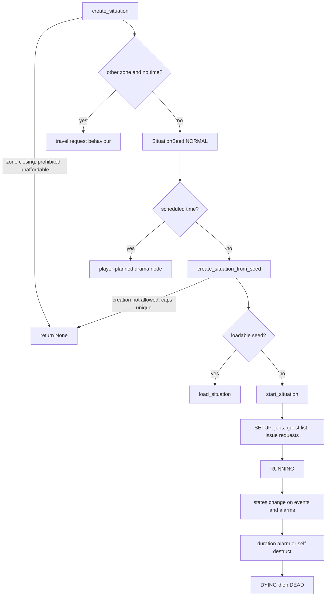
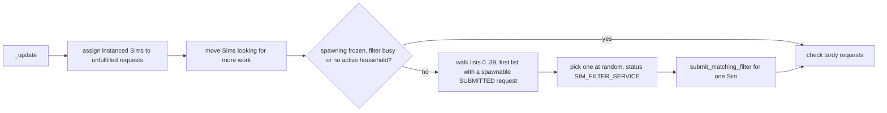

# 4.01 Situations, roles and NPC scheduling

*Game version 1.128.90.1030 (Steam, Linux/Proton). Live values come from the merged tuning (the base-game delta build plus the delta build of each installed pack: EP04 (Cats & Dogs), EP06 (Get Famous), EP09 (Eco Lifestyle), EP12 (High School Years), GP04 (Vampires), GP12 (Werewolves), SP01 (Luxury Party) and SP42 (Grunge Revival)), read through the live merge; module tuning comes from the base delta build, since the packs ship none. Written 2026-10-12. Checked 2026-10-12: 157 claims checked, 27 corrected, 5 relabelled, 1 removed.*

## In plain words

Almost every Sim you see who is not in your household is on screen because a **situation** asked for them. A situation is a small script with a guest list, a set of **jobs** (bartender, guest, walker, maid) and, for each job, a **role state** that tells the Sim what to want and what to do. A party, a walk-by neighbour, the mail carrier, a ghost rising from an urn and a vampire tapping on your window at night are all situations. The **situation manager** creates them, keeps the user-facing ones under a cap, saves the ones that should survive a save, and destroys them when they end.

A situation never picks Sims itself. It files a **request** with the **bouncer**, a matchmaker that keeps 40 ordered lists of open requests, hands instanced Sims to the most important request they can fill and asks the Sim filter for a new Sim when nobody fits; the Sim spawner then creates at most one new NPC every five Sim minutes. When the lot gets crowded it pushes the least important NPCs off the lot so that a more important request can be filled.

Above the manager sit the schedulers. The **ambient service** keeps the street populated with walk-bys and, at night, ghosts. Zone directors run **shifts** of situations through the day (see [2.01 Lots, venues and rooms](2.01-lots-venues-rooms.md) for which director runs where). The **service NPC service** books maids, gardeners, repair people and deliveries on a weekly calendar and bills the household. The **drama scheduler** scores a pool of "drama nodes" (phone calls, invitations, events) every night at 03:00 and schedules the winners, and that is how NPCs invite you to things. The **welcome wagon** is a one-off NPC-hosted visit to a new household.

The chapter ends with the special cases the core relies on: visiting and the doorbell, custom states situations, custom schedules, group dancing, going dancing, breaking and entering, and three worked examples from installed packs.

## Key facts

- Every running situation is either a `SituationSimple` (phases, 34 live records) or a `SituationComplex` (states); 667 live situation records, with 562 jobs, 844 role states, 2,326 goals and 598 goal sets behind them.
- The bouncer sorts open requests into 40 lists: every request that names a Sim comes before every request that does not, whatever the priority; then priority (10 levels from `GAME_BREAKER` to `LEAVE`); then elevated importance. Spawning works through one list at a time, needs an active household and keeps only one Sim filter query in flight.
- The NPC soft cap is `NPC_SOFT_CAP` 20 (untuned, so the code default is live) minus a cap modifier minus the active household size. At or above it only game breakers and selectable Sims spawn; above it NPCs are told to leave.
- Only one global user-facing situation of each display type runs at a time unless the type allows several (cap 3, `LIVE_EVENT` 2, `SIM_SPECIFIC` or a type flagged `allow_multiple_instances` the household size); starting a new one destroys other global user-facing situations that do not allow multiples.
- The ambient service runs every 5 Sim minutes and starts at most one walk-by or ghost situation per run; the source furthest below its target wins. A lot whose walk-by tuning is a `SchedulingWalkbyDirector` (33 live) also runs its own situation shifts. Live ghosts may start only from 23:45 for one hour (code default 21:00 for five hours).
- Service NPCs charge `cost_up_front` plus `cost_hourly` times hours worked; the household pays what its funds allow and the rest is added to the next bill. Live maid: 40 plus 20 per hour, weekdays from 10:00 for six hours. Two traits make every hireable service free.
- Ringing a doorbell needs at least one non-pet, instanced, not-hidden occupant at home; then it succeeds when any owner passes the relationship test with the ringer. When none does, the code that should show the "bad relationship" notification raises a `NameError` instead (bytecode reads an undefined global `resolver`); the three shipped records use a relationship test every owner passes, so only a modded test reaches it.
- The drama scheduler scores at 03:00 every day. Of 98 bucket rules, 91 schedule a fixed number of nodes, 2 (including `DEFAULT`) schedule `1 + floor(household size / 2)`, and 5 have no value tuned. 677 drama nodes are live, 340 of them scored.
- Custom schedules are gated on `Pack.EP20` and the service registers only when that pack is available, so the whole `custom_schedules` package is inert on this install (Inferred from the gate).
- Live tuning differs from code defaults in places that change behaviour: walk-by socials start at 50% (code 100%), last 20 minutes (code 60), most walk-bys have a 10% flavor chance (code 1%), jobs use the instance spawn action 50% of the time (code 90%), and the welcome wagon waits 120 minutes (code 60).
- Group dancing, going dancing and breaking and entering are mostly script with no live records here: the only live records are one `DanceTogetherSituation` (EP12) and five `DancerSituation` records.
- Bugs visible in bytecode that live tuning reaches: the drama node LOD run test compares a `SimInfo` with an enum, the bouncer compares each reservation with itself, and `WalkDogSituation` never calls the base removal handler. Bugs that shipped tuning never reaches or that change nothing here: the doorbell `NameError`, the butler's zero-cost `UnboundLocalError`, the service guest list comparing an id with a `Household`, the welcome wagon `stop()` that never cancels its alarm, and `start_missed_shifts` returning at the first shift with churn enabled.
- `situations.create` and `situations.destroy` carry no command type, so they are DebugOnly and never registered in the shipping game; `situations.make_greeted` is Live and `service_npc.request_service` is Cheat.

## How it works

### The cast: situations, jobs and role states

**Situation.** A tuned class in the `situation` instance manager. Code defaults in `situation.py: Situation`: `duration` 60 minutes, `duration_randomizer` 0, `max_participants` 16 (Observed). The actual duration is `duration + randint(0, duration_randomizer)` minutes, and a duration of 0 sets no time-out alarm, so the situation runs until something ends it (Observed: `situation.py: Situation._get_duration`, `_set_duration_alarm`). Live: 202 situations have duration 0, the common tuned values are 300 (44 records), 180 (41), 240 (37) and 360 (36), and `max_participants` is 20 on 147 records (Observed, live tuning).

**Job.** `SituationJob` (562 live) names a Sim filter, spawner tags, an auto-invite priority, what to do when the job holder does not show (`no_show_action`) or dies or leaves (`died_or_left_action`), optional churn and shifts, and an optional blacklist time (Observed: `situation_job.py: SituationJob`). Both actions default to DO_NOTHING (value 2) (Observed: `situation_job.py`). Live: `no_show_action` END_SITUATION 204, REPLACE_THEM 87, DO_NOTHING 14, default 257; `died_or_left_action` END_SITUATION 237, REPLACE_THEM 42, DO_NOTHING 17, default 266; `elevated_importance` True on 58; `game_breaker` True on 5 (Observed, live tuning).

**Role state.** `RoleState` (844 live) holds the buffs, autonomy modifiers and on-activate behaviour of a job. `RolePriority` is LOW 0, NORMAL 1, HIGH 2 (Observed: `role/role_state.py`). Live `_on_activate`: push_affordance 175, autonomy_ping 81, parameterized_autonomy_ping 80 (Observed, live tuning). A Sim's `RoleStateTracker` keeps one list per priority; only the roles in the highest non-empty priority are active, plus any `always_active` role (2 live). Adding a role at or above the active priority activates it, deactivates the old priority's roles and cancels the Sim's running full autonomy request (Observed: `role/role_tracker.py: RoleStateTracker.add_role`).

**Exclusivity.** Each situation has a `BouncerExclusivityCategory` (34 flags, from `LEAVE` 2 up to `TOURNAMENT`) that decides which situations a Sim can be in at once (Observed: `bouncer/bouncer_types.py`). Live tuned values: VENUE_GOER 26, SERVICE 13, NEUTRAL 8, VENUE_EMPLOYEE 6, WALKBY 6, DATE 4, NORMAL 4 (Observed, live tuning; 605 records leave the default).

### Creating a situation

`SituationManager.create_situation` runs in this order (Observed, bytecode of `situation_manager.py: SituationManager.create_situation`):

1. Return nothing if the zone is shutting down.
2. Ask the narrative service for a replacement situation type.
3. Return nothing if a zone modifier prohibits the type on the target zone.
4. Build an empty guest list if none was given and read its hire cost.
5. If there is a host and no existing drama node, take `cost()` plus the hire cost from the host household; return nothing if the funds cannot cover it.
6. Generate the situation id and send creation telemetry.
7. If the target zone is another zone and no time is scheduled, hand over to the travel path (see "What persists").
8. Build a `SituationSeed` with purpose `NORMAL` and apply any custom init data.
9. If an existing drama node id was passed, cancel that node.
10. If a time was scheduled, schedule a player-planned drama node instead of starting now (`SITUATION_CATEGORY_PLAYER_PLANNED_DRAMA_NODE` by category, else `DEFAULT_PLAYER_PLANNED_DRAMA_NODE`, live 182428).
11. Otherwise call `create_situation_from_seed`.

`create_situation_from_seed` then applies the user-facing caps (Observed, bytecode of `create_situation_from_seed`):

- First it returns nothing if the seed's `allow_creation` is False.
- If the seed is user facing, it works out the display type and whether the type allows several instances (`MULTI_INSTANCE_SITUATION_DISPLAY_TYPES`, live PIVOTAL_MOMENT, SIM_SPECIFIC and LIVE_EVENT, or the type's `allow_multiple_instances`, True on 1 live record).
- "Replacing" means the type `can_be_replaced`, exactly one of its display type runs, and multiples are not allowed. When not replacing, it refuses if one already runs and multiples are not allowed, or if the count has reached `max_number_situation_instances`: 3 by default, 2 for LIVE_EVENT, the household size for SIM_SPECIFIC or a type whose own `allow_multiple_instances` is set (a multi-instance display type such as PIVOTAL_MOMENT without that flag gets 3).
- For a globally linked, single-instance seed it then destroys every running global user-facing situation that does not allow multiples, of any display type. When replacing and none of the same display type was destroyed, it refuses.
- For every seed, user facing or not, a unique type (`_is_unique`, True on 98 live records) is refused if one is already running.
- It constructs the situation, then calls `load_situation` for a loadable seed or `start_situation` otherwise; a situation that reaches `DYING` during start is removed. User-facing situations, and any with `distribution_override`, are added to the distributor.



### Starting, states and ending

`BaseSituation.start_situation` sets stage `SETUP`, creates the job data, expands the guest list from tuning (auto-invite jobs), verifies role objects for user-facing situations, issues bouncer requests, notifies guests, records the start time, sets stage `RUNNING`, applies automatic bronze medals and fires the `SituationStarted` test event (Observed: `base_situation.py: BaseSituation.start_situation`). `AUTOMATIC_BRONZE_TRAITS` holds two live traits (Observed, module tuning).

`_issue_requests` walks the guest list: a reservation guest gets a reservation request and nothing else; any other guest gets a normal request unless the job is `do_not_spawn`. If the situation has a resident job and the host lives on the lot, it adds a host request at priority `EVENT_HOSTING`. Last, if the guest list is not invite only and a default job exists, it adds an uninvited fallback request at `EVENT_DEFAULT_JOB` (Observed, bytecode of `BaseSituation._issue_requests`; priorities from `bouncer_request.py: BouncerHostRequestFactory`, `BouncerFallbackRequestFactory`).

Complex situations move between `SituationState` objects. `SituationComplexCommon._change_state` sets the new state's owner, calls its `on_pre_activate`, deactivates the old state (which unregisters its test events and cancels its alarms; the call sits in a `finally`), then calls the new state's `on_activate` (Observed, bytecode of `situation_complex.py: SituationComplexCommon._change_state`; `SituationState.on_deactivate`; the decompile wraps this in debug-only guards). `CommonSituationState` adds tuned job and role changes and an optional `time_out`, off unless tuned and 15 minutes when switched on, whose remaining time is saved with the state (Observed: `situation_complex.py: CommonSituationState`, `SituationState.save_state`).

A situation ends when its duration alarm fires or a state calls `_self_destruct`. Jobs can end it too. When a job holder is unassigned, END_SITUATION in `died_or_left_action` destroys the situation, REPLACE_THEM files a replacement request, and DO_NOTHING just removes the Sim (Observed: `base_situation.py: BaseSituation.on_sim_unassigned_from_request`). When a request is tardy, only END_SITUATION in `no_show_action` does anything; when a spawn fails, END_SITUATION destroys the situation and REPLACE_THEM resubmits a clone, but only for a request that named a Sim (Observed: `BaseSituation.on_tardy_request`, `on_failed_to_spawn_sim_for_request`). Ending runs `on_remove`, which removes every Sim, releases their requests and moves them to leaving (Inferred from `BaseSituation.on_remove` and the leave helpers).

**Leaving.** The manager has three exits. `make_sim_leave` invites a Sim into the running system leave situation, falling back to leave-now-must-run if it is missing; its type is `DEFAULT_LEAVE_SITUATION` (live `situation_leave`, exclusivity LEAVE, jobs leaving_soon and leaving_now). `make_sim_leave_now_must_run` uses `DEFAULT_LEAVE_NOW_MUST_RUN_SITUATION` (live `Situation_SingleSimLeave`, exclusivity LEAVE_NOW, duration 0, with delay, imprisoned and leave roles). `create_visit_situation` puts a Sim into `DEFAULT_VISIT_SITUATION` (live `Situation_GreetedNPCVisitingPlayerSituation`) and makes the Sim leave if that fails (Observed: `situation_manager.py`; live values from module tuning and the two leave records).

**Goals.** User-facing situations offer goals from goal sets through a goal tracker (simple, dynamic, activity or graphed). Live: 2,326 goals, the largest classes `SituationGoalObjectInteraction` 710, `SituationGoalActor` 490, `SituationGoalRanInteractionOnTargetedSim` 449, `SituationGoalCraftObject` 158; 598 goal sets (Observed, live tuning). Goal scoring and medals are bookkeeping on top of the lifecycle above and are only skimmed here.

### What persists

The class property `situation_serialization_option` decides what is saved: DONT 0, LOT 1, OPEN_STREETS 2, HOLIDAY 3, PIVOTAL_MOMENT 4, PIVOTAL_MOMENT_ACCT_LEVEL 5, PIVOTAL_MOMENT_HOUSEHOLD_LEVEL 6 (Observed: `situation_types.py`). Live tuned values of `persistence_option` (the custom states field): PIVOTAL_MOMENT_ACCT_LEVEL 62, PIVOTAL_MOMENT 13, OPEN_STREETS 9, PIVOTAL_MOMENT_HOUSEHOLD_LEVEL 6, LOT 2, DONT 1 (Observed, live tuning). A saved situation is a seed with a `SeedPurpose`: NORMAL 0, TRAVEL 1, PERSISTENCE 2, PERSISTED_TRAVEL 3 (Observed: `situation_serialization.py`). Save formats are in [1.02 Saves and persistence](1.02-saves-persistence.md).

On load, `BaseSituation.should_seed_be_loaded` drops DONT seeds and does not load the HOLIDAY or pivotal moment options through this path. A LOT seed loads only if its time jump rule allows it, the active household is unchanged since the save (a check skipped when the type `survives_active_household_change`, True on 20 live records), and the venue and the lot owner household are unchanged; those last two checks run for every LOT seed. An open-street seed is dropped if world time has passed since the open-street save, if it invites a Sim of the lot owner household, or if it invites a selectable Sim (unless the caller allows that) (Observed, bytecode of `base_situation.py: BaseSituation.should_seed_be_loaded`; the decompiled branch structure is partly mangled, so the order above was read from the bytecode).

**Time jump.** `time_jump` is a variant: disallow (default, never load after time passed), allow (load and regenerate the guest list if time passed), simulate (call `should_load_after_time_jump`, which custom states situations implement by subtracting the elapsed time), and gig based (Observed: `situation_time_jump.py`, `custom_states/custom_states_situation.py`). Live: default 613, allow 66, simulate 8, disallow 1 (Observed, live tuning).

**Travel.** When `create_situation` targets another zone, `_create_situation_and_travel` looks at the user-facing situations linked to invited Sims and lets the most restrictive one's `travel_request_behavior` decide: disallow (default, with an optional dialog) or allow (with an optional confirmation) (Observed: `situation_manager.py: SituationManager._create_situation_and_travel`, `situation_travel_behavior.py`). Live: allow on 124 records; 22 keep disallow but tune its dialog (21 EP06 acting career situations and the EP12 `situation_HighSchool_Active_Player_Main`); the other 542 leave the field alone (Observed, live tuning). The zone side of travel is in [2.06 Worlds, regions and travel](2.06-worlds-regions-travel.md).

### The bouncer: requests, priorities and order of operations

A `BouncerRequest` moves through INITIALIZED 0, SUBMITTED 1, SIM_FILTER_SERVICE 2, SPAWN_REQUESTED 3, FULFILLED 4, DESTROYED 5 (Observed: `bouncer_types.py: BouncerRequestStatus`). Its priority is one of ten `BouncerRequestPriority` values: GAME_BREAKER 0, EVENT_VIP 1, EVENT_HOSTING 2, VENUE_REQUIRED 3, EVENT_AUTO_FILL 4, BACKGROUND_HIGH 5, BACKGROUND_MEDIUM 6, BACKGROUND_LOW 7, EVENT_DEFAULT_JOB 8, LEAVE 9 (Observed). Live job auto-invite priorities: BACKGROUND_LOW 112, BACKGROUND_MEDIUM 92, BACKGROUND_HIGH 29, VENUE_REQUIRED 24, EVENT_AUTO_FILL 11 (Observed, live tuning).

**The 40 lists.** Each request gets an unfulfilled index when it is built: 0 if it names a specific Sim ("explicit"), else 20; plus `priority × 2`; plus 1 unless the job or the request has elevated importance (Observed: `bouncer_request.py: BouncerRequest.__init__`, `BOUNCER_PRIORITY_INDEX_MULTIPLIER` 2). The bouncer allocates `10 × INDEXES_PER_BOUNCER_REQUEST_PRIORITY` = 40 lists (Observed: `bouncer.py: Bouncer`). So every explicit request, even a LEAVE request (index 18 or 19), is served before any request that leaves the Sim open, even a GAME_BREAKER one (index 20 or 21) (Inferred from the index formula).

**Klout** ranks requests for the soft cap: `priority × 4`, plus 1 if not elevated, plus 2 if not user facing; lower is more important, and a situation flagged `has_no_klout` returns none (Observed: `bouncer_request.py: BouncerRequest._get_request_klout`).

**The update.** `Bouncer._update` does nothing while offline, then runs four steps inside a delayed-destruction block (Observed: `bouncer.py: Bouncer._update`):



Spawning needs an active household and sends at most one filter query: it walks the lists in order, skips empty ones and those with no request that can spawn now and is SUBMITTED, picks one request at random from the first usable list, applies the common blacklists (Sims spawning, the active household, the active lot household, as the job asks) and submits a one-Sim filter query; the callback either assigns the found Sim or asks the spawner to create it (Observed: `bouncer.py: Bouncer._spawn_sim_for_next_request`, `_sim_filter_service_callback`). A request is tardy when it is not fulfilled `TARDY_SIM_TIME` minutes after submission: 30, untuned, so the code default is live; the situation's `on_tardy_request` runs and, if the request survives, the clock restarts (Observed: `bouncer.py: Bouncer._check_for_tardy_requests`, `bouncer_request.py`; module tuning has no value). What the situation does then is set by the job's `no_show_action` (see "Starting, states and ending").

**Exclusivity rules.** `Bouncer.EXCLUSIVITY_RULES` is a hard-coded list of 189 pairs: option NONE 139, EXPECTATION_PREFERENCE 35, ALREADY_ASSIGNED 15, over 34 categories, with no duplicate keys (Observed: `bouncer.py`). A pair with no rule may share a Sim. With NONE the first category in the rule wins; with EXPECTATION_PREFERENCE the request that expects the Sim wins, and if both do, the newer request; with ALREADY_ASSIGNED the current assignment wins (Observed: `bouncer_request.py: exclusivity_compare`). Ten categories have a rule with themselves, all ALREADY_ASSIGNED: WALKBY, SERVICE, LEAVE_NOW, VENUE_EMPLOYEE, CLUB_GATHERING, FESTIVAL_GOER, FESTIVAL_EMPLOYEE, VENUE_GOER, INSTRUCTED_CLASS, HOBBY_CLASS (Observed).

**The reservation self-compare.** `_check_request_against_reservation_request` loops `for request in self._reserved_sims[sim_id]` and tests `request.exclusivity_compare(request)`, so the loop variable hides the new request and each reservation is compared with itself (Observed, bytecode of `bouncer.py`: `STORE_FAST request`, `LOAD_FAST request`, `LOAD_METHOD exclusivity_compare`, `LOAD_FAST request`). A self comparison has a rule only for the ten self-rule categories above, and ALREADY_ASSIGNED then returns 1. So a reserved Sim whose reservation is in one of those ten categories is refused for every other request while exclusivity is checked, and a reservation in any other category never blocks anything (Inferred).

### Spawning and the NPC soft cap

`SimSpawnerService.npc_soft_cap` is `NPC_SOFT_CAP` (20 by default, untuned in both builds, so 20 is live) or a cheat override, minus `floor` of the cap modifier, minus the active household size; with no active household it is 0 (Observed: `sims/sim_spawner_service.py`). A household of four therefore leaves room for 16 instanced NPCs. When the number of instanced NPCs is at or above the cap, only game breakers and selectable Sims spawn; otherwise one spawn is allowed every `SPAWN_COOLDOWN_MINUTES` = 5 Sim minutes, except selectable Sims, game breakers and batch spawning, which skip the wait (Observed: `sims/sim_spawner_service.py: SimSpawnerService`). The bouncer declares its own `SPAWN_COOLDOWN_MINUTES` 5 but never reads it; the five-minute spacing is the spawner's (Observed: `bouncer.py`).

The bouncer's soft-cap monitor runs only with an active household in a running zone, and not while the soft cap cheat is on (Observed: `bouncer.py: Bouncer._monitor_npc_soft_cap`):

1. If instanced NPCs exceed the cap, it calls `expedite_leaving`, which moves every Sim in the leave situation to leave-now-must-run.
2. If NPCs that are not already leaving still exceed the cap, it sends that many away with leave-now-must-run, worst klout first.
3. If they sit exactly at the cap, it compares the best unfulfilled NPC request with the worst fulfilled one held by a non-resident NPC who is not leaving; if the unfulfilled one has lower klout, the holder is sent away with leave-now-must-run.

When a job's spawn action is chosen, `SituationJob.ALTERNATIVE_SPAWN_BEHAVIOR` decides how often the instance spawn action is used: live 50% (code default 90%) for the whitelisted jobs, with a land vehicle as the alternative (Observed, module tuning; `situation_job.py`).

### Job churn and shifts inside a situation

`SituationJobData` adds a repeating 10-minute alarm when a job has churn or shifts (the 10 is hard-coded) (Observed: `situation_job_data.py: SituationJobData.__init__`). Churn reads the desired population for the hour from `auto_populate_by_time_of_day`: below the minimum (counting Sims on the way) it adds one, above the maximum it removes one, otherwise with `chance_to_add_or_remove_sim` (default 20%) it adds or removes one at random where room allows. A removed Sim is picked at random among NPCs on the lot longer than `min_duration` (default 60 minutes); only when none qualifies and the job is over its maximum is the longest-staying NPC picked instead. The removed Sim is put on the auto-fill blacklist and told to leave (Observed: `SituationJobData._churn`, `_choose_random_npc_over_min_duration`). Shifts work the same way against `get_shift_staffing`, always removing the longest-staying NPC, and at each shift change request the shift's staff minus those coming (Observed: `SituationJobData._shift_churn`, `_shift_change`). Live: churn is enabled on 2 jobs and shifts on 2 (Observed, live tuning).

### Zone director shifts

Zone directors that schedule situations through the day use `SituationShifts` (the director side is in [2.01 Lots, venues and rooms](2.01-lots-venues-rooms.md)). Each shift has a `shift_curve` (curve based or shiftless), a `shift_strictness` DESTROY 0 (default) or OVERLAP 1, `additional_sources` (holiday walk-bys, zone modifier situations, narrative situations) and `count_based_on_expected_sims` (default False); the director also has `churn_alarm_interval` (default 10 minutes) and `set_host_as` (active Sim or Sim from object) (Observed: `situation_shifts.py`, `situation_shifts_enums.py`, `additional_situation_sources.py`).

- **Start-up.** `on_startup` adds a repeating churn alarm per shift and a one-shot alarm at the next shift time (Observed: `SituationShifts.on_startup`).
- **Can it start?** `can_schedule_situation` checks in order: in super speed 3 the situation must be `allowed_in_super_speed_3`; when the count is limited by Sims, `can_start_walkby(active lot, desired)` must pass; then `situation_meets_starting_requirements` and no zone modifier prohibition (Observed, bytecode of `SituationShifts.can_schedule_situation`).
- **Shift change.** The desired count is `random_int()` of the curve's interval for the hour (a count of Sims when `count_based_on_expected_sims` is set). DESTROY destroys every running situation of that shift; OVERLAP subtracts the running count. Then situations are started until the count is used up, and a failed start still uses up one (Observed: `SituationShifts._shift_change_alarm_callback`).
- **Churn.** If the desired count exceeds the running count, start one; else if it is lower and the shift is not OVERLAP, destroy the oldest. One operation per tick, and none while the shift's current curve entry disables churn (Observed: `SituationShifts.handle_situation_shift_churn`).
- **Creation.** Situations get their own predefined guest list if they have one; otherwise an invite-only list hosted by `set_host_as` (the active Sim by default, or the Sim from the object). They are created with `spawn_sims_during_zone_spin_up=True` and `creation_source` set to the director's name (Observed: `SituationShifts._create_situation_with_params`).
- **Missed shifts.** `start_missed_shifts` is meant to fill shifts whose start time passed while the zone was not loaded, but in bytecode the `return` sits inside the loop, so the whole function returns at the first shift whose churn is enabled and later shifts are never checked (Observed, bytecode; a `continue` was probably meant, Inferred). Its only caller is the object-based zone director path for shifts flagged `schedule_immediate`; live, that is the two EP12 thrift store directors, and none of their shift entries disables churn, so the function returns at once and starts nothing either way (Observed, live tuning).

`SituationCurve` picks the entry with the latest start hour at or before the current hour, and wraps to the day's last entry before the first one (Observed: `situation_curve.py: SituationCurve._get_desired_situations`). Example, live `Walkby_GardenDistrict_Nbhd` (base-game delta tuning), which tunes Sunday, weekdays and Saturday separately: on Sunday it wants 2 Sims from 02:00, 5 from 06:00, 18 from 12:00, 10 from 17:00 and 4 from 20:00, and the 20:00 entry also covers midnight to 02:00 (Observed, live tuning).

### Ambient population: walk-bys and ghosts

`AmbientService.begin_walkbys` creates two sources, street and ghost, each with priority multiplier `DEFAULT_PRIORITY_MULTIPLIER` 2.1, then adds a repeating 5-minute update alarm and a repeating 1-minute flavor alarm (Observed: `ambient/ambient_service.py`). Each source's priority is `(desired − current) × 2.1`; since both sources use the same multiplier, it never changes which one wins (Inferred).

**Update.** Every 5 Sim minutes, with a client connected, the sources are sorted by priority and only the top one may act, and only if its priority is above 0 (Observed: `AmbientService._update`). So the ambient update starts at most one situation every 5 minutes. A lot whose `walkby_schedule` is a `SchedulingWalkbyDirector` (33 live) also runs its own situation shifts, started by `begin_scheduled_walkbys` and at zone spin-up, outside this limit (Observed: `ambient_service.py`, `walkby_tuning.py`; live tuning).

- **Street source.** Desired is the lower bound of the lot's walk-by curve for the hour; when it acts, it asks for `random_int()` of that interval minus the current Sims and starts one situation picked by weight from the curve, with any holiday walk-bys added (Observed: `_AmbientSourceStreet`, `walkby_tuning.py: WalkbyTuning.get_ambient_walkby_situation`). The candidate filter is sequential: in super speed 3 the situation must be `allowed_in_super_speed_3`; then `can_start_walkby(lot, free slots)` (Observed, bytecode of `can_start_situation`).
- **Ghost source.** Active only inside the walk window: live `WALKBY_ALLOWED_START_TIME` 23:45 and `WALKBY_ALLOWED_DURATION` 1 hour (code defaults 21:00 and 5); the duration is the window in which a ghost may start. Desired comes from `DESIRED_GHOST_COUNT_PER_URNSTONE`, live points (1, 1), (4, 2), (10, 3); it picks a random valid urnstone and tries the `GHOST_SITUATIONS` entries in order, each behind its own tests, with that urnstone's ghost (Observed: `_AmbientSourceGhost`; module tuning). The list has 6 entries, of which 3 resolve here: `situation_Ghost` for humans and `situation_Ghost_Pets` twice, for cats and dogs (EP04); the horse ghost (EP14) and the cemetery day and night ghosts (EP17) are patch data, pack not installed (Observed, module tuning). When a street override exists it replaces the start time, duration and count curve; none is tuned (Observed: `street_overrides` in the same class; module tuning).

**Flavor and socials.** Every Sim minute the service gathers walk-by Sims free for a social and Sims free for a flavor action. Pairs that can socialise (within `SOCIAL_MAX_START_DISTANCE`, in the view cone) start one social with `random_chance(pairs × SOCIAL_CHANCE_TO_START)`; live `SOCIAL_CHANCE_TO_START` is 50 (code 100), so one pair starts with 50% a minute and two pairs always do. Live `SOCIAL_MAX_DURATION` is 20 minutes (code 60). Then, whether or not a social started, the first situation in the flavor list that passes its own `flavor_chance_to_start` starts one flavor interaction (Observed: `AmbientService._flavor_alarm_callback`, bytecode). A walk-by Sim waits 10 minutes after starting before its first flavor action and `flavor_cooldown` after each one (Observed: `walkby_ambient_situation.py: WalkbyAmbientSituation`). Live: `flavor_cooldown` 20 on 63 of 64 walk-by records and 40 on one; `flavor_chance_to_start` 10% on 49, 2% on 6, 5% on 5, 30% on 2, 66% on 1 and 100% on 1 (Observed, live tuning).

Live walk-by data: 64 `WalkbyAmbientSituation` records (base 39, EP06 10, EP04 4, EP09 3, GP04 3, GP12 3, EP12 2), 56 `walk_by` instances (33 `SchedulingWalkbyDirector`, 23 `WalkbyTuning`) (Observed, live tuning).

### The ring-doorbell walk-by

`WalkbyRingDoorBellSituation` has states RingDoorBell 2, Mailbox 3, WaitForInvitation 4, Leave 5 (Observed: `ambient/walkby_ring_doorbell_situation.py`). It can start only on the active household's lot. A ring that finishes goes straight to waiting for an invitation; a ring that fails goes to the mailbox, and the mailbox always ends in waiting; the wait lasts `wait_for_invitation_delay`, default 60 minutes, and all 5 live records use the default (Observed; live tuning). It saves on open streets, uses WALKBY exclusivity and expects one Sim. Through `SituationSupportKeyMixin`, if `support_given_keys` is set, a walker who holds a key to the active household is summoned with `SUMMONING_PURPOSE`, live `Invite_In_Self_Keyholder`, so the keyholder lets themselves in (Observed: `visiting/situation_support_key_mixin.py`; module tuning). The summon runs once for each household member the walker holds a key from (Observed: the loop in `_on_set_sim_job`). No live ring-doorbell record sets `support_given_keys`, so this path is unused here (Observed, live tuning). Live records: 3 base, 2 GP04 (Observed, live tuning). Summoning purposes are listed in [2.01 Lots, venues and rooms](2.01-lots-venues-rooms.md).

### Service NPCs: tuning and cost

A `ServiceNpc` (the `service_npc` manager, 11 live: 10 base, 1 EP09) names a situation, a weekly `work_hours` schedule, `request_offset` (default 10 minutes), `_min_duration_left_for_arrival_on_lot` (default 0), `_work_duration_min_max` (default 60 to 240 minutes), `full_time_npc` (False), `exclusive_to_household` (False) and an optional `additional_culling_immunity` (default 10) (Observed: `service_npcs/service_npc_tuning.py: ServiceNpc`).

- **Hireable** (`ServiceNpcHireable`): `cost_up_front` (default 0), `cost_hourly` (default 50), `free_service_traits`, `bill_source` (default Miscellaneous), `_fake_perform_minutes_per_object` (default 10), a hire interaction and `bill_time_of_day` (default hour 12). `get_cost(hours) = int(hours × cost_hourly) + cost_up_front` (Observed).
- **Charging.** `try_charge_for_service` makes the cost 0 if any household Sim has a free-service trait; otherwise it takes what the funds allow and passes the rest to `bills_manager.add_additional_bill_cost(bill_source)`; if taking the funds fails, the whole amount is billed (Observed: `ServiceNpcHireable.try_charge_for_service`).
- **Deliverable** charges the picker total plus the up-front cost when the hire interaction finishes. **Crafter** shows a recipe picker. **NonRequestable** is `always_scheduled`, is auto-scheduled on client connect, and is free (Observed).

Live service NPCs (Observed, live tuning):

| Record | Class | Up front | Hourly | Schedule | Other |
|---|---|---|---|---|---|
| `ServiceNpc_Maid` | Hireable | 40 | 20 | Mon to Fri, 10:00 for 6 h | work max 360, min left 60, bill `Maid_Service` |
| `ServiceNpc_Repair` | Hireable | 100 | 10 | every day, two 18 h entries from 08:00 and 00:00 | work max 600, min left 60 |
| `serviceNpc_Gardener_Service` | Hireable | 50 | 30 | Mon to Fri, 09:00 for 6 h | work max 360, min left 60 |
| `serviceNpc_Nanny` | Hireable | 60 | 10 | every day, 04:00 for 24 h | work 0 to 0, min left 30 |
| `ServiceNpc_PizzaDelivery` | Crafter | 25 | 0 | every day, 08:00 for 24 h | request offset 20, work max 360 |
| `serviceNPC_Deliveries_FoodDelivery_New` | Deliverable | 10 | 0 | every day, 08:00 for 24 h | request offset 15, sub-total 10, work max 120 |
| `ServiceNpc_Mailman` | NonRequestable | free | free | Mon to Sat, 08:00 for 4 h, random start | work max 120 |
| `serviceNpc_EcoInspector` (EP09) | Hireable | 225 | 0 | Mon to Fri, 09:00 for 8 h | work max 300 |

Free variants `serviceNpc_Maid_Free`, `serviceNpc_Repair_Free` and `serviceNpc_PizzaDelivery_free` set both costs to 0. The ten hireable records list the same two free-service traits, 32110 `trait_FreeServices` (base) and 196358 `trait_Hidden_Fame_Quirk_StarTreatment` (EP06); the mailman, free anyway, has none (Observed, live tuning).

### Service NPCs: request, arrival and work

`ServiceNpcService.request_service` (Observed, bytecode):

1. If the service is already in the household's request list, do nothing.
2. If the record says `hired` and this is not a load, do nothing.
3. Set the record (hired, recurring, user data).
4. The first alarm may not fire sooner than `request_offset`, except on load.
5. Create the `work_hours` scheduler with callback `_send_service_npc` and `_min_duration_left_for_arrival_on_lot` as the minimum time remaining.
6. If `bill_time_of_day` is set, add a daily bill alarm at that hour.

`_send_service_npc` runs at each scheduled window (Observed, bytecode):

1. Auto-scheduled types are skipped while auto services are disabled.
2. If the NPC already started in this window, a part-time NPC returns, and a full-time NPC returns if its situation is running.
3. Record the start time, unless a full-time NPC already has one; the duration is the window end minus now.
4. If less than `_min_duration_left_for_arrival_on_lot` remains and there is no scheduler, or the scheduler is not inside a window now, the job is faked (`fake_perform`) and nothing spawns.
5. Clamp the duration to the work min and max.
6. Build the guest list: the preferred Sim with purpose PREFERRED and expectation preference, else a filter request that blacklists fired Sims, roommates and, if the service is exclusive, other households' preferred Sims.
7. Write household id, hiring Sim id, service type, user data, selections and the recurring flag into the custom init data.
8. A full-time NPC gets duration 0 (no time-out) and is not recreated while running.
9. `create_situation(user_facing=False, duration_override=…)`.

In `_generate_situation_guest_list`, the exclusivity filter compares `household.id == hiring_household`, an integer against a `Household` object (Observed, bytecode of `service_npc_manager.py`). `Household` and its one base class define no `__eq__` (Observed, class bodies in the pyc), so the comparison is never true and the hiring household's own preferred Sims would be blacklisted too (Observed). The branch runs only for a service with `exclusive_to_household`, which no live record sets, so nothing reaches it here (Observed, live tuning). With the Nanny's work range of 0 to 0, the clamp yields duration 0, so the nanny situation has no time-out and runs until dismissed or cancelled (Inferred from the clamp and `Situation._set_duration_alarm`).

`ServiceNpcSituation` has states ArrivingOnLot 1, Working 2, Leave 3 (Observed: `complex/service_npc_situation.py`). If the game is in super speed 3 when it starts, it pushes a speed request for normal speed 3; it adds the job holder as the household's preferred Sim for the service. On starting work it runs `preroll_autonomy`: if the NPC finds nothing to do, it leaves with NO_WORK_TO_DO and no charge (Observed). Live: four `ServiceNpcSituation` records, all base; the gardener's, for example, uses SERVICE exclusivity and `max_participants` 20 and allows time jumps and travel (Observed, live tuning).

**Leaving and payment.** `_on_leaving_situation` (Observed, bytecode): if there was preroll work it charges; any billed amount turns the reason into NOT_PAID; it shows the notification and records the finish time; FIRED adds the Sim to the fired list and clears the preferred Sim; FIRED or NOT_PAID cancels the service; and in a `finally` block a non-recurring service is cancelled. The Leave state then routes by reason: ASKED_TO_HANG_OUT turns the NPC into a visitor (`create_visit_situation`), FIRED and DISMISSED use leave-now-must-run, others use the tuned finish role state or a plain leave (Observed). End reasons: NO_WORK_TO_DO 0, FINISHED_WORK 1, FIRED 2, NOT_PAID 3, ASKED_TO_HANG_OUT 4, DISMISSED 5 (Observed: `service_npcs/__init__.py`).

**Bills, cancel and fake work.** `_run_bill_collection` charges the up-front cost only if the service never finished, plus the hours since the last start; if the household cannot pay and any utility is delinquent, the NPC quits: a notification, the running service Sim is fired and the service is cancelled; otherwise a fail-to-pay notification (Observed, bytecode). `cancel_service` resets the record (hired False) and, for a full-time NPC, destroys the running situation and the bill alarm (Observed). On zone load, `_fake_perform_services_if_necessary` fakes the work of services whose window passed since the last save: objects are modified by the `fake_perform_job`, the time is `objects × _fake_perform_minutes_per_object` and the household is charged for it (Observed: `ServiceNpcHireable.fake_perform`). The culling score of a service Sim is the largest `additional_culling_immunity` across services (Observed: `get_culling_npc_score`).

### The butler

`ServiceNpcButlerSituation` has states Default 1, Cleaning 2, Gardening 3, Childcare 4, Repair 5, Leave 6 (Observed: `service_npcs/butler/service_npc_butler_situation.py`). A timer moves through default, cleaning, gardening, repair, childcare and back to default, skipping states the player has locked with the `ButlerSituationStateChange` loot; DEFAULT cannot be locked (Observed: `butler_loot_ops.py`). Every `SituationStateData` entry uses the default state's factory, so a loaded butler resumes in the default state (Inferred). In `_on_leaving_situation`, `paid_amount` is assigned only when `get_cost` is above 0; on the zero-cost path the later read raises `UnboundLocalError`, which the method's own handler catches, skipping the leave notification and the fired and restriction handling, while the `finally` still cancels the service for any reason but FINISHED_WORK (Observed, bytecode). Free-service traits do not lead there, because they zero the charge later, inside `try_charge_for_service`. No live butler records exist on this install, and the patch data butler (SP09, pack not installed) costs 175 up front and 12 an hour, so the zero-cost path is not reached by shipped tuning (Observed, live tuning and patch data).

### Visiting, greeting and the doorbell

On a venue that `requires_visitation_rights` (a home lot), an NPC on someone else's lot is either greeted or waiting to be greeted. `get_npc_greeted_status_during_zone_fixup` returns NOT_APPLICABLE elsewhere and for Sims who live there; otherwise GREETED if any seed says so, WAITING if any seed says that, and NOT_APPLICABLE when none does (Observed: `situation_manager.py`, `base_situation.py`).

The visiting classes share `VisitingNPCSituation` (Observed: `visiting/*.py`):

| Class | Exclusivity and status | Notes | Live |
|---|---|---|---|
| `UngreetedNPCVisitingNPCSituation` | UNGREETED, WAITING | summoned with PLAYER_BECOMES_GREETED when the player is greeted | 1 |
| `GreetedNPCVisitingNPCSituation` | VISIT, implies greeted | | 2 |
| `UngreetedPlayerVisitingNPCSituation` | UNGREETED, duration 0 | selectable Sim request; keeps walls up while ungreeted | 1 |
| `GreetedPlayerVisitingNPCSituation` | VISIT, implies greeted | scold count and send away | 1 |
| `GreetedNPCVisitingPlayerSituation` | VISIT, implies greeted | `DEFAULT_VISIT_SITUATION` | 18 (base 11, EP12 6, EP06 1) |

`make_waiting_player_greeted` first calls every running situation's `_on_make_waiting_player_greeted` (so waiting NPC visitors are summoned in), then creates the venue's `player_greeted_situation_type` if none is running (Observed: `situation_manager.py`). Live `Situation_GreetedPlayerVisitingNPC`: `inappropriate_behavior_threshold` is LESS 3, so the first two scolding interactions give a notification and the third sends the player Sim away; the leave-house state has `time_out` 60, after which the Sim is ungreeted again (Observed: live tuning and `_handle_scolding_interaction`). A zone director that auto-greets keeps every scold at the notification (Observed). Live `ALWAYS_WELCOME_TRAITS` holds one trait, 149527 `trait_OccultVampire` (GP04) (Observed, module and live tuning).

**Ringing the doorbell.** `RingDoorbellSuperInteraction` adds an exit function, `_try_to_be_invited_in` (Observed, bytecode of `visiting/visiting_interactions.py`):

1. `_always_allow_greeting` set: greeted.
2. No owner household (or travel group): "nobody home" notification.
3. Count the occupants, minus pets, minus Sims who are not instanced or are hidden in a rabbit hole. Zero: "nobody home".
4. If any occupant passes `_relationship_test` against the ringer: greeted, and the ringer becomes always welcome if they have an `ALWAYS_WELCOME_TRAITS` trait.
5. Otherwise it should show the bad-relationship notification, but the call reads `resolver` with `LOAD_GLOBAL`; the module never binds that name, so it raises `NameError` and no notification appears (Observed, bytecode: `LOAD_ATTR sim`, `LOAD_GLOBAL resolver`, `CALL_METHOD 2`). All three live records keep the default `_relationship_test` (full score range, no required bits, incest test off), which every owner passes, so step 4 always greets and step 5 is reached only by a mod that tightens the test (Observed, live tuning). Note that step 4 iterates every owner, including pets and hidden Sims, since the count in step 3 does not filter the list (Observed).

Live: 3 `RingDoorbellSuperInteraction` records, all base (Observed, live tuning).

### NPC-hosted events: the welcome wagon

`NPCHostedSituationService` schedules the welcome wagon when all households are loaded: skipped with the `--no_welcome_wagon` launch argument, when the household does not `needs_welcome_wagon`, when this is not the home zone, or when the venue does not `supports_welcome_wagon`. The alarm fires after `minimum_time_to_start_situation` if inside the window, else at the next window start (Observed: `npc_hosted_situations.py: NPCHostedSituationService._schedule_welcome_wagon`). Live tuning: window 16:00 to 18:00, minimum 120 minutes (code 60), situation `preWelcomeWagon` 156258, start tests "lot statistic 233831 equals 0" and "no small business open" (Observed, module tuning).

`_start_welcome_wagon` (Observed, bytecode): an incompatible user-facing situation or no instanced Sim who can live alone reschedules it; failed start tests set the household's `needs_welcome_wagon` to False, so it never comes; a narrative replacement, else the region's `welcome_wagon_replacement`, may swap the situation; no predefined guest list clears the flag; super speed 3 drops to normal; and the flag is cleared when creation fails or when the created situation does not `sets_welcome_wagon_flag` (the decompile inverts this last test; the bytecode is as stated). `stop()` reads `self._cancel_alarm` without calling it (LOAD_ATTR then POP_TOP), so the alarm is not cancelled on stop (Observed, bytecode). Nothing visible follows, since the alarm belongs to the zone that is shutting down (Inferred).

`PreWelcomeWagon` builds its own guest list: a door knocker (filter, then a random pick, at EVENT_VIP), a fruitcake bearer and other neighbours (live `_number_of_neighbors` 2), and splits into front-door and no-front-door starting states (Observed: `npc_hosted/welcome_wagon.py`; live tuning). Live: one `PreWelcomeWagon` (duration 0, blocks super speed 3) and one `WelcomeWagon`, both base (Observed, live tuning). The `npc_hosted` package also holds an NPC-hosted birthday party (1 base record), a repair-neighbour visit and two welcome wagon variants that have no live records here (Observed: module list, live tuning).

### The drama scheduler: life of a node

A drama node is a tuned instance (`drama_node` manager) that runs once at a chosen time. `DramaScheduleService` keeps scheduled nodes, active nodes and cooldowns (Observed: `drama_scheduler/drama_scheduler.py`). The base class lives in `drama_scheduler/drama_node.py`, which did not decompile and was read per function and in bytecode.

- **Scheduling.** `schedule_node` checks the node's cooldown, calls `schedule()` and, for ON_SCHEDULE cooldowns, starts the cooldown (Observed). `BaseDramaNode.schedule` runs setup, `_test` with the run-time part skipped (participant presence and `pretests` only), `_select_time` and `_schedule_alarm` (Observed, bytecode).
- **Running.** When the alarm fires, `_run_node` cleans the node up if the scheduler is disabled or a non-ON_SCHEDULE cooldown is active; otherwise it runs the node. SUCCESS_NODE_INCOMPLETE moves it to the active list, RESCHEDULED keeps it scheduled, anything else cleans it up (Observed: `DramaScheduleService._run_node`).
- **`BaseDramaNode.run`** runs `_test` without skipping the run-time part: for a node that is not simless, the receiver must be instanced if required, the sender must pass the LOD and instancing checks, the receiver must not be at work unless allowed, and then `run_tests` must pass (Observed, bytecode of `BaseDramaNode._test`). On failure it applies `tests_failed_loot`, and if `reschedule_on_failed_tests` is set and a new time and alarm succeed it returns RESCHEDULED, else FAILURE. On success it starts ON_RUN cooldowns and calls `_run()` (Observed, bytecode).
- **The LOD test bug.** `_test` compares the sender `SimInfo` object with `SimInfoLODLevel.MINIMUM` instead of comparing its `lod` (Observed, bytecode: `LOAD_ATTR _sender_sim_info`, `LOAD_GLOBAL SimInfoLODLevel`, `LOAD_ATTR MINIMUM`, `COMPARE_OP ==`). The check sits in the run-time part of `_test`, so it is reached whenever a node that is not simless and has a sender runs; 558 of the 677 live nodes have a sender option other than none (Observed, live tuning). An object never equals the enum, so a node whose sender has dropped to minimum LOD is not rejected and runs anyway (Inferred).

Enums (Observed: `drama_enums.py`, `drama_node_types.py`): `DramaNodeRunOutcome` FAILURE, RESCHEDULED, SUCCESS_NODE_COMPLETE, SUCCESS_NODE_INCOMPLETE; `CooldownOption` ON_RUN 0, ON_DIALOG_RESPONSE 1, ON_SCHEDULE 2; `DramaNodeType` 16 values; `DramaNodeUiDisplayType` 0 to 11. Module tuning adds 107 scoring buckets, 28 weekly scheduling groups and 12 cooldown groups as dynamic enum entries (Observed, module tuning).

### The drama scheduler: scoring and buckets

The daily scoring alarm fires at `SCORING_TIME` 03:00 and the weekly scheduling alarm at `WEEKLY_SCHEDULING_TIME` 03:00 (Observed: constants in `DramaScheduleService`). Scoring (Observed, bytecode of `_score_and_schedule_drama_nodes_gen` and `score_and_schedule_nodes_gen`):

1. Choose buckets. Outside start-up, a bucket is scored when today is one of its `days`, or when `score_if_no_nodes_are_scheduled` is set and no node from that bucket is scheduled. Start-up buckets are scored once at zone start with a time modifier that backdates them to the last valid day. Venue event nodes use `VENUE_BUCKET_DAYS`, live Monday only (see 2.01).
2. Work out how many to schedule: `based_on_household` gives `1 + floor(active household size / 2)`; `fixed_amount` gives `number_of_nodes` (default 1). Zero skips the bucket.
3. If `refresh_nodes_on_scheduling` is set, cancel every scheduled node of that bucket first.
4. For each node type in the bucket, skip it if on cooldown; for each active household Sim as receiver, build the node, run setup for scoring and score it. Score = `base_score` × the receiver filter score (1 when no filter) × the sender score (1); 0 rejects the node.
5. Draw with `pop_weighted` until the count is used up, at most one node per type, schedule it and start its ON_SCHEDULE cooldown. A node that fails to schedule does not use up the count.

Live bucket rules: 98 entries in `BUCKET_SCORING_RULES`, 91 `fixed_amount`, 2 `based_on_household` (`DEFAULT` and one EP21 key, patch data, pack not installed) and 5 with no value at all (Observed, module tuning). Many keys name packs that are not installed (patch data, pack not installed); their nodes do not exist here, so those rules do nothing. `SpecialScoring` has no days and `number_of_nodes` 0, so its 28 nodes are never drawn by the daily loop and are scheduled by other code (Observed for the rule; Inferred for the other code).

**Live census** (Observed, live tuning): 677 drama nodes, base 294, EP06 251, EP09 66, EP12 45, GP04 9, EP04 6, GP12 6.

| Class | Live | With scoring |
|---|---|---|
| `DialogDramaNode` | 270 | 83 |
| `PickerDramaNode` | 201 | 201 |
| `PivotalMomentDialogDramaNode` | 81 | 0 |
| `SituationDramaNode` | 32 | 13 |
| `NPCInviteSituationDramaNode` | 23 | 18 |
| `AuditionDramaNode` (EP06) | 21 | 0 |
| `RunAffordanceDramaNode` | 14 | 9 |
| `VenueEventDramaNode` | 9 | 9 |
| `DoNothingDramaNode` (EP12) | 7 | 3 |
| `PlayerPlannedDramaNode` | 5 | 0 |
| `FestivalContestDramaNode` (EP12) | 4 | 0 |
| `MultiUnitEventDramaNode` (EP04) | 2 | 0 |
| `CalendarEventDramaNode` (EP12) | 2 | 1 |
| six classes with one record each | 6 | 3 |

340 nodes have scoring enabled, spread over 42 buckets; the largest are `SpecialScoring` 28, `Freelancer_Agency_Artist` 25, `Freelancer_Agency_Maker` 25, `Freelancer_Agency_Programmer` 24, `Freelancer_Agency_Writer` 24 and `CommunityClosenessCalls` 19, and 33 scored nodes use the default bucket. `time_option` is `schedule` on 659 and `single_time` on 16; `reschedule_on_failed_tests` is set on 58; `cooldown_data` sets a node cooldown on 284 and a group cooldown on 22. Common `base_score` values: 1 (67), 2 (46), 100 (29), 50 (24) (Observed, live tuning). How nodes become careers' gigs is in [3.10 Skills, careers and school](3.10-skills-careers-school.md); festivals and holidays are in [4.04 Holidays, festivals, live events and competitions](4.04-events-holidays-festivals.md).

`NPCInviteSituationDramaNode` is the drama-side hook for NPC-hosted events: an NPC asks the player to an event and the node creates the situation if accepted. `SituationDramaNode` starts a situation when it runs (Observed: class names and tunables in `npc_invite_situation_drama_node.py`, `situation_drama_node.py`; the dialog flow is Inferred).

### Custom states situations

`CustomStatesSituation` (76 live: EP12 57, EP09 7, GP12 7, base 3, EP04 2) is a data-driven complex situation whose states are string-keyed snippets (Observed: `custom_states/custom_states_situation.py`; live tuning). Each state has job and role changes and triggers: duration, time of day or a test event; each trigger runs effects: change state, end the situation, apply loot or replace the situation (Observed: `effect_triggering_situation_state.py`). The starting state is either random weighted or time based (Observed: `custom_states_common_tuning.py`). `persistence_option` defaults to LOT and HOLIDAY is not allowed; the save stores the current state's string key. Custom states situations can start as walk-bys (`_can_start_walkby` True) and implement the simulate time jump by subtracting the elapsed time (Observed). Related live classes: `SpecificSimCustomStatesSituation` 9 (EP09 8, EP12 1), `PivotalMomentSituation` 81 (base; see [4.05 Scenarios and moments](4.05-scenarios-moments.md)), `MultiUnitEventSituation` 1 (EP04) (Observed).

### Custom schedules

`CustomScheduleService` sets `required_packs = (Pack.EP20,)`, and service registration skips a service whose required pack is not available (Observed: `custom_schedules/custom_schedule_service.py`). EP20 is not installed, so the service never registers and no schedule runs on this install (Inferred from the gate). When it does run, `CustomSchedule.start` sets an hourly alarm at ten minutes past the next hour; each Sim gets its own `SCHEDULE_SIMULATION_SITUATION` background situation (live 464260), created when the Sim is added to the schedule (`add_sim_to_schedule`) or spawns into its time slot (`fixup_sim_for_timeslot`) (Observed: `custom_schedule.py`; module tuning). Module tuning (base delta) still carries the values: encouragement multipliers 4.25 for assignments and fallbacks, `MAX_ROLE_COUNT_TO_PRE_FILL` 4, `GETAWAY_ELIMINATION_MINIMUM_START` 2 hours, `MINIMUM_CRITERIA_SKILL_LEVEL` 5 (Observed). The one live `PlayerPlannedGetawayDramaNode` is base game (Observed, live tuning). Commands: most `custom_schedule.*` commands are Live; `schedule_tuning_preset`, `start_tuning_preset`, `shutdown_active_schedule`, `get_assignment_from_sim`, `get_sims_in_each_assignment` and `getaway_reward.show_progress` are DebugOnly (Observed: `custom_schedule_commands.py`).

### Going dancing and group dances

**Go dancing.** `GoDancingSituation` uses NORMAL exclusivity, cannot target the current zone and requests a SOCIAL_EVENT zone director (Observed: `go_dancing/go_dancing_situation.py`). `GoDancingZoneDirector` keeps a `GoDancingBackgroundSituation` (PRE_VISIT exclusivity, duration 0) whose only request is a selectable-Sim request; each selectable Sim it receives gets its own invite-only party-goer situation (Observed: `go_dancing_zone_director.py`, `go_dancing_background_situation.py`). Live: only `DancerSituation` has records (5: base 3, GP04 1, GP12 1); the go-dancing classes themselves have none here (Observed, live tuning).

**Group dance.** `GroupDanceSituation` is a base for subclasses only. Its pre state registers for the start of `constraint_affordance` and sets a persisted timeout (`time_out`, default 15 minutes); when it expires it moves to the subclass's dance state (Observed: `complex/group_dance/group_dance_situation.py`). On start it reserves the dance floor named by the seed's `default_target_id`. It creates a jig object and places it on the dance floor's transform (or on the leader's, if no floor), either exactly or through a find-good-location search that ignores the dancers. It routes each Sim to a jig part with a High-priority `SCRIPT_WITH_USER_INTENT` constraint interaction. The situation does not serialize (DONT) (Observed). `DanceBattleSituation` adds dance, watch and react states with `number_of_battles` default 1; `GroupPairedDanceSituation` adds paired choreography (Observed). No live records use these two.

### Breaking and entering

`BreakingAndEnteringZoneDirector` always discards injected Sims; unless it is set to load Sims, it also discards zone-saved Sims who are not user controlled and open-street-saved residents. Residents are the lot owner household on residential and multi-unit venues, or the travel group on a rental (Observed: `breaking_and_entering/breaking_and_entering_zone_director.py`). The player group's situation is locked to VISIT exclusivity with implied greeted status and requests a SOCIAL_EVENT zone director. Its pre state travels the host to the zone if that director is not running yet; once it is, the state forces walls up, has the director save the group's guest list and makes sure the group is instanced. When the player is greeted (the door is opened), every group member gets `post_breakin_role` and the active state puts walls down. When the situation times out, the director requests the residents' return situation (NORMAL exclusivity). On removal before that, the director returns all residents early, sends the group home and pauses the clock; after it, the director marks the break-in finished and adds a restrictive buff (Observed: `breaking_and_entering_situation.py`, `BreakingAndEnteringZoneDirector.send_player_group_home`). No live records use these classes on this install (Observed, live tuning).

### Complex situations by kind

The `situations/complex` package holds 101 module files, 44 of them with live records here (Observed). Grouped by what they do:

- **Generic building blocks:** `single_job_situation.py` (69 live), `aggregate_single_state_situation.py` (29), `sim_backgroud_situation.py`, `selectable_sim_background_situation.py`, `basic_trait_situation.py`, the object-bound, staffed-object, favourite-object and give-job-object mixins, `base_pose_state.py`, `complex_experiment.py`.
- **Leaving and travel:** `leave_situation.py`, `leave_now_must_run_situation.py`, `single_sim_leave_situation.py`, `invite_to_situation.py`, `travel_teleport_situation.py`.
- **Service and work NPCs:** `service_npc_situation.py`, `service_npc_nanny_situation.py`, `pizza_delivery_situation.py`, `worker_npc_situation.py`, `staff_member_situation.py`, `security_bouncer_situation.py`, `repo_situation.py`, `burglar_situation.py`, `fire_brigade_situation.py`, `eco_inspector_situation.py`, `civic_inspector_situation.py`, `pet_care_situation.py`, `caregiver_situation.py`, `prisoner_escort_situation.py`, the three eviction modules.
- **Parties and gatherings:** `birthday_party.py`, `wedding_situation.py`, `family_meal.py`, `charity_benefit_party.py`, `lampoon_party_situation.py`, `star_placement_ceremony.py`, `spooky_party_situation.py`, `kava_party.py`, `sleepover_situation.py`, `toddler_play_date.py`, `university_mixer_situation.py`, `university_graduation_situation.py`, `holiday_visitor_situation.py`, `single_sim_visitor_situation.py`, `island_spirits_visit_situation.py`, `hot_pot_eat_situation.py`, `blanket_picnic_situation.py`, `group_cooking_situation.py`.
- **Venue and class activity:** `bowling_venue.py` (module tuning `MAX_SIMS_ON_VENUE` 3), `gym_situation.py`, `guided_meditation_situation.py`, `spin_class.py`, `yoga_class.py`, `hobby_class_situation.py`, `instructed_class_situation_mixin.py`, `relaxation_center_visitor_situation.py`, `restaurant_event_situation.py`, `obstacle_course_situation.py`, `music_performance_situation.py`, `multi_serve_situation.py`, `hospital_patient_situation.py`, `patient_situation_base.py`, `patient_emergency_situation.py`.
- **Night visitors and odd NPCs:** `vampire_nighttime_situation.py`, `paparazzi_situation.py`, `paparazzi_lock_out_situation.py`, `infected_situation.py`, `possessed_situation.py`, `skeleton_npc_situation.py`, `spectral_stalker_situation.py`, `scarecrow_situation.py`, `mother_plant_battle.py` and its ops, `protest_situation.py`, `voodoo_summon_situation.py`, `spellcaster_situation.py`, `suntanner_situation.py`, `village_vendor_situation.py`, `stormtrooper_inspection_situation.py` (patch data, pack not installed), `roommate_situation.py`, `fire_situation.py`, `university_housing_kick_out_situation.py`.
- **Group mechanics:** the `group_dance` package, `dance_together.py`, `group_interaction_situation.py`, `group_waypoint_situation.py`, `everyone_take_turn_once.py`, `wait_in_line_together_situation.py`, `ensemble_group_situation.py`, `looping_interaction_situation.py`, `reveal_situation.py`, `explore_with_situation.py`, `kids_bike_practice_situation.py`, `moving_objects_situation.py`, `walk_dog_situation.py`.

Live classes defined outside the situation packages include `VetCustomerGroupSituation` 22 and `CareerEventSituation` 22 (careers, see [3.10](3.10-skills-careers-school.md)), festival attendee situations (see [4.04](4.04-events-holidays-festivals.md)) and venue situations such as bartenders and barflies (see [2.01](2.01-lots-venues-rooms.md)) (Observed, live tuning).

The vet clinic director (`VetClinicZoneDirector._on_customer_situation_request`, opcodes) starts one more customer group per check past its desired count while fewer groups than the exam-table cap (0, 1, 1, 2 for 1, 2, 3, 4 or more tables) are still spawning, arriving or waiting. When a business closes, `BusinessSituationMixin._on_business_closed` sends the non-selectable Sims home and ends the situation for vet customer groups, vending-machine visitors, retail shoppers, small business situations and every business employee situation; restaurant diner situations do not use the mixin ([5.02](5.02-businesses.md)).

### Worked example 1: walking the dog (EP04)

`WalkDogSituation` has four live records, all EP04 (Observed, live tuning). It is locked to NEUTRAL exclusivity, is not available in the creation UI, does not imply greeted status, and requires walk nodes to start (Observed: `complex/walk_dog_situation.py`, `lock_instance_tunables`, `has_walk_nodes`).

1. **Path.** Once both the walker and the dog are assigned, `_build_walking_path` collects attractor objects by `search_tags`, or by `fallback_tags` if none exist. The nearest object to the Sim is the start. With search tags, only objects sharing a search tag with the nearest one are used; with fallback tags, all of them. The objects are sorted by `atan2` angle around their centre (descending) (Observed).
2. **Length.** With search tags the walk visits every node in the list; with fallback tags it visits `walk_nodes` nodes, default interval 5 to 6, drawn with `randrange(lower, upper)`, which excludes the upper bound, so 5 by default (Observed). Live intervals are 4 to 5 for `situation_WalkDog_Long` and `situation_WalkDog_GoForJog`, 2 to 3 for `situation_WalkDog_Short` and 3 to 4 for `walkDogSituation`, so the fallback paths visit 4, 4, 2 and 3 nodes (Observed, live tuning).
3. **Direction.** `clockwise = 1 if randint(2, 4) % 2 else -1`: the index steps +1 with probability 1/3 and −1 with probability 2/3 (Observed). The path wraps around the list and ends back at the start node (Observed).
4. **Walking.** The Walk state pushes the attractor affordance at High priority as the next interaction and retries on an alarm every `time_between_attempts` (default 5) minutes; after more than `max_attempts` (default 3) pushes it moves to the next node (Observed: `WalkState.push_walk_affordance`).
5. **Waiting.** When the walk interaction completes, WaitAround sets a statistic on the dog to its initial value (default 5) and waits until it reaches its convergence value, then walks on (Observed: `WaitAroundState`). Live, the statistic is `commodity_WalkDog_WaitAround` with initial value 9, or 0 on the jog (Observed, live tuning).
6. **Finish.** After the last node the FinishWalk state pushes `go_home_affordance`, then the situation self-destructs (Observed).

The situation does not serialize. If the walker or dog is removed it self-destructs, but `_on_remove_sim_from_situation` names `super()._on_remove_sim_from_situation` without calling it, so the base removal handling is skipped (Observed, bytecode: `LOAD_GLOBAL super`, `CALL_FUNCTION 0`, `LOAD_ATTR _on_remove_sim_from_situation`, `POP_TOP`). All four live records reach it; what the skipped base handling would have done for the removed Sim is not visible from here (Inferred).

**How it starts.** Four EP04 interactions create the four records: `dogWalking_Situation_GoForWalk` creates `walkDogSituation`, and `dogWalking_Situation_GoForWalk_Long`, `_GoForWalk_Short` and `dogWalking_Situation_GoForJog` create the matching `situation_WalkDog_*` record (Observed, live tuning).

### Worked example 2: the nighttime vampire (GP04)

`VampireNighttimeSituation` has two live records, both GP04, is locked to WALKBY_SNATCHER exclusivity and expects one Sim; it uses the walk-by limiting tags check (Observed: `complex/vampire_nighttime_situation.py`; live tuning). Two paths start it. `Situation_VampireNighttime` (152610) is a weighted entry in the street walk-by curves of 13 base `WalkbyTuning` records (the Garden District, Desert Oasis and Newcrest open streets) and of GP04's `Walkby_VampireWorld_OpenStreet`, so the ambient street source can pick it like any other walk-by; `situation_VampireNighttime_Initial` (155503) is run by the GP04 drama node `situationDramaNode_Vampire_HomeInvasion` (Observed, live tuning). GP04 also adds two ring-doorbell walk-bys named for vampires (`situation_walkby_RingDoorbell_Vampires_Initial`, `situation_walkby_RingDoorbell_Vampire`) (Observed, live tuning).

1. **Arrival.** When the arrival interaction completes, the state walks the household's instanced Sims. If any of them is awake, the vampire leaves at once. If none passes `household_sim_tests`, the vampire leaves. Otherwise it moves to BreakIn (Observed, bytecode of `_VampireArrivalState._on_interaction_of_interest_complete`).
2. **Break-in.** The state locks saving (with `save_lock_tooltip`), adds an uncancelable liability to every household Sim's running sleep interaction (by `sleep_category_tag`), and gives the vampire a temporary buff for each unlocked power perk (Observed: `_BreakInState.on_activate`). The target is the Sim targeted by the break-in interaction of interest when it completes (Observed: `_BreakInState.handle_event`).
3. **Bite.** It cancels all the target's interactions and pushes `bite_interaction` from the vampire at High priority as the next interaction; if the push fails it leaves (Observed: `_BiteState.on_activate`).
4. **Discovery.** Any `vampire_discovered_buffs` buff moves it to LeaveStartled, which then leaves (Observed: `VampireInterruptableStateMixin`).
5. **Leave.** Leave-now-must-run and self-destruct (Observed: `_LeaveState`).

States: Arrival 1, BreakIn 2, Bite 3, Leave 4, LeaveStartled 5 (Observed).

### Worked example 3: dancing together (EP12)

`DanceTogetherSituation` is a `GroupDanceSituation` subclass with one live record, EP12 `situation_CheerMat_Group_01`, which the cheer mat interaction `si_CheerMat_Group_StartSequence_01` and its `_Display` twin create (Observed: `complex/dance_together.py`; live tuning).

1. **Start.** After the base start (which reserves the dance floor), it builds the geometry: the group is the initiating Sim's ensemble rally, run through the `dance_member_job` filter; the number of Sims picks the jig from `jig_map`; an unsupported count logs an error and the situation self-destructs (Observed: `get_jig_definition`, `_create_situation_geometry`).
2. **Routing.** Each Sim gets a jig index as its job is set: the leader always gets 0, the others 1, 2 and so on, and is routed to that jig part (Observed: `get_and_increment_sim_jig_index`).
3. **Dance.** When the pre state ends, `_DanceState` removes any Sim not running the constraint affordance, then pushes `dance_affordance` on the leader at jig part 0 with `SCRIPT_WITH_USER_INTENT` and High priority (Observed: `_DanceState.on_activate`).
4. **End.** When the dance interaction completes, the situation self-destructs; removing a Sim or destroying the situation cancels that Sim's constraint interaction (Observed).

## Numbers

| Name | Value | Unit | Where | Source |
|---|---|---|---|---|
| `MAX_SITUATION_INSTANCES_OF_SAME_TYPE` | 3 | situations | `situation_manager.py` | code constant |
| `MAX_LIVE_EVENT_QUEST_SITUATION_INSTANCES_OF_SAME_TYPE` | 2 | situations | `situation_manager.py` | code constant |
| SIM_SPECIFIC or `allow_multiple_instances` cap | household size | situations | `max_number_situation_instances` | code |
| `Situation.duration` | 60 | Sim minutes | `situation.py` | code default; live 0 on 202 records |
| `Situation.duration_randomizer` | 0 | Sim minutes | `situation.py` | code default |
| `Situation.max_participants` | 16 | Sims | `situation.py` | code default; live 20 on 147 |
| `CommonSituationState.time_out` | 15 | Sim minutes | `situation_complex.py` | code default when switched on; off unless tuned |
| Job churn alarm | 10 | Sim minutes | `situation_job_data.py` | hard-coded |
| `SituationJobChurn.min_duration` | 60 | Sim minutes | `situation_job.py` | code default |
| `SituationJobChurn.chance_to_add_or_remove_sim` | 20 | percent | `situation_job.py` | code default |
| `SituationShifts.churn_alarm_interval` | 10 | Sim minutes | `situation_shifts.py` | code default |
| Bouncer priorities | 10 | levels | `bouncer_types.py` | code |
| `INDEXES_PER_BOUNCER_REQUEST_PRIORITY` | 4 | lists | `bouncer.py` | code constant (40 lists) |
| `BOUNCER_PRIORITY_INDEX_MULTIPLIER` | 2 | | `bouncer_request.py` | code constant |
| `TARDY_SIM_TIME` | 30 | Sim minutes | `bouncer_request.py` | code default, untuned (live) |
| Bouncer `SPAWN_COOLDOWN_MINUTES` | 5 | Sim minutes | `bouncer.py` | code constant, declared but never read |
| `NPC_SOFT_CAP` | 20 | NPCs | `sims/sim_spawner_service.py` | code default, untuned (live) |
| Spawner `SPAWN_COOLDOWN_MINUTES` | 5 | Sim minutes | `sims/sim_spawner_service.py` | code constant |
| Exclusivity rules | 189 | rules | `bouncer.py` | code |
| Ambient update | 5 | Sim minutes | `ambient_service.py` | hard-coded |
| Ambient flavor tick | 1 | Sim minute | `ambient_service.py` | hard-coded |
| `DEFAULT_PRIORITY_MULTIPLIER` | 2.1 | | `ambient_service.py` | code constant |
| `SOCIAL_CHANCE_TO_START` | 50 | percent per pair | `AmbientService` | delta (code 100) |
| `SOCIAL_MAX_DURATION` | 20 | Sim minutes | `AmbientService` | delta (code 60) |
| `SOCIAL_COOLDOWN` | 60 | Sim minutes | `AmbientService` | code default, untuned (live) |
| Ghost `WALKBY_ALLOWED_START_TIME` | 23:45 | time of day | `_AmbientSourceGhost` | delta (code 21:00) |
| Ghost `WALKBY_ALLOWED_DURATION` | 1 | hours | `_AmbientSourceGhost` | delta (code 5) |
| Ghosts per urnstone count | (1,1) (4,2) (10,3) | curve | `_AmbientSourceGhost` | delta |
| `GHOST_SITUATIONS` | 6 | entries | `_AmbientSourceGhost` | delta; 3 resolve on this install |
| Walk-by first flavor wait | 10 | Sim minutes | `walkby_ambient_situation.py` | hard-coded |
| `flavor_cooldown` | 20 | Sim minutes | walk-by records | full and pack tuning, 63 of 64 (code 5) |
| `flavor_chance_to_start` | 10 | percent | walk-by records | full and pack tuning, 49 of 64 (code 1) |
| `wait_for_invitation_delay` | 60 | Sim minutes | ring-doorbell walk-by | code default, all 5 records |
| `ALTERNATIVE_SPAWN_BEHAVIOR.chance_of_using_instance_spawn_action` | 50 | percent | `SituationJob` | delta (code 90) |
| `AUTOMATIC_BRONZE_TRAITS` | 2 | traits | `BaseSituation` | delta |
| Service `request_offset` | 10 | Sim minutes | `ServiceNpc` | code default; pizza 20, food 15 |
| Service work duration | 60 to 240 | Sim minutes | `ServiceNpc` | code default |
| Service `cost_hourly` | 50 | simoleons per hour | `ServiceNpcHireable` | code default |
| Service `bill_time_of_day` | 12 | hour | `ServiceNpcHireable` | code default |
| `_fake_perform_minutes_per_object` | 10 | Sim minutes | `ServiceNpcHireable` | code default; pizza 0 |
| `additional_culling_immunity` | 10 | | `ServiceNpc` | code default |
| Maid cost | 40 + 20/h | simoleons | `ServiceNpc_Maid` | delta |
| Repair cost | 100 + 10/h | simoleons | `ServiceNpc_Repair` | delta |
| Gardener cost | 50 + 30/h | simoleons | `serviceNpc_Gardener_Service` | delta |
| Nanny cost | 60 + 10/h | simoleons | `serviceNpc_Nanny` | delta |
| Eco inspector cost | 225 | simoleons | `serviceNpc_EcoInspector` | EP09 delta |
| `inappropriate_behavior_threshold` | LESS 3 | scolds | `Situation_GreetedPlayerVisitingNPC` | delta |
| Leave NPC house `time_out` | 60 | Sim minutes | `Situation_GreetedPlayerVisitingNPC` | delta |
| Welcome wagon window | 16:00 to 18:00 | time of day | `NPCHostedSituationService` | delta |
| `minimum_time_to_start_situation` | 120 | Sim minutes | `NPCHostedSituationService` | delta (code 60) |
| `_number_of_neighbors` | 2 | Sims | `preWelcomeWagon` | delta |
| `SCORING_TIME` | 3 | hour | `DramaScheduleService` | code constant |
| `WEEKLY_SCHEDULING_TIME` | 3 | hour | `DramaScheduleService` | code constant |
| `BUCKET_SCORING_RULES` | 98 | rules | `DramaScheduleService` | delta |
| Household-based node count | 1 + floor(n/2) | nodes | `DramaScheduleService` | code |
| `fixed_amount.number_of_nodes` | 1 | nodes | `DramaScheduleService` | code default |
| `VENUE_BUCKET_DAYS` | Monday | day | `DramaScheduleService` | delta |
| Group dance pre-state `time_out` | 15 | Sim minutes | `GroupDanceSituation` | code default |
| `number_of_battles` | 1 | battles | `DanceBattleSituation` | code default |
| Walk dog `walk_nodes` | 5 to 6 | nodes | `WalkDogSituation` | code default (5 in effect); live 4 to 5, 2 to 3, 3 to 4 |
| Walk dog `max_attempts` | 3 | pushes | `WalkState` | code default |
| Walk dog `time_between_attempts` | 5 | Sim minutes | `WalkState` | code default |
| Custom schedule encouragement | 4.25 | multiplier | `CustomScheduleTuning` | delta (inert, EP20 gate) |
| `MAX_ROLE_COUNT_TO_PRE_FILL` | 4 | roles | `CustomScheduleTuning` | delta (inert) |
| `MAX_SIMS_ON_VENUE` | 3 | Sims | `BowlingVenueMixin` | delta |

"Delta" means the base delta build's module tuning, which is what the game loads; "full and pack tuning" means the instance records of the live merge.

## Data shapes

**Seed.** `SituationSeed(situation_type, purpose, situation_id, guest_list, user_facing, duration_override, zone_id, start_time, scoring_enabled, spawn_sims_during_zone_spin_up, main_goal_visibility, creation_source, linked_sim_id, …)` plus custom init data written by the creator, the current state's saved data and the goal tracker seedlings (Observed: `situation_serialization.py`).

**Guest list.** `SituationGuestList(invite_only, host_sim_id)` holding `SituationGuestInfo(sim_id, job_type, spawning_option, request_priority, expectation_preference, reservation)`. Invitation purposes: INVITED 1, HIRED 2, PREFERRED 3, CAREER 4, WALKBY 5, HOSTING 6, AUTO_FILL 100, DEFAULT 101, LEAVE 102 (Observed: `situation_guest_list.py`).

**Bouncer request.** Situation, job, priority, user facing flag, exclusivity category, requested Sim id (0 for open), spawning option (MUST_SPAWN 1, CANNOT_SPAWN 2, DONT_CARE 3), blacklist, expectation preference, creation id, unfulfilled index and tardy time (Observed: `bouncer_request.py`).

**Service record.** `ServiceNpcRecord`: service id, household, preferred Sim ids, fired Sim ids, `hired`, `recurring`, time last started and finished, user-specified data id and selections, hiring Sim id (Observed: `service_npcs/service_npc_record.py`).

**Drama node tunables.** `min_and_max_times`, `time_option` (schedule or single time), `allow_during_work_hours`, `receiver_sim`, `sender_sim_info` (with `sender_sim_info_type` UNINSTANCED_ONLY 0 or INSTANCED_ALLOWED 1), `picked_sim_info`, `scoring` (base score, bucket, receiver scoring filter), `weekly_scheduling_rules`, `pretests`, `run_tests`, `tests_failed_loot`, `reschedule_on_failed_tests`, `cooldown_data`, `ui_display_type` and data (Observed, per-function rescue of `drama_node.py`). A typical live record, `DialogDramaNode_MoveOut`: scoring base 50 in `SpecialScoring`, sender from a Sim filter, reschedule within 24 hours on failed tests, and a run time 5 to 17 hours after it is scheduled, inside a daily window from 08:00 for 12 hours (Observed, live tuning).

**Live tuning shape of a service NPC** (abridged, `ServiceNpc_Maid`, base delta):

```xml
<I c="ServiceNpcHireable" i="service_npc" n="ServiceNpc_Maid" s="15923">
  <T n="_min_duration_left_for_arrival_on_lot">60</T>
  <U n="_work_duration_min_max"><T n="upper_bound">360</T></U>
  <E n="bill_source">Maid_Service</E>
  <T n="cost_hourly">20</T>
  <T n="cost_up_front">40</T>
  <L n="free_service_traits"><T>32110</T><T>196358</T></L>
  <T n="situation">16188</T>
  <U n="work_hours"><L n="schedule_entries">...</L></U>
</I>
```

## For modders

**Tuning that matters most**

- To change how often a walk-by appears, edit the lot's walk-by curve (`WalkbyTuning`) or the street override; the situation's own tuning does not set the rate. The curve's lower bound is the target and the ambient update starts at most one situation per 5 minutes; a `SchedulingWalkbyDirector` schedule runs its own shifts on top.
- To make a hired NPC cheaper or free, edit `cost_up_front` and `cost_hourly`, or give a household Sim one of the two `free_service_traits`.
- To make an NPC appear more reliably at a crowded lot, raise its job's auto-invite priority or make the job `elevated_importance`; a named-Sim request beats every open request regardless of priority.
- To keep a situation across saves, set its serialization or `persistence_option` and a `time_jump` that allows loading; the default time jump drops it when any time passes.
- Drama node frequency is set by the bucket's days and node count, the node's `base_score` relative to its bucket mates, and its cooldown. A score of 0 removes it from the draw.

**Commands and their types** (Observed, from the decorators: `server_commands/situation_commands.py`, `server_commands/drama_commands.py`, `server_commands/service_npc_commands.py`, `situations/bouncer/bouncer_commands.py`, `situations/ambient/ambient_situation_commands.py`, `custom_schedules/custom_schedule_commands.py`)

| Command | Type |
|---|---|
| `situations.make_greeted` | Live |
| `situations.destroy_user_facing_situation`, `situations.end_tagged_situations`, `situations.travel_situation_to_other_zone`, `situations.change_situation_duration_by_amount` | Live |
| `situations.create_gl`, `situations.get_situation_ids`, `situations.get_situation_data` | Live |
| `situations.set_npc_soft_cap` (alias `sim_spawner_service.set_npc_soft_cap`) | Automation |
| `situations.enable_perf_cheats`, `situations.enable_welcome_wagon`, `qa.situations.create` | Automation |
| `situations.create`, `situations.destroy`, `situations.churn_jobs`, `situations.shift_change`, `situations.blacklist` | untyped, DebugOnly |
| `situations.push_make_sim_leave_now_situation`, `situations.change_user_facing_situation_duration` | DebugOnly |
| `drama.run_node`, `drama.enable_drama_scheduler`, `drama.disable_drama_scheduler` | Automation |
| `drama.cancel_scheduled_node`, `drama.travel_to_event` | Live |
| `drama.schedule_node`, `drama.score_nodes`, `drama.print_scoring_info`, `drama.show_scheduled_nodes` | untyped, DebugOnly |
| `service_npc.request_service` | Cheat |
| `service_npc.cancel_service`, `service_npc.toggle_auto_scheduled_services` | Automation |
| `service_npc.fake_perform_service` | untyped, DebugOnly |
| `bouncer.print_exclusitivity_options`, `walkby.print_lot_tuning`, `walkby.print_desired_sim_count`, `walkby.pick_ambient_walkby_situation` | untyped, DebugOnly |

DebugOnly commands are never registered in the shipping game, so a script mod that needs `situations.create` must call `SituationManager.create_situation` itself.

**Traps**

- `create_situation` returns `None` quietly for a prohibited, unaffordable or capped situation; check the return value.
- A new global user-facing situation without `allow_multiple_instances` ends other global user-facing situations. Use a multi-instance display type for side quests.
- `_is_unique` blocks a second instance even when the first is not user facing.
- Setting `duration` to 0 removes the time-out entirely; the situation must end itself.
- A service NPC whose work range is 0 to 0 never times out (as with the nanny).
- Exclusivity is hard-coded in `bouncer.py`. A new situation must reuse an existing category, and a reservation in one of the ten self-rule categories likely blocks the reserved Sim from every other request (Inferred, see "The reservation self-compare").
- A butler record whose `get_cost` comes to 0 (for example with both costs set to 0) raises the `UnboundLocalError` described under "The butler" when the butler leaves; the free-service traits are the safe way to make it free.
- Script code that overrides `_on_remove_sim_from_situation` must call the super method; `WalkDogSituation` shows what happens when it does not.
- Drama nodes in `SpecialScoring` are never picked by the daily loop.
- Anything under `custom_schedules` needs EP20; without it the service is not registered at all.

## Limits

- `drama_scheduler/drama_node.py` and `drama_node_tests.py` did not decompile; their behaviour comes from per-function rescue and bytecode, so method names are reliable and fine detail inside long functions is less so.
- Several decompiled methods have mangled branches (`should_seed_be_loaded`, `exclusivity_compare`, `_change_state`, `create_situation`); where the text above gives an order, it was checked in bytecode unless marked Inferred.
- Live counts include only installed packs. Bucket rules and some situations reference packs that are not installed; they are patch data and are not counted.
- Nothing here was observed in a running game; "Observed" means read in code, bytecode or tuning.
- Venue zone directors, background situations, special events, summoning and zone fixup are in [2.01](2.01-lots-venues-rooms.md); story progression in [4.02 Story progression and townies](4.02-story-progression-townies.md); clubs in [4.03 Groups and factions](4.03-groups-factions.md); autonomy scoring of role affordances in [3.04 Autonomy](3.04-autonomy.md); interaction queues, priorities and jigs in [3.05 Interactions, postures and routing](3.05-interactions-postures-routing.md).

## File index

Depth: deep (read in full, bytecode where needed), skim (read the classes and the methods that matter), listed (names only). Live records are the live tuning records whose module attribute names that module, by pack.

| Module | What it holds | Depth | Live records |
|---|---|---|---|
| `simulation/custom_schedules/custom_schedule_background_situation.py` | `CustomScheduleBackgroundSituation`, the per-Sim background situation a running schedule creates | skim | 0 |
| `simulation/custom_schedules/custom_schedule_commands.py` | `custom_schedule.*` and `getaway_reward.show_progress` commands; types listed in For modders | skim | 0 |
| `simulation/custom_schedules/custom_schedule_data_classes.py` | names only: assignment, time slot, getaway challenge and schedule data records | listed | 0 |
| `simulation/custom_schedules/custom_schedule_ops.py` | names only: `RemoveFromSchedule` loot op | listed | 0 |
| `simulation/custom_schedules/custom_schedule_outfit_tuning.py` | names only: schedule outfit and uniform settings | listed | 0 |
| `simulation/custom_schedules/custom_schedule_preset_tuning.py` | `CustomSchedulePreset`, `CustomScheduleAssignment` and the Sim assignment criteria | skim | 0 |
| `simulation/custom_schedules/custom_schedule.py` | `CustomSchedule`: hourly alarm at ten past the hour, one background situation per Sim | skim | 0 |
| `simulation/custom_schedules/custom_schedule_service.py` | `CustomScheduleService`, gated on `required_packs = (Pack.EP20,)`, so inert on this install | skim | 0 |
| `simulation/custom_schedules/custom_schedule_tests.py` | names only: `GetawayIsAffordanceEncouragedTest` | listed | 0 |
| `simulation/custom_schedules/custom_schedule_tuning.py` | `CustomScheduleTuning` module tuning (encouragement multipliers 4.25, pre-fill cap 4) | skim | 0 |
| `simulation/custom_schedules/getaway_challenge_tuning.py` | names only: getaway challenges and elimination rules | listed | 0 |
| `simulation/custom_schedules/getaway_player_facing_situation.py` | names only: `GetawayPlayerFacingSituation` | listed | 0 |
| `simulation/custom_schedules/__init__.py` | empty package marker | listed | 0 |
| `simulation/custom_schedules/player_planned_getaway_drama_node.py` | `PlayerPlannedGetawayDramaNode`, the drama node that starts a planned getaway | skim | 1 (base 1) |
| `simulation/custom_schedules/recurring_getaway.py` | names only: `RecurringGetawayMixin` | listed | 0 |
| `simulation/drama_scheduler/audition_drama_node.py` | `AuditionDramaNode` (EP06 only, never scored) | skim | 21 (EP06 21) |
| `simulation/drama_scheduler/calendar_event_drama_node.py` | `CalendarEventDramaNode`, a calendar entry with no run payload of its own | skim | 2 (EP12 2) |
| `simulation/drama_scheduler/club_gathering_drama_node.py` | names only: club gatherings belong to 4.03 | listed | 0 |
| `simulation/drama_scheduler/club_invite_drama_node.py` | names only: club invites belong to 4.03 | listed | 0 |
| `simulation/drama_scheduler/dialog_drama_node.py` | `DialogDramaNode` and `PivotalMomentDialogDramaNode`, the commonest node classes (dialog, notification, loot) | skim | 351 (EP04 4 EP06 124 EP09 22 EP12 18 GP04 7 GP12 6 base 170) |
| `simulation/drama_scheduler/drama_enums.py` | run outcomes, UI display types, scoring buckets, scheduling groups, cooldown options | deep | 0 |
| `simulation/drama_scheduler/drama_node_do_nothing.py` | names only: `DoNothingDramaNode` | listed | 7 (EP12 7) |
| `simulation/drama_scheduler/drama_node_ops.py` | loot ops that schedule or cancel a drama node | skim | 0 |
| `simulation/drama_scheduler/drama_node_picker_interaction.py` | names only: picker interaction that lists drama nodes | listed | 6 (EP06 1 EP09 1 base 4) |
| `simulation/drama_scheduler/drama_node_types.py` | `DramaNodeType`, the 16 node type values | skim | 0 |
| `simulation/drama_scheduler/drama_scheduler.py` | `DramaScheduleService`: daily scoring at 03:00, buckets, cooldowns, run and reschedule | deep | 0 |
| `simulation/drama_scheduler/festival_contest_drama_node_mixin.py` | names only: festival contests belong to 4.04 | listed | 0 |
| `simulation/drama_scheduler/festival_contest_drama_node.py` | names only: festival contests belong to 4.04 | listed | 4 (EP12 4) |
| `simulation/drama_scheduler/festival_contest_ops.py` | names only: festival contest ops, see 4.04 | listed | 0 |
| `simulation/drama_scheduler/festival_contest_sub_drama_node.py` | names only: festival contests belong to 4.04 | listed | 0 |
| `simulation/drama_scheduler/festival_drama_node.py` | names only: festivals belong to 4.04 | listed | 1 (base 1) |
| `simulation/drama_scheduler/__init__.py` | empty package marker | listed | 0 |
| `simulation/drama_scheduler/interaction_drama_node.py` | `RunAffordanceDramaNode`: pushes an affordance when the node runs | skim | 14 (EP06 9 EP09 1 base 4) |
| `simulation/drama_scheduler/multi_unit_drama_node.py` | names only: `MultiUnitEventDramaNode` (EP04 records) | listed | 2 (EP04 2) |
| `simulation/drama_scheduler/npc_invite_situation_drama_node.py` | `NPCInviteSituationDramaNode`: an NPC invites the player to an event | skim | 23 (EP06 6 EP12 1 GP04 1 base 15) |
| `simulation/drama_scheduler/picker_drama_node.py` | `PickerDramaNode` and its behaviours (schedule a node, schedule a career gig) | skim | 201 (EP06 84 EP09 30 base 87) |
| `simulation/drama_scheduler/player_planned_drama_node.py` | `PlayerPlannedDramaNode`, the node a future planned event waits in | skim | 5 (base 5) |
| `simulation/drama_scheduler/player_planned_stayover_drama_node.py` | names only: planned stayover node, no live records | listed | 0 |
| `simulation/drama_scheduler/prom_invite_drama_node.py` | names only: prom invite nodes (EP12 records) | listed | 2 (EP12 2) |
| `simulation/drama_scheduler/situation_drama_node.py` | `SituationDramaNode`: starts a situation when the node runs | skim | 32 (EP06 2 EP09 13 EP12 6 GP04 1 base 10) |
| `simulation/drama_scheduler/stayover_drama_node.py` | names only: stayover node, no live records | listed | 0 |
| `simulation/drama_scheduler/tutorial_drama_node.py` | names only: `TutorialDramaNode` | listed | 1 (base 1) |
| `simulation/role/__init__.py` | empty package marker | listed | 0 |
| `simulation/role/role_state_base.py` | `RoleStateBase`: buffs, commodities and autonomy modifiers a role adds | skim | 0 |
| `simulation/role/role_state.py` | `RoleState`, `RolePriority` (LOW 0, NORMAL 1, HIGH 2) and the on-activate push and ping options | skim | 844 (EP04 94 EP06 68 EP09 55 EP12 136 GP04 9 GP12 25 base 457) |
| `simulation/role/role_tracker.py` | `RoleStateTracker`: one list per role priority; only the highest non-empty priority plus always-active roles are active | deep | 0 |
| `simulation/situations/additional_situation_sources.py` | extra shift situations from holidays, zone modifiers and narratives | skim | 0 |
| `simulation/situations/ambient/ambient_service.py` | `AmbientService`: street and ghost sources, the 5-minute update and the 1-minute flavor tick | deep | 0 |
| `simulation/situations/ambient/ambient_situation_commands.py` | `walkby.*` debug commands, all untyped (DebugOnly) | skim | 0 |
| `simulation/situations/ambient/anchored_open_streets_autonomy_situation.py` | names only: open-street autonomy anchored to a point | listed | 4 (base 4) |
| `simulation/situations/ambient/busker_situation.py` | names only: busker on a performance space (EP06 record) | listed | 1 (EP06 1) |
| `simulation/situations/ambient/ghost_situation.py` | `GhostSituation`, started by the ghost source from an urnstone | skim | 2 (EP04 1 base 1) |
| `simulation/situations/ambient/guest_list_no_bouncer_mixin.py` | builds an invite-only guest list straight from a group filter, skipping instanced and household Sims; all or nothing | skim | 0 |
| `simulation/situations/ambient/__init__.py` | empty package marker | listed | 0 |
| `simulation/situations/ambient/open_streets_autonomy_situation.py` | names only: open-street Sims running autonomy then leaving | listed | 35 (EP04 9 EP06 3 EP12 1 base 22) |
| `simulation/situations/ambient/sales_table_vendor_situation.py` | names only: sales table set up, tend, tear down (EP09 records) | listed | 2 (EP09 2) |
| `simulation/situations/ambient/soaker_family_situation.py` | names only: no live records | listed | 0 |
| `simulation/situations/ambient/tend_object_situation.py` | names only: arrive and tend an object | listed | 5 (EP12 3 base 2) |
| `simulation/situations/ambient/walkby_ambient_situation.py` | `WalkbyAmbientSituation`: leave, flavor and social states; flavor cooldown and chance | deep | 64 (EP04 4 EP06 10 EP09 3 EP12 2 GP04 3 GP12 3 base 39) |
| `simulation/situations/ambient/walkby_consumer_situation.py` | names only: walkby that consumes something then leaves | listed | 1 (base 1) |
| `simulation/situations/ambient/walkby_horseback.py` | names only: no live records on this install | listed | 0 |
| `simulation/situations/ambient/walkby_limiting_tags_mixin.py` | `WalkbyLimitingTagsMixin`: the limiting tags check in `can_start_walkby` | skim | 0 |
| `simulation/situations/ambient/walkby_magic_duel_situation.py` | names only: dueling walkby (GP12 record) | listed | 1 (GP12 1) |
| `simulation/situations/ambient/walkby_nobody_situation.py` | names only: a walkby that spawns nobody | listed | 1 (base 1) |
| `simulation/situations/ambient/walkby_pet_owner.py` | names only: owner and pet walkby (EP04 record) | listed | 1 (EP04 1) |
| `simulation/situations/ambient/walkby_ring_doorbell_situation.py` | `WalkbyRingDoorBellSituation`: door, mailbox, wait for invitation, keyholder summons | deep | 5 (GP04 2 base 3) |
| `simulation/situations/ambient/walkby_tandem_sledding_situation.py` | names only: no live records on this install | listed | 0 |
| `simulation/situations/ambient/walkby_tuning.py` | `WalkbyTuning` curves and `SchedulingWalkbyDirector`; the SS3 gate on walkbys | deep | 56 (EP04 12 EP06 4 EP09 3 EP12 3 GP04 2 GP12 1 base 31) |
| `simulation/situations/ambient/wildlife_encounter_director.py` | names only: wildlife encounter groups, the module tuning names seven groups | listed | 0 |
| `simulation/situations/ambient/yard_sale_customer_situation.py` | names only: browse and buy at a yard sale | listed | 2 (base 2) |
| `simulation/situations/ambient/yard_sale_situation.py` | names only: the player's yard sale and its end dialog | listed | 2 (base 2) |
| `simulation/situations/base_situation_goal_tracker.py` | base class of every goal tracker | skim | 0 |
| `simulation/situations/base_situation.py` | `BaseSituation`: start, load, `should_seed_be_loaded`, request issuing, add and remove Sims | deep | 0 |
| `simulation/situations/bouncer/bouncer_client.py` | names only: `IBouncerClient` interface | listed | 0 |
| `simulation/situations/bouncer/bouncer_commands.py` | `bouncer.print_exclusitivity_options`, untyped (DebugOnly) | skim | 0 |
| `simulation/situations/bouncer/bouncer.py` | `Bouncer`: the 40 request lists, assignment, spawning, tardiness, soft cap, 189 exclusivity rules | deep | 0 |
| `simulation/situations/bouncer/bouncer_request.py` | `BouncerRequest`, klout, `exclusivity_compare`, the request factories, `TARDY_SIM_TIME` | deep | 0 |
| `simulation/situations/bouncer/bouncer_types.py` | request status, the ten priorities, spawning options, 34 exclusivity categories | deep | 0 |
| `simulation/situations/bouncer/__init__.py` | empty package marker | listed | 0 |
| `simulation/situations/bouncer/specific_sim_request_factory.py` | names only: request factory for one named Sim | listed | 0 |
| `simulation/situations/breaking_and_entering/breaking_and_entering_situation.py` | player group pre, active and return states; resident return situation | deep | 0 |
| `simulation/situations/breaking_and_entering/breaking_and_entering_zone_director.py` | zone director that drops saved and injected Sims and finds residents by venue type | deep | 0 |
| `simulation/situations/breaking_and_entering/__init__.py` | empty package marker | listed | 0 |
| `simulation/situations/complex/aggregate_single_state_situation.py` | names only: one shared state over several jobs (29 live, mostly EP04) | listed | 29 (EP04 22 EP09 5 GP12 1 base 1) |
| `simulation/situations/complex/base_pose_state.py` | names only: posing state base | listed | 0 |
| `simulation/situations/complex/basic_trait_situation.py` | names only: trait-driven single state (EP09 records) | listed | 3 (EP09 3) |
| `simulation/situations/complex/birthday_party.py` | names only: gather, impatient gather, reception | listed | 1 (base 1) |
| `simulation/situations/complex/blanket_picnic_situation.py` | names only: gather on blanket, place food, eat | listed | 0 |
| `simulation/situations/complex/bowling_venue.py` | `BowlingVenueSituation`; module tuning `MAX_SIMS_ON_VENUE` 3 | skim | 0 |
| `simulation/situations/complex/burglar_situation.py` | `BurglarSituation`: wait, find object, steal, leave | skim | 1 (base 1) |
| `simulation/situations/complex/caregiver_situation.py` | names only: passive and active caregiver states | listed | 3 (base 3) |
| `simulation/situations/complex/charity_benefit_party.py` | names only: EP06 party records | listed | 2 (EP06 2) |
| `simulation/situations/complex/civic_inspector_situation.py` | names only: inspector entry, inside and outside checks (EP09 record) | listed | 1 (EP09 1) |
| `simulation/situations/complex/complex_experiment.py` | names only: test situation with angry and friendly states | listed | 1 (base 1) |
| `simulation/situations/complex/dance_together.py` | `DanceTogetherSituation`, worked example 3 (EP12) | deep | 1 (EP12 1) |
| `simulation/situations/complex/eco_inspector_situation.py` | names only: wait, inspect, expel smog, leave (EP09 record) | listed | 1 (EP09 1) |
| `simulation/situations/complex/ensemble_group_situation.py` | names only: group state for an ensemble | listed | 0 |
| `simulation/situations/complex/everyone_take_turn_once.py` | names only: gather, then each Sim takes one turn | listed | 0 |
| `simulation/situations/complex/eviction_property_owner_situation.py` | names only: no live records on this install | listed | 0 |
| `simulation/situations/complex/eviction_situation.py` | names only: no live records on this install | listed | 0 |
| `simulation/situations/complex/eviction_tenant_situation.py` | names only: no live records on this install | listed | 0 |
| `simulation/situations/complex/explore_with_situation.py` | names only: prepare, then explore together | listed | 0 |
| `simulation/situations/complex/family_meal.py` | names only: try to cook, cook, eat | listed | 1 (base 1) |
| `simulation/situations/complex/favorite_object_situation_mixin.py` | names only: favourite object helpers | listed | 0 |
| `simulation/situations/complex/fire_brigade_situation.py` | names only: find fire, fire out | listed | 2 (base 2) |
| `simulation/situations/complex/fire_situation.py` | names only: unaware, panic, save infant, safe, post fire | listed | 1 (base 1) |
| `simulation/situations/complex/give_job_object_situation_mixin.py` | names only: hands a job object to a Sim | listed | 0 |
| `simulation/situations/complex/group_cooking_situation.py` | names only: gather, craft, stop other crafters | listed | 1 (base 1) |
| `simulation/situations/complex/group_dance/dance_battle_situation.py` | `DanceBattleSituation`: dance, watch, react; `number_of_battles` default 1 | skim | 0 |
| `simulation/situations/complex/group_dance/group_dance_situation.py` | `GroupDanceSituation`: pre state, jig placement on the floor or leader, constraint interactions | deep | 0 |
| `simulation/situations/complex/group_dance/group_paired_dance_situation.py` | `GroupPairedDanceSituation`: paired choreography | skim | 0 |
| `simulation/situations/complex/group_dance/__init__.py` | empty package marker | listed | 0 |
| `simulation/situations/complex/group_interaction_situation.py` | names only: pre state then one shared interaction | listed | 0 |
| `simulation/situations/complex/group_waypoint_situation.py` | names only: group routes through waypoints and interacts | listed | 0 |
| `simulation/situations/complex/guided_meditation_situation.py` | names only: single meditation state | listed | 2 (base 2) |
| `simulation/situations/complex/gym_situation.py` | names only: exercise, shower, do stuff | listed | 3 (base 3) |
| `simulation/situations/complex/hobby_class_situation.py` | names only: pre class and in class states | listed | 0 |
| `simulation/situations/complex/holiday_visitor_situation.py` | names only: holiday visitors, see 4.04 | listed | 0 |
| `simulation/situations/complex/hospital_patient_situation.py` | names only: admitted and diagnosed states | listed | 0 |
| `simulation/situations/complex/hot_pot_eat_situation.py` | names only: gather, start, wait, eat | listed | 0 |
| `simulation/situations/complex/infected_situation.py` | names only: no live records on this install | listed | 0 |
| `simulation/situations/complex/__init__.py` | empty package marker | listed | 0 |
| `simulation/situations/complex/instructed_class_situation_mixin.py` | names only: pre and post class states for taught classes | listed | 0 |
| `simulation/situations/complex/invite_to_situation.py` | names only: `InviteToSituation` with one wait state (1 base record) | listed | 1 (base 1) |
| `simulation/situations/complex/island_spirits_visit_situation.py` | names only: no live records on this install | listed | 0 |
| `simulation/situations/complex/kava_party.py` | names only: no live records on this install | listed | 0 |
| `simulation/situations/complex/kids_bike_practice_situation.py` | names only: no live records on this install | listed | 0 |
| `simulation/situations/complex/lampoon_party_situation.py` | names only: roast state (EP06 records) | listed | 2 (EP06 2) |
| `simulation/situations/complex/leave_now_must_run_situation.py` | `LeaveNowMustRunSituation`: drives Sims off the lot at once | skim | 1 (base 1) |
| `simulation/situations/complex/leave_situation.py` | `LeaveSituation`: collects unclaimed NPCs and sends them away | skim | 1 (base 1) |
| `simulation/situations/complex/looping_interaction_situation.py` | names only: reruns one interaction | listed | 0 |
| `simulation/situations/complex/mother_plant_battle_ops.py` | names only: battle state change loot | listed | 0 |
| `simulation/situations/complex/mother_plant_battle.py` | names only: no live records on this install | listed | 0 |
| `simulation/situations/complex/moving_objects_situation.py` | names only: preparation and waiting to move (EP09 record) | listed | 1 (EP09 1) |
| `simulation/situations/complex/multi_serve_situation.py` | names only: get Sims, recovery, single serving | listed | 0 |
| `simulation/situations/complex/music_performance_situation.py` | names only: artist enter, perform, exit | listed | 4 (base 4) |
| `simulation/situations/complex/object_bound_complex_situation.py` | names only: situation tied to an object's life | listed | 0 |
| `simulation/situations/complex/object_bound_situation_mixin.py` | names only: ends the situation when its object goes | listed | 0 |
| `simulation/situations/complex/obstacle_course_situation.py` | names only: wait for jobs, run course (EP04 record) | listed | 1 (EP04 1) |
| `simulation/situations/complex/paparazzi_lock_out_situation.py` | names only: EP06 record | listed | 1 (EP06 1) |
| `simulation/situations/complex/paparazzi_situation.py` | names only: EP06 records | listed | 3 (EP06 3) |
| `simulation/situations/complex/patient_emergency_situation.py` | names only: procedure state | listed | 0 |
| `simulation/situations/complex/patient_situation_base.py` | names only: arriving, waiting, treated | listed | 0 |
| `simulation/situations/complex/pet_care_situation.py` | names only: pet care worker arrival and crate route (EP04 records) | listed | 3 (EP04 3) |
| `simulation/situations/complex/pizza_delivery_situation.py` | `PizzaDeliverySituation`: ring the bell, wait for customer, tip, failure, leave | skim | 2 (base 2) |
| `simulation/situations/complex/possessed_situation.py` | names only: no live records on this install | listed | 0 |
| `simulation/situations/complex/prisoner_escort_situation.py` | names only: escort and despawn | listed | 0 |
| `simulation/situations/complex/protest_situation.py` | names only: no live records on this install | listed | 0 |
| `simulation/situations/complex/relaxation_center_visitor_situation.py` | names only: EP06 records | listed | 2 (EP06 2) |
| `simulation/situations/complex/repo_situation.py` | `RepoSituation`: find object, repossess, leave | skim | 1 (base 1) |
| `simulation/situations/complex/restaurant_event_situation.py` | names only: one simple state | listed | 0 |
| `simulation/situations/complex/reveal_situation.py` | names only: formation then reveal | listed | 0 |
| `simulation/situations/complex/roommate_situation.py` | names only: no live records on this install | listed | 0 |
| `simulation/situations/complex/scarecrow_situation.py` | names only: no live records on this install | listed | 0 |
| `simulation/situations/complex/security_bouncer_situation.py` | names only: EP06 record | listed | 1 (EP06 1) |
| `simulation/situations/complex/selectable_sim_background_situation.py` | names only: background situation for selectable Sims | listed | 8 (EP06 1 EP12 1 base 6) |
| `simulation/situations/complex/service_npc_nanny_situation.py` | `ServiceNpcNannySituation`, the nanny service situation | skim | 1 (base 1) |
| `simulation/situations/complex/service_npc_situation.py` | `ServiceNpcSituation`: arrive, work, leave; preroll autonomy; charging and end reasons | deep | 4 (base 4) |
| `simulation/situations/complex/sim_backgroud_situation.py` | names only: single background state | listed | 3 (EP06 1 base 2) |
| `simulation/situations/complex/single_job_situation.py` | `SingleJobSituation` (69 live), the simplest one-job complex situation | skim | 69 (EP04 5 EP06 7 EP09 13 EP12 7 GP12 1 base 36) |
| `simulation/situations/complex/single_sim_leave_situation.py` | `SingleSimLeaveSituation`: delay, imprisoned and leave states | skim | 1 (base 1) |
| `simulation/situations/complex/single_sim_visitor_situation.py` | names only: no live records on this install | listed | 0 |
| `simulation/situations/complex/skeleton_npc_situation.py` | names only: no live records on this install | listed | 0 |
| `simulation/situations/complex/sleepover_situation.py` | names only: no live records on this install | listed | 0 |
| `simulation/situations/complex/spectral_stalker_situation.py` | names only: no live records on this install | listed | 0 |
| `simulation/situations/complex/spellcaster_situation.py` | names only: no live records on this install | listed | 0 |
| `simulation/situations/complex/spin_class.py` | names only: no live records on this install | listed | 0 |
| `simulation/situations/complex/spooky_party_situation.py` | names only: no live records on this install | listed | 0 |
| `simulation/situations/complex/staffed_object_situation_mixin.py` | names only: staff assigned to an object | listed | 0 |
| `simulation/situations/complex/staff_member_situation.py` | names only: arriving, working, bored | listed | 3 (EP06 2 base 1) |
| `simulation/situations/complex/star_placement_ceremony.py` | names only: EP06 record | listed | 1 (EP06 1) |
| `simulation/situations/complex/stormtrooper_inspection_situation.py` | names only: patch data, pack not installed | listed | 0 |
| `simulation/situations/complex/suntanner_situation.py` | names only: no live records on this install | listed | 0 |
| `simulation/situations/complex/toddler_play_date.py` | names only: no live records on this install | listed | 0 |
| `simulation/situations/complex/travel_teleport_situation.py` | names only: gather at teleporter, teleport | listed | 0 |
| `simulation/situations/complex/university_graduation_situation.py` | names only: no live records on this install | listed | 0 |
| `simulation/situations/complex/university_housing_kick_out_situation.py` | names only: no live records on this install | listed | 0 |
| `simulation/situations/complex/university_mixer_situation.py` | names only: no live records on this install | listed | 0 |
| `simulation/situations/complex/vampire_nighttime_situation.py` | `VampireNighttimeSituation`, worked example 2 (GP04) | deep | 2 (GP04 2) |
| `simulation/situations/complex/village_vendor_situation.py` | names only: no live records on this install | listed | 0 |
| `simulation/situations/complex/voodoo_summon_situation.py` | names only: one come-here state | listed | 1 (base 1) |
| `simulation/situations/complex/wait_in_line_together_situation.py` | names only: route to line, wait, run stored interaction | listed | 1 (base 1) |
| `simulation/situations/complex/walk_dog_situation.py` | `WalkDogSituation`, worked example 1 (EP04) | deep | 4 (EP04 4) |
| `simulation/situations/complex/wedding_situation.py` | names only: gather, ceremony, cake reception states | listed | 1 (base 1) |
| `simulation/situations/complex/worker_npc_situation.py` | names only: one working state | listed | 1 (base 1) |
| `simulation/situations/complex/yoga_class.py` | names only: no live records on this install | listed | 0 |
| `simulation/situations/create_and_use_object_situation.py` | names only: create an object, then use it | listed | 0 |
| `simulation/situations/custom_states/ambient_sim_specific_custom_state_situation.py` | names only: ambient Sim-specific variant | listed | 0 |
| `simulation/situations/custom_states/custom_states_common_tuning.py` | random weighted and time based starting state keys | skim | 0 |
| `simulation/situations/custom_states/custom_states_situation.py` | `CustomStatesSituation`: string-keyed states, persistence, time jump handling | deep | 76 (EP04 2 EP09 7 EP12 57 GP12 7 base 3) |
| `simulation/situations/custom_states/custom_states_situation_state_excursion.py` | names only: excursion state | listed | 0 |
| `simulation/situations/custom_states/custom_states_situation_states.py` | the state snippet and its job and role changes | skim | 0 |
| `simulation/situations/custom_states/custom_states_specific_sim_situation.py` | `SpecificSimCustomStatesSituation` (EP09 and EP12 records) | skim | 9 (EP09 8 EP12 1) |
| `simulation/situations/custom_states/custom_states_welcome_wagon_situation.py` | empty module, decompiles to `pass` | listed | 0 |
| `simulation/situations/custom_states/__init__.py` | empty package marker | listed | 0 |
| `simulation/situations/custom_states/multi_unit_event_situation.py` | names only: EP04 record | listed | 1 (EP04 1) |
| `simulation/situations/custom_states/pivotal_moment_situation.py` | `PivotalMomentSituation` (81 base records); pivotal moments belong to 4.05 | skim | 81 (base 81) |
| `simulation/situations/custom_states/semi_permanent_clone_situation.py` | names only: no live records on this install | listed | 0 |
| `simulation/situations/custom_states/situation_wedding_update.py` | names only: custom-state wedding | listed | 1 (base 1) |
| `simulation/situations/custom_states/temporary_clone_situation.py` | names only: no live records on this install | listed | 0 |
| `simulation/situations/dynamic_situation_goal_tracker.py` | simple, dynamic and activity goal trackers | skim | 0 |
| `simulation/situations/effect_triggering_situation_state.py` | custom state triggers (duration, time of day, test event) and effects | deep | 0 |
| `simulation/situations/empty_lot_situation.py` | names only: EP06 record | listed | 1 (EP06 1) |
| `simulation/situations/formal_dances_situation.py` | names only: dance, awards and presenter states (EP12 record) | listed | 1 (EP12 1) |
| `simulation/situations/goal_graph.py` | names only: goal graph for graphed trackers | listed | 0 |
| `simulation/situations/go_dancing/dancer_situation.py` | `DancerSituation`, the only go-dancing class with live records (5) | skim | 5 (GP04 1 GP12 1 base 3) |
| `simulation/situations/go_dancing/dj_audience_situation.py` | names only: no live records on this install | listed | 0 |
| `simulation/situations/go_dancing/go_dancing_background_party_goer_situation.py` | party goer situation spun from the background situation | skim | 0 |
| `simulation/situations/go_dancing/go_dancing_background_situation.py` | `GoDancingBackgroundSituation`: catches selectable Sims, spins party goers | deep | 0 |
| `simulation/situations/go_dancing/go_dancing_situation.py` | `GoDancingSituation`: NORMAL exclusivity, excludes current zone, SOCIAL_EVENT director request | deep | 0 |
| `simulation/situations/go_dancing/go_dancing_zone_director.py` | `GoDancingZoneDirector`, keeps the background situation alive | deep | 0 |
| `simulation/situations/go_dancing/__init__.py` | empty package marker | listed | 0 |
| `simulation/situations/go_dancing/party_pooper_situation.py` | names only: no live records on this install | listed | 0 |
| `simulation/situations/__init__.py` | empty package marker | listed | 0 |
| `simulation/situations/npc_hosted/__init__.py` | empty package marker | listed | 0 |
| `simulation/situations/npc_hosted/island_welcome_wagon.py` | names only: no live records on this install | listed | 0 |
| `simulation/situations/npc_hosted/need_something_fixed.py` | names only: repair neighbour arrival, wait, repair, leave | listed | 0 |
| `simulation/situations/npc_hosted/npc_hosted_birthday_party.py` | names only: NPC-hosted age-up party | listed | 1 (base 1) |
| `simulation/situations/npc_hosted_situations.py` | `NPCHostedSituationService`: welcome wagon scheduling and start; the `stop` bug | deep | 0 |
| `simulation/situations/npc_hosted/strange_welcome_wagon.py` | names only: no live records on this install | listed | 0 |
| `simulation/situations/npc_hosted/welcome_wagon.py` | `PreWelcomeWagon` and `WelcomeWagon`: door knocker, fruitcake bearer, other neighbours | deep | 2 (base 2) |
| `simulation/situations/realized_goal_manager.py` | names only: realized goal bookkeeping | listed | 0 |
| `simulation/situations/service_npcs/butler/butler_loot_ops.py` | `ButlerSituationStateChange` lock and unlock loot | skim | 0 |
| `simulation/situations/service_npcs/butler/__init__.py` | empty package marker | listed | 0 |
| `simulation/situations/service_npcs/butler/service_npc_butler_situation.py` | butler task cycle, locked states, the cost-0 `UnboundLocalError` | deep | 0 |
| `simulation/situations/service_npcs/__init__.py` | `ServiceNpcEndWorkReason` values 0 to 5 | skim | 0 |
| `simulation/situations/service_npcs/modify_lot_items_tuning.py` | `ModifyAllLotItems`, the fake-perform job | skim | 0 |
| `simulation/situations/service_npcs/preroll_autonomy_tuning.py` | `ServicePrerollAutonomy`, the work check on arrival | skim | 0 |
| `simulation/situations/service_npcs/service_npc_custom_situation.py` | names only: custom-state service NPC variant | listed | 0 |
| `simulation/situations/service_npcs/service_npc_interactions.py` | `PickServiceNpcSuperInteraction` (5 base records) | skim | 4 (base 4) |
| `simulation/situations/service_npcs/service_npc_manager.py` | `ServiceNpcService`: request, send, guest list, bill collection, cancel, fake perform | deep | 0 |
| `simulation/situations/service_npcs/service_npc_record.py` | `ServiceNpcRecord`: hired, preferred, fired, recurring, times | skim | 0 |
| `simulation/situations/service_npcs/service_npc_tuning.py` | `ServiceNpc` and the hireable, deliverable, crafter and non-requestable classes | deep | 11 (EP09 1 base 10) |
| `simulation/situations/situation_activity.py` | names only: `SituationActivity` | listed | 0 |
| `simulation/situations/situation_by_definition_or_tags.py` | names only: match a situation by definition or tags | listed | 0 |
| `simulation/situations/situation_complex.py` | `SituationComplex`, `SituationComplexCommon` (state change order), `SituationState`, `CommonSituationState` (optional time_out, 15 when on) | deep | 0 |
| `simulation/situations/situation_curve.py` | `SituationCurve`: day and hour entries, desired counts, missed shifts | deep | 0 |
| `simulation/situations/situation_edit.py` | names only: editing a planned situation | listed | 0 |
| `simulation/situations/situation_excursion_activity.py` | names only: excursion activities | listed | 0 |
| `simulation/situations/situation_excursion.py` | names only: `ExcursionSituation` | listed | 0 |
| `simulation/situations/situation_goal_actor.py` | actor goals (528 live records with subclasses) | skim | 516 (EP04 1 EP06 7 EP09 1 EP12 11 GP04 4 GP12 4 base 488) |
| `simulation/situations/situation_goal_compound.py` | names only: any or all compound goals | listed | 60 (base 60) |
| `simulation/situations/situation_goal_craft_object.py` | names only: craft-object goal (171 base records) | listed | 158 (base 158) |
| `simulation/situations/situation_goal_death.py` | names only: death goal, no live records | listed | 0 |
| `simulation/situations/situation_goal_interaction_time.py` | names only: time spent in an interaction | listed | 12 (base 12) |
| `simulation/situations/situation_goal_lot_tile_count.py` | names only: lot tile count change | listed | 1 (base 1) |
| `simulation/situations/situation_goal_multiple_sim_completed.py` | names only: several Sims complete a goal | listed | 7 (base 7) |
| `simulation/situations/SituationGoalMultipleSimsInRelationship.py` | names only: relationship count goal | listed | 13 (base 13) |
| `simulation/situations/situation_goal_multi_sim.py` | names only: multi-Sim interaction, mood and buff goals | listed | 40 (EP06 1 base 39) |
| `simulation/situations/situation_goal_object_criteria.py` | names only: object count goal | listed | 40 (base 40) |
| `simulation/situations/situation_goal_object_interaction.py` | object interaction goal, the commonest goal class (811 live) | skim | 710 (EP04 6 EP06 13 EP12 17 GP04 12 base 662) |
| `simulation/situations/situation_goal_proxy.py` | names only: goal proxy | listed | 0 |
| `simulation/situations/situation_goal_purchased_object.py` | names only: purchased object goal | listed | 86 (EP04 10 EP06 1 SP01 2 base 73) |
| `simulation/situations/situation_goal.py` | `SituationGoal` base, pre and post tests, loot actions | skim | 101 (EP06 25 EP12 7 base 69) |
| `simulation/situations/situation_goal_set.py` | `SituationGoalSet` (715 live) | skim | 598 (EP04 6 EP06 46 EP12 15 GP04 1 base 530) |
| `simulation/situations/situation_goal_simoleons_collected.py` | names only: EP06 record | listed | 1 (EP06 1) |
| `simulation/situations/situation_goal_simoleons_earned.py` | names only: simoleons earned goal | listed | 17 (base 17) |
| `simulation/situations/situation_goal_targeted_sim.py` | targeted Sim goals (684 live with subclasses) | skim | 619 (EP04 17 EP06 131 EP12 50 GP04 9 base 412) |
| `simulation/situations/situation_goal_tests.py` | names only: `SituationGoalTest` | listed | 0 |
| `simulation/situations/situation_goal_time.py` | names only: time-based goal | listed | 0 |
| `simulation/situations/situation_goal_tracker.py` | `SituationGoalTracker`: goal set chains | skim | 0 |
| `simulation/situations/situation_goal_tracker_tuning.py` | names only: tracker variants | listed | 0 |
| `simulation/situations/situation_goal_tuning_mixin.py` | names only: goal tuning mixin | listed | 0 |
| `simulation/situations/situation_goal_ui_interaction.py` | names only: UI interaction goal | listed | 7 (base 7) |
| `simulation/situations/situation_goal_zone_loaded.py` | names only: zone loaded goal | listed | 39 (EP06 2 base 37) |
| `simulation/situations/situation_graphed_goal_tracker.py` | names only: graphed tracker | listed | 0 |
| `simulation/situations/situation_guest_info_factory.py` | names only: guest info factory | listed | 0 |
| `simulation/situations/situation_guest_list.py` | `SituationGuestList`, `SituationGuestInfo`, invitation purposes | skim | 0 |
| `simulation/situations/situation_job_data.py` | per-job runtime data: the 10-minute churn alarm, churn, shift churn, shift change | deep | 0 |
| `simulation/situations/situation_job.py` | `SituationJob`: churn, shifts, no-show and died-or-left actions, auto invite, spawn action | deep | 562 (EP04 60 EP06 68 EP09 40 EP12 84 GP04 10 GP12 17 base 283) |
| `simulation/situations/situation_level_data_tuning_mixin.py` | names only: medal level data | listed | 0 |
| `simulation/situations/situation_liabilities.py` | names only: auto invite, create, running and removal liabilities | listed | 0 |
| `simulation/situations/situation_manager.py` | `SituationManager`: create, caps, seeds, save and load, leave helpers, greeted status | deep | 0 |
| `simulation/situations/situation_meter.py` | names only: situation meters | listed | 0 |
| `simulation/situations/situation_ops.py` | names only: special object and cancel goal loot | listed | 0 |
| `simulation/situations/situation_phase.py` | names only: phases of simple situations | listed | 0 |
| `simulation/situations/situation.py` | `Situation` tunables: duration 60, max participants 16, exclusivity, time jump, travel behaviour | deep | 0 |
| `simulation/situations/situation_scoring_mixin.py` | names only: scoring mixin | listed | 0 |
| `simulation/situations/situation_serialization.py` | seeds, `SeedPurpose`, the saved state, goal tracker seedlings | skim | 0 |
| `simulation/situations/situation_shifts_enums.py` | `SituationShiftStrictness` DESTROY 0, OVERLAP 1 | skim | 0 |
| `simulation/situations/situation_shifts.py` | `SituationShifts` for zone directors: shift change, churn, missed shifts | deep | 0 |
| `simulation/situations/situation_simple.py` | `SituationSimple` (52 live): phase based | skim | 34 (EP06 2 GP04 3 base 29) |
| `simulation/situations/situation_sim_providers.py` | names only: Sim providers for participants | listed | 0 |
| `simulation/situations/situation_sim.py` | names only: `SituationSim`, a Sim's record inside a situation | listed | 0 |
| `simulation/situations/situation_time_jump.py` | time jump variants: disallow, allow, simulate, gig based | deep | 0 |
| `simulation/situations/situation_travel_behavior.py` | travel request variants: disallow, allow; restriction order | deep | 0 |
| `simulation/situations/situation_tuning.py` | names only: style data and lot priority | listed | 1 (base 1) |
| `simulation/situations/situation_types.py` | stages, serialization options, display types, no-show actions, greeted status | deep | 0 |
| `simulation/situations/situation_water_scooter_walkby.py` | names only: no live records on this install | listed | 0 |
| `simulation/situations/situation_zone_director_mixin.py` | names only: situations that request a zone director | listed | 0 |
| `simulation/situations/special_npc_situations/__init__.py` | empty package marker | listed | 0 |
| `simulation/situations/special_npc_situations/ranger_greeting_situation.py` | names only: no live records on this install | listed | 0 |
| `simulation/situations/sub_situation_mixin.py` | names only: sub-situation owner and child | listed | 0 |
| `simulation/situations/tunable.py` | create, join, leave and destroy situation elements and loot | skim | 0 |
| `simulation/situations/visiting/greeted_npc_visiting_npc_situation.py` | NPC visiting NPC after greeting: VISIT, implies greeted | deep | 2 (base 2) |
| `simulation/situations/visiting/greeted_npc_visiting_player_situation.py` | `GreetedNPCVisitingPlayerSituation`, the `DEFAULT_VISIT_SITUATION` class (18 live) | deep | 18 (EP06 1 EP12 6 base 11) |
| `simulation/situations/visiting/greeted_player_visiting_npc_situation.py` | scolding count, send away, leave-house state back to ungreeted | deep | 1 (base 1) |
| `simulation/situations/visiting/__init__.py` | empty package marker | listed | 0 |
| `simulation/situations/visiting/invite_over_situation.py` | `InviteOverSituation` with a ring-doorbell state | skim | 1 (base 1) |
| `simulation/situations/visiting/keyholder_visiting_situation.py` | names only: no live records on this install | listed | 0 |
| `simulation/situations/visiting/situation_support_key_mixin.py` | keyholder summons with `SUMMONING_PURPOSE` | deep | 0 |
| `simulation/situations/visiting/stay_the_night_situation.py` | `StayTheNightSituation`: one stay state | skim | 1 (base 1) |
| `simulation/situations/visiting/ungreeted_npc_visiting_npc_situation.py` | UNGREETED exclusivity, WAITING greeted status, summoned on player greeting | deep | 1 (base 1) |
| `simulation/situations/visiting/ungreeted_player_visiting_npc_situation.py` | selectable Sim request, walls up while ungreeted, duration 0 | deep | 1 (base 1) |
| `simulation/situations/visiting/visiting_interactions.py` | `RingDoorbellSuperInteraction` and its exit function; the `resolver` `NameError` | deep | 3 (base 3) |
| `simulation/situations/visiting/visiting_situation_common.py` | `VisitingNPCSituation` base | deep | 0 |
| `simulation/situations/visiting/visiting_tuning.py` | `VisitingTuning.ALWAYS_WELCOME_TRAITS` (one live trait) | skim | 0 |

Other modules used (read for this chapter, owned elsewhere or not decompiled): `simulation/sims/sim_spawner_service.py`, `simulation/server_commands/situation_commands.py`, `simulation/server_commands/drama_commands.py`, `simulation/server_commands/service_npc_commands.py`, `simulation/drama_scheduler/drama_node.py` and `drama_node_tests.py` (rescued per function, bytecode), `core/sims4/random.py`, `core/sims4/commands.py`.

Tuning used (live through the live merge; module tuning from the base delta build): modules `situations.situation_manager`, `situations.situation`, `situations.base_situation`, `situations.situation_job`, `situations.bouncer.bouncer`, `situations.bouncer.bouncer_request` (empty), `sims.sim_spawner_service`, `situations.ambient.ambient_service`, `situations.ambient.wildlife_encounter_director`, `situations.npc_hosted_situations`, `situations.visiting.visiting_tuning`, `situations.visiting.situation_support_key_mixin`, `situations.complex.bowling_venue`, `drama_scheduler.drama_scheduler`, `drama_scheduler.drama_enums`, `drama_scheduler.festival_drama_node`, `drama_scheduler.player_planned_drama_node`, `custom_schedules.custom_schedule_tuning`, `custom_schedules.custom_schedule_outfit_tuning`; instances `ServiceNpc_Maid`, `ServiceNpc_Repair`, `serviceNpc_Gardener_Service`, `serviceNpc_Nanny`, `ServiceNpc_PizzaDelivery`, `serviceNPC_Deliveries_FoodDelivery_New`, `ServiceNpc_Mailman`, `serviceNpc_EcoInspector`, `serviceNpc_Maid_Free`, `serviceNpc_Repair_Free`, `serviceNpc_PizzaDelivery_free`, `Gardener_Service_Situation`, `situation_leave`, `Situation_SingleSimLeave`, `Situation_GreetedPlayerVisitingNPC`, `preWelcomeWagon`, `Interval_Walkby`, `DialogDramaNode_MoveOut`, the five ring-doorbell walk-bys (`situation_walkby_RingDoorbell_withRelationship`, `situation_walkby_RingDoorbell_Neighbor`, `situation_walkby_RingDoorBell_EV008_RoyalEnvoy`, `situation_walkby_RingDoorbell_Vampires_Initial`, `situation_walkby_RingDoorbell_Vampire`); and the class census over every live `situation`, `situation_job`, `role_state`, `drama_node`, `walk_by`, `service_npc`, `situation_goal` and `situation_goal_set` record.
