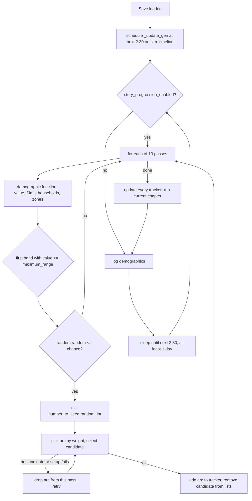
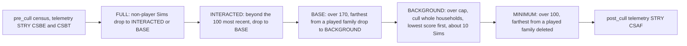

# 4.02 Story progression, households and townies

*Game version 1.128.90.1030. Numbers from the live tuning of the base game plus EP04 (Cats & Dogs: pet adoption arcs), GP04 (Vampires: one death type), EP12 (High School Years) and GP12 (Werewolves: Sim info fixups), and the townie targets of every installed world; module tuning comes from the base delta build. Written 2026-10-12. Checked 2026-10-12: 122 claims checked, 23 corrected, 4 relabelled, 1 removed, 5 added.*

## In plain words

While you play one household, the game keeps a small simulation of everyone else running in the background. Once
a Sim day, at 2:30 in the morning, it looks at the whole save and asks a handful of questions: are there few young
children around, are many houses empty, are many Sims unemployed. Depending on the answers it starts short
"stories" for a few unplayed Sims: a pregnancy, an adoption, an accidental death, a new job, a resignation, a
retirement, a new friendship or romance, a family moving into an empty house or out of an occupied one. Two sets
of story settings in the save decide which of these stories may touch your own households and which may touch
everyone else.

A second, older machine runs beside it every 20 Sim minutes. Its most important job is culling: the save may hold
about 1,041 Sims in total, and each night between 2:00 and 6:00 the game pushes far-away Sims into lighter
storage and deletes whole unimportant townie households when there are too many. A household is safe from that
deletion if any member is in a player household, is on the lot right now, is travelling, carries a protective
trait, or is still kept in more detail than the background level.

When the game needs a stranger (a barista, a walk-by, a date), it asks the Sim filter service. That service scores
every existing Sim against the request, and only when nobody fits does it make a new one. Making one new Sim makes a
whole household from a random household template, so a request for a single townie can add a family of several
Sims to your save.

Three things may surprise players. Move-ins only use homeless households that already exist, including families
the game made when it needed a stranger; this version has no code that fills empty lots with freshly made
families, even though tuning for it is still shipped. Every street but one aims for five townies who "live" there,
so new townies first go to streets that have fewer, and only once each street has five are they spread at random.
And the move-in matcher meant to favour married couples for houses with double beds tests the spouse the wrong way
round, so that bonus never applies.

## Key facts

- One `StoryProgressionService` runs two systems: a daily arc pass at **2:30** Sim time (`UPDATE_TIME`) and a
  round-robin of six older actions, one action per **20** Sim-minute alarm (`INTERVAL`).
- The daily pass runs **13** tuned passes in order. Each pass measures one demographic, picks the first band whose
  ceiling it falls under, rolls the band's chance with Python's global `random`, and seeds that many arcs.
- **21** story arcs are live (11 single-Sim, 8 multi-Sim, 2 household). The "Horse Adoption" pass names three
  EP14 (Horse Ranch) arcs that are not installed, so it ends with no arcs every night, harmlessly.
- Eight live loots (`loot_DiscussExpandingTheFamily_SeedArc_*`) start pregnancy and adoption arcs directly. That path
  checks the global switch and exclusivity, never the household's story settings.
- The player option `story_progression_effects_enabled` turns the whole daily pass off; culling and the old actions
  ignore it.
- The `MY_HOUSEHOLDS` domain defaults **off** and `OTHER_HOUSEHOLDS` **on**
  (`StoryProgTunables.DOMAIN_ENABLEMENT_DEFAULTS`); a household with no rules of its own inherits the set for its kind.
- An arc stuck on its preconditions stays active and retries every night; the tracker never expires it. Finished
  arcs stay in history for **5** Sim days.
- The Sim info cap is **1,041**: per-LOD caps 35 FULL, 100 INTERACTED, 170 BASE, 628 BACKGROUND, 100 MINIMUM, plus
  `Household.MAXIMUM_SIZE` **8**.
- Culling runs between **2:00 and 6:00** when its turn comes, and out of cycle when the save reaches
  **int(1,041 × 1.15) = 1,197** Sim infos (the fire meter, checked every 120 Sim minutes).
- The background pass deletes whole households lowest score first, aiming at no more than **10** Sims per run;
  the last household can carry it to 17. The culling buffer is **15%** below each cap.
- Culling score = relationship depth with player Sims, weighted by how long ago the other Sim was last saved while
  instanced, + up to **10** points for having been instanced in the last **7** days, + **10** for living on a lot,
  + **10** for a premade Sim, + fame and service bonuses.
- A household holds at most **8** Sims; unborn babies, pending adoptions and story-reserved slots all count.
- The Sim filter keeps a sliding window of the top **5** scorers and draws one by weight at a time; **671** of the
  **694** live Sim filters use weighted random picks.
- **29** of the 30 live streets tune `townie_demographics.target_population` to **5** (Forgotten Hollow has none). A
  brand-new townie goes to a street below 5 homeless townies, weighted by the shortfall; only when every candidate
  street has met it is the street a uniform random choice.
- **6** Sim info fixups are live; they run when a Sim is created, on its first load, or when it joins the active
  household.

## How it works

### Two systems inside one service

**Observed** (`story_progression_service.py`, rescued per function and checked in bytecode): the service holds a
tuned list `ACTIONS` and a tuned list `STORY_PROGRESSION_PASSES`.

- **Arc system (daily).** `on_all_households_and_sim_infos_loaded` schedules the generator `_update_gen` on
  `time_service().sim_timeline` at the next `UPDATE_TIME` (live 2:30). Each loop: if `story_progression_enabled`,
  run `seed_new_story_arcs_gen`, then `update_story_progression_trackers_gen`. It always writes a demographics log
  record and sleeps until the next 2:30; a span of zero or less becomes one day. An exception is logged and the
  loop reschedules.
- **Action round-robin (every 20 Sim minutes).** `on_client_connect` registers `_initialize_alarm` for
  `ZoneState.RUNNING`. That alarm repeats every `clock.interval_in_sim_minutes(INTERVAL)` with live `INTERVAL` 20
  (the tunable is declared as real seconds; the code reads it as Sim minutes). Each tick, `_process_next_action`
  calls `process_action_index` for one index and advances the index. The action runs only if
  `action.should_process(flags)`. With six live actions, each one gets a turn every 120 Sim minutes.
- `story_progression_enabled` is `_story_progression_enabled_in_options and
  _story_progression_enabled_via_killswitch`. `load_options` copies `options_proto.story_progression_effects_enabled`.
  `process_action_index` never reads it, so culling and the other actions run whatever the option says.
- The zone's update calls `StoryProgressionService.update()` only when the game is not paused
  (`zone.py: Zone.update`). That method advances a private `Timeline` scaled by `_timeline_multiplier`.
  **Inferred:** nothing in the service schedules work on that private timeline (the arc generator sits on
  `sim_timeline`), so `story_progression.set_time_multiplier` has no visible effect.

### Seeding: the 13 passes

**Observed** (`StoryProgressionService._seed_arcs_from_pass_and_neighborhood_gen`, bytecode, since the function did
not decompile). For each pass:

1. No potential arcs left after pack-safe loading: result `FAILED_NO_ARCS`.
2. Call the pass's demographic function; it returns a value and lists of Sims, households and zones. A value of
   `None` fails the pass.
3. Take the first `demographic_data` entry whose `maximum_range` is at or above the value.
4. If `random.random() > chance_of_occurrence` (Python's global generator), the pass seeds nothing.
5. `number_to_seed.random_int()`; zero seeds nothing. **Observed** (`sims4/tuning/tunable.py:
   TunedInterval.random_int`, bytecode): this builds a fresh `random.Random(seed)` with `seed=None`, so the count
   comes from an OS-seeded generator, separate from the global one.
6. Repeat that many times: pick an arc with `sims4.random.weighted_random_index` (global `random` underneath), ask
   its candidate selection function for a target, check the tracker, run the arc's setup. Any failure deletes that
   arc from this pass's list and picks again; when the list empties, the whole pass stops. A success removes the
   chosen Sim, household or zone from the demographic lists. The arc stays in the list, so it can seed again on
   another target.

`seed_new_story_arcs_gen` runs a `GLOBAL` pass once with no neighbourhood, and a `PER_WORLD` pass once per
neighbourhood in the save. **Observed** (`story_progression_demographics.py`):

- `sim_test`: the share of Sims passing the initial tests that also pass the demographic tests; returns the passing
  Sims.
- `total_sim`: `len(sim_info_manager) / CullingTuning.total_sim_cap` (1,041 live).
- `residential_lot` (`ResidentialLotDemographicFunction`, bytecode): walks residential lots (one neighbourhood, or
  all of them when none is given). An occupied lot counts in the total. An empty lot counts only if it has beds: the
  zone's saved `bed_info` (beds, else alternative sleeping spots), else the bed count tuned for its house
  description in `StoryProgressionLotSelection.REGION_TO_HOUSEHOLD_POPULATION_DATA` (22 regions in base delta); an
  empty lot with `lot_template_id` 0 is skipped. With `check_filled_lots` the value is occupied ÷ total, otherwise
  empty-with-beds ÷ total. A visited lot with saved bed info counts even when its region has no population data,
  but the MoveIn selector reads 0 beds for such a lot (it checks the region first), so it never receives a move-in.

Live passes, in tuned order (**Observed**, `story_progression.story_progression_service` module tuning, base delta;
packs ship no module tuning). Band ceilings and chances are percents; "n" is the number seeded; a band with no
ceiling uses the code default 100%. Only the AccidentalDeath value can pass 100%: above 1,041 Sim infos no band
matches and that pass seeds nothing.

| Pass (EA's name) | Measures | Type | Bands: ceiling: chance, n | Arcs (weight) |
|---|---|---|---|---|
| Pregnancy and Human Adoption | share of tested Sims aged child or younger | global | 8: 100%, 2; 11: 85%, 1–2; 14: 70%, 1–2; 17: 50%, 1; 20: 20%, 1; above: 0 | Pregnancy (3), AdoptABaby (1), AdoptAToddler (1), AdoptAChild (1) |
| AccidentalDeath | Sim infos ÷ 1,041 | global | 15: 0; 20: 10%, 1; 50: 20%, 1–2; 90: 50%, 1–2; 100: 75%, 1–2; above 100: none | AccidentalDeath |
| MoveIn | empty-with-beds share of residential lots | per world | 30: 0; 80: 15%, 0–1; above: 25%, 0–2 | MoveIn |
| Cat or Dog Adoption | sim_test | global | 5: 60%, 1–2; 10: 40%, 1; 20: 20%, 1; above: 0 | AdoptACat, AdoptADog_Big, AdoptADog_Small (EP04) |
| MoveOut | occupied share, all worlds | global | 40: 0; 70: 40%, 0–1; above: 60%, 0–2 | MoveOut |
| Career Add | sim_test | global | 20: 10%, 1; 80: 50%, 1; above: 67%, 1–2 | CareerAdd |
| Career Remove | sim_test | global | 30: 10%, 1; 80: 15%, 1; above: 33%, 1–2 | CareerRemove |
| Career Retire | sim_test | global | 50: 10%, 1; 80: 20%, 1; above: 33%, 1–2 | CareerRetire |
| Horse Adoption | sim_test | global | 2.5: 50%, 1–2; 5: 30%, 1; 10: 10%, 1; above: 0 | AdoptAHorse_Child (2), _Adult (2), _Elder (1): EP14 arcs, not installed, so the pass has no arcs |
| Friendship Changes | sim_test | global | any: 99%, 1–5 | BecomingFriends (1), FriendshipGain (3), FriendshipLoss (3), BecomingBestFriends (10), BecomingDespised (10) |
| Romance Sart | sim_test | global | 20: 10%, 1; 80: 50%, 1; above: 67%, 1–2 | RomanceRelationshipStart |
| Romance End | sim_test | global | 20: 10%, 1; 50: 15%, 1; above: 33%, 1–2 | RomanceRelationshipEnd |
| Romance ReStart | sim_test | global | any: 99%, 1 | RomanceRelationshipReStart |

**Inferred** from the bands: the system is a thermostat. Few young children means more pregnancies, a crowded save
means more accidental deaths, many empty houses mean more move-ins, full worlds mean more move-outs. The Sim lists
that `sim_test` returns drive only the chance for filter-based arcs; the target itself comes from the filter (next
section).

### Picking the target

**Observed** (`story_progression_candidate_selection.py`, the base filter checked in bytecode). Every selection first
drops Sims that are not NPCs (`is_npc` means "not in the active household"), have no story tracker, fail their
household's rule set for the arc's `required_rules`, belong to a household running a scenario, or fail
`can_add_arc`. Households are also dropped when active.

| Function | Live users | How it picks |
|---|---|---|
| `sim_from_demographic_list` | CareerAdd, CareerRemove, CareerRetire | `random.choice` (Python global) from the demographic list |
| `sim_from_filter` | Pregnancy, the 3 human and 3 pet adoptions, AccidentalDeath | `submit_filter` with the active household blacklisted and the arc required; `weighted_random_item` by filter score |
| `multi_sim_from_aggregate` | all 8 relationship arcs | aggregate filter: keeps the first result (the leader slot), then draws the others from the rest with `weighted_random_index` by score |
| `household_and_livable_lot_from_demographic_list` | MoveIn | pops random empty zones (`random.randint`) until one has beds, then draws a household for that zone only (below) |
| `household_based_on_culling` | MoveOut | households with a home; weight = 1 ÷ the highest member culling score (a tiny epsilon if ≤ 0) |

**Observed** (live tuning): the filters are `filter_Story_Progression_ChildrenStories_Pregnancy`,
`..._HumanAdoption` (baby, toddler, child), `..._PetAdoption_Cat`, `..._PetAdoption_Dog` (both dog arcs) and
`filter_Story_Progression_AccidentalDeath`; the relationship arcs use `filter_Aggregate_NeighbothoodStories_*`
(EA's spelling). **Inferred:** MoveOut favours households with the weakest ties to player Sims, the same score
culling uses.

**Observed** (`story_progression_candidate_selection.py`, MoveIn selector in bytecode): households fail if they
are active, fail the rule set, fail `can_add_arc`, or have a member passing `invalid_household_test`. The selector
commits to the first popped zone with beds and returns `weighted_random_item` over every remaining household's
weight there. Weights of 0 stay in the list, and when they are all 0 the draw returns no household, so the arc fails
for that pass even if another empty lot would have suited a household.

**Move-in weighting.** **Observed** (`story_progression_lot_selection.py:
StoryProgressionLotSelection.get_household_weight`, bytecode). A household qualifies only if `available_to_populate_zone()`: homeless, not hidden, at least one human,
nobody in a travel group (`household.py`, rescued). Weight = the `NUM_BEDS_TO_IDEAL_HOUSEHOLD_CURVE` curve for the
lot's bed count, read at the household's member count (1 when the bed count has no curve; zero or less rejects). It is then multiplied by `RELATIONSHIP_UTILITY_CURVE`
of the mean member relationship score with player Sims (0 → 1, 100 → 1.5), by `KID_TO_KID_BED_MULTIPLIER` 1.2 when
the lot has a kid bed and a member is a baby, toddler, child or teen (`age <= Age.TEEN`; infants, enum value 128,
do not count), and by `SIGNIFICANT_OTHER_MULTIPLIER` 1.5 when the lot has a double bed and the household is married.
Two bytecode details change the outcome (the decompiled source hides the first):

- The married test jumps past the bonus when `spouse_sim_id` is set and only looks the spouse up when it is empty
  (None for an unmarried Sim), which never finds a member. So the 1.5 multiplier never applies (**Observed** jump
  and data flow; **Inferred** player effect: married homeless couples get no preference for double beds).
- Inside each member's loop the depth term overwrites the running total (`total = depth × 0.5`, then
  `+= tracks × 0.5`), so only the last player relationship the loop visits counts (**Observed**).

Live ideal-household curve (beds → members: weight): 1 bed: 1: 1.2. 2 beds: 1: 0.5, 2: 1.2. 3 beds: 1: 0.4, 2: 0.7,
3: 1.2. 4 beds: 1: 0.1, 2: 0.4, 3: 0.8, 4: 1.2. 5 beds: 0.2, 0.4, 0.7, 1, 1.2. 6 beds: 0, 0.1, 0.5, 0.75, 1, 1.2.
7 beds: 0, 0.1, 0.25, 0.5, 0.8, 1, 1.2. 8 beds peak at 1.2 for 8 members. So a household the size of the bed count
is preferred, and smaller households are allowed with lower weight. Larger households are not penalised:
`sims4.math.LinearCurve.get` holds the last point beyond the curve, so a family of six weighs 1.2 on a two-bed lot,
the same as a couple (**Observed**). A lot with more than 8 beds has no curve and weight 1.

### Running an arc: trackers, chapters, exclusivity

**Observed** (`story_progression_tracker.py`, `story_progression_chapter.py`, rescued `story_progression_arc.py`):

- Arcs live on a Sim's or a household's `story_progression_tracker`. `update_arcs_gen` skips a Sim tracker while
  the Sim is in a travel group or instanced, and a household tracker while the current zone is the household's home.
- `update_story_chapter` runs `_can_update`, preconditions, `pre_action_loot_list`, each action's
  `run_story_progression_action`, then `loot_list`. A Sim chapter fails with `FAILED_ROTATION` when the Sim is not
  an NPC; a household chapter fails when the household is active.
- The next chapter comes from `linked_chapters`, weighted by `TunableMultiplier` and drawn with `pop_weighted`.
- A success schedules the arc's drama nodes (`schedule_drama_nodes_gen`); a result marked historical moves the arc to
  history. Any failure other than `FAILED_PRECONDITIONS` removes the arc. A precondition failure keeps the arc and
  retries it next night, with no limit in this loop.
- History expires after `StoryProgTunables.HISTORY.chapter_history_lifetime`, 5 days (code default; not in delta).
- `can_add_arc` checks exclusivity against every arc on the Sim and its household (Sim tracker), or on the
  household and all members (household tracker). Live categories: Career 1, Death 2, AddFamilyMember 4, Moving 8,
  RelationshipChanges 16. Live exclusive pairs (`StoryProgressionExclusivity.EXCLUSIVITY_RULES`): Career+Career,
  Career+Death, Death+Death, AddFamilyMember+AddFamilyMember, Death+AddFamilyMember, Death+Moving, Moving+Moving,
  and RelationshipChanges with every category including itself.
- The compatibility test looks up `category_1 | category_2` in the rule set. The tuning text says a NEUTRAL (0) arc
  goes with anything, but `0 | Career` equals `Career | Career`, so a NEUTRAL arc would clash with every category
  that has a rule with itself (all five live ones). No live arc is NEUTRAL; all 21 tune a category (**Observed**).
  A modder's arc that leaves the field at its default inherits this.

Live chapters (**Observed**, the live merge): 20 `SimStoryChapter` (17 base, 3 EP04), 2 `HouseholdStoryChapter`.
Every arc is one chapter long except Pregnancy, whose `_Chapter1` (action `pregnancy`) links to an action-less
`_Chapter2`. The `career_promote` action exists in code and no live chapter uses it.

### What each story does

All **Observed** in `story_progression/story_progression_actions/`, effects downstream **Inferred** where marked.

- **Pregnancy** (`MakePregnant`): needs `household.free_slot_count > 0`, reserves 1 slot, takes the first result of
  `pregnancy_partner_filter`, calls `pregnancy_tracker.start_pregnancy`. Birth follows the normal pregnancy, see
  [3.09 Life cycle](3.09-life-cycle.md).
- **Adoption** (`AddFamilyMember`): reserves a slot, builds a Sim from the tuned template's `sim_creator` with the
  adopter's last name via `SimSpawner.create_sim_infos` (creation source `neigh_pop_service:add_member:<template>`),
  injects it into the household off-lot and initialises it as adopted. `load_custom_data` reads the new member id
  with `read_bool` (**Observed**). The id is set only inside the run and nothing in gameplay reads it back, so the
  slip shows only in debug views.
- **Accidental death** (`DeathStoryProgressionAction`): setup fails if any trait has `can_die` False
  (`aging_mixin.py: is_death_disabled`). Live `simStoryChapter_AccidentalDeath` lists 16 death types; types whose
  `additional_pack_requirement` is not installed are skipped (bytecode). Here that leaves Cowplant, Electrocution,
  Anger, Laughter, ElderExhaustion, Embarrassment, Fire, Drown and Sun (needs GP04); BrokenHeart from EP16 (Lovestruck),
  Frozen and Overheat from EP05 (Seasons), ClimbingRoute from EP10 (Snowy Escape), WitchOverload from GP08 (Realm of Magic),
  and KillerRabbit and KillerChicken from EP11 (Cottage Living) drop out. Each has base weight 1 (code default; BrokenHeart
  tunes it to the same 1) and tested multipliers from 0 to 3, then `weighted_random_item`. The action calls
  `death_tracker.set_death_type(type, is_off_lot_death=True)` and `handle_adultless_household()`.
- **Careers**: Add picks a career with `career_story_progression.joining`, by weight, at a level
  `random.randint(1, max_user_level)` (Python global) without skipped rewards; Remove calls
  `quit_quittable_careers(1)`; Retire is weighted. Careers themselves: [3.10](3.10-skills-careers-school.md).
- **Relationships** (`relationship_modified`): only checks that the track exists (and romantic compatibility when
  asked) and returns success (bytecode). The actual change is the chapter's loot (**Observed**, live tuning): the
  three romance chapters carry one `loot_list` entry each, the five friendship chapters one `pre_action_loot_list`
  entry each. Relationship numbers: [3.08](3.08-relationships-socials.md).
- **Move in**: sets lot ownership for the chosen household on the chosen zone; the run fails if the zone gained a
  household meanwhile. When no zone was supplied, setup scans every neighbourhood for empty residential lots with
  weight above 0. In bytecode that branch builds a `FAILED_TESTS` result and discards it, then calls
  `weighted_random_item([])`, which returns `None`; MoveIn always gets a zone from its selector, so this fallback
  only matters to modders.
- **Move out**: `household_manager.add_pending_transfer(id, True, None)` then
  `move_household_out_of_lot(household, sell_furniture=True, delta_funds=0)`, which sends `MSG_MOVE_FAMILY_OUT` to
  the client. **Inferred:** the client does the lot clearing and the household becomes homeless.

### Player settings

**Observed** (`story_progression_rule_set.py`, `story_progression_service.py: load`):

- Two save-wide rule sets are read from the save game proto: `protected_households_story_progression_rule_set` and
  `unprotected_households_story_progression_rule_set`. A rule set has an `enabled` flag and a rule id → bool map; an
  unlisted rule counts as off. `verify(rules)` fails when the set is disabled or any of the arc's `required_rules`
  is off.
- `HouseholdStoryProgressionRuleSet` uses the household's own rules when it has any. With none it falls back to the
  protected set if `household.is_player_household`, else the unprotected set.
- 11 live rules (`StoryProgressionRuleDisplayInfo`, 10 base, `_AdoptPet` from EP04): AccidentalDeath, AdoptChild,
  AdoptPet, FriendshipUpdate, HaveChild, JoinCareer, MoveIn, MoveOut, QuitCareer, Retire, RomanceUpdate.
- `StoryProgTunables.DOMAIN_ENABLEMENT_DEFAULTS` (exported to the client only): MY_HOUSEHOLDS False, OTHER_HOUSEHOLDS
  not tuned, so the code default True. **Inferred:** `MY_HOUSEHOLDS` maps to the protected set and these are the
  defaults the client writes into a new save.
- **Inferred:** other played households are NPCs whenever they are not the active one, so with the protected set
  enabled, the arcs can reach them too.
- Arcs started by loot skip the rule sets. **Observed** (`story_progression_loot.py: SeedStoryArc`, live tuning):
  eight live loots, `loot_DiscussExpandingTheFamily_SeedArc_*` (Pregnancy for the target or the target's partner,
  baby, toddler and child adoption in base, cat and both dog adoptions in EP04), seed the arc on the target Sim. The
  op checks only `story_progression_enabled` and `can_add_arc` (exclusivity). The nightly chapter update still
  refuses a Sim in the active household (`FAILED_ROTATION`, which removes the arc).

### The older actions

**Observed** (`story_progression/actions.py`, base delta tuning). Live `ACTIONS`, in round-robin order:

| # | Action | What it does here |
|---|---|---|
| 0 | `initial_population` | If fewer than 5 homeless households exist (`_homeless_households` 5–5; homeless means `home_zone_id == 0`, bytecode of the generator), requests the difference from the population service, then marks the current neighbourhood's `npc_population_state` COMPLETED. It stops once the top-up has succeeded (a flag on the tuned action object, so once per game launch) and the neighbourhood is complete; a neighbourhood not yet complete runs it again. |
| 1 | `max_population` | Culling (below). |
| 2 | `rentable_lot_population` | Runs whenever there is an active household, for the current neighbourhood only, and only in regions 176583 and 65983 (venues 103675, 28614 `venue_residential`, 173833): wants `floor((rented + free) × density)` lots rented, density 80% (code default), at least `min_to_populate` 2. For each lot it first sends an existing household (not hidden, not travelling, with a young adult or older human passing `CAN_RENT_TESTS`) picked with `random.choice`, plus `random.sample` companions; only when no household qualifies does it create one from the templates for the travel group size (1 bed → 1 Sim up to 5 beds → 4). The stay lasts 3 Sim days (`duration` literal 3). 103675 and 173833 have no live record here. |
| 3 | `relationship_culling` | Window 2:00 to 5:00 (factory default); its limits come from the module delta of `story_progression_action_relationship_culling` (35 relationships per played NPC, depth threshold 0); see [3.08](3.08-relationships-socials.md). |
| 4 | `fame` | Counts famous Sims for telemetry between 2:00 and 6:00; changes nothing in game. |
| 5 | `university` | Daily at 20:00 for non-active Sims with a degree tracker; live `performance_gain_per_day` 12–15 (code 70–90). **Observed:** `degree_tracker.required_packs` is EP08 (Discover University), not installed, and `sim_info.py` skips trackers whose pack is missing, so no Sim has one and the action does nothing here. |

**Population flags, traced end to end.** **Observed:** the service starts with `StoryProgressionFlags.DISABLED`. A
byte search of every compiled module finds the flag setters called only by `debug.toggle_initial_story_progression`
(`developer_commands.py`), which has no command type and is therefore DebugOnly and absent from retail; the client's
strings carry no flag names. The flags matter less than they seem:

- The live `initial_population` entry is `StoryProgressionInitialPopulation`, whose `should_process` overrides the
  base class and ignores the flags. With `ALLOW_INITIAL_POPULATION` its `process_action` only adds a STARTED step
  before marking the neighbourhood COMPLETED.
- No code fills empty lots. `_region_to_population_density` and `_get_neighborhood_availability_data` have no reader
  in any module, so the live density values (region 15740: 50%, 8086: 60%, 93517: 25% with 6 lots kept empty) do
  nothing whatever the flags say.
- The save's `GameplayOptions.npc_population_enabled` field (beside `max_player_population`) is read by no Python.
  **Inferred:** whether the client uses it cannot be read here.
- Apart from the player's own moves and the rentals above, empty lots fill only through the MoveIn arc, from
  homeless households: the five-household top-up above and the households that filter-made townies bring with them
  (`submit_matching_filter` passes no zone, so those households are created homeless).

### Culling: caps and passes

**Observed** (`story_progression_action_sim_info_culling.py`, rescued and checked in bytecode). Live
`sim_info_cap_per_lod`: BACKGROUND 628, BASE 170, FULL 35, INTERACTED 100, MINIMUM 100. At tuning load the action
sets `SimInfoManager.SIM_INFO_CAP = Household.MAXIMUM_SIZE + sum(caps)` = 8 + 1,033 = **1,041**. LOD levels
themselves: [1.03](1.03-performance-lod.md).

`should_process` passes only between `time_of_day` 2:00 and 6:00 (code default). `process_action` runs in this order:

- Number to act on: `_get_num_to_cull(count, cap) = int(count - cap × (1 - 0.15))` when count > cap, else 0. So
  culling overshoots each cap down to 85% of it.
- FULL: instanced Sims are immune; non-player FULL Sims always drop (to INTERACTED if they interacted with the
  active Sim, else BASE); player Sims with a home are immune. Homeless player Sims are immune too because
  `homeless_played_demotion_time` is not tuned (an `OptionalTunable` left disabled).
- INTERACTED: Sims that interacted with the active Sim are ranked newest first
  (`CullingService.get_interacted_sim_ids_in_priority_order`); everyone after the 100th drops to BASE. This pass
  uses the cap directly, with no 15% buffer.
- BASE: `_process_low` drops `_get_num_to_cull` Sims to BACKGROUND, farthest from a played family first.
- BACKGROUND: the cap shrinks by however many Sims above BACKGROUND exceed FULL cap + 8 (43). Sims with any
  `get_culling_immunity_reasons()` are immune: player household (`imsp`), a trait whose `culling_behavior` is immune
  (`imsa`), instanced (`imsn`), in a travel group (`imst`). A household is immune if any member is above BACKGROUND
  or immune. Each other household scores the maximum of its members' culling scores; ascending order; each culled
  household subtracts its size from `min(num_to_cull, MAX_HOUSEHOLD_CULLING = 10)` and the loop stops once that
  reaches 0, so a run removes at most 9 Sims plus one more household (up to 17). **Inferred:** with a turn every
  120 Sim minutes, two runs fall inside the 2:00 to 6:00 window on a normal night.
- `cull_household` (bytecode): notification and `set_to_hidden`; a member with a player Sim in the family tree
  drops to MINIMUM (kept for genealogy), every other member is `remove_permanently(culled=True)`.
- MINIMUM: over the cap, Sims are deleted (`remove_permanently()`) farthest from a played family first, with no
  immunity check in this pass (`_process_minimum` hands `_process_low` a delete callback; bytecode).
- Family distance: 0 for spouses and siblings of played Sims, else the smaller of ancestor and descendant BFS steps
  to a played Sim, `MAX_INT32` when unrelated.
- `CullingReasons.LIVES_IN_WORLD` (`imsw`) exists in the enum and nothing in `get_culling_immunity_reasons` appends it.

**Fire meter.** **Observed** (`sims/sim_info_firemeter.py`, module not in delta, so code defaults): an alarm every
`FIREMETER_FREQUENCY` 120 Sim minutes; when the Sim info count reaches `int(cap × (1 + 0.15))` = 1,197 it calls the
max-population action with `SIM_INFO_FIREMETER`, outside the 2:00–6:00 window.

### Culling score

**Observed** (`sims/culling/culling_service.py: CullingService.get_culling_score_for_sim_info` and
`_get_culling_score_for_npc`, bytecode), live `sims.culling.culling_tuning`:

- Relationship part: for each relationship where either Sim is a player Sim, `(depth × RELATIONHSIP_DEPTH_WEIGHT 1 +
  bidirectional tracks × RELATIONSHIP_TRACKS_MULTIPLIER 0) × RELATIONSHIP_INSTANTIATION_TIME_CURVE(days since the
  other Sim was last saved)`; curve 0 days: 1, 3: 0.8, 21: 0.3. NPC to NPC relationships count for nothing.
- Recency: `max(0, (LAST_INSTANTIATED_MAX 7 - days since this Sim was saved) × LAST_INSTANTIATED_WEIGHT 1.43)`, about
  10 for a Sim saved today. A Sim with no `time_sim_was_saved` counts as `LAST_INSTANTIATED_MAX / 2` = 3.5 days,
  about 5 points.
- Importance (NPCs only): service NPC, roommate and business scores, trait `culling_behavior` scores, fame rank via
  `FAME_CULLING_BONUS_CURVE` (rank 0: 1, rank 5: 5), +`CULLING_SCORE_IN_WORLD` 10 if the household has a home lot,
  +`CULLING_SCORE_PREMADE` 10 for a premade Sim (both code defaults).

**Ghosts.** **Observed** (`culling_service.py`): a Sim whose death type is set gets `commodity_Culling_Ghost`
(161328); a ghost in a player household loses it, both on load and when it joins one. At the commodity's floor the ghost drops
to MINIMUM, leaves its household for a hidden one and plays the release effect; a warning notification fires at
value 20160. The off-lot urnstone placement and pending-cull handling on load belong to
[3.09](3.09-life-cycle.md) and [1.01](1.01-time-scheduling-loading.md).

### Households

**Observed** (`sims/household.py`, the class body failed to decompile and was read per function and in bytecode;
`sims/household_manager.py`; `sims/sim_info.py`):

- Kinds. `is_active_household` = id equals `services.active_household_id()`. `set_played_household(v)` sets both
  `_is_played_household` and `_is_player_household`. `SimInfo.is_npc` = not in the active household;
  `is_player_sim` reads the household's player flag. A hidden household (`set_to_hidden`) clears lot ownership,
  businesses, rewards and player flags and resets funds to `NPC_HOUSEHOLD_DEFAULT_FUNDS` (20,000, code default,
  tuned in neither build). A dependent household (`set_to_dependent`) keeps funds but loses its lot.
- Size. `free_slot_count = MAXIMUM_SIZE (8) - Σ(1 + unborn offspring + story-reserved slots) - adopting Sims`.
- Adultless households (`handle_adultless_household`, bytecode): if no member `can_live_alone` (teen or older human),
  every member's Sim is destroyed if instanced, every member drops to BACKGROUND LOD, and the household becomes
  dependent. Hidden and premade households can be skipped by flags.
- Funds: a new household gets `starting_funds`, default `NPC_HOUSEHOLD_DEFAULT_FUNDS`; household templates tune
  `_household_funds` (code default 20,000). Bills and money: [5.01](5.01-money-bills-rewards.md).
- `HouseholdManager` loads households from the save (with a fixup helper for Sims shared between households),
  moves Sims between households (`switch_sim_from_household_to_target_household`, which also applies
  `ON_ADDED_TO_ACTIVE_HOUSEHOLD` fixups when the target is active), keeps pending transfers and moves households out
  of lots.
- `SimInfoManager.remove_permanently` blacklists the Sim globally in the filter service while it removes clubs, clan
  data and every relationship. `SimInfo.remove_permanently` also tells social media and the family tree and deletes
  the Sim's save record.
- `PlayerPopulationTest` (`sims/households/household_tests.py`, generator in bytecode) sums members of player
  households against the option `max_player_population`; 0 means no limit.

### Townies and the Sim filter service

How a request is served (situations and the bouncer that send most requests: [4.01](4.01-situations-npcs.md)).
**Observed** (`filters/sim_filter_service.py`, rescued and bytecode):

1. `submit_filter` only finds Sims; `submit_matching_filter` may create them. Requests queue and the head request
   runs each zone update (also during spin-up).
2. Scoring: every Sim (or the constrained ids) gets the product of its filter term scores, each floored at the
   term's `minimum_filter_score`, stopping at 0. Only scores above 0 stay. A weighted filter with more than 5
   results shuffles them (Python `random.shuffle`). **Inferred:** the later sort by score is stable, so the shuffle
   only breaks ties.
3. Removal: request blacklist, the global blacklist (phone call, Sim being removed, missing pet, rabbit hole; the
   last two can be excused), and Sims failing the required arc's rule set or `can_add_arc`. Matching requests also
   drop instanced Sims unless the request allows them.
4. Selection: sort by score. With `use_weighted_random`, keep a window of the top `TOP_NUMBER_OF_SIMS_TO_LOOK_AT`
   (5), `sims4.random.pop_weighted` one, slide the next result in, repeat; otherwise take the top scores.
5. Not enough Sims and the request may conform: create Sims one per update until filled, then call back.

Creating a Sim (**Observed**, `filters/tunable.py: TunableSimFilter.create_sim_info`):

1. Repurpose first if the filter allows: `use_constrained_sims` tries the request's constrained Sims;
   `use_unimportant_sims` (the `UNIMPORTANT_FILTER`, `filter_Unimportant`) and `use_specific_sims` (a named filter)
   search for existing Sims. Non-conformable terms must score above 0, then the Sim is conformed. Live: 25 filters
   use unimportant Sims, 26 a specific filter, none constrained Sims.
2. Pick a Sim template with the `TemplateChooser` (`pop_weighted`).
3. `DemographicsService.choose_world_and_conform_filter`: with `automatically_assign_as_street_townie` (default
   True; 38 live filters set it False) every world in the save starts as a candidate; otherwise the candidates are
   the intersection of the whitelists from the filter's demographics terms (with none, no street is assigned). Blacklists then
   remove worlds. Worlds below their street's `target_population` are weighted by the shortfall
   (`weighted_random_item`); if all have met it, `random.choice` (both Python global). The chosen street then adds
   one weighted `filter_features` entry (extra terms, tags, name type).
4. Conform the creator to each forced term; random breed for pets; CAS randomization mode.
5. `create_template_matching_sim_creator`: `random.choice` among all household templates (or the override) with any
   member matching the creator. `HouseholdTemplate.create_household` creates the whole template household, rolling
   each optional member's `chance` with Python `random`, puts the requested creator into one matching slot
   (`random.choice`), applies
   template data and relationships.
6. Hide the household if `_set_household_as_hidden`, set its home world, conform the Sim info to the terms.

**Observed** (live tuning, references resolved): 29 of the 30 live `Street` records set
`townie_demographics.target_population` to 5; `street_ForgottenHollow` (GP04) leaves it disabled, which counts as 0.
A street's townie population is the number of Sims in homeless households whose home world is that street
(`get_population_counts`, and the generator in `world_meets_townie_population_cap`, both read in bytecode because
the decompile drops the filter). So while some streets have fewer than five, new townies go to those streets, more
often the larger the gap; once every candidate street has five, the pick is uniform. `world_meets_townie_population_cap`
is True when the street has reached its target or has none. A `LivesOnStreetFilterTerm` in its default
`match_target_population` mode (bytecode) scores 1 for a Sim from the tuned street, and also for a Sim from any
other street once the tuned street has met its target; 21 live terms use that mode and 2 `must_match`.

Template data (**Observed**, `filters/sim_template.py: TunableSimTemplate.add_template_data_to_sim`): skills, traits,
rank, perks, gender preference, relationship expectations, university, fixups, template id, the premade fixup flag
and pronouns, in that order. Sim generation itself: [3.01](3.01-create-a-sim.md).

### Homeless households and the population service

**Observed** (`filters/neighborhood_population_service.py`): one request at a time on `sim_timeline`. Homeless
requests draw from `HOMELESS_HOUSEHOLD_TEMPLATES` (25 live entries, weights 1 to 10; heaviest
`HH_template_NPC_parents_1CT` and `_parents_2CT` at 10) and create households with zone 0. Rentable-lot requests
check `CAN_RENT_TESTS`, pick zones with `random.choice` and create travel groups.

### Sim info fixups

**Observed** (`sims/fixup/`): a `SimInfoFixup` instance is a list of fixup actions plus a timing:
`ON_FIRST_SIMINFO_LOAD` 0, `ON_ADDED_TO_ACTIVE_HOUSEHOLD` 1, `ON_SIM_INFO_CREATED` 2. `FixupTracker.add_fixup`
applies a creation-time fixup at once and stores the others; `apply_all_appropriate_fixups(source)` applies and
drops the matching ones. Sources: a Sim template's `_fixups` and `SimInfoFixupFilterTerm`. Triggers: zone spin-up
(first-load fixups for Sims flagged `do_first_sim_info_load_fixups`, then active-household fixups; the state itself is
in [1.01](1.01-time-scheduling-loading.md)) and moving a Sim into the active household. `SimInfo.apply_fixup_actions`
also applies, and then removes, traits that carry fixup actions.

Action kinds: career, skill, unlock, perk, outfit transfer, outfit randomization, appearance, favorites, statistic
ops, developmental milestone ops, secrets. Live fixups: `simInfoFixup_ChopsticksPreference` (base, timing default),
`simInfoFixup_GrimRework_GrimAttraction` (base, on creation), `simInfoFixup_HighSchool_AStudent` (EP12, first load),
and three `simInfoFixup_WolfTown_Know*` unlocks (GP12, on joining the active household).

### Favorites, object knowledge and template affordances

- **Favorites** (**Observed**, `sims/favorites/`): a Sim's tracker maps a tag to an object id or definition id.
  `get_favorite_in_sim_inventory` prefers the remembered object, else the definition, else a tested random
  inventory object with that tag (Python `random.choice`). `SetFavoriteLootOp`, `FavoritesTest`,
  `HasAnyFavoriteOfTypeTest`, prop animation overrides in `FavoritesTuning.FAVORITES_ANIMATION_OVERRIDES`.
  `SimInfoFavoriteMixin` keeps a separate favourite recipe list.
- **Object knowledge** (**Observed**, `sims/object_knowledge/`): `AddObjectKnowledgeLootOp` records that a Sim knows an object
  with a tag in the global Sim-object relationship service, either the target or a random unknown object with the
  tag (`random.choice`, optionally only in the current zone).
- **Template affordance providers** (**Observed**, `sims/template_affordance_provider/`): `TemplateAffordanceTracker`
  counts active templates on a Sim and offers their interactions when the player picks that Sim; when the last
  instance stops, it keeps offering them for the template's `post_run_duration` (else `DEFAULT_POST_RUN_DURATION`)
  Sim minutes, and drops a template once an interaction carrying it completes on that Sim. The discipline template is its only concrete type; live tuning has 48
  `DisciplineTemplateSocialSuperInteraction` records, all from EP04 (**Inferred:** pet training).

## Numbers

| Name | Value | Unit | Where | Source |
|---|---|---|---|---|
| `UPDATE_TIME` | 2:30 | time of day | `StoryProgressionService` | delta |
| `INTERVAL` | 20 | Sim minutes | `StoryProgressionService` | delta (code 5) |
| passes | 13 | passes | `STORY_PROGRESSION_PASSES` | delta |
| live arcs | 21 (11 Sim, 8 multi, 2 household) | records | `STORY_ARC` | live |
| live chapters | 22 (20 Sim, 2 household) | records | `STORY_CHAPTER` | live |
| live rules | 11 | records | `StoryProgressionRuleDisplayInfo` | live |
| `chapter_history_lifetime` | 5 | days | `StoryProgTunables.HISTORY` | code default |
| `DOMAIN_ENABLEMENT_DEFAULTS` | My Households False, Other Households True | bool | `StoryProgTunables` | delta + code default |
| `_homeless_households` | 5–5 | households | `initial_population` | delta (code 1–3) |
| `_region_to_population_density` | 15740: 50, 8086: 60, 93517: 25 (min_empty 6) | percent | `initial_population` | delta (read by no code) |
| rentable lot regions | 176583, 65983 | region ids | `rentable_lot_population` | delta |
| rentable `min_to_populate` | 2 | lots | `rentable_lot_population` | delta (code 3) |
| rentable `density` | 80 | percent | `rentable_lot_population` | code default |
| rentable `duration` | 3 | Sim days | `rentable_lot_population` | delta |
| `sim_info_cap_per_lod` | 35 / 100 / 170 / 628 / 100 | Sims | FULL / INTERACTED / BASE / BACKGROUND / MINIMUM | delta (code 210 each) |
| `SIM_INFO_CAP` | 1,041 | Sims | derived | live |
| `culling_buffer_percentage` | 15 | percent | `max_population`, `CullingTuning` | delta (code 20) |
| culling `time_of_day` | 2:00–6:00 | time of day | `max_population` | code default |
| `MAX_HOUSEHOLD_CULLING` | 10 | Sims per run (whole households, so up to 17) | culling module constant | code |
| `homeless_played_demotion_time` | disabled | | `max_population` | code default |
| `FIREMETER_FREQUENCY` | 120 | Sim minutes | `SimInfoFireMeter` | code default |
| `SIM_INFO_ALLOWED_PERCENTAGE_ABOVE_CAP` | 15 | percent | `SimInfoFireMeter` | code default |
| `RELATIONHSIP_DEPTH_WEIGHT` | 1 | per depth point | `CullingTuning` | delta (code 0.5) |
| `RELATIONSHIP_TRACKS_MULTIPLIER` | 0 | per track | `CullingTuning` | delta (code 2) |
| `RELATIONSHIP_INSTANTIATION_TIME_CURVE` | 0: 1, 3: 0.8, 21: 0.3 | days → factor | `CullingTuning` | delta |
| `LAST_INSTANTIATED_MAX` | 7 | days | `CullingTuning` | delta (code 30) |
| `LAST_INSTANTIATED_WEIGHT` | 1.43 | points per day | `CullingTuning` | delta (code 0.5) |
| `FAME_CULLING_BONUS_CURVE` | 0: 1, 5: 5 | rank → points | `CullingTuning` | delta |
| `CULLING_SCORE_IN_WORLD` | 10 | points | `CullingTuning` | code default |
| `CULLING_SCORE_PREMADE` | 10 | points | `CullingTuning` | code default |
| `MAXIMUM_HOUSEHOLD_SIZE` | 8 | Sims | `CullingTuning` (total_sim_cap) | code default |
| `CULLING_GHOST_WARNING_THRESHOLD` | 20160 | commodity value | `CullingTuning` | delta |
| `CULLING_RETRY_TIME` | 60 | Sim minutes | `CullingService` | code |
| `Household.MAXIMUM_SIZE` | 8 | Sims | `sims.household` | delta |
| `NPC_HOUSEHOLD_DEFAULT_FUNDS` | 20,000 | Simoleons | `sims.household` | code default (not in full or delta) |
| `HouseholdTemplate._household_funds` | 20,000 | Simoleons | per template | code default |
| `NUM_BEDS_TO_IDEAL_HOUSEHOLD_CURVE` | peak 1.2 at members = beds | weight | `StoryProgressionLotSelection` | delta |
| `KID_TO_KID_BED_MULTIPLIER` | 1.2 | factor | `StoryProgressionLotSelection` | delta (code 1) |
| `SIGNIFICANT_OTHER_MULTIPLIER` | 1.5 (never applied) | factor | `StoryProgressionLotSelection` | delta (code 1) |
| `RELATIONSHIP_DEPTH_WEIGHT` | 0.5 | factor | `StoryProgressionLotSelection` | code default |
| `RELATIONSHIP_TRACK_MULTIPLIER` | 0.5 | factor | `StoryProgressionLotSelection` | delta (code 2) |
| `RELATIONSHIP_UTILITY_CURVE` | 0: 1, 100: 1.5 | score → factor | `StoryProgressionLotSelection` | delta |
| `TOP_NUMBER_OF_SIMS_TO_LOOK_AT` | 5 | Sims | `TunableSimFilter` | code default |
| `HOMELESS_HOUSEHOLD_TEMPLATES` | 25 (weights 1 to 10) | entries | `NeighborhoodPopulationService` | delta (untuned weights use code 1) |
| `PLAYED_NPC_TO_PLAYED_NPC_MAX_RELATIONSHIPS` | 35 | relationships | relationship culling | delta (code 20) |
| `PLAYED_NPC_REL_DEPTH_CULLING_THRESHOLD` | 0 | depth | relationship culling | delta (code 30) |
| `university.performance_gain_per_day` | 12–15 | points | `university` action | delta (code 70–90) |
| live Sim filters | 694 + 41 aggregate | records | `SIM_FILTER` | live |
| filters with `use_weighted_random` True | 671 of 694 | records | `SIM_FILTER` (`TunableSimFilter` only) | live |
| Sim / household templates | 219 / 75 | records | `SIM_TEMPLATE` | live |
| premade Sim / household templates | 96 / 45 | records | `SIM_TEMPLATE` | live |
| template choosers | 106 | records | `TEMPLATE_CHOOSER` | live |
| Sim info fixups | 6 | records | `SIM_INFO_FIXUP` | live |
| streets with a townie target | 29 of 30 | records | `STREET` | live |
| `townie_demographics.target_population` | 5 | homeless Sims per street | every live street except Forgotten Hollow | live (base and pack deltas) |
| `LivesOnStreetFilterTerm` modes | 21 default, 2 `must_match` | terms | `SIM_FILTER` | live |

## Data shapes

- **`StoryProgressionService`** (service, class tunables): `ACTIONS` (variant list), `INTERVAL`, `UPDATE_TIME`,
  `FEATURE_KEY`, `STORY_PROGRESSION_PASSES`: list of {`pass_type` GLOBAL or PER_WORLD, `potential_arcs` [{`story_arc`,
  `weight`}], `demographic_function` variant, `demographic_data` [{`maximum_range`, `chance_of_occurrence`,
  `number_to_seed` interval}], `debug_pass_name`}. State: flags, next action index, Sim and household tracker id
  sets (active and historical), two rule sets.
- **Story arc** (`STORY_ARC`): `BaseStoryArc` {`required_rules` [rule display info], `exclusivity_category`};
  `SimStoryArc` and `HouseholdStoryArc` add `starting_chapter` and `candidate_selection_function`;
  `MultiSimStoryArc` stores extra participants (`SavedStoryProgressionSim1`, `Sim2`).
- **Story chapter** (`STORY_CHAPTER`): {`preconditions`, `pre_action_loot_list`, `actions` variant list, `loot_list`,
  `discoveries`, `drama_nodes`, `linked_chapters` [{chapter, weight multiplier}]}.
- **`StoryProgressionTracker`** (per Sim or household): current arcs, historical arcs, `reserved_household_slots`.
- **`StoryProgressionResult`**: one of 10 types; truthy only for `SUCCESS` and `SUCCESS_MAKE_HISTORICAL`.
- **Rule set**: {enabled, {rule guid: enabled}}, with a parent for household sets.
- **`StoryProgressionActionMaxPopulation`**: {`sim_info_cap_per_lod`, `time_of_day`, `culling_buffer_percentage`,
  `homeless_played_demotion_time`}.
- **`Household`**: id, name, home zone, home world, Sim info list, `FamilyFunds`, bills, hidden / player / played /
  dependent flags, premade template id, trackers (collections, milestones, holidays, story progression, object
  preferences), adopting Sim ids, pending urnstones.
- **`TunableSimFilter`** (`SIM_FILTER`): `_filter_terms` (about 65 term types), `_template_chooser`,
  `use_weighted_random`, `repurpose_terms` (live: 25 `use_unimportant_sims`, 26 `use_specific_sims`, the rest
  `dont_repurpose`), `repurpose_game_breaker`, `_set_household_as_hidden` (17 live True),
  `_household_templates_override`, `automatically_assign_as_street_townie`, `specify_cas_randomization_mode`,
  `additional_conform_terms`. `TunableAggregateFilter` adds a leader filter; its count is filters + 1.
- **Templates** (`SIM_TEMPLATE`): `SimTemplateType` SIM 1, HOUSEHOLD 2, PREMADE_SIM 3, PREMADE_HOUSEHOLD 4,
  PREMADE_ANCESTOR 5. `HouseholdTemplate` {`_household_members` [{`sim_template`, `household_member_tag`,
  `chance`}], `_household_funds`, `desired_rent_multiplier`, `_household_relationship` [{x, y, `is_spouse`,
  `is_parentless_sibling`, `family_relationship`, `relationship_bits`}]}. `PremadeHouseholdTemplate` adds `_hidden`,
  `_townie_street`, `owned_residential_rental_lots`.
- **`Street.townie_demographics`**: {`target_population` optional int, `filter_features` [{`filter_terms`,
  `sim_creator_tags`, `sim_name_type`, `weight`}]}.
- **`SimInfoFixup`** (`SIM_INFO_FIXUP`): {`sim_info_fixup_actions` variant list, `sim_info_fixup_actions_timing`}.
  The tracker saves pending fixup ids (`PersistableFixupTracker.pending_fixups`).
- **`HouseholdChangeOrigin`**: 34 reasons (0 UNKNOWN to 33 DEPENDENT), for example NPC_GRADUATION 8, ADOPTION 14,
  NEIGH_POP_SERVICE_HOMELESS 28, NEIGH_POP_SERVICE_RENT 29.

## For modders

Common tweaks:

- **Fewer or more stories:** override `story_progression.story_progression_service` module tuning, field
  `STORY_PROGRESSION_PASSES`: change a band's `chance_of_occurrence` or `number_to_seed`, or an arc's weight. Module
  tuning cannot be merged per field: a mod replaces the whole module record, so copy the base-game delta tuning values first.
- **Change when it runs:** `UPDATE_TIME` (daily pass) and the max-population `time_of_day`.
- **Keep more Sims:** raise `sim_info_cap_per_lod` in both `StoryProgressionService.ACTIONS[max_population]` and
  `CullingTuning.SIM_INFO_CAP_PER_LOD` (the second feeds `total_sim_cap`, which the AccidentalDeath demographic
  divides by), and `culling_buffer_percentage` in both.
- **Protect a Sim from culling:** a trait with an immune `culling_behavior`; or raise their importance through a
  trait's culling score.
- **New arc:** a `SimStoryArc` with a `starting_chapter`, `required_rules` pointing at a
  `StoryProgressionRuleDisplayInfo`, an `exclusivity_category`, and a candidate filter; then add it to a pass's
  `potential_arcs`.
- **Townie targets per street:** `Street.townie_demographics.target_population` is 5 on every live street but
  Forgotten Hollow. Raise it to steer more new townies to a street; the count is Sims in homeless households whose
  home world is that street.

Commands (type read from `@sims4.commands.Command`; no type means DebugOnly, not registered in retail):

| Command | Type | What it does |
|---|---|---|
| `story_progression.set_story_progression_effects_enabled [enabled=True]` | Live | sets the option flag that gates the daily arc pass |
| `story_progression.disable [set_disabled=False]` | Live | kill switch. Trap: with no argument it ENABLES; pass `True` to disable |
| `story_progression.process_index <index>` | Cheat | runs one old-style action now if its `should_process` passes (1 is culling) |
| `story_progression.story_progression_log.enable / disable / reset / dump` | Automation | demographics and update log |
| `story_progression.set_time_multiplier`, `list_action_indexes`, `process_all`, `add_story_arc_to_sim`, `update_story_arcs_on_sim`, `update_story_progression_service` | DebugOnly | not in retail |
| `debug.toggle_initial_story_progression` | DebugOnly | the only switch for the population flags |
| `culling.set_max_player_population <n>` | Live | sets the player population limit used by `PlayerPopulationTest` (0 = none) |
| `culling.cull_household`, `culling.print_scores` | DebugOnly | not in retail |
| `sim_info.lod.override_cap_level <lod> <cap>` | Automation | overrides one LOD cap and recomputes `SIM_INFO_CAP` |
| `demographics.print`, `favorites.list/set/unset/clear`, `premade_household.create/generate/generate_all/list_premade_household_ids` | DebugOnly | not in retail |
| `object_relationship.learn_all_object_with_tag`, `object_relationship.remove_knowledge_of_object` | Live | object knowledge helpers |

Traps:

- Disabling story progression in options does not stop culling.
- `INTERVAL` is declared as real seconds and used as Sim minutes.
- An arc whose `required_rules` lists a rule the save has never seen is off: an unlisted rule counts as disabled.
- A custom filter that may create Sims creates whole template households; set `_household_templates_override` to a
  single-member template to avoid families appearing.
- `SIGNIFICANT_OTHER_MULTIPLIER` and the summed relationship weight in move-in matching do not work as named (see How
  it works); tuning them changes little.
- A custom arc stuck on preconditions never expires and blocks every exclusive arc on that Sim and household.
- The `SeedStoryArc` loot op's multi-Sim branch calls `store_participant` on the arc class with two arguments, while
  `BaseStoryArc.store_participant(self, participant, obj)` is a plain method (**Observed**, bytecode), so it raises
  a TypeError. All 8 live uses seed single-Sim arcs, so only a mod that seeds a `MultiSimStoryArc` this way hits it.
- An arc that leaves `exclusivity_category` at NEUTRAL clashes with every live category (see exclusivity above),
  the opposite of what its tuning text promises.
- Arcs seeded by loot bypass the household story settings; give such a loot its own tests if the settings should
  apply.

## Limits

- `story_progression_service.py`, `story_progression_arc.py`, `sim_filter_service.py`, the `Household` class body and
  parts of the culling action did not decompile; they were read per function and in bytecode, function by function.
  Some long functions (`_process_full`) were read in bytecode only.
- What the client does with `MSG_MOVE_FAMILY_OUT` and how lot ownership is cleared there is exe-side and not read.
- Region ids (15740, 8086, 93517, 176583, 65983 and the 22 move-in regions) are region description resources outside
  instance tuning, so their names were not resolved, nor which installed regions lack move-in data. The venues
  103675 and 173833 have no live record. The horse arcs 337805, 337836 and 337837 are EP14 (Horse Ranch) adoption
  arcs in patch data (pack not installed).
- The test contents of each `sim_test` demographic and each death-type multiplier were not expanded.
- The university action needs EP08 (Discover University), not installed; its live values are reported and it does
  nothing here.
- Whether the client reads the save option `npc_population_enabled`, or sends `story_progression.disable` with an
  argument, is exe-side and not read.
- No game was run: every rate here comes from tuning and code; none was measured in play.

## File index

| Module | What it holds | Depth |
|---|---|---|
| `simulation/filters/__init__.py` | package marker | listed (empty) |
| `simulation/filters/demographics_commands.py` | `demographics.print` (DebugOnly) | skim |
| `simulation/filters/demographics_filter_term_mixin.py` | `DemographicsFilterTermMixin.get_valid_world_ids` | skim |
| `simulation/filters/demographics_service.py` | townie world choice, street targets, townie cap test | deep |
| `simulation/filters/household_template.py` | `HouseholdTemplate`: members, chances, funds, relationships, `create_household` | deep |
| `simulation/filters/location_based_filter_terms.py` | region-keyed filter term snippet (2 live, GP12) | skim |
| `simulation/filters/neighborhood_population_service.py` | homeless and rentable-lot requests, population data | deep |
| `simulation/filters/sim_filter_handlers.py` | GSI archive of filter requests | skim |
| `simulation/filters/sim_template.py` | `TunableSimTemplate`, template types, choosers, fixups on templates | deep |
| `simulation/filters/tunable.py` | `TunableSimFilter`, aggregate filter, about 65 filter terms, `create_sim_info` | deep |
| `simulation/filters/zone_modifier_based_filter_terms.py` | zone-modifier-keyed filter term snippet | skim |
| `simulation/households/__init__.py` | package marker | listed (empty) |
| `simulation/households/household_object_preference_tracker.py` | per-zone object preferences (beds, seats) of a household | skim |
| `simulation/households/household_tracker.py` | `HouseholdTracker` base (LOD cleanup hook) | skim |
| `simulation/sims/__init__.py` | package marker | listed (empty) |
| `simulation/sims/change_sim_name_interaction.py` | rename interaction | skim |
| `simulation/sims/culling/__init__.py` | package marker | listed (empty) |
| `simulation/sims/culling/culling_commands.py` | culling commands and their types | deep |
| `simulation/sims/culling/culling_service.py` | culling score, `cull_household`, ghost culling, player population option | deep |
| `simulation/sims/culling/culling_tuning.py` | `CullingTuning`, culling behaviours, `total_sim_cap` | deep |
| `simulation/sims/daycare.py` | daycare, nanny and pet sitter handling of left-alone dependants | skim |
| `simulation/sims/favorites/__init__.py` | package marker | listed (empty) |
| `simulation/sims/favorites/favorites_commands.py` | favorites commands (DebugOnly) | skim |
| `simulation/sims/favorites/favorites_loot.py` | `SetFavoriteLootOp` | skim |
| `simulation/sims/favorites/favorites_tests.py` | `FavoritesTest`, `HasAnyFavoriteOfTypeTest` | skim |
| `simulation/sims/favorites/favorites_tunables.py` | favourite prop animation overrides | skim |
| `simulation/sims/favorites/favorites_tuning.py` | `FavoritesTuning.FAVORITES_ANIMATION_OVERRIDES` | skim |
| `simulation/sims/favorites/favorites_utils.py` | finding a favourite in inventory | deep |
| `simulation/sims/fixup/__init__.py` | package marker | listed (empty) |
| `simulation/sims/fixup/fixup_tracker.py` | `FixupTracker` | deep |
| `simulation/sims/fixup/sim_info_appearance_fixup_action.py` | appearance fixup action | skim |
| `simulation/sims/fixup/sim_info_career_fixup_action.py` | career fixup action | skim |
| `simulation/sims/fixup/sim_info_developmental_milestone_ops_fixup_action.py` | milestone ops fixup action | skim |
| `simulation/sims/fixup/sim_info_favorites_fixup_action.py` | favorites fixup action | skim |
| `simulation/sims/fixup/sim_info_fixup.py` | `SimInfoFixup` instance class | deep |
| `simulation/sims/fixup/sim_info_fixup_action.py` | timing enum, action base | deep |
| `simulation/sims/fixup/sim_info_outfit_fixup_actions.py` | outfit transfer and randomize actions | skim |
| `simulation/sims/fixup/sim_info_perk_fixup_action.py` | perk fixup action | skim |
| `simulation/sims/fixup/sim_info_secrets_fixup_action.py` | secrets fixup action | skim |
| `simulation/sims/fixup/sim_info_skill_fixup_action.py` | skill fixup action | skim |
| `simulation/sims/fixup/sim_info_statistic_ops_fixup_action.py` | statistic ops fixup action | skim |
| `simulation/sims/fixup/sim_info_unlock_fixup_action.py` | unlock fixup action | skim |
| `simulation/sims/hidden_sim_service.py` | hide and unhide Sims with an away action | skim |
| `simulation/sims/household_enums.py` | `HouseholdChangeOrigin` | deep |
| `simulation/sims/household_management_interactions.py` | move-in and move-out super interactions | skim |
| `simulation/sims/household_manager.py` | `HouseholdManager`: load, switch Sims, transfers, move out | deep |
| `simulation/sims/household_telemetry.py` | region household telemetry (HOHO, STRY) | skim |
| `simulation/sims/households/__init__.py` | package marker | listed (empty) |
| `simulation/sims/households/household_tests.py` | `PlayerPopulationTest`, same-household and size-change tests | deep |
| `simulation/sims/households/household_tests_enums.py` | `HouseholdSizeChangeType` | skim |
| `simulation/sims/master_controller.py` | per-Sim work request scheduler (transitions) | listed (belongs to interactions, see 3.05) |
| `simulation/sims/object_knowledge/__init__.py` | package marker | listed (empty) |
| `simulation/sims/object_knowledge/object_knowledge_commands.py` | two Live object knowledge commands | skim |
| `simulation/sims/object_knowledge/object_knowledge_loot_ops.py` | `AddObjectKnowledgeLootOp` | deep |
| `simulation/sims/object_knowledge/object_knowledge_tests.py` | `ObjectKnowledgeTest`, `ObjectAvailabilityTest` | skim |
| `simulation/sims/party.py` | `Party.RALLY_FALSE_ADS` | skim |
| `simulation/sims/phone_tuning.py` | phone disable tests and case colour variations | skim |
| `simulation/sims/self_interactions.py` | travel interactions and destination variants | listed (travel, outside this chapter) |
| `simulation/sims/sim_dialogs.py` | personality assignment dialog | skim |
| `simulation/sims/sim_info.py` | `SimInfo`: is_npc, player flags, LOD requests, culling immunity, removal, fixups | deep (those parts) |
| `simulation/sims/sim_info_base_wrapper.py` | base Sim info data wrapper | listed (data holder, see 3.01) |
| `simulation/sims/sim_info_favorites_mixin.py` | favourite recipes | skim |
| `simulation/sims/sim_info_gameplay_options.py` | fame and reputation option flags | skim |
| `simulation/sims/sim_info_interactions.py` | bring-here and switch-to-zone interactions | skim |
| `simulation/sims/sim_info_manager.py` | `SimInfoManager`: caps, overrides, fire meter, removal | deep |
| `simulation/sims/sim_info_mixin.py` | `HasSimInfoMixin` pass-through properties | skim |
| `simulation/sims/sim_info_name_data.py` | name data record | skim |
| `simulation/sims/sim_info_telemetry.py` | daily Sim info creation count (STRY SIDC) | skim |
| `simulation/sims/sim_info_tests.py` | Sim info, trait, buff and similar tests | listed (tests, used by filters) |
| `simulation/sims/sim_info_tracker.py` | tracker base classes with LOD validity | skim |
| `simulation/sims/sim_info_types.py` | Species, Age, Gender and related enums | skim |
| `simulation/sims/sim_info_utils.py` | Sim info finder decorator, commodity flag helpers | skim |
| `simulation/sims/sim_log.py` | interaction and posture debug logging | skim |
| `simulation/sims/sim_spawner.py` | `SimCreator`, `SimSpawner.create_sim_infos` | skim (generation is 3.01) |
| `simulation/sims/sim_spawner_enums.py` | `SimNameType`, `SimInfoCreationSource` | skim |
| `simulation/sims/sim_spawner_service.py` | spawn requests and spawn point strategies | listed (spawning, see 4.01) |
| `simulation/sims/sim_spawner_spawn_point_overrides.py` | tested spawn point override | skim |
| `simulation/sims/sims_priority_selection.py` | orders Sims by priority for the active Sim | skim |
| `simulation/sims/swim_location_test.py` | pool, ocean and water tests | skim |
| `simulation/sims/template_affordance_provider/__init__.py` | package marker | listed (empty) |
| `simulation/sims/template_affordance_provider/discipline_template_super_interaction.py` | discipline template interactions | skim |
| `simulation/sims/template_affordance_provider/template_affordance_tracker.py` | `TemplateAffordanceTracker` | deep |
| `simulation/sims/template_affordance_provider/tunable_affordance_template_base.py` | template base | skim |
| `simulation/sims/template_affordance_provider/tunable_affordance_template_discipline.py` | discipline template | skim |
| `simulation/sims/template_affordance_provider/tunable_provided_template_affordance.py` | provided template affordance | skim |
| `simulation/sims/ui_manager.py` | interaction queue UI messages | listed (UI, outside this chapter) |
| `simulation/sims/unlock_tracker.py` | `UnlockTracker` (unlocked items, used by unlock fixups) | skim |
| `simulation/sims/unlock_tracker_tests.py` | unlock tests | skim |
| `simulation/story_progression/__init__.py` | flags and seed reasons | deep |
| `simulation/story_progression/actions.py` | old-style action variant: population, culling hook, rentable lots | deep |
| `simulation/story_progression/story_progression_action.py` | old-style action base classes | deep |
| `simulation/story_progression/story_progression_action_fame.py` | fame telemetry action | deep |
| `simulation/story_progression/story_progression_action_relationship_culling.py` | relationship culling action (numbers in 3.08) | skim |
| `simulation/story_progression/story_progression_action_university.py` | university progress action | deep |
| `simulation/story_progression/story_progression_actions/__init__.py` | package marker | listed (empty) |
| `simulation/story_progression/story_progression_actions/story_progression_action_base.py` | arc action base, participants | deep |
| `simulation/story_progression/story_progression_actions/story_progression_action_career.py` | career add, remove, retire, promote | deep |
| `simulation/story_progression/story_progression_actions/story_progression_action_death.py` | accidental death | deep |
| `simulation/story_progression/story_progression_actions/story_progression_action_family.py` | pregnancy and adoption | deep |
| `simulation/story_progression/story_progression_actions/story_progression_action_moving.py` | move in and move out | deep |
| `simulation/story_progression/story_progression_actions/story_progression_action_relationship.py` | relationship check action | deep |
| `simulation/story_progression/story_progression_candidate_selection.py` | candidate selection functions | deep |
| `simulation/story_progression/story_progression_chapter.py` | chapters and chapter actions | deep |
| `simulation/story_progression/story_progression_commands.py` | story progression commands | deep |
| `simulation/story_progression/story_progression_demographics.py` | demographic functions | deep |
| `simulation/story_progression/story_progression_enums.py` | culling reasons, story types | deep |
| `simulation/story_progression/story_progression_exclusivity.py` | exclusivity categories and rules | deep |
| `simulation/story_progression/story_progression_log.py` | demographics and update log | skim |
| `simulation/story_progression/story_progression_loot.py` | `SeedStoryArc` loot op | deep |
| `simulation/story_progression/story_progression_lot_selection.py` | move-in bed data and household weight | deep |
| `simulation/story_progression/story_progression_result.py` | result types | deep |
| `simulation/story_progression/story_progression_rule_display_info.py` | rule UI info | skim |
| `simulation/story_progression/story_progression_rule_set.py` | rule sets and household fallback | deep |
| `simulation/story_progression/story_progression_telemetry.py` | STRY chapter, end and notification hooks | skim |
| `simulation/story_progression/story_progression_tracker.py` | per-Sim and per-household arc tracker | deep |
| `simulation/story_progression/story_progression_tuning.py` | `StoryProgTunables`, domains, history | deep |
| `simulation/world/premade_household_commands.py` | premade household commands (DebugOnly) | skim |
| `simulation/world/premade_household_template.py` | `PremadeHouseholdTemplate`: hidden, townie street, rental lots, fixup | skim (premade fixups are 1.01 and 3.01) |
| `simulation/world/premade_sim_relationships.py` | premade relationship map and family fixups | skim (see 3.01) |

Also read, outside the list: `story_progression_service.py`, `story_progression_arc.py`, `filters/sim_filter_service.py`,
`sims/household.py`, `sims/sim_info_firemeter.py`, `sims/aging/aging_mixin.py`, `world/street.py`,
`zone_spin_up_service.py`, `sims4/tuning/tunable.py` (bytecode of `TunedInterval.random_int`).

Tuning used: module tuning `story_progression.story_progression_service`, `sims.culling.culling_tuning`,
`sims.household`, `story_progression.story_progression_tuning`, `story_progression.story_progression_lot_selection`,
`story_progression.story_progression_exclusivity`, `filters.tunable`, `filters.neighborhood_population_service`
(all base delta). Instances (live): `householdStoryArc_MoveIn`, `householdStoryArc_MoveOut`,
`simStoryArc_AccidentalDeath`, `simStoryArc_CareerAdd`, `simStoryArc_CareerRemove`, `simStoryArc_CareerRetire`,
`simStoryArc_ChildrenStories_Pregnancy`, `_AdoptABaby`, `_AdoptAToddler`, `_AdoptAChild`, `_AdoptACat`,
`_AdoptADog_Big`, `_AdoptADog_Small`, the eight `multiSimStoryArc_RelationshipStories_*` arcs, their chapters
including `simStoryChapter_AccidentalDeath`, the 11 `storyProgressionRuleDisplayInfo_*` records,
`filter_Story_Progression_*` and `filter_Aggregate_NeighbothoodStories_*` filters, the 30 `Street` records, the six
`simInfoFixup_*` records, `HH_template_NPC_*` household templates, `commodity_Culling_Ghost`,
`notification_CullingWarning`, `notification_SpeakActorSim_Phone_CullingInWorld`, `venue_residential`.
