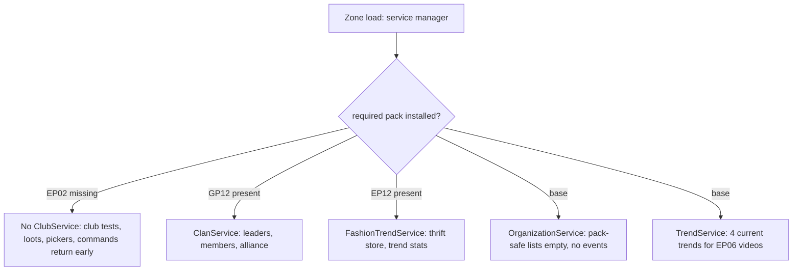

# 4.03 Clubs, organizations, clans and factions

*Game version 1.128.90.1030 (Steam, Linux/Proton). Live values come from the merged tuning (the base-game delta build plus the delta build of each installed pack: EP04 (Cats & Dogs), EP06 (Get Famous), EP09 (Eco Lifestyle), EP12 (High School Years), GP04 (Vampires), GP12 (Werewolves), SP01 (Luxury Party) and SP42 (Grunge Revival)), read through the live merge; the module tuning of every system here ships only in the base delta build. Values marked "patch data, pack not installed" come from the decoded patch tuning and do not run in this install. Written 2026-10-12. Checked 2026-10-12: 139 claims checked, 17 corrected, 2 relabelled, 1 removed, 5 added. Deepened 2026-10-13: 0 modules newly explained, 1 failed decompile read (the three `ClubService` pieces left in bytecode). Checked again 2026-10-13: 152 claims checked, 11 corrected, 0 relabelled, 0 removed (5 added). Cross-chapter edits 2026-10-13: 3 applied.*

## In plain words

The game has four ways of putting Sims into groups: clubs (Sims who meet up and follow house rules), university organizations (societies with ranks and weekly events), clans (the two werewolf packs) and faction reputation (three standings on Batuu). Two more systems track what is popular right now: video trends and fashion trends. Each one is its own service with its own save data. Most of them only switch on when the pack that owns them is installed, and the code checks this when the game starts.

On this install that check removes most of the chapter. Clubs need EP02 (Get Together), organizations need the Organization records of EP08 (Discover University), and faction reputation needs GP09 (Journey to Batuu); none of those packs is installed. What runs here is the werewolf clan service (GP12 (Werewolves)), the fashion trend service and thrift store (EP12 (High School Years)), and the base-game trend service that EP06 (Get Famous) reads for its videos. The base game still ships all the club tuning, 103 club activity groups and one finished but unused club seed, because other systems reuse club activity groups.

Three things would surprise a player. First, the live club tuning makes club rules far stronger than the code defaults: a club-encouraged social is scored 100 times higher, a discouraged one 10,000 times lower. Second, a club gathering starts from a conversation only when 9 members of the same club stand in it, while a club holds at most 8 members, so that path can never fire; gatherings still start from the venues' own schedules, from travel, from drama nodes and from the player. Third, a few plain bugs sit in the group code: the video trend picker never excludes the current trends (and every game save runs it, even without EP06), and the organization member generator throws away its own list of existing members before using it.

## Key facts

- `ClubService` registers only with EP02 (Get Together) installed (`required_packs = (Pack.EP02,)`), so `services.get_club_service()` is `None` here and every club command that needs the service fails; only the two UI helpers `clubs.request_club_building_info` and `clubs.validate_sims_against_criteria` still run. `ClanService` needs GP12, `FashionTrendService` EP12; `OrganizationService` and `TrendService` run in the base game.
- Live club rule multipliers on autonomy scores: encouraged super interaction x3, encouraged mixer x100, discouraged x0.0001 (code defaults 1.25, 100 and 0.5).
- Members are re-checked against the club's admission criteria on five events (career change, age-up, a marriage starting or ending, simoleons earned, leaving Build mode); the first failed criterion removes the Sim from the club.
- Club size: 6 members by default (code 4), plus 1 for each of two EP02 perks, so 8 at most; a Sim joins at most 3 clubs; a seed holds at most 10 rules and 5 admission criteria.
- A gathering would auto-start from a conversation when at least 9 Sims in one visible social group belong to the same club (code default 3) and the club's last gathering ended 120 minutes ago or more (code 60); with the cap of 8 this never happens. After travel it auto-starts when at least 3 Sims travelled and all of them share a club. Venues also spawn NPC club gatherings at club hangouts, only inside the club's daily window (06:00 to 18:00 or 18:00 to 06:00, picked from the club id).
- Club bucks go to the club: a new club starts with 100; a selectable Sim doing an activity its club encourages, inside that club's gathering, earns the group's reward (2 for 125 of the 128 live groups, 10 for 3) after 1 minute and then every 6 minutes; an EP02 gathering pays 5 every 15 minutes (patch data, pack not installed).
- When the world holds fewer than 10 clubs after one is removed, the service creates NPC clubs from 11 secondary seeds until there are 10 again.
- 128 live `ClubInteractionGroup` records: base 103, EP04 3, EP06 5, EP09 4, EP12 8, GP04 3, GP12 2. Small businesses, custom schedules and dynasty values reuse them.
- 662 live `club_test` nodes in 162 records, almost all in social broadcaster tests. Without the club service every test that asks about a club rule fails, and every "is a member" test fails while "is not a member" passes. The broadcasters pair "is not encouraged" with a "Not Member" alternative, so jealousy reactions fire here as if no club had rules.
- Organizations: 7 records, all EP08 patch data; the base service runs but schedules nothing. Three base interactions (`art_View`, `art_View_R3Event`, `easel_StartCrafting`) test membership of the art organization `University_Organization_Art` 219854 only for an alternative pie-menu name that also needs an EP08 event, so nothing is lost here.
- Clans: 2 werewolf packs, each with a trait, a hierarchy ranked statistic and 3 values; a daily check at 04:00 makes the first result of the pack's leader filter the leader of any pack without one. Seven narratives set the alliance state (1 neutral, 3 allied, 3 feuding); pack leaders read as level 5 of the pack statistic, which ordinary members cannot reach.
- Faction reputation (patch data, pack not installed): three ranked statistics, 12 levels over 0 to 540 points, everyone starting at 270, the midpoint.
- Video trends: 61 trends (42 skill, 11 emotional, 8 generic); 4 are current at a time and they refresh 2 days after the last pick, only when something asks; every game save asks.
- Fashion: the thrift store restocks at 06:00 every day, the exclusive-item chance is 100% so exclusive slots are always stocked, and 9 style trends shift every hour.

## How it works

### Which group systems run in this install

**Observed** (`core/sims4/service_manager.py: ServiceManager.register_service`, as described in [0.02 Architecture](0.02-architecture.md)). A service whose `required_packs` lists no installed pack is never registered, and `services.get_club_service()` and the other accessors then return `None`. Every caller in this chapter checks for `None` and gives up quietly.

| Service | Gate (`required_packs`) | Module | Here |
|---|---|---|---|
| `ClubService` | EP02 | `clubs/club_service.py` (failed to decompile, rescued per function) | absent |
| `OrganizationService` | none (base) | `organizations/organization_service.py` | runs, nothing to schedule |
| `ClanService` | GP12 | `clans/clan_service.py` | runs |
| `TrendService` | none (base) | `trends/trend_service.py` | runs |
| `FashionTrendService` | EP12 | `fashion_trends/fashion_trend_service.py` | runs |
| faction reputation | no service; module tuning only | `faction_reputation/faction_rep_tuning.py` | references not live |



### Clubs: the service, members and admission

**Observed** (`clubs/club_service.py: ClubService.required_packs`, rescued with the per-function decompiler). The service is EP02 only. `club_service.py` does not decompile as a file; 3 of its pieces also fail one by one (the class body, `start_gathering.on_response`, `send_club_building_info`), so their detail comes from bytecode (`pydisasm`), read in full and described below.

**Observed** (`ClubService` class body, bytecode line 82; `ClubService.start`, `stop`, `handle_event`; `clubs/club.py: Club.validate_sim_info`, `_validate_member_against_criteria`, bytecode). The class body defines one constant, `CLUB_VALIDATION_EVENTS`: the five test events `CareerEvent`, `AgedUp`, `SpouseEvent`, `SimoleonsEarned` and `OnExitBuildBuy`. The service listens for them from start to stop. When one fires for a Sim, every club of that Sim re-checks its admission criteria with `update_if_invalid=True`: the first criterion that fails removes the Sim from the club, and a selectable Sim then gets `CLUB_NOTIFICATION_INVALID`. So a career change, an age-up, a marriage or its end (`SpouseEvent` fires from `SimInfo.update_spouse_sim_id` whenever the marriage bit is added or removed), a pay packet or leaving Build mode (a new household value) can quietly drop a Sim from a club whose criteria they no longer meet. (The decompiled text of `_validate_member_against_criteria` puts its `return` inside the failure branch, which would make every member fail; the bytecode returns the test result on both paths.)

**Observed** (`clubs/club.py: Club.add_member`, `Club.get_member_cap`; `ClubTunables`, base delta). Adding a member checks, in order: the Sim can be instantiated, is not already a member, is human and passes every admission criterion (`validate_sim_info`), the club is below its cap, and the Sim is below `MAX_CLUBS_PER_SIM` (3, untuned). The cap is `DEFAULT_MEMBER_CAP` 6 (code 4) plus each unlocked perk in `CLUB_MEMBER_CAPACITY_INCREASES` (perks 124095 and 124096, +1 each, both EP02 records). Adding a member also writes each of the club's rules into the service's `club_rule_mapping[sim_info][affordance]`.

**Observed** (`clubs/club_tuning.py`). Admission criteria are 14 classes (`ClubRuleCriteriaSkill`, `Trait`, `OccultTrait`, `Relationship`, `RelationshipStatus`, `Career`, `HouseholdValue`, `Age`, `ClubMembership`, `FameRank`, `CareSimTypeSupervised`, `Gender`, `RomanticAttraction`, `Region`); the multi-select ones derive from `ClubRuleCriteriaMultiSelect`. The live tuning sets `MINIMUM_CRITERIA_SKILL_LEVEL` 2 (code 3) and leaves `MINIMUM_CRITERIA_CONFORMED_CAREER_LEVEL` at 1. Household value bands (`HOUSEHOLD_VALUE_MAP`): poor up to 10,000, average 10,001 to 500,000, rich 500,001 to 2,000,000,000 simoleons. `SKILL_TAG_BLACKLIST` removes `Skill_Horse` from the skill criterion.

**Observed** (`ClubService.send_club_building_info`, a staticmethod read in bytecode lines 1097 to 1158; caller `clubs.request_club_building_info`). This fills the club creation screen, and with `is_business` the small-business screen of EP18 (Businesses & Hobbies). For each of the 14 `ClubCriteriaCategory` values whose criteria class passes its own `test()`, it sends the possible values; only `ClubRuleCriteriaFameRank` overrides that test, so fame rank is offered only when `FameTunables.FAME_RANKED_STATISTIC` loads (`rankedStatistic_Fame` 188229, an EP06 record, so offered here). The business screen skips the club-membership criterion and builds the age list with `ClubRuleCriteriaAge.populate_possibilities(proto, is_business=True)`: the club screen offers child and older, the business screen teen and older (bytecode: ages at or below `TODDLER` are always skipped, ages at or below `CHILD` too when `is_business`). For clubs only, it then lists hangout lots: every saved zone whose venue has `allowed_for_clubs`, in a region compatible with the household's home region or the current one; residential and university-housing lots count only when the active household owns them. With no home region the function returns before sending anything, so the screen gets no data at all.

**Observed** (`ClubService.on_sim_killed_or_culled`, `clubs/__init__.py: on_sim_killed_or_culled`, called from `sims/sim_info.py`, `sims/sim_info_manager.py` and `interactions/utils/death.py`). A Sim who dies or is culled leaves every club. **Observed** (`clubs/club.py: Club.remove_member`, `reassign_leader`, `_find_best_leader`). When the leader leaves, the member with the best `get_leader_score_for_sim_info` takes over, with NPCs preferred when the leaving leader is not selectable (`prioritize_npcs=not member.is_selectable`); with no member left the club disbands. A Sim who leaves their last club would get the `BUFFS_NOT_IN_ANY_CLUB` buffs, but that set is untuned in both builds, so nothing is applied. `ClubService.remove_invalid_clubs` also drops memberless clubs.

**Observed** (`ClubService.generate_members_for_membership_criteria`, rescued, generator at line 638 checked in bytecode). NPC members come from `CLUB_MEMBER_SIM_FILTER` (119916, an EP02 record) and are kept only if they belong to a household, are human and pass every criterion.

### Clubs: rules and how they bend autonomy

**Observed** (`clubs/club_tuning.py: ClubRule`). A rule is an action (a `ClubInteractionGroup`), an optional "with whom" criterion and a restriction, Encouraged or Discouraged. `Club.add_rule` adds the club's encouragement or discouragement static commodity, with weight 1, to the rule's affordances. **Observed** (`clubs/club_tuning.py: BroadcasterEffectClubRule.apply_broadcaster_effect`). The rule broadcaster (`CLUB_RULE_BROADCASTER`, `broadcaster_ClubRule` 120427, an EP02 record) applies its loot to nearby Sims who belong to a club whose rule the broadcasting interaction breaks, that is, when the interaction is discouraged for its actor.

**Observed** (`ClubService.get_interaction_encouragement_status_and_rules_for_sim_info`, rescued and checked in bytecode). Rules only count while the Sim stands in a gathering of the rule's own club; outside a gathering every interaction has `NO_EFFECT`. A rule of that club whose action covers the interaction counts when its "with whom" criterion passes on the target, and also when the rule has no such criterion, the target is not a Sim or the target is the actor itself (`_does_rule_pass_tests`, bytecode); among the rules that count, a discouraging rule wins over an encouraging one.

**Observed** (`ClubService.get_interaction_score_multiplier`; callers `autonomy/autonomy_modes.py: FullAutonomy._calculate_interaction_score` and `_MixerAutonomy._create_and_score_mixers`, both read in bytecode). The autonomy score is multiplied by `CLUB_DISCOURAGEMENT_MULTIPLIER` 0.0001 when discouraged, `CLUB_ENCOURAGEMENT_MULTIPLIER` 3 for an encouraged super interaction and `CLUB_ENCOURAGEMENT_SUBACTION_MULTIPLIER` 100 for an encouraged mixer (no rule, or a rule outside its gathering: x1). The club factor sits beside the small-business, dynasty and custom-schedule factors, in that order, each from its own service. For a super interaction it is applied after the remaining-activity term has been added (source line 2441 of `_calculate_interaction_score`, decompiled text near line 1476), then come the business, dynasty and schedule factors; with no club service the code records a club factor of 1.0, which is what this install always gets. For a mixer it is applied only when the mixer provider is social: the score is mixer weight x content utility, then x club, x business, x dynasty, x schedule (source lines 731 to 733, decompiled text near line 410); non-social mixers score their weight and see no rule factor. The full score order is step 12 of "The score of one action" and the mixer formula is under "Mixers and socials" in [3.04 Autonomy](3.04-autonomy.md). `get_front_page_bonus_for_mixer` adds `FRONT_PAGE_SCORE_BONUS_FOR_ENCOURAGED_MIXER` 100 (untuned) to encouraged mixers, and `ClubSocialMixerInteraction.get_base_content_set_score` adds `FRONT_PAGE_SCORE_BONUS_FOR_CLUB_MIXERS` 100 (untuned) to a club mixer while its club is gathering.

**Observed** (`ClubService.create_club`, rescued; `Club.start_club_effects`; `ClubService.on_sim_added_to_gathering`). Each club also gets its own encouragement and discouragement static commodities, advertising at `CLUB_ENCOURAGEMENT_AD_DATA` (live 16, code 64) and `CLUB_DISCOURAGEMENT_AD_DATA` (0, untuned), and three hidden buffs. A member gets the buffs, and with them the commodities, only when added to the club's gathering, so the encouraged affordances advertise the extra 16 only to Sims in that gathering. The social encouragement buff carries an autonomy modifier that multiplies the relationship score towards targets with the encouragement buff by `CLUB_RELATIONSHIP_SCORE_MULTIPLIER`, live 1 (code 2), so it changes nothing.

**Inferred.** With these numbers a gathering almost never picks a discouraged activity on its own (a ten-thousandth of its score), and an encouraged social nearly always beats every other mixer.

### Clubs: gatherings

**Observed** (`ClubService.start_gathering`, rescued). A gathering starts only for a club the service knows, with no gathering already running, on a zone its hangout allows (unless the caller overrides validity). If the target zone is elsewhere and an invited Sim is in a rabbit hole, the player is first asked to pull them out. **Observed** (`start_gathering.on_response`, bytecode lines 245 to 256). The answer re-runs `start_gathering` with the same arguments. On yes, the Sim leaves the rabbit hole and comes along. On no, the gathering is cancelled outright when that Sim is the host; otherwise the Sim is dropped from the invited list and the gathering is started without them (the next invited Sim in a rabbit hole gets the same question). Members go on the guest list at `BACKGROUND_HIGH` priority if they were invited or match the default job's filter (checked in bytecode; the decompiled text reads the other way round); the situation is created with `user_facing=False` and the club id written into its seed.

**Observed** (`ClubService.on_gathering_ended`, bytecode lines 326 to 337). When a gathering ends that the service has no record of, the code calls `logger.error` (an empty body in retail, see [0.02 Architecture](0.02-architecture.md)) and then reads `.id` of the missing record anyway, which raises `AttributeError`; the club's own `on_gathering_ended`, which starts the auto-start cooldown, is then never reached. **Inferred.** Only a gathering that ended twice or was never registered takes this path; EP02 only.

**Observed** (`ClubService.on_sim_added_to_social_group`, rescued). When a visible social group changes, the service counts, for each club, the group's Sims that belong to it, skipping Sims already in a gathering or in a visible ensemble. It walks the clubs from most to fewest; it stops at the first one below `CLUB_GATHERING_AUTO_START_GROUP_SIZE` (live 9, code 3), skips clubs already gathering or whose `is_gathering_auto_start_available` fails, and starts at most one. **Observed** (`Club.is_gathering_auto_start_available`, bytecode). That check fails only while the club's last gathering ended less than `CLUB_GATHERING_AUTO_START_COOLDOWN` ago (120 minutes, live; code 60); a club that never gathered passes.

**Observed** (`clubs/club.py: Club.__init__`, `add_member`, `on_all_households_and_sim_infos_loaded`; `ClubService.create_club`; bytecode of every club module searched for writes to `members`). The count only includes Sims who are members of that club. `Club.members` starts empty and only `add_member` appends to it, refusing anyone past the cap of 8 (6 plus two perks); seed clubs, UI-created clubs and clubs loaded from a save all go through `add_member`, the saved ones after their bucks tracker (and so their perks) has loaded. Nine members of one club can never be present, so the social-group auto-start never fires.

**Observed** (`ClubTunables.CLUB_GATHERING_AUTO_START_SCHEDULES`, base delta; `Club.is_gathering_auto_spawning_available`). Two schedules, each every day: 06:00 for 12 hours, or 18:00 for 12 hours. Each club picks one with `random.Random(club_id)`, so the choice is stable across saves. **Observed** (`venues/venue_tuning.py: Venue._try_balance_club_gatherings`, rescued per function and checked in bytecode). The only caller is the venue's club gathering schedule: it draws a target with `random.triangular(0, maximum_club_gatherings, mode)`, the mode being `ideal_club_gatherings` for the number of clubs whose hangout is this venue type or this lot, and walks those clubs, stopping once the service's count of running gatherings (all clubs) reaches the target; it starts one for each club that is not gathering, is inside its window, passes the cooldown and, on a household's lot, has a member in that household. Venue scheduling is in [2.01 Lots, venues and rooms](2.01-lots-venues-rooms.md).

**Observed** (`ClubService.on_finish_waiting_for_sim_spawner_service`, rescued). After travel, if the travel ensemble rules apply, the service intersects the clubs of every travelled Sim, keeps those valid on the zone, and starts a gathering for a random one when at least `CLUB_GATHERING_TRAVEL_AUTO_START_GROUP_SIZE` (3, untuned) Sims travelled; otherwise it makes a travel ensemble. Every travelled Sim must belong to the club; the tunable's description ("the most common Club") does not match the code.

**Observed** (`clubs/club_gathering_situation.py: ClubGatheringSituation`; numbers from `clubGatheringSituation` 122304, patch data, pack not installed). A new gathering is protected from disbanding until either `_initial_disband_timer` (45 minutes; code 30) runs out or it reaches `_minimum_number_of_sims` (2; code 3), whichever comes first (`_disband_timer_callback`, `_on_add_sim_to_situation`). After that it ends as soon as fewer than 2 Sims remain, checked when a Sim leaves and when the timer fires. `set_club_vibe` picks, from the vibe's buffs, the first one the club's first member can take and swaps it on every Sim in the gathering. The EP02 gathering tunes 9 vibes with 3 buffs each, starts at AmongComrades, and adds `rule_breaking_buff` (`buff_Clubs_BrokeARule` 123790) to rule breakers.

**Observed** (`ClubGatheringSituation._award_club_bucks`, `_sim_satisfies_requirement_for_bucks`). Every `time_between_bucks_rewards` (15 minutes; code 10) the club gets `reward_bucks_per_interval` (5; code 1) bucks if at least one selectable, instanced Sim is present. The source applies `CLUB_BUCKS_REWARDS_MULTIPLIER` (x2) when `any(sim for sim in self._situation_sims)`; in bytecode that generator tests each Sim's equipped traits for `trait_ClubPresident` 122922 (an EP02 record), so a single Sim with the trait doubles the gathering's pay.

```mermaid
stateDiagram-v2
    [*] --> Starting: start_gathering (player, drama node, travel of 3+, venue schedule; the 9+ social group path never fires)
    Starting --> Protected: situation created, members invited (BACKGROUND_HIGH)
    Protected --> Open: 45 min passed or 2 Sims present
    Open --> Open: every 15 min +5 bucks (x2 with trait_ClubPresident)
    Open --> Open: encouraged activity, +2 or +10 bucks after 1 min then every 6 min
    Open --> Ended: fewer than 2 Sims left
    Protected --> Ended: player ends it
    Open --> Ended: player ends it
    Ended --> [*]: on_gathering_ended, cooldown 120 min for auto-start
```



### Clubs: bucks and perks

**Observed** (`interactions/club_buck_liability.py: ClubBucksLiability`; `ClubService.create_rewards_buck_liability`, `get_encouragment_mapping_for_sim_info`). A selectable Sim's encouraged interaction gets a liability that, after `CLUB_BUCKS_ENCOURAGED_REWARDS_TIMER_START` 1 minute (code 10) and then every `CLUB_BUCKS_ENCOURAGED_REWARDS_TIMER_REPEATING` 6 minutes (code 10), pays each club the highest `club_bucks_reward` among its encouraging rules for that interaction, doubled when the Sim has `trait_ClubPresident` 122922. Since rules only count inside a gathering of their own club, the Sim earns only while gathering with that club. NPC interactions never earn.

**Observed** (live `ClubInteractionGroup` records). `club_bucks_reward` is 2 on 125 groups and 10 on 3; none uses the code default 1. The three 10-buck groups are EP12 `clubInteractionGroup_DynastyValue_Entrepreneur*` records (SellPaintings, PublishBooks, ShipFashionMarketplace); 9 live groups are `DynastyValue` groups (EP06 2, EP09 2, EP12 5). Categories: OUTDOOR 18, ART_AND_MUSIC 18, FOOD_AND_DRINK 14, HOBBIES 14, SOCIAL 14, HOME_ACTIVITIES 11, KID_ACTIVITIES 11, MISCHIEF_AND_MAYHEM 10, FUN_AND_GAMES 9, OTHER 9. 27 groups set `club_rule` False, 15 are targeted, 9 are not child-safe and 1 is not teen-safe.

**Observed** (live `BucksPerk` records with `associated_bucks_type` ClubBucks). Seven: `clubPerks_SkillBoost_AdultMinor_Photography` 300 (base), `_AdultMajor_DogTraining` 400 and `_Veterinarian` 400 (EP04), `_Acting` 400 and `_MediaProduction` 300 (EP06), `_Fabrication` 400 and `_JuiceFizzing` 400 (EP09). The packs ship skill perks for their own skills; the core perk tree (`DEFAULT_USER_CLUB_PERKS` 124109 and 129919, the capacity perks, the `NEW_RELATIONSHIP_MODS` perks 124107 and 124108) is EP02. EP02's patch data holds 80 ClubBucks perks (26 SetVibe, 25 SkillBoost, 23 General, 5 SocialBonus, 1 RallyTheTroops) costing 0 to 600 bucks, 17 of them at the `unlock_cost` code default 100; the two capacity perks cost 250 (124095) and 500 (124096) (patch data, pack not installed). A new club starts with `INITIAL_AMOUNT_OF_CLUB_BUCKS` 100 (untuned).

### Clubs: NPC clubs and seeds

**Observed** (`ClubService.remove_club`, rescued). After a club is removed (not at shutdown), if fewer than `MINIMUM_REQUIRED_CLUBS` (live 10; code 5) remain, the service shuffles `CLUB_SEEDS_SECONDARY` (11 seeds: 10 EP02 plus `clubSeed_DivingClub` 206607 from EP07 (Island Living)) and creates clubs from seeds not already in use until there are 10 or the seeds run out (a seed that finds too few members makes no club).

**Observed** (`ClubService.create_club`, rescued). A seed club draws `initial_number_of_memebers` members (the field name is misspelled in code) from the member filter, gives up if it finds fewer, and picks a random leader. The 10 EP02 secondary seeds ask for 3 to 4 members; the 11 `clubSeed_InitialSeeds_*` ask for exactly 1 (patch data, pack not installed).

**Observed** (`ClubService.load`, `save`). The save keeps `has_seeded_clubs`, but nothing in the rescued Python sets it to True. **Inferred.** The premade EP02 clubs come from the pack's save or world data, outside the gameplay scripts.

**Observed** (live `clubSeed_ChessClub` 121674, base delta). The only live seed: rules 121701 (PlayChess encouraged) and 121677 (WooHoo encouraged), both EP02 records, a venue hangout (`venue_park` 25847), 3 to 4 members and perks 129919 and 124109. It is not in `CLUB_SEEDS_SECONDARY` and nothing runs it here.

### Clubs: drama nodes and pickers

**Observed** (`drama_scheduler/club_gathering_drama_node.py: ClubGatheringDramaNode._setup`, both set comprehensions checked in bytecode: no filters). The node picks a random club shared by the sender and the receiver. EP02's `clubGatheringDramaNode_Default` 127797 has a 336-hour (14-day) cooldown (`_DramaNodeCooldown.duration` is read in hours), base score 10, a daily window from 10:00 for 10 hours, and sender filter `filter_SimInSameClub` 126445 (patch data, pack not installed). Drama node scoring is in [4.01 Situations, roles and NPC scheduling](4.01-situations-npcs.md).

**Observed** (`drama_scheduler/club_invite_drama_node.py`). `ClubInviteDramaNode` texts the receiver an invitation to one of the sender's clubs and adds them on OK if they can still join; `ClubInviteRequestDramaNode` asks a club leader to let the sender in, optionally only for invite-only clubs. Both refuse to set up when the service is missing. EP02 tunes `clubInviteDramaNode_JoinClubStranger` 125814, `_joinClubFriend` 125787 and the two `clubInviteRequestDramaNode_RequestInvite_*` 129417 and 129418.

**Observed** (`clubs/club_picker_interactions.py: ClubPickerSuperInteraction`). A picker lists clubs from a participant or from the other gatherings on the lot, then runs one action: challenge (both clubs' gathering members split into teams for a game, with team sizes from the game's `players_per_game` and `teams_per_game`), summon (call every NPC member of the picked clubs), lock a portal to everyone except a club, or push a continuation. EP02 ships six such pickers (foosball challenge, invite to hang out, four padlock variants), all patch data.

### Club activity groups and club tests in live tuning

**Observed** (`clubs/club_tuning.py: ClubInteractionGroup`; references in `small_business/small_business_tuning.py`, `custom_schedules/custom_schedule.py`, `dynasty/dynasty_values.py`, `travel_group/travel_group_getaway.py`). A group is a named set of affordances and affordance lists with a category, a bucks reward and age-safety flags, plus fields for small-business rules (EP18 (Businesses & Hobbies)) and custom schedules (EP20 (Adventure Awaits), `CustomScheduleService.required_packs`). That reuse is why the base game ships 103 groups. See [5.02 Businesses](5.02-businesses.md), [3.09 Life cycle](3.09-life-cycle.md) for dynasties and [2.06 Worlds, regions and travel](2.06-worlds-regions-travel.md) for getaways.

**Observed** (`clubs/club_tests.py: ClubTest.__call__`, `_club_status_test`, `_test_club`; bytecode offsets 242 to 286 of `__call__` for the `any()`). With no club service every Sim has no clubs. `club_status` NOT_MEMBER and NOT_LEADER pass, MEMBER and LEADER fail. A test with an `affordance_rule` (encouraged, discouraged, not encouraged or not discouraged) reaches `any()` over an empty club list and fails whatever the rule asks.

**Observed** (live tuning). `club_test` appears 662 times in 162 records (base 111, EP09 13, EP12 13, EP06 10, GP04 8, EP04 4, GP12 3). Shapes: 394 `affordance_rule` with any club, 239 `club_status` with any club, 26 of those two on the target Sim, 3 others. Contexts: 575 in social mixer broadcaster tests, 31 in social super interaction broadcasters, 44 in outcome broadcasters, 10 in test sets and 2 in a loot.

**Observed** (live tuning, every OR list that holds a `club_test`). The jealousy broadcasters come in pairs, a club-encouraged one and an ordinary one. Counting each shared list once per record (counting every place a record uses it, the basis of the 662 above, in brackets): 154 (160) lists hold a lone "is encouraged" test; they never pass here, but each gates an EP02 `broadcaster_JealousyUpdates_ClubEncouraged_*` record (362565, 129459, 375433) that is absent anyway. 123 (243) lists put "is not encouraged" and "Not Member" in separate OR branches; "Not Member" passes for everyone here, so the ordinary jealousy broadcasters (362563, 76132, 375432, 125246) fire as if no club had rules. Every one of the 8 test sets has a non-club branch: `testSet_WooHoo_Reactions_AllowedByClubRules` 128340 passes through "No Gathering Exists", `testSetInstance_NotClub_Or_NotClubEncouraged` through "Not Member" and `testSetInstance_KleptoOrClub` through its trait branches. The other five, the four "encouraged by club or customer rules or hobby class" sets (126907, 490097, 490093, 490500) and `testSetInstance_ActorTarget_InClubGathering_or_SmallBusinessCustomers` 390884, have only small-business, hobby-class, getaway and dynasty branches beside the club one, and none of those can pass here: no live situation carries the `Situation_SmallBusiness_Customer` tag the small-business test looks for, no live record uses the role state `role_HobbyClass_ClassMember_PreClass` that carries the `Role_HobbyClass_Attendee` tag, and the getaway and dynasty tests return False when `services.custom_schedule_service()` (EP20) or `services.dynasty_service()` (EP21 (Royalty & Legacy)) is None (Observed: `small_business/small_business_tests.py`, `custom_schedules/custom_schedule_tests.py`, `dynasty/dynasty_tests.py` `__call__`; live tuning). So those five always fail here, which is the right answer for an "is encouraged" test when nothing sets rules. One entry can pass in no install: the prioritized outcome of `mixer_social_FirstKiss_targeted_romance_STC`, and one of its tested outcomes through the same shared broadcaster node, puts "is not encouraged" and "Not Member" on the target in one AND group; a Sim in no club fails the first (empty `any()`) and a Sim in a club fails the second. Both outcomes add broadcaster 125246 again through test set 128340, so nothing is lost.

**Observed** (`ClubGatheringTest.__call__`, `test_gathering`, both checked in bytecode). Without the service the associated clubs are `(None,)` and there is never a gathering, so "Gathering Exists" and "In Gathering" fail while "No Gathering Exists" and "Not In Gathering" pass. Live users: 19 nodes in 16 records (base 11, EP06 4, EP12 1), such as the homework-help loot `Loot_Commodity_Homework_Help`.

### Organizations (EP08, not installed)

**Observed** (`organizations/organization_service.py`; module tuning, base delta). The service runs in the base game, but every list it reads is pack-safe. `ORGANIZATION_EVENTS` names 13 EP08 drama nodes and `VENUE_ORG_EVENT_MAPPING` maps the bar venue 16869 (7 nodes), the library 16874 (4) and two EP08 venues 218857 and 218858 (2 each) to event nodes. Every entry blacklists region 176583 and prefers region 221598, the bar and the library also 8086; `org_zones_to_schedule` is untuned (1). Here every drama node list loads empty, so nothing is scheduled.

**Observed** (`display_snippet_tuning.py: Organization`, rescued per function; EP08 patch data). An organization is a snippet with a hidden `progress_statistic` (a ranked statistic), `organization_task_data` (tests plus an `AspirationOrganizationTask`), an `organization_filter` for NPC members and a `no_events_are_scheduled_string`. EP08 ships 7: Art 219854, Debate 219855, Honor 219856, Prank 219857, Party 219858, Secret 219859 and Robot 219860, with 50 tasks, 15 `OrganizationEventDramaNode`, 13 `MajorOrganizationEventDramaNode`, 10 `OrganizationMemberSingleJobSituation`, 6 `FestivalOrganizationEventType`, 2 `MajorOrganizationEvent` and 1 `MembershipSmartMajorOrganizationEvent` (patch data, pack not installed).

**Observed** (`OrganizationService.verify_valid_time`, `schedule_org_events`, `post_game_services_zone_load`, `cleanup_scheduled_or_active_events`). Each event node must use a single weekly time; it is scheduled at that day and hour this week, or next week if already past, and rescheduled when it completes. Venue events go first to zones of the venue type in preferred regions, then to any other zone, up to `org_zones_to_schedule`. `validate_venue_event` cancels an event whose zone changed venue and schedules a retry after the event's duration.

**Observed** (`organizations/organization_tracker.py: OrganizationTracker`). Joining adds the progress statistic, marks the membership ACTIVE and, for Sims who are not NPCs (`is_npc` false), assigns `ACTIVE_TASK_AMOUNT` (3, untuned) timed aspiration tasks drawn at random from those whose tests pass. When the last open task times out, a new set is drawn. Leaving resets the progress statistic to the start of its current rank, marks the membership INACTIVE and drops open tasks. Leaving university (`deactivate_organizations`) leaves every organization of that school and `reactivate_organizations` rejoins them. Falling below full LOD clears tasks; reaching minimum LOD removes the Sim from every roster.

**Observed** (`organizations/organization_tests.py: OrganizationMembershipTest.__call__`; live `art_View` 33623, `art_View_R3Event` 392018, `easel_StartCrafting` 13359, base delta). An empty organization list fails unless the test is inverted. These three records test membership of 219854 (`University_Organization_Art`, EP08), which the pack-safe list drops here, so the test always fails. **Observed** (live tuning paths). The test sits only in each record's `display_name_overrides`, an alternative pie-menu name and icon, ANDed with a `situation_running_test` on 223213 (EP08 `festivalOrganizationEvent_PaintinInThePark_Painters`, absent here). The interactions themselves are untouched, and the override could only show during an EP08 event, so the player loses nothing.

**Observed** (`organizations/organization_loot_ops.py: OrganizationMembershipLoot`; `organization_commands.py`). The loot joins through the service (which also adds the Sim to the roster) or leaves through the tracker. No live loot uses it.

### Organization member generation, a dead branch

**Observed** (`OrganizationService.generate_organization_members`, bytecode). The function first sorts the stored roster into valid and invalid members and removes invalid, non-played ones. It then re-filters the valid ones against the blacklist and the caller's extra filter terms, but rebinds the list it is about to read:

```
688  260 BUILD_LIST           0
     262 STORE_FAST           (valid_org_member_ids)
689  264 SETUP_LOOP           (to 332)
     266 LOAD_FAST            (valid_org_member_ids)
```

The loop walks an empty list, so the random pick from existing members (offsets 336 to 416) never runs, `member_result_ids` becomes empty, and the code asks the Sim filter for `minimum` new Sims when a minimum is given, otherwise `amount`, adding each one to the roster. **Observed** (`organizations/organization_situations.py: OrganizationEventBase.get_members_sim_infos`, `submit_replace_request`, and the same pair in the member-job situation). The event callers blacklist every Sim info in the save (`sim_info_manager().get_all()`), so the intended code would also drop every stored member at the blacklist check (offset 276); for events the bug changes nothing, and the roster grows with new Sims either way. **Observed** (`services/roommate_service.py: RoommateService.generate_organization_roommate`, bytecode offsets 24 to 38; `RoommateService.required_packs` is EP08). The one caller with a narrower blacklist is the EP08 roommate search, which asks for 1 member. **Inferred.** There the bug means an existing member is never chosen as a roommate; a new Sim from the filter joins the roster instead. Reached only with EP08 installed; not reached here.

**Observed** (`OrganizationService.load`, bytecode: `STORE_DEREF schedule_cancelled_event_data` at offset 102, `LOAD_CLOSURE` at 138). The alarm callback for each saved, cancelled venue event is a lambda over the loop variable, so every alarm reschedules the last event in the list. **Inferred.** With two or more cancelled venue events in a save, the earlier ones wait for their next weekly slot. EP08 only.

### Clans: the werewolf packs (GP12, live)

**Observed** (`clans/clan_tuning.py: Clan`, `ClanValue`; live GP12 records). A `Clan` has `clan_values`, a `clan_hierarchy_ranked_stat` and a `clan_trait`; a `ClanValue` names a `discipline_ranked_stat`. Two clans and 5 clan values are live. `clan_WerewolfPackA` 288921 uses hierarchy statistic 286792, trait 284944 and values 288925, 288923 and 288927; `clan_WerewolfPackB` 288922 uses 286793, 284945 and values 288925, 288924 and 288926, so the packs share one value. The Diplomacy value's discipline statistic is 292883. Rank intervals and pack traits are covered in [3.11 Occults and the supernatural](3.11-occults.md).

**Observed** (`clans/clan_service.py: ClanService`; `CLAN_DATA`, base delta). Per clan: join, leave, promote and demote loots, an information loot, a rival clan and a leader filter. Pack A: join 289804, leave 289806, promote 289808, demote 289800, info 290465, filter `filter_WolfTown_WerewolfPackA_Leader_ForServiceOnly` 288982, rival Pack B. Pack B: 289805, 289807, 289809, 289801, 290466, filter 288992, rival Pack A.

**Observed** (`ClanService.add_sim_to_clan`, `remove_sim_from_clan`, `reassign_clan_leader`, `remove_clan_leader`). Joining runs the join loot and records the member; leaving first removes leadership (running the demote loot), then runs the leave loot. Making a leader demotes the old one, records the new one and runs the promote loot. The service records leaders and members; the traits, ranks and buffs come from the loots. **Observed** (live `loot_WerewolfPack_Module_PromoteLeaderA` 289808 and `_DemoteLeaderA` 289800; `statistics/ranked_statistic.py: points_to_rank`, `convert_to_user_value`). The promote loot swaps `trait_WerewolfPackA_Member` for `trait_WerewolfPackA_Leader` and sets the pack statistic to rank 4, which `points_to_rank` turns into 900 points, the statistic's whole range (intervals 0, 150, 300, 450, 0). With a last interval of 0 the leader reads as level 5 and runs `loot_WerewolfPack_Rank_Promoted_Leader`. Every `loot_WerewolfPack_RankA_Gain_*` change caps the statistic at 899, so ordinary members stop at level 3; Pack B works the same with 1,050 and 1,049. The demote loot sets rank 3 (450 points). The live loots that call it are the 12 `loot_WerewolfPack_Membership_*` records (Join, Leave and MakeLeader, Actor and Target, for each pack); 14 GP12 records use `has_clan_leader_test` (claim leadership, ask to join or befriend, focus on the leader, the information loots).

**Observed** (`ClanService.on_zone_load`, `_on_daily_leader_check`, `create_clan_leader`). On zone load the service drops members whose Sim info is gone (and the leader record when that Sim led the clan), then sets a repeating, cross-zone alarm at `LEADER_CHECK_HOUR` (04:00, untuned). Each day, a clan with no leader gets the first Sim the leader filter returns. Deaths and culls remove the Sim from their clan (`clans/__init__.py`).

**Observed** (`ClanService._update_from_narrative_service`; `NARRATIVE_TO_ALLIANCE_STATE_MAP`, base delta). When narratives change, the service walks the active narratives and the first one in the map whose state differs from the current alliance state sets it (bytecode): `narrative_WerewolfPack_AllianceFeud_Neutral` 289594 to NEUTRAL; `_Alliance_3`, `_1`, `_2` (289595 to 289597) to ALLIED; `_Feud_3`, `_1`, `_2` (289598 to 289600) to FEUDING. The client receives leaders and the alliance state through `ClanUpdateOp`. Narratives are in [4.02 Story progression, households and townies](4.02-story-progression-townies.md).

### Faction reputation (GP09, patch data, pack not installed)

**Observed** (`faction_reputation/faction_rep_tuning.py: FactionRepModuleTuning`; base delta module tuning; the decoded patch tuning of GP09). Three pack-safe references, exported to the client: `RESISTANCE_REPUTATION` 236631, `FIRST_ORDER_REPUTATION` 236632, `SCOUNDREL_REPUTATION` 236633. Each is a `RankedStatistic` (`rankedStatistic_Batuu_FactionReputation_*`) with `initial_value` 270, no decay and 12 intervals 125, 70, 40, 15, 10, 10, 10, 10, 15, 40, 70, 125: level edges at 125, 195, 235, 250, 260, 270, 280, 290, 305, 345, 415 and 540. No Python reads the module tuning; its full name `faction_reputation.faction_rep_tuning.FactionRepModuleTuning` appears in the client executable's strings. **Inferred.** The scale is symmetric around a neutral start, and native UI code reads the three references (the statistics carry Sim info panel icons).

### Video trends (base service, EP06 users)

**Observed** (`trends/trend_tuning.py: TrendTuning`, module tuning base delta). `TREND_DATA` holds 61 trends, each a `func_trend` tag, a type and a name: 42 Skill, 11 Emotional, 8 Generic. `TREND_REFRESH_COOLDOWN` is untuned (2 days). `TRENDLESS_VIDEO_DEFINITION` is object definition 207298. `TREND_TIME_REMAINING_DESCRIPTION` has strings for under 6, 12, 24 and 99 hours left. `CELEBRITY_TREND` is `Func_Trend_Celebrity` and `TODDLER_CHILD_TREND` `Func_Trend_ToddlerChild`.

**Observed** (`trends/trend_service.py: TrendService._update_trends`, `_pick_new_trends`). Trends refresh only when something asks for them and the 2 days have passed. The pick takes 1 random trend, then 1 random trend of each type from the rest, so 4 are current.

**Observed** (bytecode of the `_pick_new_trends` list comprehension, line 64 to 65: `LOAD_ATTR trend_tag`, `LOAD_DEREF self`, `LOAD_ATTR _current_trends`, `COMPARE_OP not-in`). The filter meant to drop current trends compares a tag with a list of trend tuples, so it removes nothing and a current trend can be picked again. **Observed** (`TrendService.save`, bytecode offsets 22 to 26). Saving calls `get_current_trend_tags()`, which runs `_update_trends()`, and the service has no pack gate, so every game save reaches the picker once the 2 days have passed, with or without EP06; a new save's next-update tick is 0, so its first save always refreshes.

**Observed** (live readers). The EP06 notification on `si_VideoStation_Editing_StudyTrends` shows the list through the `current_trends` text token; the object test identity `trending` (`objects/object_tests.py: ObjectTrendingFactory`) matches objects tagged with a current trend in 3 records (`loot_Fame_UploadVideoRecording` EP06, `royalty_VideoRecording` in base and EP06).

**Observed** (`trends/trend_recording.py: RecordTrendsElement`; live `streamingDrone_RecordingSim`, EP06). Recording a Sim stamps the video with a trend: the celebrity trend if the celebrity tests pass, else the toddler and child trend for those ages, else the trend tag of the first skill the Sim gains while recorded. With no trend the video uses `TrendTuning.TRENDLESS_VIDEO_DEFINITION` (207298); otherwise a random object definition carrying the trend's tag.

### Fashion trends and the thrift store (EP12, live)

**Observed** (`fashion_trends/fashion_trend_service.py: FashionTrendService`; `FashionThriftStoreTuning`, base delta). Every day at `DAILY_REFRESH_TIME` 06:00 (code 03:00) the service restocks: it rolls `EXCLUSIVE_ITEM_CHANCE` (100%, code 25%) and then randomizes CAS parts for each entry of `REFRESH_CAS_PART_LIST` (44 entries, 345 parts in all) by body type, count and tags. In bytecode an entry is skipped only when it is exclusive and the roll failed. With 100% every exclusive entry is stocked every day (69 of the 345 parts sit in exclusive entries). The daily notification (`DAILY_REFRESH_NOTIFICATION`, an optional tunable that is off unless tuned) is not tuned, so it is off; the exclusive notification is tuned disabled (its time is 07:00, code 08:00).

**Observed** (`FashionTrendTuning.TRENDS`, base delta; live EP12 statistics and loots). Nine style trends (Bohemian, Country, Basic, Outdoor, Polished, Preppy, Goth Rock Punk, Hipster, Street), each a statistic (initial 500, max 1,000) and a shift loot that runs every `trend_shift_interval` (1 hour). For Boho, `randomWeightedLoot_FashionMarketplace_BohoChange` 287384 picks +30, +20, -10 or nothing; the +30 entry's weight is multiplied by 3 when a buff test on `buff_ThriftStore_TrendTipBoho` 281221 passes. Hype loots change `commodity_FashionMarketplace_OutfitHype` 286850 by +2, +2.5 or +5 and -1, -1.25 or -2.5 depending on test sets.

**Observed** (`FashionThriftStoreTuning`; `server_commands/inventory_commands.py`). `RARITY_ITEM_CHANCE` (Common 50, Rare 30, Very Rare 10, Exclusive 5, Exclusive Depop 5), `DOMINANT_RARITY_ITEM_COST` (1, 2, 4, 7, 9) and `DOMINANT_TREND_ITEM_COST` (Basic 1, Street 1, Bohemian 2, Country 2, Outdoor 2, Hipster 2, Preppy 3, Goth Rock Punk 3, Polished 5) have no Python reader beyond a DebugOnly print. Outfits arrive with `cost` and `trend` already set, and `get_outfit_suggested_sale_price` only reads the cost. **Inferred.** Native code prices outfits: the strings of `Simulation_x64.dll` include a `Client_ThriftStoreTuning` message with `RarityData` and `TrendData`. The service keeps the last `MAX_ALLOWED_SOLD_OUTFITS` (10) sold outfits for reuse on Sims.

### Other group-like systems

Dynasties (EP21 (Royalty & Legacy)) are in [3.09 Life cycle](3.09-life-cycle.md) and kingdoms in [6.03 Other pack systems](6.03-pack-systems.md); EP21 patch data adds 32 club activity groups, 30 of them `clubInteractionGroup_DynastyValue_*`. Werewolf pack ranks, temperaments and pack values are in [3.11 Occults and the supernatural](3.11-occults.md). Social groups and relationship bits are in [3.08 Relationships, socials and memories](3.08-relationships-socials.md); school after-school activities are in [3.10 Skills, careers and school](3.10-skills-careers-school.md).

## Numbers

| Name | Value | Unit | Where | Source |
|---|---|---|---|---|
| `DEFAULT_MEMBER_CAP` | 6 (code 4) | Sims | `ClubTunables` | base delta |
| `CLUB_MEMBER_CAPACITY_INCREASES` | 124095 +1, 124096 +1 | Sims | `ClubTunables` | base delta; perks EP02 |
| `MAX_CLUBS_PER_SIM` | 3 | clubs | `ClubTunables` | code default |
| `MAX_CLUB_RULES`, `MAX_MEMBERSHIP_CRITERIA` | 10, 5 | entries | `clubs/club_tuning.py` (seed list maxlength) | code constant |
| `MINIMUM_REQUIRED_CLUBS` | 10 (code 5) | clubs | `ClubTunables` | base delta |
| `CLUB_ENCOURAGEMENT_MULTIPLIER` | 3 (code 1.25) | x score | `ClubTunables` | base delta |
| `CLUB_ENCOURAGEMENT_SUBACTION_MULTIPLIER` | 100 | x score | `ClubTunables` | base delta (equals code) |
| `CLUB_DISCOURAGEMENT_MULTIPLIER` | 0.0001 (code 0.5) | x score | `ClubTunables` | base delta |
| `CLUB_ENCOURAGEMENT_AD_DATA` | 16 (code 64) | ad value | `ClubTunables` | base delta |
| `CLUB_DISCOURAGEMENT_AD_DATA` | 0 | ad value | `ClubTunables` | code default |
| `FRONT_PAGE_SCORE_BONUS_FOR_ENCOURAGED_MIXER`, `_FOR_CLUB_MIXERS` | 100, 100 | score | `ClubTunables` | code default |
| `CLUB_GATHERING_AUTO_START_GROUP_SIZE` | 9 (code 3); above the cap of 8, so never met | Sims | `ClubTunables` | base delta |
| `CLUB_GATHERING_TRAVEL_AUTO_START_GROUP_SIZE` | 3 | Sims | `ClubTunables` | code default |
| `CLUB_GATHERING_AUTO_START_COOLDOWN` | 120 (code 60) | minutes | `ClubTunables` | base delta |
| `CLUB_GATHERING_AUTO_START_SCHEDULES` | daily 06:00 for 12 h; daily 18:00 for 12 h | time | `ClubTunables` | base delta |
| `CLUB_BUCKS_ENCOURAGED_REWARDS_TIMER_START` | 1 (code 10) | minutes | `ClubTunables` | base delta |
| `CLUB_BUCKS_ENCOURAGED_REWARDS_TIMER_REPEATING` | 6 (code 10) | minutes | `ClubTunables` | base delta |
| `CLUB_BUCKS_REWARDS_MULTIPLIER` | `trait_ClubPresident` 122922, x2 | factor | `ClubTunables` | base delta; trait EP02 |
| `INITIAL_AMOUNT_OF_CLUB_BUCKS` | 100 | bucks | `ClubTunables` | code default |
| `BUFFS_NOT_IN_ANY_CLUB` | empty | buffs | `ClubTunables` | untuned in the base delta; the base full build has no `clubs.club_tuning` module tuning at all |
| `MINIMUM_CRITERIA_SKILL_LEVEL` | 2 (code 3) | level | `ClubTunables` | base delta |
| `MINIMUM_CRITERIA_CONFORMED_CAREER_LEVEL` | 1 | level | `ClubTunables` | code default |
| `CLUB_RELATIONSHIP_SCORE_MULTIPLIER` | 1 (code 2) | factor | `ClubTunables` | base delta |
| `CLUB_ADD_MEMBER_CAP` | 27 | Sims in picker | `ClubTunables` | code default |
| `MINUTES_BETWEEN_CLUB_GATHERING_PULSES` | 10 | minutes | `ClubTunables` | code default |
| `HOUSEHOLD_VALUE_MAP` | poor <= 10,000; average to 500,000; rich to 2,000,000,000 | simoleons | `ClubTunables` | base delta |
| `CLUB_SEEDS_SECONDARY` | 11 seeds (10 EP02, 1 EP07) | seeds | `ClubTunables` | base delta; none live |
| `club_bucks_reward` | 2 on 125 groups, 10 on 3 (code 1) | bucks | `ClubInteractionGroup` | live |
| ClubBucks perk costs | 300 or 400 | bucks | 7 live `clubPerks_SkillBoost_*` | live |
| EP02 club perk costs | 0 to 600 (17 at code default 100); capacity perks 250 and 500 | bucks | 80 EP02 `BucksPerk` records | patch data, pack not installed |
| `_initial_disband_timer` | 45 (code 30) | minutes | `clubGatheringSituation` 122304 | patch data, pack not installed |
| `_minimum_number_of_sims` | 2 (code 3) | Sims | same | patch data, pack not installed |
| `reward_bucks_per_interval` | 5 (code 1) | bucks | same | patch data, pack not installed |
| `time_between_bucks_rewards` | 15 (code 10) | minutes | same | patch data, pack not installed |
| gathering drama node cooldown, score, window | 336 h (14 days); 10; daily 10:00 for 10 h | - | `clubGatheringDramaNode_Default` 127797 | patch data, pack not installed |
| seed `initial_number_of_memebers` | secondary 3 to 4; InitialSeeds 1 | Sims | EP02 `ClubSeed` | patch data, pack not installed |
| `ACTIVE_TASK_AMOUNT` | 3 | tasks | `OrganizationTracker` | code default |
| `org_zones_to_schedule` | 1 | zones | `VENUE_ORG_EVENT_MAPPING` | base delta (lists empty here) |
| `number_of_members` (org situations) | 2 to 3 | Sims | `OrganizationEventBase` | code default |
| `LEADER_CHECK_HOUR` | 04:00 | time | `ClanService` | code default |
| pack statistic leader total, member cap | Pack A 900 and 899; Pack B 1,050 and 1,049 | points | `rankedStatistic_WerewolfPack{A,B}`, `loot_WerewolfPack_Rank{A,B}_Gain_*` | live (GP12 delta) |
| faction reputation intervals | 125, 70, 40, 15, 10 x4, 15, 40, 70, 125 | points | `rankedStatistic_Batuu_FactionReputation_*` | patch data, pack not installed |
| faction `initial_value` | 270 | points | same | patch data, pack not installed |
| `TREND_DATA` | 61 (42 Skill, 11 Emotional, 8 Generic) | trends | `TrendTuning` | base delta |
| `TREND_REFRESH_COOLDOWN` | 2 | days | `TrendTuning` | code default |
| `TREND_TIME_REMAINING_DESCRIPTION` | 6, 12, 24, 99 | hours | `TrendTuning` | base delta |
| `DAILY_REFRESH_TIME` | 06:00 (code 03:00) | time | `FashionThriftStoreTuning` | base delta |
| `EXCLUSIVE_ITEM_CHANCE` | 100% (code 25%) | chance | `FashionThriftStoreTuning` | base delta |
| `EXCLUSIVE_ITEM_NOTIFICATION_TIME` | 07:00 (code 08:00); notification disabled | time | `FashionThriftStoreTuning` | base delta |
| `REFRESH_CAS_PART_LIST` | 44 entries, 345 parts (69 exclusive) | parts | `FashionThriftStoreTuning` | base delta |
| `RARITY_ITEM_CHANCE` | 50, 30, 10, 5, 5 | % | `FashionThriftStoreTuning` | base delta, no Python reader |
| `DOMINANT_RARITY_ITEM_COST` | 1, 2, 4, 7, 9 | cost units | `FashionThriftStoreTuning` | base delta, no Python reader |
| `DOMINANT_TREND_ITEM_COST` | 1 to 5 | cost units | `FashionThriftStoreTuning` | base delta, no Python reader |
| `MAX_ALLOWED_SOLD_OUTFITS` | 10 | outfits | `FashionThriftStoreTuning` | base delta |
| `TREND_SHIFT_INTERVAL`, `trend_shift_interval` | 1 | hour | `FashionTrendTuning` | base delta |
| trend statistic | initial 500, max 1,000 | points | `statistic_FashionMarketplace_Trend_*` | live (EP12 delta) |
| Boho shift amounts | +30, +20, -10, 0; +30 weight x3 under `buff_ThriftStore_TrendTipBoho` 281221 | points | `randomWeightedLoot_FashionMarketplace_BohoChange` | live (EP12 delta) |

## Data shapes

- **`Club`** (`clubs/club.py`, a runtime object saved in the club service's protobuf): id, name, description, icon, leader, members, recent members, membership criteria, rules, `invite_only`, hangout setting (none, venue or lot), outfit setting (none, style, color, override), color and style, four uniform mannequins, a `bucks_tracker`, encouragement and discouragement static commodities, and the seed it came from.
- **`ClubService`** class constant `CLUB_VALIDATION_EVENTS`: `TestEvent` CareerEvent, AgedUp, SpouseEvent, SimoleonsEarned, OnExitBuildBuy (bytecode). Creation screen op `SendClubBuildingInfo(criterias, available_lots)`: one `ClubCriteria` proto per offered category, one `LotInfoItem` (zone id, name, world id, lot template id, lot description id, venue type) per hangout lot.
- **`ClubSeed`** (instance type `club_seed`): name, icon, description, `initial_number_of_memebers` (interval), `hangout`, `membership_criteria` (up to 5), `club_rules` (up to 10), `invite_only`, `unlocked_rewards`, color, style, uniforms, `club_outfit_setting`.
- **`ClubRule`** (factory inside seeds and clubs): `action` (`ClubInteractionGroup`), `with_whom` (optional criterion), `restriction` (Encouraged or Discouraged).
- **`ClubInteractionGroup`** (instance type `club_interaction_group`): name, `category`, `affordances`, `affordance_lists`, `child_safe`, `teen_safe`, `club_rule`, `is_targeted`, `club_bucks_reward`, tooltips, plus small-business and custom-schedule fields.
- **`ClubGatheringSituation`**: `_initial_disband_timer`, `_minimum_number_of_sims`, `_default_gathering_vibe`, `_vibe_buffs` (vibe to buff list), `rule_breaking_buff`, `reward_bucks_per_interval`, `time_between_bucks_rewards`, `_ensemble`. Seed keys: `associated_club_id`, `disband_ticks`, `gathering_buff`, `gathering_vibe`, `start_source`, `household_id_override`.
- **Enums** (`clubs/club_enums.py`): `ClubRuleEncouragementStatus` (ENCOURAGED 0, DISCOURAGED 1, NO_EFFECT 2), `ClubHangoutSetting`, `ClubGatheringStartSource` (DEFAULT, APPLY_FOR_INVITE), `ClubOutfitSetting`; `ClubGatheringVibe` has NO_VIBE 0 and nine tuned vibes from Angry 1 to Sad 9.
- **`Organization`** (snippet): `progress_statistic`, `hidden`, `organization_task_data` (tests and task), `organization_filter`, `no_events_are_scheduled_string`, display data. Status enum `OrganizationStatusEnum` ACTIVE 0, INACTIVE 1, NONMEMBER 2; `OrganizationMembershipActionEnum` JOIN, LEAVE, UPDATE.
- **`OrganizationTracker`** (per Sim info): status per organization, active tasks per organization (`TaskDataOrgInfo`: org id, task, completed, end time), completed tasks, organizations left on unenrolment.
- **`OrganizationService`** save: roster per organization id, and pending alarms for cancelled venue events.
- **`Clan`** (instance type `clan`): `clan_values`, `clan_hierarchy_ranked_stat`, `clan_trait`. **`ClanValue`** (`clan_value`): `discipline_ranked_stat`. `ClanService` save: leader per clan guid, member ids per clan guid. `ClanAllianceState`: ALLIED, NEUTRAL, FEUDING.
- **`TrendTuning.TREND_DATA`** entry: `trend_tag`, `trend_type`, `trend_name`. Save: current trend tags and next update ticks.
- **`FashionTrendTuning.TRENDS`** entry: key style tag, then `trend_icon`, `trend_name`, `trend_outfit_object_definition`, `trend_shift_interval`, `trend_shift_loot`, `trend_statistic`.
- **`REFRESH_CAS_PART_LIST`** entry: `body_type`, `count`, `include_tags`, `exclude_tags`, `is_exclusive`.

## For modders

**Common tweaks.**
- Club rule strength: `clubs.club_tuning` module tuning `ClubTunables.CLUB_ENCOURAGEMENT_MULTIPLIER`, `CLUB_ENCOURAGEMENT_SUBACTION_MULTIPLIER`, `CLUB_DISCOURAGEMENT_MULTIPLIER`. Club size: `DEFAULT_MEMBER_CAP` and `CLUB_MEMBER_CAPACITY_INCREASES`. Auto-start: `CLUB_GATHERING_AUTO_START_GROUP_SIZE` (lower it to 8 or less if gatherings should ever start from a conversation), `_COOLDOWN`, `_SCHEDULES`. NPC club count: `MINIMUM_REQUIRED_CLUBS` and `CLUB_SEEDS_SECONDARY`.
- Bucks pace: `club_bucks_reward` on each `ClubInteractionGroup`, the two `CLUB_BUCKS_ENCOURAGED_REWARDS_TIMER_*` values, and on the gathering situation `reward_bucks_per_interval` and `time_between_bucks_rewards`.
- New club activities: add a `ClubInteractionGroup` (instance type `club_interaction_group`); with EP02 installed it shows up for rules, and small businesses and custom schedules can use it too.
- Clans: `clans.clan_service` module tuning `ClanService.CLAN_DATA` (loots, rival, leader filter) and `NARRATIVE_TO_ALLIANCE_STATE_MAP`.
- Thrift store: `fashion_trends.fashion_trend_tuning` `FashionThriftStoreTuning.REFRESH_CAS_PART_LIST`, `EXCLUSIVE_ITEM_CHANCE`, `DAILY_REFRESH_TIME`; trend drift: the `loot_FashionMarketplace_Apply*Change` loots and their random weighted loots.
- Video trends: `trends.trend_tuning` `TrendTuning.TREND_DATA` and `TREND_REFRESH_COOLDOWN`.

**Commands.** Types come from the decorators (the 1.04 command census). Live commands are always available in retail; Automation ones only in automation mode, so the `qa.clubs.*` rows below are a test harness a player cannot use; untyped commands default to DebugOnly, and `Command.is_valid_command` rejects DebugOnly first, so they never register (bytecode; the decompiled `is_valid_command` nests its branches wrongly). It also refuses a command whose decorator names a pack that is not installed; of the commands below only `fashion_trends.refresh_thrift_store_inventory` names one (EP12, installed). The club commands report errors through `sims4.commands.output`, which is empty in retail. Every club command that needs the club service fails silently here; `clubs.request_club_building_info` (a staticmethod, `ClubService.send_club_building_info`, which also serves the small-business UI through its `is_business` argument) and `clubs.validate_sims_against_criteria` (`ClubTunables.send_club_criteria_validation`) never look the service up and still run.

| Command | Type | Does |
|---|---|---|
| `clubs.create_club`, `clubs.update_club`, `clubs.remove_club_by_id` | Live | create, edit or delete a club from the UI's data |
| `clubs.add_sim_to_club_by_id`, `clubs.remove_sim_from_club_by_id`, `clubs.set_leader_by_id` | Live | membership and leadership |
| `clubs.start_gathering_by_club_id`, `clubs.join_gathering_by_club_id`, `clubs.end_gathering_by_club_id` | Live | gatherings |
| `clubs.request_invite`, `clubs.show_add_member_picker`, `clubs.show_ask_about_clubs_dialog_for_sim` | Live | invite flows and pickers (`max_selectable` defaults to 8; the UI passes its own) |
| `clubs.request_club_building_info`, `clubs.validate_sims_against_criteria`, `clubs.validate_sim_against_clubs` | Live | club creation UI support |
| `clubs.set_club_outfit_style`, `clubs.set_club_outfit_color`, `clubs.set_outfit_setting` | Live | club outfit |
| `clubs.create_club_from_seed`, `qa.clubs.create_club`, `qa.clubs.get_members`, `qa.clubs.get_leader`, `qa.clubs.info` | Automation | test harness; registers only in automation mode |
| `clubs.add_sim_to_club`, `clubs.remove_sim_from_club`, `clubs.refresh_safe_seed_data_for_club` | untyped (DebugOnly) | never registers |
| `ui.leave_organization` | Live | active Sim leaves an organization |
| `orgs.show_orgs_events_dialog` | Live | opens the clubs dialog in organization mode |
| `clans.show_clan_information` | Live | runs the clan's information loot for the active Sim |
| `clans.remove_clan_leader`, `clans.replace_clan_leader` | DebugOnly | GSI buttons; never register |
| `fashion_trends.refresh_thrift_store_inventory` | DebugOnly, EP12 | calls a method whose body is `pass`; never registers |
| `inventory.get_inventory_outfit_tags`, `outfits.check_thrift_store_inventory` | DebugOnly | print outfit trend data; never register |

**Traps.**
- No group system's module tuning ships in a pack: the values live in the base delta build. Editing a pack's tuning will not change them.
- Every list of organizations, clans, venues and seeds holds `TunableReference(pack_safe=True)` entries, and the clan and venue-event tables are mappings with pack-safe keys. Without the owning pack such a list entry is dropped and a mapping drops the whole pair, so the list is shorter, with no error (the three faction statistics are `TunablePackSafeReference`s instead, which load as None): the art organization test on `art_View` silently fails here (harmless there, since it only picks a pie-menu name).
- `ClubTest` with an `affordance_rule` fails whenever the club service is missing, including "not encouraged", and also for a Sim in no club when EP02 is installed (the `any()` over clubs is empty). A mod that puts such a test on a base interaction blocks it for players without EP02 unless an OR branch such as "Not Member" covers that case, the way the game's own broadcasters do.
- `ClubService._load_specific_criteria` and `ClubTunables.load_criteria_from_proto` read `criteria.is_multi_select` without calling it (bytecode `LOAD_ATTR is_multi_select` then `POP_JUMP_IF_TRUE`, offsets 22 to 26 in the first and 20 to 24 in the second; it is a classmethod). A bound method is always true, so the guard against empty single-select criteria never runs. Only malformed save or UI data reaches it.
- The club rule multipliers apply only inside a gathering of the rule's club. A rule mod will look dead in ordinary play.
- `FashionTrendService.has_buff` always returns False and `debug_randomize_thrift_store_inventory` does nothing.

## Limits

- `clubs/club_service.py` and `display_snippet_tuning.py` failed to decompile; they were rescued function by function. The three pieces of `ClubService` that failed even then (`start_gathering.on_response`, `send_club_building_info` and the class body) were read in bytecode, so nothing of `ClubService` is left unread. `interactions/utils/loot.py` did not decompile, so loot op names come from its strings.
- EP02, EP07, EP08, GP09, EP18, EP20 and EP21 are not installed. Their clubs, seeds, organizations, events and faction statistics are patch data, described but never run or counted.
- How premade EP02 clubs are seeded is not in the gameplay Python (nothing sets `has_seeded_clubs`).
- Thrift-store pricing, rarity and outfit trend tagging happen in native code (`Simulation_x64.dll` or the client), which this book does not disassemble; only the Python side is described.
- Nothing here was observed in a running game; "Observed" means read in code, bytecode or tuning.

## File index

Depth: deep (read and explained, bytecode where needed), skim (read for this table), listed (names only, with the reason).

| Module | What it holds | Depth |
|---|---|---|
| `simulation/clans/__init__.py` | `on_sim_killed_or_culled` hook into the clan service | skim |
| `simulation/clans/clan_commands.py` | `clans.show_clan_information` (Live), `remove_clan_leader`, `replace_clan_leader` (DebugOnly) | deep |
| `simulation/clans/clan_handlers.py` | GSI "Clans" view with leader and alliance, two cheat buttons | skim |
| `simulation/clans/clan_ops.py` | `ClanMembershipUpdateOp`, `ClanUpdateOp` to the client | skim |
| `simulation/clans/clan_service.py` | `ClanService`: members, leaders, daily leader check, narrative alliance, save | deep |
| `simulation/clans/clan_tests.py` | `HasClanLeaderTest` | deep |
| `simulation/clans/clan_tuning.py` | `Clan`, `ClanValue`, `ClanLootOp` (add, remove, make leader) | deep |
| `simulation/clubs/__init__.py` | error classes and the kill or cull hook | skim |
| `simulation/clubs/club.py` | `Club`: members, cap, rules, criteria, leader, schedule, outfits | deep |
| `simulation/clubs/club_commands.py` | all `clubs.*` and `qa.clubs.*` commands | deep |
| `simulation/clubs/club_enums.py` | rule status, hangout, start source, outfit setting enums, gathering keys | skim |
| `simulation/clubs/club_gathering_situation.py` | `ClubGatheringSituation`: disband, vibe, bucks, outfits, time events | deep |
| `simulation/clubs/club_ops.py` | `SetClubGatheringVibe` loot (no live user) | skim |
| `simulation/clubs/club_picker_interactions.py` | `ClubPickerSuperInteraction`: challenge, summon, lock, continuation | skim |
| `simulation/clubs/club_service.py` (failed decompile) | `ClubService`: members, rules, gatherings, criteria revalidation events, club creation screen data, NPC clubs, save | deep (per-function decompile; class body, `start_gathering.on_response` and `send_club_building_info` from bytecode) |
| `simulation/clubs/club_sim_picker_dialog.py` | Sim picker rows with failed criteria | skim |
| `simulation/clubs/club_telemetry.py` | telemetry hook names (join, quit, create, bucks, perk, overview, count) | skim |
| `simulation/clubs/club_tests.py` | `ClubTest`, `ClubGatheringTest` | deep |
| `simulation/clubs/club_tuning.py` | `ClubTunables`, criteria classes, `ClubInteractionGroup`, `ClubRule`, `ClubSeed`, club interactions | deep |
| `simulation/display_snippet_tuning.py` (failed decompile) | `SnippetDisplayMixin` and its snippet classes: `Organization` (explained here) and `Scholarship` (explained in [3.10](3.10-skills-careers-school.md)) | deep (per-function decompile) |
| `simulation/faction_reputation/__init__.py` | empty package marker | listed (empty: `pass` only) |
| `simulation/faction_reputation/faction_rep_tuning.py` | `FactionRepModuleTuning`: three reputation statistics | deep |
| `simulation/fashion_trends/__init__.py` | empty package marker | listed (empty: `pass` only) |
| `simulation/fashion_trends/fashion_trend_commands.py` | `fashion_trends.refresh_thrift_store_inventory` (DebugOnly) | deep |
| `simulation/fashion_trends/fashion_trend_service.py` | `FashionTrendService`: restock, trend shifts, sold outfits, mannequins | deep |
| `simulation/fashion_trends/fashion_trend_tuning.py` | `FashionThriftStoreTuning`, `FashionTrendTuning` | deep |
| `simulation/organizations/__init__.py` | empty package marker | listed (empty: `pass` only) |
| `simulation/organizations/organization_commands.py` | `ui.leave_organization`, `orgs.show_orgs_events_dialog` (Live) | deep |
| `simulation/organizations/organization_enums.py` | status and membership action enums | skim |
| `simulation/organizations/organization_handlers.py` | GSI organization view and aspiration view | skim |
| `simulation/organizations/organization_loot_ops.py` | `OrganizationMembershipLoot` join and leave | deep |
| `simulation/organizations/organization_ops.py` | client ops for organization and event updates, `OrgEventInfo` | skim |
| `simulation/organizations/organization_service.py` | `OrganizationService`: rosters, event scheduling, member generation | deep |
| `simulation/organizations/organization_situations.py` | organization event situations and member jobs | skim |
| `simulation/organizations/organization_tests.py` | `OrganizationMembershipTest` | deep |
| `simulation/organizations/organization_tracker.py` | `OrganizationTracker`: status, tasks, LOD | deep |
| `simulation/organizations/organization_tuning.py` | empty module | listed (empty: `pass` only) |
| `simulation/trends/__init__.py` | empty package marker | listed (empty: `pass` only) |
| `simulation/trends/trend_recording.py` | `RecordTrendsElement` for trend videos | deep |
| `simulation/trends/trend_service.py` | `TrendService`: current trends and refresh | deep |
| `simulation/trends/trend_tuning.py` | `TrendTuning`, `TrendType` | deep |
| `simulation/world/fashion_trend_service_handlers.py` | GSI views of the fashion trend service and its statistics | skim |

Also read for this chapter (owned elsewhere): `interactions/club_buck_liability.py`, `drama_scheduler/club_gathering_drama_node.py`, `drama_scheduler/club_invite_drama_node.py`, `venues/venue_tuning.py` (failed decompile, `_try_balance_club_gatherings` rescued), `autonomy/autonomy_modes.py`, `objects/object_tests.py`, `server_commands/inventory_commands.py`, `server_commands/outfit_commands.py`, `services/roommate_service.py` (bytecode only), `statistics/ranked_statistic.py`, `drama_scheduler/drama_node.py` (bytecode only), `custom_schedules/custom_schedule_service.py`.

Tuning names used: module tuning `clubs.club_tuning`, `clans.clan_service`, `organizations.organization_service`, `faction_reputation.faction_rep_tuning`, `trends.trend_tuning`, `fashion_trends.fashion_trend_tuning`; `clubSeed_ChessClub`, `clubGatheringSituation`, `clubGatheringDramaNode_Default`, `clubInviteDramaNode_JoinClubStranger`, `clubInviteDramaNode_joinClubFriend`, `clubInviteRequestDramaNode_RequestInvite_InviteOnly`, `clubInviteRequestDramaNode_RequestInvite_NotInviteOnly`, `clubSeed_InitialSeeds_*`, `clubSeed_DivingClub`, `clubRule_*`, `clubPerks_SkillBoost_*`, `filter_HasMet_CTAYE_AllowGhosts_NoReaperOrChaletGhosts_BusyOK`, `bed_woohoo`, `testSet_WooHoo_Reactions_AllowedByClubRules`, `Loot_Commodity_Homework_Help`, `University_Organization_*`, `art_View`, `art_View_R3Event`, `easel_StartCrafting`, `clan_WerewolfPackA`, `clan_WerewolfPackB`, `clanValue_WerewolfPack_Diplomacy`, `loot_WerewolfPack_Module_*`, `loot_WerewolfPack_Membership_*`, `loot_WerewolfPack_Info*`, `filter_WolfTown_WerewolfPackA_Leader_ForServiceOnly`, `filter_WolfTown_WerewolfPackB_Leader_ForServiceOnly`, `narrative_WerewolfPack_*`, `rankedStatistic_Batuu_FactionReputation_*`, `si_VideoStation_Editing_StudyTrends`, `streamingDrone_RecordingSim`, `loot_Fame_UploadVideoRecording`, `royalty_VideoRecording`, `statistic_FashionMarketplace_Trend_*`, `loot_FashionMarketplace_Apply*`, `randomWeightedLoot_FashionMarketplace_BohoChange`, `broadcaster_ClubRule`, `buff_Clubs_BrokeARule`, `trait_ClubPresident`, `venue_park`, `filter_SimInSameClub`, `broadcaster_JealousyUpdates_*`, `mixer_social_FirstKiss_targeted_romance_STC`, `festivalOrganizationEvent_PaintinInThePark_Painters`, `rankedStatistic_WerewolfPackA`, `rankedStatistic_WerewolfPackB`, `loot_WerewolfPack_Module_PromoteLeaderA`, `loot_WerewolfPack_Module_DemoteLeaderA`, `loot_WerewolfPack_RankA_Gain_*`, `loot_WerewolfPack_Rank_Promoted_Leader`, `trait_WerewolfPackA_Member`, `trait_WerewolfPackA_Leader`, `buff_ThriftStore_TrendTipBoho`, `commodity_FashionMarketplace_OutfitHype`, `clubInteractionGroup_DynastyValue_*`.
