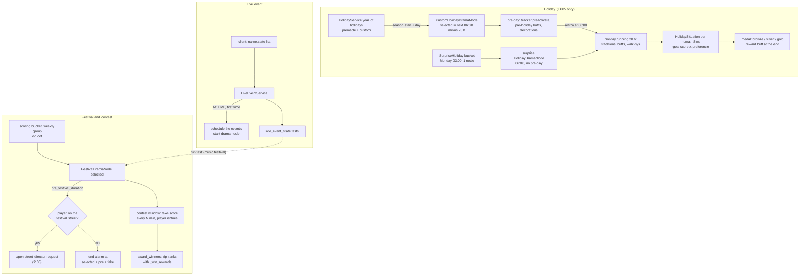

# 4.04 Holidays, festivals, live events and competitions

*Game version 1.128.90.1030 (Steam, Linux/Proton). Live values come from the merged tuning (the base-game delta build plus the delta build of each installed pack: EP04 (Cats & Dogs), EP06 (Get Famous), EP09 (Eco Lifestyle), EP12 (High School Years), GP04 (Vampires), GP12 (Werewolves), SP01 (Luxury Party) and SP42 (Grunge Revival)), read through the live merge; module tuning comes from the base delta build. Holiday, lottery, decoration and tradition values are EP05 (Seasons) patch data, and sim competition values are EP21 (Royalty & Legacy) patch data: those packs are not installed and the data does not run here. A patch file holds only the records a pack re-ships (4,721 instance records for EP05), so its counts are counts over that file. Written 2026-10-12. Checked 2026-10-12: 134 claims checked, 27 corrected, 1 relabelled, 1 removed, 15 added. Deepened 2026-10-13: 1 module newly explained, 1 failed decompile read (per-function decompile and bytecode). Checked again 2026-10-13: 175 claims checked, 18 corrected, 1 relabelled, 2 removed. Cross-chapter edits 2026-10-13: 2 applied.*

## In plain words

Four systems put dated, one-off events into a Sim's week. **Holidays** are days on the season calendar with a list of traditions (decorate, eat a grand meal, open presents); each Sim in the household likes, loves or ignores each tradition, does the matching goals during the day and gets a medal and a mood reward at the end. **Festivals** are events on a neighbourhood street that start at a set time, fill the street with stalls and visitors, and can run a **contest** that ranks entries and gives prizes. **Live events** are switches that the game client turns on from outside the game (a music festival in 2021, a gift of Simoleons, timed scenarios). **Sim competitions** are a newer tournament system with an entry fee and cash prizes by placement.

In this install the holiday half is switched off. The holiday calendar, traditions and lot decorations all live in services that only start with EP05 (Seasons), so no holiday ever runs, the calendar has no holiday days, and no house gets lights. The base game and the installed packs still carry a lot of holiday-aware tuning: 1,447 checks in 1,164 records ask "is this tradition active?", and without EP05 the answer is fixed. The ones that ask for a tradition always fail and the ones that forbid one always pass.

What could run: the base game's music festival in Willow Creek and the four EP12 (High School Years) school festivals (chess and computer science fairs on request, cheer and football on fixed weekdays). The music festival needs the client to report its 2021 live event as on, its tuned dates ended in July 2021, and even then its street director shuts itself down because the festival's data is marked disabled, which ends the festival before the street fills. The school contests rank the top three scores, but each one pays only first place. Once a player Sim has entered a contest, any save before the festival ends leaves the festival out of the saved file.

Sim competitions are Royalty & Legacy content: the script and commands are in the base game, but the only competition list points at EP21 tuning, so the selector is empty here.

## Key facts

- **Pack gates.** `HolidayService` and `LotDecorationService` declare `required_packs` EP05, so both service accessors return None here. `LiveEventService`, `CalendarService`, `SimCompetitionService` and the festival code are ungated.
- **The tracker still exists.** The active household always gets a `HolidayTracker`; with no holiday running, its active traditions are an empty tuple and every price multiplier is 1.
- **Tradition tests are frozen.** Of the 1,447 live `TraditionTest` uses, 1,337 use a whitelist (they always fail) and 110 use only a blacklist (they always pass). No `HolidayTradition` record is live.
- **Holiday clock (EP05 data).** Every calendar holiday runs through one drama node, `customHolidayDramaNode`. Its pre-day starts 23 hours before 06:00 on the holiday's date. The holiday then runs for `HOLIDAY_DURATION` 20 hours, from 06:00 to 02:00. Surprise holidays have no pre-day.
- **Holiday medals.** A Sim who cares about 3 or more of the holiday's traditions has a maximum score of 300; 1 or 2 gives 100. Goal points are multiplied by 1 (likes), 2 (loves) or 0 (does not care). Silver needs 50% of the maximum and gold 99%. Bronze, the "failed" reward, is the floor.
- **Surprise holidays (EP05 data).** At 03:00 each Monday the `SurpriseHoliday` bucket schedules one of eight surprise holidays. It lands at 06:00 on its weekday, 48 to 192 hours ahead, and that holiday then cools down for 672 hours (4 weeks).
- **Festival clock.** A festival's pre-period and length are in Sim minutes. All four EP12 contests are selected at 16:59 and open at 17:00 (football and cheer are booked by the weekly pass at their window's start time, so football's untuned 1-hour window is never used). Fake rival scores stop after 240 minutes (the last at 20:40 for a 17:00 opening), and off the festival street the node closes 300 minutes after opening (22:00). The music festival is selected for Sunday 12:00, opens at 12:20 and closes at 00:20 Monday.
- **EP12 scheduling.** The science fair (chess or computer) is booked on request through `loot_HighSchoolFestival_ScheduleScienceFair`, 24 to 48 hours ahead. Cheer runs every Friday and football every Thursday through weekly scheduling groups, booked 4 weeks ahead.
- **EP12 prizes.** Contests keep the top 3 scores and add a fake rival score every 20 Sim minutes. Each EP12 contest lists one `_win_rewards` loot, so only rank 0 is ever rewarded or told it won, although three win notifications are tuned. Ranked contests report no losers, so the lose notification never shows.
- **Proven save bug (reached with EP12).** Once a player Sim has entered a contest, every save while that festival node is active raises AttributeError in `_save_custom_data`. The save system swallows the error and leaves the whole festival node out of the saved file.
- **Proven sort inversion.** Saving sorts the kept scores lowest first and nothing re-sorts them before the award. A save after the last score update (20:40 or a later entry) and before the results gives first prize to the lowest kept score, or to nobody if that score is a fake rival.
- **Live events.** The client sends `name,state` strings. An event activates at most once per save, and the event names, windows (UTC, 2021 to 2022) and content are tuned in the base game. Eleven names exist: SoM2021, free_simoleons and nine scenario events named "%" plus the scenario id.
- **Native event flags.** `is_live_event_active` is a different, native check on string ids. It appears 1,356 times in 63 live records (spring challenge 479, fall challenge 451, double XP weekend 185 and others).
- **Sim competitions (EP21 data).** Fees are 25, 50 and 100 Simoleons. First-place prizes are 250, 500 and 1,000, and placement is 3 minus the rounds won. The competition list is empty here.
- **Commands.** All `holiday.*` commands are Live, but they do nothing without the EP05 service. The five `lot_decorations.*` commands are untyped and never register. `festival_notification_options.sync_option` is Live and raises AttributeError if typed.

## How it works

The main flows, holiday on the left (EP05 only), festival and contest in the middle, live event on the right:

### What runs in this install

**Observed** (`holidays/holiday_service.py: HolidayService.required_packs`, `lot_decoration/lot_decoration_service.py: LotDecorationService.required_packs`). Both return `(Pack.EP05,)`, so `services.holiday_service()` and `services.lot_decoration_service()` are None here. Everything that reaches a holiday through the service (the calendar, custom holidays, the `holiday.*` commands, decoration requests) stops at a None check or never starts.

**Observed** (`sims/household.pyc: Household.load_data`, bytecode line 1749; `holidays/holiday_tracker.py`). The `HolidayTracker` is created for the active household without a pack check. With no holiday ever activated, `active_holiday_id` and `upcoming_holiday_id` stay None, `get_active_traditions` returns `()`, `get_active_holiday_business_price_multiplier` returns 1, and `get_additional_holiday_walkbys` yields nothing.

**Observed** (live tuning, rechecked by the checker). No live record has instance type `holiday_definition`, `holiday_tradition`, `lot_decoration` or `lot_decoration_preset`. Every holiday drama node, tradition, holiday definition and decoration record is in the EP05 patch data. The live records of this chapter are:

| Class | Live | Source |
|---|---|---|
| `FestivalDramaNode` | 1 | base delta (`festivalDramaNode_MusicFestival`) |
| `FestivalContestDramaNode` | 4 | EP12 delta (chess, computer, cheer, football) |
| `BasicFestivalOpenStreetDirector`, `MusicFestivalOpenStreetDirector` | 4, 1 | EP12, base (see [2.06](2.06-worlds-regions-travel.md)) |
| festival situations (attendee, employee, vendor, selectable) | 32 | base 6, EP12 26 |
| `LiveEventQuest` | 62 | base delta (quests are [4.05](4.05-scenarios-moments.md)) |
| `CalendarEventDramaNode` | 2 | EP12 (exam, career day) |

The other dated EP12 school events are situations and drama nodes covered in [4.01 Situations, roles and NPC scheduling](4.01-situations-npcs.md); the prom's situation is in its [weddings and prom section](4.01-situations-npcs.md#weddings-the-prom-and-staffed-objects) and its guest lists under [other drama node types](4.01-situations-npcs.md#other-drama-node-types); the base delta drama scheduler tuning also lists an `HSProm` weekly scheduling group (4 weeks ahead) next to the two sports-day groups.

### The holiday calendar (EP05 only)

**Observed** (`holiday_service.py: YearOfHolidays`, `HolidayService`). The service keeps one `YearOfHolidays` per season length (NORMAL, LONG, VERY_LONG), each a map of season to {day of season: holiday id}. On the first load with an empty calendar it fills all three from the four `Season` records (`season_content.get_all_holiday_data()`). The premade dates per season length are tabled in [2.04 Weather, seasons and the ground](2.04-weather-seasons-ground.md); I re-read them from the EP05 Season records and they match. Fall has Harvestfest, winter has Winterfest and New Year's, spring has Love Day and summer has none.

- **One node for every calendar holiday.** `_schedule_all_holidays` schedules `CUSTOM_HOLIDAY_DRAMA_NODE` (`customHolidayDramaNode` 187999) for every entry, premade or custom, with `specific_time` = season start + day and the holiday id as a constructor argument. The four `holidayDramaNode_MainHolidays_*` records (183107 to 183110) are never scheduled by the service. In live tuning they appear only as names inside tests (see "Holiday code without EP05").
- **Custom holidays.** `holiday.add_holiday` creates a `CustomHoliday` with a fresh object id, loads its name, icon, traditions, time-off flags and decoration preset from the client's proto, adds it to all three calendars and schedules it. `YearOfHolidays.add_holiday` clamps a day past the season's end to the same weekday in the last week (`day % 7 + season_length - 7`) and refuses a day that already has a holiday.
- **Season changes.** `on_season_content_changed` cancels every scheduled custom-class node, completes the active ones still in their pre-day, schedules the calendar again, and then keeps one holiday node per day (bytecode): a calendar node seen first cancels any later node on its day, and any other node seen first is cancelled in favour of the next one. In effect a calendar holiday beats a surprise holiday on the same day.
- **Editing.** `modify_holiday` works out added and removed traditions and tells the tracker. If that holiday is in its pre-day, the tracker starts or stops the traditions' pre-holiday effects at once; if it is running, it starts or stops their holiday effects and updates the holiday situations' goals.

### The holiday drama node and its timing (EP05 only)

**Observed** (`holiday_drama_node.py: HolidayDramaNode`, bytecode for `_select_time` and `_run_holiday`).

- **Selecting the time.** With no `specific_time` (surprise holidays), the base selection runs and the node is rejected if another scheduled HOLIDAY or PLAYER_PLANNED node has the same `day`. With a `specific_time` (calendar holidays), start = the first `MAIN_HOLIDAY_START_TIME` 06:00 at or after it, rejected if in the past; selected = start minus `pre_holiday_duration`, but never earlier than now plus one tick.
- **Pre-day.** `_run` with a pre-duration above zero enters the pre-day: the tracker records the upcoming holiday, each tradition gives its `pre_holiday_buffs` to the active household's instanced Sims (and to those who spawn later), a PRE_HOLIDAY decoration request goes in, and an alarm waits for the next 06:00. With a pre-duration of 0 the holiday runs at once.
- **Running.** `_run_holiday` first sets the end alarm at now plus `HOLIDAY_DURATION` (20 h live, code default 22), then returns if the tracker marked this holiday cancelled. Otherwise it activates the tracker, requests HOLIDAY decorations and creates a `HolidaySituation` for each human Sim of the active household that passes `tests_to_create_situation`, with the holiday job at `EVENT_VIP` priority. The situation's goals are the traditions' `situation_goal`s.
- **Calendar entry.** The node shows on the calendar from the next 06:00 for `HOLIDAY_DURATION`, with `advance_notice` set to `HOLIDAY_DURATION`.
- **Time off.** `get_time_off_reason` gives school the holiday's `time_off_school` flag and work careers its `time_off_work` flag. Volunteer and university-course careers never get time off. The reason sent is `HOLIDAY_TIME_OFF_REASON` HOLIDAY.
- **Hunt.** The node keeps a set of searched object ids for its day; `HolidaySearchLootOp` adds to it and `ObjectSearchedHolidayTest` fails for an object already in it. Neither has a live use.

**Observed** (EP05 patch data, pack not installed). `customHolidayDramaNode` sets no pre-duration, so it uses the code default of 23 hours: a holiday on day D has its pre-day from 07:00 on day D-1, runs from 06:00 on day D and ends at 02:00 on day D+1. The eight surprise holiday nodes (`dramaNode_PremadeHoliday_Surprise_*`) set `pre_holiday_duration` 0, `single_time` 06:00 on one weekday, `min_and_max_times` 48 to 192 hours, an ON_SCHEDULE node cooldown of 672 hours, bucket `SurpriseHoliday` and display type POP_UP_HOLIDAY. The weekdays are Battle Royale and Pirate Day on Saturday, Discount Day on Monday, Lottery on Wednesday, Night on the Town on Friday, Prank Day and Skill Day on Sunday, and TV Premiere on Thursday. Only Skill Day sets `tests_to_create_situation` (a `scenario_sim_status` test naming scenario 282961). The base delta module tuning of the drama scheduler gives the `SurpriseHoliday` bucket Monday and a fixed count of 1 (Observed; the scoring pass itself is in [4.01](4.01-situations-npcs.md)).

### Traditions and preferences (EP05 only)

**Observed** (`holiday_tradition.py: HolidayTradition`). A tradition carries:

- a `situation_goal`;
- `pre_holiday_buffs` (the active household's instanced Sims) and `holiday_buffs` (every instanced Sim);
- `preference`, a list of test sets mapped to LOVES, LIKES or DOES_NOT_CARE (the first passing set wins, default LIKES);
- events at a time of day;
- `lifecycle_actions` that start or destroy situations on HOLIDAY_ACTIVATE, HOLIDAY_DEACTIVATE, TRADITION_ADD and TRADITION_REMOVE;
- `drama_nodes_to_score` (scored into 1 node) and `drama_nodes_to_run`;
- `additional_walkbys`;
- `business_cost_multiplier` per business type. The tracker multiplies these over all active traditions, and `restaurant_utils` and `business_manager` apply the product to prices.

**Observed** (EP05 patch data). 55 traditions: 47 regular and 8 surprise. All 55 set a goal, holiday buffs, `selectable` and a preference list. Three regular ones are not selectable (joke, mean and romantic gifts), and 6 of the 8 surprise ones are not. The fields used beyond the basics:

| Field | Traditions using it |
|---|---|
| `additional_walkbys` | 9 |
| `pre_holiday_buffs` | 3 |
| events at a time of day | 3 |
| `lifecycle_actions` | 2 |
| `drama_nodes_to_score` | 1 (GoOnDate: `dramaNode_NPCInvite_Date_Holiday`) |
| `drama_nodes_to_run` | 1 (Surprise Lottery: `lotteryDramaNode_holidayLottery`) |
| `business_cost_multiplier` | 1 (Night on the Town: RESTAURANT 0) |

The premade holidays hold 4 (Harvestfest), 3 (Love Day), 4 (New Year's) and 5 (Winterfest) traditions. Each surprise holiday holds one. A `HolidayDefinition` allows up to 5. Harvestfest, New Year's and Winterfest give time off work and school; Love Day gives none.

### Holiday scoring and medals (EP05 only)

**Observed** (`holiday_situation.py: HolidaySituation`, bytecode of the `on_holiday_data_changed` generator; `holiday_globals.py: HolidayTuning`, base delta module tuning).

1. `_setup_max_score` counts the traditions this Sim cares about (LIKES or LOVES). It takes the first entry of `HOLIDAY_SCORING_INFORMATION` whose threshold the count meets: at least 3 gives `max_score` 300; at least 1 gives 100. A Sim who cares about none gets -1, no medal reward and no end notification.
2. `on_goal_completed` adds the goal's points times `TRADITION_PREFERENCE_SCORE_MULTIPLIER` for that tradition: DOES_NOT_CARE 0, LIKES 1, LOVES 2.
3. The effective score for medals is `int(score / max_score * 100)`.
4. `holidaySituation` 182317 (EP05 patch data) sets `score_delta` bronze 0, silver 50, gold 49. The levels add up in order, so the thresholds are bronze 0, silver 50 and gold 99 percent. That is silver at 50 points and gold at 99 for a maximum of 100, and silver at 150 and gold at 297 for 300. Bronze has threshold 0, so a caring Sim always ends with at least bronze.
5. At the end (`build_situation_end_message`, skipped on shutdown) the Sim gets the medal's SimReward:

| Medal | max 300 (3+ cared traditions) | max 100 (1 or 2) |
|---|---|---|
| Bronze | `buffReward_Holiday_Failed` 184898 | `buffReward_Holiday_Failed_Small` 190214 |
| Silver | `buffReward_Holiday_Okay_LargeHoliday` 185214 | `buffReward_Holiday_Okay` 184899 |
| Gold | `buffReward_Holiday_Successful_LargeHoliday` 185211 | `buffReward_Holiday_Successful` 184897 |

The silver and gold end notifications open the reward store (`SHOW_REWARD_STORE`). Of the 55 goals the traditions name, 34 are worth 100 points and 21 are worth 20 to 50 (EP05 patch data). So one liked 100-point goal already gives gold to a Sim who cares about 1 or 2 traditions, and three liked or two loved 100-point goals give gold on a large holiday (Inferred from those numbers).

### Lottery, countdown and visitors (EP05 only)

**Observed** (`lottery_holiday.py: LotteryDramaNode`; `lotteryDramaNode_holidayLottery` 184762, EP05 patch data). The Surprise Lottery tradition runs this node. It records each Sim who fires `lottery_ticket_purchased` until `end_time` Thursday 10:00. If nobody bought a ticket, there is no draw. Otherwise the ticket buyers enter first, the list is filled up to `minimum_sims` 100 with Sims from other households (not a player or hidden household, not teen or younger, not at minimum LOD), and one is drawn with `weighted_random_item`. The weight multipliers 5 and 0.5 sit behind the EP19 (Enchanted by Nature) luck test sets `testSetInstance_LuckSys_GoodLuck` 425929 and `testSetInstance_LuckSys_BadLuck` 425930 (EP19 patch data; EP19 (Enchanted by Nature) is not installed either). The payout, the code default of 1,000,000 Simoleons, goes to the winner's household, and a notification names the winner. A selectable winner gets `loot_SurpriseHoliday_Lottery_Win` 181908; otherwise each selectable ticket buyer gets `loot_SurpriseHoliday_Lottery_Lost` 181906.

**Observed** (`countdown_situation.py`). The countdown situation counts from `time_to_start_count` with a count every `interval_between_counts` and celebrates at `celebrate_time` (code defaults 11:30, 5 Sim minutes, 00:00). The EP05 record `countdownSituation` 181148 sets 23:30, 3 Sim minutes and 00:00 (patch data, pack not installed). It is not saved (`situation_serialization_option` DONT).

**Observed** (`situations/complex/holiday_visitor_situation.py`). `HolidayVisitorNPCSituation` (the Father Winter style visitor, EP05 records only) is a worker-exclusive situation with four states: arrival, push interaction (a tuned number of times on a random target, either objects with given tags or a random instanced household Sim), hang out, leave. It saves its chosen target id.

### Lot decorations (EP05 only)

**Observed** (`lot_decoration/*.py`; `lot_decoration.pyc` rescued per function).

- `LotDecorationService` keeps a `NeighborhoodDecorationState` per world. Each `DecoratableLot` stores a decorated state per decoration type (a holiday id, or `DefaultDecorations` for everyday decor), so custom decorations are remembered per holiday.
- Holiday drama nodes add a `HolidayDecorationRequest`. The service applies the request with the highest priority (DEFAULT 0, PRE_HOLIDAY, HOLIDAY).
- `decorate_neighborhood_for_holiday` skips lots owned by the active household and lots that pass any `NON_DECORATABLE_TESTS`. The base delta module tuning lists a venue whitelist (`venue_ActingStudio` 190058, live with EP06 (Get Famous); `venue_SecretLab` 202003, GP07 (StrangerVille) patch data; `venue_GrimLot` 382810, EP17 (Life & Death) patch data) and an apartment test.
- Decorations hang at six `DecorationLocation`s: foundations, eaves, friezes, fences, spandrels and columns. The picker categories in the base delta module tuning are banners, garlands, lights, buntings, icicles and streamers.
- The client is sent a `SetLotDecorations` op. Neighbours fade in with `AUTO_DECORATION_PARAMS` 0.5 s fade, 2 s fade variation range, 5 s delay; the player's own changes use 0.5, 0 and 0 seconds (both code defaults).
- On the active lot, `LOT_DECORATED_STATISTIC` (183842, an EP05 statistic, so None here) is set to 1 or 0.

**Observed** (`lot_decoration/lot_decoration.pyc`, bytecode of the module and the class body; the per-function rescue recovers the same class body and nothing else, since the module has no functions). A `LotDecoration` record (instance type `lot_decoration`) is only data: the display mixin's icon, description and tooltip, a `decoration_resource` (a `TunableDecoTrim`, the catalog trim piece that is drawn), `available_locations` (the `DecorationLocation`s the picker offers it for) and `picker_categories` (default ALL). All placement logic sits in the service and the client. **Observed** (EP05 patch data, pack not installed). EP05 ships 132 `LotDecoration` records (`lotDecoration_Holiday_*`: banners, buntings, garlands, icicles, lights, streamers and their numbered variants) and 6 `LotDecorationPreset` records.

**Observed** (`lot_decoration/lot_decoration_handlers.py`). The GSI view "Lot Decorations" (`decoratable_lots_view`; GSI is the developer inspector, [1.04 Debug, cheats and telemetry](1.04-debug-cheats-telemetry.md)) lists each decoratable lot with zone, world, decoration type, whether the active household owns it, the preset, whether it was customized and whether it is the current lot, plus its location-to-decoration pairs. Its two buttons run `lot_decorations.apply_preset_to_neighbors` and `lot_decorations.apply_preset_to_zone` with a preset picked from the loaded `LotDecorationPreset` names; both commands are untyped and never register in retail (see "For modders"). With no decoration service the view returns an empty list.

**Proven code quirk, not reached here.** `HolidayDecorationRequest.priority` returns HOLIDAY only if `self._drama_node.holiday is ...active_holiday_id`. `holiday` is the tuned `HolidayDefinition` class and `active_holiday_id` an integer, so the identity test is always False and a running holiday's request reports PRE_HOLIDAY. When two holiday requests are open (one running, one in its pre-day) they tie, and `max()` keeps the first one in the request dictionary. The running holiday's request was usually added first, during its own pre-day, so the visible effect is often nil (both Inferred). Not reached without EP05. Every calendar holiday runs as a `CustomHolidayDramaNode`, which removes the `holiday` tunable (`REMOVE_INSTANCE_TUNABLES`) and overrides only `holiday_id`, so for those nodes this line reads an attribute the class does not tune; whether that yields a default or raises was not settled (Inferred either way).

### Holiday code without EP05

**Observed** (`holiday_tests.py: TraditionTest`; `tunable_utils/tunable_white_black_list.py`, `tunable_whitelist.py`, `tunable_blacklist.py`, bytecode of each `test_collection`). `TraditionTest` builds the list of active tradition types (empty here) and runs it through a white/black list.

- **Whitelist.** It passes when the number of whitelisted items in the list meets its threshold (default at least 1), so it fails on an empty list.
- **Blacklist with a threshold.** It passes when the count does not meet the threshold, so it passes on an empty list.
- **All-must-match** (threshold disabled). A whitelist passes on an empty list and a blacklist fails. No live use has this shape.

**Observed** (live tuning, rechecked by the checker). 1,447 uses in 1,164 records (base delta 916, EP04 20, EP06 24, EP09 95, EP12 35, GP04 49, GP12 25):

| Shape | Uses | Result without EP05 | Example records |
|---|---|---|---|
| whitelist, threshold at least 1 (default) | 1,336 | always False | `Fireplace_Light`, `Collect_Dish`, `ClayBlob_Mold` |
| whitelist, threshold at least 2 | 1 | always False | `si_Career_GradeSchool` |
| blacklist only, threshold at least 1 | 109 | always True | `Gardening_Splice`, `Gardening_Water_All_low` |
| blacklist only, threshold at least 2 | 1 | always True | `si_Career_GradeSchool` |

The lists hold 1,427 whitelist and 111 blacklist entries (29 distinct tradition ids), and none of them is a live record. The list items are `TunableReference(pack_safe=True)`, so every one drops at load and each list loads empty; the results in the table hold either way, since the active-tradition list is empty too. What each test gates (an outcome, an autonomy score, a menu entry) was not followed record by record.

**Observed** (`holiday_tests.py: SpecificHolidaysTest`, bytecode lines 96 to 118). Two live uses, `object_sculpture_gnome` and `object_sculpture_gnome_high`, test "Harvestfest node not running" (`holidayDramaNode_MainHolidays_Harvestfest` 183110, `invert` True). The reference is pack-safe and resolves to None here, and the code returns True for a None reference with `invert` set. So the gnome tests always pass in this install.

**Proven code quirk, not reached here.** In the same test, an active node whose `holiday_id` matches counts as "in the required state" whatever its state (pre-day included, even with `count_pre_holiday_time` False). Any other active holiday node that `is_running` also counts. With EP05, "Harvestfest not running" would therefore fail during any running holiday.

### Festivals

**Observed** (`drama_scheduler/festival_drama_node.py: FestivalDramaNode`). A festival is a simless drama node of type FESTIVAL with `persist_when_active`.

1. `_run` fires `TestEvent.FestivalStarted` for the active household, sets an alarm for `pre_festival_duration` (Sim minutes, code default 120) and returns SUCCESS_NODE_INCOMPLETE, so the node stays active.
2. When the alarm fires, `_try_and_start_festival` checks the current street. On the festival's `street` it asks the venue service for the `festival_open_street_director`, with preroll at selected + pre and a timeout of `delay_timeout` (code default 120 minutes), and sets no end alarm: the director's end, a timeout or an early teardown completes the node. Elsewhere it sets an end alarm at selected + pre + `fake_duration`.
3. The same alarm fires `TestEvent.FestivalStarted` a second time. It also shows `starting_notification`, whose response runs `drama.show_festival_info` with the node's tuning id (`guid64`), and scores `additional_drama_nodes` into 1 node on the festival street.
4. The calendar entry runs from selected + pre to selected + pre + fake.

The director's states and situations are in [2.06 Worlds, regions, streets and travel](2.06-worlds-regions-travel.md).

**Festival tests.** The three tests that ask about festivals from other tuning, `festival_running` (`FestivalRunningTest`), `next_festival` (`NextFestivalTest`) and `time_until_festival` (`TimeUntilFestivalTest`, code default 18 hours), are explained in [4.01 Situations, roles and NPC scheduling](4.01-situations-npcs.md#the-drama-scheduler-life-of-a-node), which rescued them. **Observed** (live tuning, every source file of the live merge searched for the three test names). No live record uses any of them, so festival-aware objects, socials and goals in this install never ask whether a festival is near. **Observed** (patch data, packs not installed). The patch files use `festival_running` 256 times (EP03 (City Living) 66, EP07 (Island Living) 7, EP10 (Snowy Escape) 44, EP11 (Cottage Living) 85, EP17 16, EP18 (Businesses & Hobbies) 32, EP20 (Adventure Awaits) 6), `next_festival` 40 times (EP03 14, EP10 3, EP11 5, EP18 14, EP20 4) and `time_until_festival` 31 times (EP03), counted over the records each patch file re-ships with shared-node references resolved (each reference counts as a use).

**Observed** (`FestivalDramaNode.get_travel_lot_id`, bytecode). With `reject_same_street_travel` (default True) and the player already on the festival street, there is no travel lot. Otherwise it uses `travel_lot_override`, then the street's `travel_lot`, and returns None if neither exists (its `logger.error` call has an empty body in retail, so nothing is written; see [0.02 Architecture](0.02-architecture.md)). The module tuning sets `GO_TO_FESTIVAL_INTERACTION` to `terrain-travel_here_with_Picker` 29344 (base delta).

**Observed** (`festivalDramaNode_MusicFestival` 269621, base delta). `pre_festival_duration` 20, `fake_duration` 720, `min_and_max_times` 0 to 24 hours, `single_time` with untuned fields (code default Sunday 12:00), scoring base 100 in bucket `MusicFestival` (Sunday, 3 nodes per the base delta drama scheduler tuning, which also lists it as a startup bucket). The run test requires live event SoM2021 ACTIVE. Street `street_WillowCreak_GardenPark` 184325, `travel_lot_override` 42527, director `musicFestivalOpenStreetDirector` 269623, additional node `dialogDramaNode_MusicFestival2021_NPC_Phone_Call` 269980. So the festival is selected at Sunday 12:00, opens at 12:20 and ends at 00:20 Monday, and it can only run while the client reports SoM2021 active (see "Live events").

**Festival notifications.** **Observed** (`festival_notification/*.py`, base delta module tuning). `FESTIVAL_NOTIFICATION_OPTIONS` gives each pack's festivals a key: festival_0 EP03 (City Living), festival_1 EP08 (Discover University), festival_2 EP10 (Snowy Escape), festival_3 EP11 (Cottage Living), festival_4 EP12, festival_5 EP17, festival_6 EP18 (Businesses & Hobbies), festival_7 EP20 (Adventure Awaits). `FestivalNotificationOptionsTest` (8 live uses, all EP12 `festival_4`) reads the disabled keys from `misc_options_service`. `misc_options.sync_festival_notification_option` (Live) adds or removes a key; it is the call the options screen uses (Inferred, since the other command is broken). `FestivalNotificationOptionsService` is a class that no service accessor returns.

### Festival contests

**Observed** (`festival_contest_drama_node_mixin.py`, `festival_contest_drama_node.py`, `festival_contest_sub_drama_node.py`, `festival_contest_ops.py`).

- **Shape.** A contest is a festival node with `festival_contest_tuning`. A sub node runs the same contest code without a street or director, and lives only for the contest window.
- **Fake rivals.** `_try_and_start_festival` adds a repeating alarm every `_score_update_frequency` minutes (code default 30). Each tick adds a fake score with `sim_id` 0, drawn uniformly from `_score_update_value_interval`, while time remains before selected + pre + `_contest_duration` (code default 60); the first tick at or after that point only cancels the alarm. For a 17:00 opening, a 240-minute window and 20-minute ticks, the last fake score lands at 20:40.
- **Entries.** `FestivalContestSubmitElement` (the `submit_to_festival_contest` basic extra) finds a running festival node with contest tuning outside its pre-period and runs the contest's `_object_tests`. It never checks that the contest window is still open; the tuning has to gate entries. It scores the entry with the score method. `by_statistic` reads the object's statistic and can remove it afterwards; `by_multipliers` is a tested multiplier list. It calls `add_score` whether or not `_destroy_object_on_submit` destroys the object, and shows the notification for the returned rank.
- **Keeping scores.** `add_score` appends, sorts by score times the Sim's multiplier, highest first, and, for ranked contests, cuts the list to `_scores_to_consider` (code default 3) and returns the Sim's rank.
- **Winners.** Ranked contests return the kept list as the winners and an empty list as the losers. Weighted random contests draw with `random.pop_weighted` while entries remain and fewer winners than rewards have been drawn.
- **Awards.** `award_winners` zips the winners with `_win_rewards`, skips fake and invalid Sims, and uses the winner's position as the notification index. It applies each reward loot at once if the winner is instanced, and otherwise requests it as a household delivery (`_award_player`). Then come `losers_loot`, the loser notification and the return of hidden entries. With no losers, a ranked contest never applies `losers_loot` or shows `_lose_notification`, so a player in second or third place hears nothing.
- **When awards happen.** `complete` awards if nothing was awarded yet and the contest window is over. The `festival_contest_get_reward` loot (live use: `loot_HighSchoolFestival_AnnounceResults` 285559, from the judge's podium interaction) awards at once.

**Observed** (EP12 delta, rechecked by the checker). The four live contests:

| Node | Id | Score statistic | Fake score range | Schedule | `min_and_max_times` |
|---|---|---|---|---|---|
| `highSchoolFestival_ScienceFair_Chess` | 281853 | `statistic_HighSchoolFestival_ChessPuzzleScore` 282029 | 5 to 80 | any day 16:59, on request | 24 to 48 h |
| `highSchoolFestival_ScienceFair_Computer` | 281854 | `..._GameJamScore` 282030 | 10 to 90 | any day 16:59, on request | 24 to 48 h |
| `highSchoolFestival_SportsDay_Cheer` | 281852 | `..._CheerScore` 282032 | 50 to 90 | Friday 16:59, weekly | 0 to 168 h |
| `highSchoolFestival_SportsDay_Football` | 281849 | `..._FootballScore` 282031 | 0 (untuned) to 60 | Thursday 16:59, weekly | 0 to 168 h |

All four set `fake_duration` 300, `pre_festival_duration` 1, `_contest_duration` 240, `_score_update_frequency` 20 and `by_statistic` with `remove_statistic_after_submission`, and leave `_winner_selection_method` at its code default, ranked with 3 scores. Each has one `_win_rewards` entry, `loot_HighSchoolFestival_GiveRewardsWin` 291730 (a team buff per contest plus an action that is not live), three win notifications and a lose notification. Scoring is disabled. Chess, computer and cheer tune their schedule window with `duration` 0; football leaves `duration` untuned (code default 1 hour, `drama_node.pyc` schedule time option, bytecode). The window length does not matter for the sports nodes: the weekly pass takes the time from `get_week_time_for_weekly_schedule`, which returns the start time of a tuned day (no offset inside the window), and schedules with that `specific_time`, which `_select_time` accepts as is, so football is selected at exactly Thursday 16:59 and its `min_and_max_times` is not consulted either (Observed: 4.01's rescue of `drama_node.pyc`, bytecode of `get_week_time_for_weekly_schedule` and `_select_time`; `drama_scheduler.py: _schedule_weekly_nodes_gen`). The science fairs, booked through a loot without a specific time, do use their 24 to 48 hour window, and with `duration` 0 they land on a 16:59 inside it. The street is `streets_EP12_HighSchoolWorld_HighSchool` 272367, the directors are 281861 to 281864, and the starting notification is gated on `festival_4`.

- **Times.** Selected at 16:59, they open a minute later. Fake scores run for 240 minutes, to 20:40 for a 17:00 opening. The submit element does not check that window: entries are gated by the social's tests, which need the contest's competition situation, and those situations belong to the street director ([2.06](2.06-worlds-regions-travel.md)). Off the festival street the node ends 300 minutes after opening (22:00 for a 17:00 opening); on the street it ends with the director.
- **Science fair.** Chess and computer are booked by `loot_HighSchoolFestival_ScheduleScienceFair` 281851. It holds one `schedule_drama_node` per fair, chess behind `careers_Volunteer_HSTeam_ChessTeam` 276602 and computer behind `careers_Volunteer_HSTeam_ComputerTeam` 276603, plus two notifications. It is reached from the phone, computer and social "request science fair" interactions (283631 to 283633), each of which tests that neither fair node exists yet.
- **Sports day.** Cheer and football use `weekly_scheduling_rules` (groups `HighSchoolFestival_Cheerleading` and `HighSchoolFestival_Football`, weight 5). With `weeks_to_schedule_in_advance` 4 (base delta drama scheduler tuning), the weekly pass at Sunday 03:00 keeps the current week and the next three booked.
- **One prize.** `award_winners` stops at the shorter of the two lists, so with one reward only rank 0 is ever rewarded or notified. The second and third win notifications are unreachable. Entries come from the player's `highSchoolFestival_Socials_Competition_SubmitScore` 282155 social (4 uses), whose entry is the Sim itself (`participant_to_submit` Actor). Each of its four outcomes needs the actor to be a playable Sim in that contest's competition or player situation. The judges' role states carry `buff_HighSchoolFestival_All_WatchCompetition` 282160, which grants the social, so it is offered on the judges. The contest then tries to hide the "object" and fails on every entry; the `logger.error("Failed to move submission object ...")` call it makes writes nothing in retail (Inferred from the code path; not run). The judge's podium announcement (`si_HighSchoolFestival_Podium_JudgeAnnounce` 282234) runs the results loot.

**Proven bug, reached in normal play with EP12.** `FestivalContestDramaNodeMixin._save_custom_data` runs when the node is saved:

- **The error.** For ranked contests it loops over `self._player_submissions.values()` and reads `submission.object_id`, but each value is a list of `ContestScore`. Bytecode: `LOAD_ATTR _player_submissions`, `LOAD_METHOD values`, `GET_ITER`, then `LOAD_ATTR object_id` on the loop item. So once any player Sim has an entry and `_scores` is not empty, the save raises AttributeError.
- **Lost record.** The drama scheduler saves each active `persist_when_active` node inside `ProtocolBufferRollback`. On an exception its `__exit__` deletes the half-written `running_nodes` entry, reports it through `logger.exception` (one of the few logging calls that still reaches native code in retail, see [0.02](0.02-architecture.md)) and returns True, so the error is swallowed and the festival node is missing from that save.
- **When it happens.** It fires on every save of the game (manual or autosave; travel also writes the save, Inferred) from the first player entry until the node completes (22:00 off the festival street, the director's end on it). It is reached in normal play here, because EP12 is installed and the submit social is a normal player action. The session in progress carries on; loading that save brings back no festival, so the contest, its scores, the entry and the unawarded prize are gone (Inferred).

**Proven bug, reachable under a timing condition.** `get_scores_gen` (called only by `_save_custom_data`, before the loop that fails) and `add_sim_score_multiplier` sort `_scores` in place lowest first. `add_score` sorts highest first, and the ranked selector returns `_scores` as it stands. If the last sort before `award_winners` came from a save, the award zips the lowest kept score with the single EP12 reward. If that score is a fake rival nobody wins; if it is a player, the weakest kept entry gets first prize. Either way the real leader gets no message, since ranked contests report no losers. This needs a save after the last `add_score` (the 20:40 fake score, or a later entry) and before the results. A player entry is what makes the order matter, and the same entry sets off the save bug above. `festival_contest_add_score_multiplier`, the loot that reaches `add_sim_score_multiplier`, has no live use.

**Proven code quirk, reachability not shown.** During the contest, `on_sim_spawned` reaches its "Missing object" `logger.error` (empty in retail) for an entry whose object is not in the Sim's inventory and then still calls `_hide_and_lock_submission(None, sim)`, where the inventory reads `None.id` and raises AttributeError. EP12 entries store the Sim's own id as the object id, so for them the lookup always fails (Inferred).

### Live events

**Observed** (`live_events/live_event_service.py`, bytecode of `process_incoming_live_events`; base delta module tuning).

1. On client connect the service sends `RequestDaysPlayed`. `live_events.set_days_played` sets `player_experience_level`, which `PlayerDayTest` reads (capped at 100; no live use). That the client answers the op with this command is Inferred from the names.
2. After households load, if no data has arrived, it sends `RequestLiveEvents`. `live_events.get_live_events` takes any number of `name,state` strings and passes them to `process_incoming_live_events` (the client as caller is Inferred).
3. For each string: an unknown name is skipped (the `logger.error` it calls writes nothing in retail). State ACTIVE (1) activates the event only if its name is not already in the saved map. State COMPLETED (0) is written directly. Then `TestEvent.LiveEventStatesProcessed` fires.
4. `activate_live_event` refuses a second `is_unique` event of the same type while one is ACTIVE. Otherwise it marks the event ACTIVE and, if the event has a drama node action, schedules that node with a `SingleSimResolver` of the active Sim.
5. The map of name to state is saved in the save slot. An old `ab_test_service` block is migrated on load.

Because an event already in the map is never re-activated, each event's start node is scheduled at most once per save, even across sessions.

**Observed** (`LiveEventService.LIVE_EVENTS`, base delta module tuning). Eleven `LiveEventName` values (64 to 74): SoM2021, free_simoleons and nine scenario events whose names are "%" plus the scenario id. SoM2021 and free_simoleons tune an `action` (a drama node to schedule); the scenario events tune `event_content` (the scenario). The tuned dates are UTC (display names "Start Date (UTC)"), and unset fields fall back to the code defaults (year 2021, month 1, day 1, 00:00). `timing_data` and `event_content` are marked for client export (`ExportModes.ClientBinary`), and no Python reads either, so the client decides when an event is reported active (Inferred).

| Event | Type | Action or content | Start (UTC) | End (UTC) |
|---|---|---|---|---|
| SoM2021 | LIVE_FESTIVAL, unique | `dialogDramaNode_MusicFestival2021_TicketGift` 269931 | (in festival data) | (in festival data) |
| free_simoleons | AB_TEST (default) | `dialogDramaNode_FreeSimoleons` 264719 | none | none |
| `%273430` | SCENARIO | `scenario_Sim_TooManyToddlers_Basic3P_003` | 3 Nov 2021 12:00 | 17 Nov 2021 12:00 |
| `%273417` | SCENARIO | `scenario_Sim_PerfectlyWellRounded_Basic_002` | 17 Nov 2021 12:00 | 1 Dec 2021 12:00 |
| `%273434` | SCENARIO | `scenario_Relationships_LivingWithEnemies_BasicHoliday_005` | 1 Dec 2021 12:00 | 5 Apr 2022 12:00 |
| `%277906` | SCENARIO | `scenario_Fortune_Hustle_NewYear_007` | 10 Jan 2022 12:00 | 2 Feb 2022 12:00 |
| `%281024` | SCENARIO | `scenario_Sim_CelebrateCarnaval_010` | 2 Feb 2022 12:00 | 8 Mar 2022 12:00 |
| `%289419` | SCENARIO | `scenario_Sim_InspirationalMentor_011` | 1 Jan 2022 01:00 | 1 Jan 2022 01:00 |
| `%294685` | SCENARIO | `scenario_Collections_FrogFanatic_021` | 20 Apr 2022 12:00 | 24 May 2022 12:00 |
| `%301711` | SCENARIO | `scenario_Challenge_Cookout_025` | 22 Jun 2022 12:00 | 6 Sep 2022 12:00 |
| `%301993` | SCENARIO | `scenario_Challenge_ExploreTheNight_026` | 23 Jun 2022 12:00 | 7 Jul 2022 12:00 |

The InspirationalMentor window has zero length as tuned. How scenarios use their event is in [4.05 Scenarios, pivotal moments and calls to action](4.05-scenarios-moments.md).

**Observed** (live tuning). `dialogDramaNode_FreeSimoleons` runs only while free_simoleons is active and household funds are at most 10,000. It is scheduled daily from 08:00 for 24 hours, 5 to 7 hours ahead, as a simless node, and accepting gives `Loot_Simoleon_50000` 107714, a `money_loot` of 50,000 Simoleons to the Actor. `LiveEventStateTest` (`live_event_state`) has 5 live uses, all for SoM2021 or free_simoleons. Three drama nodes send live event telemetry (group ABTE, hook ABDG): the free Simoleons node, the music festival ticket gift and the festival phone call.

**Observed** (`server/online_tests.py: IsLiveEventActive`; live tuning). `is_live_event_active` is a separate test. It asks the native zone (`_zone.is_event_enabled`) about a string event id, and nothing in Python sets those ids. It has 1,356 uses in 63 live records (base 44, EP04 8, EP09 3, EP12 3, EP06 2, GP04 2, GP12 1):

| Event string | Uses |
|---|---|
| springchallenge | 479 |
| fallchallenge | 451 |
| doublexpweekend | 185 |
| doublespmotive | 127 |
| doublerel | 105 |
| gardboost | 8 |
| positivechallenge | 1 |

By record class: 18 `WalkbyTuning` records (746 uses) and 31 `SchedulingWalkbyDirector` records (577 uses), 9 socials (25), 4 `phone_CallOver_EventNPC_*` interactions (7) and 1 loot (1). The walk-bys (`Walkby_GardenDistrict_Nbhd` and others) are where the seasonal challenge visitors come from (Inferred from the names).

**Observed** (`live_event_dialogs.py`, `live_event_commands.py`). `REWARD_NOTIFICATIONS` maps 11 event ids (64-bit numbers written as strings) to "new reward available" notifications. `live_events.show_reward_available_dialog` shows one, and `live_events.on_rewards_claimed` bumps the account reward cache version (`account_reward_globals.increment_account_reward_cache_version`). The 62 `LiveEventQuest` snippets (base delta; 8 EVTSept25, 12 r3Event, 12 R3Event, 8 EV008, 6 decemberEvent, 8 r5Event, 8 r4Event) are the quests of these events and belong to [4.05](4.05-scenarios-moments.md): all persist to the account, 54 have a 1,800 Sim-second cooldown and the 8 EV008 quests none, and at most 2 quests run or wait minimized at once. 70 live calls to action are named `callToAction_LiveEvents_*`; `callToAction_LiveEvents_EV008_CallEnvoy` has no live referrer.

### The live music festival (SoM2021)

**Observed** (`live_festivals/live_festival_tuning.py`, base delta module tuning). `LIVE_FESTIVAL_EVENT_DATA` has one entry, SoM2021: start 5 May 2021 00:00 UTC, end 8 July 2021 06:00 UTC, `festival_time` day 0 (Sunday) 12:00 for 720 minutes, street 42525, lot 42527, `state` DISABLED. The tunable is marked for client export, but Python reads it too: `ActiveLiveFestivalTest`, the close-businesses command and the music festival director all look it up.

**Observed** (live tuning).

- **Ticket gift.** `dialogDramaNode_MusicFestival2021_TicketGift` gives `loot_MusicFestival_2021_Ticket` 269936 (object 286614), and `go_To_MusicFestival2021_Lot_Ticket` 270439 is offered Sunday 12:00 for 10 hours.
- **Closing businesses.** `dialogDramaNode_MusicFestival2021_CloseBusinesses` 269971 (scoring base 90, bucket MusicFestival, Sunday 07:00 to 08:00, the schedule's untuned 1-hour window) uses `ActiveLiveFestivalTest`, its one live use, which passes when a unique LIVE_FESTIVAL event is active and a business at that festival's lot is open. While such an event is active, the Live command `live_festival.close_businesses_in_live_festival_street` closes every open business on the zones of the festival street.

**Observed** (`open_street_director/music_performance_festival.py: on_startup`, `_self_destruct_if_live_event_inactive`). `musicFestivalOpenStreetDirector` 269623 tunes `live_event_name` SoM2021. On startup (once the client's live event list has arrived) and again on `LiveEventStatesProcessed`, it self-destructs if that entry's `state` is DISABLED or the event is COMPLETED, and the director's shutdown completes the festival node. With the entry DISABLED, the on-street music festival ends as soon as it starts, even if the client reports SoM2021 active. Off the street, the node would still show its notification and calendar entry. **Observed** (same module, `self_destruct`; live tuning of 269623). The director's `self_destruct` applies `festival_end_loot` to the active Sim before anything else, so this early teardown still pays the end loot: a CAS unlock of 12 CAS parts (287139 to 287144 and 287154 to 287159), a notification whose button pushes `aggregateSI_goHome`, and `buff_MusicFestival_Visible_Inspired_PostPerformance` 270448. That needs the client to report SoM2021 active and the player to be on the festival street when it opens (Inferred: not run).

### The household calendar

**Observed** (`household_calendar/calendar_service.py`, `calendar_tuning.py`, base delta module tuning). `CalendarService` sends `CalendarUpdate` ops for drama nodes and other entries, skipping entries marked ALERTS_ONLY. An entry's alert fires at its start minus `advance_notice`. Favourites are saved per household (`calendar.set_favorite_calendar_entry`). `CALENDAR_FILTER_DATA` has 11 categories with 16 filters:

- Holidays: HOLIDAY and POP_UP_HOLIDAY, requires EP05.
- Events: EVENT.
- Festivals: six FESTIVAL filters, one per region pack, requiring EP03, EP11, EP12, EP10, EP17 and EP20.
- One filter each for Birthdays, Work (WORK_EVENT), Vacation, Favorites, Wedding, Stayover, Funeral and Getaway. The Getaway filter has no pack gate, but getaways run on `CustomScheduleService`, whose `required_packs` is EP20 (Adventure Awaits, not installed). Observed: `ServiceManager.register_service` (`core/sims4/service_manager.py`) returns without registering a service none of whose packs is available, so `services.custom_schedule_service()` returns None, and `PlayerPlannedGetawayDramaNode.schedule` (`custom_schedules/player_planned_getaway_drama_node.py`) fails when it does; `travel_group/travel_group_getaway.py` calls the same service. So getaway code and tuning are inert here and no getaway entry should appear in this install (Inferred for the calendar; the getaway start path is in [2.06](2.06-worlds-regions-travel.md)).

### Sim competitions (EP21 only)

**Observed** (`sim_competitions/sim_competition_service.py`, bytecode of `start_competition`, `end_competition`, `_get_unlocked_competitions`; `sim_competition_situation.py`; EP21 patch data, pack not installed).

`COMPETITION_CATEGORIES` lists one pack-safe reference, 482315 `simCompetitionCategory_SwordsmanshipTournament`, which is EP21 patch data. Here the list is empty and the selector shows nothing. `TournamentType` has one value, Swordsmanship.

- **Unlocking and picking.** A competition is unlocked when its `prerequisite_tests` are None or pass; each EP21 level tunes one `simoleon_value` test at its entry fee with value context `total_cash`, the household's funds (the test's code default would be net worth). Its `availability_tests` decide which household Sims can be picked: for EP21, an age test, a non-hidden inventory object tagged `Func_Swords` and Swordsmanship (458742) of at least the recommended level.
- **Starting.** `start_competition` checks for a duplicate, swaps in the Sim's favourite competition object if the category has one, and takes the `entry_fee` with `try_remove_amount`. The result of that call is not checked, so the start goes ahead even if the household cannot pay; for EP21 the cash prerequisite (funds at least the fee when the list is built) is the only guard. It then applies the start loot and creates the competition situation with the Sim as an `EVENT_VIP` guest.
- **The situation.** `SimCompetitionSituation` runs a list of rounds, each an active stage and a between-rounds stage with an opponent queue, and saves its current round.
- **Ending.** `end_competition` reads `matches_won` from the realized main goal's `completed_iterations`. The placement is `placements[-(matches_won + 1)]`, at index `len(placements) - matches_won - 1`. The Sim's best placement is kept (lower index is better), its Simoleons and loots are paid, and newly unlocked competitions are reported.

| EP21 level (patch data) | Entry fee | 1st | 2nd | 3rd | 4th | Recommended Swordsmanship |
|---|---|---|---|---|---|---|
| `simCompetition_SwordsmanshipTournament_Level1` | 25 | 250 | 125 | 75 | 0, loot only | 2 |
| `..._Level2` | 50 | 500 | 250 | 125 | 0, loot only | 6 |
| `..._Level3` | 100 | 1,000 | 500 | 250 | 0, loot only | 9 |

Each competition situation has three rounds, so 3 wins is first place and 0 wins is fourth (Inferred from four placements and three rounds).

**Proven code quirk, not reached here.** The duplicate guard builds `_ActiveSimCompetitionInformation(competition_id, sim_id, 0, 0, None)` and tests `in self._active_competitions`. The class is a frozen dataclass whose equality compares all five fields, and a real entry has a real situation id, so the guard never matches. Not reached without EP21.

## Numbers

| Name | Value | Unit | Where | Source |
|---|---|---|---|---|
| `HOLIDAY_DURATION` | 20 (code 22) | hours | `holidays.holiday_globals` | base delta module |
| `HOLIDAY_DISPLAY_DELAY` | 0 (code 3) | hours | `holidays.holiday_globals` | base delta module |
| `MAIN_HOLIDAY_START_TIME` | 06:00 | time of day | `holidays.holiday_globals` | base delta module (code default 6) |
| `HOLIDAY_SCORING_INFORMATION` | at least 3 cared: max 300; at least 1: max 100 | points | `holidays.holiday_globals` | base delta module |
| `TRADITION_PREFERENCE_SCORE_MULTIPLIER` | 0 / 1 / 2 | multiplier | `holidays.holiday_globals` | base delta module |
| `HOLIDAY_SITUATION`, `HOLIDAY_JOB` | 182317, 182319 | id | `holidays.holiday_globals` | base delta module (EP05 records) |
| `HOLIDAY_TIME_OFF_REASON` | HOLIDAY | enum | `holidays.holiday_globals` | base delta module |
| `CUSTOM_HOLIDAY_DRAMA_NODE` | 187999 | id | `holidays.holiday_service` | base delta module (EP05 record) |
| `pre_holiday_duration` | 23 | hours | `HolidayDramaNode` | code default; `customHolidayDramaNode` sets none |
| surprise `pre_holiday_duration` | 0 | hours | 8 surprise nodes | EP05 patch data |
| surprise `min_and_max_times` | 48 to 192 | hours | 8 surprise nodes | EP05 patch data |
| surprise cooldown | 672, ON_SCHEDULE | hours | 8 surprise nodes | EP05 patch data |
| `SurpriseHoliday` bucket | Monday, 1 node | day, count | `drama_scheduler` module | base delta module |
| holiday medal deltas | bronze 0, silver 50, gold 49 | percent | `holidaySituation` 182317 | EP05 patch data |
| tradition goal `_score` | 100 on 34 of 55 goals, 20 to 50 on the rest | points | goals named by the 55 traditions | EP05 patch data (code default 10) |
| lottery `minimum_sims` | 100 | Sims | `lotteryDramaNode_holidayLottery` | EP05 patch data |
| lottery end | Thursday 10:00 | time | same | EP05 patch data |
| lottery payout | 1,000,000 | Simoleons | `LotteryDramaNode` | code default |
| lottery weight multipliers | 5, 0.5 | multiplier | same, behind EP19 luck test sets | EP05 patch data |
| countdown start, step, celebrate | 11:30, 5, 00:00 (EP05: 23:30, 3, 00:00) | time, Sim minutes | `CountdownSituation`; `countdownSituation` 181148 | code defaults (EP05 patch data) |
| `AUTO_DECORATION_PARAMS` | 0.5, 2, 5 | s (fade, variation range, delay) | `LotDecorationService` | code default |
| `PLAYER_DECORATION_PARAMS` | 0.5, 0, 0 | s (fade, variation range, delay) | `LotDecorationService` | code default |
| `LOT_DECORATED_STATISTIC` | 183842 | id | `lot_decoration.lot_decoration_service` | base delta module (EP05 record) |
| `LotDecoration`, `LotDecorationPreset` records | 132, 6 | records | EP05 patch file | EP05 patch data |
| `TimeUntilFestivalTest.max_time` | 18 | hours | `drama_node_tests.py` (see 4.01) | code default |
| festival test uses | live 0; patch `festival_running` 256, `next_festival` 40, `time_until_festival` 31 | uses | live merge; patch files (references resolved) | live merge, patch data |
| `NON_DECORATABLE_TESTS` venues | 190058, 202003, 382810 | id | same | base delta module |
| `pre_festival_duration` | 120 | Sim minutes | `FestivalDramaNode` | code default |
| `fake_duration` | 60 | Sim minutes | `FestivalDramaNode` | code default (a plain `TunableSimMinute`, minimum 1, not optional; the optional `fake_duration` in 2.06 belongs to the director's situation-ended state) |
| `delay_timeout` | 120 | Sim minutes | `FestivalDramaNode` | code default |
| `reject_same_street_travel` | True | bool | `FestivalDramaNode` | code default |
| `GO_TO_FESTIVAL_INTERACTION` | 29344 | id | `drama_scheduler.festival_drama_node` | base delta module |
| music festival pre, fake | 20, 720 | Sim minutes | `festivalDramaNode_MusicFestival` | base delta |
| music festival `min_and_max_times` | 0 to 24 | hours | same | base delta |
| music festival time | Sunday 12:00 | time | same | code default of `single_time` |
| music festival scoring | base 100, bucket MusicFestival (Sunday, 3) | score | same; `drama_scheduler` module | base delta |
| `_scores_to_consider` | 3 | scores | ranked selector | code default |
| `_score_update_frequency` | 30 (EP12: 20) | Sim minutes | contest tuning | code default (EP12 delta) |
| `_contest_duration` | 60 (EP12: 240) | Sim minutes | contest tuning | code default (EP12 delta) |
| EP12 `fake_duration`, pre | 300, 1 | Sim minutes | 4 contest nodes | EP12 delta |
| EP12 fake score ranges | 5-80, 10-90, 50-90, 0-60 | score | chess, computer, cheer, football | EP12 delta |
| EP12 `min_and_max_times` | 24-48 (fairs), 0-168 (sports; unused, the weekly pass passes a specific time) | hours | 4 contest nodes | EP12 delta |
| EP12 start time | 16:59 | time | 4 contest nodes | EP12 delta (football `duration` untuned, code default 1 h, unused by the weekly pass) |
| last EP12 fake score | 20:40 for a 17:00 opening | time | 4 contest nodes | from the EP12 delta values |
| EP12 weekly weight | 5 | weight | cheer, football | EP12 delta |
| `weeks_to_schedule_in_advance` | 4 | weeks | cheer and football groups | base delta module |
| `WEEKLY_SCHEDULING_TIME` | Sunday 03:00 | time | `drama_scheduler` | code |
| EP12 `_win_rewards` | 1 entry (291730) | loots | 4 contest nodes | EP12 delta |
| live event default date | 2021-01-01 00:00 | UTC | `TunableRealWorldDateAndTime` | code default |
| SoM2021 window | 5 May 2021 00:00 to 8 Jul 2021 06:00 | UTC | `live_festivals.live_festival_tuning` | base delta module |
| SoM2021 festival time | Sunday 12:00, 720 | time, minutes | same | base delta module |
| SoM2021 state | DISABLED | enum | same | base delta module |
| free Simoleons funds cap | 10,000 | Simoleons | `dialogDramaNode_FreeSimoleons` | base delta |
| free Simoleons window | daily 08:00 for 24 h, 5 to 7 h ahead | hours | same | base delta |
| `PlayerDayTest.number_of_days` cap | 100 | days | `live_event_tests.py` | code |
| `FESTIVAL_NOTIFICATION_OPTIONS` | 8 keys | keys | `festival_notification.festival_notification_options_tuning` | base delta module |
| `CALENDAR_FILTER_DATA` | 11 categories, 16 filters | entries | `household_calendar.calendar_tuning` | base delta module |
| EP21 entry fees | 25, 50, 100 | Simoleons | 3 `SimCompetition` snippets | EP21 patch data |
| EP21 1st place prizes | 250, 500, 1,000 | Simoleons | same | EP21 patch data |
| EP21 recommended skill | 2, 6, 9 | level | same | EP21 patch data |

## Data shapes

- **`HolidayDefinition`** (`holiday_definition`): display name and icon, `traditions` (up to 5), `time_off_work`, `time_off_school`, `can_be_modified` (all default False), optional `decoration_preset`, `calendar_alert_description`, `audio_sting`. `POSSIBLE_ICONS` (27 EP05 icons) is the icon list for custom holidays.
- **`CustomHoliday`**: a runtime holiday with `holiday_id` (object id) and optional `holiday_type`. It copies fields from a definition or the client's proto, saves and loads its traditions, name, icon, flags and preset, and uses `GENERIC_HOLIDAY_START_AUDIO`.
- **`YearOfHolidays`**: `season_length` and {season: {day: holiday_id}}. Saved as a list of (holiday_id, day, season) per season length.
- **`HolidayTradition`** (`holiday_tradition`): see "Traditions and preferences". `TraditionPreference` DOES_NOT_CARE 0, LIKES 1, LOVES 2; `TRADITION_PREFERENCE_CARES` = {LIKES, LOVES}.
- **`HolidayDramaNode`** (`drama_node`): `holiday` (definition), `pre_holiday_duration` (hours, default 23), `tests_to_create_situation`. Runtime: `_searched_objs` (saved under the hunt token). `CustomHolidayDramaNode` takes `holiday_id` instead. `HolidayState` INITIALIZED, PRE_DAY, RUNNING, SHUTDOWN.
- **`HolidayTracker`** (per active household): pre-day id, active id, traditions per holiday id, situation seeds, cancelled holiday and time. Saved with the household.
- **`HolidaySituation`**: holiday job and role (`situationJob_Holiday` 182319, `roleState_Holiday` 182318), dynamic goal tracker, max score and reward set from `HOLIDAY_SCORING_INFORMATION`, serialization HOLIDAY.
- **`LotteryDramaNode`**: `lottery_event`, `end_time`, `payout` (default 1,000,000), `minimum_sims` (default 100), weight `multipliers` with tests, winning and losing loots.
- **Lot decorations**: `LotDecoration` (`lot_decoration`; display icon, description and tooltip, `decoration_resource` (deco trim), `available_locations`, `picker_categories` default ALL), `LotDecorationPreset` (`lot_decoration_preset`; `location_content`, location to decoration), `DecoratableLot` (zone, household, per-type `DecoratedState` of custom location to decoration), `NeighborhoodDecorationState` (world id, lots), `HolidayDecorationRequest` (node, priority, provided type), `ClientLotDecorationParams` (fade duration, fade variation range, client fade delay).
- **`FestivalDramaNode`** (`drama_node`): `street`, `festival_open_street_director`, `pre_festival_duration`, `fake_duration`, `delay_timeout` (Sim minutes), `travel_lot_override`, `reject_same_street_travel`, `starting_notification`, `additional_drama_nodes`, `festival_dynamic_sign_info`, `calendar_activity_info`, plus the base drama node fields ([4.01](4.01-situations-npcs.md)).
- **Contest tuning** (`festival_contest_tuning`): `_score_update_frequency`, `_score_update_value_interval`, `_win_rewards` (loots; delivered later to a winner who is not instanced), `_win_notifications`, `_lose_notification`, `losers_loot`, `_contest_duration`, `_score_method` (`by_statistic` or `by_multipliers`), `_winner_selection_method` (`ranked` with `_scores_to_consider`, or `weighted_random`), `_object_tests`, `_destroy_object_on_submit`, `_lock_submission_stats` (stats locked on a hidden entry), `_allow_multiple_entries_per_sim`, submission type (OTHER 0, OBJECT 1, ANIMAL_OBJECT 2). Runtime: `_scores` (list of `ContestScore(score, sim_id, object_id, modifier_handle)`), `_player_submissions` (sim id to list of `ContestScore`), `_score_multipliers`, `_has_awarded_winners`, `_running_contest_sub_nodes`.
- **`LiveEventService.LIVE_EVENTS`**: key `LiveEventName`; value `event_type` (AB_TEST 0, LIVE_FESTIVAL 1, SCENARIO 2), `is_unique`, `action` (`start_drama_node` with a drama node), `event_content` (a scenario; client export), `timing_data` (start and end, UTC; client export). The value tuple itself is server XML. State `LiveEventState` COMPLETED 0, ACTIVE 1. Saved as (event_id, state) pairs.
- **`LiveFestivalTuning.LIVE_FESTIVAL_EVENT_DATA`**: `live_event_name`, `name`, `start_date`, `end_date`, `festival_time` (day, hour, duration; no minute field), `street`, `lot`, `street_description_image`, `state` (ACTIVE 0, DISABLED 1).
- **`LiveEventTelemetry`**: `LiveEventSource` NONE 0, AUTOMATIC 1, MAIN_MENU 2, NOTIFICATION_DIALOG 3, SITUATION_DISPLAY 4, TNS 5.
- **Calendar**: `CALENDAR_FILTER_DATA` categories of filters (entry types, required packs, name, icon); favourites as entry ids per household.
- **Sim competitions** (EP21 snippets): `SimCompetitionCategory` (tournament category, `competition_levels`, optional competition object and tag), `SimCompetition` (availability tests, `prerequisite_tests`, `competition_situation`, `entry_fee`, `placements` with Simoleons, loots, trait and frame, `sim_skill_requirements`), `_ActiveSimCompetitionInformation(competition_id, sim_id, situation_id, default_object_id, object_tag)`, best placement per Sim per competition (saved).

## For modders

**Common tweaks.**

- **Holiday length and start.** Change `HOLIDAY_DURATION` and `MAIN_HOLIDAY_START_TIME` in the `holidays.holiday_globals` module tuning; the delta build's 20 hours overrides the code's 22. The pre-day length is `pre_holiday_duration` on the drama node. Calendar holidays all use `customHolidayDramaNode`, so changing a `holidayDramaNode_MainHolidays_*` record has no effect on them.
- **Medals.** Edit `HOLIDAY_SCORING_INFORMATION` (thresholds, max scores, rewards), `TRADITION_PREFERENCE_SCORE_MULTIPLIER`, and the `_level_data` of `holidaySituation`. The level deltas add up, so gold is bronze plus silver plus gold deltas.
- **A new tradition.** A `HolidayTradition` with a goal, buffs and preference tests, added to a `HolidayDefinition`. The definition holds at most 5.
- **Festival timing.** Set `pre_festival_duration`, `fake_duration` and `delay_timeout` in Sim minutes on the node, and `min_and_max_times` in hours. Weekly festivals need a `weekly_scheduling_rules` group, which is a dynamic enum with an entry in `WEEKLY_SCHEDULING_RULES`.
- **More EP12 prizes.** Add loots to `_win_rewards`; second and third place get nothing until the list has as many entries as you want winners.
- **Live-event-gated content.** Swap the `live_event_state` run test of `festivalDramaNode_MusicFestival` for a test you control, or remove it. The street director would still tear itself down, so also set SoM2021's `state` in `LIVE_FESTIVAL_EVENT_DATA` to ACTIVE or clear `live_event_name` on `musicFestivalOpenStreetDirector`. Nothing in Python can turn an `is_live_event_active` string on.

**Commands this chapter's systems register** (types from the 1.04 command census. A decorator without a `command_type` defaults to DebugOnly, and `Command.is_valid_command` rejects DebugOnly, so DebugOnly and untyped commands never register in the shipped game. Live commands are always available, Cheat ones only with cheats on and Automation ones only in automation mode; this chapter's systems register no Cheat or Automation command. `sims4.commands.output` prints nothing in retail).

| Command | Type | What it does here |
|---|---|---|
| `holiday.get_holiday_data`, `holiday.get_active_holiday_data`, `holiday.update_holiday`, `holiday.add_holiday`, `holiday.remove_holiday` | Live | Send holiday data or edit the calendar; four stop at the missing EP05 service, and `get_active_holiday_data` asks the tracker, which sends nothing when no holiday is active (its `logger.error` is empty in retail). If no Sim resolves (no `opt_sim` and no active Sim, or a bad id), it calls `sims4.commands.output` with one argument; the retail `output(s, context)` takes two, so that branch raises TypeError instead of printing (Observed: bytecode `CALL_METHOD 1`, `core/sims4/commands.py`; every such command: [1.04](1.04-debug-cheats-telemetry.md#unregistered-and-refused-commands)) |
| `lot_decorations.apply_decoration`, `remove_decoration`, `reset_lot_decorations_to_default`, `apply_preset_to_neighbors`, `apply_preset_to_zone` | untyped, so DebugOnly (EP05) | Never registered |
| `live_events.get_live_events` | Live | Feeds `name,state` strings; can activate an event once per save |
| `live_events.set_days_played` | Live | Sets the player experience level used by `PlayerDayTest` |
| `live_events.show_reward_available_dialog`, `live_events.on_rewards_claimed` | Live | Reward notification; bump the account reward cache version |
| `live_events.open_event_dialog`, `live_events.set_live_event_state` | DebugOnly | Never registered |
| `live_festival.close_businesses_in_live_festival_street` | Live | Closes open businesses on the live festival street; needs an active LIVE_FESTIVAL event |
| `festival_notification_options.sync_option` | Live | Raises AttributeError: calls `services.festival_notification_options_service`, which does not exist |
| `misc_options.sync_festival_notification_option` | Live | The working toggle for festival notifications |
| `drama.show_festival_info`, `drama.show_festival_info_by_drama_node_uid` | Live | Festival info panel and travel |
| `drama.show_drama_calendar` | untyped, so DebugOnly | Never registered |
| `calendar.set_favorite_calendar_entry` | Live | Favourite a calendar entry |
| `sim_competition.show_ui`, `pick_new_assignee`, `pick_new_object`, `start_competition` | Live | Competition selector and start; empty list without EP21 |
| `sim_competition.print_highest_placement_index`, `print_available_competitions` | untyped, so DebugOnly | Never registered |
| `quest_events.get_quest_events`, `reprocess_quest_events`, `trigger_end_event_notification` | Live | Live-event quest data from the client ([4.05](4.05-scenarios-moments.md)) |
| `quest_events.grant_live_event_reward` | Live | Applies any loot id to the active Sim |
| `quest_events.force_quest_activation`, `create_quest_situation` | DebugOnly | Never registered |

`quest_events.grant_live_event_reward <loot id>` looks up any `action` instance and applies it with the active Sim as the subject, with no check that the loot is an event reward (Observed: `tutorials/quest_events_commands.py`). Being Live, it is reachable from the console without `testingcheats`.

**Traps.**

- **No holiday-only tuning runs.** Without EP05, holiday definitions, traditions and decorations are not live, so editing them changes nothing.
- **Tradition gates are fixed.** Every whitelist `TraditionTest` fails and every blacklist one passes. A mod that relies on "not during a tradition" works by accident, and one that relies on "during a tradition" never fires.
- **Festival units.** Durations on the node are Sim minutes; `min_and_max_times` and `pre_holiday_duration` are hours.
- **Contest saves.** Saving during a contest after a player entry drops the festival from that save (see "Festival contests").
- **Live event dates.** The windows are client data; changing them in Python tuning changes nothing the game script reads.
- **Contest entries after the window.** The submit element never checks the contest window, so a new contest must gate its submit interaction with tests (the EP12 social uses the competition situations).

## Limits

- **EP05 (Seasons) is not installed.** Every holiday, tradition, decoration and lottery number above is patch data, read from the decoded patch tuning of EP05, and none of it runs. The holiday code paths were read, not watched.
- **EP21 (Royalty & Legacy), EP11 and EP07 (Island Living) are not installed.** Sim competition values are EP21 patch data. EP11 has 5 weighted-random contests with 4 sub nodes, and EP07 has a ranked fishing contest (`islandEvents_Large_DramaNode_FishingCompetition` 208690). Both are patch data, pack not installed, and are not described further.
- **Other packs' festivals.** Festival node counts in the patch data are EP03 5, EP07 7 (plus the fishing contest above), EP10 3, EP17 15, EP18 14 and EP20 8. They are not live and not covered.
- **Failed decompiles.** `lot_decoration/lot_decoration.pyc` did not decompile; its one class body was rescued per function and checked in bytecode, so nothing of it is left unread. `sims/household.py` exists only as bytecode, so the tracker creation was read with `pydisasm`. `drama_scheduler/drama_node.py` is bytecode only; its selection code was read from 4.01's per-function rescue.
- **Decompiler errors.** Several functions decompile wrongly and were read from bytecode instead: `_run_holiday`, `_select_time`, the tracker load, the `HolidaySituation` generator, `SpecificHolidaysTest`, `get_travel_lot_id`, the weighted-random loop, `_enter_object_into_contest`, the white and black list tests, and the competition start, end and unlock code.
- **Native and client logic.** `is_live_event_active` asks native code (`_zone.is_event_enabled`), and which events the client reports active, and when, is decided outside Python. The date gating of live events is inferred from the export modes.
- **Not traced.** What each of the 1,447 `TraditionTest` uses gates. The reachability of the `on_sim_spawned` quirk. (A planned getaway cannot start without EP20: its drama node fails to schedule with no `CustomScheduleService`; see "The household calendar".)

## File index

Modules assigned to this chapter:

| Module | What it holds | Depth |
|---|---|---|
| `simulation/festival_notification/__init__.py` | empty package marker | listed (empty: `pass` only) |
| `simulation/festival_notification/festival_notification_options_commands.py` | Live `festival_notification_options.sync_option`, calls a service accessor that does not exist | deep |
| `simulation/festival_notification/festival_notification_options_service.py` | `FestivalNotificationOptionsService` (disabled keys, sync); never returned by any accessor | skim |
| `simulation/festival_notification/festival_notification_options_tests.py` | `FestivalNotificationOptionsTest` via `misc_options_service` | deep |
| `simulation/festival_notification/festival_notification_options_tuning.py` | `FestivalNotificationOptionKey`, `FESTIVAL_NOTIFICATION_OPTIONS` | deep |
| `simulation/holidays/__init__.py` | empty package marker | listed (empty: `pass` only) |
| `simulation/holidays/countdown_situation.py` | New Year's countdown situation, count times | skim |
| `simulation/holidays/custom_holiday.py` | `CustomHoliday` runtime holiday, save and load | skim |
| `simulation/holidays/holiday_commands.py` | Live `holiday.*` commands | deep |
| `simulation/holidays/holiday_definition.py` | `HolidayDefinition` instance | deep |
| `simulation/holidays/holiday_drama_node.py` | `HolidayDramaNode`, `CustomHolidayDramaNode`: time selection, pre-day, run, time off, hunt | deep |
| `simulation/holidays/holiday_globals.py` | `HolidayState`, `TraditionPreference`, `HolidayTuning` | deep |
| `simulation/holidays/holiday_loot_ops.py` | `HolidaySearchLootOp` (hunt) | deep |
| `simulation/holidays/holiday_ops.py` | `SendHolidayInfo`, `SendActiveHolidayInfo` client ops | skim |
| `simulation/holidays/holiday_service.py` | `YearOfHolidays`, `HolidayService` (EP05 gate, scheduling, custom holidays) | deep |
| `simulation/holidays/holiday_situation.py` | `HolidaySituation`: max score, multipliers, medal reward | deep |
| `simulation/holidays/holiday_tests.py` | `HolidayTest` (running, specific), `TraditionTest`, `ObjectSearchedHolidayTest` | deep |
| `simulation/holidays/holiday_tracker.py` | `HolidayTracker` per active household | deep |
| `simulation/holidays/holiday_tradition.py` | `HolidayTradition` and its effects | deep |
| `simulation/holidays/holiday_tunables.py` | active, upcoming and specific holiday tunable variants | skim |
| `simulation/holidays/lottery_holiday.py` | `LotteryDramaNode` | deep |
| `simulation/household_calendar/__init__.py` | empty package marker | listed (empty: `pass` only) |
| `simulation/household_calendar/calendar_service.py` | `CalendarService`: updates, alerts, favourites | skim |
| `simulation/household_calendar/calendar_tuning.py` | `CALENDAR_FILTER_DATA` | deep |
| `simulation/live_events/__init__.py` | empty package marker | listed (empty: `pass` only) |
| `simulation/live_events/live_event_commands.py` | `live_events.*` commands | deep |
| `simulation/live_events/live_event_dialogs.py` | `REWARD_NOTIFICATIONS` | skim |
| `simulation/live_events/live_event_service.py` | `LiveEventName`, states, types, `LIVE_EVENTS`, `LiveEventService` | deep |
| `simulation/live_events/live_event_telemetry.py` | `LiveEventSource`, dialog telemetry | skim |
| `simulation/live_events/live_event_tests.py` | `LiveEventStateTest`, `PlayerDayTest` | deep |
| `simulation/live_festivals/__init__.py` | empty package marker | listed (empty: `pass` only) |
| `simulation/live_festivals/live_festival_commands.py` | Live close-businesses command | deep |
| `simulation/live_festivals/live_festival_tests.py` | `ActiveLiveFestivalTest` | skim |
| `simulation/live_festivals/live_festival_tuning.py` | `LIVE_FESTIVAL_EVENT_DATA`, `LiveFestivalEventState` | deep |
| `simulation/lot_decoration/__init__.py` | `ClientLotDecorationParams`, `DECORATE_IMMEDIATELY` | skim |
| `simulation/lot_decoration/decoratable_lot.py` | `DecoratableLot`, visual state, per-type decorated states | skim |
| `simulation/lot_decoration/decorated_state.py` | empty and custom decorated states | skim |
| `simulation/lot_decoration/decoration_provider.py` | default and holiday decoration providers | skim |
| `simulation/lot_decoration/lot_decoration_commands.py` | five untyped EP05 commands | deep |
| `simulation/lot_decoration/lot_decoration_elements.py` | apply, remove, reset, put up, take down elements | skim |
| `simulation/lot_decoration/lot_decoration_enums.py` | `DecorationLocation`, `DecorationPickerCategory` | deep |
| `simulation/lot_decoration/lot_decoration.py` (failed decompile) | `LotDecoration` instance: display data, deco trim resource, locations, picker categories | deep (per-function decompile, bytecode) |
| `simulation/lot_decoration/lot_decoration_handlers.py` | GSI "Lot Decorations" view with two preset buttons that call unregistered commands | skim |
| `simulation/lot_decoration/lot_decoration_mixins.py` | holiday-or-everyday occasion mixin | skim |
| `simulation/lot_decoration/lot_decoration_picker.py` | decoration picker interaction | skim |
| `simulation/lot_decoration/lot_decoration_preset.py` | `LotDecorationPreset` instance | skim |
| `simulation/lot_decoration/lot_decoration_request.py` | `HolidayDecorationRequest` and its priority quirk | deep |
| `simulation/lot_decoration/lot_decoration_service.py` | `LotDecorationService` (EP05 gate, requests, neighbourhood decoration) | deep |
| `simulation/lot_decoration/lot_decoration_tests.py` | `LotDecorationTest` variants | skim |
| `simulation/lot_decoration/neighborhood_decoration_state.py` | per-world lot list | skim |
| `simulation/sim_competitions/__init__.py` | empty package marker | listed (empty: `pass` only) |
| `simulation/sim_competitions/sim_competition_commands.py` | `sim_competition.*` commands | deep |
| `simulation/sim_competitions/sim_competition_service.py` | categories, competitions, placements, start, end, unlock | deep |
| `simulation/sim_competitions/sim_competition_situation.py` | rounds and stages of a competition | skim |

Other modules read for this chapter (assigned elsewhere): `drama_scheduler/festival_drama_node.py`, `drama_scheduler/festival_contest_drama_node_mixin.py`, `drama_scheduler/festival_contest_drama_node.py`, `drama_scheduler/festival_contest_sub_drama_node.py`, `drama_scheduler/festival_contest_ops.py` (all deep), `drama_scheduler/drama_scheduler.py` (weekly scheduling, save), `situations/complex/holiday_visitor_situation.py`, `tunable_utils/tunable_white_black_list.py`, `tunable_utils/tunable_whitelist.py`, `tunable_utils/tunable_blacklist.py`, `server/online_tests.py`, `gameplay_options/misc_options_service.py`, `tutorials/quest_events_commands.py`, `open_street_director/music_performance_festival.py`, `open_street_director/festival_open_street_director.py`, `distributor/rollback.py`, `objects/components/inventory.py`, `sims/household.pyc`, `drama_scheduler/drama_node.pyc` (bytecode), and 4.01's rescue of `drama_scheduler/drama_node_tests.py` for the three festival tests.

Tuning used. Live, through the live merge: `festivalDramaNode_MusicFestival`, the four `highSchoolFestival_*` contest nodes, `loot_HighSchoolFestival_ScheduleScienceFair`, `loot_HighSchoolFestival_GiveRewardsWin`, `loot_HighSchoolFestival_AnnounceResults`, `highSchoolFestival_Socials_Competition_SubmitScore`, `dialogDramaNode_FreeSimoleons`, `dialogDramaNode_MusicFestival2021_TicketGift`, `dialogDramaNode_MusicFestival2021_CloseBusinesses`, `go_To_MusicFestival2021_Lot_Ticket`, `loot_MusicFestival_2021_Ticket`, `Loot_Simoleon_50000`, `musicFestivalOpenStreetDirector`, `buff_HighSchoolFestival_All_WatchCompetition`, `si_HighSchoolFestival_Podium_JudgeAnnounce`, the science fair request interactions, the `object_sculpture_gnome` records, every record using the tests named above, and the `LiveEventQuest` records. Module tuning, base delta: `holidays.holiday_globals`, `holidays.holiday_service`, `holidays.custom_holiday`, `holidays.holiday_definition`, `lot_decoration.lot_decoration_service`, `lot_decoration.lot_decoration_enums`, `live_events.live_event_service`, `live_events.live_event_dialogs`, `live_festivals.live_festival_tuning`, `household_calendar.calendar_tuning`, `festival_notification.festival_notification_options_tuning`, `drama_scheduler.festival_drama_node`, `sim_competitions.sim_competition_service`, and the drama scheduler's buckets and weekly rules. Patch data, pack not installed: EP05 `HolidayDefinition`, `HolidayTradition`, `HolidayDramaNode`, `CustomHolidayDramaNode`, `LotteryDramaNode`, `HolidaySituation`, `Season` and tradition goal records; EP19 luck test sets 425929 and 425930; EP21 `SimCompetitionCategory` and `SimCompetition` snippets; EP11, EP07, EP03, EP10, EP17, EP18 and EP20 festival node counts.
