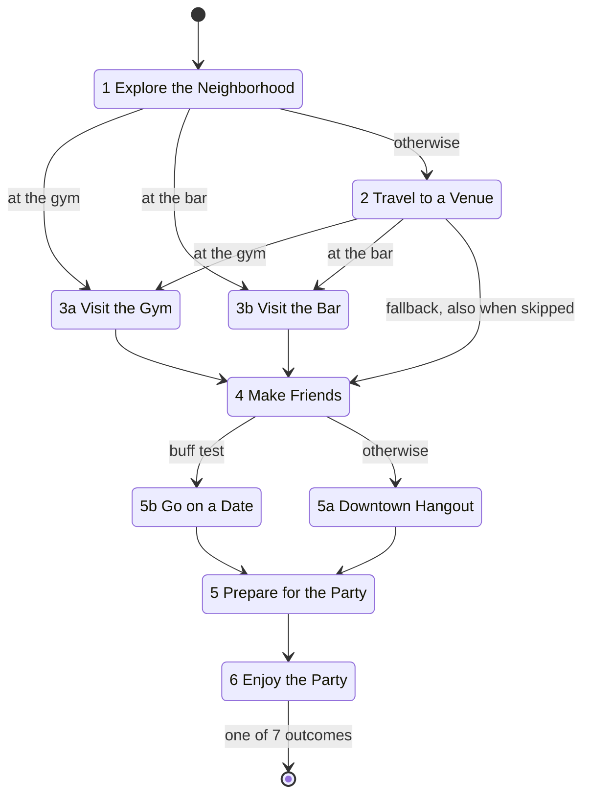
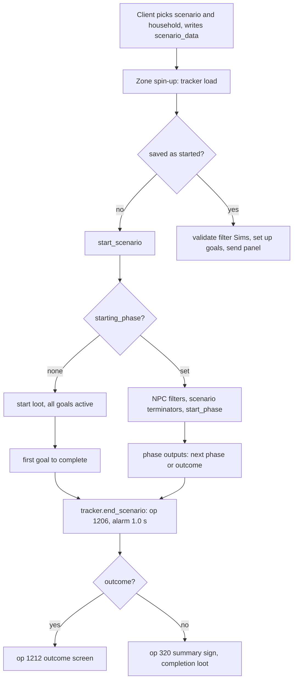
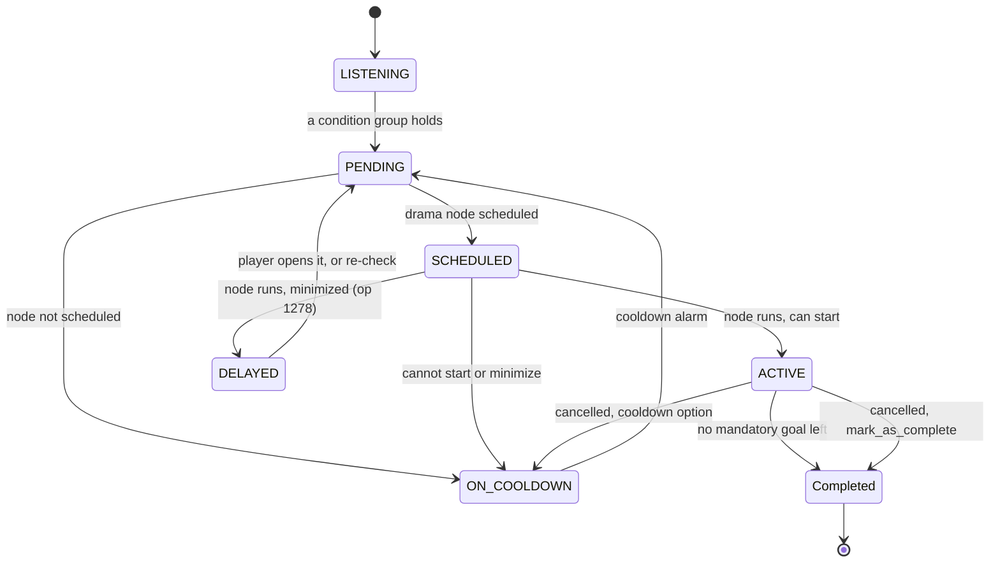

# 4.05 Scenarios, pivotal moments and calls to action

*Game version 1.128.90.1030 (Steam, Linux/Proton). Live numbers are the merged tuning of the base-game delta build and the delta builds of the installed packs: EP04 (Cats & Dogs), EP06 (Get Famous), EP09 (Eco Lifestyle), EP12 (High School Years), GP04 (Vampires), GP12 (Werewolves), SP01 (Luxury Party) and SP42 (Grunge Revival); records that exist only for packs that are not installed are counted separately as patch data. English text comes from the base string table. Written 2026-10-12. Checked 2026-10-12: 123 claims checked, 12 corrected, 4 relabelled, 0 removed.*

## In plain words

A scenario is a short story you pick from the main menu: "Making Money", "Too Many Toddlers", "New in Town" and so on. The game gives your household a goal list, a few starting gifts and sometimes a starting budget, then watches what you do. Most scenarios are a list of possible endings: the first goal you finish ends the scenario and shows a summary card with the time you took. Four scenarios are longer stories told in chapters. Each chapter has its own goals; when you finish the required ones, the game looks at how you played (who you befriended, which mood you were in, where you went) and picks the next chapter or the ending.

Pivotal moments are the game's "Discovery Quests": small guided tasks such as "Navigating Needs", "Scoring Simoleons" or "You and Your Phone". They listen in the background for a reason to appear (a low need, a timer, finishing another quest), then start a small goal list with a reward at the end. Some count once per installation, some once per household. Calls to action are the pulsing outlines the game draws around an object, a Sim or a neighbouring lot to point you at what a tip or quest wants you to use.

Three things would surprise a player. First, in the chapter scenarios a failure that ends the story (a key Sim who dies and is kept as a playable ghost, or in Stuck in their Shadow the rival dying or moving in) is handled by first finishing the current chapter as if you had completed it; in the last chapter that hands out the loot of a success ending before the failure ending, and the game ends the scenario twice. An ordinary death does not trigger this, because the Sim leaves the household before the game checks. Second, while the guided-tutorial option is on and the tutorial is unfinished, every Discovery Quest that triggers waits minimized in the corner; once the tutorial is done, the onboarding quests open by themselves and the others stay minimized until the onboarding ones are finished. Third, no more than three non-event quests can be running or waiting at once; a quest that triggers while that slot count is full goes on cooldown and tries again later.

## Key facts

- 31 live scenarios, all from the base game; 4 run in phases (Family Fortune and the three "Welcome" onboarding stories), 27 are flat lists of alternative endings. No scenario exists in the patch data of uninstalled packs.
- A flat scenario ends on the first of its goals to complete, including hidden failure goals; 70 of its 114 goal entries are hidden from the load dialog.
- A phase completes when no active mandatory goal is left; its outputs are tested in order, the first that passes wins, else the fallback (key -1). An output either starts the next phase or ends the scenario with an outcome.
- Outcomes show an outcome screen (op 1212); an ending without an outcome shows a summary sign (op 320) and is the only path that grants `household_loot_on_successful_completion`, which is why Family Fortune's tuned completion loot is never given.
- A scenario-level terminator first resolves the active phase (reason TERMINATED) and then ends the scenario; in a final phase this ends the scenario twice and applies both endings' loot (proven in bytecode). Normal play reaches it when a role Sim dies and is kept as a playable ghost (all four phase scenarios), and in Stuck in their Shadow also when the rival Lewis dies or joins a household.
- The outcome screen is sent from a 1.0 second real-time alarm after the end op, and only if the household still has a Sim who can live alone.
- Starting money: 20,000 by default, 80,000 for Family Fortune, 30,000 for New in Town and Stuck in their Shadow, 40,000 for Parenting Predicaments; the client applies it to the premade household.
- 19 live pivotal moments: 7 offered through module tuning `PIVOTAL_MOMENT_LIST` (12 ids, 5 belong to EP18 (Businesses & Hobbies) and EP21 (Royalty & Legacy) patch data, pack not installed), 7 through the N7_SpruceItUp_DQ experiment (the six base moments for any group the client reports, plus N7 for group 1), and 5 that nothing live offers.
- Pivotal moment cooldown: 14,400 Sim seconds (4 Sim hours) for 11, 5 seconds for the 6 household dream moments, none for 2; time triggers are in Sim minutes (Money 90, Needs 360, N7 900).
- Cap: active non-event moments plus other minimized ones must stay below `MAX_SITUATION_INSTANCES_OF_SAME_TYPE` = 3 (minimized household moments are not counted); live-event quests have their own cap of 2.
- All 19 live pivotal moment dialogs are auto-accepted, so no question is shown: the moment either starts its situation, minimizes it, or goes on cooldown.
- 183 live calls to action (181 base, 1 EP04, 1 EP09); 178 tutorial tips own 176 of them. A CTA highlights objects by tag, Sims by filter or tests, or residential lots on the home street, and is drawn by the client from op 210 or 1282.
- `scenarios.cancel` is the only player command for scenarios (Live; that the client sends it is inferred); the five Cheat scenario commands print nothing in retail because they write through `sims4.commands.output`.

## How it works

### The scenario service, tracker and module layout

- **Observed** (`gameplay_scenarios/scenario_service.py: ScenarioService.update`). The service does one thing: each update it calls `update()` on the active household's active scenario. `Scenario.update` only records phase timing when profiling is on (module dict `scenario_profiles`, set only by the profiling commands), so in normal play the service is idle.
- **Observed** (`sims/household.pyc` `HOUSEHOLD_TRACKERS` and `Household.__init__`, bytecode; `ScenarioTracker._tracker_lod_threshold`). Every household creates a `ScenarioTracker` in its constructor. The tracker's LOD threshold is FULL, and `household_lod_cleanup` resets its scenario data when the household's LOD cleanup runs.
- **Observed** (`gameplay_scenarios/scenario.pyc`, compiled 2024-07-30). The `Scenario` class body and `Scenario.apply_loot` did not decompile; this chapter read them in bytecode and rescued the other 78 code objects of the module (methods and nested helpers) one by one. Everything below about `Scenario` comes from those two sources.
- **Observed** (`gameplay_scenarios/scenario_enums.py`; module tuning `gameplay_scenarios.scenario_enums`). `ScenarioEntryMethod` is a flag set: NEW_HOUSEHOLD 1, EXISTING_HOUSEHOLD 2. `ScenarioProperties` has ONBOARDING 1. The tuned dynamic enums are `ScenarioCategory` (Story 1, Test 2, Challenge 3, Welcome 4), `ScenarioDifficultyCategory` (PLACEHOLDER 1, BEGINNER 2, EASY 3, INTERMEDIATE 4, HARD 5) and `ScenarioTheme` (15 values, Family 1 to Emotion 15).

### How a scenario starts

- **Inferred** (the client executable's strings: `StartScenario`, `CancelScenario`, `SelectHouseholdForActiveScenario`, `GetHouseholdsIncompatibleWithScenario`, `GetScenariosDisabled`, `MainMenu_CreateNewScenario`, `MainMenu_ResetAndStartScenario`, `MainMenu_PlayResumeScenario`, `gamedata.shared.ScenarioStaticData`). The scenario picker, the household choice and the "reset and start" flow live in the client, which reads the exported scenario tuning. Python never reads `household_money`; its tuning description says it is the premade household's starting money, and the client names it.
- **Observed** (`Scenario` class statics, module tuning `gameplay_scenarios.scenario`). `RECOMMENDED_SCENARIOS` lists 9 scenarios for new players (New in Town, Stuck in their Shadow, Parenting Predicaments, Perfectly Well Rounded, Making Money, Too Many Toddlers, Finding Love After a Breakup, Engaged in Conflict, Family Fortune) and a list for each of 7 playstyles (Content Omnivore 14 entries with one repeat, Experience Achiever 9, Legacy Writer 12, Less Live Artist 7, Personality Stylist 11, Sim Perfectionist 14, Social Storyteller 17). `SCENARIO_CATEGORIES` names Challenge, Story and Welcome; `SCENARIO_DIFFICULTY_CATEGORIES` names the five difficulties.
- **Observed** (`gameplay_scenarios/scenario_tracker.py: ScenarioTracker.load_data`). The client writes `HouseholdData.scenario_data` (`scenario_id`, `sim_role_pairs`, `instance_id`, `scenario_entry_method`). On load the tracker compares it with the saved `gameplay_scenario_tracker.active_scenario_data`: present only in the client record means a new scenario, not yet started; the same type in both, or only the saved record, means a running scenario; different types log an error.
- **Observed** (`zone_spin_up_service.py`, the hit-their-marks step, see [1.01 Time, scheduling and lot loading](1.01-time-scheduling-loading.md)). When the zone finishes spinning up, the tracker either starts the new scenario or, for a running one, checks its filter Sims (`validate_sim_infos`), sets its goals up again and sends the goal panel.
- **Observed** (`Scenario.start_scenario`, bytecode and rescued source). The order is: time spent reset to 0 and a time marker set; then, with no `starting_phase`, `start_scenario_without_phase`; with one, the NPC filters run (`conform_if_constraints_fail=True`), the scenario-level terminators are registered and the starting phase starts. The scenario is marked started and `scenario_start_notification` is shown with the scenario name as token. All 31 live scenarios tune that notification.
- **Observed** (`Scenario.start_scenario_without_phase`, bytecode). Start loot comes from `loot_on_scenario_start.get(ScenarioEntryMethod(entry))`. If there is an entry for the method, inside `hide_selected_notifications()` it applies `household_loot` to the first household Sim and `rel_loot` to every pair of household Sims; then every tuned goal is made active at once. A method with no entry gets no loot and no error.
- **Observed** (live tuning, 27 flat scenarios). Unlucky Chef and Proud Parent tune no start loot at all. 9 of the 20 scenarios that allow existing households have no start-loot entry for EXISTING_HOUSEHOLD, so starting them on an existing household skips the loot: those two, plus Cook Out, Honeymooners, New Year New Hustle, Engaged in Conflict, Celebrate Carnaval, Inspirational Mentor and Well Rounded. Of the 11 that have an entry, Perfectly Well Rounded and both Too Many Toddlers records leave it empty.
- **Observed** (`core/sims4/tuning/tunable.pyc: TunableEnumFlags.__init__` and `Tunable.load_etree_node`, bytecode; base delta shared node 350; client SimData of the 31 scenarios, `ClientDeltaBuild0.package` type 0x545AC67A group 0x00F216E1). 28 scenarios list the shared node 350 in `compatibility_with_scenario_entry_method`, and that node is an empty `<E/>`. An empty element loads as the tunable's default, and the flag list's element default is `enum_type.names[0]`, which is NEW_HOUSEHOLD. The client data agrees: it stores `[1]` (new household only) for 11 scenarios and `[2, 1]` for the other 20. The same empty node is Family Fortune's only `properties` entry, where `names[0]` is ONBOARDING, and its client data stores properties `[1]`.
- **Observed** (module tuning `live_events.live_event_service`, `LIVE_EVENTS` `event_content`; see [4.04 Holidays, festivals, live events and competitions](4.04-events-holidays-festivals.md)). Nine scenarios are the content of SCENARIO live events (Too Many Toddlers `Basic3P_003`, Perfectly Well Rounded, Surviving the Holidays, New Year New Hustle, Celebrate Carnaval, Inspirational Mentor, Frog Fanatic, Cook Out, Explore the Night), with UTC windows from November 2021 to September 2022; Inspirational Mentor's window has zero length. The nine events are named `%<scenario id>` (`%273430` to `%301993`, `LiveEventName` 66 to 74, base delta module tuning), which is the name the client must send. The field is exported to the client only and no Python reads it, so whatever it does to the picker is client side (**Inferred**).

### Flat scenarios: a list of endings

- **Observed** (`Scenario._on_goal_completed` and `ScenarioTracker.on_goal_completed`, bytecode). With no starting phase, every goal completion sends the goal panel and then calls the tracker, which ends the scenario with that goal unless a celebration alarm is already pending. So the tuned goals are alternative endings: the first to complete wins.
- **Observed** (live tuning). The 27 flat scenarios tune 114 goal entries, 2 to 8 each. 70 are hidden from the load dialog (`visible_in_load_dialog` False); these are failure endings shared across scenarios, such as `scenarioGoal_Actor_Hidden_UnviableHousehold` ("The End") and `scenarioGoal_Actor_Hidden_MissingRoles_PrimarySim_2` ("Someone's Missing"). Power Couple, for example, has three visible endings ("Working Relationship", "Invested Partners" and "Contract Terminated": CEO with a soulmate, CEO not soulmates, CEO not married) and those two hidden ones.
- **Observed** (`ScenarioTracker.end_scenario`, bytecode offsets 0 to 64). Only the screen slam depends on the goal being visible; the end op, the alarm and the telemetry always run. The decompiled source nests all four under the visibility test, which would mean an outcome ending never shows a screen.
- **Observed** (`ScenarioTracker.on_goal_completed`). A flat ending calls the tracker's `end_scenario` directly, so `Scenario.end_scenario` never runs for it: no `loot_on_end` or outcome loot (no flat scenario tunes either) and no pass that removes role traits from the household; the tracker's other removal path, on deinstance, stops once the active scenario is cleared. Whether such role traits then stay on the Sims was not traced.

### Phases, goal sequences and outputs

- **Observed** (`gameplay_scenarios/scenario_phase.py`, `scenario_phase_goal.py`). A phase (snippet `ScenarioPhase`) has a `phase_objective` text, `pre_tests`, `intro_loot`, `goals` (a list of goal sequences, each with optional `sequence_reset_conditions`), `phase_outputs` (each an output plus conditions), a `phase_fallback_output` and phase `terminators`. Each goal in a sequence carries `situation_goal`, `mandatory` (default True), `hidden` (default False), `goal_loot`, `loot_on_instantiate`, `required_pack` and a header icon.
- **Observed** (`Scenario.start_phase`, bytecode). Starting a phase: if it was triggered before, its completed goals are forgotten; it is added to the triggered set and `TestEvent.ScenarioPhaseTriggered` fires. If its pre-tests pass, it becomes active, its intro loot applies, the first goal of each sequence is activated (applying that goal's `loot_on_instantiate`), goals are set up, its terminators and reset handlers are registered and the goal panel is sent. If the pre-tests fail, the phase is skipped: it immediately chooses an output with reason SKIPPED.
- **Observed** (`Scenario._on_goal_completed`, bytecode). In phase mode a completed goal activates the next goal of its sequence, applies `goal_loot`, records the completion time, refreshes the panel, is decommissioned and fires `TestEvent.ScenarioGoalCompleted`. Then, if no active mandatory goal remains, the phase completes. The decompiled source shows this test with `or`; the bytecode has `and`. Only active goals count, so a mandatory goal still waiting behind an optional one in its sequence does not hold the phase open.
- **Observed** (`ScenarioPhase.choose_output_and_progress`, `progress_with_output`, bytecode). Outputs are tested in tuned order; the first whose scenario tests all pass is taken with its index as key, else the fallback with key -1 (with a warning if the fallback is empty). The output's loot applies, the output is recorded (key, next phase name, time), the phase ends, then either the scenario ends with the output's outcome or the next phase starts as a new phase object.
- **Observed** (`ScenarioPhase.run_scenario_test`, `scenario_tests_set.py`). Each condition names a test and an actor: a scenario role (all Sims holding it), a Sim filter, and optionally a secondary role or filter for two-Sim tests.
- **Observed** (`Scenario._verify_tuning_callback`, `get_all_phases`). Tuning load walks the phase graph and reports loops; `get_all_phases` walks it with a visited set.
- **Observed** (live tuning, 23 phases). 255 phase goals in 134 sequences: 116 mandatory, 139 optional, 9 hidden, 191 with goal loot, 2 with `loot_on_instantiate`. 74 sequences hold one goal, the longest holds 9. One phase has pre-tests (New in Town phase 2, `venue_availability`); none tunes sequence reset conditions.

The New in Town phase graph, from live tuning:

- **Observed** (live tuning). Phase 2's pre-test checks venue availability; when it fails, phase 2 is skipped and its outputs pick 3a, 3b or the fallback, phase 4. Phase 6 tests, in order: a relationship (Love), a buff (Gold party), a relationship (Good friends), a trait (Woohoo), two buffs (Silver, Bronze), then an unconditional output (No-score party).

### The four phase scenarios

- **Observed** (live tuning, `scenario_Challenge_Inheritance` 336503, "Family Fortune"). Phase 1 "Learn to Get Along" (intro loot 12) leads to Phase 2 while the grandmother lives (`dead_test` inverted), to `Hidden_MissingGrandmother` if she died. Phase 2 "Become Respectable Adults" picks 3a when `statistic_Scenario_InheritanceScoreTracker` on the mean sibling is at least 3 and 3b when it is below 3, then tests the grandmother's death (to `Hidden_MissingGrandmother`), fallback 3b. Phase 3a "A New Beginning for the Family" ends in GrandmotherSpiritLivesOn, GaveAwayTheMoney, HappyFamily or MadeGrandmaProud_Default; 3b "The End of the Family?" ends in GrandmotherHauntsUs, WeDontWantYourMoney or LetGrandmaDown_default. 3a and 3b tune no fallback; their last output is a blacklist of the earlier outputs' goal traits, so 3a covers every case. 3b's blacklist also names `trait_Scenario_Inheritance_Goal_SiblingsFriends`, which none of 3b's outputs accepts, but the loot that grants it (`lootActions_Scenario_Inheritance_Goals_Traits_SiblingsFriends`) is goal loot only in phase 3a, so in normal play the mean sibling does not carry it in 3b and 3b also covers every case. Phases 1 and 2 have a grandmother-death terminator; three scenario terminators end the story with `Hidden_MissingSibling` when a sibling dies.
- **Observed** (live tuning, `scenario_Onboarding_ParentingPredicaments` 294165). Five phases in a line: "Set Up a Child-Friendly Home", "Have Children Do Better in School", "Complete Child Aspirations", "Raise Your Children into Teens!", "Determine Your Teenager's Path!". Phase 5 tests a goal-complete test and four trait combinations on Leonardo and Sofia, with ResponsibleTeenagers as fallback. Eight scenario terminators (four household-size, four `dead_test`) end it with `scenarioOutcome_Generic_Failure_MissingScenarioSim`.
- **Observed** (live tuning, `scenario_Onboarding_StuckInTheirShadow` 294592). Phases 1 "Launch your Sim's Career", 2 "Set your Sim up for Success", 3 "Deal with Lewis" (a buff on Nova picks 4b "Team up with Lewis?", otherwise 4a "Au Revoir, Lewis!"). 4a ends through 12 outputs and 4b through 16, each a combination of career, relationship, buff and goal-complete tests, and both have an outcome fallback and a trait terminator. Scenario terminators: RivalDied, RivalInHousehold and two MissingScenarioSim.
- **Observed** (live tuning, `scenario_Onboarding_NewInTown` 294798). Terminators: household-size and `dead_test` on the Newcomer (MissingScenarioSim) and a household-size test for Game Over. It is the only scenario with `outcome_on_cancel` (`scenarioOutcome_Onboarding_NewInTown_Cancelled`, 1 loot).

### Terminators, and the double ending

- **Observed** (`scenario_phase.py: TerminatorHandler.handle_event`). A terminator is a test registered with the event manager. When its event fires for a Sim, the handler runs the test only if that Sim is in the scenario's role map for the terminator's actor role; only when no role is tuned does it compare the Sim with the one its Sim filter found (bytecode offsets 36 to 112, an `elif`). So the filter on Family Fortune's phase 1 terminator, which also names the grandmother role, is never used. If the test passes, the handler calls back.
- **Observed** (`interactions/utils/death.py: DeathTracker._set_death_type` and `_should_remove_from_household`, bytecode; `sims/sim_info_tests.py: DeadTest`; `Scenario.on_household_member_removed`, rescued source). `DeadTest` listens only to `TestEvent.SimDeathTypeSet`. A death removes the Sim from the household (line 557, offsets 118 to 132) before that event fires (line 693, offsets 872 to 894), unless the player picked the playable-ghost option (`DeathOption.PLAYER_GHOST`, the only option that keeps the Sim), and removal takes the Sim out of the scenario's role map. So a role terminator with `dead_test` runs only for a Sim kept as a playable ghost. The live death dialog offers that choice for a played Sim from child to elder (base delta, for example on `death_OldAge`). `HouseholdChanged` after a removal names the first remaining member, not the Sim who left.
- **Observed** (`ScenarioPhase.on_terminator_triggered`, bytecode). A phase terminator makes the phase choose an output with reason TERMINATED. Family Fortune uses this: if the grandmother dies as a playable ghost in phase 1, she fails the inverted `dead_test` output and passes the one that leads to `Hidden_MissingGrandmother`. After an ordinary death she is no longer in the role map, so the terminator never runs, and when phase 1 completes the inverted `dead_test` passes because `run_scenario_test` passes a role with no Sims; the story goes on to phase 2.
- **Observed** (live tuning order; `event_testing/statistic_tests.py: StatThresholdTest`, `must_have_stat` default False, so a missing statistic counts as 0; `run_scenario_test`). In Family Fortune phase 2 the two statistic outputs come first (at least 3, below 3) and between them cover every score, and with no mean sibling left the first passes for want of anyone to test. So a grandmother kept as a playable ghost still moves the story on to 3a or 3b, and phase 2's `Hidden_MissingGrandmother` output cannot be reached.
- **Observed** (`Scenario.on_terminator_triggered`, bytecode, offsets 0 to 30). A scenario terminator stores the active phase, calls the active phase's `on_terminator_triggered`, and then calls `end_scenario(terminator.scenario_outcome, last_phase)`. Both calls always run.
- **Observed** (`ScenarioPhase.progress_with_output`, `Scenario.end_scenario`, `ScenarioTracker.end_scenario`, bytecode). So the phase is resolved as if it had finished, and only then does the scenario end. In an earlier phase, the next phase starts first: its intro loot applies, its goals activate and its terminators register. `Scenario.end_scenario` unregisters only the scenario terminators, so that new phase's handlers stay registered. In a final phase whose chosen output is an outcome, the phase itself calls `end_scenario(outcome)`, and the scenario terminator calls it again: both outcomes' loot applies (`apply_outcome`), `loot_on_end` applies twice, and the tracker sends `ScenarioEnded` twice, writes the end telemetry twice and schedules a second celebration alarm into the same handle field.
- **Observed** (live tuning). All three onboarding stories always reach an outcome in their last phase: New in Town phase 6 ends with an unconditional output, Parenting Predicaments phase 5 and both Stuck in their Shadow phase 4 variants have an outcome fallback. Family Fortune 3a and 3b cover every case in normal play (see above). So any scenario terminator that fires in those phases ends the scenario twice. In Parenting Predicaments phase 5 the household first receives the loot of the outcome phase 5 picks (TriedForAnotherBaby and ResponsibleTeenagers, the fallback, tune 3 loots each) and then MissingScenarioSim (no loot); in Stuck in their Shadow, `loot_on_end` (3 loots) is applied twice. In Family Fortune, a sibling kept as a playable ghost in phase 1 first starts phase 2 (1 intro loot) and then ends the story with the hidden MissingSibling outcome; in 3a or 3b the same death ends it twice.
- **Inferred** (terminator tuning; the death order and `TerminatorHandler.handle_event` above). Normal play fires these terminators in two ways. A role Sim's `dead_test` fires only when the player keeps the dead Sim as a playable ghost; this covers New in Town, Parenting Predicaments, Nova in Stuck in their Shadow and the three Family Fortune siblings. Stuck in their Shadow's two rival terminators name a Sim filter instead of a role, so `RivalDied` fires whenever Lewis dies, wherever he is, and `RivalInHousehold` runs its household-size test on any household change that names him, such as his joining a household. The household-size terminators that count the holders of a role and require 0, with that same role as actor, cannot fire: the event Sim must still hold the role, so the count is at least 1. New in Town's Game Over (no teen-to-elder humans, actor the Newcomer) fails the same way while the Newcomer is in the household.
- **Inferred** (`alarms.py: AlarmHandle`, `_register_auto_cleanup`). Which outcome screen the player then sees is not settled. Replacing the handle drops the last plain reference to the first alarm handle, and a collected handle hard-stops its alarm, but each handle is in a reference cycle through its owner weakref callback, so it is freed only when the cycle collector runs. If both alarms fire, the first shows the phase's outcome and the second fails in `_celebrate_outcome` on `None.clean_up_goals()` (offsets 12 to 18), because the first already cleared the active scenario.

### How a scenario ends

- **Observed** (`Scenario.end_scenario`, bytecode). The outcome is the given one, or `outcome_on_cancel` when cancelled. `apply_outcome` runs the outcome's tests and, if they all pass, its loot (1 of 60 live outcomes tunes tests). `loot_on_end` always applies. Unless cancelled, the tracker's `end_scenario` runs. Then the scenario terminators are unregistered, goals are cleaned up and role traits removed from every household Sim.
- **Observed** (`ScenarioTracker.end_scenario`, bytecode). It sends the screen slam if a visible goal ended the scenario, sends `ScenarioEnded` (op 1206), adds a 1.0 second real-time alarm that calls `_celebrate_outcome`, and writes telemetry SCEN/ENDD with the scenario, goal, outcome and phase.
- **Observed** (`ScenarioTracker._celebrate_outcome`, bytecode). It clears the alarm handle, cleans up goals and clears the active scenario, then returns early if no household Sim can live alone. With an outcome it sends `ScenarioOutcomeData` (op 1212: name, title, description, next steps, icons, reward and bonus tooltips). Without one it sends a `DynamicSignView` (op 320) of type SCENARIO with the time spent in minutes and every completed goal as an activity, and sets a flag if any completed goal is visible. `household_loot_on_successful_completion` applies only when that flag is set, the list is not empty and there is an active Sim. The decompiled source nests the op send inside that loot test; the bytecode sends it unconditionally.
- **Observed** (live tuning). 28 scenarios tune that completion loot (27 with 1 loot, Inspirational Mentor 2). Family Fortune is one of them but always ends through an outcome, so its completion loot is never given in play.
- **Observed** (`ScenarioTracker.cancel_scenario`, `scenario_commands.py`). `scenarios.cancel` (Live; that the client sends it is **Inferred**: the executable names `CancelScenario` but not the command, and the UI package was not read) ends the scenario as cancelled: `outcome_on_cancel` loot and `loot_on_end` apply, no end op or outcome screen is sent, and the active scenario is cleared.
- **Observed** (`Scenario.validate_sim_infos`, rescued source). On load, if a Sim the NPC filters found earlier is missing or dead, the scenario ends with `outcome_on_validation_failed`. No live scenario tunes one, so this ends Parenting Predicaments or Stuck in their Shadow (the two with NPC filters) without an outcome.

### Save and load

- **Observed** (`ScenarioTracker.save_data`, `Scenario.save`, `save_phase_related_data`, rescued source; proto `GameplayScenarioData`). The household record keeps `scenario_data` (id, instance id, Sim-role pairs, entry method). A started scenario also writes `GameplayScenarioData`: guid, time spent in ticks, active goals as goal seeds, and for phase scenarios the active phase, triggered and skipped phases, the last completed visible goal per sequence (index, goal, mandatory), phase outputs (phase, key, next phase name, time), filter-to-Sim pairs, completed goal infos and terminated phase infos. Proto fields 5 (`completed_goals`) and 10 (`terminated_phases`) exist but are never written.
- **Observed** (`Scenario.load_household_data`, `load_data_with_phase`, `activate_goal`). Load rebuilds goals from their seeds and creates any that are missing, finds the active phase by id through the phase graph, and re-registers handlers. `activate_goal` applies `loot_on_instantiate` every time a goal is activated, including on every load; the tuning description warns about this. The time marker is set only for the active household.
- **Observed** (`ScenarioTracker.on_household_member_instanced`, `Scenario.on_household_member_removed`). Role traits are added when a role Sim is instanced and removed when it is deinstanced or leaves the household; `household_lod_cleanup` resets the scenario data.

### The goal panel, tests, telemetry and debug views

- **Observed** (`ScenarioTracker.send_goal_update_op_to_client`). `ScenarioGoalsUpdate` (op 1205). A flat scenario sends one group per goal with its header icon, title and visible sub-goals. A phase scenario sends one group headed by `phase_objective`; for each sequence it shows the active goal if it is visible and not hidden, else the last completed visible goal, each with its mandatory flag. The DebugOnly `scenarios.toggle_show_hidden_goals` shows hidden goals.
- **Observed** (`scenario_tests.py`). `ScenarioSimStatusTest` passes when the Sim is in a scenario, optionally of a given type and role (the bytecode checks the role whether or not a type is tuned; the decompile nests it), with `invert`. `ScenarioGoalCompletedTest` and `ScenarioPhaseTriggeredTest` read the active household's scenario and listen to the matching test events. `TunableScenarioRelationshipTest` lives in `relationships/relationship_tests.py`.
- **Observed** (`scenario_tests_set.py`). The phase test variant offers 41 test types, from `aspiration_track_completed` to `zone`, including `dead_test`, `household_size`, `venue_availability` and the three scenario tests; the break-test variant used for sequence reset conditions offers 23.
- **Observed** (`scenario_tracker.py`, telemetry). Group SCEN with hooks ENDD (end), GOAL and PHAS (phase finished).
- **Observed** (`scenario_handlers.py`, `scenario_profiling.py`). The GSI view "scenarios" lists the active scenario, Sims, phases (state, progress, output key, shown as "Fallback" for -1), goals and terminators. Profiling (Automation commands `performance.scenario.enable`, `disable`, `dump`) records Sim time debt per phase into percentage buckets.

### The 31 live scenarios

All are base game, category Challenge unless marked Welcome; "flat" gives the number of ending goals, "phases" the phase count. Money is the default 20,000 unless shown.

| Scenario | Tuning name | Difficulty | Entry | Shape | Reward text |
|---|---|---|---|---|---|
| Power Couple | `scenario_Career_PowerCouple_Basic_006` | Easy | new | flat 5 | Satisfaction Points |
| Unlucky Chef | `scenario_Careers_UnluckyChef_013` | Hard | both | flat 4 | Satisfaction Points |
| Aliens Stole My Parents | `scenario_Challenge_AlienAbduction_027` | Intermediate | both | flat 6 | Mentor & Speed Reader |
| Best Friends Forever | `scenario_Challenge_ChildhoodFriends` | Easy | both | flat 4 | Flirty Potion |
| Extraterrestrial Researcher | `scenario_Challenge_Collections_ExtraterrestrialResearcher_015` | Intermediate | both | flat 3 | Satisfaction Points |
| Cook Out | `scenario_Challenge_Cookout_025` | Easy | both | flat 3 | Satisfaction Points |
| Explore the Night | `scenario_Challenge_ExploreTheNight_026` | Hard | both | flat 3 | Seldom Sleepy |
| Proud Parent | `scenario_Challenge_Family_ProudParent_024` | Intermediate | both | flat 4 | Savant |
| Troublemaker | `scenario_Challenge_Family_Troublemaker_014` | Easy | new | flat 7 | Satisfaction Points |
| Honeymooners | `scenario_Challenge_Honeymooners_Basic_008` | Intermediate | both | flat 4 | Satisfaction Points |
| Family Fortune (80,000) | `scenario_Challenge_Inheritance` | Intermediate | new | phases 4 | Satisfaction Points |
| Plant-a-Sim | `scenario_Challenge_PlantSim` | Intermediate | both | flat 4 | Super Green Thumb |
| Rom-Com | `scenario_Challenge_Relationships_RomCom_016` | Easy | new | flat 7 | Satisfaction Points |
| Frog Fanatic | `scenario_Collections_FrogFanatic_021` | Intermediate | new | flat 4 | Satisfaction Points |
| New Year New Hustle | `scenario_Fortune_Hustle_NewYear_007` | Easy | both | flat 4 | Satisfaction Points |
| Making Money | `scenario_Fortune_MakingMoney_Basic_001` | Easy | both | flat 2 | Satisfaction Points |
| No Skills, No Problem | `scenario_Fortune_NoSkillsNoProblem_017` | Intermediate | new | flat 3 | Satisfaction Points |
| Super Rich Supervillain | `scenario_Fortune_SuperRichSupervillain_012` | Intermediate | both | flat 4 | Satisfaction Points |
| In The Moodlet | `scenario_InTheMoodlet_022` | Easy | both | flat 3 | Potions |
| New in Town (Welcome, 30,000) | `scenario_Onboarding_NewInTown` | Beginner | new | phases 9 | Inspired Explorer Trait |
| Parenting Predicaments (Welcome, 40,000) | `scenario_Onboarding_ParentingPredicaments` | Beginner | new | phases 5 | Re-Traiting Potion |
| Stuck in their Shadow (Welcome, 30,000) | `scenario_Onboarding_StuckInTheirShadow` | Beginner | new | phases 5 | Highflier Trait |
| Engaged in Conflict | `scenario_Relationships_EngagedConflict_Basic_009` | Intermediate | both | flat 8 | Satisfaction Points |
| Finding Love After a Breakup | `scenario_Relationships_FindingLove_BasicBreakup_004` | Intermediate | new | flat 4 | Satisfaction Points |
| Surviving the Holidays | `scenario_Relationships_LivingWithEnemies_BasicHoliday_005` | Intermediate | new | flat 4 | Satisfaction Points |
| Celebrate Carnaval | `scenario_Sim_CelebrateCarnaval_010` | Easy | both | flat 4 | Satisfaction Points |
| Inspirational Mentor | `scenario_Sim_InspirationalMentor_011` | Easy | both | flat 4 | Satisfaction Points |
| Perfectly Well Rounded | `scenario_Sim_PerfectlyWellRounded_Basic_002` | Intermediate | both | flat 3 | Satisfaction Points |
| Too Many Toddlers | `scenario_Sim_TooManyToddlers_011` | Intermediate | both | flat 5 | Satisfaction Points |
| Too Many Toddlers | `scenario_Sim_TooManyToddlers_Basic3P_003` | Intermediate | both | flat 5 | Satisfaction Points |
| Well Rounded | `scenario_Sim_WellRounded_018` | Intermediate | both | flat 3 | Satisfaction Points |

- **Observed** (live tuning). Difficulty: 3 Beginner, 10 Easy, 16 Intermediate, 2 Hard. The 28 Challenge scenarios tune a screen slam; the 3 Welcome ones tune one premade household template and no slam. The 3 Welcome ones and Family Fortune carry the ONBOARDING property (Family Fortune through the empty shared node, confirmed by the client data), and Family Fortune also has one template; no Python reads `properties`. The client data sorts the Welcome three at `ui_sort_order` 0, Family Fortune at 1 and the rest from 10 to 100. 42 role entries across the scenarios, 24 at the default count of one Sim, 14 with role traits; 7 scenarios tune 8 relationship requirements; 15 `ScenarioTag` records map one to one onto the 15 themes (for example `scenarioTag_Sims_Weddings` "Weddings" to Wedding). Two records share the English name "Too Many Toddlers".

### Pivotal moments: which ones the game offers

- **Observed** (`tutorials/tutorial_service.py: TutorialService.determine_valid_pivotal_moments`, bytecode). The service tracks the union of module tuning `PIVOTAL_MOMENT_LIST`, the active live-event quests and the "dynamic" moments set by an experiment. Each not yet tracked becomes an instance with the activation-trigger key the client stored for it (default 1); if not completed, its triggers start listening. HOUSEHOLD moments go to the active household's tracker, the rest to the service's own tracker. Nothing runs until the client has sent the completed list.
- **Observed** (module tuning `tutorials.tutorial_service`, base delta). `PIVOTAL_MOMENT_LIST` holds 12 ids. 7 are live: 448526 `pivotalMoment_NUUeventPriority_needsDone`, 449243 `pivotalMoment_NUUeventPriority_allDone`, 445439, 446034, 439932, 439933 (the four Dreams choices) and 446602 `pivotalMoment_dreamsV0_N5_DLCQuest`. The other 5 are patch data, pack not installed: 422698, 429994, 430281 (EP18 (Businesses & Hobbies) onboarding moments) and 488701, 489764 (EP21 (Royalty & Legacy) onboarding moments).
- **Observed** (module tuning `experiment_service.experiment_service`, `ExperimentService.EXPERIMENTS` entry N7_SpruceItUp_DQ; `experiment_service/experiment_types.py: PivotalMomentsExperiment.on_group_id_set`, bytecode offsets 0 to 66; see [1.04 Debug tools, cheats and telemetry](1.04-debug-cheats-telemetry.md)). The six base moments (Aspiration 342428, Money 342429, Needs 342430, Phone 342431, Skill 342432, SocialAndTravel 342433) are the experiment's control set; group 1 adds `pivotalMoment_N7` 460986. They are offered only after the client has answered the service's `GetGroupsForExperiments` (op 1270) through the Live `experiments.set_group_for_experiment` or `set_no_group_for_experiment`, both named by the client. Group 1 gets the seven; any other group, or no group, gets the control six. The decompiled source nests that fallback under the group test, which would leave an unknown group with nothing.
- **Inferred** (live references; module scan; the three sources above). The four N3 moments (Aspiration_N3 431346, Money_N3 431347, Needs_N3 431348, Exploration_N3 431349) and `pivotalMoment_DreamsV0_N5_Trigger` 439931 are referenced only by other moments' conditions and by their own dialog nodes and situations; no module tuning names them, and no pack or patch file holds their ids. So nothing live puts them in the tracked set. Quest ids come from the client's live-event data and `get_tuned_pivotal_moments` accepts any snippet id, so only the client could add one.
- **Observed** (`TutorialService.on_client_connect`, `process_pivotal_moment_data`, `pivotal_moment_commands.py`). On connect the service asks the client for completed moments (op 1226), refreshes feature parameters for `FEATURE_KEY`, asks for live-event quests and for the account's PIVOTAL_MOMENTS data (op 1258). The client answers through the Live command `pivotal_moments.process_stored_data` with completed ids, rewarded ids and a per-moment activation key (the client binary names this command). Completion is reported back with `PivotalMomentCompleted` (op 1227) for GAME moments, which are "completed once per install" according to the tuning description.

### Activation triggers and timing

- **Observed** (`pivotal_moments/pivotal_moment.py`; `statistics/statistic_conditions.py`). `activation_triggers` maps a key 0 to 5 (default 1) to a list of condition groups; any group whose conditions all hold triggers the moment. Condition types: `event_based`, `event_test_based`, `time_based` (Sim minutes, a uniform pick between `min_time` and `max_time`, default 1), `timed_event_based` (a timer that an event resets), `pivotal_moment` (any listed moment completes) and `live_event_quest`. Every condition carries a `save_id`, nonzero and unique in its group, so its satisfied flag can be saved.
- **Observed** (`PivotalMoment.activation_callback`, `_activate_pivotal_moment`). On trigger, if the moment is enabled (always for HOUSEHOLD moments and quests; otherwise the "Discovery Quests" setting), the status goes PENDING, any scheduled copy of its drama node is cancelled, and the node is scheduled: SCHEDULED, or a cooldown if scheduling fails. The conditions detach.
- **Observed** (live tuning, key 1). Money: 90 Sim minutes, or leaving Build/Buy with at most §2,000, or opening the career panel, or crafting with at most §2,000. Needs: Hygiene, Fun or Bladder at -50 or lower, or 360 minutes, or Money completed. Phone: 900 minutes, or Money plus Needs or Skill plus the hidden buff `buff_PivotalMoments_Hidden_trigger_2`, or pressing the phone button. Skill: 720 minutes once Money or Needs is done, a finished workday plus a hidden buff, or Money plus a skill gain. SocialAndTravel: 1,080 minutes on a timer that travel resets, or Skill, Needs, Money and Phone done plus a hidden buff, or Social at -70 or lower once Phone is done. Aspiration: 1,350 minutes on a timer that a completed aspiration goal resets, or Needs, Money and Phone or Skill done plus a hidden buff, or opening the aspirations panel. N7: 900 minutes, or Phone or Exploration_N3 completed. NUU needsDone: Needs or Needs_N3 completed; NUU allDone: all six base moments, or the four N3 ones. Five Dreams moments wait for their own events (`event_DreamsV0_choice1` to `choice4`, `event_DreamsV0_DLC`); the Dreams trigger waits for NUU needsDone to complete. The N3 moments chain off Needs_N3, whose only trigger is a 1-minute timer.
- **Observed** (live tuning). The six base moments also tune keys 2 and 3 with other timers and thresholds. Money, for example, waits 360 to 720 minutes with a §1,000 cash test under key 2, and 180 to 360 minutes with §500 under key 3; Needs moves its need threshold to -70 and -90. The client picks the key per moment; the other 13 moments tune only key 1.
- **Observed** (`PivotalMoment.start_cooldown`). The cooldown is a uniform pick in the interval, in Sim seconds, on a cross-zone alarm that calls the trigger again; a moment with no cooldown simply stops.

### From trigger to situation: gating and minimized quests

- **Observed** (`dialog_drama_node.py: _pivotal_dialog_mixin.on_pivotal_node_run`, bytecode for the head). When the node runs it asks the moment two questions. If the situation can neither start nor be minimized, the moment goes on cooldown. With `auto_accept` (all 19 live moment nodes) the dialog is skipped: minimize if it should, else start, applying the node's loot first. Without it, a moment the player reopened from its minimized state shows the dialog; a fresh one is minimized if it should be, or shows the dialog if it can start. Quest nodes are also treated as auto-accepted when `--SuppressQuestPopups` is among the script process's arguments (`QuestPopupSupression` parses `sys.argv` with argparse; whether a launch option reaches it was not tested). OK starts the situation; on the OK/Cancel variant Cancel completes the moment, Custom 1 or no response starts a cooldown.
- **Observed** (`PivotalMoment.can_situation_start`, bytecode). False without the service or an active Sim. True at once if the situation tunes no goals. Otherwise false if guidance blocks and the moment is not being activated from its minimized state; false if it is not an onboarding moment, discovery quests do not allow it, and it is not being activated from minimized; else the cap decides.
- **Observed** (`PivotalMoment.should_add_minimized_Situation`). Minimize when minimized situations are on, there is an active Sim, the cap allows, the moment is not already being activated from minimized, and the situation has goals; then yes if guidance blocks, no if discovery quests allow, no for an onboarding moment, else yes.
- **Observed** (`TutorialService.guidance_allows_situation_start`, `discovery_quest_enables_situation_start`, `update_is_guidance_complete`; matches [7.01 UI, dialogs, notifications and tutorials](7.01-ui-dialogs-tutorials.md)). Guidance allows a start when minimized situations are off, or guidance auto-start is off (`misc_options.guidance_auto_enabled`, an account option), or the guidance is complete. Completion comes from the account value `Emily_LiveMode_Status` == "Complete"; only when that value is absent does the service ask the client whether guidance tip 449239 is complete (op 1281). Discovery quests allow a start when minimized situations are off, or pivotal moments are disabled, or no active or minimized onboarding moment is still incomplete (`PivotalMomentTracker.are_active_discovery_quests_complete`, bytecode offsets 16 to 52; the decompiled source drops the minimized case). `_are_minimized_situations_enabled` starts True and only the DebugOnly `situations.enable_minimized_situations` changes it.
- **Observed** (`TutorialService.can_new_pivotal_moment_start`, `get_delayed_pivotal_moment_count`, bytecode). The cap is: active non-quest moments plus other minimized non-quest moments must be below `MAX_SITUATION_INSTANCES_OF_SAME_TYPE` (3, `situations/situation_manager.py`). The active count reads `_active_pivotal_ids`, which holds household moments too, but the minimized count reads only the service's own tracker, so a minimized HOUSEHOLD moment (a Dreams moment) does not count. Quests use their own count against `MAX_LIVE_EVENT_QUEST_SITUATION_INSTANCES_OF_SAME_TYPE` (2) in `can_new_live_event_quest_start`, whose filter to quest ids sits in a generator the decompiled source drops.
- **Observed** (`PivotalMoment.add_minimized_situation`, `PivotalMomentTracker.activate_pivotal_moment`, `reevaluate_pending_situations`, `situation_commands.py`). Minimizing sets DELAYED and sends `AddMinimizedSituation` (op 1278). The Live `situations.activate_minimized_situation <id>` opens it (that the UI sends it when the player clicks is **Inferred**; the executable does not name the command): the moment goes PENDING with the "from minimized" flag and its drama node runs again, which now starts the situation. Minimized moments are also re-checked after any moment completes, when the guidance value arrives, and through `situations.reevaluate_minimized_situations`; one that can start is opened automatically when guidance allows and it is an onboarding moment or discovery quests allow.
- **Observed** (`PivotalMoment.start_situation`, `PivotalMomentSituation.get_predefined_guest_list`). Starting sets ACTIVE, stores the household, and creates the situation with every active-household Sim in the resident job (CANNOT_SPAWN, EVENT_HOSTING priority), or an open list hosted by the active Sim if the household is empty.

### Pivotal moment situations, rewards and completion

- **Observed** (`situations/custom_states/pivotal_moment_situation.py`, `on_remove` in bytecode). `PivotalMomentSituation` reports the user-facing type PIVOTAL_MOMENT and runs `loots_on_run` on start and on load. When no mandatory goal remains it marks itself completed and ends. On removal: a cancelled situation calls the moment's cancel option; a completed one finds the first valid `potential_rewards` entry, shows the outcome (op 1229, `SituationOutcomeData`) unless it is a quest with popups suppressed, gives the reward if not given before, and then calls `on_pivotal_moment_complete(not rewarded)` whether or not a reward existed.
- **Observed** (`PivotalMoment.on_pivotal_moment_complete`). Completion cancels the cooldown alarm, fires `TestEvent.PivotalMomentCompleted` (which other moments' conditions listen to), sends op 1227 for GAME moments and records the moment as completed (and rewarded) in the right tracker, then re-checks minimized moments.
- **Observed** (live tuning). 81 `PivotalMomentSituation` records (19 for moments, 62 for quests): 78 tune goals and rewards; the two NUU situations and the Dreams trigger tune neither, so they start without any gating. Money and Phone offer 3 potential rewards, the others 1. Of the 81 dialog drama nodes, 66 are `dialog_ok` (46 quests without auto-accept, 16 quests and 4 moments with it) and 15 are `dialog_ok_cancel`, all for moments and all auto-accepted, so the Cancel button is never offered for a live moment.

### Saving pivotal moments, and the household load slip

- **Observed** (`PivotalMoment.save`, bytecode; `TutorialService` save; proto `PivotalMoment`, `HouseholdPivotalMomentTracker`). Each moment saves its id, household, remaining cooldown ticks, the situation seed if one runs, its status, its trigger key and every condition's satisfied flag (the decompile wrongly nests the last three under the situation test). ACCOUNT moments go to the account through `SetAccountDataForCurrentUser` (op 1259) as `PivotalMomentsData`; GAME moments go to the save slot's tutorial service data; HOUSEHOLD moments go to the household with their completed and rewarded ids.
- **Observed** (`HouseholdPivotalMomentTracker.load_data`, bytecode offsets 44 to 78). The loop over `rewarded_pivotal_moment_ids` calls `add_completed_pivotal_moment`, so after a load the household's rewarded set is empty and the ids land in the completed set (where they already are). The 6 live HOUSEHOLD moments (the Dreams moments, of which the trigger is never tracked) are affected.
- **Inferred** (reset paths in `tutorial_service.py` and `pivotal_moment_commands.py`). Normal play does not show this: a completed household moment never triggers again, and only the untyped (DebugOnly) `pivotal_moments.reset_household_level` and `reset_with_rewards_household_level` can make it run again, at which point its reward would be given a second time.

### The kill switch

- **Observed** (`TutorialService.toggle_pivotal_moments`, bytecode offsets 96 to 108; argument counts read from the code objects). With `killswitch=True` it first destroys the situation of every killable active moment, then calls `self._pivotal_moment_tracker.remove_pivotal_moment(pivotal_moment_id, None)` with two arguments; `PivotalMomentTracker.remove_pivotal_moment` takes only `pivotal_moment_id`. The call raises TypeError before the id is discarded from `_active_pivotal_ids`.
- **Observed** (`pivotal_moment_commands.py`, client strings). The path is the Live command `pivotal_moments.disable 1`, which the client binary names. It fails whenever a pivotal moment situation is running (quests cannot be killed). The situations are already gone by then; the stale ids keep counting toward the cap of 3, which matters for HOUSEHOLD moments because they stay enabled when Discovery Quests are off (**Inferred** from `PivotalMoment.enabled`).

### The live pivotal moments

| Moment (situation title) | Id | Persistence | Cooldown | Offered by | Onboarding |
|---|---|---|---|---|---|
| Aspiration (Lifelong Aspirations) | 342428 | game | 14,400 s | experiment | no |
| Money (Scoring Simoleons) | 342429 | game | 14,400 s | experiment | yes |
| Needs (Navigating Needs) | 342430 | game | 14,400 s | experiment | yes |
| Phone (You and Your Phone) | 342431 | game | 14,400 s | experiment | no |
| Skill (Skillful Sims) | 342432 | game | 14,400 s | experiment | yes |
| SocialAndTravel (Always on the Move) | 342433 | game | 14,400 s | experiment | no |
| N7 (Spruce It Up) | 460986 | game | 14,400 s | experiment group 1 | no |
| NUUeventPriority_needsDone (no title) | 448526 | game | none | list | yes |
| NUUeventPriority_allDone (no title) | 449243 | game | none | list | yes |
| DreamsV0_N5_General_choice1 (Successful Sims Dream) | 445439 | household | 5 s | list | no |
| DreamsV0_N5_General_choice2 (Generations Dream) | 446034 | household | 5 s | list | no |
| DreamsV0_N5_Narrative_Choice1 (Family Farm Dream) | 439932 | household | 5 s | list | no |
| DreamsV0_N5_Narrative_Choice2 (Friendly Neighbor) | 439933 | household | 5 s | list | no |
| dreamsV0_N5_DLCQuest (Optional Dream: Cats & Dogs) | 446602 | household | 5 s | list | no |
| DreamsV0_N5_Trigger (no title) | 439931 | household | 5 s | nothing live | no |
| Aspiration_N3 (Lifelong Aspirations) | 431346 | game | 14,400 s | nothing live | yes |
| Money_N3 (Scoring Simoleons) | 431347 | game | 14,400 s | nothing live | yes |
| Needs_N3 (Navigating Needs) | 431348 | game | 14,400 s | nothing live | yes |
| Exploration_N3 (Exploring the World) | 431349 | game | 14,400 s | nothing live | yes |

- **Observed** (live tuning; `pivotal_moments/live_event_quest.py`; `PivotalMoment.should_add_minimized_Situation`). No live moment uses ACCOUNT persistence; all 62 `LiveEventQuest` records do (54 with a 1,800 second cooldown, 8 with none). Live-event quests subclass `PivotalMoment`, are always enabled and cannot be killed. Their `can_situation_start` checks only the quest cap, so guidance and discovery quests never stop a quest from starting, but they inherit `should_add_minimized_Situation`, so a quest that triggers while guidance or an unfinished onboarding moment blocks waits minimized like a moment. They report `QuestGoalComplete` (op 1261) and `QuestComplete` (op 1262); the events themselves belong to [4.04 Holidays, festivals, live events and competitions](4.04-events-holidays-festivals.md).

### Calls to action

- **Observed** (`call_to_action/call_to_action_service.py`). The service keeps the active CTAs by guid and a set of permanently disabled guids, the only thing it saves (`gameplay_data.call_to_action_service.permanently_disabled_ids`). `begin` does nothing for a disabled CTA; otherwise it creates the CTA and turns it on with its owner. `end` turns it off; `abort` (optionally permanent) ends it. On zone load every active CTA is turned on again; new and removed objects are offered to every active CTA through hooks in `game_object.py`.
- **Observed** (`CallToAction.turn_on`, bytecode for the object loop). With `_target_neighbor_lots`, it sends `SetCallToActionLot` (op 1282) with the tutorial text for every residential zone on the active household's home street other than home, up to the cap. Otherwise it highlights every client-visible object carrying one of `_tags` that passes the optional state threshold, then Sims: those the `_sim_filter` returns among instanced Sims (also passing the tests), or with no filter every instanced Sim passing `_sim_tests`. Each target gets `SetCallToAction` (op 210: colour, pulse frequency, thickness, tutorial text) and optional VFX, unless it is on the active lot with `_on_active_lot` off or on the open street with `_on_open_street` off. `_max_highlighted_objects` caps the count (0 = no cap).
- **Observed** (`CallToAction.sim_passes_tests`, bytecode). Each test runs on the candidate and a target: the active Sim, or for target SCENARIO_SIM a Sim of the given scenario role (the active Sim if it holds the role). It fails when there is no scenario or role.
- **Observed** (`CallToAction.turn_off`). Zeroed ops go to every tagged object, highlighted Sim and lot, the VFX stop, and the owner hears `on_cta_ended`.
- **Observed** (`call_to_action_elements.py`; `basic.py`; `tutorials/tutorial_tip.py`; `vet/vet_clinic_zone_director.py`; `venues/zone_director_residential.py`; `civic_policies/base_civic_policy_provider.pyc` names). Owners: a situation state mixin, an open-street director mixin, the `call_to_action_turn_off` basic extra (`TurnOffCallToAction`, which aborts only when its participant is selectable, `_permanent` optional), tutorial tips (begin while the tip runs, end with it, see [7.01 UI, dialogs, notifications and tutorials](7.01-ui-dialogs-tutorials.md)), the vet clinic podium, the residential front door, and the civic policy provider's `CALL_TO_ACTIONS` class tuning.
- **Observed** (live tuning, references resolved). 178 tutorial tips reference 176 CTAs. 15 interactions turn CTAs off: three doorbell interactions (`callToAction_FrontDoor`), eight vet podium continuations and the zone director (`callToAction_Vet_Podium`, EP04), four community-board interactions (`callToAction_CommunityBoard_Vote`, EP09, also named by module tuning `civic_policies.base_civic_policy_provider`; two more, `si_CommunityBoard_GoToCheck_*`, are in the EP09 full build only, outside the live set). No live zone director sets `front_door_call_to_action`. Four CTAs have no live referrer (`callToAction_LiveEvents_EV008_CallEnvoy`, `FTUE_CallToAction_Clean`, `FTUE_CallToAction_Read`, `fTUE_CallToAction_NPCs_newRel_noArrow`). Patch data, pack not installed: 5 EP03 (City Living) festival CTAs, owned by festival situation states and street directors, and 1 EP20 (Adventure Awaits) archery-contest CTA.
- **Observed** (live tuning, 183 CTAs). By name: 81 scenario, 70 live-event, 15 first-time-user, 14 pivotal moment, 1 each vet, community board and front door. 124 tune tags, 55 a Sim filter, 21 Sim tests (17 relationship, 3 has-job, 1 has-buff), 165 VFX, 178 tutorial text, 3 a state threshold. 2 target neighbour lots (the N7 "visit neighbors" pair), 15 skip the open street, 1 skips the active lot. Cap: 99 none, 68 at 1, 13 at 2, 3 at 3. Every CTA keeps the default pulse and thickness.

## Numbers

| Name | Value | Unit | Where | Source |
|---|---|---|---|---|
| live Scenario / ScenarioPhase / ScenarioOutcome / ScenarioRole / ScenarioTag | 31 / 23 / 60 / 20 / 15 | records | snippet tuning | live, base delta |
| scenarios in patch data | 0 | records | decoded patch tuning | patch data |
| phase scenarios / flat scenarios | 4 / 27 | records | `starting_phase` | live |
| `household_money` default | 20,000 | Simoleons | `Scenario` | code default |
| `household_money` tuned | 80,000 / 30,000 / 40,000 / 30,000 | Simoleons | Family Fortune / New in Town / Parenting Predicaments / Stuck in their Shadow | live, base delta |
| role `sim_count` default and bounds | 1 to 1, bounds 0 to 8 | Sims | `Scenario.scenario_role_data` | code default |
| `ui_sort_order` default | 0 | order | `Scenario` | code default |
| `ui_sort_order` in client data | 0 (Welcome three), 1 (Family Fortune), 10 to 100 (the rest) | order | Scenario SimData | client data, base delta |
| ONBOARDING property | 4 (Welcome three, Family Fortune) | records | `Scenario.properties` | live and client data |
| difficulty mix | Beginner 3, Easy 10, Intermediate 16, Hard 2 | records | `Scenario.difficulty` | live |
| entry methods | 11 new only, 20 both | records | `compatibility_with_scenario_entry_method` | live and client data |
| phase / break test variants | 41 / 23 | test types | `scenario_tests_set.py` | code |
| flat goal entries / hidden in load dialog | 114 / 70 | goals | `Scenario.goals` | live |
| phase goals: total / mandatory / optional / hidden | 255 / 116 / 139 / 9 | goals | `ScenarioPhase.goals` | live |
| goal sequences | 134 | sequences | `ScenarioPhase.goals` | live |
| completion loot (`household_loot_on_successful_completion`) | 28 scenarios (Inspirational Mentor 2 loots) | loots | `loot_on_scenario_end` | live |
| `loot_on_end` | 3 (Stuck in their Shadow only) | loots | `Scenario` | live |
| Family Fortune phase 1 intro loot | 12 | loots | `scenarioPhase_Challenge_Inheritance_Phase1` | live |
| outcomes with loot / with tests | 53 / 1 of 60 | records | `ScenarioOutcome` | live |
| fallback output key | -1 | key | `ScenarioPhase.choose_output_and_progress` | code |
| celebration delay | 1.0 | real seconds | `ScenarioTracker.end_scenario` | code |
| recommended for new players | 9 | scenarios | `RECOMMENDED_SCENARIOS` | live, base delta module |
| live PivotalMoment / LiveEventQuest | 19 / 62 | records | snippet tuning | live, base delta |
| PivotalMomentSituation / PivotalMomentDialogDramaNode | 81 / 81 | records | situation, drama node | live, base delta |
| pivotal records in patch data | EP18 3 + 3 + 3, EP21 2 + 2 + 2 | moment, situation, node | decoded patch tuning | patch data, pack not installed |
| `PIVOTAL_MOMENT_LIST` | 12 ids, 7 live | ids | `tutorials.tutorial_service` | base delta module |
| N7_SpruceItUp_DQ moments | 6 (control, any group but 1, or no group) / 7 (group 1) | moments | `experiment_service.experiment_service` | base delta module |
| `cooldown` default when enabled | 600 to 600 | Sim seconds | `PivotalMoment` (an optional interval) | code default |
| cooldown tuned | 14,400 (11), 5 (6), none (2) | Sim seconds | `PivotalMoment.cooldown` | live |
| quest cooldown | 1,800 (54), none (8) | Sim seconds | `LiveEventQuest.cooldown` | live |
| `activation_triggers` key range / default | 0 to 5 / 1 | key | `PivotalMoment` | code |
| time trigger default | 1 | Sim minutes | `TunableTimeRangeCondition` | code default |
| Money / Needs / N7 / Skill / Phone first timers | 90 / 360 / 900 / 720 / 900 | Sim minutes | key 1 conditions | live |
| Aspiration / SocialAndTravel reset timers | 1,350 / 1,080 | Sim minutes | `pivotalMoment_Aspiration`, `pivotalMoment_SocialAndTravel` key 1 | live |
| Money cash test | at most 2,000 (key 1), 1,000 (key 2), 500 (key 3) | Simoleons | `pivotalMoment_Money` | live |
| Needs trigger threshold | -50 (key 1), -70 (key 2), -90 (key 3) | need value | `pivotalMoment_Needs` (Hygiene, Fun, Bladder) | live |
| `MAX_SITUATION_INSTANCES_OF_SAME_TYPE` | 3 | moments | `situations/situation_manager.py` | code |
| `MAX_LIVE_EVENT_QUEST_SITUATION_INSTANCES_OF_SAME_TYPE` | 2 | quests | `situations/situation_manager.py` | code |
| `EMILY_TUTORIAL_GUIDANCE_FINALE_ID` | 449239 | guidance tip | `TutorialService` | code |
| `GUIDANCE_COMPLETE_VALUE` | "Emily_LiveMode_Status" | account key | `TutorialService` | code |
| onboarding moments | 9 of 19 | records | `is_onboarding_requirement` | live |
| live CallToAction | 183 (181 base, 1 EP04, 1 EP09) | records | call_to_action | live, delta |
| CTA in patch data | EP03 5, EP20 1 | records | decoded patch tuning | patch data, pack not installed |
| `_pulse_frequency` default / minimum | 1.0 / 0.1 | pulses | `CallToAction` | code default (all 183 keep it) |
| `_thickness` default / range | 0.002 / 0.001 to 0.005 | outline | `CallToAction` | code default (all 183 keep it) |
| `_max_highlighted_objects` default | 0 (no cap) | targets | `CallToAction` | code default |
| `_on_active_lot` / `_on_open_street` / `_target_neighbor_lots` defaults | True / True / False | flag | `CallToAction` | code default |

## Data shapes

- **`Scenario`** (snippet, `gameplay_scenarios.scenario`, 28 instance tunables): `compatibility_with_scenario_entry_method` (flags), `category`, `difficulty`, `scenario_name`, `scenario_description`, `tagline_text`, `scenario_tags`, `icon`, `reward_icon`, `reward_text`, `scenario_start_notification`, `scenario_role_data` (role, `sim_count`, `role_traits`), `relationship_requirements`, `screen_slam_scenario_completed`, `starting_phase`, `terminators` (outcome, condition, description text), `outcome_on_cancel`, `outcome_on_validation_failed`, `loot_on_end`, `scenario_npc_sims` (Sim filter plus invalidation trait), `goals` (situation goal, title, description, header icon, required pack, `visible_in_load_dialog`), `household_money`, `loot_on_scenario_start` (entry method to `household_loot` and `rel_loot`), `loot_on_scenario_end.household_loot_on_successful_completion`, `outcome_screen_background_image`, `ui_sort_order`, `compatible_premade_household_templates`, `properties`. Class statics: `SCENARIO_CATEGORIES`, `SCENARIO_DIFFICULTY_CATEGORIES`, `RECOMMENDED_SCENARIOS`. Runtime: `ActiveGoal(situation_goal, scenario_goal)`, `LastVisibleGoal(goal, is_mandatory)`.
- **`ScenarioRole`** (snippet): CAS criteria and `household_requirement_text`, exported to the client. **`ScenarioTag`**: name and theme.
- **`ScenarioPhase`** (snippet): `phase_objective`, `pre_tests`, `intro_loot`, `goals` (list of `goal_sequence` with `sequence_reset_conditions`), `phase_outputs` (`output`, `conditions`), `phase_fallback_output`, `terminators`. A phase output holds `output_loot`, `next_phase` or `scenario_outcome`. `PhaseEndingReason`: COMPLETE 1, SKIPPED 2, TERMINATED 3.
- **`ScenarioPhaseGoal.goal`**: `situation_goal`, `outcome_header_icon`, `required_pack`, `mandatory`, `hidden`, `goal_loot` and `loot_on_instantiate` (each a loot with actor and secondary role or Sim filter).
- **`ScenarioOutcome`** (snippet): `visible`, `scenario_outcome_loot`, title, description, next steps, icon, reward and bonus icons with tooltips, `tests`.
- **`ScenarioTest`**: `test` plus `actor_role`, `actor_sim_filter`, `secondary_actor_role`, `secondary_actor_sim_filter`. `ScenarioTestSet`: a list of these, all must pass.
- **Save**: `HouseholdData.scenario_data` (`ScenarioData`: id, Sim-role pairs, instance id, entry method) and `GameplayScenarioTrackerData.active_scenario_data` (`GameplayScenarioData`, 13 fields, listed under Save and load).
- **Client messages**: `ScenarioGoalsUpdate` (scenario id, goal groups, completed goal id, instance id), `ScenarioOutcomeData` (10 fields), `DynamicSignView` of type SCENARIO.
- **`PivotalMoment`** (snippet): `cooldown`, `activation_triggers` (key to condition groups), `drama_node` (a `PivotalMomentDialogDramaNode`), `situation_to_start`, `on_situation_cancel` (cooldown or mark_as_complete), `persistence_option` (GAME 0, ACCOUNT 1, HOUSEHOLD 2), outcome texts, `reward_icons`, `reward_description_text`, `is_onboarding_requirement`. Status: LISTENING 0, PENDING 1, SCHEDULED 2, ACTIVE 3, ON_COOLDOWN 4, DELAYED 5. `LiveEventQuest` adds `QUEST_CLEARED_DIALOG` and `LIVE_EVENT_QUEST_END_NOTIFICATION`.
- **Pivotal save**: `PivotalMoment` proto (household id, remaining ticks, situation seed, status, triggers as `trigger_id` and `satisfied`, moment id, trigger key); `HouseholdPivotalMomentTracker` (moments, completed ids, rewarded ids, situation seeds); `PivotalMomentsList` from the client (completed ids, rewarded ids, items with trigger keys).
- **`PivotalMomentDialogDramaNode`**: `pivotal_moment_dialog_variant` (`dialog_ok` or `dialog_ok_cancel`, each with `auto_accept`), `pivotal_moment`, `is_simless` (default True, sends to the active Sim). **`PivotalMomentSituation`**: `pivotal_moment`, `potential_rewards`, `loots_on_run`, goal chains.
- **`CallToAction`** (instance type CALL_TO_ACTION): `_color`, `_pulse_frequency`, `_thickness`, `_tags`, `_desired_state_threshold`, `_on_active_lot`, `_on_open_street`, `_target_neighbor_lots`, `_tutorial_text`, `_sim_filter`, `_sim_tests` (test plus target ACTIVE_SIM or SCENARIO_SIM with `scenario_role`), `_max_highlighted_objects`, `highlighted_object_vfx`.

## For modders

**Tuning to change**

- A new flat scenario: a `Scenario` snippet with `goals` (each one ending), `loot_on_scenario_start` keyed by every entry method you allow (a missing key silently skips the loot), and `loot_on_scenario_end` for the reward. The picker reads the exported tuning, so the client must see the record (**Inferred**).
- A chapter scenario: `starting_phase` plus `ScenarioPhase` snippets; give every final phase a fallback or an unconditional last output. With neither, a phase whose outputs all fail ends with the warning "No fallback output" and starts nothing, so the scenario stays open with no active phase (**Inferred** from `ScenarioPhase.progress_with_output`). Keep `loot_on_instantiate` idempotent: it runs again on every load.
- Rewarding a phase scenario's success: put the loot on the outcome (`scenario_outcome_loot`); `household_loot_on_successful_completion` is never given when the scenario ends through an outcome.
- Offering a pivotal moment: add it to module tuning `tutorials.tutorial_service` `PIVOTAL_MOMENT_LIST` (or an experiment mapping). Its drama node must point back to the moment and its situation must use the matching pivotal serialization option, or tuning load logs an error.
- Making a CTA: a CALL_TO_ACTION instance owned by a tutorial tip's `call_to_actions`, a situation state, or turned off by the `call_to_action_turn_off` basic extra.

**Commands** (types from the 1.04 command census; Live, Cheat and Automation register in retail, DebugOnly and untyped do not)

| Command | Type | What it does |
|---|---|---|
| `scenarios.cancel` | Live | Cancel the active scenario (cancel outcome, `loot_on_end`, no outcome screen); presumably what the client sends (**Inferred**) |
| `scenarios.reset_active_phase` | Cheat | Restart the active phase without pre-tests |
| `scenarios.start_phase <phase>` | Cheat | Start a phase; the current one is not ended first |
| `scenarios.get_all_phases`, `get_all_active_goals` | Cheat | List phases or goals, through `sims4.commands.output`, so nothing prints in retail |
| `scenarios.reset_goal <goal>` | Cheat | Reset an active goal's count |
| `scenarios.start`, `complete_goal`, `toggle_show_hidden_goals`, `dump` | DebugOnly | Not registered in retail |
| `pivotal_moments.process_stored_data`, `completed_ids` | Live | Load completed and rewarded ids from the client (the client names only the first) |
| `pivotal_moments.reset`, `reset_with_rewards` | Live | Reset game-level moments, optionally their rewards |
| `pivotal_moments.toggle_enable <bool> [update_client]` | Live | Switch Discovery Quests on or off (or set the client option) |
| `pivotal_moments.disable 1` | Live | Kill switch; raises TypeError while a moment situation runs (see above) |
| `pivotal_moments.print_completed`, `print_rewarded`, `reset_household_level`, `reset_with_rewards_household_level`, `switch_activation_triggers` | untyped | DebugOnly, not registered |
| `situations.activate_minimized_situation <id>`, `activate_minimized_live_events`, `reevaluate_minimized_situations` | Live | Open a minimized moment, open minimized quests, re-check minimized moments |
| `situations.enable_minimized_situations` | DebugOnly | Toggle minimizing |
| `quest_events.*` (4 Live, 2 DebugOnly) | mixed | Live-event quests, see 4.04 |
| `performance.scenario.enable`, `disable`, `dump` | Automation | Phase timing profile |
| `misc_options.guidance_auto_enabled`, `tutorial.is_guidance_tip_complete_callback` | Live | Guidance option and the client's answer to op 1281 |

There is no call-to-action command.

**Traps**

- `sims4.commands.output` is empty in retail; only `CheatOutput` reaches the console, so the scenario cheats look silent.
- Any scenario-level terminator in a final phase ends the scenario twice and grants the phase's success loot (see Terminators). A safer pattern is phase-level terminators that lead to a failure output.
- A role `dead_test` terminator does not fire on an ordinary death: the Sim leaves the household and the role map before `SimDeathTypeSet`. Only a playable ghost, or a terminator keyed to a Sim filter instead of a role, sees the death. Likewise a scenario test on a role with no Sims passes, so an inverted `dead_test` output reads "still alive" for a Sim who is gone.
- A scenario terminator in an earlier phase starts the next phase (with intro loot) before ending; the new phase's handlers stay registered.
- The `Scenario` class did not decompile, and six decompiled methods mislead: `Scenario._on_goal_completed` (`or` for `and`), `ScenarioTracker.end_scenario` (the end op, alarm and telemetry nested under the visible-goal test), `ScenarioTracker._celebrate_outcome` (op nesting), `PivotalMoment.save` (status nesting), `PivotalMoment.can_situation_start` (the onboarding test nested under the guidance test) and `ScenarioSimStatusTest.__call__` (role nesting). Four more mislead in the pivotal code: `PivotalMomentTracker.are_active_discovery_quests_complete` (drops minimized moments), `TutorialService.get_delayed_pivotal_moment_count` (the skip tests nested under the id test), the generator in `can_new_live_event_quest_start` (quest filter dropped) and `PivotalMomentsExperiment.on_group_id_set` (control-set fallback nested). Read the bytecode.
- A quest's dialog is skipped when `--SuppressQuestPopups` is among the script process's arguments; the outcome popup is suppressed too.

## Limits

- `gameplay_scenarios/scenario.pyc` has no decompiled module; the class body and `apply_loot` were read in bytecode, and the other 78 code objects were rescued one by one. `civic_policies/base_civic_policy_provider.pyc` did not decompile; only its names were read.
- The scenario picker, the household compatibility checks, the outcome screen and the minimized-quest strip are client code; their behaviour here comes from strings and message shapes only.
- Which outcome screen appears after a double ending depends on when the cycle collector frees the first alarm handle; this chapter did not trace the game's collector schedule.
- When the client sends `pivotal_moments.disable`, which experiment group it reports, and which activation key it stores per moment are server-side or client decisions not visible here.
- The playable-ghost route to the double ending and the rival terminators were traced in code and tuning, not played in game. The client SimData was decoded only for the scenario fields this chapter uses.
- Smaller slips proven in bytecode but not reached: `ScenarioPhase.unregister_goal_sequence_reset_tests` clears `_terminator_handlers` instead of its own list (no live phase tunes reset conditions, and each phase start makes a new phase object); `TutorialService.can_new_pivotal_moment_start_minimized` passes an argument to a method that takes none, and `PivotalMomentTracker.remove_completed_pivotal_moment` and `remove_rewarded_pivotal_moment` call `set.pop` with an argument; none of the three has a caller in any module.
- Reference scans matched a few unrelated ids (a CAS part and object definitions that share a CTA's number); those were dropped from the counts.

## File index

| Module | What it holds | Depth |
|---|---|---|
| `simulation/call_to_action/__init__.py` | empty package file | listed (no code) |
| `simulation/call_to_action/call_to_action.py` | `CallToAction` instance: tunables, `turn_on` for tags, filters, tests and neighbour lots, `turn_off`, create and remove hooks, `sim_passes_tests` | deep |
| `simulation/call_to_action/call_to_action_elements.py` | situation state and open-street director owner mixins, `TurnOffCallToAction` basic extra | deep |
| `simulation/call_to_action/call_to_action_service.py` | `CallToActionService`: active map, permanent disable set and its save, begin, end, abort, zone-load refresh | deep |
| `simulation/gameplay_scenarios/__init__.py` | empty package file | listed (no code) |
| `simulation/gameplay_scenarios/scenario_enums.py` | entry method flags, ONBOARDING property, category, difficulty and theme enums | deep |
| `simulation/gameplay_scenarios/scenario_handlers.py` | GSI "scenarios" view: Sims, phases, goals, terminators, output key labels | skim |
| `simulation/gameplay_scenarios/scenario_outcomes.py` | `ScenarioOutcome` snippet and `ScenarioPhaseLoot` | deep |
| `simulation/gameplay_scenarios/scenario_phase.py` | `ScenarioPhase`, `TerminatorHandler`, `SequentialGoalResetHandler`, output choice, `run_scenario_test` | deep |
| `simulation/gameplay_scenarios/scenario_phase_goal.py` | `ScenarioPhaseGoal`: goal tuple with mandatory, hidden and loots | deep |
| `simulation/gameplay_scenarios/scenario_profiling.py` | per-phase Sim time debt records for the performance commands | skim |
| `simulation/gameplay_scenarios/scenario_service.py` | `ScenarioService.update` | deep |
| `simulation/gameplay_scenarios/scenario_tests.py` | Sim status, goal completed and phase triggered tests | deep |
| `simulation/gameplay_scenarios/scenario_tests_set.py` | `ScenarioTest`, `ScenarioTestSet`, the phase and break test variants | skim |
| `simulation/gameplay_scenarios/scenario_tracker.py` | `ScenarioTracker`: load, save, start, end, cancel, celebration, goal panel, role traits, telemetry | deep |
| `simulation/pivotal_moments/__init__.py` | empty package file | listed (no code) |
| `simulation/pivotal_moments/household_pivotal_moment_tracker.py` | household tracker: save, load (rewarded-ids slip), reset | deep |
| `simulation/pivotal_moments/live_event_quest.py` | `LiveEventQuest` overrides: always enabled, unkillable, quest ops and telemetry | skim (events are 4.04's) |
| `simulation/pivotal_moments/pivotal_moment.py` | `PivotalMoment`: tunables, statuses, triggers, gating, minimizing, situation start, cooldown, completion, save and load | deep |
| `simulation/pivotal_moments/pivotal_moment_tracker.py` | game-level tracker: completed and rewarded sets, activation, re-check, discovery-quest test, situation seeds | deep |

Also read for this chapter (owned elsewhere): `gameplay_scenarios/scenario.pyc` (bytecode), `tutorials/tutorial_service.py`, `tutorials/pivotal_moment_commands.py`, `tutorials/quest_events_commands.py`, `server_commands/scenario_commands.py`, `server_commands/situation_commands.py`, `situations/custom_states/pivotal_moment_situation.py`, `drama_scheduler/dialog_drama_node.py`, `statistics/statistic_conditions.py`, `alarms.py`, `zone_spin_up_service.py`, `experiment_service/experiment_service.py`, `experiment_service/experiment_types.py` (bytecode for `on_group_id_set`), `interactions/utils/death.py` (bytecode for `_set_death_type`), `sims/sim_info_tests.py` (`DeadTest`), `live_events/live_event_service.py` (`event_content`).

Tuning names used: `Scenario` (all 31 named in the table), `ScenarioPhase` (`scenarioPhase_Challenge_Inheritance_Phase1` to `Phase3b`, `scenarioPhase_Onboarding_NewInTown_*`, `scenarioPhase_Onboarding_ParentingPredicaments_1` to `_5`, `scenarioPhase_Onboarding_StuckInTheirShadow_1` to `_4b`), `ScenarioOutcome` (`scenarioOutcome_Generic_Failure_MissingScenarioSim`, `_GameOver`, `scenarioOutcome_Inheritance_*`, `scenarioOutcome_Onboarding_NewInTown_*`, `scenarioOutcome_Onboarding_ParentingPredicament_ResponsibleTeenagers`, `scenarioOutcome_Onboarding_StuckInTheirShadow_Failure_RivalDied`, `_RivalInHousehold`), `scenarioGoal_Actor_Hidden_UnviableHousehold`, `scenarioGoal_Actor_Hidden_MissingRoles_PrimarySim_2`, module tuning `gameplay_scenarios.scenario`, `gameplay_scenarios.scenario_enums`, `tutorials.tutorial_service`, `experiment_service.experiment_service` (`ExperimentService.EXPERIMENTS`, N7_SpruceItUp_DQ), `live_events.live_event_service`, `civic_policies.base_civic_policy_provider`; `lootActions_Scenario_Inheritance_Goals_Traits_SiblingsFriends`, `trait_Scenario_Inheritance_Goal_SiblingsFriends`, `death_OldAge`; `PivotalMoment` (all 19 in the table), `PivotalMomentSituation`, `PivotalMomentDialogDramaNode`, `LiveEventQuest`; `CallToAction` (`callToAction_FrontDoor`, `callToAction_Vet_Podium`, `callToAction_CommunityBoard_Vote`, `callToAction_PivotalMoments_N7_VisitNeighbors`, `callToAction_PivotalMoments_N7_addNeighborsFromGallery`, `callToAction_LiveEvents_EV008_CallEnvoy`, `FTUE_CallToAction_Clean`, `FTUE_CallToAction_Read`, `fTUE_CallToAction_NPCs_newRel_noArrow`), `zoneDirector_VetClinic`, `door_PlayerRingDoorbell`.
