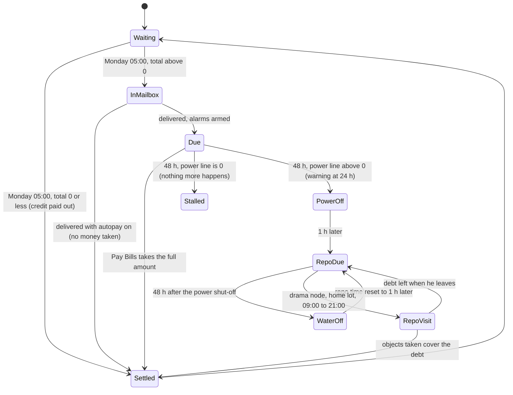
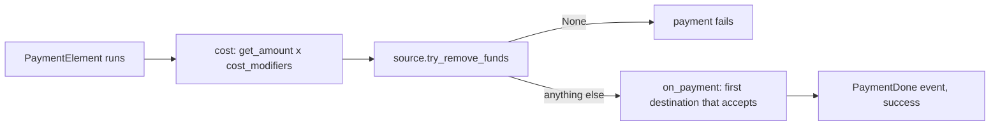

# 5.01 Money, bills, perks and rewards

*Game version 1.128.90.1030 (Steam, Linux/Proton). Instance counts come from the live tuning as the live merge builds it (the base-game delta build plus the delta build of each installed pack): the base game, EP04 (Cats & Dogs), EP06 (Get Famous), EP09 (Eco Lifestyle), EP12 (High School Years), GP04 (Vampires), GP12 (Werewolves), SP01 (Luxury Party) and SP42 (Grunge Revival). Module tuning (class constants such as the bill brackets) exists only in the base builds; the base delta build is the live copy, and the base full build is an older snapshot that differs in places. Records from packs that are not installed come from the decoded patch tuning and are marked "patch data, pack not installed". Checked 2026-10-12: 134 claims checked, 16 corrected, 2 relabelled, none removed, 6 added. Deepened 2026-10-13: 3 modules newly explained (none promoted from listed: the 7 listed rows are empty package markers), 3 failed decompiles read. Checked again 2026-10-13: 159 claims checked, 18 corrected, 1 relabelled, none removed. Cross-chapter edits 2026-10-13: 4 applied.*

## In plain words

Your household has one wallet. Almost everything that costs or pays money goes through it: buying, selling, wages, rewards and bills. The wallet tops out at 9,999,999 Simoleons, and anything above that is lost without a message. When a Sim from outside the household you are playing pays from their own household's wallet, the code reports the payment as made and takes nothing.

Bills come once a week. Early on Monday morning the game totals what you owe and puts a bill in the mailbox for the mail carrier to deliver. Most of the bill is property tax, worked out in brackets from what your lot and everything on it is worth: 1.8 percent of the first 20,000, rising to 4.9 percent of everything above 50,000. A 100,000 Simoleon home pays 3,710 a week before anything else. On top of that comes 0.6 Simoleons for every unit of power and water used, plus whatever services you could not pay for on the spot. Frugal Sims, lot traits, neighbourhood plans, building pieces with eco effects and a civic inspector can push the total up or down. Two Frugal Sims stack: each one multiplies the bill by 0.75 again, so two pay 56 percent of it.

If you do not pay, nothing happens for two days apart from a warning after the first. Then the power goes off, two days later the water, and from an hour after the first shut-off the repo man can turn up. He ranks your objects once, by how close each one's value is to your whole debt when he arrives, takes them in that order up to ten, and never gives change; the list is not re-ranked as the debt shrinks, so a second pick can be worth far more than what is left. Two surprises: the "autopay bills" cheat marks each bill paid and takes no money; and if the first utility on the list has nothing to charge (for example you keep your own solar power instead of selling it, used next to none, or sold a surplus too small to earn a whole Simoleon), the late-bill chain stops at its first step, so the power, the water and the repo man all stay away.

Besides Simoleons, the game keeps many side currencies called bucks: vampire power points, fame perk points, vet clinic money, recycling bits and pieces, influence for neighbourhood votes and more. Each kind of bucks buys perks from its own list. Rewards are a separate system again: a reward is a bundle (money, an object, a trait, clothes, bucks) handed out by careers, aspirations, events and pivotal moments. Royalties for books and songs, rebates on purchases, loans and achievements round out the money side.

## Key facts

- **The wallet cap is 9,999,999** (live module tuning `sims.funds`; the code default is 99,999,999). `_update_money` takes `min(funds + amount, cap)`, so money above the cap is dropped silently.
- **The household wallet never charges an NPC Sim.** `_Funds.allow_npcs` is False and `FamilyFunds` keeps it (only business funds override it), so `try_remove_amount` returns the full amount as paid without touching the money when the call names a paying Sim who is outside the active household (bytecode).
- **Bills run only for the active household.** `Bills.on_all_households_and_sim_infos_loaded` returns at once for any other household (bytecode).
- **The bill is drawn up every Monday at 05:00** (live; code default Monday 08:00) and placed in a hidden inventory for the mail carrier. No bill is drawn up in the first week of game time (**Inferred**: a new save's first week).
- **Property tax brackets (live):** 1.8% up to 20,000, 2.7% from 20,000 to 30,000, 3.15% from 30,000 to 50,000, 4.9% above 50,000, charged on the lot's billable value. The older full build had 2, 3, 3.5 and 5 percent.
- **Utilities cost 0.6 Simoleons a unit** for power and for water (live; code default 1). Excess production is sold at the same 0.6 (times 1.3 when the street's eco footprint is industrial) unless you choose to store it.
- **Bill modifiers multiply.** Per-Sim modifiers are applied once for every Sim that passes, so each Frugal Sim multiplies the bill by 0.75; household modifiers are tested once, against the last Sim in the household.
- **Late bills (live):** warning 24 hours after delivery, power off at 48 hours, water off 48 hours after that, repo man due 1 hour after each shut-off. The code defaults were 24 and 2 hours.
- **The repo man aims at 100% of the debt** (live `repo_Situation_BillsDelinquent`; code default 10%) and takes up to 10 objects, from a list ranked once against the debt when he arrives. The tuned 0.8 to 1.2 "collection range" is read by no code.
- **Autopay waives bills.** With `households.autopay_bills` on, delivery calls `pay_bill`, which removes no money for a positive bill (bytecode). In live play the base tutorial turns autopay on while it runs and off when it ends; the code also turns it on for university housing, which needs EP08 (Discover University), not installed. The flag is never saved.
- **The late-bill chain can stall.** The shut-off alarm always targets the first utility not yet shut off (power before water); if that utility's line on the bill is 0, `_shut_off_utility` returns without scheduling anything else (bytecode). Live play reaches this when power is stored instead of sold, or when the power meter ends the week anywhere from about -1.66 to about 2.66 (2.28 on an industrial street): little use, production that about matches use, or a sold surplus worth less than 1 Simoleon.
- **Two "bills decrease" tiers test the wrong statistic.** In live `sims.bills`, the 0.9 and 0.75 tiers that share their description with the 0.6 "decrease" tier test `statistic_BBGameplayEffects_IncreaseBills`. Lots with a few bill-raising pieces pay 1.35 or 1.5 times instead of 1.5 or 2 times, and bill-lowering pieces do nothing below 10 points.
- **138 live perks over 8 bucks types:** vampire powers 41 and weaknesses 16, fame perks 21 and quirks 12, werewolf abilities 25 and quest abilities 6, vet clinic 10, club 7. Perk purchase checks only the price; prerequisites are shown by the UI and not enforced by the server.
- **488 live reward records** (389 `SimReward`, 99 `HouseholdReward`). A money reward with a range is rolled again on every payout.
- **Royalties pay every day at 10:00** (92 live `RoyaltyPayment` records). A song pays 100 rising to 300 at the fourth payment and back to 100 at the seventh, then stops, each payment varied by up to 40 percent.

## How it works

### Household funds

**Observed** (`sims/funds.py: FundsSource`, `get_funds_for_source`). Money is read through a funds source: HOUSEHOLD (0) returns the Sim's `family_funds`; BUSINESS (2) returns the zone's business manager funds; STATISTIC (3), BUCKS (4) and NO_SOURCE (5) return None; RETAIL (1) raises `NotImplementedError` (retail now goes through the business source, see [5.02 Businesses](5.02-businesses.md)).

**Observed** (`_Funds.add`, `try_remove_amount`, `_update_money`, bytecode).

- `add` rounds the amount; a negative amount is ignored (the error call writes nothing in retail, where `Logger.error` has an empty body).
- `try_remove_amount` rounds the amount and returns None for a negative one. If NPCs are not allowed and the call passes a Sim who is an NPC, it returns the amount without removing anything; a call with no Sim is charged. With `require_full_amount` False an amount above the balance is clamped to the balance; with it True (the usual case) the call fails and returns None. On success it calls `_update_money(-amount)` and returns the amount.
- `_update_money` returns on 0, sets the balance to `min(balance + amount, MAX_FUNDS)`, clamps to 0 if the result is negative unless negatives are allowed (its error call writes nothing in retail), sends `SetMoney` to the client (with the amount for the coin effect when `show_fx`, else 0), writes the `FUND`/`FMOD` telemetry hook (see [1.04 Debug tools](1.04-debug-cheats-telemetry.md)), and, when `count_as_earnings` is set and the amount is positive, fires `SimoleonsEarned`: for the whole household with the amount when no Sim is given, else for that Sim with the amount and for the other members with 0.
- `transfer_funds` is `try_remove` with the loss reason followed by `add` with the gain reason. `FamilyFunds` uses `FUNDS_HOUSEHOLD_TRANSFER_LOSS` and `_GAIN` and keeps the base `allow_npcs` (False); `business/business_funds.py` is the only override, and its `BusinessFunds` returns True for both `allow_negative_funds` and `allow_npcs`. `is_npc` on a Sim info means "not in the active household" (`sims/sim_info.py`).

**Observed** (live module tuning `sims.funds`). `_Funds.MAX_FUNDS` is 9,999,999; its description says the UI file `GlobalTunables.as` holds a matching constant. `FundsTuning.UNAFFORDABLE_TOOLTIPS` maps the BUCKS, BUSINESS, HOUSEHOLD and RETAIL sources to the tooltip shown on an interaction you cannot afford.

**Observed** (bytecode of `sims/household.pyc: Household`). A household created without a starting amount (`Household.__init__` with `starting_funds` left at DEFAULT, which its description ties to NPC households) gets `NPC_HOUSEHOLD_DEFAULT_FUNDS` 20,000 (code default; the live `sims.household` module tuning does not set it).

The funds reasons that this chapter's modules pass are `TELEMETRY_INTERACTION_COST`, `TELEMETRY_INTERACTION_REWARD`, `TELEMETRY_MONEY_ASPIRATION_REWARD` (money rewards and rebates), `TELEMETRY_MONEY_ROYALTY`, `TELEMETRY_LOANS_SIM_DEATH`, `FUNDS_HOUSEHOLD_TRANSFER_GAIN`/`_LOSS`, `FUNDS_INTERACTION_REWARD` and six `FUNDS_SMALL_BUSINESS_*` reasons (`_EMPLOYEE`, `_HOURLY_FEE_REWARD`, `_ENTRY_FEE_REWARD`, `_LIGHT_RETAIL_REWARD`, `_INTERACTION_REWARD`, `_OPEN_BUSINESS`; EP18 (Businesses & Hobbies), not installed). Selling an object uses `TELEMETRY_OBJECT_SELL` (`interactions/utils/destruction.py`) and moving or evicting a household uses `FUNDS_LOT_SELL` (`household_commands.py`, `eviction_situation.py`), both outside this chapter's modules. The numeric values live in `Consts_pb2`, which is not among the decompiled sources.

### The weekly bill: timer, hidden inventory and mail

**Observed** (`sims/bills.py: Bills._set_up_bill_timer`, bytecode). The timer runs to the next `TIME_TO_PLACE_BILL_IN_HIDDEN_INVENTORY` (live Monday 05:00). One week is added when the previous bill was settled as a credit (`from_negative_payout`) or when the delivery time would fall before `DateAndTime(0)` plus one week, a fixed point of game time, so **Inferred**: a new save gets no bill in its first week. A timer stored in the save is resumed from its ticks. The callback is `allow_bill_delivery`, or `_update_rental_businesses` when a payment is still owed, so **Inferred**: no new bill is drawn up while one is unpaid.

**Observed** (`allow_bill_delivery`, `_place_bill_in_hidden_inventory`). At the alarm the bill total is computed. A total of 0 or less is settled at once with `pay_bill(sound=False)`. A positive total creates the `BILL_OBJECT` definition (21471) in the lot's hidden inventory and sets `_can_deliver_bill`; the mail carrier then moves it to the mailbox. With no lot available the delivery step runs straight away.

**Observed** (`trigger_bill_notifications_from_delivery`, bytecode). At delivery: if the mail carrier already delivered, return; otherwise clear the deliver flag. If autopay is on, the total is exactly 0, or the household is empty, call `pay_bill(sound=False)` and stop. Otherwise start the late-bill timers (`_set_next_delinquency_timers`, plus `_set_rent_timers` for an EP15 (For Rent) tenant), show the first arrival notification whose tests pass (five live variants) and, only if that notification was actually shown, run `BILL_ARRIVAL_NOTIFICATION_LOOT` (one EP09 loot, `loot_Trait_GreenFiend_UncontrollableFootprint`).

**Observed** (bytecode of `Bills.on_all_households_and_sim_infos_loaded`). Everything above is set up only for the active household; for any other household the method returns first. A home zone whose venue sets `is_university_housing` turns autopay on; no live venue sets it (that housing is EP08's, not installed).

### What a bill costs

**Observed** (`Bills.get_total_bill_amount`, bytecode). The multipliers come first (next section), then:

| Line | Amount | Multiplied by | Counted as |
|---|---|---|---|
| Rent | `_get_rent_cost()` | nothing | housing |
| Property tax | `int(tax x mult[ALL] x mult[PROPERTY_TAX])` | all bills, property tax | housing |
| Rental-unit taxes (EP15) | `_add_rental_unit_taxes`, written into the additional bills under `Taxes_per_Rental_Unit` | nothing | non-housing |
| Additional bills | each `AdditionalBillSource` total | nothing | non-housing |
| Each utility | `int(line x mult[ALL] x mult[utility])`, a credit is not multiplied | all bills, that utility | non-housing |

The sum is returned as an integer and written to the `BILL`/`BIGI` telemetry hook (rent, property tax, other bills, power, water).

**Rent.** **Observed** (`_get_rent_cost`, bytecode). An occupied EP15 rental unit returns the rent currently owed; any other zone that is not an apartment returns 0 (a penthouse does not count as an apartment here); an apartment (EP03 (City Living), not installed) returns the native `services.get_rent(house_description_id)`.

**Property tax.** **Observed** (`_get_property_taxes`, bytecode). An occupied rental unit or an apartment pays none. Otherwise the household's billable value is taxed in slices: for each bracket whose lower bound the value reaches, the part of the value inside the bracket (an open upper bound means "up to the value") is multiplied by its `tax_percentage` (a `TunablePercent`, so 1.8 means 0.018), and the slices are added.

```text
value 100,000 (live brackets):
  20,000 x 1.8%  =   360
  10,000 x 2.7%  =   270
  20,000 x 3.15% =   630
  50,000 x 4.9%  = 2,450
  property tax   = 3,710 per week, before multipliers
```

**Inferred** (from the same brackets): 20,000 pays 360, 50,000 pays 1,260, 200,000 pays 8,610. The first three live percentages are 0.9 times the full build's 2, 3 and 3.5; the top bracket fell only from 5 to 4.9.

**Billable value.** **Observed** (`Household.household_net_worth`, `_update_cached_home_lot_value`, bytecode; `household.py` itself failed to decompile). With `billable=True` the net worth is the cached home lot value alone: the native `lot.furnished_lot_value`, minus `current_value` and inventory value of every non-Sim object on the lot (or, in a plex, in this unit) that this household does not own, clamped at 0. The cache is refreshed only when the home zone is loaded. Without `billable` the net worth also adds the household inventory (native `build_buy.get_household_inventory_value`), every Sim's inventory and the funds.

**Utilities.** **Observed** (`Bills.get_utility_bill_info`, bytecode; live `UTILITY_INFO`). Power reads `commodity_Utilities_Power` and water `commodity_Utilities_Water` on the lot. Objects drain them as they are used and producers (solar panels, wind turbines, dew collectors) fill them. With the value v and `statistic_sell_value` 1.0 (code default):

- v above 1.0: production. With the end-of-bill action STORE the line is 0 and nothing changes. With SELL (the default) one unit is set aside, the line is `-int(0.6 x (v - 1) x sell multiplier)` (a credit) and the bill records a change of -v.
- v from 0 to 1.0: kept, line 0.
- v below 0 (usage): the line is `-int(0.6 x v)`, a charge of 0.6 per unit, and the bill records a change of -v.

The sell multiplier is 1.3 when `testSet_EcoFootprint_Industrial` (EP09) passes, read with a global resolver. When the bill is paid, `pay_source_bill` adds the recorded change to the lot statistic, so the meter returns to whatever was used or produced since the bill was drawn up. **Inferred**: on SELL the unit set aside is neither sold nor kept, since the recorded change is the whole v. `sell_excess_utility` (the `bills.sell_excess_utility` command) is different: it pays `int(0.6 x (v - 1) x multiplier)` at once and sets the meter to 1.0.

**How an object drains the meter, one worked example.** **Observed** (`objects/components/state.py: StateComponent._start_lot_statistic_gains`, `_ModifierValueWithMultipliers`; live `object_hottub_InGround` and `object_hottub_EVG_Anniversary`, base). An object state can carry `lot_statistic_modifiers`: when the state starts, each entry's value is computed once (a base value times every multiplier whose tests pass on the object) and added to the active lot's statistic as a rate modifier, so the multipliers are not re-tested while the state lasts. Both live hot tubs drain on their state `utilities_Water_Consumption_On`:

| Lot statistic | Base value | Multipliers (when their test passes) |
|---|---|---|
| `commodity_Utilities_Water` | -0.02083 | x0.88 always; x0.5 with zone modifier `zoneModifier_Hidden_WaterHeater_On`; x0.5 once the tub's state is `upgrade_Completed_EcoUpgrades_WaterRecycler` (EP09); x0 while it is `ecoUpgrades_Fill_Values_Siphoner_HasFuel` (EP09) |
| `commodity_Utilities_Power` | -0.01042 | x0.74 always; x0.75 with zone modifier `zoneModifier_Hidden_FuseBox_On` |

**Inferred** (rate modifiers on a continuous statistic are per Sim minute, see [3.03 Needs, statistics and commodities](3.03-needs-statistics.md)): a running tub with no upgrades uses 1.25 x 0.88 = 1.1 water units and 0.625 x 0.74 = 0.46 power units an hour, about 0.94 Simoleons an hour on the bill at 0.6 a unit; with the water heater and the recycler the water side falls to a quarter of that. Other objects were not counted (Limits).

**Additional bills.** **Observed** (`situations/service_npcs/service_npc_tuning.py: ServiceNpcHireable.try_charge_for_service`). A service NPC charges the household on the spot; only the part the household cannot pay becomes an additional bill line under its `bill_source` (live `AdditionalBillSource` values: Maid_Service 1, Pizza_Delivery 2, Repair_Service 3, Gardening_Service 4, Nanny_Service 5, Butler_Service 6, RanchHand_Service 7, Taxes_per_Rental_Unit 8, plus Miscellaneous 0 from code). A Sim with one of the service's `free_service_traits` makes it free.

### Bill multipliers

**Observed** (`Bills._get_bill_multiplier`, bytecode). Multipliers start at 1 for each utility, for ALL (-1) and for PROPERTY_TAX (-2). Then:

1. For every Sim in the household, each `BILL_COST_MODIFIERS_SIM_WITH_REASON` entry whose tests pass for that Sim multiplies its source. The same entry is applied again for each Sim that passes.
2. Each `BILL_COST_MODIFIERS_HOUSEHOLD_WITH_REASON` entry is tested once with the resolver left over from step 1 (the last Sim in the household), or a global resolver for an empty household.
3. Each active global-policy bill reduction multiplies `REDUCTION_REASON_SOURCE[reason]` (default ALL) by its amount, and its text joins the descriptions.

An entry without a source applies to ALL; a `utility` source with no utility named means power (the variant's default). ALL touches property tax and utilities only (table above).

**Observed** (live module tuning `sims.bills`, base delta). Household modifiers:

| x | Applies to | Test | Pack |
|---|---|---|---|
| 1 | power | home lot has `zoneModifier_lotTrait_OffTheGrid` | base (a description line only: "No Power Bills while Off-the-Grid") |
| 1 | water | same | base (description only: "No Water Bills while Off-the-Grid") |
| 0.75 | property tax | same | base ("Off-the-Grid Property Tax Discount") |
| 0.5 | all | current zone has `zoneModifiers_TinyHome_Bill_Decrease` | SP16 (Tiny Living), patch data, pack not installed |
| 0.5 | power | `streetCivicPolicy_ShutOffDay_Power` enacted on the home street | EP09 |
| 0.5 | water | `streetCivicPolicy_ShutOffDay_Water` enacted | EP09 |
| 1.2 | property tax | any `NeighborhoodRenovation_ModernPolicy_*` enacted | EP09 |
| 1.5 | power | any `NeighborhoodRenovation_GreenPolicy_*` enacted | EP09 |
| 1.5 | water | same | EP09 |
| 1.5 / 2 / 2.5 | all | lot `statistic_BBGameplayEffects_IncreaseBills` at least 1 and under 5 / 5 to under 10 / at least 10 | base |
| 0.9 / 0.75 | all | the same IncreaseBills bands, 1 to under 5 / 5 to under 10 | base |
| 0.6 | all | lot `statistic_BBGameplayEffects_DecreaseBills` at least 10 | base |
| 1.2 | all | lot `commodity_CivicInspector_notfollowing` at least 0.01 | EP09 |
| 0.8 | all | lot `commodity_CivicInspector_following` at least 0.01 | EP09 |
| 0.75 | all | a trait test on `ActorLot` with no trait listed ("Bills are lower here to compensate for any...strangeness.") | base delta only; never passes for a household with a home lot (below) |
| 0.8 / 0.9 / 1.1 / 1.2 | all | kingdom tax level VeryLow / Low / High / VeryHigh of the Sim's home neighbourhood (`world` ACTOR_NEIGHBORHOOD) | EP21 (Royalty & Legacy) test, pack not installed: `KingdomTaxLevelTest` returns False when `services.kingdom_service()` is None, so none of the four ever applies here |

Per-Sim modifiers: `trait_Frugal` 0.75; `buff_CommunityCloseness_LandgrabPower_HiddenDiscount` (EP09) 0.5; 0.9 for Sims with `trait_Nature_CountryCaretaker_NatureConversationalist` (EP11 (Cottage Living), patch data, pack not installed) living in one of three listed worlds.

**Observed** (live `ZoneModifiers_Hidden_BBGameplayEffects`, see [2.01 Lots, venues and rooms](2.01-lots-venues-rooms.md)). The bills statistics come from tagged building pieces: each column, fence, floor tile, wall or roof piece tagged to raise or lower bills adds 0.05 to its statistic, and each tagged object adds 0.5. **Inferred**: a lot reaches the 0.6 discount at 20 bill-lowering objects or 200 bill-lowering pieces. The same zone modifier also touches the utility meters: objects tagged as power or water consumers add a rate modifier of -0.0001 on `commodity_Utilities_Power` or `_Water`, producers +0.0001 (the water producer as a statistic change), pool surfaces -0.0001, and roof materials tagged as producers +0.0000139 (full list in [2.01 Lots, venues and rooms](2.01-lots-venues-rooms.md), "Lot traits in the live tuning").

**Observed** (tuning; the `statistic` test's threshold defaults to `GREATER_OR_EQUAL`, bytecode of `TunableThreshold.__init__`). The 0.9 and 0.75 entries test `statistic_BBGameplayEffects_IncreaseBills` (235314), the same statistic and bands as the 1.5 and 2 entries. Their description string (0x2D478421, "Bill Discount Items on Lot" in the English table) is the one used by the 0.6 entry, which tests `DecreaseBills` (235316); the raising tiers use 0x8EDE22B7, "Bill Surcharge Items on Lot". **Inferred**: the two entries were meant to test `DecreaseBills`. As tuned, a lot with 1 to under 10 raising points pays 1.5 x 0.9 = 1.35 or 2 x 0.75 = 1.5, and lowering points do nothing until they reach 10. Normal play reaches this whenever the building eco effects are in play (2.01 notes the game option that controls them).

**Observed** (`situations/complex/civic_inspector_situation.py: CivicInspectorSituation.notify_result_and_push_bill_modifier` and the follow check above it; live `commodity_CivicInspector_following` and `_notfollowing`, EP09). The inspector counts the street's civic policies that apply and, for each, whether one whitelisted object passes its test. None followed sets `commodity_CivicInspector_notfollowing` on the active lot to its maximum, 100; all followed (or no policy to check) sets `commodity_CivicInspector_following` to 100. A partial result only shows the partial-success notification and sets **neither** commodity, so partly following the policies leaves the bill as it is. Both commodities decay toward 0 at 0.0115 a Sim minute. **Inferred** (from that rate and the bill test's 0.01 threshold): the 1.2 or 0.8 multiplier lasts about 8,700 Sim minutes, a little over six Sim days after the inspection, so it covers the next Monday bill only when the inspection falls within six days before it, and only if the lot statistic keeps decaying while the lot is not loaded (not traced). How the inspector visit runs is in [4.01 Situations](4.01-situations-npcs.md).

**Observed** (resolver code: `event_testing/resolver.py`, `ParticipantType.Lot` returns `services.active_lot()`). **Inferred**: the building-effect and civic-inspector tests read the lot that is loaded when the bill is drawn up, which is the home lot only when the household is at home on Monday at 05:00.

**Observed** (`event_testing/resolver.py: SingleSimResolver`, `sims/sim_info_tests.py: TraitTest.__call__`). `ActorLot` under a Sim resolver is that Sim's home lot. A lot has no `trait_tracker`, and `TraitTest` returns False for any target without one, so the 0.75 "strangeness" entry never applies to a household that has a home lot (an unloaded home zone still resolves to a lot). **Inferred**: only a household with no home lot at all, whose test then has no target, could pass it. It is new in the delta build (the full build lacks it) and names no trait.

**Observed** (`global_policies/global_policy_effects.py: BillReduction`, `global_policy_service.add_bill_reduction`). A global policy's `reduction_amount` is a `TunablePercent` (default 50) described as the percent by which bills drop, and `_get_bill_multiplier` multiplies the bill by it directly. At the default 50 both readings agree. The only bill-reducing policy found is `globalPolicy_Conservationist_Energy_GreenEnergy` (EP07 (Island Living), patch data, pack not installed), which keeps the default; the live `BillReductionEnum` adds `GlobalPolicy_GreenEnergyRebate` (64). Policies themselves are in [2.07 Neighbourhood systems](2.07-neighbourhood-systems.md).

### Paying, autopay and credits

**Observed** (`interactions/payment/payment_cost.py: PaymentBills`, `payment_element.py: PaymentElement`; live interactions). Eight live interactions carry a payment element whose cost is `bills`, and none tunes cost modifiers. Seven deduct: `mailbox_PayBills`, `mailboxWall_PayBills`, `computer_PayBills`, `tablet_PayBills` and three outcomes of `phone_PayBills`. The household source removes the whole amount or nothing, then `PaymentBills.on_payment` calls `pay_bill()`. The eighth, `bills_PayBills` on the bill object itself, marks its payment element `display_only` (the old full build did too), so it shows the price and returns without paying; its other extras are an EP15 loot and EP15 tests that are not live. **Inferred**: paying from the bill in a Sim's hand settles nothing, and a bill is paid only through one of the other seven (not seen in play).

**Observed** (`Bills.pay_bill`, bytecode). Only a negative total (a credit) is paid out here: the arrival notification is shown and `funds.add(-owed)` adds the credit with `TELEMETRY_INTERACTION_REWARD`, not counted as earnings, and the next bill is pushed a week. If the amount owed is not 0 it then applies the recorded utility changes and plays the "delinquency removed" sound if a utility was off (or the "bills paid" sound); a bill of exactly 0 skips both, so its meters are not reset. For every bill it then clears the owed amounts, the details, every shut-off and the rent alarms, re-arms the weekly timer, destroys the bill objects and, for an EP15 tenant, pays the rent. **No money is removed in `pay_bill`.** So autopay, which reaches `pay_bill` straight from delivery, waives the bill. The flag lives only in memory: `save_data` and `load_data` never touch it, so **Inferred**: the cheat lasts until the household is next loaded (a dorm turns it back on at each load).

**Observed** (`Bills.on_active_sim_set`). Money the household still owes a venue it left (`_lot_unpaid_bill`, keyed by zone and situation) is charged with `try_remove` when the active Sim is set in another zone and one of the Sims who were there is present, with the `LOT_OWED_PAYMENT_SUCCEED` or `_FAIL` notification (a venue's zone director can override both). The entry is dropped either way.

### Late bills, shut-offs and the repo man

**Observed** (`Bills._set_next_delinquency_timers`, bytecode; the decompile misplaces the second alarm). The method walks the utilities in order, power then water, and stops at the first one not yet shut off. If that utility's billed line is not 0, a warning alarm is set at `DELINQUENCY_FREQUENCY - DELINQUENCY_WARNING_OFFSET_TIME` (48 - 24 = 24 Sim hours live). A shut-off alarm for it is set at `DELINQUENCY_FREQUENCY` (48 hours) either way. Then, if any utility is already shut off, `_repo_man_due_time = now + REPO_MAN_TIMER` (1 hour live).

**Observed** (`Bills._shut_off_utility`, bytecode). At the alarm:

1. Nothing owed, or every utility line 0: clear all shut-offs and return (the error call writes nothing in retail).
2. This utility's line is 0: return. No alarm is set.
3. Otherwise send the shut-off notification, mark the utility shut off and call `_set_next_delinquency_timers` again (which schedules water and moves the repo time).
4. Ask the utilities manager to cut the utility, with reason `BILLS_DELINQUENT`, only if the lot statistic is missing or at 0 or below. A lot that produces the utility keeps it.

**Observed** (the two steps above). Because the alarm is set for power even when power's line is 0, and step 2 then schedules nothing, an unpaid bill whose power line is 0 never shuts anything off and never makes the repo man due. **Inferred** (from `get_utility_bill_info`; the check reads the unmultiplied line stored in `_current_bill_details`, `_get_utility_billable_amount`): live play reaches this when power is produced and stored (STORE) rather than sold, or when the meter ends the week anywhere above -5/3 (about -1.66) and below 8/3 (about 2.66): a small use (the `int` truncates 0.6 x 1.66 to 0), production that about matches use, or a sold surplus under 5/3 units, since `int(0.6 x (v - 1))` is 0 for v - 1 below 5/3 (below about 1.28 units, v about 2.28, with the industrial 1.3). Only a sold surplus worth at least 1 Simoleon makes a non-zero credit, and then the shut-off steps run (step 4 leaves the power on). An Off the Grid lot (EP09) that produces no power keeps its meter near 0 and should stall the same way. A bill with no utility charges at all takes step 1 instead, with the same result.



**Observed** (live `situationDramaNode_Repo_Situation_BillsDelinquent`; module tuning `drama_scheduler.drama_scheduler`). The repo man arrives through a drama node: home lot only, not during work hours, in a window from 09:00 for 12 hours on every day, pre-tested and tested with the `bills` test's `is_repo_man_due`, and blocked while `repo_Situation_BillsDelinquent` or one other situation runs. Its scheduler bucket `RepoMan` is scheduled on all seven days. Drama scheduling itself is in [4.01 Situations](4.01-situations-npcs.md).

**Observed** (`situations/complex/repo_situation.py: RepoSituation`, bytecode of `_cache_valid_objects`, `reduce_debt`, `get_debt_value`, `on_object_repossessed`; live `repo_Situation_BillsDelinquent`).

- The debt is the bill total owed (for an EP15 tenant, the non-housing part); the target is debt x `target_amount` (live 100%, code default 10%).
- Candidates are the debtor household's objects on the active lot, outside a plex common area, reachable by the repo man, with nothing slotted on them, passing `valid_object_tests` (live: the object must carry the `Func_Lightning_CanStrike` tag and must not carry `Func_CantRepo`). They are sorted by `abs(depreciated_value - target)`. The list is built once, when the repo man and the debtor have both joined the situation, and is never re-sorted.
- No code reads `min_and_max_collection_range` (a name search over every code object in `repo_situation.pyc` finds no use); the live 0.8 to 1.2 window has no effect.
- Each object taken reduces the debt by its depreciated value through `Bills.reduce_amount_owed`, housing first, then non-housing. When the owed total reaches 0 or less, `pay_bill(clear_bill=True)` settles the bill. Value above the debt is not refunded.
- After each object he looks for another while debt remains, up to `maximum_object_to_repossess` (live 10, code default 1). He takes the next entry of the cached list, dropping any object in use, so a second pick is the one closest to the starting target, not to what is left.
- Asking him not to take an object uses the live `ask_not_to_take_success_chances` in order, one per ask: 100 percent (the first entry is empty, so the default), then 90, 80 and 70; every later ask fails. A success makes him drop that object and look for another. A successful bribe makes him drop the current object and leave, with the debt still owed; the `event_beat_the_man` event (`auto_clear_debt_event`) clears the whole debt and sends him away. Saving is locked for the length of the situation.

### Utility shut-off and the utilities manager

**Observed** (`sims/household_utilities/utility_types.py`; live module tuning). `Utilities` is POWER 0 and WATER 1. `UtilityShutoffReasonPriority` (live) lists BILLS_DELINQUENT 1, UTILITY_BOX_NEEDS_REPAIRS 2, GLOBAL_POLICY_ENERGY_CURFEW 3, OFF_THE_GRID 4, GLOBAL_POLICY_ENERGY_REBATE 5, CIVIC_POLICY_SHUT_OFF_DAY 6, HAUNTED_ACTIVITY 7 and UTILITY_COMMUNITYCLOSENESS 8 (NO_REASON 0 in code).

**Observed** (`utilities_manager.py: UtilityInfo`, `ZoneUtilitiesManager._update_surplus`). A utility works when the lot has a surplus or when no shut-off reason is set. Surplus starts as "meter above 0" and is then driven by two listeners with a dead zone: it turns on above `statistic_sell_value - 0.25` (0.75) and off at 0 or below. Shutting off cancels running interactions that need the utility, applies the delinquent states, puts a floor on the commodity and updates the lighting; the tooltip shown belongs to the reason with the largest `UtilityShutoffReasonPriority` value.

**Observed** (`utility_loot_op.py`, `utility_operations.py`, `utility_tests.py`). `UtilityModifierOp` shuts off or restores a utility with a reason (on the subject's household manager, or on the zone's manager when the subject has no household or the venue is an EP18 small business); `UtilityUsageOp` toggles an object's usage (six live entries in four Off the Grid loots, `loot_LotTrait_OffTheGrid_Object_Utility_Off`/`_On` and `_Power_Off`/`_On`). `ShutOffUtilityModifier` and `UtilityModifierState` let object states cut a utility. `UtilityTest` checks whether a household's utility is active.

**Observed** (live `zoneModifier_lotTrait_OffTheGrid`). The Off the Grid lot trait shuts off power and water with loots when it is added and at every lot spin-up, and restores them when removed, with extra loots for fridges and for tagged objects. Its bill effect is the 0.75 property tax multiplier above.

### Household value, selling and depreciation

**Observed** (`interactions/utils/destruction.py: ObjectDestructionElement._get_object_value`, bytecode). An interaction that destroys an object and awards its value pays `round(current_value x award multiplier x tested multiplier x sell price modifier)` into the household funds with `TELEMETRY_OBJECT_SELL`. The sell price modifier (from buffs' game effects) applies only when the award is marked `is_sell_action` and the selling Sim is the active Sim.

**Observed** (see [2.02 Objects](2.02-objects-states-wear.md) and [2.03 Build/Buy](2.03-build-buy-placement.md)). `current_value` carries a single 20 percent cut after purchase and drops for broken or burnt states; build-mode purchases and refunds are charged through the native hook `c_api_modify_household_funds`. The repo man uses `depreciated_value`, and property tax uses the native furnished lot value.

**Observed** (`server_commands/household_commands.py: _transfer_sims_main`, `situations/complex/eviction_situation.py`). When a whole household moves out in the transfer dialog, the amount the client sends is added with `FUNDS_LOT_SELL`; an EP15 eviction that moves the household off its lot with no new home, and not to the household bin, pays the home lot's furnished value minus its unfurnished value with the same reason (counted only when the home zone is the current zone).

### Payments inside interactions

**Observed** (`interactions/payment/*.py`, bytecode of `_Payment.make_payment`, `_Payment.on_payment`, `_PaymentSource.try_remove_funds`, `_PaymentSourceBucks.try_remove_funds`, `Payment.try_deduct_payment`).



- The cost variants are: amount, amount_up_to, bills, catalog_value, current_value, base_retail_value, dining_meal_cost, business_amount, input_dialog, liability, housing_costs, non_housing_costs, two marketplace listings, statistic_on_sim, utility, multi_serving, small_business_fee and scandal_secrets_cost. Live use (explicit tags): amount 448, catalog_value 11, bills 8, current_value 5, amount_up_to 4, input_dialog 3, liability 3, housing_costs 2, and one each of statistic_on_sim, business_amount and object_fashion_marketplace_listing.
- `make_payment` takes `-delta` (or `max(-delta, 0)` when credits are not allowed) and asks the source. The household source's defaults are `require_full_amount` True and `allow_credits` False; a negative amount with credits allowed is added instead.
- Sources live (explicit tags): household 94, business 27, no_source 11, bucks 10, statistic 6. The no-source variant always succeeds.
- Destinations: none (the money vanishes, `PaymentDoneToVoid`), the active household, a participant's household, a business, an open small business, rental-unit owners, or a statistic (`is_debt`, with a 5 percent minimum by default).
- `PaymentAmount` multiplies by the payment-altering service's modifier, which only EP18's small-business income data registers.

**Observed** (bytecode). `_PaymentSourceBucks.try_remove_funds` returns the result of `try_modify_bucks`, which is True or False, and `make_payment` treats every result other than None as paid. A bucks payment that fails to deduct therefore still runs `on_payment` and succeeds. For player Sims, `Interaction.test` compares each cost with the bucks balance (the payment element's `max_funds`) and blocks it with the BUCKS tooltip, and it skips NPC actors; the interaction queue runs that test again when the interaction reaches its head (`interaction_queue.py: process_one_interaction_gen`). The 10 live bucks payments are all EP09. Three are `display_only` (`community_Vote_Policy_ConvinceToSupportPolicy` and the two repeal votes `mailbox_GoToVote_RepealablePolicies` and `si_CommunityBoard_GoToRepeal`): they show a price and `PaymentElement` never deducts it. The seven that deduct are four fuel interactions (condenser, generator, fuel cell, siphoner), two smog vacuum repairs and the persuasion mixer `mixer_Social_CivicPolicy_ConvinceToSupportPolicy`. **Inferred**: the gap needs the balance to fall between that test and the payment element, for example two Sims of one household refuelling at once from the shared household recycling bits, or an NPC actor; I did not see either in play.

### Bucks and perks

**Observed** (live module tuning `bucks.bucks_enums`, `bucks.bucks_utils`). 21 bucks types are defined, each with a tracker type:

| Tracker | Bucks types |
|---|---|
| HOUSEHOLD | RetailBucks, RestaurantBucks, VetBucks, RecycleBitsBucks, RecyclePiecesBucks, GalacticCredits |
| SIM | VampirePowerBucks, VampireWeaknessBucks, FamePerkBucks, FameQuirkBucks, WitchPerkBucks, InfluenceBuck, WerewolfAbilityBucks, WerewolfQuestAbilityBucks, GhostPowersAbilityBucks, FairyPerkBucks, CustomerSatisfactionBucks |
| CLUB | ClubBucks |
| SMALL_BUSINESS | BusinessPerkBucks |
| DYNASTY | DynastyPerkBucks |
| (no entry) | NobilityPerksBucks |

The wallet types (shown in the household wallet UI) are RecycleBitsBucks, RecyclePiecesBucks and GalacticCredits.

**Observed** (`bucks/bucks_utils.py: BucksUtils.get_tracker_for_bucks_type`). With an owner id the tracker is chosen by type: the Sim's household, the club, the Sim (created when asked), the Sim's small business or the dynasty. **With no owner id the active household's tracker is returned for every type.**

**Observed** (`bucks/bucks_tracker.py: BucksTrackerBase`, bytecode of `try_modify_bucks`, `unlock_perk`, `pay_for_and_unlock_perk`, `lock_perk`).

- `try_modify_bucks`: if the new balance would be negative and `force_refund` is set, perks are locked from the most recently bought backwards, adding back their costs until the balance is 0 or more (False, with nothing changed, if they run out); without `force_refund` a negative result returns False. The walk (`_most_recently_acquired_perks_gen`, bytecode) sorts every perk the tracker has an entry for, and a locked perk keeps one with timestamp 0, so perks already locked come last and their cost still counts toward the balance while `lock_perk` on them only returns. The only live `force_refund` users are the three EP06 fame rank-down loots (`loot_Fame_Progression_RankDown_0`, `_2`, `_4`); what that does to quirks is in [3.13](3.13-health-luck-fame.md). The balance is capped at `MAX_BUCKS_ALLOWED` (9,999,999, code default). Then the callbacks run, a distributable tracker sends the update and writes `CRNC` telemetry, and every owner Sim gets a `BucksEarned` event (not on load).
- `pay_for_and_unlock_perk`: refuses a perk already unlocked, pays `unlock_cost` through `try_modify_bucks`, unlocks, locks the perks in `lock_on_purchase` and fires `PerkPurchased`. The price is the only check.
- `unlock_perk`: gives the rewards, buffs, traits and unlock loots, starts the timer of a temporary perk (stopping if that fails), stores the unlock time, fires `BucksPerkUnlocked` per owner Sim, unlocks the linked perks with `unlocked_by` set, and writes `PERK`/`GAIN`.
- `lock_perk`: cancels a temporary perk's timer, removes its buffs and traits, runs the lock loots, refunds the cost when asked, and writes `PERK`/`RFND`.
- `required_unlocks` is read only by the perk list sent to the UI (`send_perks_list_for_bucks_type`, which marks the perk locked) and by a save fixup; `available_for_puchase_tests` likewise only produce a tooltip. **Inferred**: prerequisites are enforced by the perk screen, and the `bucks.unlock_perk` command skips them.

**Observed** (live `BucksPerk`, 138 records):

| Bucks type | Perks | Cost each | Notes | Chapter |
|---|---|---|---|---|
| VampirePowerBucks | 41 (GP04) | 1 to 6, 161 in total | 16 have a next level, 13 conflict with others | [3.11 Occults](3.11-occults.md) |
| VampireWeaknessBucks | 16 (GP04) | 1 | | 3.11 |
| WerewolfAbilityBucks | 25 (GP12) | 1 | 1 locks another on purchase | 3.11 |
| WerewolfQuestAbilityBucks | 6 (GP12) | 0 | | 3.11 |
| FamePerkBucks | 21 (EP06) | 1 | 16 with prerequisites | [3.13 Fame](3.13-health-luck-fame.md) |
| FameQuirkBucks | 12 (EP06) | 1 | progression statistic each | 3.13 |
| VetBucks | 10 (EP04) | 350 to 5,000 | earned 25 to 50 per billed treatment by the pet owner's customer score (`loot_OwnableVetClinic_VetBucks_Treatment`); `vetPerks_MoreCustomers` is temporary, 24 hours; `vetPerks_LengthenImpatienceTimeout` does nothing ([5.02](5.02-businesses.md)) | [5.02 Businesses](5.02-businesses.md) |
| ClubBucks | 7 (base 1, EP04 2, EP06 2, EP09 2) | 300 or 400 | clubs need EP02 (Get Together), not installed | [4.03 Clubs](4.03-groups-factions.md) |

**Observed** (`bucks_loot_op.py`; live variant counts). `BucksLoot` gives `int(round(amount x statistic multipliers))` bucks (default 10) and can force a refund; 178 live entries in 96 records (104 in loot actions, 74 as actions of random weighted loots). `AwardPerkLoot` unlocks a perk for free by default, or pays for it when affordable; its progress strategy advances a locked perk only when affordable; 71 live entries (fame quirk loots, the vampire teen age-up and the werewolf perk loots). `RecyclingBucksLoot` pays bits or pieces for recycling.

**Observed** (`bucks_recycling.py`; live module tuning). Recycling pays `int(2 x curve(value) x object recycling value x value)` for each of bits and pieces, where `value` is the object's `current_value` and the curve falls from 0.2 at 0 through 0.1 at 500, 0.05 at 1,500, 0.03 at 3,000 and 0.027 at 10,000 to 0.001 at 1,000,000. **Inferred**: an object worth 500 with a recycling value of 1 gives 100 bits; one worth 10,000 gives 540.

**Observed** (the per-type trackers). The household tracker's owners are the household's Sims and only the active household distributes updates. The Sim tracker re-checks perks against a Sim's rank (`validate_perks` locks and refunds perks above it) and refreshes day/night tracking traits. The club tracker migrates the old EP02 club bucks id 24577 and reports earned club bucks to the club. The dynasty tracker (EP21) sorts perks by time with a bubble sort. `is_bucks_type_allowed_to_load` skips BusinessPerkBucks.

### Perk pickers: adding and removing a perk from an interaction

**Observed** (`bucks/bucks_picker_interaction.py`, failed decompile: per-function decompile for three methods, bytecode for the class body and `picker_rows_gen`). `BucksPerkPickerSuperInteraction` is a picker interaction with four tunables: `is_add` (default True), `bucks_type` (a pack-safe enum entry with default INVALID; its `invalid_enums` setting only marks INVALID for the tuning tool's export, and nothing checks it at load), `continuations` (pushed after a choice) and `subject` (default `TargetSim`). The rows are every perk of that bucks type whose unlock state is the opposite of `is_add` (locked perks to add, unlocked perks to remove), read from the subject's tracker, created if missing; a perk with no display name is skipped. The rows do not look at the price. On a choice, adding calls `pay_for_and_unlock_perk`, so an unaffordable perk is simply not unlocked (its error call writes nothing in retail); removing calls `lock_perk(perk, refund_cost=True)`, so the perk's price comes back. Either way the continuations are pushed.

**Observed** (live, 4 records, all EP06 and all FameQuirkBucks): `fameQuirks_QuirkBeGone_Picker` and `fameQuirks_CrystalHelmet_Picker` remove a quirk from the actor; `fameQuirks_Debug_Add` and `fameQuirks_ShippingCheat_Remove` set the interaction's `cheat` flag (the testing-cheats pie menu, [3.05](3.05-interactions-postures-routing.md)) and add or remove a quirk. **Inferred**: since quirks cost 1 FameQuirkBucks each (table above), removing a quirk this way hands its point back. Quirks, the continuations of these pickers and the crystal tests are in [3.13](3.13-health-luck-fame.md).

### Small-business perks freeze with the business rank (EP18)

**Observed** (`bucks/small_business_bucks_tracker.py`, failed decompile: per-function decompile for 17 methods, bytecode for the class body and `update_perks_by_rank`; module tuning `bucks.small_business_bucks_tracker`, base delta). `SmallBusinessBucksTracker` is the tracker a small business owns (`small_business/small_business_manager.py` builds it with the owner Sim's id). It starts with a BusinessPerkBucks balance of 0, loads only that bucks type from a save, and adds **frozen perks**: a map from perk id to "was it unlocked when frozen".

- `BUCKS_TRACKER_REWARDS_CATEGORIES` maps each business rank (live: 1 to 5) to a category with six ordered slots, of which slots 2, 4 and 6 name a perk; the 15 perks, three per rank, are one Schemer, one Neutral and one Dreamer perk each (names resolved in EP18 patch data, for example rank 1: `smallBusinessPerks_Schemer_CustomerSway`, `smallBusinessPerks_Neutral_TipJar_1`, `smallbusinessPerks_Dreamer_InspirewithBusinessStory`).
- `update_perks_by_rank` walks rank 1 up to the number of ranks tuned and runs the tests of that level of the rank statistic (`SMALL_BUSINESS_RANK_RANKED_STATISTIC`) against the owner. If they fail, each perk in that rank and every `next_level_perk` after it is frozen: an unlocked one is locked with no refund and remembered as unlocked. If they pass and a perk is frozen, it and its next levels are unfrozen, and an unfrozen perk that had been unlocked is unlocked again (with its rewards, buffs and traits).
- `check_business_rank_frozen` does the same for the rank itself: when the owner fails the current level's tests the rank value is remembered, and when the tests pass again the rank statistic is set back to it. `check_frozen_perks` runs both; it is called on an owner transfer, when the owner ages up (`sims/aging/aging_mixin.py`), and before the perk list is first sent to the UI.
- A frozen perk's row shows `FROZEN_PERKS_TOOLTIP` (live string 0x133C9A4F, "This is not available to child Sims." in the English table). Saving writes the frozen rank value and only the frozen perks that had been unlocked; loading marks those frozen.
- Bucks updates go to the owner Sim's id with `SetBuckFunds`; unlocking a perk writes the `BSPP` hook (business id, perk id `bspc`, points left `bspp`) to the business telemetry group.

**Inferred**: the level tests are what freeze perks, so a rank whose tests check the owner's age (the tooltip text points at child owners) or a condition the owner can lose takes its perks away until the condition returns, and gives them back for free. The rank statistic 374179 is an EP18 record, not in the live merge, so in this install `check_frozen_perks` returns before it does anything. The rest of small businesses is in [5.02 Businesses](5.02-businesses.md).

### The bucks debug views

**Observed** (`bucks/bucks_handlers.py`, failed decompile: per-function decompile for three functions, bytecode for the module body and `generate_bucks_perks_view`). Three GSI views, which need the developer GSI server ([1.04 Debug tools, cheats and telemetry](1.04-debug-cheats-telemetry.md)):

- **Bucks Perks** (per Sim): every `BucksPerk` with its bucks type, the tracker found for the Sim and whether it is unlocked; filters per bucks type and "Unlocked Only". Double-clicking a row runs `bucks.unlock_perk <perk> True <bucks type> <sim id>`, a free unlock.
- **Bucks** (per Sim): the balance of every bucks type whose tracker type is household, Sim, small business or dynasty; club bucks and NobilityPerksBucks are left out.
- **Bucks Log**: an archiver that `BucksTrackerBase.try_modify_bucks` feeds only while it is enabled; it records start, change and final amount per Sim, once for every member of a household tracker and once for a Sim or dynasty tracker. Club and small-business changes are not logged.

### Rewards

**Observed** (`rewards/reward.py`; bytecode of `TunableRewardObject.open_reward` and `TunableRewardBucks.open_reward`). A `Reward` lists rewards; each entry is one reward or a weighted random list. `_give_reward_payout` drops disallowed types, picks from each random list, builds the chosen reward (so a money range is rolled again each time), opens it, and shows the notification if anything was paid. `SimReward` delivers to the Sim; `HouseholdReward` to the household or, with `deliver_with_mail`, the mailbox.

- Money: `funds.add` with `TELEMETRY_MONEY_ASPIRATION_REWARD`.
- Object: to the lot's hidden inventory for the mailbox, to the Sim's inventory (with a collection check) for a Sim, else the household inventory.
- Bucks: nothing if the type is INVALID or its pack is unavailable, nothing for an NPC, else `try_modify_bucks(amount)`. (The decompile drops a `not`; the bytecode has it.)
- Also: trait, CAS part (valid only if not owned yet), build/buy object or magazine unlock, buff, whim bucks, display text, club vibe, three business upgrades and dynasty prestige.

**Observed** (live, 488 records: `SimReward` base 298, EP04 3, EP06 18, EP09 27, EP12 28, GP04 4, GP12 11; `HouseholdReward` base 86, EP04 3, EP06 6, EP12 3, GP04 1). Reward entries by type: CAS part 745, object 541, bucks 296, money 241, build/buy object 204, buff 197, trait 102, display text 53, magazine 36, dynasty prestige 30, whim bucks 5. Money rewards include the career promotion bonuses (110 for Athlete level 2 to 8,039 for Criminal Boss level 5; job pay is in [3.10 Skills, careers and school](3.10-skills-careers-school.md)), the overmax bonus (42 `careerRewards_Overmax_*` records; 40 choose with equal weight between nothing and a random 1,000 to 2,000, and 41 also give 10 InfluenceBuck) and pivotal moment money (500 to 6,000: three pay 2,000, `reward_PivotalMoment_N7` 5,000, the four `rewardsBoost` variants 4,000 or 6,000, and `reward_PivotalMoment_dreamsV0_N5_DLCQuest` 500).

**Observed** (`rewards/cas_part_loot_op.py`). `CASUnlockLootOp` adds CAS parts, pelt brushes or pelt layers to the household's reward inventory, for one Sim or the whole household; `StoreCASPartsLootOp` stores parts on an object. `RewardOperation` is the loot that gives a `Reward` (31 live uses).

### The satisfaction store

**Observed** (`satisfaction/satisfaction_tracker.py`). Satisfaction points are clamped from 0 to `MAX_POINTS` (the 32-bit maximum); a positive gain is multiplied by the Sim's score multiplier. `purchase_satisfaction_reward` checks only the cost, then spends the points and gives the reward. The store's 124 entries, their costs and award types are covered in [3.07 Personality and feelings](3.07-personality-feelings.md).

### Royalties

**Observed** (`sims/royalty_tracker.py`; bytecode of `update_royalties_and_get_paid`; live module tuning `sims.royalty_tracker`). The royalty alarm pays the active household's Sims every day at 10:00. Each royalty counts its payments from 1; the amount is `pay_curve(n) x multiplier`, the multiplier tested once when the royalty starts, and `int(uniform(p - p x d, p + p x d))` when a deviation d is tuned. Past the curve's last point a `pay_forever` royalty repeats the last value; any other ends. Amounts are summed per tag and added with `TELEMETRY_MONEY_ROYALTY`. A royalty type can carry a one-time bonus buff that multiplies the next payment (live: video recordings, 1.5, code default 2) and is then removed. When a Sim's level of detail drops below full the tracker clears its royalties from memory, and when it returns to full they are loaded again from the Sim's saved record (`on_lod_update`); active-household Sims, the only ones paid, stay at full.

**Observed** (live, 92 records: base 89, EP06 2, GP04 1): 81 books, 4 songs, 2 lyrics, 2 video recordings, 1 app, 1 game, 1 music track.

| Royalty | Curve (payment: Simoleons) | Forever | Deviation |
|---|---|---|---|
| Songs (guitar, piano, violin, GP04 pipe organ), lyrics | 1: 100, 4: 300, 7: 100 | no | 40% |
| Self-published book, Mystery, 1 to 3 stars and bestseller | 35, 70, 140, 280, flat to payment 20 | no | 20% |
| Published book, Mystery, same steps | 137, 182, 273, 325, flat to payment 20 | no | 20% |
| `royalty_Book_SellCopy` | 1: 50, 10: 200 | no | 0 |
| App | 1: 75, 5: 125, 10: 10 | yes | 30% |
| Game | 1: 125, 5: 205, 10: 15 | yes | 30% |
| Video recording | 1: 125, 5: 205, 15: 105, 25: 1 | no | 0 or 30% |
| EP06 music production track | 1: 20, 5: 15, 10: 5, 25: 1 | yes | 30% |

Book multipliers are tested on the book itself (`PickedObject`): published books pay 1, 1.23, 1.46 or 1.69 by its `statistic_BookCrafting_Level` (9 to 11, 12 to 14, 15 to 17, 18 to 20), times 1.25 when it is in the `BookPublished_Digest_Sold` state and 1.5 with the EP06 perk `famePerks_SkillCareer_EstablishedName`; self-published books use 1, 1.4, 1.7 and 2 on the same bands and the same 1.5 perk. The lifestyle brand, paid by the same alarm, is in [3.13](3.13-health-luck-fame.md).

### Rebates

**Observed** (`sims/rebate_manager.py`, bytecode of `add_rebate_for_object`; live module tuning `sims.rebate_manager`). When an object is bought in build/buy, or a gameplay object is added, each rebate of the matching category checks the object's tags (all objects when none are listed) and its tests against the object and the household's Sims, then adds either a flat amount per item or `catalog_value x percentage`. Rebates are paid on Monday, Wednesday and Friday with `TELEMETRY_MONEY_ASPIRATION_REWARD` (`funds.add` rounds); cyclical ones restart on Sunday.

| Rebate | Who | What | Pays |
|---|---|---|---|
| VALUED_CUSTOMER | a Sim with `trait_ValuedCustomer` | every build/buy purchase | 10% of catalog value |
| CRITIC_CAREER_THRIFTY | `Trait_Hidden_Career_Critic_Thrifty` (EP03, patch data, pack not installed) | objects tagged `Func_Art` | 20% |
| SURPRISE_HOLIDAY_DISCOUNT | `trait_SurpriseHoliday_DiscountDay` (EP05 (Seasons), patch data, pack not installed) | every purchase | 10% |
| COCONUT_REBATE | the EP07 coconut policy complete | each coconut plant (object 219551, tagged `Func_RebatePlant`) on the active lot | 10 per item, cyclical |

### Loans and debt

**Observed** (`sims/loan_tuning.py`; live module tuning `sims.loan_tuning`). `LoanType` has INVALID and UNIVERSITY. A loan of x adds `int(x x (1 + rate))` to `statistic_Debt`; the live UNIVERSITY rate is 5 percent (code default 10). When a Sim with debt dies, the debt is removed, a notification is shown if that Sim is in the active household, `POVERTY_LOOT` is applied to every other household member when the debt is at least the household's funds, and `min(debt, funds)` is taken from the household. `POVERTY_LOOT` is a pack-safe reference to `loot_Buff_Loans_Death` (228586, EP08, patch data, pack not installed); that record is not in the live merge, so in this install the reference is None and no loot runs. `sims.take_out_loan` is an untyped (debug) command.

### Achievements and account rewards

**Observed** (`achievements/achievements.py: AchievementTracker.complete_milestone`, bytecode). Completing an achievement shows the screen slam and notification only on desktop with no tutorial running, always gives its reward, and fires the unlock event. Each update sends `cheats_ever_enabled` with it (see [1.04](1.04-debug-cheats-telemetry.md)). Live: 83 `Achievement` records worth 4,130 points in all; 3 tune a reward, the EP04 pet photography achievements `simstagramPet_tier1` to `_tier3` (25, 25 and 50 points), each pointing at an EP04 `HouseholdReward` (`reward_SimStagram_Tier1` to `_Tier3`). Categories are references to the 6 live `AchievementCat` records, and all 83 list at least one.

**Observed** (`account_rewards/*.py`). An `AccountReward` (220 live, base) names a required pack, a category and items of 11 kinds (CAS, build/buy, trait, lot trait, consumable, recipe, aspiration track, radio song, floor and wall patterns, radio station). Whether an item is granted is asked of the native `is_granted_or_non_account_reward_item`, which the radio (stereo and channel picker), `sim_info.py`, `sim_dialogs.py` and the trait commands call; live events bump a cache version.

## Numbers

| Name | Value | Unit | Where | Build |
|---|---|---|---|---|
| `MAX_FUNDS` | 9,999,999 | Simoleons | `sims.funds` `_Funds` | delta (full build too); code 99,999,999 |
| `NPC_HOUSEHOLD_DEFAULT_FUNDS` | 20,000 | Simoleons | `sims.household` `Household` | code default |
| `TIME_TO_PLACE_BILL_IN_HIDDEN_INVENTORY` | Monday 05:00 | week time | `sims.bills` | delta; code Monday 08:00 |
| `BILL_BRACKETS` | 1.8 / 2.7 / 3.15 / 4.9 | percent | `sims.bills` | delta; full 2 / 3 / 3.5 / 5; code 10 |
| Bracket bounds | 20,000 / 30,000 / 50,000 | Simoleons | `sims.bills` | delta |
| `UTILITY_INFO` `unit_cost` | 0.6 | Simoleons per unit | `sims.bills` (power, water) | delta; code 1 |
| `statistic_sell_value` | 1.0 | units | `sims.bills` | code default |
| Sell price multiplier | 1.3 | factor | `UTILITY_INFO` with `testSet_EcoFootprint_Industrial` | delta |
| `DELINQUENCY_FREQUENCY` | 48 | Sim hours | `sims.bills` | delta; code 24 |
| `DELINQUENCY_WARNING_OFFSET_TIME` | 24 | Sim hours | `sims.bills` | delta; code 2 |
| `REPO_MAN_TIMER` | 1 | Sim hour | `sims.bills` | delta |
| Housing / additional key starts | 128 / 256 | key | `Bills` | code |
| Frugal | 0.75 per Sim | factor | `BILL_COST_MODIFIERS_SIM_WITH_REASON` | delta |
| Landgrab hidden discount buff | 0.5 per Sim | factor | same | delta (EP09 buff) |
| Off the Grid property tax | 0.75 | factor | `BILL_COST_MODIFIERS_HOUSEHOLD_WITH_REASON` | delta |
| Shut-off day, power or water | 0.5 | factor | same | delta |
| Renovation plans | 1.2 tax (modern), 1.5 power and water (green) | factor | same | delta |
| Building effects | 1.5 / 2 / 2.5 up; 0.9 / 0.75 (see trap); 0.6 down | factor | same | delta |
| Building effect bands | 1, 5, 10 | statistic points | same | delta |
| Civic inspector | 1.2 not following, 0.8 following | factor | same | delta |
| Kingdom tax | 0.8 / 0.9 / 1.1 / 1.2 | factor | same | delta (EP21 test; inert here, no kingdom service) |
| BB effect per piece / object | 0.05 / 0.5 | statistic points | `ZoneModifiers_Hidden_BBGameplayEffects` | delta |
| BB utility modifiers | objects -0.0001 consumer, +0.0001 producer; pool surfaces -0.0001; roof producers +0.0000139 | rate on `commodity_Utilities_Power`, `_Water` | same | delta |
| Surplus dead zone | 0.25 below sell value | units | `ZoneUtilitiesManager` | code |
| Repo `target_amount` | 100 | percent of debt | `repo_Situation_BillsDelinquent` | delta; code 10 |
| Repo `min_and_max_collection_range` | 0.8 to 1.2 (unused) | factor | same | delta; code 1 to 1 |
| Repo `maximum_object_to_repossess` | 10 | objects | same | delta; code 1 |
| Repo ask-not-to-take chances | 100 / 90 / 80 / 70, one per ask, then 0 | percent | same | delta (first entry empty, code default 100) |
| Repo drama window | 09:00 for 12 | hour, Sim hours | `situationDramaNode_Repo_Situation_BillsDelinquent` | delta |
| `MAX_BUCKS_ALLOWED` | 9,999,999 | bucks | `BucksTrackerBase` | code default |
| Perk `unlock_cost` default | 100 | bucks | `BucksPerk` | code |
| `BucksLoot` amount default | 10 | bucks | `bucks_loot_op` | code |
| Vet perk costs | 350 to 5,000 | VetBucks | `vetPerks_*` | live EP04 |
| Club perk costs | 300, 400 | ClubBucks | live `BucksPerk` | live |
| Recycling base value | 2 | factor | `bucks.bucks_recycling` | delta |
| Recycling curve | 0: 0.2, 500: 0.1, 1,500: 0.05, 3,000: 0.03, 10,000: 0.027, 1,000,000: 0.001 | factor by Simoleons | same | delta |
| Satisfaction `MAX_POINTS` | 2,147,483,647 | points | `SatisfactionTracker` | code default |
| Royalty payday | daily 10:00 | time | `sims.royalty_tracker` `PAYMENT_SCHEDULE` | delta |
| Video one-time bonus | 1.5 | factor | `ROYALTY_TYPE_DATA` | delta; code 2 |
| Song curve | 100, 300, 100 at 1, 4, 7; 40% | Simoleons | `royalty_Song_*` | live |
| Rebate payout days | Monday, Wednesday, Friday | days | `REBATE_PAYMENT_SCHEDULE` | delta |
| Rebate cycle | Sunday | day | `REBATE_CYCLE` | delta |
| Valued customer rebate | 10 | percent of catalog value | `REBATES` | delta (code default percentage) |
| Critic thrifty rebate | 20 | percent | `REBATES` | delta |
| Coconut rebate | 10 | Simoleons per plant | `REBATES` | delta |
| University loan interest | 5 | percent | `sims.loan_tuning` `INTEREST_MAP` | delta; code 10 |
| Overmax money reward | 1,000 to 2,000, half the time | Simoleons | 40 of the 42 `careerRewards_Overmax_*` | live |
| Achievements | 83, 4,130 points | records, points | `Achievement` | live |
| `motherlode`, `rosebud` | 50,000, 1,000 | Simoleons | `server_commands/sim_commands.py` | code ([1.04](1.04-debug-cheats-telemetry.md)) |
| Civic inspector commodity on a result | 100 (`max_value_tuning`) | points | `commodity_CivicInspector_following`, `_notfollowing` | live EP09 |
| Civic inspector commodity decay | 0.0115 toward 0 | points per Sim minute | same | live EP09 |
| Hot tub water drain | -0.02083 base; x0.88, x0.5 water heater, x0.5 recycler, x0 siphoner fuel | units per Sim minute, factors | `object_hottub_InGround`, `object_hottub_EVG_Anniversary`, state `utilities_Water_Consumption_On` | live base |
| Hot tub power drain | -0.01042 base; x0.74, x0.75 fuse box | units per Sim minute, factors | same | live base |
| Hot tubs of packs not installed | always-on factor x2 water, x1.5 power (`object_hottub`, `object_hottub_SP82YARD`); x0.44 both (`object_hottub_SP02STONE`) | factors on the same base | SP02, SP82 | patch data, pack not installed |
| Small-business perk ranks | 5 ranks, 3 perks each (slots 2, 4, 6 of 6) | ranks, perks | `bucks.small_business_bucks_tracker` `BUCKS_TRACKER_REWARDS_CATEGORIES` | delta (perks EP18, patch data) |
| `BucksPerkPickerSuperInteraction` records | 4 | records | `fameQuirks_*` pickers | live EP06 |

## Data shapes

- **`_Funds` / `FamilyFunds`** (`sims/funds.py`): `_funds` (int), `_household_id`, `allow_negative_funds` and `allow_npcs` (both False for a family). Methods `add`, `try_remove`, `try_remove_amount`, `transfer_funds`, `money`.
- **`Bills`** (one per household, `household.bills_manager`). State: `_current_payment_owed`, `_housing_costs_owed`, `_non_housing_costs_owed`, `_current_bill_details` (source key to `UnpaidBillSourceInfo`), `_utility_delinquency` (utility to bool), `_additional_bill_costs`, `_utility_bill_action` (SELL or STORE per utility), `_lot_unpaid_bill`, `autopay_bills`, `bill_notifications_enabled`, `_can_deliver_bill`, `_put_bill_in_hidden_inventory`, `_repo_man_due_time`, timer handles saved as ticks. Source keys: a utility is its enum value (0, 1), housing 128 + `HousingBillSource` (PROPERTY_TAX 0, RENT 1), additional 256 + `AdditionalBillSource`, ALL -1, PROPERTY_TAX -2.
- **`UnpaidBillSourceInfo`**: `billable_amount`, `net_consumption`, `statistic_deltas` (statistic, change) pairs; `+`, `-` and `is_zero`.
- **Bill enums** (`bills_enums.py`): `UtilityEndOfBillAction` SELL 0, STORE 1; `BillTypes` ALL_BILLS 0, HOUSING_BILLS 1, NON_HOUSING_BILLS 2; `BillDueType` IS_DUE, IS_NOT_DUE, HAS_POSITIVE_CREDITS; `DebtSource` SCHOOL_LOAN, BILLS, HOUSING_BILLS (auto-numbered). `BillReductionEnum` (in `bills.py`) has six code values plus live `GlobalPolicy_GreenEnergyRebate` 64.
- **`Bills` module tuning**: `UTILITY_INFO` (per utility a list of tuples: notifications, tooltip, tests, statistic, sell value, unit cost, sell multiplier, name, font symbol), `BILL_BRACKETS` (interval, percent), the two `BILL_COST_MODIFIERS_*` lists (tests, multiplier, description, source), timers, `REPO_MAN_TIMER`, `BILLS_UI`, notifications, `BILL_OBJECT`, `AUDIO`.
- **Payments**: `Payment` = `payment_cost` (a `_Payment` subclass with `get_amount`, `cost_modifiers`, `payment_destinations`, `make_payment`, `on_payment`) + `payment_source` (`_PaymentSource`: `require_full_amount`, `allow_credits`, `try_remove_funds`, `max_funds`). `PaymentElement` adds `display_only`, `include_in_total` and `insufficient_funds_behavior`. `PaymentLoot` runs a payment as a loot.
- **`BucksPerk`** (instance): `associated_bucks_type`, `unlock_cost`, `rewards`, `linked_perks`, `next_level_perk`, `temporary_perk_information` (`duration` hours, at least 1), display fields, `required_unlocks`, `lock_on_purchase`, `buffs_to_award`, `traits_to_award`, `conflicting_perks`, `loots_on_unlock`, `loots_on_lock`, `available_for_puchase_tests` (EA's spelling), `progression_statistic`.
- **Bucks trackers**: `_bucks` (type to amount), `_unlocked_perks` (type to perk to `PerkData(unlocked_by, timestamp, currently_unlocked)`), temporary perk timers, recently locked perks; subclasses for household, Sim, club, small business and dynasty, chosen by `BucksTrackerType` (HOUSEHOLD 0, CLUB 1, SIM 2, SMALL_BUSINESS 3, DYNASTY 4).
- **`BucksPerkPickerSuperInteraction`** (a `PickerSuperInteraction`): `is_add`, `bucks_type`, `continuations`, `subject`. Rows are `ObjectPickerRow(name, row_description, icon, tag=perk)`.
- **`SmallBusinessBucksTracker`** (a `BucksTrackerBase`): adds `_frozen_perks` (perk id to was-unlocked), `_frozen_business_rank_value` (-1 when none), `_frozen_perks_initialized`; module tuning `BUCKS_TRACKER_REWARDS_CATEGORIES` (rank to `category_name`, `category_tooltip`, `rewards` ordered map of slot to perk) and `FROZEN_PERKS_TOOLTIP`; save fields `frozen_business_rank_value`, `frozen_perk_ids`.
- **Bucks GSI schemas** (`bucks_handlers.py`): Bucks Perks (sim_id, name, bucks_type, bucks_type_value, bucks_tracker_name, is_unlocked), Bucks (bucks_type, bucks_tracker_type, bucks_amount), Bucks Log (sim_id, bucks_type, bucks_tracker_type, start, change, final amount).
- **`Reward`**: `name`, `reward_description`, `icon`, `tests`, `rewards` (list of a reward variant or a weighted random list), `notification`; `HouseholdReward.deliver_with_mail`. `RewardType` 0 to 14 (MONEY to DYNASTY_PRESTIGE); `RewardDestination` SIM, HOUSEHOLD, MAILBOX.
- **`RoyaltyPayment`**: recipient, type, subject, `pay_curve`, `pay_forever`, `payment_multipliers`, `payment_deviation_percent`, `payment_tag`. The tracker stores `Royalty` entries (type, payment, current payment number, entry name, multiplier).
- **Rebates**: `REBATES` maps a `RebateItem` to category, `valid_objects` (tags or all), payout (percentage or per item), tests and notification; the manager keeps `_rebates` (item to amount) and `_rebate_object_ids`.
- **`SatisfactionTracker`**: points, score multiplier; `SATISFACTION_STORE_ITEMS` maps a reward to cost and `SatisfactionAwardTypes` (MONEY 0, BUFF 1, OBJECT 2, TRAIT 3, CASPART 4, CHILDHOOD_INSPIRATION 5).
- **`Achievement`** (a `Milestone`): `point_value`, `reward`, categories, `hidden`, screen slam, notification. **`AccountReward`**: name, description, required pack, category, images, items.

## For modders

**Common tweaks.**

- Cheaper or dearer bills: the `sims.bills` module tuning (`BILL_BRACKETS`, `UTILITY_INFO` `unit_cost`, the two `BILL_COST_MODIFIERS_*` lists). Module tuning ships only in the base builds; no installed pack has a single module record.
- Bill timing: `TIME_TO_PLACE_BILL_IN_HIDDEN_INVENTORY`, `DELINQUENCY_FREQUENCY`, `DELINQUENCY_WARNING_OFFSET_TIME`, `REPO_MAN_TIMER`.
- A kinder repo man: `repo_Situation_BillsDelinquent` (`repo_amount.target_amount`, `maximum_object_to_repossess`, `ask_not_to_take_success_chances`) or the drama node's window.
- The wallet cap: `sims.funds` `_Funds.MAX_FUNDS`. Its description says the UI keeps its own copy, so **Inferred**: raising it alone may leave the display capped.
- Perk prices: `unlock_cost` on each `BucksPerk`; recycling yield: `bucks.bucks_recycling`.
- Royalties: `pay_curve`, `pay_forever` and `payment_deviation_percent` on each `RoyaltyPayment`.

**Commands** (types from the decorators; see [1.04](1.04-debug-cheats-telemetry.md) for the census, and remember that untyped and DebugOnly commands never register in retail and `sims4.commands.output` prints nothing there):

| Command | Type | Does |
|---|---|---|
| `bills.show_bills_dialog` | Live | the estimated-bills panel |
| `bills.sell_excess_utility U` | Live | sell a utility surplus now, meter to 1.0 |
| `bills.set_utility_end_bill_action U A` | Live | SELL or STORE at bill time |
| `households.autopay_bills` (`bills.autopay_bills`) | Cheat | toggle autopay, which waives bills; the confirmation prints through `sims4.commands.output`, so it shows nothing in retail |
| `households.force_bills_due`, `households.toggle_bill_notifications` (and `bills.*` aliases, `households.toggle_bill_dialogs`) | Automation | draw up a bill now; mute bill notifications |
| `bills.make_bills_delinquent`, `bills.pay_bills`, `bills.make_bill_source_delinquent`, `bills.put_bills_in_hidden_inventory`, `bills.force_rent_overdue` | untyped (DebugOnly) | not registered in retail |
| `bills.clear_rent_due`, `bills.show_lease_status` | DebugOnly | not registered in retail |
| `motherlode`, `rosebud`/`kaching` | Live (console: Cheat) | +50,000, +1,000 |
| `money N` | Cheat | set funds to N |
| `sims.modify_funds`, `households.modify_funds` | Automation | add or remove funds |
| `sims.give_satisfaction_points N` | Cheat | satisfaction points |
| `sims.whims_award_prize`, `sims.request_satisfaction_reward_list` | Live | the satisfaction store UI |
| `bucks.update_bucks_by_amount T N [owner]` | Cheat | add bucks; refuses a negative result (the SUCCESS or FAILURE message prints through `sims4.commands.output`, so it shows nothing in retail) |
| `bucks.unlock_perk P [free] [type] [owner]`, `bucks.unlock_multiple_perks`, `bucks.lock_perk`, `bucks.lock_all_perks_for_bucks_type`, `bucks.request_perks_list`, `bucks.request_bucks_list`, `bucks.request_bucks_amounts` | Live | perk screen commands; `request_bucks_list` and `request_bucks_amounts` only print through `sims4.commands.output`, so they show nothing in retail; `unlock_multiple_perks` raises `TypeError` when no tracker can be made (its failure message calls `output` with one argument, and the retail `output` takes two; every such command: [1.04](1.04-debug-cheats-telemetry.md#unregistered-and-refused-commands)) |
| `bucks.has_tracker`, `bucks.has_perk_unlocked`, `bucks.reset_recently_locked_perks` | Automation | test helpers |
| `rewards.mark_as_seen` | Live | clear the "new" flag on a CAS reward |
| `rewards.give_reward`, `rewards.give_cas_part` | untyped (DebugOnly) | not registered in retail |
| `achievements.complete_achievement` | Automation | complete one |
| `achievements.reset_data`, `achievements.list_all_achievements`, `royalty.give_royalties`, `households.rebates.payout`, `sims.take_out_loan` | untyped (DebugOnly) | not registered in retail |
| `famepoints` | Cheat | fame perk points ([3.13](3.13-health-luck-fame.md)) |

**Traps.**

- **Omit the owner id and bucks go to the household.** `bucks.update_bucks_by_amount` and `bucks.unlock_perk` without an owner id use the active household's tracker whatever the type, so vampire, werewolf or fame points given that way land where the Sim's perk screen does not look. Pass the Sim id.
- **`bucks.unlock_perk P true` skips prerequisites.** Only the perk screen enforces `required_unlocks` and `available_for_puchase_tests`.
- **Autopay is free.** Expecting it to debit the wallet is wrong; it settles the bill without a charge, and it is not saved.
- **Household bill modifiers see one Sim.** A household modifier whose test names the Actor is tested against the last Sim in the household only. Put Sim conditions in the per-Sim list, remembering that each passing Sim multiplies again.
- **`BillReduction.reduction_amount` is used as the multiplier.** A policy tuned to "reduce bills by 20 percent" makes the household pay 20 percent.
- **The late-bill chain stalls on a zero power line.** A mod that makes power free or stored will also stop shut-offs and the repo man.
- **`min_and_max_collection_range` does nothing.** Change `target_amount` instead, and remember that the candidate list is ranked once against the starting debt.
- **Bucks payments are trusted.** A bucks-source payment that fails to deduct still succeeds; keep the interaction test that compares the cost with the balance.
- **NPCs are never charged by the household wallet**, so paying "with" an NPC actor from a household source costs nothing.
- **Money over the cap is lost**, including rewards and royalties paid near 9,999,999.
- **A removal perk picker refunds.** A `BucksPerkPickerSuperInteraction` with `is_add` False locks the chosen perk with `refund_cost=True`, and no tunable turns the refund off; a removal that should cost the point needs a loot that also takes the bucks (`BucksLoot` with a negative amount).
- **A partial civic inspection changes nothing on the bill.** Only "none followed" and "all followed" set a commodity; a mod that wants a middle tier needs its own commodity and bill modifier entry.
- **The decrease tiers of the building effects are mistuned** (Bill multipliers above); a fix is to point the 0.9 and 0.75 entries at `statistic_BBGameplayEffects_DecreaseBills`.

## Limits

- `simulation/sims/household.py` failed to decompile; household value was read from the bytecode. `bucks_handlers.pyc`, `bucks_picker_interaction.pyc` and `small_business_bucks_tracker.pyc` also failed; they were rescued per function and the rest read in bytecode, so nothing in them is unread.
- Small-business perk freezing could not be seen running: the rank statistic and the perks are EP18 records, not installed, and the tests on each rank level were not read (patch data covers only changed records).
- Native code holds the lot's furnished value, the household inventory value, apartment rent (`_zone`), whether an object can depreciate, the account-reward grant check and the UI's copy of the funds cap. None of it is readable here.
- `Consts_pb2` (the funds reason numbers) is not among the decompiled sources, so reasons are given by name only.
- Only the bill modifier descriptions were looked up in the English string table (`Strings_ENG_US.package`); the "intent" of the mistuned tiers rests on their shared "Bill Discount Items on Lot" text.
- The world ids in the EP11 per-Sim modifier (263087, 263089, 263090) were not resolved.
- What spends the influence for the two display-only repeal votes was not traced.
- How many utility units each object uses per hour lives in object state tuning; only the two live hot tubs were read (worked example above), the other objects were not counted ([2.02](2.02-objects-states-wear.md)). Patch data for packs that are not installed has three more tubs with the same base values and the same conditional multipliers; only the always-on factor (x0.88 water, x0.74 power on the live tubs) differs: SP02 (Perfect Patio) `object_hottub` x2 water and x1.5 power, `object_hottub_SP02STONE` x0.44 both, and SP82 (Yard Charm) `object_hottub_SP82YARD` x2 water and x1.5 power (patch data, pack not installed).
- Drama scheduler scoring for the `RepoMan` bucket was not traced beyond its tuning ([4.01](4.01-situations-npcs.md)).
- Patch data for packs that are not installed covers only the records this update ships; counts from it are partial.
- EP15 rent, EP03 apartments, EP18 small-business payments and EP21 dynasty perks were read only as far as the bills and bucks code calls them ([5.02](5.02-businesses.md)).

## File index

| Module | What it holds | Depth |
|---|---|---|
| `simulation/account_rewards/__init__.py` | package marker | listed (empty: `pass` only, nothing to explain) |
| `simulation/account_rewards/account_reward_enums.py` | `AccountRewardType`, 12 values | skim |
| `simulation/account_rewards/account_reward_globals.py` | the account-reward cache version counter | skim |
| `simulation/account_rewards/account_reward_tuning.py` | `AccountReward` instance and its 11 item kinds | skim |
| `simulation/achievements/__init__.py` | package marker | listed (empty: `pass` only, nothing to explain) |
| `simulation/achievements/achievement_tuning.py` | `Achievement` (a milestone with points and reward) | skim |
| `simulation/achievements/achievements.py` | `AchievementTracker`, completion, update messages, telemetry | deep |
| `simulation/bucks/__init__.py` | package marker | listed (empty: `pass` only, nothing to explain) |
| `simulation/bucks/bucks_handlers.py` (failed decompile) | GSI views Bucks Perks, Bucks and the Bucks Log archiver fed by `try_modify_bucks` | deep (per-function decompile, bytecode) |
| `simulation/bucks/bucks_picker_interaction.py` (failed decompile) | `BucksPerkPickerSuperInteraction`: add or remove a perk from a picker; removal refunds | deep (per-function decompile, bytecode) |
| `simulation/bucks/bucks_commands.py` | the 11 `bucks.*` commands | deep |
| `simulation/bucks/bucks_enums.py` | `BucksType`, `BucksTrackerType` | deep |
| `simulation/bucks/bucks_loot_op.py` | `BucksLoot`, `AwardPerkLoot`, `RecyclingBucksLoot` | deep |
| `simulation/bucks/bucks_perk.py` | `BucksPerk` instance, perk tooltips | deep |
| `simulation/bucks/bucks_recycling.py` | recycling value per bucks type | deep |
| `simulation/bucks/bucks_telemetry.py` | CRNC and PERK telemetry hooks | skim |
| `simulation/bucks/bucks_tracker.py` | `BucksTrackerBase`: balances, unlock, lock, refunds, perk list | deep |
| `simulation/bucks/bucks_utils.py` | type-to-tracker map, display data, wallet types, tracker lookup | deep |
| `simulation/bucks/club_bucks_tracker.py` | club tracker, EP02 id migration | skim |
| `simulation/bucks/currency_buck.py` | `CurrencyBuck` display snippet | skim |
| `simulation/bucks/currency_tests.py` | `BucksTest` | skim |
| `simulation/bucks/dynasty_bucks_tracker.py` | EP21 dynasty tracker | skim |
| `simulation/bucks/household_bucks_tracker.py` | household tracker, owners, distribution | skim |
| `simulation/bucks/sim_info_bucks_tracker.py` | per-Sim tracker, rank validation, day/night refresh | skim |
| `simulation/bucks/small_business_bucks_tracker.py` (failed decompile) | EP18 small-business tracker: perks and rank frozen by the rank level tests, save fields, BSPP telemetry | deep (per-function decompile, bytecode) |
| `simulation/interactions/payment/__init__.py` | package marker | listed (empty: `pass` only, nothing to explain) |
| `simulation/interactions/payment/payment_altering_service.py` | cost modifiers registered by EP18 small businesses | skim |
| `simulation/interactions/payment/payment_cost.py` | `_Payment` and its cost variants, `make_payment`, `on_payment` | deep |
| `simulation/interactions/payment/payment_dest.py` | payment destinations | deep |
| `simulation/interactions/payment/payment_element.py` | `PaymentElement` | deep |
| `simulation/interactions/payment/payment_info.py` | `PaymentInfo`, `BusinessPaymentInfo` and the `PaymentBusinessRevenueType` enum | skim |
| `simulation/interactions/payment/payment_loot_ops.py` | `PaymentLoot` | skim |
| `simulation/interactions/payment/payment_source.py` | household, business, bucks, statistic and no-source payers | deep |
| `simulation/interactions/payment/tunable_payment.py` | `Payment` tuple, `try_deduct_payment` | deep |
| `simulation/rewards/__init__.py` | package marker | listed (empty: `pass` only, nothing to explain) |
| `simulation/rewards/cas_part_loot_op.py` | CAS unlock and store loots | skim |
| `simulation/rewards/reward.py` | `Reward`, `SimReward`, `HouseholdReward`, payout | deep |
| `simulation/rewards/reward_commands.py` | three `rewards.*` commands | deep |
| `simulation/rewards/reward_enums.py` | `RewardType`, `RewardDestination` | deep |
| `simulation/rewards/reward_operation.py` | `RewardOperation` loot | skim |
| `simulation/rewards/reward_tuning.py` | the 15 reward variants | deep |
| `simulation/rewards/tunable_reward_base.py` | base class, UNLK telemetry | skim |
| `simulation/satisfaction/__init__.py` | package marker | listed (empty: `pass` only, nothing to explain) |
| `simulation/satisfaction/satisfaction_tracker.py` | satisfaction points and store purchase | skim (store in 3.07) |
| `simulation/sims/bills.py` | `Bills`: timers, totals, multipliers, payment, delinquency | deep |
| `simulation/sims/bills_commands.py` | three Live `bills.*` commands | deep |
| `simulation/sims/bills_enums.py` | bill sources, actions, types, debt sources | deep |
| `simulation/sims/funds.py` | `FundsSource`, `_Funds`, `FamilyFunds`, cap | deep |
| `simulation/sims/household_utilities/__init__.py` | package marker | listed (empty: `pass` only, nothing to explain) |
| `simulation/sims/household_utilities/utilities_manager.py` | per-household and per-zone utility state, surplus, shut-off | deep |
| `simulation/sims/household_utilities/utility_loot_op.py` | `UtilityModifierOp`, `UtilityUsageOp` | skim |
| `simulation/sims/household_utilities/utility_operations.py` | state-driven utility shut-off | skim |
| `simulation/sims/household_utilities/utility_tests.py` | `UtilityTest`, `UtilitiesComponentTest` | skim |
| `simulation/sims/household_utilities/utility_types.py` | `Utilities`, shut-off reason priority | deep |
| `simulation/sims/loan_tuning.py` | loans, interest, debt at death | deep |
| `simulation/sims/rebate_manager.py` | rebates and their payout | deep |
| `simulation/sims/royalty_tracker.py` | royalty payments and the daily alarm | deep |

Also read for this chapter (other chapters' modules): `simulation/situations/complex/repo_situation.py`, `simulation/situations/complex/civic_inspector_situation.py`, `simulation/objects/components/state.py` (`lot_statistic_modifiers`), `simulation/small_business/small_business_manager.py` and `simulation/sims/aging/aging_mixin.py` (the small-business tracker callers), `simulation/drama_scheduler/tutorial_drama_node.py`, `simulation/interactions/interaction_queue.py`, `simulation/sims/fixup/sim_info_perk_fixup_action.py`, `simulation/server_commands/household_commands.py`, `simulation/situations/complex/eviction_situation.py`, `simulation/sims/sim_info_tests.py` (`TraitTest`), `simulation/interactions/utils/destruction.py`, `simulation/global_policies/global_policy_effects.py`, `simulation/global_policies/global_policy_service.py`, `simulation/situations/service_npcs/service_npc_tuning.py`, `simulation/event_testing/resolver.py`, the bytecode of `sims/household.pyc`, `interactions/base/interaction.pyc` (`Interaction.test`, `get_simoleon_cost_for_source`, `get_upper_limit_on_payment`), `achievements/achievements.pyc` (`complete_milestone`) and `core/sims4/tuning/tunable.pyc` (`TunableThreshold`).

Tuning used. Module tuning (base delta, compared with base full): `sims.funds`, `sims.bills`, `sims.bills_enums`, `sims.household`, `sims.household_utilities.utility_types`, `sims.loan_tuning`, `sims.rebate_manager`, `sims.royalty_tracker`, `bucks.bucks_enums`, `bucks.bucks_perk`, `bucks.bucks_recycling`, `bucks.bucks_tracker`, `bucks.bucks_utils`, `bucks.club_bucks_tracker`, `bucks.dynasty_bucks_tracker`, `bucks.sim_info_bucks_tracker`, `bucks.small_business_bucks_tracker`, `satisfaction.satisfaction_tracker`, `drama_scheduler.drama_scheduler`. Instances (live merge): every `BucksPerk`, `SimReward`, `HouseholdReward`, `RoyaltyPayment`, `Achievement`, `AccountReward`; `repo_Situation_BillsDelinquent`, `situationDramaNode_Repo_Situation_BillsDelinquent`, `ZoneModifiers_Hidden_BBGameplayEffects`, `zoneModifier_lotTrait_OffTheGrid`, `streetCivicPolicy_ShutOffDay_Power/_Water`, `streetCivicPolicy_NeighborhoodRenovation_GreenPolicy_*` and `_ModernPolicy_*`, `commodity_CivicInspector_following/_notfollowing`, `buff_CommunityCloseness_LandgrabPower_HiddenDiscount`, `testSet_EcoFootprint_Industrial`, `loot_Trait_GreenFiend_UncontrollableFootprint`, `statistic_BBGameplayEffects_IncreaseBills/_DecreaseBills`, `statistic_Debt`, `commodity_Utilities_Power/_Water`, `trait_Frugal`, `trait_ValuedCustomer`, `bills_PayBills`, `mailbox_PayBills`, `mailboxWall_PayBills`, `computer_PayBills`, `tablet_PayBills`, `phone_PayBills`, `tutorialDramaNode`, every `AchievementCat`, the ten bucks-paid EP09 interactions (`community_Vote_Policy_ConvinceToSupportPolicy`, `mixer_Social_CivicPolicy_ConvinceToSupportPolicy`, `mailbox_GoToVote_RepealablePolicies`, `si_CommunityBoard_GoToRepeal`, the four fuel and two smog vacuum interactions), `statistic_BookCrafting_Level`, `BookPublished_Digest_Sold`, `famePerks_SkillCareer_EstablishedName`, and a full walk of every live record for payment sources, payment costs, payment element flags, money reward values and loot variants. Deepening (2026-10-13): module tuning `bucks.small_business_bucks_tracker` and `small_business.small_business_tuning` (base delta); live `commodity_CivicInspector_following`, `commodity_CivicInspector_notfollowing`, `object_hottub_InGround`, `object_hottub_EVG_Anniversary`, `utilities_Water_Consumption_On`, `zoneModifier_Hidden_WaterHeater_On`, `zoneModifier_Hidden_FuseBox_On`, `upgrade_Completed_EcoUpgrades_WaterRecycler`, `ecoUpgrades_Fill_Values_Siphoner_HasFuel`, the four `fameQuirks_*` pickers; EP18 patch data for the 15 small-business perk names. Strings: the bill modifier descriptions in `Data/Client/Strings_ENG_US.package`. Patch data, packs not installed: `zoneModifiers_TinyHome_Bill_Decrease` (SP16), `globalPolicy_Conservationist_Energy_GreenEnergy` and `globalPolicy_Conservationist_Food_CoconutRebate` (EP07), `Trait_Hidden_Career_Critic_Thrifty` (EP03), `trait_SurpriseHoliday_DiscountDay` (EP05), `trait_Nature_CountryCaretaker_NatureConversationalist` (EP11), `loot_Buff_Loans_Death` (EP08); hot tubs `object_hottub` and `object_hottub_SP02STONE` (SP02) and `object_hottub_SP82YARD` (SP82).
