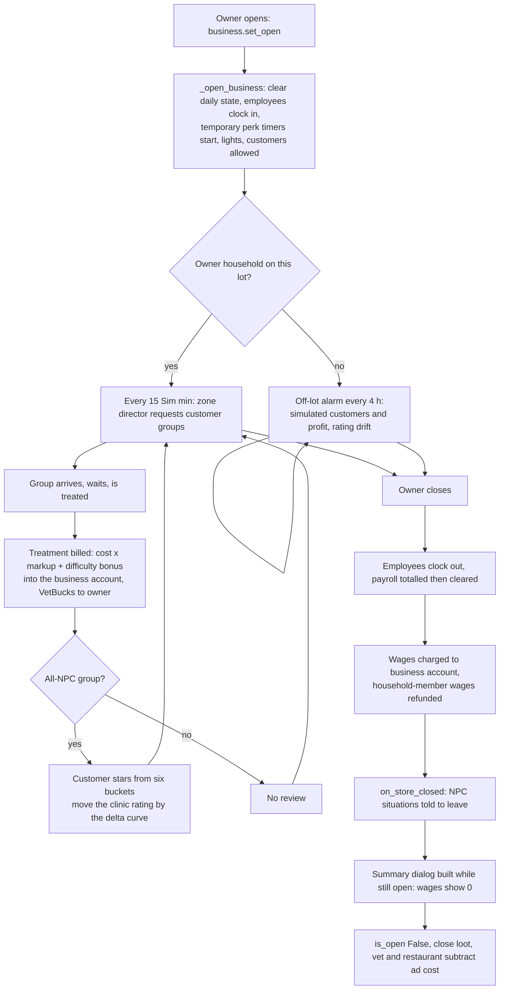
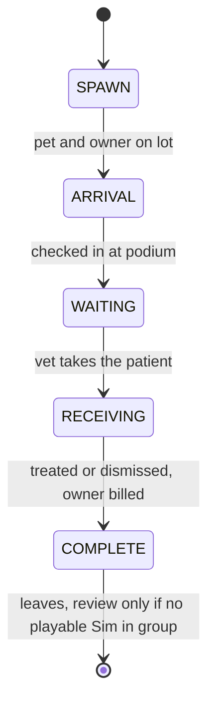

# 5.02 Businesses: retail, restaurants, vet clinics, small business

*Game version 1.128.90.1030. Live numbers come from the live tuning (the base-game delta build plus the delta build of each installed pack); EP04 (Cats & Dogs) is the only installed pack with a business, and module tuning comes from the base-game delta build. Retail, restaurant, small business and rental numbers are patch data from EP01 (Get To Work), GP03 (Dine Out), EP18 (Businesses & Hobbies) and EP15 (For Rent), packs not installed. Checked 2026-10-12: 133 claims checked, 17 corrected, 3 relabelled, 1 removed.*

## In plain words

The game has one business engine and five kinds of business on top of it: retail stores, restaurants, vet clinics, small businesses and rental units. The engine keeps a separate bank account for the business, a star rating, a markup on prices, a list of hired staff with wages, a queue of customers and a set of perks bought with a business currency. In this install only the vet clinic has the data it needs to run. The code for the other four is present, and their packs' own records are not.

At a vet clinic every customer carries six hidden scores (ambiance, bedside manner, quality of treatment, value for money, the pet's stress and the wait). Their sum becomes that customer's one to five stars, and when an all-NPC customer leaves, the gap between their stars and the clinic's stars moves the clinic's rating. Two of the six scores (the wait and the vet's manner) can sink 17 to 20 times deeper than the others. A wait of nearly four hours leaves a customer at one or two stars even after a perfect treatment. Being sent away is worth almost as much on paper, but it counts only if something later makes the game re-score the customer.

A few things would surprise a player. Getting from one to five stars takes roughly fifty five-star reviews, because each review moves the rating less as the clinic gets better. A clinic left open while the family is elsewhere almost always loses rating: the "chance to improve" while away is about 1 in 101 per four-hour check, far below what its tuning number (0.1) looks like. The end-of-day summary shown when you close, on the lot or from elsewhere, shows no wages owed, although the wages were charged a moment before. And one perk, Lengthen Impatience Timeout, does nothing.

## Key facts

- Five business types exist in code (`BusinessType` RETAIL 1, RESTAURANT 2, VET 3, RENTAL_UNIT 4, SMALL_BUSINESS 5). Live tuning holds one `Business` record, `business_Vet` (EP04 delta); `BusinessTuning.BUSINESS_TYPE_TO_BUSINESS_DATA_MAP` names five, and the other four ids resolve to nothing here.
- Business star rating is a value from 0 to 100 turned into half stars by a stepped curve: 1 star below 7.5, then a half star every 7.5 up to 3 stars at 30, then 3.5 at 40, 4 at 50, 4.5 at 65 and 5 at 80. A new vet clinic starts at value 0 (1 star).
- Each review moves the value by a curve of (customer stars minus clinic stars): +2.5 at +4, +1.72 at +2, +1 at +0.5, 0 at 0, -1.38 at -2, -2 at -4. About 52 five-star reviews take a clinic from 1 to 5 stars.
- A customer starts at 3 stars and is re-scored only when one of 9 "rating" buffs arrives (good wait, five value-of-service levels, three pet-stress levels). The score is the sum over six buckets of (bucket total clamped to plus or minus 1) times that bucket's maximum or minimum. Sum 100 or more gives 5 stars, 40 gives 4, -40 gives 3, below about -100 gives 1.
- The wait and bedside-manner buckets bottom out at -500. A wait adds the Bad buff (-0.05) at 181 Sim minutes and Disgruntled (-0.5) at 230, both kept, so the wait bucket sits at -0.55, worth -275. A perfect treatment (150) with ambiance and bedside manner at 0 then leaves the sum at -125, 1 star, and even every other bucket at its maximum (230) reaches only -45, 2 stars.
- Customer groups are requested every 15 Sim minutes. Desired count = stars curve (1, 2, 3, 3, 3 at 1 to 5 stars) times the ad multiplier (1, radio 2, web 3) plus 3 for 24 hours with the More Customers perk. Past that count, one more group still spawns per check while fewer groups are still spawning, arriving or waiting than the exam-table cap (0, 1, 1, 2 for 1, 2, 3, 4 or more tables).
- The bill is int(treatment cost times markup), plus 100, 200 or 300 for a correct treatment of an illness of difficulty 1 or more, 5 or more, or 10 or more. Markups are 0.75, 0.85, 1, 1.5 and 2; markup and the vet's skill pick the value-of-service buff.
- One vet slot by default, plus one each from two perks (350 and 900 VetBucks), three at most. A hire starts at the career level the skills justify; pay is 10, 20, 30, 40 or 50 Simoleons per hour by level, summed as rounded hours.
- Closing charges the day's wages to the business account, refunds the wages of employees from the playing household, and shows the summary while the business still counts as open, so its wage line reads 0 (opcodes in `business_manager.py: BusinessManager._close_business`). This happens on every close by an active owner, on the lot or away. The vet summary also leaves the treatment supply costs out of its net profit.
- Off the lot, every 4 hours (code default): customers per hour = min(exam tables, stars curve times ad multiplier); profit = running average profit per treatment (seeded at 120, last 6) times 0.66 times customers. The rating rises with chance `random_chance(0.1)`, about 1 in 101, and otherwise decays (-0.73 a run on average at 3 stars). A clinic with no way to make money skips the run.
- The business account (`BusinessFunds`) is separate from household money, may go negative, and is moved to or from the household through a transfer dialog that offers up to 10000 at the grand opening. `BusinessFunds` also sets `allow_npcs` True, so a business account is charged even when the paying Sim is an NPC; the household wallet (`FamilyFunds`, through `_Funds.try_remove_amount` in `sims/funds.py`) skips the charge for an NPC Sim and reports it paid.
- VetBucks per billed treatment, by the pet owner's customer score: 50 at 5, 40 from 4, 35 from 3, 30 from 2, 25 from 1. 10 perks cost 350 to 5000; `vetPerks_LengthenImpatienceTimeout` (600) has no effect, because the only loot that gives the longer wait tests a restaurant perk.
- Ads cost 10 (radio) or 20 (web) per open hour, charged at close after the summary is built.
- 115 command names live in these modules (77 Live, 36 Automation, 2 untyped). 16 are gated on EP01 or EP18 and the 2 untyped ones never register, so 97 register in this install.
- Selling through `business.sell_lot` pays the business balance into the household twice when it is positive (opcodes in `business_commands.py: _distribute_funds_from_business` and `BusinessManager.sell_business_finalize_funds`); the client's business panel names the command beside a sell button that `show_sell_button` controls, which the vet record leaves False, so a vet owner reaches it by typing the Live command (see Selling).

## How it works

### The pieces: service, tracker, manager

**Observed** (`business/business_service.py: BusinessService`). One service holds a `BusinessTracker` per owning household and business type, plus trackers for unowned (NPC) businesses. It runs a repeating alarm every `HOURS_BETWEEN_OFF_LOT_SIMULATIONS` hours (code default 4, range 4 to 24; the module record leaves it unset) that asks the active household's trackers to simulate their businesses on other lots. It also owns the first-time dialogs, the rental payout timer (`PROPERTY_OWNER_PAYOUT_TIMER` 24 hours) and `EMPLOYEE_ADDITIONAL_IMMUNITY` 75 (code default 10), a bonus that keeps hired NPCs from being culled ([4.02](4.02-story-progression-townies.md) covers culling).

**Observed** (`business/business_tracker.py: BusinessTracker`). A tracker owns one `BusinessManager` per zone (small businesses, which are tied to a Sim and not a lot, are keyed by Sim id). `make_owner` builds the right subclass for the type: `RetailManager`, `RestaurantManager`, `VetClinicManager`, `RentalUnitManager` (in `multi_unit`, [2.01](2.01-lots-venues-rooms.md)) or `SmallBusinessManager`. The tracker also stores the perk rewards that apply to every business of that type: extra employee slots (capped at `employee_count_max - employee_count_default`), extra markup (`max(0, ...)`), and extra customers, clamped to 0 to 13 by a literal in `add_additional_customer_count`.

**Observed** (`business/business_manager.py: BusinessManager`). Each manager has a `BusinessFunds` account, a `BusinessEmployeeManager`, a `BusinessCustomerManager`, a star rating value, a markup, a quality setting and, for vets and restaurants, an `AdvertisingManager` (`advertising_manager.py: HasAdvertisingManagerMixin`). Its tuning is the `Business` instance (`business/business.py: Business`, instance type BUSINESS) for its type. The zone director of the lot (`business_zone_director_mixin.py: CustomerAndEmployeeZoneDirectorMixin`) requests customer and employee situations; [4.01](4.01-situations-npcs.md) covers situations in general.

### What runs in this install

**Observed** (live tuning, counted with the live merge):

| Type | Business record | Zone director | State here |
|---|---|---|---|
| Vet clinic | `business_Vet` (EP04 delta) | `zoneDirector_VetClinic` (EP04 delta) | runs |
| Retail | `business_Retail` 137335 | `zone_director_retail` | patch data, pack not installed (EP01) |
| Restaurant | `business_Restaurant` 139821 | `zoneDirector_Restaurant` | patch data, pack not installed (GP03) |
| Small business | `business_Small_Business` 373396 | `zone_director_small_business` | patch data, pack not installed (EP18) |
| Rental unit | `business_Rental` 345665 | (multi-unit, [2.01](2.01-lots-venues-rooms.md)) | patch data, pack not installed (EP15) |

The type map is a pack-safe reference list, so the four missing ids drop out quietly. Other live records that belong to these systems: 22 `VetCustomerGroupSituation`, 1 each of `VetClinicDiagnosisSituation`, `VetCustomerVendingMachineSituation`, `VetEmployeeSituation`, `BusinessRule` (`Rule_PMI_NoPets_EP04`, an EP15 rental rule shipped in EP04's delta), 3 `BusinessPreset` (small business presets `smallBusinessPreset_CatCafe` from EP04, `_CommunityGarden` and `_MakerSpace` from EP09 (Eco Lifestyle)), 17 `RetailComponent` snippets (14 base, 2 EP06 (Get Famous), 1 EP04), and EP06's celebrity diner and shopper situations (`restaurantDinerBackground_NPC_Celebrity_*`, `retailCustomerSituation_CelebrityHangOut_*`). **Inferred**: those EP06 situations need a restaurant or retail zone director, which only GP03 and EP01 supply, so they never start here. `RetailComponent.required_packs` is `(EP01,)` (`retail/retail_component.py`), and `add_component` refuses a component whose packs are all missing (`objects/components/__init__.py: is_valid_pack`), so the base objects' retail snippets add no retail component in this install; the objects keep their ordinary value.

### An open business day

### Opening and closing

**Observed** (`business_manager.py: BusinessManager._open_business`). Opening clears the daily counters, marks the business open and records the time, clocks employees in (`employee_manager.open_business`), shows the open notification, starts timers for temporary perks, and then either sets the business lights and allows customers (owner on the lot) or starts off-lot tracking. It plays the open sting and applies `loot_list_on_open`. The vet record sets no open or registration fee (code defaults 0); only small business code reads the two fees (`business_tracker.py`, `small_business_manager.py`). `meets_requirements_to_be_open` needs a zone director that supports the type, the minimum staff, and some way to make money; `on_build_buy_exit` closes the business when a build edit breaks those.

**Observed** (opcodes of `BusinessManager._close_business`, in this order): return if not open; play the close sting; `employee_manager.close_business()`; profit and telemetry updates; only when `get_bucks_tracker()` is not None (it is None for a business with no owning household) stop the temporary perk timers, then `modify_funds(-final_daily_wages)` and `modify_funds(+household_employee_wages)`; fire `on_store_closed` and the BusinessClosed event; lights (on the lot) or one last off-lot run (away); add the open hours to the lifetime total; if `show_summary_dialog` (default True) and the owner household is active, build and show the summary; only then set `_open_time = None` and `_is_open = False`; apply `loot_list_on_close`. `VetClinicManager._close_business` and `RestaurantManager._close_business` call this first and subtract the day's ad cost afterwards.

**Observed** (`business_situation_mixin.py: BusinessSituationMixin._on_business_closed`): vet customer groups, vending-machine visitors, retail shoppers, small business situations and every business employee situation (vet, retail, small business, chef, host, waiter) listen to `on_store_closed`, send their non-playable Sims home and destroy themselves. Restaurant diner situations do not use the mixin. **Inferred** (not traced to the review): a vet group that had started waiting is removed at that point, and an all-NPC group would then leave its review.

**Observed** (`vet/vet_clinic_manager.py`): a clinic has "no way to make money" with no employees or no exam tables. On the active owner's own lot the owner may work alone; elsewhere it needs at least one employee. `should_automatically_close` (no employees, owner household active, clinic on another lot) is read only by `business_manager.py: should_close_after_load`, which closes a business at zone load when the active household changed between save and load. A clinic left open elsewhere with no employees simply skips its off-lot runs.

### Customers arriving at a vet clinic

**Observed** (`zoneDirector_VetClinic`, EP04 delta; `vet/vet_clinic_zone_director.py`). The director requests customers every `customer_situation_interval` 15 Sim minutes. Its desired count (`_get_num_desired_customer_situations`) is the exam-table count for an NPC-owned clinic. For an owned clinic it is `VetClinicManager.get_ideal_customer_count()`, which is the stars curve (1, 2, 3, 3, 3 at 1 to 5 stars, interpolated for half stars) times the time-of-day curve (flat 1 here) times the ad multiplier (None 1, Radio 2, Web 3), plus the tracker's extra customers (3 from `vetPerks_MoreCustomers`, a 24-hour perk).

**Observed** (opcodes of `VetClinicZoneDirector._on_customer_situation_request`). If the running groups are at or above the desired count, it counts the groups not yet seen (`customer_has_been_seen` is False: still spawning, arriving or waiting) and returns when the waiting cap is less than or equal to that number. Otherwise, and also when fewer unseen groups exist than the cap, it starts one group. The cap (`_ObjectBasedWaitingCustomerCap`) maps exam tables to waiting groups: 1 table 0, 2 tables 1, 3 tables 1, 4 or more 2 (thresholds read from the top down). **Inferred**: so the desired count is a hard limit with one table and a floor with four or more.

**Observed** (`customer_situation_type_curve`). One time slot (from 8:00, all week) picks the group type by weight: sick dog and sick cat (weight 2, times 3, 2 or 1 as the clinic is at 1.5 stars or less, 1.51 to 3, or 3.1 to 5), their mid-level versions (times 0, 3, 2), high-level versions (times 0, 1, 4), check-ups for a cat or a dog (weight 1), and a vending-machine visitor (weight 3, times 0.34 at 1.5 stars or less, and only with an unowned `Func_VetVendingMachine` object on the active lot). Better clinics get harder cases. The tuning note says the curve's own desired count is ignored, which matches the code.

**Observed** (`vet/vet_customer_group_situation.py: VetCustomerGroupSituation`). When the group starts waiting, the pet owner becomes a business customer (`began_waiting`), and `_should_leave_review` is set to "no playable Sims in the group". A correct treatment records its cost with the difficulty bonus flag set; an acceptable treatment records its cost without it. The two checks are separate `if`s (opcodes), so an interaction that passes both ends with the flag cleared. The record keeps only the last cost (`track_treatment_cost` overwrites). When the owner is removed, `remove_customer(review_business=_should_leave_review)` runs, so the player's own pets never rate the clinic.

### A customer's star rating

**Observed** (`business_customer_data.py: BusinessCustomerData`). A new customer has empty buckets, so their star statistic (`statistic_OwnableVet_Customer_StarRating`) is set to `default_customer_star_rating`, 3 (code default; the vet record leaves it unset). Each tuned buff adds its `buff_bucket_delta` to one bucket when it is added. Buffs with `update_star_rating_on_add` then recompute the stars; the others only change the bucket. Removing a buff subtracts its delta again unless `ignore_remove` is set (the eight environment buffs set it, so ambiance stays counted after the mood ends; the decompile of `_on_buff_removed` reads `if not not ignore_remove`, and the opcodes skip the subtraction when the flag is set).

**Observed** (opcodes of `_calculate_star_rating_from_buff_bucket_totals` and `BusinessManager.get_interpolated_buff_bucket_value`). For every bucket tuned on the business (all six, including untouched ones), the total is clamped to -1..1 and mapped linearly from 0 to the bucket maximum (positive) or minimum (negative). The sum goes through `customer_star_buff_bucket_to_rating_curve` and is clamped to 1..5; the customer's whole stars are `int()` of that.

| Vet bucket | min | max | buffs (delta) |
|---|---|---|---|
| AMBIANCE | -25 | 50 | decorated 0.66, nicely 1.5, beautifully 2, good music 1.5, stereo 0.5, unpleasant -0.5, wretched -0.75, bad surroundings -1 (all ignore remove) |
| PERSONAL_TOUCH | -500 | 30 | friendly greeting 2, neutral 1, friendly social 0.5, mean greeting or social -0.1, dismissed -0.5 |
| SERVICE_QUALITY | -25 | 50 | correct treatment by tier -0.5 to 2, incorrect -0.33, cone of shame -0.15 |
| SERVICE_VALUE | -30 | 50 | value of service Amazing 2, Great 1, Good 0.5, Poor -0.33, Terrible -0.5 (re-score) |
| STRESS_LEVEL | -25 | 50 | pet stress Amazing 2, Great 1, Good 0.5 (re-score), Bad -0.33 |
| WAIT_TIME | -500 | 30 | Good 2 (re-score), Bad -0.05, Disgruntled -0.5 |

Rating curve (sum to stars): -200 gives 1, -99.99 gives 2, -40 gives 3, 40 gives 4, 100 gives 5. **Inferred** (arithmetic on the above): an untouched customer scores 0, which is 3.5 on the curve and 3 whole stars; Amazing value plus an Amazing stress result (50 + 50) reach exactly 5; a single Bad wait costs 25 (about a third of a star in the middle band), one mean greeting 50, a dismissal 250, and a Disgruntled wait, which always comes on top of Bad, 275. After a Disgruntled wait, a perfect treatment (quality, value and stress all at their 50 maximum, 150) leaves the sum at -125, still 1 star, and even all five other buckets at their maximum (230) only reach -45, 2 stars; 3 stars would need 235. Because only the nine re-scoring buffs recompute the stars, a bucket buff changes the review only if one of them follows it.

**Observed** (EP04 delta: role states `vet_Role_PetOwner_WaitForService` and `_DuringService`, `buff_OwnableVetClinic_WaitTime_Start` and `_Stop`, `commodity_OwnableVetClinic_Customer_WaitTime`). The waiting role's start buff adds the wait commodity, which runs from 0 toward 360 at 1 per Sim minute: at 181 it adds WaitTime_Bad, at 230 Disgruntled, and at 240 it pushes `Push_Leave_Lot_Immediate`. Neither buff has a timeout. When the owner moves to the service role, the stop loot removes the commodity and, if it stood at 180 or less, starts a 7-minute timer that adds WaitTime_Good. Removing the start buff runs `loot_OwnableVetClinic_BedsideManner_RemoveBuffs` (all eight bedside-manner buffs, the dismissal included) and the environment removal loot, so bedside manner shown during the wait is subtracted again while ambiance stays (`ignore_remove`). `Vet_DismissPatient` adds the dismissal buff and runs `loot_Vet_Remove_BillOwner`. Value-of-service buffs come from the bill and also from 18 treatment mixers through `loot_OwnableVetClinic_ValueOfService_AddBuffs`, which can also give a Neutral buff (168499) that the rating table does not list. **Inferred** (not seen in play): bedside manner shown during the wait reaches the stars only if a re-scoring buff arrives before the wait ends, and a dismissal only if one arrives while it is on.

### The business star rating

**Observed** (opcodes of `BusinessManager.process_customer_rating`). When a reviewed customer leaves: delta = customer whole stars minus the business's user-facing stars; change = `customer_rating_delta_to_business_star_rating_value_change_curve`(delta); with a critic trait on the customer the change is multiplied by `critic_star_rating_application_count` (the vet has no critic; restaurants do, count 10, patch data); the customer's bucket values are added to the business's running totals; the value is adjusted and clamped to `min_and_max_star_rating_value` (0 to 100, code default for the vet). Afterwards `customer_star_rating_leaving_loot_actions` for that star level run (none on the vet).

**Observed** (`get_star_rating`): user-facing stars = `star_rating_value_to_user_facing_rating_curve`(value), rounded to the nearest half, clamped to 1..5. The vet curve is a staircase with steps at 7.5, 15, 22.5, 30, 40, 50, 65 and 80.

**Inferred** (from the two curves): from value 0 a run of five-star reviews needs 3 to reach 1.5 stars, then 4, 3 and 4 for the half stars up to 3, 6 each for 3.5 and 4, 12 for 4.5 and 14 for 5, about 52 in all, before any off-lot decay. Equal-star reviews change nothing; a 1-star review at a 5-star clinic costs 2 points.

### Prices, markup and the bill

**Observed** (`BusinessManager.get_value_with_markup`): for an owned business the price is `int(value * (markup + tracker.additional_markup_multiplier))`; for an NPC-owned one it is the markup times the active household's holiday price multiplier for that business type. `set_markup_multiplier` accepts only values listed in `markup_multiplier_data` (vet: 0.75, 0.85, 1, 1.5, 2; default 1).

**Observed** (`vet_clinic_zone_director.py: bill_owner_for_treatment`, `vet_clinic_manager.py: VetClinicManager.bill_owner_for_treatment`). The live interaction `Vet_Service_BillOwner` runs the Live command `vet.bill_owner_for_treatment` with the pet owner at its end. The director finds the owner's group, reads its payment data (last treatment cost, illness difficulty, bonus flag) and calls the manager: total = `get_value_with_markup(cost)`, plus `get_bonus_payment(difficulty)` when the flag is set; the profit queue gets `max(0, total - cost)`; `modify_funds(total, from_item_sold=True)`. The bonus (`VetClinicTuning.DIFFICULTY_BONUS_PAYMENT`, base delta) is 100 at difficulty 1 or more, 200 at 5, 300 at 10, read from the top. Treatment prices and the clinic's own cost per treatment are in [3.12](3.12-pets-horses.md); illness difficulty is in [3.13](3.13-health-luck-fame.md). Then the owner gets a value-of-service buff, and the interaction's loot pays the clinic owner VetBucks.

**Inferred**: the clinic pays the treatment cost from its account when the treatment runs (3.12) and bills cost times markup, so a treatment nets (markup - 1) times cost plus any bonus. At markup 1 the only profit is the bonus; at 0.75 and 0.85 the clinic loses money on every bonus-free case.

**Observed** (`vet_clinic_utils.py: get_value_of_service_buff`, `VetClinicTuning.VALUE_OF_SERVICE_AWARDS`). Rows by markup threshold and columns by the vet's Veterinarian skill (thresholds 3, 5, 7, 9), each matched from the last entry back:

| Markup | skill 0 to 2 | 3 to 4 | 5 to 6 | 7 to 8 | 9 to 10 |
|---|---|---|---|---|---|
| under 0.85 | Great | Great | Amazing | Amazing | Amazing |
| 0.85 | Good | Great | Great | Amazing | Amazing |
| 1 | Good | Good | Great | Great | Amazing |
| 1.5 | Poor | Poor | Good | Great | Amazing |
| 2 | Terrible | Poor | Poor | Good | Great |

### Employees: hiring, pay, satisfaction and shifts

**Observed** (`businessEmployee_Vet`, EP04 delta; `business_employee_tuning.py`). One employee type, VET, with career `career_Adult_NPC_OwnableVetClinic_Vet`, skills Veterinarian, Charisma and Handiness at the code-default weight 100%, `employee_count_default` 1 and `employee_count_max` 3 (code defaults), a hire pool of 6 candidates (`potential_employee_pool_size` code default, at most 9) from `filter_OwnableBusiness_PotentialEmployees_Vet`, and the satisfaction commodity `commodity_OwnableBusiness_Employee_Satisfaction`.

**Observed** (`business_employee_manager.py: get_desired_career_level`): desired level index = `clamp(0, floor(ratio * mean(weight * skill / max_skill) * top_index), top_index)`, with ratio `weighted_skill_to_career_level_ratio` (code default 1) and top index 4 for the five vet levels. `add_employee` adds the career at that index plus one, adds the satisfaction commodity at its initial value and starts the employee's situation. **Inferred** example: Veterinarian 10, Charisma 5, Handiness 0 gives mean 0.5, index 2, a hire at level 3 earning 30 an hour.

**Observed** (`business_employee.py: BusinessEmployeeData.add_career_buff`): while clocked in, an employee carries one pay buff keyed by current level minus desired level, from `..._Pay_-4_GrosslyUnderpaid` through `_0_PaidAdequately` to `_+4_GrosslyOverpaid`. As skills grow the desired level rises and the buff turns to underpaid until you promote. Promotion and demotion close the payroll segment at the old level and open one at the new.

**Observed** (`get_employee_wages`): wages = `ceil(sum(level.simoleons_per_hour * round(hours)))` over the payroll segments plus the open segment, and 0 while the business is closed. Vet levels pay 10, 20, 30, 40 and 50 per hour (EP04 delta). A shift clocks in only when the owner household is the active one (`business_employee_situation_mixin.py: _start_work_duration`); it clocks out whenever the situation ends.

**Observed** (`situation_vet_employee`, EP04 delta): a shift lasts a random 2592 to 3168 Sim minutes (`total_work_time`); after 25% of it the employee gets `buff_OwnableBusiness_Employee_Exhausted`, after 99% `buff_OwnableBusiness_Employee_Exhausted_Quit`. The situation has TREAT and CLEAN modes that the owner can switch off per employee with a disabling buff (time-outs 30 and 10 minutes, 5 in the default state). For NPC staff the tuning defers the count to the director, which asks for as many vets as exam tables (`VetClinicZoneDirector._get_desired_employee_count`).

### Daily accounting and the summary

**Observed** (`BusinessManager.modify_funds`). Zero is ignored. A negative amount flagged as a sale is refused with a warning; other negatives are taken from the account (and may push it below zero, `BusinessFunds.allow_negative_funds`). Positive amounts are added. Sales and comps adjust `daily_revenue`; sales also count items sold. `get_daily_outgoing_costs` = day's wages plus the funds-category tracker; net profit = revenue minus that. The tracker sums whatever category a payment names (`business_funds.py: BusinessFunds.try_remove_amount`): the vet's treatment payments are RESTOCKING ([3.12](3.12-pets-horses.md)), the restaurant's ingredients RESTOCKING (`RestaurantTuning.BUSINESS_FUNDS_CATEGORY_FOR_COST_OF_INGREDIENTS`, base delta), while a restaurant comp carries no category and comes off the revenue instead. The vet ad cost is charged at close with no category; ADVERTISING appears on the vet only as a summary-line entry (`funds_category_data`).

**Observed** (opcodes of `BusinessEmployeeManager.close_business` and `BusinessManager._close_business`). At close the employee manager clocks everyone out, stores `_daily_employee_wages` and `_daily_household_employee_wages`, and clears the payroll. The manager charges the first and refunds the second. The summary is built next, while `_is_open` is still True, so `get_total_employee_wages()` takes the open branch and sums an empty payroll. **Inferred** (the dialog text was not seen): the close-time summary of a vet clinic (and of a restaurant) shows wages owed 0 and a net profit (`VetClinicSummaryDialog`: revenue minus wages minus ads) too high by the day's wages, while the account was charged the real amount. Reopening the summary later, with the business closed, takes the closed branch and shows `final_daily_wages()`. Normal play reaches this every time an active owner closes a clinic with paid staff, on its lot or from elsewhere: off-lot opening clocks every employee in (`employee_manager.open_business`), and the summary shows whenever the owner household is active. **Observed** (`vet_clinic_summary_dialog.py`): the vet summary has three lines (revenue, wages, ads) and profit = revenue minus wages minus ads, so the RESTOCKING treatment costs are missing from its net profit as well.

**Observed**: wages of employees who belong to the playing household are added back, so they cost the business nothing net (`get_household_employee_wages` keeps only `sim_info.household == active_household`, a filter the decompiler dropped and the opcodes show).

### Off-lot simulation

**Observed** (`BusinessManager.run_off_lot_simulation`, `_adjust_profit`; `VetClinicManager._get_off_lot_customer_count`). For each open business of the active household that is not on the current lot, every off-lot tick (skipped when the business has no way to make money, which for a vet means no exam tables or no employees, or when it has no last update time or no increase curve):

- hours = time since the last run; customers = int(min(exam tables, stars curve times ad multiplier times `off_lot_customer_count_multiplier` 1) times `off_lot_customer_count_penalty_multiplier` 1 times hours);
- profit = average profit per treatment times `off_lot_profit_per_item_multiplier` 0.66 times customers, added as one sale. The average is over the last `MAX_COUNT_FOR_OFF_LOT_PROFIT_PER_TREATMENT` 6 treatments (code default 10), seeded with `DEFAULT_PROFIT_PER_TREATMENT_FOR_OFF_LOT_SIMULATION` 120 (code default 20);
- rating: with `sims4.random.random_chance(off_lot_chance_of_star_rating_increase)` the value rises by the increase curve at the current stars (0.31, 0.42, 0.52, 0.63, 0 per hour at 1 to 5 stars) times hours; otherwise it falls by the decay curve (-0.13, -0.15, -0.19, -0.22, -0.07 per hour), times 0.667 with `vetPerks_LowerChanceBadEvents_Small`.

**Observed** (opcodes): the chance field is a `TunableRange` of float with default 0.1, left unset by the vet record, passed unchanged to `random_chance`, whose body is `randint(0, 100) < chance_value`. With 0.1 only a roll of 0 passes: 1 in 101 per run. Of the patch data, only GP03's `business_Restaurant` sets the field, explicitly to 0.1. The small business tip jar (`small_business/small_business_income_data.py`) passes `probability * 100` from a percent tunable, so the code elsewhere converts fractions before calling. **Inferred** (from the live curves): if 0.1 was meant as 10%, this is a units mismatch; either way, a clinic run from another lot drifts down. At 3 stars a run that does not rise loses 0.76 and the average run 0.73, so two days of off-lot opening (12 runs) cost about 8.8 points, roughly a half star. The average loss per run is 0.52, 0.56, 0.73, 0.86 and 0.26 at 1 to 5 stars; with 10% it would be 0.48 at 3 stars.

**Observed** (`off_lot_net_loss_notification`, unset on the vet): a business that loses money off the lot can warn using wages per hour and ad cost per hour.

### Advertising, quality and perks

**Observed** (`advertising_configuration.py`, `advertising_manager.py`; vet record). Ad types None (0 per hour, x1), Radio (10, x2) and Web (20, x3); cost accrues as open hours times cost per hour and is charged at close. Quality LOW, MEDIUM (default) and HIGH; the clinic's quality setting changes treatment supply costs (x0.5 and x1.5, see [3.12](3.12-pets-horses.md)) and is locked behind `vetPerks_UnlockSupplyQuality`.

**Observed** (live `BucksPerk` records with `associated_bucks_type` VetBucks, EP04 delta): 10 perks. Costs: `vetPerks_AdditionalVet_1` 350 (+1 vet slot), `_AdditionalVet_2` 900 (+1, needs the first), `_MoreCustomers` 500 (+3 customers for 24 hours), `_UnlockSupplyQuality` 500, `_LengthenImpatienceTimeout` 600, `_InspirationalSpeechSocial` 900, `_LowerEmployeeTrainingCost` 1500, `_LowerChanceBadEvents_Small` 4500 (also the off-lot decay perk), `_ReducePetStress` 5000 and `_UnlockCASItem` 5000 (ten CAS parts). VetBucks come from `loot_OwnableVetClinic_VetBucks_Treatment`, applied by the bill interaction to the lot owner when that owner is in the active household: 50 when the pet owner's customer score (`statistic_OwnableVet_Customer_StarRating`) is 5 or more, 40 for 4 to 5, 35 for 3 to 4, 30 for 2 to 3 and 25 for 1 to 2. How bucks and perks work in general is in [5.01](5.01-money-bills-rewards.md). Perk rewards that touch businesses are `business_reward_tuning.py`: `TunableRewardAdditionalEmployeeSlot`, `TunableRewardAdditionalMarkup`, `TunableRewardAdditionalCustomerCount`.

**Observed** (EP04 delta; `event_testing/test_variants.py: BucksPerkTest`): `vetPerks_LengthenImpatienceTimeout` holds only its name, icon, cost and text, and no live record references it. The one loot that adds `buff_OwnableVetClinic_Perk_LongerWaitTime` (which halves the wait commodity's rate) is `loot_OwnableVetClinic_WaitTime_Start`, and it tests `restaurantPerks_LengthenImpatienceTimeout` (139158), a GP03 record. Here that pack-safe reference is None, and the test returns False. **Inferred**: buying the vet perk changes nothing, and with GP03 installed the longer wait would follow the restaurant perk.

### Selling and moving money

**Observed** (`retail_balance_transfer_dialog.py: FundsTransferDialog`). The transfer dialog lists the household and every owned lot business with its balance; on the grand opening it proposes `min(household money, initial_funds_transfer_amount)`, 10000 for the vet. Transfers go through the Live command `retail.transfer_funds` (no pack gate).

**Observed** (opcodes of `business_commands.py: _distribute_funds_from_business` and `BusinessManager.sell_business_finalize_funds`, `transfer_balance_to_household`). `business.sell_lot` shows a confirmation with `_get_lot_business_sell_value` = max(0, funds F + lot value L). On accept, `_distribute_funds_from_business` computes `lot_value = max(0.0, F + L)` and calls `sell_business_finalize_funds(lot_value)`, which does `modify_funds(lot_value)` (so the account now holds F + max(0, F + L)) and then `transfer_balance_to_household()`, which pays the whole account to the household when positive. With F at or above 0 the household receives 2F + L against a dialog that showed F + L; with a debt D smaller than L the debt is taken off twice (the household gets L - 2D, nothing if that is not positive). The older retail path (`retail.sell_lot`, also Live and not pack-gated) adds only L before transferring and pays F + L. Small businesses and rental units override `sell_business_finalize_funds`; their `modify_funds` pays the household directly (`SmallBusinessManager`; `multi_unit/rental_unit_manager.py: RentalUnitManager`, which pays only while the owner household is active).

**Observed** (strings of the client's GFx files in `UI.package`, type 62ECC59A, instances 93F5A6B7F8C8B809 and 25AB0D3229713CDC): the business panel's script names `business.sell_lot` beside `business.set_markup`, `business.show_summary_dialog` and `business.show_balance_transfer_dialog`, together with `show_sell_button`, `CanSellLotAndFurniture` and the store-sell tooltip. `show_sell_button` is a client-exported bool, default False; the vet record leaves it unset and the retail patch record sets it True. No live tuning sends the command, and the other server paths that drop an owner (`clear_owned_business` on household death, `remove_owner` on a multi-unit change) move no vet funds. **Inferred**: the panel's sell button is the normal sender and is hidden on a vet clinic, so on a vet lot the double payout is reached by typing the Live command, which needs no cheats. The script logic itself was not decompiled.

### Retail stores (EP01, code and patch data)

**Observed** (code) with patch data, pack not installed. `RetailManager` sells objects that carry a `RetailComponent`; an item's price is `get_value_with_markup` of its catalog value, or of its cached crafted value times its state value. Markups 1.05, 1.15, 1.25 (default), 1.5 and 2. Retail uses no bucket star rating (`_should_make_customer` is False). Store pull is curb appeal: the sum of objects' curb appeal plus the lot ad commodities (`RetailTuning.ADVERTISING_COMMODITY_MAP`: TV and web, long and short), and `zone_director_retail` turns it into desired shoppers with the curve 0 to 1, 50 to 4, 150 to 8, 300 to 10, filling up to that count each check. Shopper situations are picked by an exact markup match and the store's median item value; the 11 patch records browse 60 to 180 minutes and carry purchase-intent and price ranges (bargain shopper intent 80 to 95, price 1 to 200; wealthy price 800 to 3200). Purchase chance by intent: 25 gives 0.1, 50 gives 0.4, 75 gives 0.85, 100 gives 1 (`RetailCustomerSituation.PURCHASE_INTENT_CHANCE_CURVE`, base delta). A shopper with 1000 or more Sim minutes left after buying starts over (`CONTINUE_SHOPPING_THRESHOLD`, base delta; code default 30). Retail staff (`career_Adult_NPC_Retail`) earn 19, 24, 31, 40, 53 per hour with a skill ratio 1.33. The retail record sets `show_sell_button` True.

### Restaurants (GP03, code and patch data)

**Observed** (code) with patch data, pack not installed. Three staff types: chef (pay 7, 12, 17, 30, 50; up to 2), host (3, 6, 12, 20, 30; 1) and waiter (2, 5, 9, 16, 25), skill ratio 0.9, and at least one of each to open. Desired diners = stars curve (5, 7, 10, 14, 20) times `RestaurantTuning.TIME_OF_DAY_TO_CUSTOMER_COUNT_MULTIPLIER_CURVE` (0.15 at midnight, 1 at 11:00 and 18:00, 0.3 at 14:00 and 21:00) times ads (newspaper 5 per hour x1.2, radio 10 x1.4, web 20 x1.75, TV 50 x2) plus perk customers, capped at the dining-spot count; the director keeps starting diner groups until the invited Sims cover the shortfall (`restaurant_zone_director.py: _on_customer_situation_request`). Each order costs the restaurant the recipe's `restaurant_base_price` times the ingredient-quality expense factor (Grade F 0.75, Standard 1, Fresh Organic 1.1, Sustainably Grown 1.25) times perk factors (0.8, 0.6, 0.5), charged to RESTOCKING; the sale is `get_value_with_markup` of the base prices of food and drink, credited when the food is placed at the table (`RestaurantZoneDirector.create_food_for_group_order`). Markups run 2 to 4 (default 2.25); a higher markup lowers the customer's perceived value (2 gives 1.75, 2.75 gives 1, 4 gives 0.5). Meal quality adds the ingredient adder (-35 to +30), recipe difficulty adder (0 to -80), cooking-speed adder (-20, 0, +25) and the chef's skill curve (0 at level 1, 100 at 10, 150 at 15). The menu shows price times holiday factor times the group's tested cost multiplier times 70% for the daily special, then markup (or x0.75 when unowned); the sale credited to the business uses base price times markup only. The star value is capped at 85 and restaurant critics count 10 times. Off the lot: x0.65, penalty x0.24, profit per meal x0.85, seeded at 20 over 10 meals.

### Small business (EP18, code and patch data)

**Observed** (code) with patch data, pack not installed. A small business belongs to a Sim and not a lot; `make_owner` charges the registration fee (750) from household funds and each opening charges the opening fee (75), recorded in the day's income record (`SmallBusinessManager._open_business`). Its money never sits in a business account: `SmallBusinessManager.modify_funds` pays or charges the household directly. Revenue comes from hourly or entry attendance fees (rank baselines 5, 7, 9, 12, 16, 26 per hour and 23, 33, 42, 52, 64, 112 per entry, times markup; `SmallBusinessTunables`, base delta), interaction sales and light-retail sales (the markup part), and tips (tip-jar perks: 80% chance of 20%, 60% of 15%, 30% of the code-default 10%). Markups 0.5, 0.75, 1, 1.5, 2; markup 0 during Customer Appreciation Day. Customer stars use their own buckets with `customer_always_get_starting_star_value` and a default of 2; satisfaction also comes from wait ratio, number of activities and markup rewards (`small_business_customer_wait_satisfaction.py`), checked every 60 Sim minutes (`SATISFACTION_WAITING_RATIO_FREQUENCY` code default). Employees are paid by one of three levels (12, 20, 32 per hour); an employee with the perk's fake-payment relationship bit to the owner costs 0 (`SmallBusinessEmployeeManager.get_employee_wages`). Business rules (at most 5, `MAX_BUSINESS_RULES`, base delta) steer customers and staff through autonomy multipliers (x1.25 for super interactions, x100 for mixers, x1.5 for staff targets in business areas; code defaults of `SmallBusinessTunables` that the base delta leaves unset).

### Rental units and business rules (EP15, patch data)

**Observed** (code) with patch data, pack not installed. Rental units reuse the business manager for rent and rules ([2.01](2.01-lots-venues-rooms.md) has the multi-unit lots). `BusinessRule` records (`business/business_rule.py`) test tenant behaviour on a schedule; `Rule_PMI_LoudNoises` fines 250 with a 1300-minute cooldown. The one live rule, `Rule_PMI_NoPets_EP04` (EP04 delta), fines 1000 with the same cooldown; no live business lists it. Rule state is DISABLED, ENABLED or BROKEN (`business_rule_enums.py`). The unit rating categories SIZE, AMENITY, ENVIRONMENT and MAINTENANCE are tuned in `UnitRatingTuning`, mostly exported only to the client, and changed by `ModifyDynamicUnitRatingLootOp`.

## Numbers

| Name | Value | Unit | Where | Kind |
|---|---|---|---|---|
| Business records loaded | 1 (`business_Vet`) | records | live `Business` class count | live (EP04 delta) |
| `BUSINESS_TYPE_TO_BUSINESS_DATA_MAP` | 5 entries, 1 resolves | entries | `business.business_tuning` | base delta |
| `markup_multiplier_data` (vet) | 0.75, 0.85, 1, 1.5, 2 | multiplier | `business_Vet` | EP04 delta |
| `default_markup_multiplier` (vet) | 1 | multiplier | `business_Vet` | EP04 delta (code 1.25) |
| Vet ads | None 0/x1, Radio 10/x2, Web 20/x3 | Simoleons per hour / multiplier | `business_Vet` | EP04 delta |
| `star_rating_to_customer_count_curve` (vet) | 1, 2, 3, 3, 3 at 1 to 5 stars | groups | `business_Vet` | EP04 delta |
| `time_of_day_to_customer_count_multiplier_curve` (vet) | 1 all day | multiplier | `business_Vet` | EP04 delta |
| `star_rating_value_to_user_facing_rating_curve` | steps at 7.5, 15, 22.5, 30, 40, 50, 65, 80 | value | `business_Vet` | EP04 delta |
| `default_business_star_rating_value` | 0 | value | `business_Vet` | EP04 delta (code 1) |
| `min_and_max_star_rating_value` | 0 to 100 | value | `Business` | code default |
| `min_and_max_star_rating` | 1 to 5 | stars | `Business` | code default |
| Rating change curve | -4 to -2, -2 to -1.38, -1 to -1.06, -0.5 to -0.53, 0 to 0, 0.5 to 1, 1 to 1.33, 2 to 1.72, 3 to 2.11, 4 to 2.5 | value | `business_Vet` | EP04 delta |
| `customer_star_buff_bucket_to_rating_curve` | -200 to 1, -99.99 to 2, -40 to 3, 40 to 4, 100 to 5 | stars | `business_Vet` | EP04 delta |
| Bucket ranges | see bucket table | points | `business_Vet` | EP04 delta |
| `bucket_growth_opportunity_threshold`, `bucket_excellence_threshold` | 17, 10 | points | `business_Vet` | EP04 delta |
| `default_customer_star_rating` | 3 | stars | `Business` | code default |
| `critic` (vet) | off | | `Business` | code default |
| `off_lot_chance_of_star_rating_increase` | 0.1 (about 1/101 effective) | `random_chance` argument | `Business` | code default (GP03 patch data sets 0.1 explicitly) |
| Off-lot multipliers (vet) | customers 1, penalty 1, profit 0.66 | multiplier | `business_Vet` | EP04 delta |
| Off-lot increase curve | 0.3125, 0.4167, 0.5208, 0.625, 0 | value per hour | `business_Vet` | EP04 delta |
| Off-lot decay curve | -0.1339, -0.1455, -0.1901, -0.2232, -0.0661 | value per hour | `business_Vet` | EP04 delta |
| Off-lot decay perk | x0.667 | multiplier | `business_Vet` | EP04 delta |
| `HOURS_BETWEEN_OFF_LOT_SIMULATIONS` | 4 | hours | `business.business_service` | code default |
| `EMPLOYEE_ADDITIONAL_IMMUNITY` | 75 | score | `business.business_service` | base delta (code 10) |
| `PROPERTY_OWNER_PAYOUT_TIMER` | 24 | hours | `business.business_service` | base delta (same as code default) |
| `initial_funds_transfer_amount` (vet) | 10000 | Simoleons | `business_Vet` | EP04 delta (code 2500) |
| `registration_fee`, `opening_fee` (vet) | 0, 0 | Simoleons | `Business` | code default |
| Extra customer clamp | 0 to 13 | groups | `business_tracker.py` | code literal |
| `customer_situation_interval` (vet) | 15 | Sim minutes | `zoneDirector_VetClinic` | EP04 delta (code 10) |
| Waiting cap (vet) | 0, 1, 1, 2 at 1, 2, 3, 4+ tables | groups | `zoneDirector_VetClinic` | EP04 delta |
| Vet case weights | sick 2 (x3/2/1), mid 2 (x0/3/2), high 2 (x0/1/4), check-up 1, vending 3 (x0.34 at 1.5 stars or less) | weight | `zoneDirector_VetClinic` | EP04 delta |
| Wait commodity thresholds | 181 Bad, 230 Disgruntled, 240 leaves; Good if 180 or less at service | Sim minutes | `commodity_OwnableVetClinic_Customer_WaitTime`, `loot_OwnableVetClinic_WaitTime_Stop` | EP04 delta |
| `employee_count_default`, `employee_count_max` | 1, 3 | employees | `BusinessEmployeeData` | code default |
| `potential_employee_pool_size` | 6 (max 9) | Sims | `BusinessEmployeeData` | code default |
| `weighted_skill_to_career_level_ratio` | 1 | ratio | `BusinessEmployeeData` | code default |
| Vet pay | 10, 20, 30, 40, 50 | Simoleons per hour | `careerLevel_NPC_OwnableVetClinic_Vet_Level_1` to `_5` | EP04 delta |
| `total_work_time` (vet) | 2592 to 3168 | Sim minutes | `situation_vet_employee` | EP04 delta |
| `total_work_time_buffs` | 25%, 99% | of shift | `situation_vet_employee` | EP04 delta |
| `DIFFICULTY_BONUS_PAYMENT` | 100, 200, 300 at 1, 5, 10 | Simoleons | `vet.vet_clinic_tuning` | base delta |
| `DEFAULT_PROFIT_PER_TREATMENT_FOR_OFF_LOT_SIMULATION` | 120 | Simoleons | `vet.vet_clinic_tuning` | base delta (code 20) |
| `MAX_COUNT_FOR_OFF_LOT_PROFIT_PER_TREATMENT` | 6 | treatments | `vet.vet_clinic_tuning` | base delta (code 10) |
| `VALUE_OF_SERVICE_AWARDS` | 5 markup rows x 5 skill bands | buff | `vet.vet_clinic_tuning` | base delta |
| VetBucks per treatment | 50, 40, 35, 30, 25 at customer score 5+, 4+, 3+, 2+, 1+ | VetBucks | `loot_OwnableVetClinic_VetBucks_Treatment` | EP04 delta |
| VetBucks perks | 10, costing 350 to 5000 (Lengthen Impatience Timeout inert) | VetBucks | `vetPerks_*` | EP04 delta |
| `vetPerks_MoreCustomers` | +3 for 24 | groups, hours | `vetPerks_MoreCustomers` | EP04 delta |
| Command names | 115 (77 Live, 36 Automation, 2 untyped), 97 register | names | code (a scan of the compiled modules) | code |
| Retail markups | 1.05, 1.15, 1.25, 1.5, 2 | multiplier | `business_Retail` | patch data, pack not installed |
| Retail curb appeal curve | 0 to 1, 50 to 4, 150 to 8, 300 to 10 | shoppers | `zone_director_retail` | patch data, pack not installed |
| Retail pay | 19, 24, 31, 40, 53 | Simoleons per hour | `career_Adult_NPC_Retail` | patch data, pack not installed |
| `PURCHASE_INTENT_CHANCE_CURVE` | 25 to 0.1, 50 to 0.4, 75 to 0.85, 100 to 1 | chance | `retail.retail_customer_situation` | base delta |
| `CONTINUE_SHOPPING_THRESHOLD` | 1000 | Sim minutes | `retail.retail_customer_situation` | base delta (code 30) |
| Restaurant markups | 2, 2.25 (default), 2.5, 2.75, 3, 3.5, 4 | multiplier | `business_Restaurant` | patch data, pack not installed |
| Restaurant diners by stars | 5, 7, 10, 14, 20 | diners | `business_Restaurant` | patch data, pack not installed |
| Restaurant star value cap | 85 | value | `business_Restaurant` | patch data, pack not installed |
| Restaurant pay (chef, host, waiter) | 7-50, 3-30, 2-25 | Simoleons per hour | `career_Adult_NPC_OwnableRestaurant_*` | patch data, pack not installed |
| `DAILY_SPECIAL_DISCOUNT` | 70 | percent of price | `restaurants.restaurant_tuning` | base delta |
| `UNOWNED_RESTAURANT_PRICE_MULTIPLIER` | 0.75 | multiplier | `restaurants.restaurant_tuning` | base delta |
| `INGREDIENT_QUALITY_DATA_MAPPING` | F -35/0.75, Standard 0/1, Organic 20/1.1, Sustainable 30/1.25 | quality adder / cost factor | `restaurants.restaurant_tuning` | base delta |
| `CHEF_NOT_SKILLED_ENOUGH_THRESHOLD` | -30 | quality | `restaurants.restaurant_tuning` | base delta |
| Small business fees | registration 750, opening 75 | Simoleons | `business_Small_Business` | patch data, pack not installed |
| Small business pay | 12, 20, 32 | Simoleons per hour | `careerLevels_SmallBusiness_Employee_Level1` to `3` | patch data, pack not installed |
| `BUSINESS_RANK_HOURLY_BASELINES` / `_ENTRY_` | 5 to 26 / 23 to 112 | Simoleons | `small_business.small_business_tuning` | base delta |
| `Rule_PMI_LoudNoises` | fine 250, cooldown 1300 | Simoleons, Sim minutes | EP15 | patch data, pack not installed |
| `Rule_PMI_NoPets_EP04` | fine 1000, cooldown 1300 | Simoleons, Sim minutes | `Rule_PMI_NoPets_EP04` | EP04 delta (unused without EP15) |

## Data shapes

- **`Business`** (instance type BUSINESS, `business/business.py`): currency (`npc_starting_funds`, `registration_fee`, `opening_fee`, `initial_funds_transfer_amount`, `bucks`), pricing (`markup_multiplier_data`, `default_markup_multiplier`, `quality_settings`, `default_quality`, `quality_unlock_perk`, `advertising_configuration`), staff (`employee_data_map` of type to `BusinessEmployeeData`), star rating (`min_and_max_star_rating[_value]`, `star_rating_value_to_user_facing_rating_curve`, `default_business_star_rating_value`, `customer_rating_delta_to_business_star_rating_value_change_curve`, `critic`), customer buckets (`customer_star_rating_buff_bucket_data`, `customer_star_rating_buff_data`, `customer_star_buff_bucket_to_rating_curve`, `default_customer_star_rating`, `customer_always_get_starting_star_value`, `customer_star_rating_statistic`, `customer_star_rating_leaving_loot_actions`), flow (`star_rating_to_customer_count_curve`, `time_of_day_to_customer_count_multiplier_curve`), off-lot (`off_lot_*`), rules (`available_rules`), open and close loot, and many UI strings.
- **`BusinessEmployeeData`** (snippet, `business_employee_tuning.py`): `career`, `employee_count_default`, `employee_count_max`, `employee_skills` (skill to weight), `weighted_skill_to_career_level_ratio`, `career_level_delta_buffs`, `satisfaction_commodity`, `potential_employee_pool_filter`, `potential_employee_pool_size`, uniforms, and the hire, fire, promote and demote interactions.
- **`BusinessManager`** state: `_funds` (`BusinessFunds`), `_star_rating_value`, `_markup_multiplier`, `_quality_setting`, `_is_open`, `_open_time`, `_last_off_lot_update`, daily revenue and items sold, `_funds_category_tracker`, `_buff_bucket_totals` and size, lifetime open hours; saved per business.
- **`BusinessEmployeeManager`**: `_employees` (Sim id to `BusinessEmployeeData`), `_employee_payroll` (Sim id to (clock-in time, level to hours)), `_daily_employee_wages`, `_daily_household_employee_wages`. Its generators are wrapped by `sims/sim_info_utils.py: sim_info_auto_finder`, which turns the stored ids into SimInfos.
- **`BusinessCustomerData`**: Sim id, `_buff_bucket_totals` (bucket to float), start time, last rating buff; the stars live on the Sim as a statistic.
- **Zone director tuning** (vet): `customer_situation_type_curve`, `customer_situation_interval`, `employee_situation_data` (type to job and NPC count), `employee_situation`, `exam_table_test`, `waiting_customer_cap`, `podium_call_to_action`.
- **Enums** (`business_enums.py`, base delta dynamic entries): employee types RETAIL, RESTAURANT_CHEF, RESTAURANT_WAITSTAFF, RESTAURANT_HOST, VET, SMALL_BUSINESS_HELP; buckets SERVICE, AMBIANCE, FOOD_QUALITY, FOOD_VALUE, PERSONAL_TOUCH, WAIT_TIME, MISC, STRESS_LEVEL, SERVICE_VALUE, SERVICE_QUALITY, CUSTOMER_RELATIONSHIP, ACTIVITIES_COMPLETED, PRICING, QUALITY; ads Business_None, Business_Radio, Retail_TV_Long, Retail_TV_Short, Retail_Web_Long, Retail_Web_Short, Business_Web, Business_Newspaper, Business_TV; quality LOW, MEDIUM, HIGH; funds categories ADVERTISING, RESTOCKING, COMPING (`business_funds.py`).

## For modders

**Common tweaks** (all in tuning; the vet ones are EP04 delta records, so override the delta):
- Customer volume: `business_Vet.star_rating_to_customer_count_curve`, the ad `customer_count_multiplier`, and `zoneDirector_VetClinic.waiting_customer_cap` (the cap matters more than the curve on clinics with four or more tables).
- Rating speed: `customer_rating_delta_to_business_star_rating_value_change_curve` and the staircase `star_rating_value_to_user_facing_rating_curve`. To make away-time fair, set `off_lot_chance_of_star_rating_increase` explicitly in percent (for example 10), since the code passes it straight to `random_chance`.
- Harsh reviews: raise `bucket_value_minimum` of WAIT_TIME and PERSONAL_TOUCH from -500.
- Prices and profit: `markup_multiplier_data` (and `VetClinicTuning.VALUE_OF_SERVICE_AWARDS`, whose rows must stay in ascending markup order because the lookup reads from the last row back), `DIFFICULTY_BONUS_PAYMENT`.
- Staff: `careerLevel_NPC_OwnableVetClinic_Vet_Level_*.simoleons_per_hour`, `employee_count_default` and `_max` on `businessEmployee_Vet`, and `situation_vet_employee.total_work_time`.
- Patience: the wait commodity's state thresholds (181, 230, 240). To make the vet's Lengthen Impatience Timeout perk work, point the `bucks_perks_test` in `loot_OwnableVetClinic_WaitTime_Start` at `vetPerks_LengthenImpatienceTimeout` (167997) in place of the restaurant perk 139158.

**Commands** (type from the decorator; Live, Cheat and Automation register in retail, untyped means DebugOnly and never registers, and `pack=` is checked once at import). 115 names in these modules: `business_commands.py` 74 (45 Live, one of them `business.auto_create_business` gated on EP18, and one `small_business.employee_fire`; 29 Automation, 4 gated on EP18, one the alias `qa.business.request_customer_situation`), `restaurant_commands.py` 25 (20 Live, 5 Automation), `retail_commands.py` 15 (9 Live and 2 Automation gated on EP01, `retail.sell_lot` and `retail.transfer_funds` Live and ungated, 2 untyped), `vet_commands.py` 1 (Live). None is a Cheat command, so none needs `testingcheats`.

| Command | Type | What it does |
|---|---|---|
| `business.set_star_rating_value <0-100>` | Live | sets the current lot business's value (80 = 5 stars) |
| `business.set_markup <float>` | Live | sets markup; only values in `markup_multiplier_data` are accepted |
| `business.set_advertising <number>` | Live | sets the ad type by its enum number (parsed as a float) |
| `business.set_quality <LOW/MEDIUM/HIGH>` | Live | sets the quality setting |
| `business.set_open <bool> [zone]` | Live | opens or closes |
| `business.show_summary_dialog` | Live | shows the summary (closed: real wages) |
| `business.force_off_lot_update` | Live | runs the off-lot tick now for the active household |
| `business.sell_lot [zone]` | Live | sell dialog; see the double payout under Selling |
| `business.set_customers_allowed <bool>` | Automation | stops or allows customers |
| `business.request_customer_situation <situation>` (alias `qa.business.request_customer_situation`) | Automation | starts one customer situation |
| `vet.bill_owner_for_treatment <sim>` | Live | bills that pet owner now (used by `Vet_Service_BillOwner`) |
| `retail.transfer_funds <amount> <from zone> <to zone>` | Live | moves money between household and business accounts |
| `restaurant.comp_order_for_sim <sim>` | Live | refunds a delivered order (GP03 only in practice) |
| `retail.get_retail_info`, `retail.add_funds` | untyped | never register |

**Traps**
- `sims4.commands.output` and `Output` print nothing in a retail build, so the error text in these commands (for example "Trying to sell a lot that isn't a business lot") is invisible; only `CheatOutput` reaches the console ([1.04](1.04-debug-cheats-telemetry.md)).
- Four calls construct a command decorator and throw it away instead of printing: `sims4.commands.Command("message", _connection)` in `restaurant.comp_order_for_sim` (`restaurant_commands.py` lines 305, 309, 313) and in `vet.bill_owner_for_treatment` (`vet_commands.py` line 19). They do nothing.
- `off_lot_chance_of_star_rating_increase` is a raw float handed to `random_chance(0..100)`; 0.1 means about 1%.
- The summary built at close reads wages 0; trust the account or reopen the summary. The vet summary's net profit also leaves out the treatment supply costs.
- `vetPerks_LengthenImpatienceTimeout` is sold but tested nowhere; the wait loot tests the restaurant perk.
- Customer stars change only on buffs with `update_star_rating_on_add`; a new bucket buff without that flag affects the review only if a re-scoring buff follows.
- `ignore_remove` keeps a buff's bucket delta after the buff ends; leave it off for anything that should be temporary.
- Many decompiled business methods are mis-nested or lose generator filters (`get_household_employee_wages`, `get_number_of_employees_by_type`, `process_customer_rating`, `_close_business`, `VetClinicZoneDirector._on_customer_situation_request`, `BusinessCustomerData._on_buff_removed`); read the opcodes before trusting them.
- Small business, retail and restaurant records are not in this install; tuning for them loads only with their packs, though their module tuning (base delta) loads anyway.

## Limits

- Only the vet clinic runs here. Retail, restaurant, small business and rental behaviour is described from code and from patch data (EP01, GP03, EP18, EP15), packs not installed; nothing was observed running.
- The client side of the business panel, the sell button, the transfer dialog and `MSG_SELL_RETAIL_LOT` lives in the client's GFx files, which were read for strings only; the double payout's reachability and the exact summary text are therefore inferred.
- Vet treatment prices, illness difficulty and pet stress are taken from [3.12](3.12-pets-horses.md) and [3.13](3.13-health-luck-fame.md) and not re-derived.
- When the pet-stress rating buffs are given, and whether the vet's Lengthen Impatience Timeout perk was ever meant to share the restaurant perk's test, were not traced.
- Restaurant diner, waiter, chef and host state machines, small business seeds, goals and loot ops, and the rental unit rating maths (mostly client-exported tuning) were read for names only or skimmed.

## File index

| Path | What it holds | Depth |
|---|---|---|
| `business/__init__.py` | package marker | skim (empty) |
| `business/advertising_configuration.py` | per ad type cost per hour and customer multiplier, default type | deep |
| `business/advertising_manager.py` | `HasAdvertisingManagerMixin` and `AdvertisingManager`: multiplier, cost accrued by open hours | deep |
| `business/business.py` | the `Business` instance type: currency, pricing, staff, star rating, buckets, curves, off-lot, critic, UI | deep |
| `business/business_commands.py` | 74 `business.*` command names, sell value and the sell flow | deep |
| `business/business_customer_data.py` | `BusinessCustomerData`: bucket totals, star statistic, buff callbacks, star VFX | deep |
| `business/business_customer_manager.py` | add and remove customers, served counts, review hand-off | deep |
| `business/business_elements.py` | interaction elements: buy lot, hire and fire, small business hire, assign lot on buy | skim |
| `business/business_employee.py` | `BusinessEmployeeData` runtime record and the pay-delta buff | deep |
| `business/business_employee_manager.py` | hiring, desired level, payroll, wages, close of day | deep |
| `business/business_employee_situation_mixin.py` | shift length, tiredness buffs, clock in and out | deep |
| `business/business_employee_tuning.py` | per employee type tuning (career, counts, skills, pool, uniforms, interactions) | deep |
| `business/business_enums.py` | `BusinessType` and the dynamic enums | deep |
| `business/business_funds.py` | `BusinessFunds` account (negative allowed) and `BusinessFundsCategory` | deep |
| `business/business_manager.py` | `BusinessManager`: open, close, star rating, markup, funds, off-lot, save | deep |
| `business/business_ops.py` | rental loot ops: customer flow, rule compliance state, rent arrears loot | skim |
| `business/business_reward_tuning.py` | perk rewards: employee slot, markup, customer count | deep |
| `business/business_rule.py` | `BusinessRule` instances for rentals: tests, fine, cooldown, auto-resolve | skim |
| `business/business_rule_enums.py` | `BusinessRuleState` | skim |
| `business/business_rule_manager.py` | `BusinessRuleManagerMixin`: rule states and fines on rental units | skim |
| `business/business_service.py` | `BusinessService`: trackers, off-lot alarm, rentals, first-time dialogs, values | deep |
| `business/business_situation_mixin.py` | business situations end and send NPCs home on close | deep |
| `business/business_summary_dialog.py` | end-of-day summary line items, wages, ads, net profit | deep |
| `business/business_tests.py` | tests: allows customers, business settings (quality, stars), rental tests, rule state | skim |
| `business/business_tracker.py` | per-household tracker: owners, fees, perk rewards, off-lot runs, rental payouts | deep |
| `business/business_tuning.py` | `BusinessTuning` type-to-record map | deep |
| `business/business_zone_director_mixin.py` | customer request interval, employee situations, NPC managers | deep |
| `business/unit_rating/__init__.py` | package marker | skim (empty) |
| `business/unit_rating/unit_rating_category.py` | `UnitRatingCategory` display snippet | skim |
| `business/unit_rating/unit_rating_enums.py` | rating change sizes, sub-scores, contribution objects, categories | skim |
| `business/unit_rating/unit_rating_ops.py` | `ModifyDynamicUnitRatingLootOp` | skim |
| `business/unit_rating/unit_rating_tuning.py` | `UnitRatingTuning`, mostly client-exported rating tables | skim |
| `restaurants/__init__.py` | package marker | skim (empty) |
| `restaurants/chef_situation.py` | `ChefSituation` cooking states; direct orders at the chef station charge the diner | skim |
| `restaurants/chef_tuning.py` | `ChefTuning` module tunables | listed (GP03 not installed) |
| `restaurants/chefs_choice.py` | `ChefsChoice` order picking | listed (GP03 not installed) |
| `restaurants/home_chef_situation.py` | `HomeChefSituation` for a hired home chef | listed (GP03 not installed) |
| `restaurants/host_situation.py` | `HostSituation` states: arriving, host station, right this way, show to table | skim |
| `restaurants/restaurant_commands.py` | 25 `restaurant.*` commands, three no-op `Command` calls | deep |
| `restaurants/restaurant_diner_situation.py` | diner sub-situation states, background diner groups, review on leaving | skim |
| `restaurants/restaurant_handlers.py` | GSI order and seat views | listed (debug only) |
| `restaurants/restaurant_host_log_handler.py` | GSI host log | listed (debug only) |
| `restaurants/restaurant_liabilities.py` | `RestaurantDeliverFoodLiability` | listed (GP03 not installed) |
| `restaurants/restaurant_manager.py` | `RestaurantManager`: diners, expense, sale, comp, quality | deep |
| `restaurants/restaurant_ops.py` | loot ops: claim or release table and seat, expedite order | listed (GP03 not installed) |
| `restaurants/restaurant_order.py` | `SimOrder`, `GroupOrder`, order status | skim |
| `restaurants/restaurant_summary_dialog.py` | food profit minus wages minus ads | skim |
| `restaurants/restaurant_tag_tuning.py` | `RestaurantTagTuning` tag sets | listed (tags only) |
| `restaurants/restaurant_tests.py` | restaurant, dining spot, dress code, payment, course count tests | listed (GP03 not installed) |
| `restaurants/restaurant_tuning.py` | `RestaurantTuning`: menus, ingredient quality, markup value, ads, perks, quality curves | deep |
| `restaurants/restaurant_ui.py` | `ShowMenu` op | listed (UI op) |
| `restaurants/restaurant_utils.py` | menu prices, tested group cost multiplier | deep |
| `restaurants/restaurant_zone_director.py` | dining spots, diner requests, daily special | skim |
| `restaurants/waitstaff_situation.py` | waiter states: idle, take order, to chef, to table, feedback, clean | skim |
| `retail/__init__.py` | package marker | skim (empty) |
| `retail/retail_balance_transfer_dialog.py` | `FundsTransferDialog` household and business balances | deep |
| `retail/retail_commands.py` | 15 `retail.*` names, the old sell and transfer commands | deep |
| `retail/retail_component.py` | `RetailComponent` (EP01): sale states, price, curb appeal | skim |
| `retail/retail_customer_situation.py` | shopper browse and buy states, purchase intent | skim |
| `retail/retail_elements.py` | elements adjusting browse time, shop time, price range | listed (EP01 not installed) |
| `retail/retail_employee_situation.py` | `RetailEmployeeSituation` | listed (EP01 not installed) |
| `retail/retail_manager.py` | `RetailManager`: curb appeal, median value, NPC stores | skim |
| `retail/retail_summary_dialog.py` | retail summary with payroll lines | skim |
| `retail/retail_tests.py` | `RetailOpenTest`, `RetailMarkupTest` | listed (EP01 not installed) |
| `retail/retail_tuning.py` | `RetailTuning` ad commodity map | skim |
| `retail/retail_utils.py` | `RetailUtils` tags and inventory types | skim |
| `retail/retail_zone_director.py` | shoppers by curb appeal, choice by markup and median value | skim |
| `small_business/__init__.py` | package marker | skim (empty) |
| `small_business/light_retail_surface_component.py` | `LightRetailSurfaceComponent` states | skim |
| `small_business/small_business_customer_loot_ops.py` | loot moving a customer between states | listed (EP18 not installed) |
| `small_business/small_business_customer_wait_satisfaction.py` | wait ratio, activity count and markup rewards | skim |
| `small_business/small_business_debug.py` | debug visualizers | listed (debug only) |
| `small_business/small_business_employee_manager.py` | assignments, rules, pay level, fake salary | skim |
| `small_business/small_business_employee_situation.py` | `_BusinessWork` state | listed (EP18 not installed) |
| `small_business/small_business_income_data.py` | revenue records, fees, tips, interaction payments | deep |
| `small_business/small_business_loot_ops.py` | loot ops: modes, markup, register, open, close, sell, transfer | listed (EP18 not installed) |
| `small_business/small_business_manager.py` | `SmallBusinessManager`: fees, open, close, household funds, sale | deep |
| `small_business/small_business_seed.py` | `SmallBusinessSeed` records | listed (EP18 not installed) |
| `small_business/small_business_situation.py` | customer states and satisfaction tuning | skim |
| `small_business/small_business_situation_goals.py` | income and activities goals | listed (EP18 not installed) |
| `small_business/small_business_tests.py` | attendance, light retail, markup, encouraged affordance, ownership tests | listed (EP18 not installed) |
| `small_business/small_business_tuning.py` | `SmallBusinessTunables`, `BusinessPreset` | deep |
| `small_business/small_business_zone_director.py` | `SmallBusinessZoneDirector` | listed (EP18 not installed) |
| `vet/__init__.py` | package marker | skim (empty) |
| `vet/vet_clinic_handlers.py` | GSI vet view | listed (debug only) |
| `vet/vet_clinic_manager.py` | `VetClinicManager`: ideal count, off-lot, bill, auto close | deep |
| `vet/vet_clinic_player_situations.py` | `VetClinicDiagnosisSituation`: meters and goals for diagnosing the player's own pet | skim |
| `vet/vet_clinic_summary_dialog.py` | revenue minus wages minus ads | deep |
| `vet/vet_clinic_tests.py` | assignment and waiting tests (`VetTest`) | skim |
| `vet/vet_clinic_tuning.py` | `VetClinicTuning`: bonus, value of service, off-lot profit, venue, skill | deep |
| `vet/vet_clinic_utils.py` | bonus and value-of-service lookups, director getter | deep |
| `vet/vet_clinic_zone_director.py` | customer requests, waiting cap, reservations, billing | deep |
| `vet/vet_commands.py` | `vet.bill_owner_for_treatment`, one no-op `Command` call | deep |
| `vet/vet_customer_group_situation.py` | customer group states, treatment cost, review flag | deep |
| `vet/vet_customer_vending_machine_situation.py` | vending-machine visitor situation | skim |
| `vet/vet_employee_situation.py` | vet employee managed states TREAT and CLEAN | deep |

Tuning names used: `business_Vet`, `businessEmployee_Vet`, `career_Adult_NPC_OwnableVetClinic_Vet`, `careerLevel_NPC_OwnableVetClinic_Vet_Level_1` to `_5`, `zoneDirector_VetClinic`, `situation_vet_employee`, `situation_vetSickDog`, `situation_vet_SickCat`, their `_MidLevel` and `_HighLevel` variants, `situation_Vet_CheckUp_Dog`, `situation_Vet_CheckUp_Cat`, `vetCustomerVendingMachineSituation`, `statistic_OwnableVet_Customer_StarRating`, `Vet_Service_BillOwner`, `loot_OwnableVetClinic_VetBucks_Treatment`, `loot_Vet_Remove_BillOwner`, `vetPerks_*` (10), `buff_OwnableVetClinic_*`, `buff_OwnableBusiness_Customer_Environment_*`, `buff_OwnableBusiness_Employee_SatisfactionModifiers_Pay_*`, `buff_OwnableBusiness_Employee_Exhausted`, `_Exhausted_Quit`, `filter_OwnableBusiness_PotentialEmployees_Vet`, `commodity_OwnableBusiness_Employee_Satisfaction`, `commodity_OwnableVetClinic_Customer_WaitTime`, `vet_Role_PetOwner_WaitForService`, `vet_Role_PetOwner_DuringService`, `loot_OwnableVetClinic_WaitTime_Start`, `loot_OwnableVetClinic_WaitTime_Stop`, `loot_OwnableVetClinic_BedsideManner_RemoveBuffs`, `loot_OwnableVetClinic_ValueOfService_AddBuffs`, `Vet_DismissPatient`, `Push_Leave_Lot_Immediate`, `vet_Treatment`, modules `business.business_tuning`, `business.business_service`, `business.business_enums`, `business.business_funds`, `vet.vet_clinic_tuning`, `vet.vet_employee_situation`, `restaurants.restaurant_tuning`, `retail.retail_customer_situation`, `retail.retail_tuning`, `small_business.small_business_tuning`, `business.unit_rating.unit_rating_tuning`; patch data `business_Retail`, `business_Restaurant`, `business_Small_Business`, `business_Rental`, `zone_director_retail`, `zoneDirector_Restaurant`, `retailCustomerSituation_*`, `businessemployee_Retail`, `businessEmployee_Restaurant_Chef`, `_Host`, `_Waiter`, `businessEmployee_SmallBusiness`, `career_SmallBusiness_Employee`, `Rule_PMI_LoudNoises`, `restaurantPerks_LengthenImpatienceTimeout`; live leftovers `Rule_PMI_NoPets_EP04`, `smallBusinessPreset_CatCafe`, `_CommunityGarden`, `_MakerSpace`, `retailComponent_*`, `restaurantDinerBackground_NPC_Celebrity_*`, `retailCustomerSituation_CelebrityHangOut_*`.
