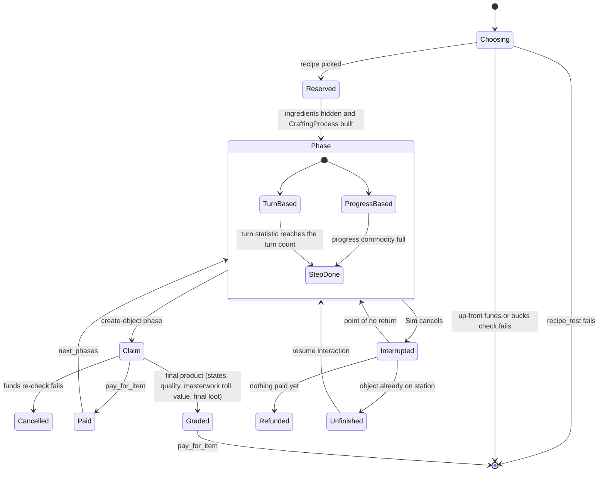

# 6.01 Crafting, cooking and making things

*Game version 1.128.90.1030 (Steam, Linux/Proton). Numbers come from the live set: the base delta build plus the delta build of each installed pack, EP04 (Cats & Dogs), EP06 (Get Famous), EP09 (Eco Lifestyle), EP12 (High School Years), GP04 (Vampires), GP12 (Werewolves) and SP01 (Luxury Party); SP42 (Grunge Revival) is installed but ships no combined tuning. A record found only in the base full build is not live. Patch data for packs that are not installed is labelled as such and never counted. Written 2026-10-12. Checked 2026-10-12: 72 claims checked, 38 corrected, 1 relabelled, 3 removed. Deepened 2026-10-13: 8 modules newly explained, 1 failed decompile read. Checked again 2026-10-13: 317 claims checked, 22 corrected, 1 relabelled, 0 removed. Cross-chapter edits 2026-10-13: 1 applied.*

## In plain words

Everything a Sim makes, from a plate of mac and cheese to a painting, a drink, a comedy routine, a candle or a fabricated chair, runs through one shared machine. A recipe says what is made, at which station, what it costs and what it needs; the Sim then works through a fixed series of steps (chopping, stirring, painting strokes), each a little animation that counts a "turn" or fills a progress bar. Halfway through, an unfinished object appears on the counter or easel, and the Sim can walk away and come back to finish it later.

When the item is done, the game grades it once. The grade is a number from -50 to 50 that comes from the Sim's skill, the quality of the ingredients, the station and anything that happened during the steps (a dirty stove, a fumbled trick, a group of friends helping). That number picks the star rating (poor, normal, outstanding), and a separate dice roll can make it a masterwork. The item's price then scales from the recipe's retail price by the maker's skill, by quality for most non-food items, and by a few traits.

Three things tend to surprise players. A Fresh Chef's food is set to "outstanding" before the grade is added, so a weak cook with that trait can still land on "normal". In this install the masterwork dice roll never succeeds for a cooked dish: every food recipe that allows one requires a trait that only exists in a pack that is not installed, so the only way to a masterwork meal is the Perfectionist trait's lucky step up. And 451 food recipes carry a food-poisoning roll (7% on most) in their tuning that does nothing here, because the "poisoned" state belongs to Dine Out, which is not installed either.

## Key facts

- 1,310 live recipe records: 1,207 ordinary recipes, 76 painting recipes, 21 song recipes and 6 paint-by-reference recipes. By pack: base 813, EP09 327, EP12 87, EP04 34, GP12 19, SP01 15, GP04 14, EP06 1.
- 559 recipes are tagged food (316 dishes or single servings plus 243 multi-serving variants) and 177 are tagged drink.
- 237 start-crafting interactions open the pipeline: 130 player menus, 65 autonomous, 24 orders, 14 autonomous orders, 3 group-cooking starts and 1 situation start.
- Crafted quality is one statistic, -50 to 50, starting at 0. Poor is -50 to -31 (1 star), normal -30 to 30 (2 stars), outstanding 31 to 50 (3 stars).
- The grade added at the end is `base_quality + (effective skill - required level) x skill_adjustment` plus the average ingredient bonus plus the process term `(P + 50) x m - 50`. Mac and cheese (large) uses -30 and +15 per Homestyle Cooking level above 1. 668 recipes leave both values at 0, so skill adds nothing to their grade.
- Money is checked when the craft starts and taken when the first object of the craft is created; a household that cannot pay at either moment gets no craft and no message. Fridge ingredients are used only when the player ticks "use ingredients" (or the menu is one of the 18 "with ingredients" menus); otherwise none are touched and the full ingredient surcharge is paid.
- Ingredients are taken lowest quality bonus first; single servings and canned goods are pulled forward (sort modifier -60), giant crops pushed back (+60, +120) and spoiled ones go last (+1000). A spoiled ingredient is worth -550 quality points in the average; a pristine one +60.
- Cooked food starts at 120 freshness and loses 0.2 per sim minute: 10 hours on a counter, about 6.9 days in a powered fridge (x0.06), 20 hours in a picnic basket (x0.5), forever in a hidden or mailbox inventory (x0).
- Servings: a large recipe makes 8, a medium one 4, a group-cooked meal 12. An empty plate stops spoiling (freshness decay x0).
- Masterwork chance: base chance plus a per-level bonus above the required level, then multiplied by tested factors (Inspired x1.25, Bored x0.75, Perfectionist x1.2). All 292 food recipes with masterworks require `trait_StovesAndGrillsMaster`, which is defined only in GP01 (Outdoor Retreat) patch data, pack not installed; a Perfectionist in the zone can still step an outstanding dish up to masterwork after the grade.
- 45 station objects carry a crafting-quality multiplier (34 of them other than x1, from 0.75 to 3.5), none of them on the crafting process itself; 17 fridges and stoves add a flat 4 to 16 points through their own cooking interactions, and every pot or frying-pan staging adds +15.
- A dirty station costs -45 quality per phase step, a neutral-dirt one -7.
- Item value is retail price times random state multipliers, the masterwork multiplier, a skill curve (mac and cheese: x0.5 at level 0 to x2 at level 10) and x0.7 for a copy. Only 17 of 559 food recipes map quality to value, so a dish's price follows the cook's skill. Outstanding x2 belongs to fabrication, woodworking and juice fizzing; poor x0.5 to fabrication and woodworking plus 105 drinks (44 juice fizzer, 49 bar and 12 other drinks).

## How it works

### Recipes, stations and recipe choice

**Observed** (`recipe.py: Recipe`, live tuning). A recipe is an instance in the RECIPE manager. Next to the 1,310 recipe records the same manager holds the pieces they are built from: 107 `SimplePhase` and 27 `MultiStagePhase` shared phases, 22 `CraftingObjectType` records, 460 `PaintingTexture`, 30 `PaintingStyle`, 868 `MusicTrack`, 149 `MusicStyle` and 24 `VocalTrack` records (and 104 `SpawnerTuning` records unrelated to crafting).

**Observed** (`crafting_interactions.py: StartCraftingMixin`, rescued per function; `crafting_process.py: CraftingProcess.recipe_test, phase_completable`). A station offers a start-crafting interaction whose `recipes` list is the menu. Each listed recipe goes through `CraftingProcess.recipe_test`, which returns whether the row is visible and enabled and the errors that grey it out: entitlement, price and bucks, a path through the phases whose stations are free, and the skill test. Ingredients are counted separately while the picker rows are built: `build_requirement_data` disables a recipe with `all_ingredients_required` that is short of ingredients, and for every recipe returns the missing fraction that the price uses. Counting each recipe once per station category that lists it:

| Station category | Recipes listed | By pack |
|---|---|---|
| cooking and food (stove, fridge, grill, microwave, campfire, oven) | 414 | base 347, EP12 26, EP04 10, SP01 10, EP09 9, GP12 9, GP04 3 |
| fabrication | 213 | EP09 213 |
| drinks (bar, coffee, tea) | 91 | base 64, EP12 9, GP04 6, GP12 5, EP09 4, EP04 3 |
| painting and drawing | 79 | base 79 |
| papercraft | 77 | base 77 |
| stalls and cafeteria orders | 52 | EP12 25, base 15, EP04 9, EP09 3 |
| candle making | 50 | EP09 50 |
| juice fizzing | 44 | EP09 44 |
| writing | 41 | base 39, EP06 1, EP09 1 |
| comedy routines (computer) | 24 | base 24 |
| woodworking | 23 | base 23 |
| song writing | 21 | base 16, GP04 5 |
| vet medicine | 12 | EP04 12 |
| civil designer drafting | 2 | EP09 2 |

171 recipe records are listed by no start interaction (129 base). 65 are single-serving recipes whose multi-serving variant is listed (the variant's `base_recipe` points at them), 3 are the base of a variant that is not listed either, 16 are multi-serving variants, and 87 stand alone (42 food, 30 EP12 fashion-marketplace recipes, 13 drinks, a snack and a woodwork item); those are reached through orders, situations and loot.

**Observed** (`crafting_interactions.py: StartCraftingMixin.find_best_recipe`, loop checked in bytecode; `recipe.py: Recipe.calculate_autonomy_weight`). An autonomous Sim picks by weighted random over the listed recipes that pass the test, skipping every recipe with `all_ingredients_required` and leaving bucks costs unchecked. The weight is `autonomy_weight` (1 in 1,294 recipes) times every `buff_weight_multipliers` entry whose buff the Sim has. 188 recipes carry such multipliers; the common ones are Snob x5, Gourmet Cooking skill buff x5, Art Lover x5, child x100 and hidden mood buffs (Silly, Playful, Hysterical, Imaginative, Inspired) x10, so mood steers which painting or joke a Sim picks on its own. `Recipe.mood_list` only colours the UI (its tunable description says so).

### The crafting process: phases, turns and progress

**Observed** (`recipe.py: Phase, SimplePhase, MultiStagePhase`; `crafting_process.py: CraftingProcess`). A recipe is a graph of named phases: `_first_phases` (or `_first_phases_alternative`), then each phase's `next_phases`. A phase runs one super-interaction; a multi-stage phase runs a staging interaction whose content set offers small mixers (`CraftingStepInteraction`, 182 live), each of which adds one turn (`StatChange_Turns_01`) or some progress. Completion is either turn based (the `statistic_turns` statistic reaches the phase's turn count) or progress based (`commodity_CraftingProgress` fills). The quality UI shows a progress phase as 10 virtual turns (`PROGRESS_VIRTUAL_TURNS`, code default 10), and the Automation command `crafting.shorten_phases` caps every turn phase at `MAX_TURNS_FOR_AUTOSMOKE` (code default 2).

**Observed** (`recipe.py: MultiStagePhase.__init__`, live tuning). A multi-stage phase's turn count is the number of phase affordances in its content set whenever that is above 0, which overwrites the tuned `_num_turns` (code default 3). The tuned leaves (1 in 231 entries, 4 in 161, 5 in 143, 2 in 122, 3 in 110) therefore matter only for an empty content set. Effective turns of the turn-based multi-stage entries: 5 (164), 3 (159), 4 (145), 2 (140), 7 (65), 1 (46), 6 (33), 9 (21). Of 5,245 tuned phase entries, 807 use progress-based completion (545 multi-stage, 262 simple). 216 more are `GetPreppedIngredientPhase` entries whose `simple_phase_ref` names one of six SP46 (Home Chef Hustle) `phaseSimple_Food_PreppedIngredientsTray_*` records (patch data, pack not installed); the reference is pack-safe, so those entries drop and 5,029 phase entries load here.

**Observed** (`crafting_process.py: CraftingProcess.increment_phase, apply_state_effects`). Each time a phase advances, every Object participant of the interaction in a mapped state runs a loot from `CraftingTuning.STATE_EFFECT_MAP`: `Dirty_Dirty` runs `CommodityChange_Quality_Crafting_Loss_VeryLarge` (-45 to the process quality) and `Dirty_Neutral` runs `CommodityChange_Quality_Crafting_Loss_Med` (-7).

**Observed** (`crafting_interactions.py: CraftingPhaseSuperInteractionMixin._should_go_to_next_phase`). A phase tuned `point_of_no_return` (857 phase entries) goes on to the next phase even when its interaction is cancelled, so from that phase on the product is always made.



### Phase interaction classes

**Observed** (`crafting_interactions.py`, rescued per function; live counts of each class). Every phase runs one interaction from a family of subclasses of `CraftingPhaseSuperInteractionMixin`. They differ in where the object comes from and where it goes:

| Class | Live | What it adds over the mixin | Tunables that matter |
|---|---|---|---|
| `CraftingStepInteraction` | 182 | the mixer: one turn or some progress, then a quality and progress update | `go_to_next_phase`, `skill_offset` (no live record sets either) |
| `CraftingPhaseStagingSuperInteraction` | 110 | runs the phase's content set (its own is ignored; the `logger.error` call about it writes nothing in retail); advances by itself only when its basic content is not staging; pushes eating on exit | content set from the phase |
| `CraftingPhaseCreateObjectInInventorySuperInteraction` | 33 | adds the new object to a participant's inventory, cancelling if it does not fit | `use_family_inventory` (2 live: the fabricator and woodworking household-inventory steps send it to the household inventory) |
| `CraftingPhaseCreateObjectInSlotSuperInteraction` | 19 | parents the new object to a slot | `parenting_element` |
| `CraftingPhaseTransferCraftingComponentSuperInteraction` | 16 | makes no object: adds the crafting component to an existing one (coffee and tea makers, kettle, pressure cooker, the 10 fabricator colour starts), advances the phase, re-checks funds, pays and grades that object at once | `crafting_component_recipient`, `override_crafting_process` |
| `CraftingPhaseCreateCarriedObjectSuperInteraction` | 15 | creates the object in the Sim's hand (fridge tray, bar glass, campfire, grill and oven food, a dipped candle) and can hand it straight to the eat or drink interaction | `carry_track_override`, `posture_type` |
| `CraftingPhaseCreateObjectFromCarryingSuperInteraction` | 8 | puts a carried in-progress object down as a new object (counter, oven, stove, pressure cooker); off the lot it is saved with the open street; it counts as done if the route there succeeded, even when the animation was cut | `apply_final_states_xevt_id` (6 live) |
| `CraftingPhasePickUpObjectSuperInteraction` | 5 | picks up a tool (cutting board, frying pan, jar, mixing bowl, sauce pot); no code of its own | none |
| `CreateConsumableAndPushConsumeSuperInteraction` | 2 | fridge snack: inserts the eat interaction next; `UnclaimedCraftableLiability` destroys the snack and refunds the recipe's price and bucks to the Sim if it is still where it was made when that interaction ends | none |
| `CraftingPhaseSendObjectForDeliverySuperInteraction` | 1 | `AnimalObjects_AnimalClothing_CraftClothes`: makes nothing on the spot, asks the household's delivery tracker to deliver the recipe and pays | none |

Mixin flags used live: `crafting_type_requirement` (30 phase interactions name a `CraftingObjectType` such as stove, oven, counter, grill, fridge, microwave, campfire, pressure cooker, sink or high chair), `stop_other_sims_crafting` (4: the grill's final food, placing on the counter and the two oven transitions; it stops the other crafters of a linked group-cooking situation), `force_final_product` (2: `Bots_CreateInSlot`, `electricKettle_Finish`) and `destroy_ico_object_if_reset` (1: `candleMakingStation_Dipping_Dip`).

**Observed** (`CraftingPhaseSuperInteractionMixin._maybe_push_cancel_phase, _go_to_next_phase, should_push_consume`; `crafting_process.py: CraftingProcess.cancel_crafting`). A phase interaction that exits before advancing pushes its phase's cancel phase when one is tuned (`_cancel_phase_name`, 7 live records: six bar-drink phase and recipe records name `discard_shaker`, and `recipe_Sketchpad_SketchImpression` names `6-Staging`); otherwise it leaves through the refund path above. Advancing marks the phase done, increments the process and pushes the next phase; after the last phase the created object or the current ICO is told the process finished, and a target that was crafted onto loses its crafting component when the phase sets `remove_crafting_component_on_end`. The eat or drink push runs only when the process is complete (or on its single last phase), the interaction was not cancelled, and the recipe's Hunger or Thirst threshold passes when one is set.

### Paying, ingredients and missing ingredients

**Observed** (`recipe.py: Recipe.crafting_price, get_price`). The player-facing price is `((crafting_price + int(delta_ingredient_price x fraction of ingredients missing)) x price multiplier + extra cost) x number of orderers`; the order count multiplies the extra cost too (`Recipe.get_price`, then `_handle_begin_crafting`). `crafting_price` is a flat fee or a fraction of `_retail_price` (code default 0.8). Live: 518 recipes charge a flat fee above 0, 305 a flat fee of 0, 254 a fraction of 0, 144 use the default 0.8, 89 another fraction (0.1 to 0.66); 85 set `_no_initial_charge`, which forces 0. Orders (`is_retail`) charge the retail price instead. Mac and cheese (large) costs 2 plus up to 12 when no ingredients are present.

**Observed** (`crafting_process.py: CraftingProcess.pay_for_item, check_is_affordable, refund_payment`, the refund guard checked in bytecode; `crafting_interactions.py: CraftingPhaseCreateObjectSuperInteraction.build_basic_content, _exited_pipeline`). At start the used ingredients move to a hidden inventory as "reserved". The money and any bucks cost are taken in the claim callback of the first object-creating phase, right after the object is set up; just before that the process re-checks `check_is_affordable` and cancels the interaction with no message if the household can no longer pay. Paying destroys the reserved ingredients unless the recipe's `ingredients_save` roll refunds them or `return_on_cancel` keeps them. A create-object phase calls `refund_payment` every time its interaction leaves the pipeline: before payment that returns the reserved ingredients, after payment there is normally nothing left to return. Bucks marked `refund_on_cancel` and ingredients kept by `return_on_cancel` set an explicit-refund flag instead, so they come back only on an explicit refund such as `RefundCraftingProcessLoot` or a reset of an interaction tuned `destroy_ico_object_if_reset`. The transfer-component phase refunds only while the process is incomplete.

**Observed** (`crafting_ingredients.py: IngredientTuning`; `crafting_interactions.py: StartCraftingMixin._get_ingredient_candidates`; base delta module tuning, no installed pack overrides it). Requirements are by definition or by tag, each with a count. Candidates are sorted in ascending order of their quality boost plus `INGREDIENT_STATE_SORT_MODIFIERS` (`Freshness_Spoiled` +1000) plus `INGREDIENT_TAG_SORT_MODIFIERS` (`Food_Single` and `Func_CannedGood` -60, `Func_GiantCrop_Medium` +60, `Func_GiantCrop_Large` +120), so the lowest-boost fresh ingredient is used first and a spoiled one last (sort order confirmed in bytecode). Each used ingredient contributes the `quality_boost` of its quality state through `INGREDIENT_QUALITY_MAPPING`:

| Tier | Boost | Example states |
|---|---|---|
| IngredientQuality_1 | -550 | Freshness_Spoiled |
| IngredientQuality_2 | -60 | FishFreshness_Foul, FruitDecay_1_RottenFruit, foodAsIngredientQuality_Poor |
| IngredientQuality_4 | -20 | FishFreshness_Poor |
| IngredientQuality_5 | 0 | GardeningQuality_00_Wild, GardeningQuality_01_Sickly |
| IngredientQuality_6 | +5 | FishFreshness_Average, foodAsIngredientQuality_Normal |
| IngredientQuality_9 | +20 | FishFreshness_Great, foodAsIngredientQuality_Outstanding |
| ingredientQuality_11 | +60 | FishFreshness_Excellent, GardeningQuality_10_Pristine |

(Tiers 3, 7, 8 and 10 are -40, +10, +15 and +40; tiers 3 and 8 list no state, so nothing earns them. Gardening quality has only six states: Frail is +10, Meager +20, Scrubby +40.) The full build has ten tiers instead (-120, -60, -30, 0, +5, +10, +15, +20, +30, +60); the delta's eleven above are live. Gardening and fishing quality states are explained in [6.02 Gardening, fishing and collecting](6.02-gardening-fishing-collecting.md).

**Observed** (`crafting_process.py: CraftingProcess.apply_quality`). The ingredient bonus is the sum of boost x count over the requirements divided by the total required count; a requirement the Sim could not fill counts as 0 boost, so cooking without ingredients pulls the average toward 0. The object also gets the matching ingredient-quality state (`IngredientTuning.get_ingredient_quality_state`). The cheat `crafting.ingredients_required_toggle` flips the module flag `recipe.debug_ingredient_requirements`, which `Recipe.all_ingredients_required` ANDs in, so recipes that demand every ingredient stop demanding them.

### Beginning a craft: ingredients, payer and the up-front check

**Observed** (`crafting_interactions.py: StartCraftingMixin._handle_begin_crafting`, which fails even in the per-function decompile and was read in bytecode; `StartCraftingSuperInteraction.on_choice_selected`, read in bytecode). Every start interaction ends in `_handle_begin_crafting`, which runs these steps in order:

1. **Ingredients or not.** The picker returns whether the player ticked fresh or prepped ingredients (`ingredient_check`, `prepped_ingredient_check`). The ingredient requirements built for the picker are used only when one of those is ticked, when the interaction sets `use_ingredients_default_value` (18 live: the stove and fridge "with ingredients" breakfast, brunch, lunch and dinner menus at 1 and 8 servings, `campfire_startCrafting` and `grill_StartCrafting`), or when the recipe requires every ingredient. Otherwise no ingredient is touched, the ingredient bonus is 0 and the missing fraction is 1, so the whole `delta_ingredient_price` is charged (mac and cheese, large: 14 instead of 2). With ingredients, `validate_and_satisfy_ingredients` fills each requirement from the sorted candidates and stops the start when a recipe that needs every ingredient is short.
2. **Payer and price.** With no tuned `paying_sim`, a Sim ordering from another crafter pays and is charged the retail price (the ordinary crafting price when the interaction takes ingredients from a tuned `ingredient_source`, which none of the 38 live order interactions sets); otherwise the crafter pays. The price comes from `_get_recipe_price_discounts` (the interaction's `price_multiplier` and per-bucks multipliers, the missing fraction and any extra cost) and is multiplied by the number of orderers. `ingredient_cost_only` sets it to 0; no live start interaction sets that flag.
3. **Up-front check.** If the payer's household cannot afford the price (or a tuned funds source's `max_funds` is below it), or a bucks balance is below its cost times the orderers, the method returns nothing: no craft starts and no message is shown. The money itself is still taken at the first object, with a second check there (above).
4. **Reservation.** Each ingredient to consume moves into its own inventory's hidden storage. An ingredient that is itself a multi-serving dish (it carries the servings statistic) stays where it is and is earmarked instead; it loses those servings only once the craft has started.
5. **The process.** Unless the interaction turns off `remove_previous_crafting_component` (only `coffeeMaker_StartCrafting_Pot` and `teaMaker_StartCrafting_Pot`), a crafting component already on the target is removed. A `CraftingProcess` is built with the price, payer, reserved ingredients, orderers, the average ingredient bonus, funds source, bucks costs, situation id and earmarked servings; `set_target_as_current_ico` makes the target the in-progress object; the first phase is pushed and the ingredient calculation goes to the GSI crafting log.
6. **Failure.** If a reservation or the first push fails, reserved ingredients are handed back through the crafter's own inventory (`try_move_hidden_object_to_inventory`). **Inferred**: an ingredient reserved from a fridge sits in the fridge's hidden storage, which the crafter's inventory does not share (`InventoryComponent.is_object_hidden` checks only its own hidden storage), so this path probably cannot return it; the `logger.error` call that follows writes nothing in the retail build, and the ingredient stays hidden. (The ordinary cancel path, `refund_payment`, returns each ingredient through its own inventory.)

**Observed** (`StartCraftingMixin` class body, read in bytecode; `get_default_candidate_ingredients`, `_get_ingredient_candidates_cache_key`). Candidates come from the crafter's inventory (`check_sim_inventory`, default on) and the lot's shared fridge inventory (`check_fridge_shared_inventory`, default on; the first inventory of `CraftingTuning.SHARED_FRIDGE_INVENTORY_TYPE` on the active lot), and from the target's inventory when `check_target_inventory` is on (default off). Only the two EP09 juice fizzer starts change these: they read the fizzer's own inventory and neither the Sim's nor the fridge. The candidate list is cached per crafter and target, keyed by the last-update time of each inventory it reads.

**Observed** (same function; family recipes belong to EP18 (Businesses & Hobbies), not installed). A family recipe adds one extra ingredient requirement, leaves it out of the quality average, adds its price when the payer carries none, and adds the family buff's cost times the tracker's cost modifier (the modifiers are in [3.09 Life cycle: ages, pregnancy and death](3.09-life-cycle.md)). Without EP18 no Sim has the tracker, so this branch never runs here.

### Who a craft is for: start interactions, orders and group starts

**Observed** (`crafting_interactions.py`, rescued per function, with the order tests read in bytecode; live counts):

| Class | Live | What it adds | Tunables that matter |
|---|---|---|---|
| `StartCraftingSuperInteraction` | 130 | the player's recipe picker, or a favorite recipe without a picker | `recipes`, `crafter`, `paying_sim`, `funds_source`, `craft_for_other_sims`, `price_multiplier`, `use_ingredients_default_value`, `favorite_recipe` |
| `StartCraftingAutonomouslySuperInteraction` | 65 | the weighted autonomous pick; its test needs a free part of the station it can reserve and skips recipes the Sim's food restrictions forbid; its situation score uses the final product's definition | `test_reserve_object`, `recipes` |
| `StartCraftingOrderSuperInteraction` | 24 | an order to another Sim (bartender, stall vendor, cafeteria, bubble tea counter) | `crafter` (TargetSim in all 24), `order_craft_affordance`, `order_wait_affordance`, `ingredient_source`, `tooltip_crafting_almost_done` |
| `StartCraftingOrderAutonomouslySuperInteraction` | 14 | the same order, chosen by autonomy | same |
| `StartGroupCraftingSuperInteraction` | 3 | starts group cooking (fridge, stove, off-the-grid stove) | `group_crafting_situation` |
| `SituationStartGroupCraftingInteraction` | 1 | run by the group-cooking situation; takes its inventory checks and price multipliers from the start interaction that created it | none |
| `CraftingResumeInteraction` | 21 | resumes an in-progress object (see below) | `resume_phase_name` (2 live) |
| `DebugCreateCraftableInteraction` | 7 | picker of every recipe with a tag (food, main, dessert, appetizer, drink, pet food, candle) that makes the finished product at once | `recipe_tag`, `quality` |

`craft_for_other_sims` decides the orderers: `no_other_sims` (the default), `party_crafting` (`bar_StartCrafting_for_party` and `bar_PushOrderDrink_for_party`: one order per Sim of the ensemble, so the price is multiplied by their number) or `craft_for_specific_participant` (15 live: toddler high-chair feeding, fridge snacks and drinks for toddlers, the EP04 pet recipes and the EP09 prank drink). Favorite-recipe mode is used once, by `bar_MakeDrinkPrototype_PrankDyed` (EP09): no picker opens; the orderer's stored favorite for the tags is made, or else a random listed recipe that needs no ingredients and passes its tests, which is then stored as the new favorite.

**Observed** (`StartCraftingOrderHandler`; `crafting_process.py: CraftingProcess.add_order, remove_order, should_repeat_phase, pop_order`). An order runs in two parts. The orderer first runs the order interaction (for example `si_MarketStalls_OrderFood` in 11 of the 24 player orders, `bar_OrderDrink`); when it ends, the order is placed. If the crafter is already running a phase that allows multiple orders and serves with the same serve affordance, every orderer is added to that process's order queue; otherwise a new craft is begun on the crafter. The orderer then runs the wait interaction (`si_MarketStalls_WaitForFood`, `bar_WaitForDrink` and others), which the crafter's phase cancels when it ends; leaving the wait removes the order, and removing the last order before the point of no return cancels the crafter's phase. Phases tuned `loop_by_orders` repeat while orders remain. An order that joins a running batch only calls `CraftingProcess.add_order`; the price is computed in `_handle_begin_crafting`, which that path never calls, so **Inferred**: a patron whose order joins a batch is not charged for it (the batch's serve affordance must match; its recipe need not). Live, 98 recipe and phase records allow multiple orders (the shared bar-drink phases, bubble tea, market stalls) and 84 loop by orders; the 6 bar food recipes set the loop off.

**Observed** (`StartCraftingOrderSuperInteraction._test`, `StartCraftingOrderAutonomouslySuperInteraction._test`, both read in bytecode). The player's order is refused while the crafter runs a phase that takes no more orders, or while its process is on the last phase (the "almost done" tooltip). The autonomous order checks the reverse: it is refused whenever the crafter runs a phase that does allow multiple orders, with the same "almost done" text. **Inferred**: an autonomous patron never joins a batch in progress; it orders when the crafter is free or busy with a phase that takes no orders, and that order starts a separate craft queued behind the current one.

**Observed** (`StartGroupCraftingSuperInteraction._handle_begin_crafting`, `SituationStartGroupCraftingInteraction._run_interaction_gen`). Group cooking does not start the craft directly. It creates `groupCraftingSituation_GroupCooking_CookTogether`, not user-facing, with the crafter as head crafter at hosting priority (`EVENT_HOSTING`) and every picked Sim as another crafter at VIP priority (`EVENT_VIP`), all `CANNOT_SPAWN`, handing over the recipe, ingredients, orderers, funds source and payer (the price is worked out later, when the situation's start interaction runs the ordinary `_handle_begin_crafting`). The situation then runs `situationStartGroupCraftingInteraction_GroupCooking`, which begins the craft with the situation's id, and the process is attached to the situation. The situation's jobs are in [4.01 Situations, roles and NPC scheduling](4.01-situations-npcs.md).

### Prepped ingredients (SP46, not installed)

**Observed** (`crafting_interactions.py: get_ingredient_requirements` and its helpers, `get_ingredient_requirement_with_ingredient_replacement_rules`, `StartCraftingSuperInteraction.picker_rows_gen`; base delta module tuning `crafting.recipe`, `crafting.crafting_ingredients`). The picker builds three variants of every recipe row: fresh ingredients only, prepped ingredients only (requirements tagged `Func_Ingredient_Prepped`, `IngredientTuning.PREPPED_INGREDIENT_TAG`) and both, each with its own price and enable flag. `Recipe.INGREDIENT_REPLACEMENT_MAP` has 8 entries; each lets one prepped ingredient stand in for a group of raw requirements (flour, sugar and milk-or-egg tags; fish and crawdad; red and wrapped meats; nine vegetable tags; meat substitutes). All 8 replacement objects are SP46 (Home Chef Hustle) object definitions, pack not installed. A row shows "cooking time reduced" when the recipe sets `enable_speed_up_background` (217 live recipes) and a prepped requirement is satisfied. The start passes the choice on to the process's quality liability and telemetry; the faster route itself is tuning, `_first_phases_alternative` (219 live recipes), whose tested phases are tried before `_first_phases`. In 216 of those recipes the alternative is `GetPreppedIngredientPhase`, whose phase record is SP46 patch data and does not load here (see the phase count above). **Inferred**: with no SP46 object in this install, the replacement rules never match and the prepped variants stay unavailable.

### The quality roll

**Observed** (`crafting_process.py: CraftingProcess.apply_quality`, nesting checked in bytecode: the process term runs whether or not there is an ingredient bonus). When the final product is claimed, one value is added to the object's quality statistic (`statistic_Object_Consumable-Quality`, -50 to 50, initial 0):

```
skill_term   = base_quality + (L_eff - L_base) x skill_adjustment
ingredient   = sum(boost_i x count_i) / sum(required_count_i)
process_term = (P + 50) x m - 50
added        = skill_term + ingredient + process_term
P      = the crafting process's own quality statistic (starts at 0)
m      = product of the quality multipliers collected at each object claim
L_base = _quality_control_stat.base_level, else the skill test's minimum level
L_eff  = effective skill level (skills) or user value (other statistics)
```

The statistic clamps the result to -50..50. Recipes with neither a skill test nor a quality-control statistic (282 live; no live recipe sets `_quality_control_stat`) get no skill term. Live `base_quality` values: -30 (310 recipes), -15 (93), 0 (75), -20 (44); `skill_adjustment`: 15 (384), 20 (122), 9 (63), 25 (41). 668 recipes set neither value, so their skill term is 0 even though 413 of them have a skill test; they are fabrication (213), food (169: 161 dishes and 8 snacks), papercraft (77), drinks (72), candles (50), EP12 fashion (30), comedy (24), music (21) and vet (12) recipes.

**Observed** (`objects/components/state.py: CommodityBasedObjectStateValue`, live state values). The star state follows the statistic: `Quality_Poor` -50..-31 (1 star), `Quality_Normal` -30..30 (2), `Quality_Outstanding` 31..50 (3). A value in a gap (between -31 and -30, or 30 and 31) falls back to the closest state.

**Worked example** (Inferred arithmetic from the observed formula and the recipe's live phases). Mac and cheese (large) has `base_quality` -30, `skill_adjustment` 15 and a Homestyle Cooking test from level 1. Its phases are the ingredient tray (`fridge_CreateTray`), the pot staging (`stove_MakeFood_Pot_Staging_Basic`, 6 turns), the cheese sauce and the place-on-counter step (point of no return); the pot staging always adds the +15 Flavorized loot to P. With no ingredients, clean stations without a cooking bonus and nothing else, P = 15 and m = 1: level 1 gives -15 (normal), level 4 gives +30 (normal, on the edge), level 5 gives +45 (outstanding). On `object_stove_electric` (+8.5) with `object_fridgeLOW_01` (+5.5), P = 29: level 1 gives -1 (normal) and level 4 gives +44 (outstanding).

### What feeds the quality numbers

**Observed** (`crafting_interactions.py: CraftingPhaseCreateObjectSuperInteraction._custom_claim_callback`, `objects/components/statistic_component.py: StatisticComponent.get_stat_multiplier, add_modifiers_for_interaction`). The multiplier m is collected at every object-creating claim from autonomy modifiers whose `stat_use_multiplier` names the quality statistic and whose subject is `CraftingProcess`; such modifiers are lent to the process for the duration of an interaction with the object that owns them. Live, only the state `Upgrade_Generic_IncreaseQuality_Completed` (x2, the quality upgrade) carries that subject. With P = 0 the upgrade alone turns the process term into +50. **Inferred**: a recipe with two object-creating phases on an upgraded station multiplies in the factor twice.

**Observed** (live tuning, `autonomy/autonomy_modifier.py` subject variant). 45 objects carry a quality `stat_use_multiplier` (34 with a value other than 1), in object-level `autonomy_modifiers` and, for fridges and coolers, also in the modifiers of a state value. 39 entries name the interaction's Object participant and 10 use the default subject (the owning object), for example `object_Microwave_Low` x0.8, `object_microwave_Med` x1.18, `object_Microwave_DS` x2.33, `object_fridgeLOW_01` x0.75, `object_fridgeHIGH_01` x1.5, `object_paintEaselRWPainterHigh_01` x3, `object_barProRWCulSS4x1_01` x3.5. **Inferred** (`statistics/base_statistic.py` statistic multipliers): these scale changes to the quality statistic of the station or the interaction's Object participant while the interaction runs, which reaches the product only when the product is that participant; they do not enter m.

**Observed** (live object `affordance_tuning`). 17 fridges and stoves add a flat amount to P when their cooking interactions run, through `commodity_Quality_FridgeAndStove_CookingQuality_N` (N = 2 to 10, amount 1 + 1.5 x N, so 4 to 16): `object_fridgeLOW_Mini` 4, `object_fridgeLOW_01` 5.5, `object_fridgeMED_01` 7, `object_stove_electric` 8.5, `object_stoveMinorGFVintage_01` 10, `object_stoveMinorHIGH_01` 11.5, `object_fridgeHIGH_01` 13, `object_fridgeDS_02` and `object_stoveMinorDS_01` 16. On stoves the bonus rides on the pot, frying-pan and oven staging interactions, on fridges on `fridge_CreateTray`.

**Observed** (live tuning, other P inputs):
- Mixer outcomes. 10 mixers have a dual outcome. The eight cooking tricks succeed 35% of the time at base: `Cooking_Shared_AddCombo_Basic` and the air slice cost -15 on failure (`CommodityChange_Quality_Crafting_Loss_Large`), the six counter and pan tricks -7, and the two pan tricks also run the fire test on failure. Each trick has two skill multipliers (x2, then x1.5 at a higher level, on Homestyle or Gourmet Cooking); `SuccessChance.get_chance` multiplies every passing one and caps at 1, so AddCombo succeeds 70% from Homestyle 5 and always from 7. Success and failure both add one turn (`StatChange_Turns_01`); only failure costs quality. The other two are EP04 vet-medicine mixers at 50% that add crafting progress.
- `CommondityChange_Quality_Crafting_Flavorized` (+15 to the process) has no test and sits in the outcome of five pot and frying-pan staging interactions, so every run of them adds it; it also sets the stove's `statistic_Object_StoveFlavorized` to 0.
- Group cooking (`GroupCooking_Join_Continue`): every 15 minutes each joined Sim adds 4 quality to the shared item times the product of three curves on its own skills, Homestyle, Gourmet and Baking (each x0 at level 0 to x4 at level 10; `StatisticChangeOp._get_local_statistic_multipliers` multiplies them together), plus 4 more if at least one other Sim in its ensemble has a relationship of 35 to 100 with it. A curve whose skill the Sim does not have returns x1 (`TunableStatisticModifierCurve.get_multiplier`, bytecode), so a Homestyle 10 cook without Gourmet adds 16 per tick and one with both at 10 adds 64. **Inferred**: Baking (s=104198) exists only in EP01 (Get to Work) patch data, its pack-safe reference loads as None, and that curve counts x1 for everyone here. `loot_GroupCooking_Finish_HeadCook` runs for the head cook or a Sim with the mentoree role buff; it sets the meal to full servings (`servings_GrandUntouched`, 12) and adds +30 only when the finisher has `buff_Role_GroupCooking_Mentoree`. The situation itself is in [4.01 Situations, roles and NPC scheduling](4.01-situations-npcs.md).

**Observed** (live tuning, after the grade). 1,207 recipes run `loot_Crafting_Recipe_QualityModifiers` from their final-product loot list. Its live parts are `loot_Trait_Perfectionist_AttemptQualityIncrease` (only while the Sim has `buff_Trait_Perfectionist_InTheZone`: weights 8 for nothing and 1 for a hidden 5-minute buff, so a 1 in 9 chance, and weight 0 once the object or its children are already masterworks; with the buff the object steps up one tier, poor to normal, normal to outstanding or outstanding to masterwork, and the in-the-zone buff ends) and `loot_Fear_Failure_CraftingEffects` (a Sim with `trait_Fear_Failure`: -15 quality and a 15% chance of a sad buff). `loot_Fear_Fire_Grilling_LowerQuality` takes -30 from the created object for a Sim with `trait_Fear_Fire`. The other nine entries of `loot_Crafting_Recipe_QualityModifiers` are patch data for packs that are not installed: two EP13 (Growing Together) loots (midlife crisis, burnout), an SP49 (Crystal Creations) gemology loot, an EP17 (Life & Death) tarot loot, three EP19 (Enchanted by Nature) loots (luck, ailments, a gnome boost) and two EP21 (Royalty & Legacy) mirror loots.

**Observed** (scan of every live record that names the quality statistic). No live loot, periodic change or quality multiplier is gated on a mood; the one buff-gated change is the group-cooking mentoree bonus above. **Inferred**: mood therefore does not move the grade directly; it scales masterwork chances, steers autonomous recipe choice, and reaches the grade through effective skill level (see [3.10 Skills, careers and school](3.10-skills-careers-school.md)).

### Masterworks

**Observed** (`crafting_process.py: CraftingProcess.make_masterwork_if_necessary`, nesting checked in bytecode: the multiplier loop and the roll also run when there is no skill level). If the recipe has `masterworks` and its `base_test` passes, the chance is `base_chance + max(0, L_eff - required level) x skill_adjustment`, then multiplied by every passing `multiplier_tests` entry, then rolled; success sets `Masterwork_Masterwork`. The state trigger on food objects (240 live objects) then sets `Quality_Outstanding`.

**Observed** (live tuning, `recipe.py` defaults). 571 recipes have masterworks. 521 set the base chance and per-level bonus: 0.2 and 0.03 (292), 0.2 and 0.01 (87), 0.1 and 0.01 (57), 0.25 and 0.05 (44), 0.15 and 0.015 (41); the other 50 (EP09 candles) use the code defaults 0.25 and 0. Multipliers: Perfectionist x1.2 (235), Inspired x1.25 (185), Creative Visionary x1.25 (118) or x1.2 (67), Hidden Painting Master x1.4 (67), Bored x0.75 (67), and 77 papercraft debug buffs (x999 and x0). Three more test buffs that are not live: x1.4 in 144 recipes under buffs from EP11 (Cottage Living) and GP06 (Jungle Adventure) patch data, and x1.4 (144) or x1.25 (41) under an SP49 buff, packs not installed. Base tests:

| Gate | Recipes | Effect here |
|---|---|---|
| `trait_StovesAndGrillsMaster` (s=104880) | 292, all of them food | defined only in GP01 (Outdoor Retreat) patch data, pack not installed; the pack-safe whitelist then fails by design, so these dishes never become masterworks |
| skill at least 7 (Papercraft, Painting, Writing) | 77, 67, 40 | normal |
| Child Creativity at least 8 | 1 | normal |
| `trait_Fizzyhead` | 44 juice fizzer recipes | normal |
| none | 50 EP09 candles | always rolls |

**Observed** (`sims/sim_info_tests.py: TraitTest`): the whitelist is a list of pack-safe references whose own description says a missing pack trait makes a required count of 1 fail every time. **Inferred**: the 0.2 + 0.03 masterwork roll on mac and cheese (large) never runs in this install; with GP01 it would be 0.47 at level 10. The multipliers that test missing buffs never apply. The Perfectionist route (479 food recipes carry `loot_Crafting_Recipe_QualityModifiers`) sets `Masterwork_Masterwork` directly and does not need the base test.

### The finished product: states, value and what runs at claim

**Observed** (`crafting_interactions.py: CraftingPhaseCreateObjectSuperInteraction._custom_claim_callback`, nesting checked in bytecode). When the claimed object is the final product, in this order: the recipe's `conditional_apply_states` (Fresh Chef: `FreshChef_LockFreshness` and `Quality_Outstanding` in 557 recipes; Marketable: `Marketable_HigherValue` in 1,308), the food-poisoning roll, `apply_quality_and_value` (every final product), the family-recipe effect, the final-product loot list, stored CAS parts. Then `pay_for_item` runs.

**Inferred** (`objects/components/state.py`, sequence above). Setting `Quality_Outstanding` puts the statistic at the state's midpoint, 40.5 (the state sets no `default_value`), before the grade is added. With P = 15 from the pot staging as in the worked example, a Fresh Chef making mac and cheese (large) ends at 25.5 at level 1 (normal), 40.5 at level 2 (outstanding) and the cap of 50 from level 3.

**Observed** (`crafting_process.py: CraftingProcess.apply_simoleon_value`, nesting checked in bytecode). Value is skipped when the product is the original target (crafting onto an existing object). Otherwise `modifier` starts at 1 and is multiplied by a random float from each `simoleon_value_modifiers_map` entry whose state the object has, by the masterwork `simoleon_value_multiplier` if it is a masterwork, by the recipe's skill curve for the crafter, and by `COPY_VALUE_MULTIPLIER` 0.7 if the object is in `copy_Copy`. `base_value = int(retail_price x modifier)`; a single serving from a multi-serving recipe uses the base recipe's retail price. Common live maps: `Marketable_HigherValue` 1 to 3 (1,308 recipes), poor 0.5 (342: fabrication 213, drinks 105 of them 49 bar and 44 juice fizzer recipes, woodworking 24), outstanding 2 (281) or 1.1 to 1.3 (143), masterwork 1.5 to 2 (77) or 2 to 3 (41). The outstanding x2 entries belong to fabrication (213), juice fizzing (44) and woodworking (24); only 17 of the 559 food recipes map quality to value at all, while 378 use a skill curve, so a dish's price tracks the cook's skill and barely its stars. Mac and cheese (large): retail 25, skill curve 0.5 at level 0, 0.8 at 1, 1 at 3, 1.5 at 5, 2 at 10, 3 at 15.

**Observed** (`recipe.py`, live tuning). `push_consume` (code default on) pushes the eat or drink interaction after crafting: 688 recipes keep it on, 488 of them only when the Sim's Hunger or Thirst is at or under `push_consume_threshold`; 622 turn it off.

### Crafted objects made without the pipeline

**Observed** (`crafting_interactions.py: create_craftable` and its callers). Many systems hand out a finished crafted object without anyone crafting it: household deliveries (`delivery/delivery_tracker.py`), service NPCs (`service_npc_tuning.py`), pizza delivery, the welcome wagon, walk-by consumer situations, the object and fashion marketplace pickers, the `objects.create_multiple_objects` (untyped, so DebugOnly and never registered in retail) and `objects.set_as_head` (Cheat) commands, which remake a crafted object from its recipe, the `crafting.create_recipe` command (Automation), the recipe option of `tunable_utils/create_object.py` and the debug craftable pickers. `create_craftable` builds a `CraftingProcess` for the recipe and the given crafter (often none), creates the final product, sets the recipe's `apply_states`, fills the progress statistic, sets a quality state only when the caller passes one, computes the value with `apply_simoleon_value`, stores the recipe's CAS parts, adds its tags and marks the crafting process finished; an inventory-only product goes into the owner's inventory. It runs no quality or masterwork roll, takes no money or ingredients and runs no final-product loot. **Inferred**: a delivered or NPC-made object stays at quality 0 (normal) unless its caller names a quality state.

### Interruptions, resume and the unfinished object

**Observed** (`crafting_interactions.py`, `crafting_loots.py`, `crafting_station_liability.py`). The first object-creating phase leaves an in-progress object (ICO) with a crafting component (see [2.02 Objects: components, states and wear](2.02-objects-states-wear.md)). If the Sim stops, the ICO stays, and `crafting_resume` (`CraftingTuning.DEFAULT_RESUME_AFFORDANCE`) or the recipe's own `resume_affordance` continues the same process; 452 recipes set `resumable_by_different_sim` to true (370 set it to false and 488 keep the default false). `CraftingStationLiability` takes the station out of the crafting cache (both the player and the autonomy counts) while its interaction runs; `CraftingProcess.phase_completable` counts free stations of each crafting type in that cache, so while every station of a type is busy, recipes that need one fail `recipe_test`. Two loots exist for scripted flows: `RefundCraftingProcessLoot` (explicit refund) and `SetupCraftedObjectLoot` (runs a recipe's setup on an existing object).

**Observed** (`crafting_interactions.py: CraftingResumeInteraction._test, _run_interaction_gen`, the test read in bytecode; 21 live resume interactions). Resuming is refused when the target has no process, when the recipe is not `resumable_by_different_sim` and the Sim is not the original crafter, when the process's own `resume_test` fails, or when `recipe_test` from the current phase fails (bucks costs are not re-checked; the failure reasons become the tooltip). A resume makes the Sim the crafter (its order replaces the old crafter's), then either jumps to the phase named by `resume_phase_name` (2 live: `candleMakingStation_Resume_Dipping` to `1-ICO-Transition`, `writebook_resume_scrap` to `ScrapBook`) or re-pushes from the current phase, passing the phase's `repeat_on_resume` flag on as the resume flag (with it set, the phase's tested `alternative_phase_on_resume` entries are tried first).

### Cooking: servings, serving and group meals

**Observed** (live tuning, `crafting_grab_serving_mixin.py: GrabServingMixin`). Multi-serving dishes use the `Servings` state over `statistic_Object_Consumable_Servings` (-12 to 12): `Servings_Single` 1, `Servings_Small` 2 to 4, `Servings_SmallUntouched` 4, `Servings_Large` 5 to 8, `Servings_LargeUntouched` 8, `servings_Grand` 9 to 12, `servings_GrandUntouched` 12, and empty values at -4, -8, -12. 149 recipes apply `Servings_LargeUntouched` (81 of them named `-Large`) and 87 apply `Servings_SmallUntouched` (48 named `-Medium`). Grabbing a plate creates a single serving set up from the base recipe (`use_base_recipe_on_setup`, default on), copies the tuned stats and states (freshness and quality on all 19 grab interactions, plus a sabotage or coffee-infuser statistic) and recomputes its value.

**Observed** (`crafting_interactions.py: GrabServingSuperInteraction`, with `build_basic_elements.grab_sequence` read in bytecode). The 19 grab interactions take one serving off the dish when the plate reaches the hand (`decrease_serving`, default on; `grab_all_servings` would take the whole stack but no live record sets it) and then hand the plate to an eat interaction: the first passing entry of `consume_affordances_override` (6 live), else the plate's own consume affordance, preferring seats around the table the dish stands on. A grab prefers a sit-and-eat slot at that table; grabbing while standing is allowed at an extra constraint cost of `GRAB_WHILE_STANDING_PENALTY` (5, code default). A dish inside a non-Sim inventory is taken out with that inventory's own take-out animation. If the dish turns into an empty platter while the grab is queued, the grab cancels. The grab also yields the autonomy advertisements, commodity flags and statistic operations of its `si_to_push` (14 live, mostly `generic_consume_food` and the toddler `toddler_GrabFood_PickupFood`). **Inferred**: autonomy therefore values grabbing a plate like the eating it leads to.

**Observed** (`serving_interactions.py`). `ServeToSlot`, `ServeToSitSlot`, `CreateAndServe*` and `ChooseDeliverySuperInteraction` put the product on a table, in front of seated Sims or on a customer slot; when a target slot is full the oldest unused object in it is destroyed to make room. Calling the household to a meal and family meals belong to [4.01](4.01-situations-npcs.md); eating itself to [3.05 Interactions, postures and routing](3.05-interactions-postures-routing.md).

### Spoilage

**Observed** (`commodity_freshness`, base delta; `objects/components/inventory_type_tuning.py: InventoryTypeTuning.GAMEPLAY_MODIFIERS`). Food starts at 120 freshness and decays 0.2 per sim minute (range -1 to 120). `Freshness_Untouched` is 120, `Freshness_Fresh` 0 to 120 and `Freshness_Spoiled` -1 to 0, so an untouched dish spoils after 600 minutes at the base rate. Inventory decay multipliers: FRIDGE 0.06 while the lot has power (or the off-grid fridge-power statistic), RETAIL_FRIDGE, BAKING_WARMINGRACK and the EP03 (City Living) sales-table type 0.06, PICNICBASKET 0.5, HIDDEN, MAILBOX, JUICEFIZZER and ANIMALHOME 0. That gives about 10,000 minutes (6.9 days) in a powered fridge and 1,200 minutes in a basket. Every `Servings` value except `Servings_Empty` keeps freshness decay at x1; empty plates stop decaying. On spoiling, food objects switch to `Reaction_Low` (228 live objects carry a state trigger from `Freshness_Spoiled` to it). The spoil timer and tooltip are in [2.02](2.02-objects-states-wear.md); hunger and the commodity system in [3.03 Needs, statistics and commodities](3.03-needs-statistics.md).

### Food poisoning, restrictions and failed food

**Observed** (live tuning, `crafting_tunable.py`, `crafting_interactions.py`). 451 food recipes carry a `food_poisoning_chance` with no multipliers: 379 base, 26 EP12, 15 GP12, 11 SP01, 11 EP09, 6 EP04, 3 GP04. Three GP12 steak tartare recipes use 14% and two base off-the-grid recipes 9% and 12%; all others 7%. `CraftingTuning.FOOD_POISONING_STATE` points at `FoodPoisoningStatus` (s=132137), which exists only in GP03 (Dine Out) patch data, pack not installed. **Inferred**: the reference loads as None, the claim callback's `FOOD_POISONING_STATE is not None` check fails, and no home-cooked dish is ever poisoned here. Restaurants (`restaurant_zone_director.py`) use the same field.

**Observed** (`food_restrictions.py`, `food_restrictions_utils.py`). A Sim's `FoodRestrictionTracker` holds a set of restricted ingredients; `FoodRestrictionOp` adds or removes one and `FoodRestrictionTest` (registered as `food_restriction_test`) checks a recipe against it. The live enum has one value, Dairy, and 181 recipes list it (168 base, 11 EP12, 2 EP04).

**Observed** (live tuning). "Failure" in crafting is a set of separate outcomes: a mixer's failure branch (-7 or -15), the passive fire mixer `Cooking_Shared_Passive_FireChance` running `Loot_Fire_TestHomestyleCooking` (3% at Homestyle level 1 or below, 1.5% at level 2, 0.5% at levels 3 and 4, none while the Sim has `Buff_Fire_RecentFire`, and the 3% roll is also skipped under the EP09 industrial eco-footprint buff; each x0.25 under `buff_Role_MultiUnitCommunity_UseObjects` (the other role buff of that multiplier is not live); plus separate rolls of 2% for the unlucky-chef scenario trait (the other buffs on that roll belong to EP03, EP05, EP07 and EP17, not installed), 1% for the EP09 industrial eco footprint and 1% for Fear of Fire), a poor grade (x0.5 value on 342 recipes, mostly fabrication, drinks and woodworking) and machine fail branches such as `cupcakeFactory_MakeRecipe_Fail`. Fire itself is in [2.02](2.02-objects-states-wear.md).

### Other stations on the same pipeline

**Observed** (`painting.py`, `change_painting_state.py`). `PaintingRecipe` adds a `PaintingStyle` and canvas types. At setup the style picks a `PaintingTexture` by weighted random among textures that fit the canvas and pass their tests (falling back to the first fitting texture; the accompanying `logger.error` writes nothing in the retail build). `PaintByReferenceRecipe` paints from a photo. `ChangePaintingState` sets, clears or keeps a canvas texture from an interaction.

**Observed** (`music.py`, `music_interactions.py`). `MusicRecipe` (21 live) drives song writing; `MusicStyle` and `MusicTrack` drive playing. `PlayAudio*` interactions pick a track for the instrument and run alarms on the track length; `UnluckMusicTrackSuperInteraction` (sic) unlocks a track through a crafting phase; `LicenseSongSuperInteraction` licenses a written song (royalties are in [5.01 Money, bills, perks and rewards](5.01-money-bills-rewards.md)). `genre.py: Genre` maps 54 genre tags to names for books and media.

**Observed** (`photography.py: Photography._apply_quality_and_value_to_photo`, base delta). Photos do not use the recipe grade. Quality is a random base by camera quality (CHEAP -50 to -20, STANDARD -30 to 5, EXPENSIVE -50 to 30, SUPER_EXPENSIVE 30 to 50) plus 10 per effective Photography level, set directly; a failed photo gets -50 to -31. `EMOTION_STATE_MAP` stamps a mood as a crafting-emotion state (Angry, Confident, Fine, Flirty, Focused, Playful, Sad): the photographer's for a selfie, otherwise the single pictured Sim's.

**Observed** (live tuning). Drinks, woodworking, papercraft, writing, comedy routines, EP09 fabrication (213 recipes), candles (50) and juice fizzing (44) are ordinary `Recipe` records. Juice fizzer value multipliers come from ingredient-value states (`juiceFizzer_IngredientValues_VeryLow` x0.5 to `VeryHigh` x8, 44 recipes).

**Observed** (`jewelry_crafting/`, `tattoo/`, patch data). Jewelry (SP49) and tattoos (EP18, Businesses & Hobbies) are not installed. The base delta still ships their module tuning: `JewelryCraftingTuning.JEWELRY_DATA` lists 48 jewelry recipes, none of them a live record, and the tattoo module tuning extends the dynamic enums `TattooQuality` (EXCELLENT, NORMAL, POOR) and `TattooSentimentType` (FAMILY, LOVER, PET, FRIEND), both NONE 0 in code, and sets the `TattooTuning` defaults. `StartCraftingRandomJewelSuperInteraction` picks a random allowed recipe, metal and crystal, preferring materials in the Sim's or workbench's inventory.

### Jewelry and tattoo trackers (SP49 and EP18, not installed)

**Observed** (`jewelry_tracker.py: JewelryTracker.required_packs`, `tattoo_tracker.py: TattooTracker.required_packs`, `sims/sim_info.py` tracker set-up on a level-of-detail change). Both trackers name their pack (SP49, EP18), and a Sim gets a tracker only when one of its required packs is available, so no Sim has either one in this install. The base game still ships their code:

| Module | What it does |
|---|---|
| `jewelry_crafting/jewelry_tracker.py` | `JewelryTracker` stores, per body part, per outfit category and per outfit id, which jewel object (and CAS part) is worn. It covers 8 wearable categories (everyday, formal, athletic, sleep, party, swimwear, hot weather, cold weather) and every occult form whose part-hiding flags allow the part. Wearing on all outfits replaces what each outfit had there. At start-up it drops entries whose jewel left the inventory (removing the CAS part), rebuilds the map from the jewel object ids recorded in the outfits themselves, and re-adds the buffs of the jewels in the current outfit; an outfit change swaps those buffs. A jewel in the tuned bad-energy state in the current outfit gives the drained buff. Death takes every jewel off. Saved as rows of body part, CAS part, object id, category and outfit id. |
| `jewelry_crafting/jewelry_elements.py` | `JewelryWearElement`, `JewelryRemoveElement`: call the tracker's wear and remove, on the current outfit or on all outfits |
| `jewelry_crafting/jewelry_tests.py` | `EquippedJewelryTest`: is the given jewel (or any jewel) worn in the current outfit, optionally on given body parts |
| `tattoo/tattoo_tracker.py` | `TattooTracker` stores, per occult form and per tattoo body type (11: lower and upper arms, both legs, lower and upper back, lower and upper front torso, head), a `TattooData` of quality, sentiment type, the Sim it is dedicated to, the layer hashes and a custom texture. A design is applied as a CAS part on the first free layer, up to `TATTOO_MAX_LAYERS` (5, code default) per body type, and can unlock the design into the household's reward inventory. A custom tattoo waits as pending data (with a waiting buff) until the next outfit check, which records it and gives a finished or cancelled buff. Older single-layer tattoos are converted at start-up, skipping CAS parts with `IGNORE_TAGS` (medical wearables and arm body paint). |
| `tattoo/tattoo_elements.py` | track (quality, sentiment, dedicated Sim, picked design), remove (by body type, custom textures included), show the check notification, store the picked design |
| `tattoo/tattoo_tests.py` | `TattooTests` variant: a free layer anywhere, on a body type or on the body type of a picked part; a data test on body types with a quality comparison, sentiment type, dedicated Sim, relationship range to that Sim, a dead check and invert; a count of sentimental tattoos of a type against a threshold |
| `tattoo/sentimental_tattoo_multi_picker.py` | multi-picker that saves the picked Sim as a saved actor and the picked design as the picked item |
| `tattoo/show_check_tattoo_notification_loot_op.py` | loot that shows the check-tattoo notification, one line per tattoo (body part, quality, sentiment and Sim); skipped for autonomous interactions unless `allow_autonomous` |

**Observed** (`jewelry_tracker.py: JewelryTracker._check_outfit_changes, _get_equipped_object_ids`). Two slips in the jewelry code: the update pass intersects a set of object ids with a dictionary keyed by body type, so it always gets an empty set, and `_get_equipped_object_ids` guards on the method itself instead of its argument. **Inferred**: jewels that moved between outfits are reconciled by the add and remove passes alone. The tattoo data test and `get_filtered_tattoo_data` decompile with mangled nesting and are described here only by their inputs.

## Numbers

| Name | Value | Unit | Where | Source | Live |
|---|---|---|---|---|---|
| Quality statistic range | -50 to 50, initial 0 | points | `statistic_Object_Consumable-Quality` | delta | yes |
| Quality_Poor / Normal / Outstanding | -50..-31 / -30..30 / 31..50 | points | object_state values | delta | yes |
| Star numbers | 1 / 2 / 3 | stars | `CraftingTuning.QUALITY_STATE_VALUE_MAP` | delta | yes |
| base_quality (most common) | -30 (310 recipes) | points | recipes `final_product/quality_adjustment` | delta | yes |
| skill_adjustment (most common) | 15 (384 recipes) | points per level | same | delta | yes |
| Recipes with no quality adjustment | 668 | recipes | same, both fields at the code default 0 | delta | yes |
| Mac and cheese (large) base_quality, skill_adjustment | -30, 15 | points | `recipe_Food_Homestyle_MacNCheese-Large` | delta | yes |
| Mac and cheese (large) retail, flat fee, delta ingredient price | 25, 2, 12 | simoleons | same | delta | yes |
| Mac and cheese (large) masterwork base, per level | 0.2, 0.03 | chance | same | delta | gated (GP01 trait) |
| Masterwork defaults | 0.25 base, 0 per level | chance | `recipe.py` masterworks tuple | code default | yes (50 candles) |
| crafting_cost discount default | 0.8 | x retail | `recipe.py` | code default | yes (144 recipes) |
| PROGRESS_VIRTUAL_TURNS | 10 | turns | `crafting_tunable.py` | code default | yes |
| MAX_TURNS_FOR_AUTOSMOKE | 2 | turns | `crafting_tunable.py` | code default | yes |
| MultiStagePhase num_turns default | 3, overwritten by the content set's phase count | turns | `recipe.py` | code default | yes |
| COPY_VALUE_MULTIPLIER | 0.7 | x value | `CraftingTuning` | delta | yes |
| STATE_EFFECT_MAP Dirty_Dirty | -45 | process quality | `CommodityChange_Quality_Crafting_Loss_VeryLarge` | delta | yes |
| STATE_EFFECT_MAP Dirty_Neutral | -7 | process quality | `CommodityChange_Quality_Crafting_Loss_Med` | delta | yes |
| Quality loss large | -15 | process quality | `CommodityChange_Quality_Crafting_Loss_Large` | delta | yes |
| Quality gain medium | +8 | process quality | `CommodityChange_Quality_Crafting_Gain_Med` | delta | yes |
| Flavorized | +15, every pot and pan staging | process quality | `CommondityChange_Quality_Crafting_Flavorized` | delta | yes |
| Station cooking bonus N | 1 + 1.5 x N (4 to 16) | process quality | `commodity_Quality_FridgeAndStove_CookingQuality_2..10` | delta | yes |
| Quality upgrade multiplier | x2 | m | `Upgrade_Generic_IncreaseQuality_Completed` | delta | yes |
| Station quality stat multipliers | 0.75 to 3.5 | x | 45 objects `autonomy_modifiers` (34 other than 1) | delta | yes |
| AddCombo mixer success | 35%, x2 from Homestyle 5, a further x1.5 from 7, capped at 100% | chance | `Cooking_Shared_AddCombo_Basic` | delta | yes |
| Group cooking tick | 4 x product of three skill curves (0..4 each, x1 for a skill the Sim lacks), +4 if an ensemble Sim's rel is 35..100, every 15 | quality, minutes | `GroupCooking_Join_Continue` | delta (Baking curve: EP01 patch data) | yes |
| Phase entries | 5,245 tuned, 216 drop (SP46 prepped-tray refs), 5,029 load | entries | recipe `_phases` | delta | yes |
| Group cooking finish | +30 (mentoree only), 12 servings | quality | `loot_GroupCooking_Finish_HeadCook` | delta | yes |
| Perfectionist roll | 8 : 1, buff 5 | weights, minutes | `randomWeightedLoot_Trait_Perfectionist_FocusQualityAdjustmentChance` | delta | yes |
| Fear of failure | -15, 15% sad buff | quality, chance | `loot_Fear_Failure_CraftingEffects` | delta | yes |
| Fear of fire grilling | -30 | quality | `loot_Fear_Fire_Grilling_LowerQuality` | delta | yes |
| Ingredient boosts | -550, -60, -40, -20, 0, +5, +10, +15, +20, +40, +60 | quality | `IngredientTuning.INGREDIENT_QUALITY_MAPPING` | delta (full: -120 to +60, ten tiers) | yes |
| Spoiled sort modifier | +1000 | sort key | `INGREDIENT_STATE_SORT_MODIFIERS` | delta | yes |
| Tag sort modifiers | single serving and canned -60, giant crop +60 / +120 | sort key | `INGREDIENT_TAG_SORT_MODIFIERS` | delta | yes |
| Masterwork multipliers | Perfectionist 1.2, Inspired 1.25, Creative Visionary 1.25 or 1.2, Painting Master 1.4, Bored 0.75 | x chance | recipes `masterworks/multiplier_tests` | delta | yes |
| Masterwork multipliers on missing buffs | 1.4 (EP11, GP06), 1.4 or 1.25 (SP49) | x chance | same | delta, buffs are patch data | no (packs not installed) |
| Value maps | poor 0.5, outstanding 2, Marketable 1..3, masterwork 1.5..2 | x value | recipes `simoleon_value_modifiers_map` | delta | yes |
| Mac skill value curve | 0.5, 0.8, 1, 1.5, 2, 3 at levels 0, 1, 3, 5, 10, 15 | x value | `recipe_Food_Homestyle_MacNCheese-Large` | delta | yes |
| Freshness | 120 start, -1..120, 0.2 decay | points per minute | `commodity_freshness` | delta | yes |
| Inventory freshness multipliers | fridge 0.06, basket 0.5, hidden 0 | x decay | `InventoryTypeTuning.GAMEPLAY_MODIFIERS` | delta | yes |
| Servings states | 1, 4, 8, 12 untouched | servings | `Servings_*`, `servings_Grand*` | delta | yes |
| Servings statistic | -12 to 12 | servings | `statistic_Object_Consumable_Servings` | delta | yes |
| Food poisoning chance | 7% (14% steak tartare) | chance | 451 recipes `food_poisoning_chance` | delta | inert (GP03 state) |
| Fire chance by Homestyle level | 3% (1 or below), 1.5% (2), 0.5% (3 to 4) | chance per mixer | `Loot_Fire_TestHomestyleCooking` | delta | yes |
| Photo base quality | CHEAP -50..-20, STANDARD -30..5, EXPENSIVE -50..30, SUPER_EXPENSIVE 30..50 | quality | `Photography.BASE_PHOTO_QUALITY_MAP` | delta | yes |
| Photo skill bonus | 10 | quality per level | `QUALITY_MODIFIER_PER_SKILL_LEVEL` | delta | yes |
| Fail photo quality | -50..-31 | quality | `FAIL_PHOTO_QUALITY_RANGE` | delta | yes |
| Juice fizzer value states | 0.5, 1, 1.5, 2, 8 | x value | `juiceFizzer_IngredientValues_*` maps | EP09 delta | yes |
| Autonomy recipe weight | 1 (1,294 recipes), mood buffs x10 | weight | recipes `autonomy_weight`, `buff_weight_multipliers` | delta | yes |
| Mac and cheese (large) price without ingredients | 14 (2 + 12) | simoleons | `recipe_Food_Homestyle_MacNCheese-Large`, missing fraction 1 | delta | yes |
| "With ingredients" start interactions | 18 | interactions | `use_ingredients_default_value` True | delta | yes |
| StartCraftingMixin inventory defaults | Sim inventory on, shared fridge on, target inventory off, target as ICO off | flags | `crafting_interactions.py` class body (bytecode) | code default | yes (2 juice fizzer starts override) |
| Start interactions by class | 130 player, 65 autonomous, 24 order, 14 autonomous order, 3 group, 1 situation | interactions | live class counts | delta | yes |
| Phase interactions by class | 182 step, 110 staging, 33 in inventory, 19 in slot, 16 transfer, 15 carried, 8 from carrying, 5 pick up, 2 snack, 1 delivery | interactions | live class counts | delta | yes |
| Crafting for others | 15 specific participant, 2 party | interactions | `craft_for_other_sims` | delta | yes |
| Multi-order records | 98 allow multiple orders, 84 loop by orders, 6 loop off | records | recipe and phase `multiple_order_tuning`, `loop_by_orders` | delta | yes |
| Cancel phases | 7 | records | `_cancel_phase_name` (`discard_shaker` 6, `6-Staging` 1) | delta | yes |
| Resume interactions | 21 (2 with `resume_phase_name`) | interactions | `CraftingResumeInteraction` | delta | yes |
| GRAB_WHILE_STANDING_PENALTY | 5 | constraint cost | `GrabServingSuperInteraction` | code default | yes |
| Ingredient replacement map | 8 entries | entries | `Recipe.INGREDIENT_REPLACEMENT_MAP` | delta (objects are SP46) | inert |
| Speed-up recipes, alternative first phases | 217, 219 | recipes | `enable_speed_up_background`, `_first_phases_alternative` | delta | yes |
| TATTOO_MAX_LAYERS | 5 | layers per body type | `TattooTuning` | code default | no (EP18) |
| TATTOO_DEFAULT_QUALITY | NORMAL | enum | `TattooTuning` | delta | no (EP18) |
| Tattoo body types, jewelry outfit categories | 11, 8 | count | `TattooTuning.TATTOO_BODY_TYPES`, `JewelryTracker.WEREABLE_CATEGORIES` | code | no (EP18, SP49) |

## Data shapes

- **Recipe** (RECIPE manager; classes `Recipe`, `PaintingRecipe`, `PaintByReferenceRecipe`, `MusicRecipe`): `name`, `_phases` (name to phase), `_first_phases`, `skill_test` (skill and level range), `_quality_control_stat`, `use_ingredients` (`ingredient_list` of by-definition or by-tag requirements with counts, `all_ingredients_required`, `ingredients_save`, `return_on_cancel`), `ingredient_cost_only_ingredients`, `_retail_price`, `crafting_cost` (flat fee or discount), `delta_ingredient_price`, `crafting_bucks_cost`, `_no_initial_charge`, `base_recipe`, `linked_recipes_map`, `final_product` (definition, `initial_states`, `apply_states`, `conditional_apply_states`, `quality_adjustment`, `masterworks`, `simoleon_value_modifiers_map`, `simoleon_value_skill_curve`, `loot_list`, `chef_loot_list`, `super_affordances`), `food_poisoning_chance`, `food_restriction_ingredients`, `crafting_buffs`, `buff_weight_multipliers`, `autonomy_weight`, `mood_list`, `recipe_tags`, `recipe_difficulty` (NORMAL 0 in code plus tuned 1 to 5; only restaurant tuning reads it), `push_consume`, `resume_affordance`, `resumable_by_different_sim`.
- **Phase** (`SimplePhase`, `MultiStagePhase`, or shared refs): super-affordance or content set of mixers, `num_turns` or progress completion, `next_phases`, `point_of_no_return`, `is_visible`, `_object_info` (literal definition or the final product), animation overrides.
- **CraftingProcess** (runtime, a component container with a statistic component): recipe, crafter, orderers, phase pointer, current and previous ICO, reserved ingredients, `_cost`, `_paying_sim`, bucks costs, `_ingredient_quality_bonus`, `_interaction_quality_multiplier`, family recipe, crafted value, the order queue (Sim id, recipe) with a multiple-order flag, earmarked servings; owns the quality and turn statistics while crafting.
- **Start interaction** (`StartCraftingMixin` and subclasses): `check_sim_inventory`, `check_fridge_shared_inventory`, `check_target_inventory`, `set_target_as_current_ico`, `recipes`, `crafter`, `funds_source`, `paying_sim`, `craft_for_other_sims` (none, party with a rally source, specific participant), `price_multiplier`, `bucks_price_multipliers`, `ingredient_cost_only`, `use_ingredients_default_value`, `show_disabled_crafting_recipes`, `remove_previous_crafting_component`, `allow_empty_recipes`, `favorite_recipe` (recipe tags, persist, tooltip); orders add `order_craft_affordance`, `order_wait_affordance`, `ingredient_source`, `tooltip_crafting_almost_done`; group starts add `group_crafting_situation`.
- **Phase interaction** (`CraftingPhaseSuperInteractionMixin`): `crafting_type_requirement`, `force_final_product`, `destroy_ico_object_if_reset`, `stop_other_sims_crafting`; per class `use_family_inventory`, `inventory_participant`, `parenting_element`, `crafting_component_recipient`, `override_crafting_process`, `carry_track_override`, `apply_final_states_xevt_id`, `remove_crafting_component_on_end`.
- **TattooData** (EP18): quality, sentimental target (Sim id), sentimental type, layer hash list, custom texture; saved per occult form and body type, plus one pending entry and the stored picked design.
- **Jewelry save row** (SP49): body part, CAS part, object id, outfit category, outfit id.
- **CraftingTuning** (module): quality, servings, freshness, consumable, masterwork, copy and food-poisoning states, `STATE_EFFECT_MAP`, `DEFAULT_RESUME_AFFORDANCE`, `MARK_UP_STATE`, turn and progress statistics.
- **IngredientTuning** (module): `INGREDIENT_QUALITY_MAPPING`, `INGREDIENT_STATE_SORT_MODIFIERS`, `INGREDIENT_TAG_SORT_MODIFIERS`, `INGREDIENT_TAG`, tag display names.
- **PaintingStyle / PaintingTexture**: weighted texture list; texture resource, canvas types, tests.
- **MusicStyle / MusicTrack / VocalTrack**: track, length, tests, unlock and vocal data.
- **Photography** (module): camera-quality ranges, skill bonus, fail range, value curve and state maps, mood maps, photo object definitions by size.
- **Persisted**: crafted objects keep their crafting component (recipe, crafter, quality, servings, value); see [2.02](2.02-objects-states-wear.md) and the save format chapters.

## For modders

Common tweaks:
- Make a dish better or worse: `final_product/quality_adjustment` (`base_quality`, `skill_adjustment`) on the recipe.
- Make a station matter more: the object's `autonomy_modifiers` `stat_use_multiplier` on `statistic_Object_Consumable-Quality` with subject `CraftingProcess` (enters m), or an `affordance_tuning` loot that changes the quality statistic on `CraftingProcess`.
- Spoilage speed: `commodity_freshness.decay_rate`, or the inventory entry in `InventoryTypeTuning.GAMEPLAY_MODIFIERS`.
- Price: `crafting_cost`, `delta_ingredient_price`, `_retail_price`, `simoleon_value_modifiers_map`.
- New recipe at a station: add it to the start-crafting interaction's `recipes` list.
- Masterwork odds: `final_product/masterworks`. Food masterworks need a base test that does not reference `trait_StovesAndGrillsMaster` unless GP01 is present.
- Cook with the fridge's ingredients without the picker checkbox: set `use_ingredients_default_value` on the start interaction (the 18 "with ingredients" menus do).
- Batch orders at a station: `multiple_order_tuning` on the phase (a bool on a simple phase, a minimum turn count on a multi-stage one) and `loop_by_orders` to repeat it per order.
- Make a phase leave something behind when cancelled: `_cancel_phase_name` on the phase.

Commands (types from the 1.04 census, `server_commands/crafting_commands.py`, see [1.04 Debug tools, cheats and telemetry](1.04-debug-cheats-telemetry.md)):

| Command | Type | What it does |
|---|---|---|
| `crafting.ingredients_required_toggle` | Cheat | flips `recipe.debug_ingredient_requirements`; available only with cheats on (`testingcheats true`), and its message goes through `sims4.commands.output`, which is empty in retail, so it prints nothing |
| `crafting.shorten_phases`, `crafting.create_recipe`, `crafting.get_recipe_price`, `crafting.add_recipe_ingredients`, `crafting.populate_crafting_inventory` and other `crafting.get_*` queries | Automation | test-harness helpers, available only when the game runs in automation mode, so not usable from a normal console; they reply through `AutomationOutput` or the empty `Output` |
| `crafting.show_quality`, `objects.show_crafting_cache`, `objects.clear_crafting_autonomoy_cache` (sic), `objects.set_painting_state` | untyped | DebugOnly, never registered in retail |
| `photography.get_photo_list` | Live | UI call that lists stored photos |

Traps:
- Delta module tuning overrides the full build for ingredient boosts (spoiled -550 live, -120 in the full build); read the delta.
- The base full build carries crafting records the game does not load, for example the `object_stove_gas_fancy` object (a x1.2 `CraftingProcess` multiplier), the `Microwave_Use_Basic` mixer (the live record of that name is an animation) and the quality loots `CommodityChange_Quality_Crafting_Gain_Large`, `_Gain_Max` and `_Loss_Max`. Check that a record is live before relying on it.
- Food poisoning and food masterworks look tuned but are inert without GP03 and GP01.
- The jewelry module tuning loads, but every recipe it lists is missing without SP49.
- A quality state set through `set_state` writes the state midpoint (40.5 for outstanding) into the statistic, and the grade is added afterwards.
- Station multipliers without the `CraftingProcess` subject never reach m.
- An unticked "use ingredients" box means no ingredient is used at all, not "use what is there": the bonus is 0 and the whole `delta_ingredient_price` is charged.
- The autonomous order test is the reverse of the player's: it refuses while the crafter runs a phase that allows multiple orders, so (Inferred) autonomous patrons never join a batch in progress.
- Objects made through `create_craftable` (deliveries, service NPCs, marketplace pickers, `crafting.create_recipe`) skip the quality roll, masterworks, payment and the final-product loot; their quality is whatever state the caller passes, or none.
- A failed start hands reserved ingredients back through the crafter's own inventory; fridge ingredients probably do not come back this way (Inferred).
- Prepped-ingredient rules (SP46), jewelry (SP49) and tattoo (EP18) code and module tuning load in the base game but do nothing without their packs: no prepped object exists and no Sim gets a jewelry or tattoo tracker.
- The GSI "Crafting Log" (`crafting_handlers.py`, 200 records, readable only through a GSI client) logs each grade split into skill, ingredient, base, multiplied and final; telemetry hooks in `crafting_process.py` record start, end and ingredients used.

## Limits

- `crafting/crafting_interactions.py` does not decompile as a file and has no source in the tree. It was rescued function by function; five pieces fail even alone (the `StartCraftingMixin` class body, `_handle_begin_crafting`, and the nested `callback`, `crafting_sequence` and `grab_sequence`), and all five were read in bytecode. `StartCraftingSuperInteraction.picker_rows_gen` decompiles with mangled nesting, so the picker is described by what it computes (three ingredient variants, their prices and enable flags), not by its branch order.
- The decompiler misnests blocks in several crafting functions. These were checked in bytecode: `apply_quality`, `make_masterwork_if_necessary`, `apply_simoleon_value`, `_custom_claim_callback`, `find_best_recipe`, `build_requirement_data`, the guard in `refund_payment`, `on_choice_selected`, `get_default_candidate_ingredients`, `_autonomous_test` and the order and resume tests; the text above follows the bytecode. Others (`pay_for_item`, `get_valid_recipe_list`, the photo-quality nesting) are described only at the level that does not depend on their nesting.
- How station multipliers without the `CraftingProcess` subject reach the product is inferred from the statistic code, not traced through a live run.
- Patch data for GP01, GP03, GP06, SP49, EP01, EP03, EP11, EP13, EP17, EP18, EP19 and EP21 was read but not exercised: restaurant cooking, poisoning effects, jewelry, tattoos and the masterwork and quality loots of those packs.
- The crafting quality bar, star display and recipe picker are drawn by the client; only the protocol messages were read.
- The jewelry and tattoo trackers (SP49, EP18) were read but cannot run here. `TattooDataTest._evaluate`, `TattooTracker.get_filtered_tattoo_data` and `JewelryTracker._update_object` decompile with mangled nesting and were not checked in bytecode; they are described only by their inputs and purpose.

## File index

| Module | What it holds | Depth |
|---|---|---|
| `simulation/crafting/__init__.py` | empty package marker | listed (empty: `pass` only) |
| `simulation/crafting/change_painting_state.py` | `ChangePaintingState` element: set, clear or keep a canvas texture | skim |
| `simulation/crafting/crafting_cache.py` | `CraftingObjectCache`: counts of crafting station types for user and autonomy | skim |
| `simulation/crafting/crafting_defined_ingredients_test.py` | test on ingredients defined for a process | skim |
| `simulation/crafting/crafting_grab_serving_mixin.py` | `GrabServingMixin`: single serving from a multi-serving dish, copied stats and states | deep |
| `simulation/crafting/crafting_interactions.py` (failed decompile, no `.py`) | `create_craftable`; `StartCraftingMixin` and the start, autonomous, order, group, resume and debug interactions; the order handler; phase mixins and the ten phase classes; grab serving; unclaimed-snack liability | deep (per-function decompile, bytecode) |
| `simulation/crafting/crafting_handlers.py` | GSI "Crafting Log" schema and quality log (200 records) | skim |
| `simulation/crafting/crafting_ingredients.py` | `IngredientTuning`, requirements by definition or tag, quality mapping, sort values | deep |
| `simulation/crafting/crafting_ingredients_tests.py` | `CraftingConsumedIngredientsTest` | skim |
| `simulation/crafting/crafting_loots.py` | `RefundCraftingProcessLoot`, `SetupCraftedObjectLoot` | deep |
| `simulation/crafting/crafting_process.py` | `CraftingProcess` (quality, masterwork, value, payment, refunds, phases, station check), liabilities, telemetry | deep |
| `simulation/crafting/crafting_station_liability.py` | removes a busy station from the crafting cache | deep |
| `simulation/crafting/crafting_tests.py` | `CraftingRecipeTest` by tag or definition | skim |
| `simulation/crafting/crafting_tunable.py` | `CraftingTuning` module constants | deep |
| `simulation/crafting/create_photo_memory.py` | element that makes a memory from a photo | skim |
| `simulation/crafting/food_restrictions.py` | `FoodRestrictionTracker`, `FoodRestrictionOp` | deep |
| `simulation/crafting/food_restrictions_tests.py` | `FoodRestrictionTest` | skim |
| `simulation/crafting/food_restrictions_utils.py` | `FoodRestrictionEnum` (live: Dairy) | deep |
| `simulation/crafting/genre.py` | `Genre` tag-to-name map (54 genres) | skim |
| `simulation/crafting/music.py` | `MusicRecipe`, `MusicStyle`, `MusicTrack`, `VocalTrack` | skim |
| `simulation/crafting/music_interactions.py` | `PlayAudio*` interactions, track unlock, song licensing | skim |
| `simulation/crafting/painting.py` | `PaintingRecipe`, `PaintingStyle` weighted texture pick, `PaintingTexture` | deep |
| `simulation/crafting/photography.py` | photo creation, quality and value | deep |
| `simulation/crafting/photography_enums.py` | camera mode, zoom, camera quality, style, size, orientation enums | skim |
| `simulation/crafting/photography_interactions.py` | photo pickers, interior decorator photo selection | skim |
| `simulation/crafting/photography_loots.py` | default and rotate-target take-photo loots | skim |
| `simulation/crafting/photography_service.py` | queued loots and callbacks for the next photo | skim |
| `simulation/crafting/photography_tests.py` | `TookPhotoTest` | skim |
| `simulation/crafting/recipe.py` | `Recipe`, phases, prices, quality adjustment, `debug_ingredient_requirements` | deep |
| `simulation/crafting/recipe_enums.py` | `RecipeDifficulty` dynamic enum (NORMAL 0, tuned 1 to 5) | skim |
| `simulation/crafting/recipe_helpers.py` | recipe tag to tuning id map | skim |
| `simulation/crafting/serving_interactions.py` | serve to slot, sit slot, customer, delivery choice | deep |
| `simulation/crafting/set_photo_filter.py` | element that applies a photo filter | skim |
| `simulation/crafting/take_photo.py` | photo modes and the take-photo op | skim |
| `simulation/jewelry_crafting/__init__.py` | empty package marker | listed (empty: `pass` only) |
| `simulation/jewelry_crafting/jewelry_crafting_interactions.py` | random jewel start, material picker (SP49 not installed) | skim |
| `simulation/jewelry_crafting/jewelry_crafting_tuning.py` | `JewelryCraftingTuning.JEWELRY_DATA` | skim |
| `simulation/jewelry_crafting/jewelry_elements.py` | `JewelryWearElement`, `JewelryRemoveElement`: wear or remove a jewel on one or all outfits (SP49 not installed) | skim |
| `simulation/jewelry_crafting/jewelry_tests.py` | `EquippedJewelryTest`: jewel worn in the current outfit, optionally on given body parts (SP49 not installed) | skim |
| `simulation/jewelry_crafting/jewelry_tracker.py` | per-Sim `JewelryTracker`: jewel per body part, outfit category and outfit, buffs, bad-energy drained buff, save rows (SP49 not installed) | deep |
| `simulation/tattoo/__init__.py` | empty package marker | listed (empty: `pass` only) |
| `simulation/tattoo/sentimental_tattoo_multi_picker.py` | multi-picker that saves the picked Sim and design (EP18 not installed) | skim |
| `simulation/tattoo/show_check_tattoo_notification_loot_op.py` | loot that shows the check-tattoo notification, skipped for autonomy unless allowed (EP18 not installed) | skim |
| `simulation/tattoo/tattoo_elements.py` | track, remove, notify and store-picked-design elements (EP18 not installed) | skim |
| `simulation/tattoo/tattoo_loot_op.py` | `TrackTattooOp`, `SetQualityTattooOp`, `StorePickedTattooOp` | skim |
| `simulation/tattoo/tattoo_tests.py` | `TattooTests`: free layer, tattoo data, sentimental count tests (EP18 not installed) | skim |
| `simulation/tattoo/tattoo_tracker.py` | per-Sim `TattooTracker`: tattoo data per occult form and body type, layers, pending custom tattoos, notification, save (EP18 not installed) | deep |
| `simulation/tattoo/tattoo_tuning.py` | `TattooQuality`, `TattooSentimentType`, `TattooTuning` | skim |

Related modules owned elsewhere: `server_commands/crafting_commands.py` (1.04), `crafting_component.py`, `crafting_station_component.py`, `spoilable_object_mixin.py`, `inventory_type_tuning.py` (2.02), `autonomy_modifier.py`, family recipes (3.09), group cooking and family meals (4.01), `item_consume.py` (3.05), `restaurant_tuning.py` (restaurants, GP03 not installed).

Tuning names used: `recipe_Food_Homestyle_MacNCheese-Large`, `statistic_Object_Consumable-Quality`, `statistic_Object_Consumable_Servings`, `commodity_freshness`, `Quality_Poor`, `Quality_Normal`, `Quality_Outstanding`, `Masterwork_Masterwork`, `Freshness_Fresh`, `Freshness_Spoiled`, `Freshness_Untouched`, `Servings_*`, `servings_Grand*`, `FreshChef_LockFreshness`, `Marketable_HigherValue`, `copy_Copy`, `FoodPoisoningStatus` (GP03 patch data), `trait_StovesAndGrillsMaster` (GP01 patch data), `trait_FreshChef`, `trait_Marketable`, `trait_Fizzyhead`, `trait_Perfectionist`, `trait_Fear_Failure`, `trait_Fear_Fire`, `CommodityChange_Quality_Crafting_Gain_Med`, `CommodityChange_Quality_Crafting_Loss_Med`, `CommodityChange_Quality_Crafting_Loss_Large`, `CommodityChange_Quality_Crafting_Loss_VeryLarge`, `CommodityChange_Quality_Crafting_Gain_Large`, `_Gain_Max` and `_Loss_Max` (full build only, not live), `CommondityChange_Quality_Crafting_Flavorized`, `statistic_Object_StoveFlavorized`, `commodity_Quality_FridgeAndStove_CookingQuality_2` to `_10`, `Upgrade_Generic_IncreaseQuality_Completed`, `loot_Crafting_Recipe_QualityModifiers`, `loot_Trait_Perfectionist_AttemptQualityIncrease`, `randomWeightedLoot_Trait_Perfectionist_FocusQualityAdjustmentChance`, `buff_Trait_Perfectionist_QualityIncrease`, `buff_Trait_Perfectionist_InTheZone`, `loot_Fear_Failure_CraftingEffects`, `loot_Fear_Fire_Grilling_LowerQuality`, `loot_GroupCooking_Finish_HeadCook`, `buff_Role_GroupCooking_Mentoree`, `GroupCooking_Join_Continue`, `Microwave_Use_Basic` (the mixer is full build only, not live), `Cooking_Shared_AddCombo_Basic`, `Cooking_Shared_Passive_FireChance`, `Loot_Fire_TestHomestyleCooking`, `cupcakeFactory_MakeRecipe_Fail`, `fridge_CreateTray`, `stove_MakeFood_Pot_Staging_Basic`, `object_stove_gas_fancy` (full build only, not live), `object_stove_electric`, `object_fridgeLOW_01`, `object_Microwave_Low`, `object_fridgeHIGH_01`, `object_stoveMinorDS_01`, `crafting_resume`, module tuning `crafting.crafting_tunable`, `crafting.crafting_ingredients`, `crafting.photography`, `crafting.food_restrictions_utils`, `crafting.genre`, `crafting.recipe_enums`, `jewelry_crafting.jewelry_crafting_tuning`, `tattoo.tattoo_tuning`, `InventoryTypeTuning.GAMEPLAY_MODIFIERS`, module tuning `crafting.crafting_interactions` and `crafting.recipe` (`INGREDIENT_REPLACEMENT_MAP`), `groupCraftingSituation_GroupCooking_CookTogether`, `situationStartGroupCraftingInteraction_GroupCooking`, `si_MarketStalls_OrderFood`, `si_MarketStalls_WaitForFood`, `bar_OrderDrink`, `bar_WaitForDrink`, `bar_MakeDrinkPrototype_PrankDyed`, `bar_StartCrafting_for_party`, `bar_PushOrderDrink_for_party`, `coffeeMaker_StartCrafting_Pot`, `teaMaker_StartCrafting_Pot`, `campfire_startCrafting`, `grill_StartCrafting`, `AnimalObjects_AnimalClothing_CraftClothes`, `Bots_CreateInSlot`, `electricKettle_Finish`, `candleMakingStation_Dipping_Dip`, `candleMakingStation_Resume_Dipping`, `writebook_resume_scrap`, `recipe_Sketchpad_SketchImpression`, `generic_consume_food`, `toddler_GrabFood_PickupFood`.
