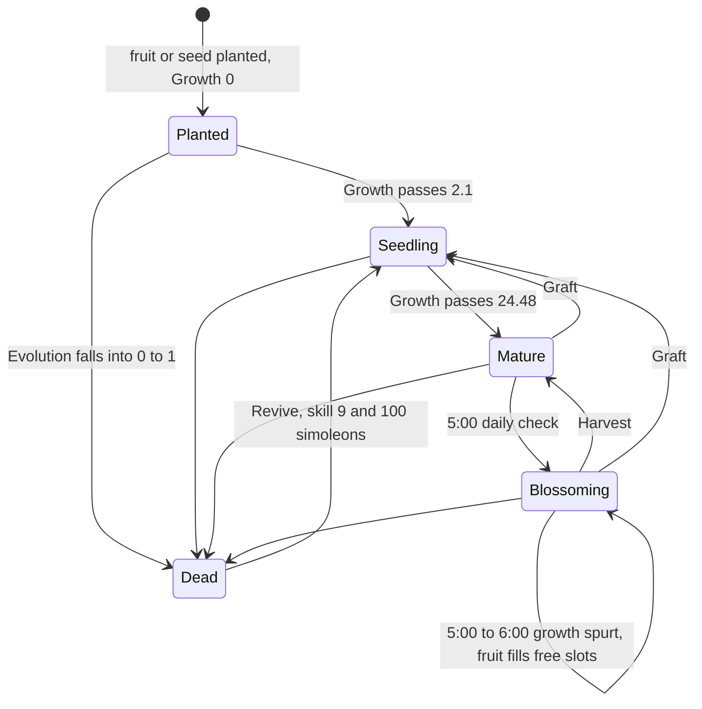
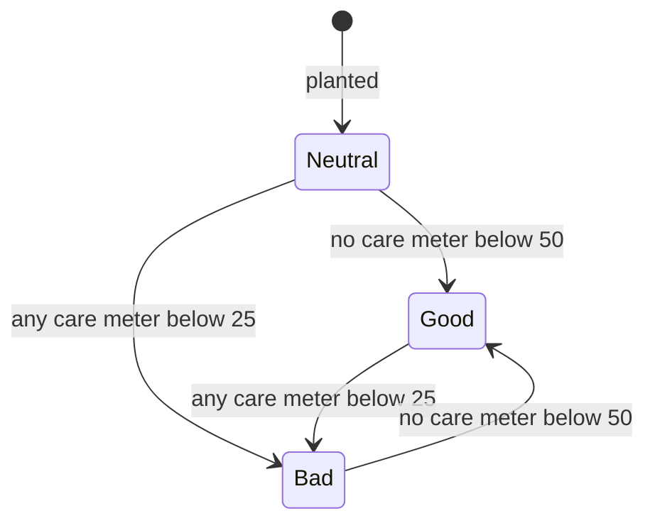
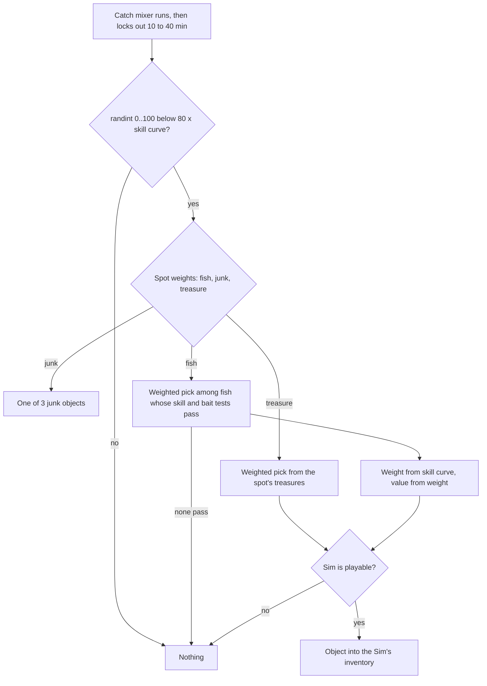

# 6.02 Gardening, fishing and collecting

*Game version 1.128.90.1030 (Steam, Linux/Proton). Numbers are live tuning: the base game's delta build, then each installed pack's delta build, which replaces that build's full tuning whole. The packs that add plants, fish, spawners or collections here are EP04 (Cats & Dogs), EP06 (Get Famous), EP09 (Eco Lifestyle), GP04 (Vampires) and GP12 (Werewolves); EP12 (High School Years), SP01 (Luxury Party) and SP42 (Grunge Revival) are installed and add nothing to these systems. A full-build value is quoted only where older notes used it. Written 2026-10-12. Checked 2026-10-12: 80 claims checked, 30 corrected, 1 relabelled, 1 removed. Deepened 2026-10-13: 2 modules newly explained, 0 failed decompiles read. Checked again 2026-10-13: 159 claims checked, 20 corrected, 1 relabelled, 0 removed. Cross-chapter edits 2026-10-13: 1 applied.*

## In plain words

A garden plant is an object with a handful of hidden meters. One meter is growth: it carries a planted seed through seedling to mature. Three meters are care: water, weeds and bugs. Each falls on its own clock, and watering, weeding or spraying fills it again. A fourth meter is the plant's evolution. When the plant is well cared for it rises a few points a day, and when the meter is full a Sim can evolve the plant one quality step, from Sickly up to Pristine. If the plant is neglected the same meter falls instead, and the plant dies when it reaches zero. Fruit appears only at dawn. Every morning at 5:00 a grown plant blossoms and fills its fruit slots during one "growth spurt" hour. Harvesting takes the fruit and puts the plant back to plain grown until the next morning.

Fishing is a dice roll every 10 to 40 minutes. Fishing skill sets the chance of any catch. Then the spot's weights choose fish, junk or treasure, and a fish is picked from the spot's list among those the Sim's skill and bait allow. The fish's weight comes from the Sim's skill, and its price grows with its weight. Collecting is bookkeeping: the first time the household owns one of a collection's items it is ticked off, and finishing the set pays money and usually gives a wall plaque.

Things that would surprise a player:

- Fertilizer never makes a plant grow faster. It only pushes the evolution meter, and that push shrinks with quality: a Scrubby plant gets one sixth of it and a Pristine plant none.
- Plant health has memory. A plant turns "bad" as soon as one care meter drops into the red, and it only turns "good" again once all three are back in the top half. In between it keeps whatever it was. A plant left dry dies about six days after its last watering.
- Quality lowers what fruit is worth. A Pristine fruit sells for 56 percent of the catalog value, a Sickly one for 20 percent and a wild one for 10 percent.

## Key facts

- **85 plant types and 47 fruit types are live** (live merge, matching the component key `gardening`; the full builds, which the game does not read, key it `gardening_component`, so a full-build count under `gardening` finds only EP09's 7 entries: plants base 68, EP04 8, EP09 3, GP04 6; fruit base 37, EP04 4, EP09 3, GP04 3), plus 1 fruitless plant and 1 grafting shoot.
- **Growth runs on one counter from 0 to 100**: Planted below 2.1, Seedling to 24.48, Mature to 99, Blossoming 99 to 100. The base rate is 0.017006804 per Sim minute. Each plant scales it with its own multipliers, so planting to Mature takes 24 h for a generic plant, 68.6 h for an apple tree, 3 h for parsley and 192 h for a public-garden cherry tree.
- **No plant blossoms by growing in practice.** On 83 of the 85 plants Mature sets the growth convergence to 98. The growfruit and forbidden fruit trees have no such override and keep growing at about half speed, but they would need 146 to 183 h to pass 99, and the 5:00 daily check turns every Mature plant Blossoming first. Harvesting resets the plant to Mature.
- **Fruit is made only from 5:00 to 6:00.** The fruit counter is locked the rest of the day. During the spurt it runs 50 times faster, so one fruit lands in a free slot every 3.4 to 4.8 Sim minutes (twice as fast on a wild plant).
- **Fruit does not rot by time.** Its decay meter turns Ripe after 66.7 h and Fallen after 120 h, and Fallen freezes it. The pickup mapping that should turn fallen fruit rotten never matches (a script bug, shown in disassembly).
- **Watering sets moisture to 100**, and weeding and spraying run their meters up to 100. Moisture then falls into the red in 76 h on a plant with multiplier 1, 101 h on an apple tree and 61 h on a tomato. Weeds reach the red about 7 days after weeding and bugs about 36 days after spraying. Seedlings cannot get bugs.
- **Health:** Bad as soon as any care meter is below 25, Good only when all three are at 50 or more, otherwise unchanged. Good raises evolution 3.75 points a day on a Sickly plant. Bad lowers it 16.7 a day and halves growth.
- **Death:** a plant dies when evolution falls into 0 to 1, 70.6 h after turning Bad from the midpoint 50 (Sickly). Reviving needs Gardening skill 9 and §100.
- **Quality ladder:** Sickly, Frail, Meager, Scrubby, Pristine, plus Wild. Each evolve needs evolution at 99.9 or more and Gardening skill 2, and resets the meter to 50. With care alone the climb from Sickly to Pristine takes about 93 days.
- **Fertilizer** adds +3.75 to +45 evolution, scaled ×1, ×0.43, ×0.25, ×0.17 and ×0 by quality, and can be used again after about 71 h. The fertilizer meter changes no rate.
- **Wild plants** never need water, weeding or spraying and never evolve, and they grow and fruit twice as fast.
- **Fishing:** catch chance is 80 × a skill curve, rolled as `randint(0,100) < chance`: 39.6% at level 1, 59.4% at 2, 79.2% at 3 and certain from level 4. The spot then picks fish, junk or treasure, most often at base weights 5 : 3 : 2, which skill, traits and mood scale (angling for a big catch multiplies the fish weight by 10).
- **26 of the 46 fish** named in fishing tuning exist here. The other 20 come from packs that are not installed. Only a playable Sim's catch creates an object: an NPC's catch creates nothing.
- **Collections:** 53 are tuned and 27 have items in this install (330 items). Finishing a base set pays §500 (frogs, plants, fish and a few others), §5,000 (magic beans) or the code default §100, even when there is no plaque to give.
- **Spawners:** 148 live objects enable a spawner component and 104 `SpawnerTuning` records are live. Most wild plants respawn on Monday, Wednesday and Friday, starting at a random time between 1:00 and 4:00, while dig sites, piles and sand refresh daily.
- **The EP05 (Seasons) hooks are inert.** Plants carry tuned season modifiers (in season ×2 growth and ×4 evolution, dormant ×0 growth), but the season states do not exist in this install, so the game drops them.

## How it works

### The gardening component family

**Observed** (`objects/gardening/gardening_component_variant.py: TunableGardeningComponentVariant`, live count). An object enables gardening through one `gardening` entry in `_components`, a variant with four live options: `plant_component` (`GardeningPlantComponent`, 85 objects), `fruit_component` (`GardeningFruitComponent`, 47), `fruitless_plant_component` (`GardeningFruitlessPlantComponent`, 1: `object_HousePlants_Plant`) and `shoot` (`GardeningShootComponent`, 1: `object_GardeningShoot_Generic`). Another 41 objects tune it as disabled (base 33, EP04 4, EP09 1, GP04 3): 40 of them are the `_wild` spawner hosts described under Spawners, and the last is `object_GardeningPot`. The crop variants (`GardeningCropPlantComponent`, `GardeningCropFruitComponent`) have no live users. They serve giant crops, which need EP11 (Cottage Living, not installed). No live record carries the older key `gardening_component`. The full builds of the base game, EP04 and GP04 use that key (121 enabled entries: base 97, EP04 12, GP04 12, plus 28 disabled), and EP09's full build already uses `gardening`; the game reads none of the full builds. See [2.02 Objects: components, states and wear](2.02-objects-states-wear.md) for how components attach.

**Observed** (`gardening_component.py: _GardeningComponent`, `gardening_component_base_plant.py: _GardeningBasePlantComponent`, `gardening_component_base_fruit.py: _GardeningBaseFruitComponent`). All gardening classes share one component slot and one persistence key. The plant base class registers the plant with `GardeningService` (`gardening_service.py`, a list of gardening objects searchable by level, centre and radius), refreshes fruit when the plant's state changes, and runs the fruit catch-up on load. The plant itself is driven by tuned states and commodities: the Python mostly manages fruit spawners, splicing and the hovertip.

**Observed** (`gardening_tuning.py: GardeningTuning`, base delta module tuning). The module tuning names the key commodities and states: `FRUIT_SPAWN_COMMODITY` 16573 (`commodity_Collection_SpawnSlotObject`), `QUALITY_STATE_VALUE` and `INHERITED_STATE` (both `GardeningQuality`), `EVOLUTION_STATE` 39328, `SCALE_COMMODITY` 16598 (`commodity_Gardening_Fruit-Size`), `SPONTANEOUS_GERMINATION_COMMODITY` 16599, `GROWTH_SPURT_STATE_INFO` (state 185741, On 185743, Off 185744, window 5 to 6), `SPAWN_WEIGHTS` (COMMON 40, UNCOMMON 9, RARE 1) and `FRUIT_STATES`. `FRUIT_STATES` lists the plant states in which fruit may stay on the plant: `PlantGrowth` Mature or Blossoming, and every `PlantEvolution` value except death. Its EP05 and EP11 keys drop at load. The behaviour is the default, destroy, so fruit vanishes when its plant leaves those states. `EXCLUSIVE_FRUITS` lists one definition from GP07 (StrangerVille) and is empty here.

### A plant's life

**Observed** (live states `PlantGrowth_*`, `object_GardeningPlant_Tree_apple` state component). `PlantGrowth` is a commodity-based state on `commodity_Gardening_Growth` (convergence 100, start 0). Ranges: Planted 0 to 2.1, Seedling 2.1 to 24.48, Mature 24.48 to 99, Blossoming 99 to 100, X_Decaying -1 to 0. The full build had 0 to 4.5 and 4.5 to 23.33333 and a rate of 0.02777778, which is where older notes got "Planted 2.7 h, Seedling 14 h". The live delta replaces all three. On 83 of the 85 plants Mature overrides the growth convergence to 98, so growth stops below 99. `Tree_Growfruit` and `Tree_forbiddenFruit` have no override: their Mature entry instead scales growth by 0.5 and 0.48, so they would reach 99 after about 183 h and 146 h, far longer than the wait for the next 5:00 check. Blossoming sets the convergence back to 100. When a state is set directly, the commodity jumps to the middle of the state's range unless the state names a default value (`objects/components/state.py: CommodityBasedObjectStateValue._tuning_loaded_callback`). Planted names 0. A commodity tuned with `_use_stat_value_on_init` is the exception at creation: it keeps its own initial value, and the object's default state only breaks ties between overlapping ranges (`StateComponent.pre_add`, which calls `set_state_from_stat(state, stat, preferred_value=value)`).

**Observed** (`time_of_day_component` on the apple tree, the same on all 85 plants). At 5:00 a plant in Mature or Blossoming is set to Blossoming and runs `Garden_GrowthSpurtOn_Loot_TimeOfDay`, which turns `Gardening_GrowthSpurt` On. At 6:00 the spurt goes Off again. A test would skip a plant in EP05's out-of-season or dormant states, but those states do not exist here. **Observed** (`loot_Gardening_Harvest_ResetGrowth`): harvesting a Mature or Blossoming plant sets it to Mature and fills the fruit counter to its maximum. A harvested plant therefore waits for the next 5:00, blossoms and refills.

**Observed** (live default values). Of the 85 objects that carry `PlantGrowth`, 57 start Planted, 7 start Seedling and 21 start Mature; the Seedling and Mature starts are 24 of the 30 `_public_garden` variants and four `Tuber_*_garden` objects (the other six public variants, the four catnips, the grape and the soybean, start Planted). No live object lists the `PlantDecay` (wilting, -50 to 100) or `PlantExpiration` states. Those records exist and are named in one visual-effect trigger on 84 plants and in the six revive interactions, but no plant carries them, so the wilting meter of older notes does nothing.

### Growth speed

**Observed** (`statistics/continuous_statistic.py: ContinuousStatistic._recalculate_modified_decay_rate`, `objects/components/state.py`). A commodity moves toward its convergence at its base rate times the product of every decay modifier that is active. Each active state value adds its modifiers twice over: the state record's own `new_client_state`, and the object's `client_states` entry for that value (`StateComponent._client_states_gen`, read in disassembly; the decompiled nesting shows only one of the two). Locked stats stop moving and ignore additions (`ContinuousStatistic.on_lock`, `BaseStatistic.add_value`).

For growth on a plant the active factors are:

| Factor | Where | Values |
|---|---|---|
| Base rate | `commodity_Gardening_Growth` | 0.017006804 per Sim minute |
| Stage | object `client_states` for `PlantGrowth_0_Planted` and `_1_Seedling` | apple 0.075 and 0.32; tomato 0.357 and 0.357; many plants none (×1) |
| Plant constant | object `client_states` for `GardeningDecay_PlantDecays` (default, never changes) | 0.25 (cowplant) to 16 (public lemon); apple 1.4 |
| Health | `PlantStatusAggregate_0_Bad` record | ×0.5 while Bad |
| Quality | `GardeningQuality_00_Wild` record | ×2 while Wild |
| Super Green Thumb | `SuperGreenThumb_PlantedBy` record | ×2 |
| EP09 neighbourhood | `ecoFootprint_Gardening_Green` / `_Industrial` records | ×0.625 / ×1.25 |

Time to Mature in hours, at Neutral or Good health, Sickly quality (**Inferred**: 2.1 ÷ (rate × plant × planted) + 22.38 ÷ (rate × plant × seedling), from the live values of all 85 plants):

| Plant (object name after `object_GardeningPlant_`) | Planted, Seedling, plant constant | To Mature |
|---|---|---|
| `Bush_parsley`, `Tuber_mushroom` | 1, 1, 8 | 3.0 h |
| `Bush_spinach` | 0.1, 1, 4 | 10.6 h |
| `Bush_basil`, `Tuber_carrot`, `Bush_Garlic` (GP04) | 1, 1, 1.4 | 17.1 h |
| `object_MeatWall` (EP09) | its own health entries: ×1.1 at Neutral, ×1.25 at Good | 21.8 h / 19.2 h |
| `Bush_strawberry` | 0.66, 0.9, 1.4 | 19.6 h |
| `Generic`, `Bush_generic`, `Tree_generic`, `Bush_SoyBeans` (EP09) | 1, 1, 1 | 24.0 h |
| `Flower_Wolfsbane` and its `_public_garden` variant | 1, 1, 0.84 | 28.6 h |
| `Bush_Catnip` (EP04) | 0.25, 0.97, 1.04 | 29.7 h |
| `Flower_tulip`, `Flower_snapdragon` | 1, 1, 0.7 | 34.3 h |
| `Bush_rose` | 1, 1, 0.54 | 44.4 h |
| `Bush_tomato`, `Tuber_potato`, `Bush_bluebell`, `Bush_sage` | various | 48.0 h |
| `Tree_apple` | 0.075, 0.32, 1.4 | 68.6 h |
| `Flower_orchid` | 1, 1, 0.35 | 68.5 h |
| `Tree_cherry`, `Tree_pear` | 0.12 to 0.125, 0.45 to 0.48, 0.7 | 90 to 93 h |
| `object_Cowplant` | 1, 1, 0.25 | 96.0 h |
| `Flower_DeathFlower`, `Bush_dragon` | 0.75 to 0.8, 0.8, 0.294 | 102 to 103 h |
| `Tree_apple_public_garden`, `Tree_cherry_public_garden`, `Tree_pear_public_garden` | 0.089 to 0.179, same, 0.7 to 1.4 | 191.9 h |

The median over the 85 plants is 34.3 h. **Inferred**: the public-garden variants spawn as Wild (see Spawners), which doubles their rate, so a public apple tree matures in about 96 h. Under Bad health every time doubles.

**Observed** (live tuning). 85 live `GameObject` records (83 `object_GardeningPlant_*`, plus `object_Cowplant` and `object_MeatWall`) have a decree-gated `tested_states` entry that would set `nobleCareer_EnvironmentPreservation_Values_On` (170 entries); it never applies here ([6.03](6.03-pack-systems.md#kingdom-residue-in-the-live-tuning)).

### Care: water, weeds and bugs

**Observed** (base delta commodities; object `client_states` per band, identical on all 85 plants). `commodity_Gardening_Moisture`, `_Weeds` and `_Infestation` each fall at a base 1 per Sim minute toward 0. Each band has its own multiplier, and the plant constant from `GardeningDecay_PlantDecays` scales on top (moisture 0.5 to 1.5, bugs 0.5 to 1.5, weeds 0.5 to 1).

| Meter | Red (0 to 25) | Yellow (25 to 50) | Middle (50 to 75) | Top (75 to 99 or 100) | Dripping (99 to 100) |
|---|---|---|---|---|---|
| Moisture | 0.03472222 | 0.03472222 | 0.02604167 | 0.00840336 | 0.04166667 |
| Weeds | 0.01736111 | 0.01743375 | 4.16666667 | 0.00289352 | |
| Bugs | 0.00868056 | 0.01743375 | 4.16666667 | 0.00049603 | |

The red moisture band also multiplies weeds by 0.75.

**Observed** (`Garden_Watered_Loot_Tested`, `Garden_Watered_Loot_Untested`, used by `Gardening_Water_Continuation`, `Gardening_Water_All_low`, `Gardening_Water_All_Area`, `Gardening_Tend_Continuation_water`). Watering sets moisture to its maximum, 100, and sets the `MoistureEffects` look to Watered. Only `Gardening_Water_with_Tears` uses `loot_Gardening_Water`, which sets 90 to 100. **Observed** (`Gardening_Weed_Continuation`, `Gardening_Spray_Continuation`, base delta; `statistics/statistic_ops.py: _get_tunable_amount`, rates per Sim minute). Weeding and spraying fill their meters while the Sim works: weeding adds 5 weeds a Sim minute (7 while Energized), spraying 2.5 bugs a minute, and each stops when its meter reaches 100. Both lower the Sim's hand hygiene by 10 a minute. The loots `loot_Gardening_Weed` and `loot_Gardening_Spray` (90 to 100, 4 hygiene) are full-build records with no live user. Weeding can also hand over one object from a weighted list of five definitions (`loot_Gardening_Weed_objectRewards`): 2% for Sims without the Collector or One with Nature traits and 5% for Sims with either, both only while the plant's weeds are at `Weeds_1_WeedsLightYellow` or lower. That loot sits in the interaction's outcome, and the outcome runs after the interaction's content (`interactions/base/interaction.py: Interaction.build_basic_elements`, disassembly: `build_critical_section(sequence, _decay_topics, build_outcome())`). **Inferred**: a weeding that runs to its exit at 100 fails the weeds test, so the reward needs a weeding cut short while weeds are still at 50 or below. **Observed** (`loot_Gardening_PuddleChance`, in the watering outcome): when the plant is in the dripping band the Sim may leave a puddle, 40% at Gardening skill 2 or below (×0.1 while an EP20 (Adventure Awaits) situation runs, which cannot happen here), 20% at 3 to 4 and 10% at 5 to 6. A separate 2% applies up to skill 8 when moisture is fully watered or above. Puddles themselves are in [2.04 Weather, seasons and the ground](2.04-weather-seasons-ground.md).

**Inferred** (time = band width ÷ (band multiplier × plant constant), using the table above). After watering, a plant with moisture constant 1 spends 24 min dripping, 47.6 h fully watered, 16 h waterable and 12 h yellow, so it turns red 76 h after watering. Divide by the plant constant: apple tree (0.75) 101 h, tomato (1.25) 61 h, orchid (1.5) 51 h, grape and blackberry (0.5) 152 h. Weeds weeded to 100 stay clear for 144 h, cross the middle band in 6 minutes, and turn red after another 23.9 h: about 168 h (7.0 days) in all. Bugs sprayed to 100 stay clear for 840 h (35 days), then 6 minutes and 23.9 h to the red, about 36 days. Divide by the plant's weed or bug constant. The middle band of weeds and bugs is crossed in minutes, so in practice those meters go straight from clear to yellow.

**Observed** (object `client_states` for Planted and Seedling). Young plants override the bug convergence to 75 and the fruit counter's convergence to 90. Both meters then stop inside their top band, so a planted or seedling plant cannot get bugs or make fruit.

**Observed** (`time_of_day_component`, `state_triggers` on the apple tree). The look of a plant (`MoistureEffects`, `InfestationEffects`, `GardeningWeedFX`, `MaterialEffects`) is refreshed at 6:00 each day: Dry if moisture is in band 0 or 1, Waterable if in band 2. A state trigger sets Watered whenever moisture is in band 3 or 4. The watering interactions test `MoistureEffects` for Waterable or Dry. **Inferred**: once watered, a plant cannot be watered again through those interactions until a 6:00 refresh finds it at or below the middle band. With moisture constant 1 the meter stays above 75 for 48 h after watering, so the next watering comes at the first 6:00 two to three days later.

### Plant health

**Observed** (`state_triggers` on the apple tree, the same on all 85 plants). `PlantStatusAggregate` has two triggers. `Bad` is an OR trigger on `Moisture_0_VeryDryRed`, `Weeds_0_WeedsHeavyRed` and `Infested_0_BugsHeavyRed`. `Good` is a NONE trigger: it fires when the plant is in none of the six red and yellow states. No trigger sets `Neutral` (its 86 live references are the 85 plants' default values and the state record). Neutral is the planting default and is never re-entered. A yellow meter keeps whatever the plant last was.

**Observed** (`PlantStatusAggregate_*` records). Bad halves growth and moves evolution toward 0 at 0.011574074 of its base 1 per minute (16.7 a day). Neutral sets the evolution multiplier to 0, so nothing evolves until the plant first turns Good. Good moves evolution toward 100 at 0.002604167 (3.75 a day). **Observed** (`commodity_Gardening_Moisture`, `_Weeds`, `_Infestation` initial tuning; `StateComponent.pre_add`): the three care commodities set `_use_stat_value_on_init`, so a new plant starts with moisture at 70 to 74 (`Moisture_2_Waterable`), weeds at 87 to 100 and bugs at 77 to 100, whatever default the plant names (50 plants name `Moisture_1_DryYellow` and 35 the dripping band). **Inferred**: a new plant is in none of the six red or yellow states, so it is Neutral only until its first state change after placement (at the latest when it becomes a seedling), when the NONE trigger turns it Good.

### Evolution, quality and death

**Observed** (`commodity_Gardening_Evolution` 39327: rate 1, start 50; `PlantEvolution` states: 0_Death 0 to 1, 1_Devolve 1 to 10, 2_Devolve 10 to 20, 3_Neutral 20 to 30 with default value 50, 4 to 8 in steps of 10, 9_Neutral 80 to 99.9, 10_Evolution 99.9 to 100). The quality state scales the evolution rate and also scales positive changes that loot makes to evolution. The second effect is applied in `BaseStatistic.add_value` through the `stat_use_multiplier` INCREASE entries.

| Quality (`GardeningQuality_*`) | Evolution rate × | Loot gains to evolution × | Days per step under Good (from 50) |
|---|---|---|---|
| 00_Wild | 0 | (1, untuned) | never |
| 01_Sickly | 1 | 1 | 13.3 |
| 02_Frail | 0.6666667 | 0.428571429 | 20.0 |
| 03_Meager | 0.5 | 0.25 | 26.6 |
| 04_Scrubby | 0.4 | 0.166666667 | 33.3 |
| 10_Pristine | 0.5 | 0 | top step |

Values 05 to 09 exist only in the base full build and are not live. The live ladder has five steps plus Wild.

**Observed** (`Gardening_Plant_Evolve` 39335, `testSet_Gardening_GenericEvolveTests`). Evolve needs the plant in `PlantEvolution_10_Evolution`, quality neither Wild nor Pristine, Gardening skill 2 or more, and no mature cowplant. It moves quality one step up (Sickly, Frail, Meager, Scrubby, Pristine) and resets evolution to 50 (`Loot_Statistic_Gardening_Evolve_reset`). **Inferred**: with steady care and no fertilizer, Sickly to Pristine takes 13.3 + 20 + 26.6 + 33.3, about 93 Sim days.

**Observed** (`PlantEvolution_0_Death`). In the death band the record zeroes the fruit counter, growth, bugs, moisture and weeds (each key is listed without a value, and a missing value reads as 0: `statistics/tunable.py: CommodityDecayModifierMapping`). Two triggers then set `PlantGrowth_X_Decaying` and `Moisture_0_VeryDryRed`. The plant looks dead and stays that way. **Inferred**: under Bad from 50, a Sickly plant dies after 49 ÷ 0.011574 = 4,234 min (70.6 h), and a Pristine plant after twice that. A plant with moisture constant 1 left without water therefore dies about 76 + 71 = 147 h (6.1 days) after its last watering.

**Observed** (`Gardening_Revive_Generic`, base delta). Revive requires the death state and Gardening skill 9, costs §100, and sets Moisture Waterable, Weeds Weedable, NoBugs, Seedling and `PlantEvolution_3_Neutral` (evolution 50). It also names the unused `PlantDecay_2_Alive` and `PlantExpiration_1_Alive`.

### Fertilizer

**Observed** (`Loot_Gardening_Fertilize_*`, base delta, used by `Gardening_Fertilize_continuation`, EP09's `Gardening_Fertilize_VerticalGarden_continuation` and `loot_Gardening_FertilizeAll`; `gardening_loot_ops.py: FertilizeAll`). The loot depends on the fertilizer object's value:

| Fertilizer value | Fertilizer meter | Evolution |
|---|---|---|
| below §5 | +20 | +7.5 |
| §5 to 12 | +20 | +15 |
| §12 to 20 | +30 | +22.5 |
| §20 to 50 | +40 | +30 |
| §50 or more, or pet poop (`Func_Pet_Poop`) | +50 | +45 |
| none of the above | +5 | +3.75 |

Every tier except the fallback (+5 / +3.75) also runs `Loot_Gardening_Fertilize_ResetCooldown`, which fills `commodity_Object_FertilizerCooldown` (rate 0.023148 per minute, maximum 100). The `Fertilizer_CanBeFertilized` state needs it below 1, which takes 99 ÷ 0.023148 = 4,277 min (71.3 h). `FertilizeAll` fertilizes every plant within 10 m that is in `Fertilizer_CanBeFertilized`, one fertilizer from the stack each, skipping giant-crop tags. The four fertilize pickers (`gardening_Fertilize_picker`, `_picker_All` and the two vertical-garden pickers) refuse a Wild target. `FertilizeAll` itself does not test quality. **Inferred**: a wild plant within 10 m of a fertilize-all target is fertilized too, which uses up a fertilizer and gains nothing, since Wild cannot evolve.

**Observed** (`Fertilizer_0_Depleted`, `_1_Normal`, `_2_Fertilized` records; `autonomy/autonomy_modifier.py` for the 1.0 default). Every fertilizer state sets growth ×1, and Normal and Fertilized add an evolution use multiplier left at its default 1.0. The fertilizer meter (rate 0.033 per minute) therefore changes nothing, and only the direct evolution gain matters, scaled by quality. **Inferred**: with the best fertilizer every 71.3 h and steady care, the four steps take about 2.6, 5.5, 8.8 and 12.4 days (about 29 days in all) against 93 without.

### Wild plants, Super Green Thumb and neighbourhood effects

**Observed** (`GardeningQuality_00_Wild` record). Wild zeroes moisture, weeds, bugs, fertilizer and evolution and doubles growth and the fruit counter. The tend interactions (`Gardening_Tend_Start`, `Gardening_Tend_All`), the fertilize pickers and the evolve test set exclude Wild. **Observed** (`gardening_component_fruit.py: GardeningFruitComponent._germinate`, `gardening_component_plant.py: GardeningPlantComponent.add_fruit`). A plant that sprouts from a fruit takes the fruit's quality, and fruit takes its plant's quality (`gardening_spawner.py: FruitSpawnerData.create_spawned_object`). **Inferred**: planting a wild fruit gives a wild plant that needs no care and can never be evolved.

**Observed** (`Loot_Gardening_SuperGreenThumb`, referenced by 109 live records, among them the water, spray, weed, tend, harvest and revive interactions; `SuperGreenThumb_PlantedBy` record). A Sim with `trait_SuperGreenThumb` who cares for or harvests a plant marks it, and from then on the plant grows ×2, dries ×0.2 and gets bugs ×0.1. The record also lists fruit size ×2 and germination ×5, but both commodities have a base rate of 0, so those two do nothing.

**Observed** (EP09 delta). Plants carry EP09 states: `ecoFootprint_Gardening_Green` (growth ×0.625), `_Industrial` (growth ×1.25, weeds ×1.5) and two neutral states. While a plant is Green, a timed trigger every 360 minutes runs `loot_EcoFootprint_Gardening_ToGreenSetQuality`. That loot adds evolution +10 (100%), +30 (50%) and +50 (25%), gated by a threshold test on evolution with value 1, which is an expected +37.5 every six hours before the quality scaling. **Inferred**: a Sickly plant in a green neighbourhood at 50 reaches the evolve band at the first six-hour tick only when the +50 roll lands (25%), and usually by the second tick (12 h); the bonus dwindles at higher quality. How a street makes plants Green belongs to EP09's eco-footprint system (see [2.07 Neighbourhood systems](2.07-neighbourhood-systems.md)).

**Observed** (the apple tree and tomato bush records; ids resolved in patch data, pack not installed). Base tuning on these plants gives modifiers for EP05's season states: Dormant (growth ×0, moisture ×0.1, evolution ×0, weeds and bugs locked), Indoors (evolution ×0.5), In Season (growth ×2, evolution ×4) and Out of Season (growth ×0.75, evolution ×0). Other entries name EP05 heat (moisture ×3), frost (care frozen) and spring bugs (bugs ×2), a GP08 (Realm of Magic) gardening spell (care ×0), EP19 (Enchanted by Nature) enchantment states, a GP01 (Outdoor Retreat) herbicide state, EP03 (City Living) and SP16 (Tiny Living) lot-trait soil states and EP07 (Island Living) conservation states. Their state values are not loaded here. `StateComponent` skips a state whose default value is missing, so none of them apply (see [2.04 Weather, seasons and the ground](2.04-weather-seasons-ground.md)).

### Fruit: when it appears and what it is worth

**Observed** (object `client_states` for `Gardening_GrowthSpurt_On` and `_Off`, Mature and Blossoming). The fruit counter `commodity_Collection_SpawnSlotObject` (rate 0.41666665 per minute, start 100) is locked by GrowthSpurt Off and by Mature. During the 5:00 to 6:00 spurt on a Blossoming plant it runs ×50, 20.83 per minute. **Observed** (`objects/components/spawner_component.py: SpawnerComponent.reset_spawn_commodity`, `SPAWNER_COMMODITY_RESET_VARIANCE` 30 in base delta, code default 0). Each time the counter reaches 0 the slot spawner places one fruit, and the counter resets to 100 minus `randint(0, 30)`. **Inferred**: a fruit appears every 3.4 to 4.8 minutes during the hour (1.7 to 2.4 on a wild plant), up to 12 to 17 tries. Each try fills one free fruit slot. The slot count lives in the model, and the plant also skips its tuned prohibited slots in a medium pot or vertical garden. Once the slots are full, further tries make nothing.

**Observed** (`objects/components/spawner_component.py: SpawnerComponent._spawn_object`, read in the disassembly). The firemeter only gates: a spawn fails by limit when the spawner already owns as many objects as its cap. The apple tree's cap is state-based and keyed on EP05 states. Those entries drop, so it has no cap. A weighted pick among the spawner entries whose owner tests pass (for a plant, its fruit spawners) comes next, then `random.random() > spawn_chance` fails by chance, then the spawner's tests, then the object is created in a slot. **Observed** (`gardening_component.py: _GardeningComponent._get_fruit_spawn_weight`, checked in disassembly). Each fruit spawner's weight is `SPAWN_WEIGHTS` of the rarer of the fruit and the plant's own root fruit in the Gardening collection, with a missing entry counting as COMMON. A rare graft on a common tree therefore yields 1 ÷ 41 = 2.4% of the fruit and an uncommon one 9 ÷ 49 = 18.4%.

**Observed** (`gardening_component_base_plant.py: _GardeningBasePlantComponent.spawn_fruits_for_time_passed_since_last_save`). When a lot loads after time has passed, the plant counts only the minutes that overlap the 5:00 to 6:00 window. It sets the spurt On, works out how many times the counter would have emptied (`int(total change ÷ distance to convergence)`), forces that many spawns, stops at the first result other than a spawn or a failure by chance (normally a failure by limit once the slots are full), then sets the spurt Off.

**Observed** (`object_GardeningFruit_Apple` 24950; `objects/components/state.py` value modifiers). Fruit value starts from the catalog value. Each quality removes a percentage of it: Wild 90%, Sickly 80%, Frail 71.11%, Meager 62.22%, Scrubby 53.33%, Pristine 44.44%. The value is `max(round((base + added value) × multiplier), 0)`, where the multiplier starts at 1.0 and each percentage cut subtracts from it. A Pristine apple therefore sells for 55.6% of its catalog value and a Sickly one for 20%. The rotten state takes off another 50%, which leaves a Sickly rotten fruit at 0. The fruit's scale per quality is 0.97, unchanged, 1.01, 1.02, 1.03 and 1.05. `FruitSpawnerData.create_spawned_object` copies the plant's quality onto the fruit and sets fruit size to 1 × uniform(0.8, 1.2), using the code default of `SCALE_VARIANCE`.

**Observed** (`commodity_Gardening_Fruit-Decay` 16597: rate 0.005 per minute, start 100, convergence -1; `FruitDecay_*` states: 5_New 80 to 100, 4_Ripe 64 to 84, 3_Fallen 48 to 68, 2_Picked 32 to 52, 1_Rotten 0 to 36 with decay ×10, 0_Decayed from -1, which replaces the object). Fallen and Picked list fruit decay with no value, which is ×0. **Inferred**: the overlapping bands switch as the value leaves each one, so fruit turns Ripe after 66.7 h and Fallen after 120 h, and there the meter stops. Time alone never makes fruit rotten in live tuning (the pickup mapping that would rot fallen fruit never fires; see the dead code paths below). A fruit rots only when something sets `FruitDecay_1_RottenFruit` (the one live setter outside the fruit and state records is `Rocket_Mischief_StuffFruit_picker`); the meter then jumps to 18, the middle of the Rotten band, and at ×10 reaches Decayed 6 h later.

**Observed** (`gardening_component_fruit.py: GardeningFruitComponent.start_germination_timer`). A fruit sprouts into a plant when its germination counter (16599, start 100, rate 0) reaches its convergence. The Rotten, Picked, Fallen and Decayed states also set its modifier to 0. **Inferred**: a fruit left on the ground never sprouts on its own in live tuning, and planting is what drives the counter.

### Grafting and splicing

**Observed** (`gardening_interactions.py: GardeningSpliceInteraction`, `GardeningGraftInteraction`, `GardeningGraftPickerInteraction`; `gardening_component_plant.py: GardeningPlantComponent.create_shoot`, `add_fruit`). Taking a cutting creates a shoot (definition 22469 on the apple tree) that carries the plant's root fruit spawner. `loot_Gardening_Splice_Devolve` then lowers the source plant's evolution by 30 and refills its fruit counter. Grafting moves the shoot into a hidden inventory and adds the shoot's root fruit as an extra spawner on the target. If the target's fruit tuning has a splicing recipe for that fruit, the recipe's result is added as another spawner. The apple lists one recipe: definition 22467 grafted on gives definition 23439, both Gardening collection items. The target is marked `GardeningSpliced_IsSpliced`, and `loot_Gardening_Graft` sets it to Seedling with `PlantEvolution_5_Neutral`, so a grafted tree has to grow up again. `Gardening_Graft` tests Gardening skill with lower bounds 4 and 5.

### Spawners

**Observed** (`objects/components/spawner_component.py: SpawnerComponent`, `SpawnerTuning`; live counts). 148 live objects enable the spawner component (base 113, EP04 13, EP06 7, EP09 6, GP04 9) and one base object disables it. 104 `SpawnerTuning` records are live (base 70, EP06 26, EP04 4, GP04 3, EP09 1). A spawner entry chooses a ground or slot spawner, a weighted list of objects, a spawn chance, tests, a radius and minimum radius for ground spawns, states to force on what it creates, and either a weekly schedule (`spawn_times`) or the commodity clock. Without a schedule a ground spawner uses commodity 16572 (rate 1 per minute, reset 70 to 100, so 70 to 100 minutes apart) and a slot spawner uses 16573. With a schedule the commodity is removed.

**Observed** (live `SpawnerTuning`). The 104 records split into 57 wild plant spawners, 21 other ground spawners and 26 slot spawners. A wild plant spawner sits on a `_wild` host object (gardening disabled, global firemeter) and spawns the matching `_public_garden` plant. 51 of them run on Monday, Wednesday and Friday, starting at a random time within 3 h of 1:00; the other 6 (five `_Wild_Mature` spawners and the growfruit tree) run daily. Later spawns are forced to `PlantGrowth_0_Planted` and Wild (Mature and Wild for the five mature ones). First spawns arrive Wild and as Seedling (46), Blossoming (6) or Mature (5). The other ground spawners (fish, seaweed and leaf piles, dig mounds, the dig site, the sand bottle, the EP05 snow drift and the frog log and water pump) run daily from 1:00 within 3 h; the frog log skips Saturday and the water pump Sunday. Ground radii: 1 m (48 records, 31 of them at the code default), 6 m (16, the DewCollector variants, with a 2 m minimum radius), 2 m (12: eight wild plant spawners including the four wild flowers, the frog log, the dig site, the dirt dig mound and the sand bottle), 5 m (the snow drift) and 0 (the water pump). A `spawn_chance` of 75 appears only on the EP05 leaf piles and snow drift. Weights are 1 except the frog log, dig site and sand bottle (4), the water pump, the small seaweed pile and three catering pizzas (2) and the wild growfruit (0). EP06 adds 21 catering slot spawners and 5 celebrity tile spawners. The 13 `_garden` plant spawners and 20 `spawner_Lot_*` spawners of older notes, and `spawner_Gardening_HarvestGeneric`, are base full build only and are not live.

**Observed** (`SpawnerComponent._SpawnFiremeterGlobal`, `_SpawnFiremeterStateBased`). A global firemeter is a fixed cap (code default 1, used untuned by 51 spawner objects: base 43, EP04 4, GP04 3, EP09 1). A state-based firemeter takes the cap from the first active state and gives no cap when none is active; 94 objects use one (the 85 plants, the two EP05 piles, the five EP06 celebrity tiles and the two EP09 dew collectors). Three objects (two EP06 catering tables and the EP04 pet crate) have no firemeter and no cap. **Observed** (`SpawnerInitializer`, code defaults): on the first visit to a zone, initial spawns run one every 5 minutes after a random 15 to 60 minute delay. `SPAWN_ON_GROUND_FGL_HEIGHT_TOLERANCE` is 0.3 m in base delta (code 0.1).

### Fishing: spots, bait and the catch roll

**Observed** (`fishing/fishing_interactions.py: FishingLocationCatchMixerInteraction._is_successful_catch`, `_build_outcome_sequence`). The chance is `BASE_CATCH_CHANCE` (untuned, code default 80%) × `CATCH_CHANCE_MODIFIER_CURVE` on Fishing skill (level 1 0.5, 2 0.75, 3 1, 4 1.25, 5 1.5, 6 1.75, 7 2, 8 2.25, 9 2.5, 10 3). It is rolled with `sims4.random.random_chance`, which tests `randint(0, 100) < chance` over 101 outcomes. That gives 39.6% at level 1, 59.4% at level 2 and 79.2% at level 3. From level 4 the chance is 100 or more and every attempt succeeds. A Sim without the skill gets the curve's ×1 and 79.2%. With the luck service (EP19, not installed) the roll would go through luck options instead. On success `FishingDataBase.choose_any` picks a category by the spot's weights, then a fish (`_choose_individual_fish`, `require_bait=True`) or a treasure. Junk is one of `JUNK_OBJECTS` (three definitions). Fish and treasure objects are created only when `sim.is_selectable`, so an NPC's catch leaves nothing. A caught fish goes to the Sim's inventory, or to household inventory when that is full. The release-or-keep dialog for endangered fish needs EP07's dialog, which is not loaded, so it never shows.

**Observed** (live `FishingLocation_Catch` mixer). The catch mixer has a lockout of 10 to 40 Sim minutes. **Inferred**: a fishing Sim rolls once per 10 to 40 minutes.

**Observed** (`fishing/fish_object.py: Fish.can_catch`). A fish can be chosen only if the Sim has its `required_bait_buff` (when tuned) and passes its `catchable_tests`, mostly a minimum effective Fishing skill. Bait works as a buff: `fishing_tuning.py: FishingTuning.BAIT_TAG_DATA_MAP` maps 12 bait tags to bait data (`FishingBait`, 12 live snippets, one from GP04), and `FishingLocationGoFishingSuperInteraction` applies the bait buff while fishing and re-applies it after each catch. Each fish entry in a spot's list has its own weight (base 2 to 5 among the installed fish of `fishingData_Generic`, and three rarer fish there carry no base and take the default 1) with bait multipliers, typically ×1.2 or ×1.4 for a matching bait buff. Some entries also carry ×0.5 under EP07's (Island Living) `globalPolicy_Conservationist_Fishing_ControlInvasiveSpecies` and ×4 or ×6 under its mermaid lure state; neither is loaded here, so those multipliers never apply.

**Observed** (`fishing_location` component: 59 live objects, base 50, EP04 6, GP04 1, GP12 2, of which 13 are fishing holes; 53 live `FishingData` snippets, base 44, EP04 6, GP12 2, GP04 1). The commonest base weights for fish, junk and treasure are 5 : 3 : 2 (17 of 53 records, 50%, 30% and 20% before multipliers). The numbered fishing spots and holes use 7 : 2 : 1 when common, 11 : 3 : 2 when uncommon and mostly 7 : 1 : 2 when rare; the common glade and cave ones and one rare spot use 10 : 1 : 5. The town spots vary: 6 : 2 : 2 (5 records), 5 : 2 : 3 (4), 6 : 1 : 3 and 5 : 2 : 2 (2 each) and a few single patterns. The fish-tip spot is 100 : 0 : 0 and ponds 6 : 4 : 0. The fish lists reference 46 fish definitions, 26 of them installed. The 20 missing ones come from EP07 (13), GP02 (Spa Day, 3), EP03 (City Living, 2), GP01 (Outdoor Retreat, 1) and GP06 (Jungle Adventure, 1), and they drop from every list. Examples:

| Fishing data | Fish (live of tuned) | Treasures (live of tuned) | Fish : junk : treasure |
|---|---|---|---|
| `fishingData_Generic` | 13 of 14 | 15 of 17 | 5 : 3 : 2 |
| `fishingData_WillowCreek_Common_Freshwater` | 17 of 21 | 15 of 17 | 5 : 3 : 2 |
| `fishingData_IslandWorld_Rare_NaturalIsland` | 20 of 37 | 15 of 17 | 5 : 3 : 2 |
| `fishingData_BrindletonBay_Rare_Ocean` (EP04) | 18 of 22 | 16 of 18 | 6 : 1 : 3 |
| `fishingData_Spot_GD_Common_01` | 8 of 11 | 3 of 4 | 7 : 2 : 1 |
| `fishingData_Spot_GD_Rare_01` | 12 of 15 | 4 of 5 | 10 : 1 : 5 |
| `fishingData_Spot_VampireStreet_Common_01` (GP04) | 8 of 11 | 4 of 4 | 8 : 3 : 1 |
| `fishingData_Wolftown_Lake` (GP12) | 12 of 15 | 31 of 33 | 5 : 3 : 2 |
| `fishingData_FishTip` | 23 of 28 | 15 of 17 | 100 : 0 : 0 |

**Observed** (`fishingData_Generic`, the three `weight_*` tunables). The category weights are `TunableMultiplier`s: the base value times every multiplier whose tests pass. The fish weight is ×10 while the Sim has `buff_Skill_Fishing_AngleForBigCatch`, ×1.2 at Fishing 3 to 5, ×1.4 at 6 to 8 and ×1.8 from 9, ×1.2 for Loves Outdoors, Perfectionist or Loner, ×1.4 for Angler's Tranquility, One with Nature or GP01's Survivalist (not loaded), ×1.2 when Focused, ×0.8 when Dazed, Stressed, Angry or Bored, and ×1.2 while a situation tagged `Situation_R3Event` runs. The junk weight is ×1.33 at Fishing 2 or below, ×1.33 when Dazed, ×1.25 when Stressed and ×1.2 when Uncomfortable or Angry; an EP21 decree test (×0.5) needs a service that does not run here. The treasure weight is ×1.25 for Materialistic, Collector or the base game's `trait_JungleExplorer_TreasureHunter_BG` (GP06's own treasure-hunter trait in the list is not loaded). **Inferred**: a Fishing 9 Sim angling for a big catch at a 5 : 3 : 2 spot picks fish 5 × 10 × 1.8 = 90 against 3 + 2, about 95% of catches.

**Observed** (live tuning). 53 live `FishingData` records (base 44, EP04 6, GP12 2, GP04 1) also carry EP21 (Royalty & Legacy) EnvironmentPreservation decree multipliers: ×2 on 284 entries and ×0.5 on 53. With no kingdom service the decree test always fails, so they never apply ([6.03](6.03-pack-systems.md#kingdom-residue-in-the-live-tuning)).

**Observed** (`fishing_data.py: DynamicFishingData`). A pond stocked through gameplay keeps its own fish list. Only there does a fish's `catch_multiplier` weigh its chance (for example the anglerfish: base 2, ×1.4 with small-fish bait, ×1.2 with medium-fish bait).

### Fish weight, value and freshness

**Observed** (`fish_object.py: Fish.initialize_fish`, `Fish._update_fish_cost`). Weight in kg: the mean is `skill_weight_curve` at the Sim's effective Fishing level (1 without the skill). The deviation is the mean × `mean_weight_deviation`, and the weight is uniform between max(mean - deviation, 0.1) and mean + deviation. The fish's value is its catalog value, plus `int(1 × weight_money_multiplier)` added when the object is created (the weight stat starts at 1), plus `int(weight × weight_money_multiplier)` after the catch. A level 10 sturgeon weighs 20 to 80 kg and adds §40 to §160.

| Fish (`object_fish_*`) | Min skill | Required bait | Mean kg at level 1 / 10 / 20 | Deviation | § per kg |
|---|---|---|---|---|---|
| Angel | 3 | | 0.25 / 3.2 / 5.12 | 0.4 | 1.5 |
| Angler | 7 | medium fish | 8 / 32 / 64 | 0.5 | 2 |
| Bass | 2 | | 3 / 10 / 17.5 | 0.5 | 1.25 |
| Batfish | 2 | | 2.75 / 10 / 15 | 0.5 | 1.5 |
| Betta | 3 | | 0.2 / 2.8 / 4.48 | 0.4 | 1.5 |
| Catfish | 4 | organic | 4.3 / 16 / 40 | 0.5 | 1.5 |
| Gold | | | 0.2 / 2 / 6 | 0.4 | 1.25 |
| Guppy | | | 0.15 / 1.25 / 1.88 | 0.4 | 1.25 |
| KissingGourami | 4 | | 0.4 / 8 / 12 | 0.4 | 1.5 |
| Koi | 2 | | 3.5 / 9 / 27 | 0.5 | 1.25 |
| LunaFish (GP12) | 3 | | 8.5 / 25 / 45 | 0.6 | 1.5 |
| Minnow | | | 0.5 / 1.5 / 2.25 | 0.4 | 1.25 |
| Perch | | | 0.3 / 1.75 / 2.63 | 0.4 | 1.25 |
| Pirahna | 6 | medium fish | 0.5 / 3.5 / 5.25 | 0.4 | 2 |
| Rainbow | 6 | (disabled) | 1.5 / 7.2 / 12.6 | 0.5 | 2 |
| RedTailedShark | 5 | small fish | 0.66 / 3.2 / 5.6 | 0.4 | 2.25 |
| Salmon | 3 | | 8.5 / 25 / 45 | 0.6 | 1.25 |
| Spooky_Bones | 5 | | 0.5 / 4 / 7 | 0.4 | 2 |
| Spooky_gummy | 3 | | 0.2 / 3 / 6 | 0.4 | 2 |
| Sturgeon | 7 | | 12 / 50 / 115 | 0.6 | 2 |
| Tetra | | | 0.25 / 2 / 3 | 0.4 | 1.25 |
| Tilapia | 4 | | 2.5 / 10 / 16 | 0.5 | 2 |
| Treefish | 2 | | 3 / 11 / 19.25 | 0.5 | 1.5 |
| Trout | 2 | | 2.5 / 12 / 18 | 0.5 | 1.25 |
| VampireSquid (GP04) | 7 | | 2.5 / 11 / 22 | 0.5 | 2.5 |
| WolfEel | 5 | frog | 7.8 / 17.5 / 35 | 0.6 | 1.5 |

Nine fish (Bass, Gold, Guppy, Koi, Minnow, Perch, Salmon, Tetra and Trout) also fail their catchable tests while the Sim has `buff_Skill_Fishing_AngleForBigCatch`, so angling for a big catch removes them from the pool. The skill curve runs to level 20, but the skill stops at 10 (see [3.10 Skills, careers and school](3.10-skills-careers-school.md)), so the level 20 column is never reached.

**Observed** (`commodity_Fish_Freshness` 77040: start and maximum 300, rate 0.2 per minute, convergence -1; `FishFreshness` states Excellent 240 to 300, Great 180 to 240, Good 120 to 180, Average 60 to 120, Poor 0 to 60, Foul below 0). **Inferred**: each band lasts 5 h, so a fish turns foul 25 h after the catch unless something pauses the commodity. Cooking fish is in [6.01 Crafting, cooking and making things](6.01-crafting-cooking.md).

### Aquariums, fish bowls, mounting and fish traps

**Observed** (`fishing/aquarium_object.py: Aquarium`, `fishing/fish_bowl_object.py: FishBowl`, `fishing_interactions.py: MountFishSuperInteraction`). A fish bowl holds one fish and takes that fish's environment score and tooltip. An aquarium sums the environment scores of the fish in its inventory and adds an effect per fish at `_FX_fish_` slots. Mounting creates the fish's `wall_mounted_object`. Live counts: 3 `FishBowl`, 1 `Aquarium`, 1 `MountFishSuperInteraction`. **Observed** (`fishing/fish_trap_interactions.py: FishingTrapCatchMixerInteraction`): fish traps catch several items per check through `choose_any_multiple`, but the only tuning that uses the class is EP07 patch data (patch data, pack not installed), and no live record uses it.

### Collections

**Observed** (`objects/collection_manager.py: ObjectCollectionData`, `CollectionTracker`, `CollectableComponent`; base delta module tuning). `COLLECTIONS_DEFINITION` lists 53 collections, each with base items, optional bonus items, a reward object and reward money. Rarity comes from `Collectible_RarityState` (COMMON, UNCOMMON, RARE, mapped from three state values). 258 live objects enable the `collectable` component (base 234, GP12 14, EP04 5, GP04 4, EP09 1). An item counts the first time an object of that definition owned by the active household is added to an inventory or leaves an invalid state. The invalid states are `GardeningIdentify_Unidentified`, which keeps an unidentified plant from counting, and two GP06 states that are not loaded. A later copy only updates the stored quality if it is higher.

**Observed** (live tuning). 9 live base `LootActions` (4 `loot_ObjectReward_Collectible_*`, 5 `loot_FrogCollectible_*`) have decree-gated multipliers: reward-object weight ×5 (72 entries) or ×3 (1), and a ×1.5 on the object-reward chance (`object_rewards` > `chance` > `multipliers`) of `loot_ObjectReward_Collectible_Crystal` and `loot_ObjectReward_Collectible_Crystal_NoObject`. None of these tests is negated, so all of them are inert without EP21 ([6.03](6.03-pack-systems.md#kingdom-residue-in-the-live-tuning)).

**Observed** (`CollectionTracker.check_collection_complete`, disassembly). When every base item of a collection is collected, the household is paid `completed_award_money` through `household.funds.add` (code default §100 when untuned). The jump to the payment does not depend on the reward object or the lot, so the money arrives even when there is no reward to place. The reward object goes into the hidden inventory on the home lot, otherwise into household inventory, and is unlocked in build mode. Bonus items run the same check with `is_base_collection=False`, which gives no second payment.

| Collection | Live items (common / uncommon / rare) | Reward § | Bonus items live of tuned | Plaque |
|---|---|---|---|---|
| Gardening | 32 (14 / 11 / 7) | 500 | 6 of 55 | yes |
| Fish | 22 (9 / 6 / 7) | 500 | 4 of 35 | yes |
| Frogs | 25 (8 / 11 / 6) | 500 | 0 of 2 | yes |
| Telescope | 25 (11 / 8 / 6) | 100 | | yes |
| MySims, Metals, Crystals | 20 each (10 / 6 / 4) | 100 | Metals 0 of 5, Crystals 0 of 7 | yes |
| NatureElements, Fossils | 15 each (9 / 3 / 3) | 100 | 0 of 1, 0 of 5 | yes |
| Postcards | 14 (8 / 4 / 2) | 100 | 0 of 7 | yes |
| Microscope | 12 (6 / 4 / 2) | 100 | | yes |
| Feathers (EP04) | 12 (5 / 4 / 3) | 100 | | no |
| WerewolfRelics (GP12) | 12 (3 / 6 / 3) | 500 | | yes |
| Aliens | 10 (5 / 3 / 2) | 100 | | yes |
| EasterEggs | 10 (all common) | 100 | 2 of 2 (rare) | yes |
| CandySkulls | 9 (all common) | 100 | 1 of 1 (rare) | no |
| MagicBeans | 6 (all common) | 5,000 | | no |
| FreezerBunnies, MilkCartons, Magnets, HolidayMagnets | 6 each (3 / 2 / 1) | 100 | | yes |
| RegencyMemento | 6 (2 / 2 / 2) | 100 | | yes |
| EV008SkeletonKeys | 5 (1 / 1 / 3) | 100 | | yes |
| SpaceRocks | 4 (1 / 2 / 1) | 100 | | yes |
| EFDec24EVRwreath | 4 (2 / 1 / 1) | 100 | | yes |
| EF63NatureMagazines | 4 (2 / 1 / 1) | 100 | | no |
| PositivityPosters | 4 (all common) | 500 | | no |

The other 26 collections have no installed items. Insects (GP01), geodes (EP01, Get To Work), posters and snow globes (EP03), seashells and buried treasure (EP07), magic objects (GP08, Realm of Magic) and others need packs that are not installed. The base full build, which is not live, lists only 13 collections, with Telescope at 15 items and Gardening at 31 and some items left without a rarity; older notes that read it undercount.

**Observed** (`gardening_notebook_entries.py: NotebookEntryGardeningPlant`, 41 live). The gardening notebook entry is keyed by fruit definition and shows the plant's fruit and splice data. `fishing_tuning.py: FishingTuning.add_bait_notebook_entry` adds bait entries when a fish is caught with bait.

### Wisps (EP19, not installed)

**Observed** (`objects/gardening/wisp/wisp_service.py: WispService.required_packs`, `wisp_tuning.py: WispTuning`, base delta module tuning). Wisps fly between enchanted plants. The service needs EP19 and does not run here. `wisp_tests.py: WispTest` returns False without the service, and the two console commands (`gardening.force_start_wisp`, `gardening.stop_wisp`) are DebugOnly and never register in retail. The tuning still reads: idle 50 minutes, travel 3 minutes, search radius 5 m, at least 4 enchanted plants on the lot each with at least 2 neighbours, scheduled daily at 6:00 for 5 h. The state machine is in `wisp_states.py` (`IdleWispState` and the travel state) and `wisp.py: Wisp`.

### A dead code path: harvesting giant crops

**Observed** (`gardening_component_crop_plant_element.py: HarvestCropsElement._do_behavior` and its `get_simoleon_delta`, disassembly). Line 53 is `LOAD_FAST gardening_component; LOAD_ATTR supports_harvest; POP_JUMP_IF_TRUE`, and line 64 is `LOAD_ATTR supports_harvest; POP_JUMP_IF_FALSE`, with no call in between. `supports_harvest` is a plain method in both `gardening_component.py` (line 383 of the original source, returns False) and `gardening_component_crop_plant.py` (line 130), with `MAKE_FUNCTION` and `STORE_NAME` and no decorator call. A bound method is always truthy, so the check never rejects a non-crop object. Normal play does not reach it: no live tuning uses the `harvest_crops` element, and no live object has a crop component.

### A dead code path: the fruit pickup mapping

**Observed** (`gardening_component_base_fruit.py: _GardeningBaseFruitComponent.on_added_to_inventory`, read in the disassembly; `GardeningTuning.PICKUP_STATE_MAPPING` in base delta module tuning). When a fruit enters an inventory, the hook walks the mapping, which base delta tunes as Fallen to Rotten, Ripe to Picked and New to Picked. Line 77 is `LOAD_METHOD has_state; LOAD_FAST on_state_value; CALL_METHOD 1; POP_JUMP_IF_FALSE`. `StateComponent.has_state(state)` is `state in self._states`, and `_states` is keyed by the state, not by its values, so the test is always False and nothing happens. Line 78 would fail too: it calls `set_state` with the value alone, and `set_state` needs the state and the value. **Inferred**: picked fruit keeps the decay state it had on the plant, and together with the freeze in Fallen and Picked, fruit does not rot by time in this install.

## Numbers

| Name | Value | Unit | Where | Build |
|---|---|---|---|---|
| Growth base rate | 0.017006804 (full 0.02777778) | per Sim minute | `commodity_Gardening_Growth` | base delta |
| Planted / Seedling / Mature / Blossoming / X_Decaying | 0-2.1 / 2.1-24.48 / 24.48-99 / 99-100 / -1-0 (full 0-4.5, 4.5-23.33) | growth | `PlantGrowth_*` | base delta |
| Mature growth convergence | 98 (83 of 85 plants; growfruit and forbidden fruit trees: none, growth ×0.5 and ×0.48 instead) | growth | plant `client_states` | base delta |
| Apple stage multipliers | 0.075 (Planted), 0.32 (Seedling) | × | `object_GardeningPlant_Tree_apple` | base delta |
| Plant constant on growth | 0.25 to 16, apple 1.4 | × | `GardeningDecay_PlantDecays` per plant | base delta and packs |
| Plant constant on moisture / bugs / weeds | 0.5-1.5 / 0.5-1.5 / 0.5-1 | × | same | base delta and packs |
| Moisture, weeds, bugs base rate | 1 | per Sim minute | `commodity_Gardening_Moisture`, `_Weeds`, `_Infestation` | base delta |
| Moisture band multipliers | 0.03472222, 0.03472222, 0.02604167, 0.00840336, 0.04166667 | × | plant `client_states` | base delta |
| Weed band multipliers | 0.01736111, 0.01743375, 4.16666667, 0.00289352 | × | plant `client_states` | base delta |
| Bug band multipliers | 0.00868056, 0.01743375, 4.16666667, 0.00049603 | × | plant `client_states` | base delta |
| Weeds while very dry | 0.75 | × | `Moisture_0_VeryDryRed` entry | base delta |
| Watering | set to maximum (100) | moisture | `Garden_Watered_Loot_Tested`, `_Untested` | base delta |
| Watering with tears | 90 to 100 | moisture | `loot_Gardening_Water` | base delta |
| Weeding, spraying | weeds +5 (+7 Energized), bugs +2.5, until 100 | per Sim minute | `Gardening_Weed_Continuation`, `Gardening_Spray_Continuation` | base delta |
| New plant care meters | moisture 70-74, weeds 87-100, bugs 77-100 | value | care commodities' initial tuning | base delta |
| Weeding object reward | 2 (5 with Collector or One with Nature), weeds at yellow or lower | percent | `loot_Gardening_Weed_objectRewards` | base delta |
| Young plant overrides | fruit counter convergence 90, bugs 75 | value | Planted, Seedling `client_states` | base delta |
| Puddle on watering | 40 / 20 / 10 by skill when dripping, plus 2 up to skill 8 | percent | `loot_Gardening_PuddleChance` | base delta |
| Evolution | rate 1, start 50 | per Sim minute | `commodity_Gardening_Evolution` | base delta |
| Good / Neutral / Bad on evolution | ×0.002604167 to 100 / ×0 / ×0.011574074 to 0 | × | `PlantStatusAggregate_*` | base delta |
| Bad on growth | 0.5 | × | `PlantStatusAggregate_0_Bad` | base delta |
| Evolution states | death 0-1, evolve 99.9-100 | evolution | `PlantEvolution_*` | base delta |
| Quality rate multipliers | 1, 0.6666667, 0.5, 0.4, 0.5 | × | `GardeningQuality_01` to `_10` | base delta |
| Quality gain multipliers | 1, 0.428571429, 0.25, 0.166666667, 0 | × | same, `stat_use_multiplier` | base delta |
| Wild | growth ×2, fruit counter ×2, care and evolution ×0 | × | `GardeningQuality_00_Wild` | base delta |
| Super Green Thumb | growth ×2, moisture ×0.2, bugs ×0.1 (fruit size ×2 and germination ×5 act on zero rates) | × | `SuperGreenThumb_PlantedBy` | base delta |
| Eco Green / Industrial | growth ×0.625 / growth ×1.25, weeds ×1.5 | × | `ecoFootprint_Gardening_*` | EP09 delta |
| Eco Green evolution push | +10 (100%), +30 (50%), +50 (25%) every 360 min | evolution | `loot_EcoFootprint_Gardening_ToGreenSetQuality` | EP09 delta |
| Season modifiers (inert) | in season growth ×2 and evolution ×4; dormant growth ×0 | × | plant `client_states` on EP05 keys | base delta, keys missing |
| Fertilizer gains | +20/+7.5 to +50/+45 | meter / evolution | `Loot_Gardening_Fertilize_*` | base delta |
| Fertilizer cooldown | 0.023148, maximum 100 | per Sim minute | `commodity_Object_FertilizerCooldown` | base delta |
| Fertilizer meter | 0.033 | per Sim minute | `commodity_Gardening_Fertilizer` | base delta |
| Fertilize-all radius | 10 | m | `FertilizeAll` users | base delta |
| Evolve skill | 2 | Gardening level | `Gardening_Plant_Evolve` | base delta |
| Evolve reset | 50 | evolution | `Loot_Statistic_Gardening_Evolve_reset` | base delta |
| Revive | skill 9, §100 | | `Gardening_Revive_Generic` | base delta |
| Graft skill tests | lower bounds 4 and 5 | Gardening level | `Gardening_Graft` | base delta |
| Splice | evolution -30, fruit counter to maximum | | `loot_Gardening_Splice_Devolve` | base delta |
| Growth spurt window | 5 to 6 | hour | `GROWTH_SPURT_STATE_INFO` | base delta |
| Growth spurt on fruit counter | ×50; Off locks it | × | `Gardening_GrowthSpurt_On`, `_Off` entries | base delta |
| Fruit counter | rate 0.41666665, start 100 | per Sim minute | `commodity_Collection_SpawnSlotObject` | base delta |
| Spawner reset variance | 30 (code 0) | value | `SPAWNER_COMMODITY_RESET_VARIANCE` | base delta |
| Fruit spawn weights | 40 / 9 / 1 | weight | `SPAWN_WEIGHTS` | base delta |
| Fruit size variance | 0.8 to 1.2 | × | `SCALE_VARIANCE` | code default |
| Fruit value cut by quality | 90, 80, 71.11, 62.22, 53.33, 44.44 | percent | `object_GardeningFruit_Apple` | base delta |
| Rotten fruit | value -50%, fruit decay ×10 | | `FruitDecay_1_RottenFruit` | base delta |
| Fruit decay | rate 0.005, start 100, convergence -1; ×0 while Fallen or Picked | per Sim minute | `commodity_Gardening_Fruit-Decay`, `FruitDecay_*` | base delta |
| Germination | rate 0, start 100 | per Sim minute | `commodity_Gardening_Germination` | base delta |
| Germination variance | 10 | value | `SPONTANEOUS_GERMINATION_COMMODITY_VARIANCE` | code default |
| Base catch chance | 80 | percent | `BASE_CATCH_CHANCE` | code default |
| Catch skill curve | 0.5, 0.75, 1, 1.25, 1.5, 1.75, 2, 2.25, 2.5, 3 | × per level 1 to 10 | `CATCH_CHANCE_MODIFIER_CURVE` | base delta |
| Catch lockout | 10 to 40 | Sim minutes | `FishingLocation_Catch` | base delta |
| Spot weights | 5 : 3 : 2 commonest (17 of 53) | fish : junk : treasure | `fishingData_*` | base delta and packs |
| Fish weight multipliers | ×10 angling for a big catch; ×1.2 / 1.4 / 1.8 at skill 3-5 / 6-8 / 9+ | × | `fishingData_Generic` `weight_fish` | base delta |
| Minimum fish weight | 0.1 | kg | `Fish.MINIMUM_FISH_WEIGHT` | code |
| Fish freshness | start 300, rate 0.2, bands of 60 | per Sim minute | `commodity_Fish_Freshness` | base delta |
| Ground spawner clock | rate 1, reset 70 to 100 | per Sim minute | commodity 16572 | base delta |
| Initial spawns | delay 15 to 60, then every 5 | Sim minutes | `SpawnerInitializer` | code default |
| Spawn height tolerance | 0.3 (code 0.1) | m | `SPAWN_ON_GROUND_FGL_HEIGHT_TOLERANCE` | base delta |
| Global firemeter cap | 1 (51 objects, all untuned) | objects | `_SpawnFiremeterGlobal.value` | code default |
| Collection reward money | 500 (Frogs, Gardening, Fish, others), 5,000 (MagicBeans), 100 default | § | `COLLECTIONS_DEFINITION` | base delta |
| Wisp | idle 50, travel 3, radius 5, 4 plants, 6:00 for 5 h | min, m | `WispTuning` | base delta, inert |

## Data shapes

- **Gardening component** (`gardening` variant): plant (`GardeningPlantComponent`: `shoot_definition`, prohibited spawn slots for medium pot and vertical garden, the root fruit spawner), fruit (`GardeningFruitComponent`: `plant` to sprout, `splicing_recipies` mapping a grafted fruit to a result fruit, `fruit_spawner_data`), fruitless plant (root from the seed object, inherits its quality) and shoot (only `is_shoot`). Saved data: the plant's fruit spawner list and spliced fruit names.
- **Plant state list**: about 55 states per plant. The ones that matter are `PlantGrowth`, `GardeningQuality`, `PlantStatusAggregate`, `PlantEvolution`, `Moisture`, `Weeds`, `Infested`, `Fertilizer` plus `Fertilizer_CanBeFertilized`, `Gardening_GrowthSpurt`, `GardeningDecay`, `GardeningSpliced`, `GardeningContainer`, `SuperGreenThumb`, `ecoFootprint_Gardening` and the look states. Each entry has a default and per-value `client_states` with `autonomy_modifiers` (`decay_modifiers`, `locked_stats`, `override_convergence_value`, `stat_use_multiplier`). `state_triggers` hold `at_states`, `prohibited_states`, `set_states` and `trigger_operation` (AND, OR, NONE), and `timed_state_triggers` hold delays and loots.
- **FruitSpawnerData** (`gardening_spawner.py`, a `SpawnerTuning`): one fruit definition, `spawn_weight` from rarity, tests. `main_spawner` is the root fruit.
- **SpawnerTuning**: `spawner_option` (ground with radius and minimum radius, or slot with slot types), weighted `object_reference`, `spawn_weight`, `spawn_chance`, `spawn_times` (weekly schedule), `spawner_initializer`, `force_states`. **SpawnerComponent**: `spawner_data_from_tuning`, `spawn_firemeter` (global or state-based), the object's spawned-object set.
- **Fish** (`fish_object.py`, a GameObject): `required_bait_buff`, `catchable_tests`, `fish_type`, `skill_weight_curve`, `mean_weight_deviation`, `weight_money_multiplier`, `catch_multiplier`, `buffs_on_catch`, `wall_mounted_object`, `fishbowl_vfx`, environment score modifiers, global policy value modifiers.
- **FishingData** (`fishing_data.py: TunedFishingData`): `weight_fish`, `weight_junk`, `weight_treasure` (tunable multipliers), `possible_fish` (fish, weight multiplier, luck config), `possible_treasures` (treasure, weight). `DynamicFishingData` wraps one for stocked ponds and saves the added fish.
- **FishingBait**: bait tag, buff and notebook text, keyed in `BAIT_TAG_DATA_MAP`.
- **Collection** (`TunableCollectionTuple`): `collection_id`, `object_list` and `bonus_object_list` of `CollectibleTuple` (item, rarity, screen-slam chance), `completed_award`, `completed_award_money`, `screen_slam`, telemetry flag. Household side: `CollectionTrackerData` (collection id, new flag, base flag, quality, icon, discovery order).

## For modders

Common tweaks:

| Goal | Change |
|---|---|
| Faster or slower growth for one plant | the `PlantGrowth_0_Planted` / `_1_Seedling` entries in that plant's `client_states`, or its `GardeningDecay_PlantDecays` growth modifier |
| Faster growth for every plant | `commodity_Gardening_Growth` decay rate (copy the delta build's record: the full build's is never loaded) |
| Less care | the band multipliers in each plant's `Moisture_*`, `Weeds_*`, `Infested_*` entries, or the plant constant |
| More fruit | the `Gardening_GrowthSpurt_On` multiplier (×50), `GROWTH_SPURT_STATE_INFO` windows, or `SPAWNER_COMMODITY_RESET_VARIANCE` |
| Faster evolution | `PlantStatusAggregate_2_Good` evolution modifier, quality `decay_modifiers`, or the fertilizer loots |
| Higher fruit prices | the quality value cuts on each fruit's `GardeningQuality` values |
| Easier fishing | `CATCH_CHANCE_MODIFIER_CURVE`, `BASE_CATCH_CHANCE` in `FishingLocationCatchMixerInteraction` module tuning, the spot's `weight_*` values |
| Collection rewards | `completed_award_money` in `ObjectCollectionData.COLLECTIONS_DEFINITION` |

Commands registered by these modules:

| Command | Type | Pack | Does |
|---|---|---|---|
| `gardening.remove_all_fruits` | Automation (registers, but runs only in automation mode) | base | destroys every fruit and seed object in the object manager; its text output goes to `sims4.commands.output`, which is empty in retail |
| `gardening.cleanup_gardening_objects` | untyped (DebugOnly, never registered in retail) | base | destroys fruit with no parent on the open street |
| `gardening.force_start_wisp <plant_id>` | DebugOnly (never registered in retail) | EP19 | starts a wisp on a plant |
| `gardening.stop_wisp` | DebugOnly (never registered in retail) | EP19 | stops the wisp |
| `spawners.force_spawn_objects`, `spawners.slot_spawn <obj>` | untyped (never registered) | base | force spawns |
| `households.collection_view_update <collection_id>` | Live | base | marks a collection as viewed |
| `household.fix_collections [full_check]` | Cheat (needs cheats on) | base | repairs collection ids in the household tracker |
| `debugvis.spawner_component.start` / `.stop` | Automation (automation mode only) | base | spawner debug visualisation |

The debug plant interactions are tuning, not commands, and only one is live: `debug_Gardening_SpawnFruit` (flagged `debug`), whose outcome runs the console command `spawners.slot_spawn`. That command is untyped and never registers in retail, so the interaction does nothing even where the debug cheat gate in [1.04 Debug tools, cheats and telemetry](1.04-debug-cheats-telemetry.md) shows it. `debug_Gardening_GrowPlant`, `DEBUG_Gardening_Kill_Plant`, `debug_Gardening_MaxEvolveCommodity` and the three that take 25 off bugs, water and weeds (98026 to 98028) exist only in the base full build and are not live. No fishing commands exist.

Traps:

- **A modifier key with no value is 0.** `decay_modifiers` entries default to 0 (`statistics/tunable.py: CommodityDecayModifierMapping`), so a listed key without a value freezes that stat. `stat_use_multiplier` without a multiplier is 1.0.
- **Multipliers multiply.** A plant's growth rate is the product of its stage, its plant constant, health, quality and any trait or neighbourhood state. Changing one entry rarely gives the number you expect.
- **Fertilizer level does nothing.** Raising the `Fertilizer_*` multipliers is the way to make fertilizer speed growth. Today they are all 1.
- **States for missing packs vanish.** An entry whose default value is missing is skipped whole. A list entry behind a missing `TunableReference(pack_safe=True)` is dropped (the fish lists), a mapping drops a pair whose pack-safe key is missing (`FRUIT_STATES`, the state-based firemeter caps), and a list of `TunablePackSafeReference` keeps the missing member as None ([0.03 The tuning system](0.03-tuning-system.md)). A trigger or test that only names missing states can quietly do nothing or always pass.
- **The full build is never loaded.** Each build's delta replaces its full tuning whole, and here the growth rate and stage ranges (0.017006804, 2.1, 24.48), the weeding and spraying path, the quality ladder, the debug interactions and 34 spawners all differ from the full build. Read live values with the live merge.
- **`PICKUP_STATE_MAPPING` does nothing.** Its hook tests a state value where the code expects a state (see the dead code paths above), so tuning it changes nothing until the script is fixed.
- **Mature never becomes Blossoming by growth** on 83 of the 85 plants (their Mature entry caps growth at 98). A custom plant built on them without the 5:00 time-of-day entry never fruits.
- **`supports_harvest` must be called.** A custom crop that relies on `HarvestCropsElement` gets no harvest check (see the dead code path above).
- **The gardening and wisp inspector views are dead in retail.** **Observed** (`objects/gardening/gardening_handlers.py`, `objects/gardening/wisp/wisp_handlers.py`). The first registers a "Gardening" GSI grid (`gardening_objects`: object id, class, definition, model, root stock, and every fruit spawner with its spawn weight), the second a "Wisp" grid (`wisp_data`: active flag, current state and the plants the wisp affects), each with a focus-camera button. GSI is compiled out of the retail build ([1.04 Debug tools, cheats and telemetry](1.04-debug-cheats-telemetry.md)), so neither view can be opened; their fields only show what EA's own inspector looked at.

## Limits

- The number of fruit slots on each plant is in the model rig, which this book does not read, so fruit per morning is given as "until the slots are full".
- Super Green Thumb's source (which aspiration or reward grants the trait) and how EP09 sets a plant to Green were not traced. They belong to [3.07 Personality: traits, emotions and buffs](3.07-personality-feelings.md) and [2.07 Neighbourhood systems](2.07-neighbourhood-systems.md).
- Two failed decompiles that this chapter leans on are read in other chapters: `event_testing/state_tests.py` in [0.04 Tests, loot and effects](0.04-tests-loot-effects.md) (its `StateTest` defaults its subject to the Object, so the weed reward's state test reads the plant) and `interactions/base/interaction.py` in [3.05 Interactions, postures and routing](3.05-interactions-postures-routing.md) (the outcome order used here was also checked in its `build_basic_elements` bytecode).
- `collection_manager.py: CollectionTracker.check_add_collection_item` decompiled with mangled nesting. The completion and payment path was read from disassembly instead.
- The catch mixer lockout is a tuned interval. Whether a long fishing session rolls exactly once per lockout depends on mixer scheduling in [3.05 Interactions, postures and routing](3.05-interactions-postures-routing.md).
- Luck (EP19), seasons and weather (EP05), giant crops and animal helpers (EP11), endangered fish and fish traps (EP07), wisps (EP19), insects (GP01) and the other missing packs' collections are described from base tuning or patch data only and do not run here.
- Fish catalog prices and fruit catalog prices live in the object definitions (catalog), not in tuning, so values are given as cuts and additions to those prices.

## File index

| Module | What it holds | Depth |
|---|---|---|
| `simulation/fishing/__init__.py` | package marker | listed (empty: `pass` only) |
| `simulation/fishing/aquarium_object.py` | `Aquarium`: summed environment score, per-fish effects | skim |
| `simulation/fishing/fish_bowl_object.py` | `FishBowl`: one fish, its score and tooltip | skim |
| `simulation/fishing/fish_object.py` | `Fish`: bait, catch tests, weight and value | deep |
| `simulation/fishing/fish_trap_interactions.py` | `FishingTrapCatchMixerInteraction`: multi-catch traps (EP07 tuning only) | skim |
| `simulation/fishing/fishing_data.py` | category, fish and treasure picks, stocked ponds, `FishingBait` | deep |
| `simulation/fishing/fishing_interactions.py` | go fishing, pond fishing, examine water, catch mixer and roll, mounting | deep |
| `simulation/fishing/fishing_tests.py` | `FishingTest`: tests on a fishing location's data | skim |
| `simulation/fishing/fishing_tuning.py` | `FishingTuning`: bait tag map, bait notebook entries | skim |
| `simulation/objects/collection_manager.py` | collection definitions, household tracker, completion reward, `CollectableComponent` | deep |
| `simulation/objects/collection_manager_enums.py` | rarity and collection id enums | skim |
| `simulation/objects/gardening/__init__.py` | package marker | listed (empty: `pass` only) |
| `simulation/objects/gardening/gardening_commands.py` | `gardening.*` console commands | skim |
| `simulation/objects/gardening/gardening_component.py` | shared base component, spliced fruit names, `supports_harvest` | deep |
| `simulation/objects/gardening/gardening_component_base_fruit.py` | fruit base: seed flag, the inventory hook that never matches, tooltip | deep |
| `simulation/objects/gardening/gardening_component_base_plant.py` | plant base: service registration, fruit state checks, catch-up on load | deep |
| `simulation/objects/gardening/gardening_component_crop_fruit.py` | giant-crop fruit with spoilage (no live users) | skim |
| `simulation/objects/gardening/gardening_component_crop_plant.py` | giant-crop plant: yield, weight, sell price (no live users) | skim |
| `simulation/objects/gardening/gardening_component_crop_plant_element.py` | `HarvestCropsElement` and its uncalled check | deep |
| `simulation/objects/gardening/gardening_component_fruit.py` | fruit: germination, sprouting into a plant | deep |
| `simulation/objects/gardening/gardening_component_fruitless_plant.py` | house plant with a root from its seed | skim |
| `simulation/objects/gardening/gardening_component_plant.py` | plant: prohibited slots, fruit states, shoots, grafted spawners, spawn weights | deep |
| `simulation/objects/gardening/gardening_component_shoot.py` | shoot marker component | skim |
| `simulation/objects/gardening/gardening_component_variant.py` | the `gardening` component variant | skim |
| `simulation/objects/gardening/gardening_handlers.py` | GSI "Gardening" grid: every gardening object with its root stock and fruit spawners and weights; dead in retail (GSI compiled out) | skim |
| `simulation/objects/gardening/gardening_interactions.py` | splice, graft picker, graft | deep |
| `simulation/objects/gardening/gardening_loot_ops.py` | create plant at location, fertilize all | deep |
| `simulation/objects/gardening/gardening_notebook_entries.py` | plant notebook entry | skim |
| `simulation/objects/gardening/gardening_object_generator.py` | object generator for loot: gardening objects within a radius of a participant (default 4 m), as the plants or as what they hold | skim |
| `simulation/objects/gardening/gardening_service.py` | `GardeningService`: gardening objects by level and radius | skim |
| `simulation/objects/gardening/gardening_spawner.py` | `FruitSpawnerData`: fruit creation, quality copy, size | deep |
| `simulation/objects/gardening/gardening_tests.py` | `LotHasGardenTest` | skim |
| `simulation/objects/gardening/gardening_tuning.py` | `GardeningTuning` module tuning and helpers | deep |
| `simulation/objects/gardening/wisp/__init__.py` | package marker | listed (empty: `pass` only) |
| `simulation/objects/gardening/wisp/wisp.py` | `Wisp`: state alarm, save and load | skim |
| `simulation/objects/gardening/wisp/wisp_handlers.py` | GSI "Wisp" grid: active flag, state, affected plants (EP19); dead in retail | skim |
| `simulation/objects/gardening/wisp/wisp_service.py` | `WispService` (EP19): schedule, enchanted plant search | skim |
| `simulation/objects/gardening/wisp/wisp_states.py` | idle and travel wisp states | skim |
| `simulation/objects/gardening/wisp/wisp_tests.py` | wisp on object and wisp active tests | skim |
| `simulation/objects/gardening/wisp/wisp_tuning.py` | `WispTuning` durations and radii | skim |

Tuning names used: `commodity_Gardening_Growth`, `commodity_Gardening_Moisture`, `commodity_Gardening_Weeds`, `commodity_Gardening_Infestation`, `commodity_Gardening_Evolution`, `commodity_Gardening_Fertilizer`, `commodity_Object_FertilizerCooldown`, `commodity_Gardening_Fruit-Decay`, `commodity_Gardening_Fruit-Size`, `commodity_Gardening_Germination`, `commodity_Collection_SpawnSlotObject`, `commodity_Fish_Freshness`, `PlantGrowth_*`, `PlantEvolution_*`, `PlantStatusAggregate_*`, `GardeningQuality_*`, `Moisture_*`, `MoistureEffects_*`, `Weeds_*`, `Infested_*`, `Fertilizer_*`, `Gardening_GrowthSpurt_On`, `Gardening_GrowthSpurt_Off`, `GardeningDecay_PlantDecays`, `GardeningSpliced_IsSpliced`, `SuperGreenThumb_PlantedBy`, `ecoFootprint_Gardening_*`, `FruitDecay_*`, `FishFreshness` states, `PlantDecay_*`, `PlantExpiration_*`, `object_GardeningPlant_Tree_apple`, `object_GardeningPlant_Bush_tomato`, `object_GardeningFruit_Apple`, `object_Cowplant`, `object_HousePlants_Plant`, `object_GardeningShoot_Generic`, `Garden_GrowthSpurtOn_Loot_TimeOfDay`, `Garden_Watered_Loot_Tested`, `Garden_Watered_Loot_Untested`, `loot_Gardening_Water`, `loot_Gardening_PuddleChance`, `loot_Gardening_Harvest_ResetGrowth`, `loot_Gardening_Graft`, `loot_Gardening_Splice_Devolve`, `Loot_Gardening_SuperGreenThumb`, `loot_EcoFootprint_Gardening_ToGreenSetQuality`, `Loot_Statistic_Gardening_Evolve_reset`, `loot_Gardening_Weed`, `loot_Gardening_Spray`, `loot_Gardening_Weed_objectRewards`, `testSet_Gardening_GenericEvolveTests`, `testSetInstance_Gardening_TimeOfDayTrigger_*`, `Gardening_Plant_Evolve`, `Gardening_Revive_Generic`, `Gardening_Fertilize_continuation`, `gardening_Fertilize_picker`, `Loot_Gardening_Fertilize_*`, `loot_Gardening_FertilizeAll`, `Gardening_Weed_Continuation`, `Gardening_Spray_Continuation`, `Rocket_Mischief_StuffFruit_picker`, `debug_Gardening_SpawnFruit`, `Gardening_Graft`, `Gardening_Splice`, `Gardening_Harvest`, `Gardening_Water_Continuation`, `Gardening_Water_All_low`, `Gardening_Water_All_Area`, `Gardening_Water_with_Tears`, `Gardening_Tend_Continuation_water`, `trait_SuperGreenThumb`, `object_fish_*` (26), `fishingData_*` (53), `FishingLocation_Catch`, `buff_Skill_Fishing_AngleForBigCatch`, `Collectible_RarityState`, `GardeningIdentify_Unidentified`, module tuning `objects.gardening.gardening_tuning`, `objects.components.spawner_component`, `fishing.fishing_interactions`, `fishing.fish_object`, `fishing.fishing_tuning`, `objects.collection_manager`, `objects.gardening.wisp.wisp_tuning`.
