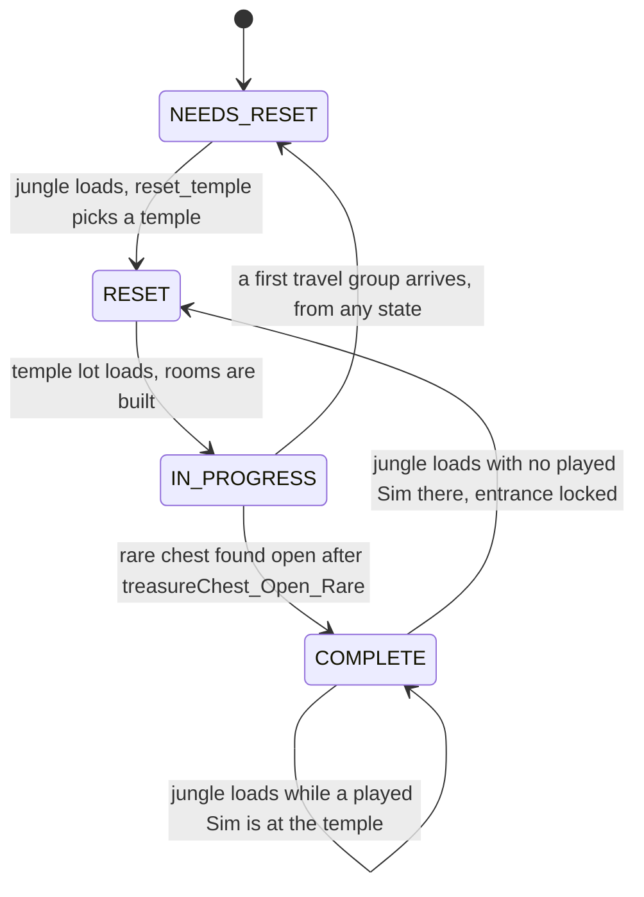
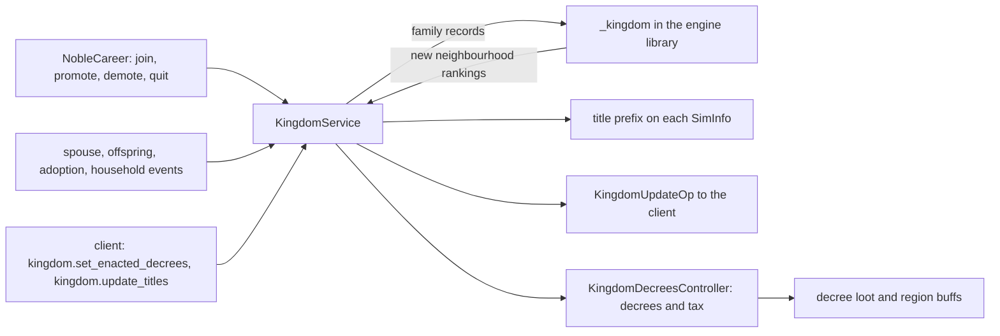

# 6.03 Other pack systems: temples, kingdoms, relics and more

*Game version 1.128.90.1030 (Steam, Linux/Proton). Installed: EP04 (Cats & Dogs), EP06 (Get Famous), EP09 (Eco Lifestyle), EP12 (High School Years), GP04 (Vampires), GP12 (Werewolves), SP01 (Luxury Party), SP42 (Grunge Revival). The systems in this chapter belong to GP06 (Jungle Adventure) and EP21 (Royalty & Legacy), which are not installed. Their numbers come from the base delta module tuning (which is live but points at the missing packs) and from patch data (pack not installed), with a few references into EP17 (Life & Death), EP10 (Snowy Escape), EP13 (Growing Together) and EP20 (Adventure Awaits) patch data. Live counts come from the base delta build plus each installed pack's delta build (the live merge, 72,956 records). Written 2026-10-12. Checked 2026-10-12: 62 claims checked, 17 corrected, 4 relabelled, 0 removed, 1 defect added.*

## In plain words

Three pack systems share this chapter, and none of them can run in this install. **Temples** belong to GP06 (Jungle Adventure). A temple is a lot in the jungle made of an entrance and a chain of rooms closed by gates. In each room one trap object is the "right" one, and one of its interactions is the "right" action; do that and the next gate opens, do anything else and the trap punishes you. The last room holds a rare chest. Once you have opened it and no played Sim is left at the temple, the next load of the jungle swaps in a different temple layout and blocks the way in for most of a Sim day.

**Relics** are also GP06. You fuse a relic top, a relic bottom and optionally a crystal; the game remembers, Sim by Sim, which combinations each Sim has learned about, and the fusing menus show the learned description or a "not discovered yet" text. **Kingdoms** are the noble side of EP21 (Royalty & Legacy): every neighbourhood with nobles keeps a ranking of noble Sims (primary, secondary, tertiary), titles at ten levels, up to three decrees and a tax level. When a noble dies or quits, a promised heir takes the title, or the spouse and children get the chance to claim it.

Three things would surprise a player. First, the actual family ranking of a kingdom is not in the Python at all: the game hands a list of family records to the engine library and gets the new ranking back. Second, temple gates are opened by a console command: the trap interactions run `temple.unlock_next_room`, which is a Live command any player can type. Third, even without EP21, 265 live records in this install carry a kingdom test, 262 of them asking whether a decree is enacted (fish weights, plant states, career performance, collectible loot). None of those tests is negated, so every one fails here and the effects they gate never happen.

## Key facts

- **None of these systems run in this install.** `KingdomService.required_packs` is EP21, so the service manager never creates it and `services.kingdom_service()` returns None. The temple and jungle directors exist only as GP06 records. The relic tracker is created on every Sim at full detail, but nothing here can add to it.
- **Their module tuning ships in the base delta build anyway.** `temple.temple_tuning` lists 5 temples, `relics.relic_tuning` 36 relic combinations, `kingdom.kingdom_tuning` 8 decrees and 10 title levels, and `kingdom.kingdom_enums` 10 decree types and 5 tax levels. Almost every reference inside points at GP06 or EP21 records that are not loaded. The exceptions are base records (`GenericFX_Off`, the `collectible_Rarity_*` states, `loot_Divorced_ActorToTargetSim`) and loots of other missing packs (EP17, EP10, EP13, EP20).
- **A temple is one of 5 house descriptions, and a reset never repeats the temple just played.** `_get_new_temple_id` drops the current id and picks at random from the rest. The swap happens on the next jungle load after the final chest is open, and only when no played Sim is at the temple. The exception: a first travel group in the region clears the remembered id, and its reset can pick any of the 5.
- **Each room's solution is rolled once, when the temple is built.** Every trap placeholder becomes a random trap type for its room, then one placed trap becomes the trigger object and one of its 3 or 4 interactions the trigger interaction. The last room gets no trigger.
- **Gates open through a Live console command.** 23 GP06 trap interactions run `temple.unlock_next_room` through `do_command` when the trigger test passes, and `temple_Gate_TryToPass_WithRelic_ConsumeRelic` runs it with no trap at all (patch data, pack not installed). The command takes no arguments.
- **A temple counts as solved when its one `Func_Temple_Chest` object has the base state `GenericFX_Off`** after a `treasureChest_Open_Rare` interaction completes.
- **After a reset the temple entrance stays locked about 18 Sim hours, counted from the street's last save (Inferred).** The lock state `Locked_4` covers 720 to 1440 on `commodity_PathObstacle_TempleLock`, so setting it puts the commodity at the range midpoint, 1080 (Observed, `state.py`), and the commodity decays 1 per Sim minute toward 0 (patch data, pack not installed). The reset at once decays that 1080 by the time since the jungle street was last saved.
- **The jungle has 8 path obstacles, and 4 are always open.** Of the other 4, `num_of_paths_available` 2 can be cleared and 2 are blocked for good, rolled per travel group (patch data, pack not installed; code default 1).
- **Relic knowledge is per Sim and lives only at full detail.** 9 combinations pair a top with a bottom, and 27 more add a crystal of common, uncommon or rare quality. The tracker is wiped when a Sim drops below FULL detail and reloaded from the save when it comes back.
- **The kingdom ranking is computed natively.** Python builds family dictionaries (ids, age, spouse, children, parents, noble career level, neighbourhood) and calls `_kingdom.refresh_sims` or `_kingdom.sim_death_or_abdicate` in the engine library, which return the new per-neighbourhood ranking.
- **Only one noble level is exclusive: `career_Noble_Level10`.** The tunable says one Sim "in the world", but the code checks one Sim per neighbourhood.
- **Decrees reach Sims only at the moment they are enacted.** `set_enacted_decrees` runs each new decree's loot on the active Sim and adds its hidden region buffs to the Sims instanced right then. Nothing in this code adds them to Sims who arrive later.
- **265 live records test kingdom state, and all of them fail here.** 115 career levels (+15 or +25 performance under a decree), 85 objects (a decree state), 53 fishing records (fish weights ×2 or ×0.5), 9 collectible and frog loots (×5, ×3 or ×1.5) and 3 records with EP21 display-name, icon or household checks. None of the tests is negated; a negated kingdom test would pass without the service.
- **Eight defects are confirmed in the bytecode, and none can run in this install.** Two are in temples, one in relics, three in the kingdom service and commands, one in the noble career and one in the base career test `can_be_promoted` (see Defects).

## How it works

### What runs in this install

**Observed** (`core/sims4/service_manager.py`, `KingdomService.required_packs`). The service manager skips any service whose required packs are all unavailable. `KingdomService` asks for EP21 alone, so in this install no kingdom service exists, `services.kingdom_service()` returns None, and nothing writes `SaveSlotData.kingdom_service` (see [8.04 The save file format](8.04-save-file-format.md)).

**Observed** (`sims/sim_info_tracker.py: SimInfoTracker.required_packs`, `sims/sim_info.py`). `RelicTracker` does not override the base default (`Pack.BASE_GAME`), so every Sim at FULL detail carries one. Nothing here can add to its known set, because the only thing that adds to it is the `add_relic_combo` loot, used only by GP06 records. A save made with GP06 keeps its known ids, though: `SimInfo` loads `relic_tracker` from the save and writes it back unchanged.

**Observed** (live scan, 72,956 live records). No live record has a class whose name contains temple, relic, kingdom or noble (so none is `TempleZoneDirector`, `JungleOpenStreetDirector`, `Templeroomdata` or `NobleCareer`), and no live record uses `add_relic_combo`, `is_temple_trigger_interaction` or `is_in_current_temple_room`. The only live names with a temple, relic, blessing, curse or noble prefix are two base loots, `curses_SeeingThings_IncrementDispel` and `curses_SeeingThings_IncrementDispel_Pancakes`, which use none of those keys. The GP06 patch data holds `zoneDirector_Temple` (174458) and `jungleOpenStreetDirector_01` (174600), and the EP21 patch data holds `career_Noble` (patch data, pack not installed).

**Observed** (`event_testing/tests.py`; string constants in `interactions/utils/loot.pyc`, which has no decompiled source). The test set registers `is_in_current_temple_room`, `is_temple_trigger_interaction` and `kingdom`. Loot actions register `add_relic_combo` (`AddRelicCombo`) and `kingdom` (`KingdomLootOp`). These keys load in every install, which is why base and installed-pack tuning can carry kingdom tests (see the live residue below).

### Temples: the jungle's temple cycle

The jungle world's north half runs `JungleOpenStreetDirector`, which owns the temple's state across visits. Its other job, the jungle path obstacles, is summarized at the end of this subsection; regions and travel are in [2.06 Worlds, regions, streets and travel](2.06-worlds-regions-travel.md).

**Observed** (`open_street_director/jungle_open_street_director.py`, bytecode where noted). The director keeps a temple id and one of four states, saved as `temple_id` and `temple_state`:

- `NEEDS_RESET` (0): the default, and the state a new save starts in.
- `RESET` (1): a new temple id is chosen and waiting for the temple lot to load.
- `IN_PROGRESS` (2): the temple lot has built its rooms.
- `COMPLETE` (3): the final chest has been opened.

At the end of `on_startup` the director asks `_temple_needs_reset` (bytecode). That is true in `NEEDS_RESET`. It is also true in `COMPLETE` when no played Sim has the temple zone as its current zone; the temple zone is the one zone whose venue is `venue_Temple` (173492, `TEMPLE_VENUE_TUNING`), and the code logs an error if there is not exactly one. When it is true, `reset_temple` runs:

1. If the state is `COMPLETE` and the reset is not forced, the temple entrance obstacle (tag `Func_PathObstacleJungle_temple_entrance`) is set to `TEMPLE_PATH_OBSTACLE_LOCK_STATE`, `objectStateValue_PathObstacles_Temple_Locked_4`, and its lock commodity is brought up to date.
2. `_get_new_temple_id` (bytecode) returns a requested id if it is a known temple and differs from the current one. Otherwise it removes the current id, when there is one, from the list of `TempleTuning.TEMPLES` keys and picks one at random. `_setup_for_first_travel_group` sets the current id to None, so the reset that follows it can pick any of the 5.
3. The state becomes `RESET`, and `_update_temple_id_for_client` writes the new id into `pending_house_desc_id` of every zone record whose lot description is `TEMPLE_LOT_DESCRIPTION` (179746).

**Inferred** (the field is read only by native code; the string `pending_house_desc_id` is in `Simulation_x64.dll`). The next time the temple zone loads, the engine builds the lot from that house description, so the rooms, gates and placeholders physically change.

**The entrance lock.** **Observed** (`objects/components/state.py: CommodityBasedObjectStateValue._tuning_loaded_callback` and `StateComponent._set_stat_to_value`; GP06 patch data, pack not installed). A commodity-based state without a default value uses the midpoint of its range, and setting the state writes that value into its linked commodity. `Locked_4` covers 720 to 1440 and has no default value, so locking the entrance sets `commodity_PathObstacle_TempleLock` to 1080. The commodity has maximum 1440, minimum 0 and decay rate 1; it converges to 0, the code default (`_default_convergence_value`). The lower states are `Locked_3` (240 to 720), `Locked_2` (120 to 240), `Locked_1` (1 to 120) and `Unlocked` (0 to 1). Right after locking, `reset_temple` calls `_update_temple_lock_commodity`, which runs `update_commodity_to_time(last save time)`: the fresh 1080 at once loses the Sim minutes that passed since the jungle street was last saved. **Inferred**: with commodity decay counted per Sim minute (`continuous_statistic.py: _update_value` works in minutes; [3.03 Needs, statistics and commodities](3.03-needs-statistics.md)), the way in reopens about 18 Sim hours after the street's last save, which is normally when the Sim left the temple. When a returning travel group loads the jungle, a still-locked entrance has its commodity brought up to date from the last save time (`_update_temple_lock_commodity`). If that unlocks it, the entrance becomes clearable with its progress at 0; if not, it is marked permanently blocked for this visit (bytecode of `on_startup`).

**Path obstacles.** **Observed** (code and `jungleOpenStreetDirector_01`, GP06 patch data, pack not installed). The record lists 8 obstacles: 01, 02, Pool and the temple entrance have `always_available` True, and 03, 04, 05 and 06 do not (the code default is False). When a travel group arrives for the first time, the always-available ones are locked but clearable, `random.sample` picks `num_of_paths_available` 2 of the other 4 to be clearable too, and the remaining 2 are set to the permanently blocked state. A path clears when the clearing interaction completes with `statistic_PathObstacle_Clear` at its maximum. A returning travel group gets its saved obstacle and treasure chest states back. If no other travel group in the region has been played, the temple state goes back to `NEEDS_RESET` and the entrance is unlocked (`_setup_for_first_travel_group`).

### Temples: building a temple on load

The temple lot runs `TempleZoneDirector`, a scheduling zone director ([2.01 Lots, venues and rooms](2.01-lots-venues-rooms.md)). Its rooms are **plexes**: numbered sub-areas of the lot that the engine can show or hide.

**Observed** (`temple/temple_zone_director.py: TempleZoneDirector.on_cleanup_zone_objects`). On zone load the director asks the open street director for `get_next_temple_id`, which returns the id only in state `RESET`. If an id comes back, the director forgets its saved temple. If it then has no temple (a new one, or a fresh lot), it:

1. reads `TempleTuning.TEMPLES[id]`, makes one empty `TempleRoom` per tuned room, and sets the current room to 0;
2. sets up the gates, then the traps (below);
3. hides every room from 1 upward that is beyond the current room (`build_buy.set_plex_visibility`);
4. tells the open street director the temple is `IN_PROGRESS`.

If no id is known at all, it logs an error and stops before giving any loot.

**Room numbers.** **Observed** (`_setup_gates`, `_setup_traps`, `temple_tuning.py`). Room 0 is the entrance (the `rooms` tunable's description) and needs no plex. **Inferred** (from the gate error "doesn't seem to have a plex on either side" when both ids are 0; the function is native): `build_buy.get_location_plex_id` returns 0 for a spot outside every plex. Rooms 1 and up are plexes 1 and up. A gate belongs to the lower-numbered room on its two sides (`min(front, back)`), so gate *n* separates room *n* from room *n*+1, and the last room has no gate. A gate with plex 0 on both sides is skipped with an error.

**Gates.** **Observed** (`_setup_gates`, bytecode). Every object tagged `Func_Temple_Gate` that has a state component gets a random value of `temple_Gate_MysticalArchway_States` from its room's `gate` set, then `GATE_LOCK_LOOT`: a `LockDoor` of type `lock_all_with_simid_exception` at `PLAYER_LOCK` priority, with the active Sim as actor. Both room data snippets offer the same 4 gate looks: ElectricalField, Fire, MysticalField and Poison (GP06 patch data, pack not installed).

**Traps.** **Observed** (`_setup_traps`, bytecode). Every object tagged `Func_Temple_Trap` is a placeholder. For each one the director finds its plex, picks one entry of that room's `traps` mapping at random (each placeholder picks on its own, so a room can repeat a trap type), creates the trap object at the placeholder's location and destroys the placeholder. Then, for every room except the last, it picks one placed trap at random as the room's **trigger object** and one interaction from that trap's set as the **trigger interaction**. A room with no traps logs "rooms missing traps" and gets no trigger.

**Saving.** **Observed** (`_save_custom_zone_director`, `_load_custom_zone_director`). The zone director saves `temple_id`, `temple_current_room` and `temple_rooms`, a flat list of three ids per room (gate object, trigger object, trigger interaction guid). Loading restores them and reapplies room visibility. The constant `temple_needs_reset` is defined and never written or read.

**Enter and exit loot.** **Observed** (`handle_event`, `_apply_enter_lot_loot`, bytecode). When a Sim's active-lot status changes, the director runs the temple's `enter_lot_loot` if the Sim is now on the lot and `exit_lot_loot` if not. At load it runs the enter loot on every instanced Sim that is on the active lot or standing inside the arrival spawn point's footprint. The tunable's own description warns that exit loot is not guaranteed (a Sim summoned away skips it).

### Temples: traps, triggers and gates

**Observed** (`temple/temple_tests.py`).

- **`IsTriggerInteractionTest`** (`is_temple_trigger_interaction`): takes the trap participant (default Object; a part is replaced by its owner). It passes only when the trap stands in the current room's plex, is that room's trigger object, and the tuned `affordance_to_test` is that room's trigger interaction. Outside a temple or without a trap it fails even with `negate`.
- **`IsInCurrentTempleRoomTest`** (`is_in_current_temple_room`): passes when the subject's plex is the current room; with `negate` it passes when it is not.

**Observed** (`temple_Trap_Activate_Pillar_0` and siblings, GP06 patch data, pack not installed). Each trap interaction is a test-based outcome. Its tested outcome requires `is_temple_trigger_interaction` with itself as `affordance_to_test`, and plays the success animation, runs the `do_command` basic extra `temple.unlock_next_room` and gives `loot_Temple_Trap_Activation_Success`. Its fallback outcomes are weighted punishments that continue into interactions such as `temple_Trap_Punishment_BladderScare`, `_BoneDust`, `_MiserableVacation`, `_PoinsonDart` (EA's spelling), `_MysticalHunger`, `_RestlessHorror`, `_SoAlone` and three "NothingBad" variants. `_MysticalHunger` has weight multiplier 0 when `motive_Hunger` or GP04's `commodity_Motive_Visible_Vampire_Thirst` is at -25 or lower, so a starving Sim never draws it. 29 SuperInteractions carry the trigger test: the 23 activation interactions that run the command, and 6 `temple_Trap_Examine_*` interactions. Each Examine interaction tests every activation interaction of its trap type twice, once plain and once negated (23 of each across the six). **Inferred**: so examining tells the Sim whether the trap holds the right action. One more interaction runs the command without the test, `temple_Gate_TryToPass_WithRelic_ConsumeRelic`, so consuming a relic opens a gate directly. 50 records use the current-room test (47 interactions, 23 of them `DEBUG` copies, the broadcasters `broadcaster_Temple_NaturalDangers_Fireflies` and `_Spiders`, and the test set `testSet_Temple_Trap_InCurrentRoomOrNotInJungle`).

**Observed** (`TempleZoneDirector.unlock_next_room`, bytecode). Opening a gate focuses the camera on the current room's gate, sets `temple_Gate_MysticalArchway_Unlocked`, applies `GATE_UNLOCK_LOOT` (an `UnlockDoor`), adds 1 to the current room and shows that plex. The guard only stops when the current room is past the last room, which leaves a defect in the chest room (see Defects).

**Trap types** (`TempleRoomData_All` 174628 and `TempleRoomData_NoEmotionalPlate` 182997, GP06 patch data, pack not installed). The trap objects are object definitions, so I name them by their trigger interactions:

| Trap type (trigger interactions) | Interactions | In `_All` | In `_NoEmotionalPlate` |
|---|---|---|---|
| Skeletons (Left, Middle, Right) | 3 | yes | yes |
| Pillar 0 to 3 | 4 | yes | yes |
| Emotional plate (Flirty, Energized, Inspired, Confident) | 4 | yes | no |
| Moody sculpture (Blame, Compliment, Insult, SkeletonPun) | 4 | yes | yes |
| Rotating sculpture 0 to 3 | 4 | yes | yes |
| Glyph 0 to 3 | 4 | yes | yes |

### Temples: completion

**Observed** (`TempleZoneDirector.handle_event`, bytecode; `temple.temple_tuning` in the base delta). When an interaction completes and it matches `CHEST_OPEN_INTEARCTION` (the misspelling is EA's; it lists `treasureChest_Open_Rare`, 180178), the director collects the objects tagged `Func_Temple_Chest`. It logs an error if there are none or more than one, takes the first, and marks the temple `COMPLETE` if that chest has `CHEST_OPEN_STATE` active. That state is `GenericFX_Off` (98746), a base-game state value.

### Temples: the five layouts

**Observed** (`temple.temple_tuning`, base delta module tuning; names from `TEMPLE_NAME_LOOKUP` in `temple_commands.py`, which is debug text; loot names from GP06 and EP17 (Life & Death) patch data, packs not installed).

| Id | Name in the debug table | Rooms | Room data, rooms 0 upward | Enter loot | Exit loot |
|---|---|---|---|---|---|
| 181306 | Temple of Abundance | 5 | NoEP, All, All, NoEP, NoEP | `loot_Temple_Buffs_Plants_Add`, `loot_UnfinishedBusiness_Jungle` | `loot_Temple_Buffs_Plants_Remove` |
| 181307 | Pristine Temple | 5 | NoEP, All, All, NoEP, NoEP | `loot_UnfinishedBusiness_Jungle` | none |
| 185848 | Temple of Death | 5 | NoEP, All, All, NoEP, NoEP | `loot_UnfinishedBusiness_Jungle` | none |
| 185849 | Digsite Temple | 5 | NoEP, NoEP, All, All, NoEP | `loot_Temple_Buffs_Archaeology_Add`, `loot_UnfinishedBusiness_Jungle` | `loot_Temple_Buffs_Archaeology_Remove` |
| 185850 | Party Temple | 4 | NoEP, All, NoEP, NoEP | `loot_UnfinishedBusiness_Jungle` | none |

"All" is `TempleRoomData_All`, "NoEP" is `TempleRoomData_NoEmotionalPlate`. A five-room temple has 4 gates and 4 puzzles; the Party Temple has 3. `loot_UnfinishedBusiness_Jungle` (386814) is an EP17 record in every temple's enter loot (**Inferred** from its much higher id: a later patch added it).

### Relics: combinations and the relic tracker

**Observed** (`relics/relic_tuning.py`, `relics/relic_loot.py`, `relics/relic_tracker.py`; `relics.relic_tuning` in the base delta).

- **`RelicComboId`** is a dynamic enum with 36 values: tops Bird, Cat and Llama × bottoms Chaos, Death and Watcher, each plain and with `_Common`, `_Uncommon` and `_Rare`.
- **`RELIC_DISCOVERY_DATA`** maps each id to two object sets with optional states. The 9 plain combos have one top and one bottom. The 27 gem combos have 2 definitions in `object_a` (**Inferred**: the fused relic) and the same 27 crystal definitions in `object_b`, each with an `object_b_state` of `collectible_Rarity_Common` (144904), `_Uncommon` (144901) or `_Rare` (144905). Three of the 27 crystal ids (384507, 384970, 384971) are far higher than the rest (**Inferred**: a later patch extended the list).
- **Matching** (`get_relic_combo_id_data_tuple_for_objects`, bytecode): the first entry (**Inferred**: in tuning order) whose sets hold the two objects in either order and whose states are active wins; otherwise (None, None).
- **Learning**: the `add_relic_combo` loot adds an id to the subject Sim's tracker. In GP06 patch data 51 `LootActions` use it, all blessings and curses (21 `blessings_*`, 26 `curses_*` and 4 `loot_Curses_*`, for example `blessings_ApplyBlessingPicked_Money_Rare`, `curses_ApplyCurseSelf_SeeingThings_Common`) (patch data, pack not installed). **Inferred** (from those names): a Sim learns a combination when the relic's blessing or curse is applied.
- **Saving and detail** ([1.03 Performance, budgets and level of detail](1.03-performance-lod.md)): the known ids save as `PersistableRelicTracker.known_relics`. Below FULL detail the set is dropped, and on the way back up it reloads from the Sim's saved record.

### Relics: descriptions and hovertips

**Observed** (`RelicTracker._resolve_combo_id_to_description_text`, bytecode; `objects/components/tooltip_component.py`; `objects/components/inventory_item.py`; `interactions/base/picker_interaction.py`).

- **Picker rows.** A picker row whose description comes from the tooltip field `relic_description` (field 22) calls `get_description_for_objects(row object, target)`. A known combo shows its `discovered_picker_description_text`. An unknown one shows the linked combo's discovered text when the Sim knows the linked combo (every gem combo links to its plain pair), and `DEFAULT_UNDISCOVERED_TEXT` otherwise. In GP06 patch data the six fusing pickers (`mysticalRelic_Fuse_TopPicker_*`, `_BottomPicker_*`, `mysticalRelic_Insert_CrystalPicker_*`) use it.
- **Inventory hovertip.** An object whose inventory item component lists `relic_description` in `on_inventory_change_tooltip_updates` refreshes that field on every inventory change. In a Sim's inventory the text comes from `get_tooltip_for_object`: the first combo whose `hovertip_data` lists the object and whose state is active (plain combos use `mysticalRelic_NoGem`, gem combos `mysticalRelic_HasGem`), or no text when none matches. Anywhere else the field shows `IN_WORLD_HOVERTIP_TEXT`.
- **Inferred** (from the tuning order). The three gem combos of one pair list the same two objects and the same `HasGem` state, so the hovertip of any gem relic resolves to the first of them in tuning order (`_Common`) whatever the crystal's rarity.
- **Live use.** 7 base photo objects (`object_Photo_Landscape*`, `object_Photo_Portrait*`, `object_photo_General`) and 2 EP12 ones (`object_HSGraduation_Photo`, `object_Photo_Photobooth`) use `relic_description` as a `tooltip_fields` key in their custom tooltips, twice per record (14 and 4 entries). That only fills the field slot with static text; no other live record names the field, so no live picker or inventory update asks for the relic description and the tracker code is never called here.

### Kingdoms: the service and the native ranking

**Observed** (`kingdom/kingdom_service.py`, `kingdom/kingdom.py`, native strings of `Simulation_x64.dll`).

- **Native types.** `_kingdom.KingdomSim` holds `sim_id`, `level`, `priority` and `inheriting_sim_id`; `_kingdom.KingdomNeighborhood` holds `neighborhood_id` and a dictionary of Sims. The engine library also exports `refresh_sims`, `sim_rejoined` and `sim_death_or_abdicate`. `kingdom.py` falls back to an empty stub if the native module cannot be imported.
- **Priority** (`KingdomPriority`): PRIMARY 1, SECONDARY 2, TERTIARY 3. Python never computes it. **Inferred** (the names and the parent and spouse lookups in `get_primary_sim_for_sim`): primary is the title holder, secondary the spouse, tertiary the children.
- **The family list** (`get_family_and_affected_sim_ids`). The Sims touched by a change are the Sim, its children and its spouse. The Sims looked up are those plus every parent or spouse who holds a noble career; for each of them the family list gets its entry and entries for its children, parents and spouse. The "already listed" checks compare a Sim id with the list of entry dictionaries (bytecode: `COMPARE_OP (in)` on `family`), so they never match and a Sim reached twice is sent twice. Each entry carries `sim_id`, `age`, `age_progress`, `spouse_sim_id`, `children_sim_ids`, `noble_career_level` (the career's user level), `neighborhood_id` and `parent_sim_ids`. Entries with no neighbourhood are dropped (bytecode of `get_common_data`).
- **Neighbourhood.** A Sim's kingdom is the neighbourhood of its home zone. A Sim without a home uses a **virtual neighbourhood** set by the `set_virtual_neighborhood` loot.
- **Updates.** `refresh_kingdom_data` calls `_kingdom.refresh_sims(family, affected, neighbourhoods)`, stores the returned neighbourhoods, refreshes the titles of the affected Sims, sends a `KingdomUpdateOp` (`KINGDOM_UPDATE`) to the client and makes their careers resend. It runs when a noble joins, is promoted or is demoted, on `SpouseEvent` (when either side is noble), on `OffspringCreated` and `ChildAdopted` (when the child has a primary parent), on `HouseholdChanged` (when the Sim is in a kingdom), after `claim_title` and after a household merge.
- **Death.** **Observed** (`interactions/utils/death.py: DeathTracker.set_death_type` and `_set_death_type`; `handle_set_death_type_event`, bytecode; see [3.09 Life cycle](3.09-life-cycle.md)). Both steps run only when the death removes the Sim from its household (`remove_from_household`). Before the careers end, `handle_set_death_type_event` writes the dead Sim's title, region name and level into the family tree (`FamilyTreeNodeKingdomData`) and removes the Sim from the kingdom only when no noble career level is found; the career check runs whether or not kingdom data was found. Later, right after taking the Sim out of its household, `_set_death_type` calls `remove_from_kingdom` again, this time with no noble-level check (bytecode, read in the disassembly).
- **Save** ([1.02 Saves and persistence](1.02-saves-persistence.md)). `PersistableKingdomService` holds the neighbourhoods (Sims, enacted decrees, tax level, titles), the open title claims, each Sim's stored noble level, and the virtual neighbourhoods. Load also reads `affected_sim_ids`, which `save` never writes.

### Kingdoms: the noble career bridge

**Observed** (`careers/noble_career.py`; the career system itself is in [3.10 Skills, careers and school](3.10-skills-careers-school.md)). `NobleCareer` (`career_Noble`, EP21 patch data, pack not installed) reports every join, quit, promotion and demotion to the kingdom service. It never counts the Sim as busy or at work, counts a work day as 24 hours, and pays its hourly rate × 24 as salary. When a shift starts, a Sim in a blocking event gets the day marked `PTO` (if still in one when the shift ends, it loses a PTO day when it has any); otherwise the day is marked `WORK_FROM_HOME_NOBLE` (bytecode of `_start_work_callback`; the decompiled source nests this whole block under `if self.on_assignment`, which the bytecode does not). The career does take assignments: `offer_assignments` does nothing and `should_have_assignments` is False (in `career_base` that only silences an error in `_start_work_from_home`, bytecode), but `clear_and_request_assignments` picks assignments and accepts them at once, at each shift start when the Sim is not on one and the day is not PTO, and after every promotion and demotion. In EP21 patch data `CareerTrack_Noble` tunes assignments with `active_assignment_amount` 2. Auto promotion follows the career service flag `noble_career_auto_promotion_enabled`. Its company name is `WORK_COMPANY_NAME` formatted with the title and the region (for example "Queen of Sulani" in the tunable's description).

**Observed** (`KingdomService.sim_can_promote`). A promotion is refused only when the next level is in `EXCLUSIVE_CAREER_LEVELS` (live tuning: `career_Noble_Level10` only) and some Sim in the same neighbourhood already holds that level. The base career test `can_be_promoted` (`CareerCanBePromotedTest`, `event_testing/test_variants.py`) also asks the kingdom service for nobles, but it passes one argument where `sim_can_promote` takes two (defect 8 below).

**Observed** (`on_all_households_and_sim_infos_loaded`, bytecode). After a load, for each Sim listed in the saved `affected_sim_ids`, the stored level wins: the career is promoted or demoted by the difference, a demotion runs `ON_AUTO_DEMOTE_LOOT`, and a Sim with `trait_NobleCareer_Promised` who is no longer anyone's heir gets `REMOVED_AS_INHERITING_SIM_LOOT`. **Inferred** (from the tunable description, "moving to another neighborhood", and from `save` never writing that list): the client edits the kingdom when households move between worlds, and the server reconciles the careers here.

**Observed** (`household_merged`). When households merge, each incoming noble's career is removed and re-added at its level, one level lower if it holds an exclusive level and anyone in the target kingdom already holds an exclusive level.

### Kingdoms: inheritance and claiming titles

**Observed** (`KingdomService.on_quit`, `process_inheriting_sim`, `process_career_level_inheriting_candidates`, `can_claim_title`, `claim_title`, bytecode where noted).

1. When a noble quits or dies, the service calls `_kingdom.sim_death_or_abdicate`, which returns the new rankings and, when there is one, the promised heir.
2. **Promised heir.** If the heir lives in the same neighbourhood and has a noble career level (`get_noble_career_level`), `PROMISED_SIM_INHERITING_LOOT` runs and `process_inheriting_sim` returns True, so no candidates are offered. When the heir's level is below the lost level, the heir is also promoted straight to that level (reason `KINGDOM_INHERIT_PROMISED_SIM`) and telemetry `INHE` records the reason (bytecode of `process_inheriting_sim`).
3. **No valid heir.** The children and spouse in the same neighbourhood become candidates for that level, saved as available titles. Each candidate whose noble level is below the lost level gets `NON_PROMISED_SIM_CANDIDATES_LOOT` (`loot_NobleCareer_LeaveCareer_CanInherit` and a notification). The others, including those with no noble career, get `NON_PROMISED_SIM_NON_CANDIDATES_LOOT` (`_CannotInherit` and the notification) (bytecode).
4. **Claiming.** The `can_claim_title` test passes for a candidate below the title's level; with `check_exclusive` an exclusive level must also be empty. The `claim_title` loot picks the open title that raises the Sim the most levels, promotes the Sim to it, runs its own `on_claim_loots` on every candidate for that title, and deletes the title.
5. The `set_inheriting_sim` loot names an heir. A replaced heir gets `REMOVED_AS_INHERITING_SIM_LOOT`.

### Kingdoms: titles

**Observed** (`set_sim_title`, `get_sim_gender_by_pronouns`; `kingdom.kingdom_tuning` in the base delta).

- A noble's title is the name prefix of its SimInfo. If the player renamed a title for this neighbourhood, level and priority group (the client sends `kingdom.update_titles`), that custom string is used. Otherwise the title comes from `DEFAULT_KINGDOM_TITLES[level + 1]` (10 levels, 1 to 10), primary data for primary and secondary Sims and tertiary data for tertiary Sims. Each `kingdom.update_titles` call first empties the stored custom titles of every neighbourhood, then stores the sent list for each neighbourhood it names (bytecode of `set_kingdom_titles`). The lookup cache (`_kingdom_titles_cache`) is rebuilt only for the named neighbourhoods, so a neighbourhood left out keeps showing its old custom titles until the next load, while `save` writes none for it. **Inferred**: the client always sends the full set.
- The gendered variant follows the Sim's pronouns (bytecode of `get_sim_gender_by_pronouns`). When the current language does not support custom pronouns, or the Sim's pronouns are empty or `|||||`, the Sim's sex decides (male, otherwise female). Otherwise `she|her|her|hers|herself|` gives the female title, `he|him|his|his|himself|` the male one, and anything else the neutral title (`DEFAULT_ENGLISH_PRONOUNS_STRINGS`).

### Kingdoms: decrees and taxes

**Observed** (`kingdom/kingdom_decrees_controller.py`, `kingdom/kingdom_commands.py`; `kingdom.kingdom_tuning` and `kingdom.kingdom_enums` in the base delta; loot and buff names from EP21 patch data, pack not installed).

- **Decree types**: EnvironmentPreservation 1, TechnicalAdvancements 2, HealthyLiving 3, Babyboom 4, ElderlyCare 5, ImprovedEducation 6, LawAndOrder 7, LocalGastronomy 8, CulturalLegacy 9, CommunityCare 10. `DECREES` tunes 8 of them; LawAndOrder and CommunityCare have no entry, so the decree list sent to the client never offers them.
- **Each decree** has an icon, title, description, 2 to 9 gameplay description strings, one on-enact loot (`loot_NobleCareer_NobleDecrees_OnEnact_*`, a notification) and one hidden region buff (`buff_NobleCareer_Decrees_Hidden_*`, whose add test requires the decree to be enacted).
- **Choosing.** The client asks for the list with `kingdom.send_available_decrees` and answers with `kingdom.set_enacted_decrees` and a comma-separated list of decree numbers. With nothing enacted the list sent is `NUM_DECREES_PER_NEIGHBORHOOD` (code default 3, not tuned) NONE slots.
- **Effects.** New decrees run their loot on the active Sim. Their buffs are added to every instanced Sim (imaginary friends excluded) and the buffs of removed decrees are removed. Nothing here reapplies them later, and the decree test (`is_decree_enacted`) is what the rest of the tuning reads.
- **Taxes.** `TaxLevel` is Normal 1, VeryLow 2, Low 3, High 4, VeryHigh 5 (NONE 0 by default). The `set_tax_level` loot sets the level for the subject's home neighbourhood. The bills module multiplies bills by 0.8, 0.9, 1.1 or 1.2 at VeryLow, Low, High and VeryHigh through `kingdom` tax-level tests ([5.01 Money, bills, perks and rewards](5.01-money-bills-rewards.md)). In EP21 patch data the five `loot_NobleCareer_SetKingdomTax_*` loots also add and remove traits on `AllNoblesInActorNeighborhood`.

### Kingdoms: tests and loot ops

**Observed** (`kingdom/kingdom_tests.py`, `kingdom/kingdom_loot_ops.py`, bytecode where noted). The `kingdom` test wraps one of seven variants, run on `subjects` (default Actor) with an optional `negate`; every variant fails with "No kingdom service found" when the service is absent.

| Variant | Passes when |
|---|---|
| `can_promote` | `sim_can_promote` (exclusive level free), optionally for a given career level |
| `priority` | the Sim is in a kingdom and its priority meets the threshold |
| `is_inheriting_child` | some kingdom Sim names this Sim as heir |
| `has_inheriting_sim` | this Sim has named an heir |
| `is_decree_enacted` | the decree is enacted in the current neighbourhood (default) or the actor's home neighbourhood |
| `tax_level` | the neighbourhood tax level compares true to the tuned level (default operator EQUAL) |
| `can_claim_title` | `can_claim_title`, optionally checking exclusive levels |

The `kingdom` loot runs one operation and does nothing without the service: `set_inheriting_sim` (the subject becomes the target's heir; the target must be a Sim, bytecode), `set_tax_level`, `claim_title` and `set_virtual_neighborhood` (current zone's neighbourhood or the target Sim's home neighbourhood).

**Patch data, pack not installed** (re-counted by the checker, distinct records per variant). EP21 records use `priority` 11 times, `tax_level` 13, `is_decree_enacted` 13, `is_inheriting_child` 4, `can_promote` 4, `has_inheriting_sim` 1 and `can_claim_title` 1, and the loot operations `set_tax_level` 5, `set_virtual_neighborhood` 2, `claim_title` 1 and the default `set_inheriting_sim` 2 (`loot_NobleCareer_InheritNobleTitle_Request` and `_Promise`). 10 of EP21's kingdom tests are negated. Across all 72 patch-data packs, 265 records test `is_decree_enacted`, most in EP03 (City Living) 49, EP01 (Get To Work) 32, EP11 (Cottage Living) 31 and GP01 (Outdoor Retreat) 24.

### Kingdom residue in the live tuning

**Observed** (live scan, 72,956 records; the writer's own count gives the same totals). 265 live records contain a `kingdom` test: 262 test `is_decree_enacted` and 3 test `priority`. None is negated. With no kingdom service every one returns False, so the multiplier, state or override it gates never applies.

| Class (source) | Records | Decree and what it gates |
|---|---|---|
| `CareerLevel` (base 105, EP06 10) | 115 | `performance_mod` +15 under CulturalLegacy (57 entries), HealthyLiving (16) or LocalGastronomy (15); +25 under TechnicalAdvancements (27) |
| `GameObject` (base 68, EP04 8, GP04 6, EP09 3) | 85 | EnvironmentPreservation turns on `nobleCareer_EnvironmentPreservation_Values_On` in `tested_states` (170 entries; 83 of the 85 are `object_GardeningPlant_*` bushes, trees, flowers and tubers, the others `object_Cowplant` and `object_MeatWall`) |
| `FishingData` (base 44, EP04 6, GP12 2, GP04 1) | 53 | EnvironmentPreservation fish weight multiplier 2 (284 entries) or 0.5 (53 entries) |
| `LootActions` (base) | 9 | EnvironmentPreservation reward weight multiplier 5 (72 entries), 3 (1) or 1.5 (2) on 4 collectible loots (`loot_ObjectReward_Collectible_Metal`, `_Crystal`, `_Crystal_NoObject`, `_Excavate_Unbrushed`) and 5 frog loots (`loot_FrogCollectible_*`) |
| `SuperInteraction`, `SocialMixerInteraction`, `HouseholdStoryArc` (base) | 3 | a `priority` test: the EP21 display name and noble pie-menu icon of `crib_Socials_TellBedtimeStory` and `mixer_social_LieAboutCareer_group_mischief_skills`, and an "invalid household" check in `householdStoryArc_MoveOut` |

The base delta module `sims.bills` adds 4 `tax_level` tests (the bill multipliers above). Fishing and gardening themselves are in [6.02 Gardening, fishing and collecting](6.02-gardening-fishing-collecting.md).

### Defects confirmed in the bytecode

Each defect below was re-read in the pydisasm output. None of them can run in this install: seven need GP06 or EP21 code paths, and the eighth stops at a None check because no kingdom service exists.

1. **The chest room crashes `temple.unlock_next_room`** (`TempleZoneDirector.unlock_next_room`). The only guard is `_current_room >= len(rooms)` (`COMPARE_OP (>=)` at offset 14). In the last room the index is in range, `_rooms[index].gate` is None (the chest room has no gate), and offset 42 `LOAD_ATTR (position)` on it raises AttributeError. Trap interactions cannot reach it (the last room has no trigger); typing the Live command in the chest room does. Reach: GP06 temple zone only; here the command finds no temple director and returns False.
2. **A temple without a tagged chest crashes on chest opening** (`TempleZoneDirector.handle_event`). After the "no rare chests" error, `POP_JUMP_IF_FALSE` at offset 168 jumps over `STORE_FAST (final_chest)` at 180, and offset 182 `LOAD_FAST (final_chest)` raises UnboundLocalError. Reach: GP06 temple zone only.
3. **Relic descriptions for an unknown pair raise NameError** (`RelicTracker._resolve_combo_id_to_description_text`). When `combo_data` is None, the error call loads `LOAD_GLOBAL (object_a)` and `LOAD_GLOBAL (object_b)` (offsets 14 and 16); the module defines neither. The hovertip path returns before calling it when no combo matches, so only the fusing picker path (`get_description_for_objects`) can reach it. Reach: GP06 pickers only (Inferred: a pair that matches no combo, for example a crystal missing from the 27).
4. **Removing a noble's SimInfo always passes None as the lost level** (`KingdomService._on_sim_info_removed`). It passes `get_sim_noble_career(sim_info.id)` (a Career, or None) where `on_quit` expects `career_level`. `SimInfoManager.remove_permanently` calls `self.remove(sim_info)` before `on_sim_info_removed` (bytecode, read in the disassembly), so the manager lookup inside `get_sim_noble_career` finds nothing and the value is always None. With a promised heir or a family candidate who has a noble level, `COMPARE_OP (<)` between that level and None raises TypeError (offset 72 of `process_inheriting_sim`, offset 168 of `process_career_level_inheriting_candidates`). With no such Sim, None is stored as the level of the available titles. **Inferred**: saving those titles then fails when it writes `career_level`. Reach: EP21 only.
5. **`get_primary_sim_for_sim` calls `get_primary_parent` with 2 arguments** (`CALL_METHOD (2 positional arguments)`); that method takes one. In the bytecode the call is reached even when the Sim's kingdom entry is None. No Python code calls `get_primary_sim_for_sim`, so it is dead code.
6. **`kingdom.set_default_pronouns` calls `KingdomService.set_default_pronouns`, which does not exist**: the name is absent from all 81 functions of the class in the bytecode, so an EP21 install raises AttributeError whenever the client sends the command. Here `services.kingdom_service()` is None, so it raises AttributeError on None instead; the command wrapper catches both and logs "Error executing command".
7. **`NobleCareer.join_career` sets `_waiting_for_first_assignment` as a local** (`LOAD_CONST (True)`, `STORE_FAST (_waiting_for_first_assignment)`), so the attribute stays False and the first assignment request after joining is made with `just_accepted=False`. Reach: EP21 only.
8. **The base `can_be_promoted` test passes one argument to `sim_can_promote`** (`CareerCanBePromotedTest.__call__`, `event_testing/test_variants.py`, bytecode read in the disassembly). It runs `LOAD_METHOD (sim_can_promote)`, `LOAD_FAST (sim_info)`, `CALL_METHOD (1 positional argument)`, but `sim_can_promote(self, sim_info, target_career_level_reference)` has no defaults (its `MAKE_FUNCTION` carries annotations only), so the call raises TypeError. Reach: with EP21, on any Sim in `career_Noble`, through the two live base test sets that use the test (`testSet_Career_Promotable_Actor` and `testSet_Career_Promotable_PickedSim`). Here the call is skipped by `kingdom_service is not None`.

## Numbers

| Name | Value | Unit | Where | Source |
|---|---|---|---|---|
| Temples | 5 | house descriptions | `TempleTuning.TEMPLES` | base delta module (refs to GP06) |
| Rooms per temple | 5, 5, 5, 5, 4 | rooms | `TEMPLES[*].rooms` | base delta module |
| Gate looks per room | 4 | states | `TempleRoomData_*.gate` | patch data GP06, pack not installed |
| Trap types | 6 (`_All`), 5 (`_NoEmotionalPlate`) | definitions | `TempleRoomData_*.traps` | patch data GP06 |
| Trigger interactions per trap | 3 or 4 | interactions | same | patch data GP06 |
| Gate, trap, chest tags | `Func_Temple_Gate`, `Func_Temple_Trap`, `Func_Temple_Chest` | tag | `GATE_TAG`, `TRAP_TAG`, `CHEST_TAG` | base delta module |
| Chest open state | `GenericFX_Off` (98746) | state value | `CHEST_OPEN_STATE` | base delta module (base state) |
| Chest open interaction | `treasureChest_Open_Rare` (180178) | interaction | `CHEST_OPEN_INTEARCTION` | base delta module, GP06 record |
| Gate lock | `lock_all_with_simid_exception`, `PLAYER_LOCK` | lock | `GATE_LOCK_LOOT` | base delta module |
| Temple lot description | 179746 | id | `TEMPLE_LOT_DESCRIPTION` | base delta module |
| Entrance lock state | `objectStateValue_PathObstacles_Temple_Locked_4` (181572) | state | `TEMPLE_PATH_OBSTACLE_LOCK_STATE` | base delta module |
| `Locked_4` range, start value | 720 to 1440, 1080 | commodity points | state range (no `default_value`); midpoint rule in `state.py` | patch data GP06; code |
| MysticalHunger trap weight | 0 when `motive_Hunger` or `commodity_Motive_Visible_Vampire_Thirst` is at -25 or lower | weight | trap outcome tests | patch data GP06 |
| Lock commodity max, min, decay, convergence | 1440, 0, 1, 0 | points, per Sim minute | `commodity_PathObstacle_TempleLock` | patch data GP06 (convergence not tuned: code default 0) |
| Lower lock states | 240 to 720, 120 to 240, 1 to 120, 0 to 1 | points | `Locked_3`, `_2`, `_1`, `Unlocked` | patch data GP06 |
| Jungle path obstacles | 8 (4 always available) | obstacles | `path_obstacle_data` | patch data GP06 (`always_available` code default False) |
| Clearable random paths | 2 | paths | `num_of_paths_available` | patch data GP06 (code default 1) |
| Interactions running the unlock command | 24 (23 traps, 1 gate with relic) | records | `do_command` | patch data GP06 |
| Relic combo ids | 36 (9 plain, 27 gem) | ids | `RelicComboId`, `RELIC_DISCOVERY_DATA` | base delta module |
| Crystals per gem combo | 27 | definitions | `object_b` | base delta module |
| Relic loots | 51 | `LootActions` | `add_relic_combo` users | patch data GP06 |
| Relic tracker detail threshold | FULL | LOD | `RelicTracker._tracker_lod_threshold` | code |
| Decree types, tuned decrees | 10, 8 | decrees | `DecreeType`, `DECREES` | base delta module |
| Decrees per neighbourhood | 3 | slots | `NUM_DECREES_PER_NEIGHBORHOOD` | code default |
| Tax levels | 5 (+ NONE) | levels | `TaxLevel`, `TAXES_NAME` | base delta module |
| Tax bill multipliers | 0.8, 0.9, 1.1, 1.2 | factor | `sims.bills` | base delta module (see 5.01) |
| Title levels | 10 (looked up as level + 1) | levels | `DEFAULT_KINGDOM_TITLES` | base delta module |
| Exclusive levels | `career_Noble_Level10` | career level | `EXCLUSIVE_CAREER_LEVELS` | base delta module |
| Noble career levels | 10 | levels | `CareerTrack_Noble` | patch data EP21, pack not installed |
| Favor statistic start, decay | 200, 0 | points | `rankedStatistic_NobleFavor` | patch data EP21 |
| Auto-demote loots | 7 (1 EP21, 2 EP10, 3 EP13, 1 EP20) | loots | `ON_AUTO_DEMOTE_LOOT` | base delta module; ids found in patch data, packs not installed |
| Secondary quit loot | `loot_Divorced_ActorToTargetSim` (never read) | loot | `SECONDARY_QUIT_LOOT` | base delta module |
| Live records with kingdom tests | 265 (115, 85, 53, 9, 3; 262 `is_decree_enacted`, 3 `priority`, none negated) | records | see residue table | live (base delta + installed pack deltas) |
| Decree performance bonus | +15 or +25 | performance | `CareerLevel` `tested_metrics` entries (`performance_mod`) | live, never applies |
| Decree fish weight | ×2 or ×0.5 | factor | `FishingData` weight multipliers | live, never applies |
| Decree collectible weight | ×5, ×3, ×1.5 | factor | `LootActions` weight multipliers | live, never applies |

## Data shapes

- **`TempleTuning`** (module): `TEMPLES` {house description: {`rooms` {room number: `TempleRoomData`}, `enter_lot_loot`, `exit_lot_loot`}}, `GATE_TAG`, `TRAP_TAG`, `CHEST_TAG`, `CHEST_OPEN_STATE`, `GATE_STATE`, `GATE_UNLOCK_STATE`, `TEMPLE_LOT_DESCRIPTION`, `GATE_LOCK_LOOT`, `GATE_UNLOCK_LOOT`, `CHEST_OPEN_INTEARCTION`.
- **`TempleRoomData`** (snippet): `gate` (set of gate state values), `traps` {trap definition: set of trigger SuperInteractions}.
- **`TempleRoom`** (runtime): `gate`, `trigger_object`, `trigger_interaction`. **`TempleZoneDirector`**: `_temple_id`, `_temple_data`, `_current_room`, `_rooms`; saves `temple_id`, `temple_current_room`, `temple_rooms` (3 ids per room).
- **`JungleOpenStreetDirector`**: module tunables `TEMPLE_PATH_OBSTACLE`, `TEMPLE_PATH_OBSTACLE_LOCK_STATE`, `_UNLOCK_STATE`, `TEMPLE_VENUE_TUNING`, `TEMPLE_LOCK_COMMODITY`; instance tunables `path_obstacle_data` {tag: `always_available`, `layers`}, `num_of_paths_available`, `clear_path_interaction`, `permanently_blocked_state`, `path_unlocked_state`, `path_clearing_commodity`, treasure chest tag and states. Saves `temple_id`, `temple_state`, obstacle status per travel group and chest status per travel group.
- **`RelicTuning`** (module): `RELIC_DISCOVERY_DATA` {`RelicComboId`: {`object_a`, `object_b`, `object_a_state`, `object_b_state`, `undiscovered_picker_description_text` (default text or link to another id), `discovered_picker_description_text`, `hovertip_data` {`objects`, `object_state`}}}, `DEFAULT_UNDISCOVERED_TEXT`, `IN_WORLD_HOVERTIP_TEXT`. **`RelicTracker`**: `_known_relic_combos` (set, None when empty); saves `known_relics`.
- **`KingdomSim`** (native): `sim_id`, `level`, `priority`, `inheriting_sim_id`. **`KingdomNeighborhood`** (native): `neighborhood_id`, `sims` {sim id: KingdomSim}.
- **`KingdomService`**: `_kingdom_data` {neighbourhood: KingdomNeighborhood}, `_kingdom_titles` and a cache {neighbourhood: {level: {priority group: {gender: string}}}}, `_available_titles` {neighbourhood: {dead Sim: [(level, candidate)]}}, `_sim_career_levels`, `_sim_virtual_neighborhoods`, `_updated_sim_ids`, and a `KingdomDecreesController` with `_enacted_decrees` and `_tax_levels` per neighbourhood.
- **`TunableKingdomDecree`**: `icon`, `title`, `decree_description`, `on_enact_loots`, `on_enact_region_buffs`, `gameplay_descriptions`.
- **`KingdomTuning`** (module): `EXCLUSIVE_CAREER_LEVELS`, `NOBLE_CAREER`, `NOBLE_CAREER_TRACK`, `DECREES`, `NUM_DECREES_PER_NEIGHBORHOOD`, `TAXES_NAME`, `JOIN_CAREER_WARNING_DIALOG_DATA`, two demotion dialogs, `SECONDARY_QUIT_LOOT`, the four inheritance loot lists, `PROMISED_TRAIT`, `DEFAULT_KINGDOM_TITLES`, `WORK_COMPANY_NAME`, `BALLROOM_SITUATION`, `DEFAULT_ENGLISH_PRONOUNS_STRINGS`, `ON_AUTO_DEMOTE_LOOT`. **`FavorTuning`** (client binary only): noble career track, favor statistic, unknown-favor icon and name.

## For modders

**Tuning to change** (all of it needs the pack to do anything):

- Temple layouts and loot: the `temple.temple_tuning` module in the base delta build. The base delta replaces it whole. **Inferred** (module tuning loads as one resource): a mod overriding this module must carry all five temples.
- Room puzzles: the `TempleRoomData_All` and `TempleRoomData_NoEmotionalPlate` snippets (GP06). Every trigger interaction listed there must also be on the trap object, and the interaction needs an `is_temple_trigger_interaction` tested outcome that runs `temple.unlock_next_room`.
- Lock time after a reset: `commodity_PathObstacle_TempleLock` decay and the `Locked_4` range (GP06). Path count: `num_of_paths_available` on `jungleOpenStreetDirector_01`.
- Relic texts and combinations: the `relics.relic_tuning` module (base delta). Add new crystals to the 27-entry `object_b` sets, or a fusing picker can hit defect 3.
- Decrees, titles, taxes: the `kingdom.kingdom_tuning` and `kingdom.kingdom_enums` modules (base delta). `NUM_DECREES_PER_NEIGHBORHOOD` is not tuned there, so it is the code default 3.

**Commands.** In retail only Live, Cheat and Automation commands register; an untyped command is DebugOnly and never registers. All the text these commands write goes through `sims4.commands.output`, which is empty in retail, so they print nothing.

| Command | Type | What it does |
|---|---|---|
| `temple.unlock_next_room` | Live | opens the next gate at a temple (GP06); in the chest room it raises (defect 1) |
| `temple.show_room`, `temple.force_reset`, `temple.list`, `temple.current_id` | DebugOnly | not registered in retail |
| `kingdom.send_available_decrees` | Live | sends the decree list for the current neighbourhood (client UI) |
| `kingdom.set_enacted_decrees <list>` | Live | enacts the comma-separated decree numbers in the current neighbourhood |
| `kingdom.update_titles <text proto>` | Live | stores custom titles from the client |
| `kingdom.show_ballroom_ui [sim]` | Live | opens the situation picker for `situation_CustomState_BallroomDance` |
| `kingdom.set_default_pronouns <text proto>` | Live | always raises AttributeError (defect 6) |

In this install the `kingdom.*` commands register. Four of them call the service, which is None here, so they raise AttributeError, which the command wrapper catches and logs as a warning ("Error executing command"). `kingdom.show_ballroom_ui` does not use the service; it hands the unresolved ballroom situation (None here) to the situation picker (not tested). `temple.unlock_next_room` finds no temple zone director and returns False.

**Traps.**

- The kingdom ranking (who is primary, secondary and tertiary, and who inherits) is native code in `_kingdom`; no tuning or Python override changes it.
- Decree region buffs are given once, to the Sims instanced at that moment. Tuning that wants a decree to affect everyone should test `is_decree_enacted`, as 262 of the 265 live kingdom records do.
- Every kingdom test fails when the service is missing, but a negated one then passes (`TunableKingdomTest.__call__` turns the failure into TRUE). No live record negates one; 10 EP21 tests do.
- Title lookups use the native level plus 1, and custom titles are keyed by neighbourhood, level and priority group.
- The exclusive-level check is per neighbourhood, whatever the tunable's description says.
- `SECONDARY_QUIT_LOOT`, both demotion dialogs and `JOIN_CAREER_WARNING_DIALOG_DATA` (its method has no Python caller) are tunable but unused by the Python.
- The temple's "solved" check reads `GenericFX_Off` on the tagged chest, a generic base state. A custom temple chest must reach that state when opened.

## Limits

- **GP06 and EP21 are not installed**, so nothing here was seen running. Records are cited from patch data (pack not installed) and from the base delta module tuning. House descriptions, plex layouts and object definitions are not tuning, so the number of placeholders in each temple room and the contents of each trap and crystal definition could not be read.
- **The kingdom ranking and inheritance choice are native** (`_kingdom` in `Simulation_x64.dll`). Only its exported names, docstrings and error strings were read; how it orders family members by age, marriage and level is not visible from the Python.
- **Client-side parts**: the decree and title screens, `FavorTuning` and `TAXES_NAME` (exported to the client binary) and the handling of `pending_house_desc_id` are outside the Python.
- **Strings**: the GP06 and EP21 pack string tables are not installed, so title, decree and relic texts are known only by hash. The install does carry their small delta string tables (`Delta/GP06` and `Delta/EP21`, `Strings_ENG_US.package`, 2,081 and 4,114 English entries), but none of the 35 string hashes in the relic module or the 84 in the kingdom module is among them.
- **Auto-demote ids**: of the 7 `ON_AUTO_DEMOTE_LOOT` entries only `lootActions_WorkRival_NobleCareer_BitRemove` (486627) is EP21's. The other 6 are loots of other missing packs, found in their patch data: EP10 245770 and 246060 (`Loot_Lifestyles_Progress_Lock_Workaholic`, `loot_Lifestyles_Workaholic_WorkOffHours_RemoveStatistic`), EP13 307090, 307091 and 311335 (`loot_Child_Confidence_Loss_Small`, `_Medium`, `loot_SelfDiscovery_Progress_Mood_Max_Small`) and EP20 482705 (`loot_Papercraft_ConsolationCard_Demotion`).
- All 23 modules decompiled; where the decompile nests control flow wrongly the bytecode was read instead, in the disassembly. Of the other modules, `careers/career_base.pyc` and `sims4/tuning/tunable.pyc` have no decompiled source: `career_base` was read as bytecode in its disassembly, and the iteration order of tuned mappings (which decides which of several matching relic combos a hovertip shows) stays Inferred, because `frozendict` comes from the native `_sims4_collections`.

## File index

| Module | What it holds | Depth |
|---|---|---|
| `simulation/kingdom/__init__.py` | empty package marker | listed: empty |
| `simulation/kingdom/kingdom.py` | import of the native `_kingdom` module with a no-op stub | deep |
| `simulation/kingdom/kingdom_commands.py` | the five Live `kingdom.*` commands | deep |
| `simulation/kingdom/kingdom_decrees_controller.py` | enacted decrees, tax levels, decree list op, save and load | deep |
| `simulation/kingdom/kingdom_enums.py` | decree, tax, priority, title, removal, pronoun and inheritance enums | deep |
| `simulation/kingdom/kingdom_handlers.py` | GSI view of kingdoms, Sims and decrees | skim |
| `simulation/kingdom/kingdom_loot_ops.py` | `KingdomLootOp`: heir, tax level, claim title, virtual neighbourhood | deep |
| `simulation/kingdom/kingdom_ops.py` | `KingdomUpdateOp` and the default-pronouns request op (`KingdomRequestDefaultPronounsOp`, which no Python code sends) | deep |
| `simulation/kingdom/kingdom_service.py` | `KingdomService`: family records, native calls, inheritance, titles, load reconcile, save | deep |
| `simulation/kingdom/kingdom_tests.py` | the `kingdom` test and its seven variants | deep |
| `simulation/kingdom/kingdom_tuning.py` | `KingdomTuning`, `TunableKingdomDecree`, title data, `FavorTuning` | deep |
| `simulation/relics/__init__.py` | empty package marker | listed: empty |
| `simulation/relics/relic_loot.py` | `AddRelicCombo` loot | deep |
| `simulation/relics/relic_tracker.py` | `RelicTracker`: known combos, descriptions, save, detail level | deep |
| `simulation/relics/relic_tuning.py` | `RelicComboId`, `RelicTuning`, pair and hovertip matching | deep |
| `simulation/temple/__init__.py` | empty package marker | listed: empty |
| `simulation/temple/temple_commands.py` | `temple.*` commands and the debug temple name table | deep |
| `simulation/temple/temple_handlers.py` | GSI view of the temple rooms | skim |
| `simulation/temple/temple_room_data.py` | `TempleRoomData` snippet: gate states and trap mapping | deep |
| `simulation/temple/temple_tests.py` | trigger interaction and current room tests | deep |
| `simulation/temple/temple_tuning.py` | `TempleTuning` module tunables | deep |
| `simulation/temple/temple_utils.py` | finds the temple zone director | deep |
| `simulation/temple/temple_zone_director.py` | `TempleZoneDirector`: build, gates, traps, unlock, completion, save | deep |

Other modules used: `simulation/open_street_director/jungle_open_street_director.py` (temple state, entrance lock, path obstacles; assigned to 2.06), `simulation/careers/noble_career.py` (assigned to 3.10), `simulation/objects/components/tooltip_component.py`, `simulation/objects/components/inventory_item.py`, `simulation/interactions/base/picker_interaction.py`, `simulation/objects/components/state.py`, `simulation/sims/sim_info.py`, `simulation/sims/sim_info_tracker.py`, `simulation/event_testing/tests.py`, `simulation/event_testing/test_variants.py` (`CareerCanBePromotedTest`, bytecode too), `simulation/interactions/utils/death.py`, `simulation/statistics/commodity.py`, `simulation/statistics/continuous_statistic.py`, `simulation/sims/sim_info_manager.py` (bytecode too), `simulation/indexed_manager.py`, `simulation/careers/career_base.pyc` (no source; bytecode), `simulation/interactions/utils/loot.pyc` (no source; constants only), `core/sims4/service_manager.py`, `core/sims4/commands.py`; native strings: the strings of `Simulation_x64.dll`.

Tuning names used: modules `temple.temple_tuning`, `relics.relic_tuning`, `kingdom.kingdom_tuning`, `kingdom.kingdom_enums`, `open_street_director.jungle_open_street_director`, `sims.bills` (base delta); `GenericFX_Off`, `collectible_Rarity_*`, `loot_Divorced_ActorToTargetSim`, `motive_Hunger`, `testSet_Career_Promotable_Actor`, `testSet_Career_Promotable_PickedSim`, `curses_SeeingThings_IncrementDispel*` (base); the 265 live records with kingdom tests (`CareerLevel`, `GameObject`, `FishingData`, `LootActions`, `crib_Socials_TellBedtimeStory`, `mixer_social_LieAboutCareer_group_mischief_skills`, `householdStoryArc_MoveOut`) and the photo objects with `relic_description` keys; GP06 patch data: `TempleRoomData_All`, `TempleRoomData_NoEmotionalPlate`, `temple_Trap_Activate_*`, `temple_Trap_Punishment_*`, `loot_Temple_*`, `treasureChest_Open_Rare`, `temple_Gate_MysticalArchway_*`, `jungleOpenStreetDirector_01`, `zoneDirector_Temple`, `commodity_PathObstacle_TempleLock`, `objectStateValue_PathObstacles_Temple_*`, `statistic_PathObstacle_Clear`, `venue_Temple`, `mysticalRelic_*`, `blessings_*`, `curses_*`, `loot_Curses_*`, `testSet_Temple_Trap_InCurrentRoomOrNotInJungle`, `broadcaster_Temple_NaturalDangers_Fireflies`, `broadcaster_Temple_NaturalDangers_Spiders`; GP04 (installed, live delta): `commodity_Motive_Visible_Vampire_Thirst`; EP10, EP13 and EP20 patch data: the six auto-demote loots named under Limits; EP17 patch data: `loot_UnfinishedBusiness_Jungle`; EP21 patch data: `career_Noble`, `CareerTrack_Noble`, `career_Noble_Level*`, `trait_NobleCareer_Promised`, `rankedStatistic_NobleFavor`, `situation_CustomState_BallroomDance`, `loot_NobleCareer_*`, `buff_NobleCareer_Decrees_Hidden_*`, `nobleCareer_EnvironmentPreservation_Values_On`.
