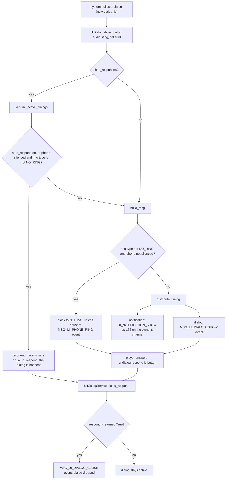
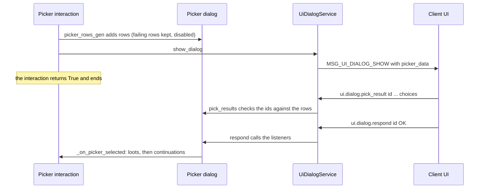

# 7.01 UI, dialogs, notifications and tutorials

*Game version 1.128.90.1030 (Steam, Linux/Proton). Live numbers are the merged tuning of the base game and the installed packs: EP04 (Cats & Dogs), EP06 (Get Famous), EP09 (Eco Lifestyle), EP12 (High School Years), GP04 (Vampires), GP12 (Werewolves), SP01 (Luxury Party) and SP42 (Grunge Revival); string counts come from the base English string table. Written 2026-10-12. Checked 2026-10-12: 147 claims checked, 19 corrected, 3 relabelled, 0 removed, 11 added. Deepened 2026-10-13: 1 module newly explained (`interaction_picker`, skim to deep; none promoted from listed: the 7 listed rows are empty package files), 3 failed decompiles read. Checked again 2026-10-13: 329 claims checked, 22 corrected, 2 relabelled, 1 removed. Cross-chapter edits 2026-10-13: 3 applied.*

## In plain words

Every pop-up the game shows you while you play (a yes/no question, a phone call, a list of Sims to pick from, the little message cards in the corner) is built by the simulation and drawn by the user interface. The simulation gives each pop-up a number, sends it over, and waits for the interface to say which button you pressed. The interface does the drawing, the countdowns and the layout; the simulation only decides what is in the pop-up and what happens when you answer.

Three things surprise most players. First, a pop-up's countdown is kept by the interface, not by the simulation: the game only tells the interface how many Sim minutes to allow. Second, silencing your phone does more than mute it: a call that asks a question is answered for you straight away, with "No" when there is a "No" button and "Yes" otherwise, unless the code that placed the call chose an answer itself. Third, an incoming call sets the game speed back to normal (unless the game is paused), so a call at triple speed slows the game down.

The message cards that loots and actions raise in the corner go to Sims you control: a card meant for a Sim you cannot select is dropped (an action with no Sim behind it is the exception). Some cards can be capped so they do not flood the screen; the base game sets up 49 such caps, most of them "once per save" for first-time explanations, though only four are used by the game data installed here. Lists of Sims to pick from almost never freeze the action behind them: the action that opened the list finishes at once, and whatever you pick starts a new action later. The adoption list is the exception and waits for your answer. Sims who fail a rule stay in the list but are greyed out with a reason.

The lessons, the first-time tutorial and the newer guidance hints are mostly run by the interface. It decides when a tip appears, using rules it reads from the game data; the simulation only does the gameplay part (give a buff, hide some actions, watch for the Sim to do something). Text you see everywhere is stored as numbered strings in a table, filled in with names and numbers at the last moment, so "Bella's" and "1,000 §" are never part of the stored text.

## Key facts

- A dialog is tracked by the simulation only when it has buttons that answer (`has_responses`); the client answers with the Live command `ui.dialog.respond <dialog_id> <button>`, where OK is 10001, Cancel 10002, the custom buttons 10004 to 10006 and the close box -1.
- The dialog timeout is client side. `timeout_duration` (Sim minutes, minimum 5) is copied into the message and no server timer exists. 72 live dialogs set one: 55 at 55 minutes (all career messages), 9 at 60, 7 at 120 and 1 at 5.
- A phone dialog (ring type other than `NO_RING`) sets the clock to normal speed unless it is paused or speed requests are ignored. With the phone silenced, a ringing dialog that has buttons is answered on a zero-length alarm (the answer the calling code passed, else Cancel if offered, else OK); the dialog itself is never sent, and only the close event follows once the answer is accepted. Tuning cannot set that answer: only four code sites pass one.
- Dialogs go to the client as standalone events (`MSG_UI_DIALOG_SHOW` 40, `MSG_UI_PHONE_RING` 183); notifications ride the op stream as `UI_NOTIFICATION_SHOW` (op 166) on the owner's channel. The distributor sends events before the ops of the same tick.
- Live notification tuning: 453 `Notification` snippets, 1,191 `notification_and_dialog` loots that show an inline notification (49 more show another dialog kind), and 2,218 list entries of the `notification` element. The loot shows nothing unless its owner is selectable; the element skips non-selectable recipients unless the interaction has no Sim. Notifications built in code check neither.
- 49 notification suppression groups are configured; 40 count for the whole save. Only 7 live tunings put a notification in a group (3 loots, 4 interactions), using 4 groups. 43 of the others are named only by data of packs not installed here, and 2 by nothing.
- A picker almost never blocks its interaction: `SimPickerInteraction` returns right after showing the dialog and the pick arrives later through a listener. The exception is `AdoptionPickerSuperInteraction` (13 live), which sleeps until the pick. Rows that fail `cell_enabled_tests` stay in the list, disabled, with a tooltip; a pick whose id is not a row id is rejected.
- The Sim picker filters candidates in a fixed order of 12 per-Sim checks ending with the Sim filter, `sim_tests` and a code test function. 451 of the 546 live `SimPickerInteraction` records turn off uninstantiated Sims (the default includes them).
- While any dialog with buttons, no ring and not a notification is open, player-planned events (the planner, stayovers, getaways) wait: they reschedule themselves 1 or 5 Sim minutes later. Getaways need EP20 (Adventure Awaits), which is not installed, so here that delay applies only to the planner and stayovers.
- 98 live headlines: 90 show a like or dislike being discovered (41 music, 40 activities, 9 fashion), 4 ranked statistics, 3 relationships and 1 influence bucks. Each sends a float value and lets the client pick the matching level icon.
- 414 tutorial tips in 580 tip groups and 241 lessons are live. The client decides when a tip shows (the display rules are client-exported); the server runs the tip's gameplay when the client sends `tutorial.activate_tutorial_tip`.
- In FTUE tutorial mode with no tip restriction, a fallback hides every pie-menu action except "Go Here" and a Day 1 list. Its "enabled" half is loaded and then discarded: the method returns before using it.
- The 43 guidance tips are client-only on the server side: `GuidanceTip.activate`, `satisfy` and `deactivate` are empty, and every tunable is exported to the client binary.
- A `LocalizedString` is a 32-bit key plus typed tokens (Sim, string, raw text, number, list of Sims). The base English table holds 58,374 strings; 8,140 carry tokens, and `{0.SimFirstName}` is the most common field (7,589 uses).
- The profanity filter is native (`_profanity_filter.scan` and `check`, substitution character `*`). Python filters only gallery object names and descriptions, heirloom engravings and a crafter's name (plus two Live console commands that call the filter directly); text-input dialogs send a `check_profanity` flag that no live tuning turns on.

## How it works

### The dialog object

- **Observed** (`ui/ui_dialog.py: UiDialogBase`). Every dialog gets a `dialog_id` from a process-wide counter (`@unique_id("dialog_id", 1)`). It holds the owner (a Sim or SimInfo), a resolver for tokens and participants, a listener list and the chosen `response`.
- **Observed** (`ui/ui_dialog.py: ButtonType`). Answers are integers: `DIALOG_RESPONSE_CLOSED` -1, `NO_RESPONSE` 10000, `OK` 10001, `CANCEL` 10002, `OK_ALT` 10003, `CUSTOM_1` to `CUSTOM_3` 10004 to 10006.
- **Observed** (`ui/ui_dialog.py: UiDialogResponse`). A tuned button (`ui_responses`) carries `sort_order`, `dialog_response_id` (default `NO_RESPONSE`), a `ui_request` the client performs (41 values in Python, such as `SHOW_LESSONS`, `SHOW_SKILL_PANEL`, `SEND_COMMAND`, `SEND_UI_MESSAGE`), an optional client `response_command`, audio, tooltip, icon, lesson id and `loots_for_response`. Tuning `loots_for_response` forces the button's id to its `dialog_response_id_override` (one of the three custom ids).
- **Observed** (`ui/ui_dialog.py: UiDialog.build_msg`, checked in bytecode). The message lists every button: the class's own `responses` (OK and Cancel for the OK classes), any added at run time, and the tuned `ui_responses`, sorted by `sort_order`.
- **Observed** (`ui/ui_dialog.py: UiDialog._build_localized_string_msg`, checked in bytecode). Text tokens are the resolver's default tokens unless `text_tokens` is tuned; with no resolver there are none. Extra tokens passed by the caller are appended.
- **Observed** (`ui/ui_dialog.py: UiDialog.show_dialog`, checked in bytecode; the decompile nests it wrongly). Order: play `audio_sting` if tuned (its owner is the `audio_sting_owner` participant, which is off unless tuned, a SimInfo turned into its Sim instance); pick the caller id (the owner's id for `ALARM` and `PIVOTAL_MOMENT` rings, returning early if the owner is gone, else the target Sim id); then `UiDialogBase.show_dialog` runs a high-water garbage collection and hands the dialog to `UiDialogService.dialog_show`.

### Showing a dialog: the service

- **Observed** (`ui/ui_dialog_service.py: UiDialogService.dialog_show`, checked in bytecode; the decompile puts the message build inside the `has_responses` branch and the ring message inside the `PAUSED` check, and the bytecode does neither). A disabled service (zone teardown) shows nothing. A dialog with responses is stored by id. If the service is in auto-respond mode, or the phone is silenced and the dialog rings, it schedules a zero-length alarm that calls `do_auto_respond` and returns. Otherwise it builds the message. A ringing dialog on an unsilenced phone sets the clock to `NORMAL` when the clock is not `PAUSED` and `GameClock.ignore_game_speed_requests` is off, then sends `MSG_UI_PHONE_RING` (`UiPhoneRing`: ring type, the dialog, caller id). Anything else goes through `distribute_dialog`.
- **Observed** (`ui/ui_dialog.py: UiDialog.distribute_dialog`; `ui/ui_dialog_notification.py: UiDialogNotification.distribute_dialog`). A dialog is an event (`Distributor.add_event`). A notification overrides this and adds a `GenericProtocolBufferOp(UI_NOTIFICATION_SHOW)` op on its owner when the owner is valid for distribution, else an op with no owner.
- **Observed** (`distributor/system.py: Distributor.process`). Events are sent before the view-update ops of the same pass, so a dialog can reach the client ahead of object changes queued earlier in the same tick.
- **Observed** (`ui/ui_dialog_service.py: has_active_modal_dialogs`). "Modal" means any stored dialog whose message type is not the notification type and whose ring type is `NO_RING`.
- **Observed** (`ui/ui_dialog_service.py: save`, `load`, `send_dialog_options_to_client`). The phone-silenced flag is saved in the slot's gameplay data and pushed to the client as `SetPhoneSilence` (op 173). The counts of the notification suppression groups are saved too.

### Answers, auto-responses and timeouts

- **Observed** (`ui/ui_dialog.py: UiDialogBase.respond`, checked in bytecode). `respond` stores the answer. For a tuned button with that id: if it has no `loots_for_response`, it calls `logger.warn` (empty in retail), calls `on_response_received` and returns False without calling the listeners; otherwise it applies the loots to the dialog's resolver. Then it calls the listeners and returns True.
- **Observed** (`ui/ui_dialog_service.py: dialog_respond`). True closes the dialog (`MSG_UI_DIALOG_CLOSE` 157, `UiDialogCloseRequest`) and removes it. An exception inside `respond` also closes it, then re-raises. False leaves it stored.
- **Observed** (`ui/ui_dialog.py: UiDialogBase.do_auto_respond`, checked in bytecode). The automatic answer is the caller's `auto_response` when given, else Cancel when Cancel is among the responses, else OK when offered, else the close value -1. `auto_response` is a `show_dialog` argument, never a tunable; four code sites pass one: adventure moments 0 (`interactions/utils/adventure.py`), the career work dialog OK (`careers/career_service.py`), `CUSTOM_1` in `interactions/utils/death.py` and `DeathOption.FREEROAMING_GHOST` in `death_interactions.py`.
- **Observed** (`ui/ui_dialog_generic.py: UiDialogTextInput.do_auto_respond`, checked in bytecode). A text-input dialog answering OK automatically fills each input with `*` repeated to its minimum length (or one `*`), and it looks only at the class's own OK and Cancel buttons, not the tuned ones, so an OK/Cancel text dialog answers Cancel. The test is `min_length != 0` followed by `min_length.length`; for a `fixed` length rule whose `min_length` is disabled (the default rule, 108 of the 137 live text inputs, counting the 10 untuned `new_description` inputs that `RenameImmediateInteraction` declares alongside `new_name`), `min_length` is None and the read raises AttributeError at offset 98, before `dialog_respond` at offset 146. The dialog is not closed: it stays stored, so it counts as modal. Normal play never reaches this: all 73 live text-input dialogs are `NO_RING`, so only the Automation auto-respond can answer one.
- **Observed** (`ui/ui_dialog_service.py: set_auto_respond`; `server_commands/ui_commands.py: ui_dialog_auto_respond`). Turning auto-respond on answers every stored dialog at once. The command is typed Automation; `simulate_to_time.py` also turns it on.
- **Observed** (`ui/ui_dialog.py: UiDialog.build_msg`). `timeout_duration` is copied into `UiDialogMessage.timeout_duration` (field 4, float). Nothing else in Python reads it, so the countdown and what happens when it runs out are client behaviour (**Inferred**).

### What a dialog blocks

- **Observed** (`interactions/base/picker_interaction.py: SimPickerInteraction._run_interaction_gen`, checked in bytecode). Pickers do not block: the interaction shows the dialog and returns True.
- **Observed** (`adoption/adoption_picker_interaction.py: AdoptionPickerSuperInteraction._run_interaction_gen`, checked in bytecode). The exception: the adoption picker shows its Sim list and runs `soft_sleep_forever`; the selection callback triggers a soft stop, and the interaction then applies the adoption action when Sims were picked. 13 live records.
- **Observed** (`ui/ui_dialog_element.py: UiDialogElement`; `ui/ui_dialog_rename.py: RenameDialogElement`; `interactions/utils/adventure.py: Adventure.showing_dialog`). Three elements block: they show the dialog and run `soft_sleep_forever` until the answer arrives, so the interaction that owns them waits. For the dialog element the result is `dialog.accepted` (or a tuned callback's result), and a hard stop cancels the dialog, which sends the close message. The rename element is the baby-naming flow (first and last name text inputs); the adventure element sleeps while an adventure moment's dialog is up.
- **Observed** (`drama_scheduler/drama_node.pyc: BaseDramaNode.try_do_travel_dialog_delay`, read in bytecode because the module did not decompile). When `has_active_modal_dialogs` is true, the node reschedules itself to now plus the delay and returns `RESCHEDULED`. Callers pass 1 Sim minute (`player_planned_drama_node.py`) or 5 (`player_planned_stayover_drama_node.py`, `custom_schedules/player_planned_getaway_drama_node.py`). The getaway caller is inert in this install: `CustomScheduleService.required_packs` is EP20 (Adventure Awaits, not installed), so the service is never created and `PlayerPlannedGetawayDramaNode.schedule` fails on `services.custom_schedule_service()` being None (`custom_schedules/custom_schedule_service.py`, `player_planned_getaway_drama_node.py`).
- **Observed** (`ui/ui_dialog_service.py`). Nothing in the service pauses the clock; only phone rings touch it, and only to set normal speed. Whether the client pauses for a modal dialog is client behaviour (**Inferred**: not decided in Python).

### Dialog kinds

**Observed** (`protocolbuffers` descriptor `UiDialogMessage.Type`; the classes in `ui/`). The `dialog_type` field picks the client layout.

| Type | Value | Python class (module) |
|---|---|---|
| `DEFAULT` | 1 | `UiDialog`, `UiDialogOk`, `UiDialogOkCancel`, `UiEndSituationDialogOkCancel` (adds `OK_ALT`), the text-input classes (`ui_dialog.py`, `ui_dialog_generic.py`) |
| `OBJECT_PICKER` | 2 | `UiDialogObjectPicker` and its subclasses (`ui_dialog_picker.pyc`) |
| `NOTIFICATION` | 3 | `UiDialogNotification` and subclasses |
| `OK_CANCEL_ICONS` | 4 | `UiDialogOk` with `is_special_dialog` set |
| `ICONS_LABELS` | 6 | `UiDialogLabeledIcons`, `UiDialogIcons`, `UiDialogAspirationProgress` (`ui_dialog_labeled_icons.py`), `UiDialogLifestyles`, `UiDialogNpcDisplay` (`ui_lifestyles_dialog.py`) |
| `MULTI_PICKER` | 7 | `UiMultiPicker` (`ui_dialog_multi_picker.py`) |
| `INFO_IN_COLUMNS` | 8 | `UiDialogInfoInColumns` (`ui_dialog_info_columns.py`) |
| `CUSTOMIZE_OBJECT_MULTI_PICKER` | 9 | `UiCustomizeObjectMultiPicker` |
| `REVEAL_SEQUENCE` | 10 | `UiDialogRevealSequence`: before and after photo pairs from a gig (`ui_dialog_reveal_sequence.py`) |
| `DEATH_OPTIONS` | 12 | `UiDialogDeathOptions` (`ui_dialog_death_options.py`) |

**Observed** (`ui/ui_dialog_picker.pyc`, read per function). Types 11 (`CRAFTING_JEWELRY`) and 13 (`FAMILY_RECIPE`) are set by picker classes: `UIJewelryCraftingPicker` and `UIFamilyRecipesCreationPicker`. Type 5 (`INFO_SETTING`) is never set by Python.

- **Observed** (`ui/ui_dialog.py: UiDialogOk`, `UiDialogOkCancel`). The default `text_ok` is string 0xD977B872 ("OK") and `text_cancel` is 0xD078441A ("Cancel"), read from the English table. `include_cancel_response` defaults True. `UiDialogOk.OK_BUTTON_ICON` is set in base module tuning. The snippet type `dialog_ok_cancel` (class `DialogOkCancel`) has 2 live records, both move-in questions.
- **Observed** (`ui/ui_text_input.py: UiTextInput`). A text input has default and initial text, a title, a length rule (`max_length` default 20, optional `min_length` default 1 with a tooltip), a `restricted_characters` pattern sent as a localized string, `check_profanity` (default False) and a height. CAS-style names use a fixed rule of at most 14 characters; the last name's minimum is 0 when the species' last name is optional. `ui.dialog.text_input <id> <name> <value>` stores the value only when the input name exists (`UiDialogTextInput.on_text_input`).
- **Observed** (live tuning). 71 text-input groups are tuned, 52 of them on `RenameImmediateInteraction` records. Explicit `max_length` values: 140 (42 times), 30 (25), 125 (18), 40 (6), 14 (2), and 13, 25 and 7 once each.

### Notifications: kinds and urgency

- **Observed** (`ui/ui_dialog_notification.py: UiDialogNotification`). A notification ("TNS" in the code) is a `UiDialog` with five enums sent in the `UiDialogNotification.dialog` extension: `expand_behavior` (`USER_SETTING` 0 default, `FORCE_EXPAND` 1), `urgency` sent as `criticality` (`DEFAULT` 0, `URGENT` 1), `information_level` (`PLAYER` 0, `SIM` 1 default; the proto also has `GALLERY` 2), `visual_type` (`INFORMATION` 0 default, `SPEECH` 1, `SPECIAL_MOMENT` 2) and `auto_delete_reason` (`NO_REASON` 0, `LEAVE_LIVE_MODE` 1). It can also tune click responses on its two icons, a suppression group, per-age replacement text and `disable_prompt_buttons_during_save_lock`.
- **Observed** (`ui/ui_dialog_notification.py: build_msg`, checked in bytecode). The base message is always built first, then the type is set to `NOTIFICATION` and the extension filled. Age text applies only when the owner is a Sim.
- **Observed** (live tuning, every node whose name is one of these notification-only enums). Explicit values: `urgency` `URGENT` 122 and `DEFAULT` 174; `visual_type` `SPEECH` 1,038, `SPECIAL_MOMENT` 340, `INFORMATION` 75; `information_level` `PLAYER` 153, `SIM` 54; `expand_behavior` `FORCE_EXPAND` 238, `USER_SETTING` 46. Most of these sit in inline notifications; the 453 snippets mostly keep the defaults (one explicit `URGENT`, 24 `SPEECH`, 5 `SPECIAL_MOMENT`).
- **Observed** (live tuning). 8 notification snippets tune `phone_ring_type` `RING`, so they arrive as a phone ring through the path above. Explicit ring types in instance tuning: `RING` 223 (128 on careers, 77 on dialog drama nodes), `BUZZ` 94, `NO_RING` 82 and `PIVOTAL_MOMENT` 7; base module tuning adds `BUZZ` 5, `NO_RING` 4 and `RING` 3. A ringing dialog without buttons on a silenced phone is shown as an ordinary dialog or notification.
- **Observed** (`ui/tested_ui_dialog_notification.py`, `ui/ui_dialog_buff_notification.py`, `ui/ui_dialog_notification_story_progression_discovery.py`). Variants: a tested notification (snippet `tested_notification`, shown only if its tests pass; 0 live records), a buff notification whose text comes from the highest-priority buff's notification info, and a story progression discovery notification whose text comes from `story_progression_service.get_discovery_string()` (see [4.02 Story progression](4.02-story-progression-townies.md)).
- **Observed** (`ui/ui_utils.py: hide_selected_notifications`). A context manager sets a class flag while it is open. Two places read the flag: relationship bits (`relationships/relationship_bit.py: RelationshipBit.show_bit_added_dialog`, `show_bit_removed_dialog`) and the "joined a career" notification (`careers/career_base.pyc: CareerBase.send_join_career_message`, read in bytecode). Only `gameplay_scenarios/scenario.pyc: Scenario.start_scenario_without_phase` enters it (read in bytecode; the module did not decompile), around the household loot and the relationship loot it applies to every pair of household Sims. `start_scenario` takes that path when the scenario has no starting phase, which is 27 of the 31 live scenarios, and enters the context only when `loot_on_scenario_start` has an entry for the entry method: 25 of the 27 on a new household (Unlucky Chef and Proud Parent tune no start loot) and 13 on an existing household. So relationship-bit and career-join notifications raised by a scenario's start loot are not shown, and every other notification ignores the flag.

### How loots and interactions raise a notification

- **Observed** (`interactions/utils/loot_ops.py: DialogLootOp._apply_to_subject_and_target`). The loot `notification_and_dialog` does nothing while the zone is loading. The owner is the subject when it is a Sim, else the active Sim; the dialog is built and shown only when that owner is selectable. Its `dialog` variant offers `notification` (default), `notification_reference`, `dialog_icon`, `dialog_ok`, `aspiration_progress`, `reveal_sequence`, `npc_display`, `buff_notification` and `story_progression_discovery_notification`.
- **Observed** (live tuning). 1,240 `notification_and_dialog` loots: 1,191 inline `notification`, 23 `dialog_icon`, 21 `dialog_ok`, 4 `npc_display` and 1 story progression discovery. None uses `notification_reference`.
- **Observed** (`interactions/utils/notification.py: NotificationElement.show_notification`, checked in bytecode). The interaction element `notification` returns at once for an autonomous interaction when `allow_autonomous` is off. Recipients are the tuned participant (the active Sim for `ActiveHousehold`). A recipient is skipped unless the interaction is Sim-less or the recipient is selectable, so a Sim-less interaction can notify a Sim you do not control. `limit_to_one_notification` stops after the first shown. The `dialog` field is a tested variant, so it can resolve to nothing.
- **Observed** (live tuning). 2,218 list entries choose the `notification` element, all of them in interaction `basic_extras` lists; 72 more sit under `dialog_and_loot` and 6 under `goodbye_notification`.
- **Observed** (`interactions/utils/loot_ops.py: SimInteractionDialogLootOp`). The loot `sim_interaction_dialog` (5 live) builds buttons at run time from a tested list, ids 0 upward, and applies the loots of the chosen one.

### Notification suppression

- **Observed** (`ui/notification_suppression.py: TNSSuppression.try_show_tns`; `ui/ui_dialog_notification.py: show_dialog`). A notification with a `tns_suppression_group` goes through that group's config. The config has a `limit` (minimum 1, default 1), a counting strategy and a fallback.
- **Observed** (`ui/notification_suppression.py: _SuppressForSave.execute`). "For save": the count grows on every attempt; while it is at or below the limit the notification shows at once, above it the fallback runs. The count is saved with the dialog service, so it lasts for the save.
- **Observed** (`_SuppressForTick.execute`). "For tick": the first attempt schedules a reset element on the Sim timeline; each attempt then schedules its show or its fallback as another element. **Inferred**: the limit applies to a burst of notifications raised before the timeline next runs, and the display is deferred to that run.
- **Observed** (`_FallbackToNothing`, `_FallbackToTns`, `_FallbackToTestedTns`). Fallbacks: nothing (default), another notification built with the same owner and resolver, or the first of a tested list whose tests pass (with its own nothing or notification fallback).
- **Observed** (base delta module tuning `ui.notification_suppression`, `ui.notification_suppression_enums`). 49 groups are defined and all 49 configured: 40 for the save (mostly `Onboarding_*`, luck, fairy and ailment explanations) and 9 per tick. Limits: 1 for 40 groups, 5 for the six `LuckSys_LuckImpact_*` groups, 3 for `Milestones` and `Onboarding_NaturalLivingSkill`, 10 for `EP19_FairyAbility_CreateSeed`. One group (`Burglar_ScaredOff`) falls back to another notification and one (`Attraction`) to a tested list. "For tick" is the strategy's default, and 5 of the 9 tick groups rely on it.
- **Observed** (live tuning). Only 7 tunings put a notification in a group, using 4 groups: `loot_Burglar_RunAwayPanic_Actor` and `loot_Burglar_RunAwayPanic_Target` (`Burglar_ScaredOff`), `loot_LotTrait_EV008_RegalResidence_PropertyValueDown_2` (`ImaginaryFriend_Games`), three loud-noise interactions (`Onboarding_InfantSleep`) and one house-plant interaction (`HousePlants_FirstHousePlant`). Of the other 45 groups, 43 are named only by tuning of packs not installed here (EP13 (Growing Together), EP16 (Lovestruck), EP17 (Life & Death), EP18 (Businesses & Hobbies), EP19 (Enchanted by Nature), EP20 (Adventure Awaits), EP21 (Royalty & Legacy)), and 2 (`ImaginaryFriend_Dismiss`, `ImaginaryFriend_PowerOfImagination`) by nothing at all.

### Pickers: the dialog side

- **Observed** (`ui/ui_dialog_picker.pyc: UiDialogObjectPicker`, rescued per function). A picker dialog holds rows. Each row (`BasePickerRow`) has an `option_id`, a `tag` (the object the game gets back: a Sim id, an object, a definition, a recipe), enabled flag, name, icon, description, tooltip, selected flag and two tag lists for filters. Subclasses add fields: `SimPickerRow` (Sim id, default selection, location, household), `ObjectPickerRow` (object and definition ids, count, cost and discounted cost, rarity text, slot types, status icons), and recipe, outfit, purchase, lot and odd-job rows.
- **Observed** (`UiDialogObjectPicker.add_row`). A row of the wrong class is refused; a row without an id gets its list index.
- **Observed** (`UiDialogObjectPicker.pick_results`). `ui.dialog.pick_result <id> <ingredient_check> <prepped_ingredient_check> <choices...>` stores the picks. Any id that is not a row id makes the whole pick fail; the message "Player choose ... out of provided" goes to `logger.error`, which is empty in retail. A recipe pick is matched by the row tag's `guid64`. Storing does not close the dialog; **Inferred** from the command shapes: the client then sends `ui.dialog.respond` to close it and fire the listeners.
- **Observed** (`UiDialogObjectPicker`). `max_selectable` is a variant: `static_count` (`number_selectable` default 1, plus the pre-selected rows while `exclude_previously_selected` is on), `unlimited` (sent as 0), `all_but_one` (rows minus a threshold, default 1), `household_size` (free household slots, capped by an optional maximum that is 8 when enabled and 32,767 when not), `slot_based_count`, `slot_types_count`, `unused_parts`, `cost_per_item` (funds divided by cost, at least 1), `animal_home_capacity` and `stayover_guests_capacity`. `min_selectable` defaults to 1. The list is multi-select when `min_selectable` is below 1 or the maximum is above 1 or unlimited.
- **Observed** (live tuning). Explicit `max_selectable` choices: `static_count` 108, `unlimited` 75, `all_but_one` 16, `household_size` 14, `slot_based_count` 4. The 14 `household_size` pickers cap at 3 (8 records) or 1 (5) or not at all (1); none uses the default 8. Explicit `picker_dialog` kinds: `sim_picker` 561, `object_picker` 219, `recipe_picker` 153, `purchase_picker` 63, `map_view_picker` 14, `item_picker` 11, `skills_sim_picker` 9, and a handful of others.
- **Observed** (`UiPurchasePicker`, class body and `_build_customize_picker` read in bytecode; `__init__` per function). The shop picker (type `PURCHASE`; `UiFashionPurchasePicker` sets `FASHION_PURCHASE`) tunes `categories` (a tag, an icon, a tooltip and an optional `disabled_tooltip` each) and an optional `sub_total` line (text and an integer cost, default 0, that the client adds to the total, for example a delivery fee). Building the message copies the run-time fields (object and inventory ids, delivery method, show cost and description, row and per-row selection limits, right-hand custom text) and the sub-total, writes every row, and collects the tags the rows carry. A category whose tag no row carries is left out of the message, unless it tunes `disabled_tooltip`: then it is sent with that tooltip, which the tunable's description says the client shows as a disabled button. Rows must be `PurchasePickerRow`.
- **Observed** (`UiSimPicker`). The Sim grid has `column_count` (default 3, 1 to 8), name display, a cell type and a display filter.

### Pickers: the interaction side

- **Observed** (`interactions/base/picker_interaction.py: PickerSuperInteractionMixin`, owned by [3.05 Interactions](3.05-interactions-postures-routing.md)). The dialog's title defaults to the interaction's name; the listener `_on_picker_selected` calls `on_multi_choice_selected(tags)` for multi-select lists and `on_choice_selected(tag)` otherwise. With `pie_menu_option` tuned, the rows become pie-menu entries instead (`interactions/picker/picker_pie_menu_interaction.py: _PickerPieMenuProxyInteraction`): a disabled row fails the entry's test, with its tooltip only when `show_disabled_item` is on, and choosing the entry calls `on_choice_selected` with the row's tag.
- **Observed** (`PickerSingleChoiceSuperInteraction._show_picker_dialog`, checked in bytecode). With exactly one choice, a preset `picked_item_ids` that matches it, and `force_show_dialog_when_single_choice` off, the choice is taken without a dialog.
- **Observed** (`SimPickerInteraction.picker_rows_gen`, checked in bytecode). Every candidate becomes a row; failing `cell_enabled_tests` disables it and sets the tooltip; `default_selection_tests` pre-select it.
- **Observed** (`SimPickerMixin._get_valid_sim_choices_gen`, used by `SimPickerInteraction`, checked in bytecode). Before the loop, a tuned `included_override` returns its own Sims and skips everything below, and a missing requesting Sim ends the search with no choices. The per-Sim order: (1) the pool is every SimInfo, or the Sim filter's pre-filtered set; (2) skip Sims that cannot be instantiated; (3) skip the exclude list; (4) skip the actor unless `include_actor_sim` (default False); (5) skip the target unless `include_target_sim` (default False); (6) skip Sims not instanced unless `include_uninstantiated_sims` (default True); (7) skip instanced Sims unless `include_instantiated_sims` (default True); (8) when `radius` is tuned (1 to 50, default 5 when enabled, off by default), skip every Sim when the actor is not instanced, and skip Sims not instanced or whose straight-line distance between intended positions exceeds it; (9) skip Sims hidden by the relationship service; (10) run the Sim filter for that one Sim (rabbit-hole and missing pets excluded by default) and skip on no result; (11) run `sim_tests` with that Sim as the picked item; (12) run the code `test_function`, which also skips Sims not instanced. After the loop, `create_sim_if_no_valid_choices` asks the filter service to create `min_required` (a call argument, default 1) minus the Sims found.
- **Observed** (`SimPickerInteraction._run_interaction_gen`, checked in bytecode). Fewer choices than `min_choices` ends the interaction with False. With `min_selectable` 0 and no choices, it counts as a successful pick at once. On a pick, `_on_successful_picker_selection` applies `success_loot_actions`, pushes continuations (actor, target and picked, sequential or not, linked per `SimPickerLinkContinuation`) and logs telemetry.
- **Observed** (live tuning). 546 `SimPickerInteraction` records: 451 set `include_uninstantiated_sims` False, 12 set `include_instantiated_sims` False, 6 include the actor and 4 the target, and 119 turn `radius` on. Explicit `min_selectable`: 1 (22 times) and 0 (21).
- **Observed** (`interactions/base/object_picker_mixins.py: ObjectPickerMixin._get_objects_internal_gen`, checked in bytecode). The two pickers built on this mixin, `AutonomousGigObjectPickerInteraction` and `AutonomousStyleTagObjectPickerInteraction`, keep an object when it is within `radius` (straight line, default 5, on by default), passes `object_filter_test`, has a part connected to the Sim when it has parts, and is itself connected to the Sim. `ObjectPickerInteraction` uses a different `ObjectPickerMixin` (in `picker_interaction.py`) with no radius, and `AutonomousObjectTaggedPickerInteraction` tunes its own.
- **Observed** (`interactions/base/picker_interaction.py: LotPickerMixin._get_valid_lot_choices`, checked in bytecode; the decompile is badly nested). For each saved zone: skip the active lot unless `include_active_lot`; skip regions not compatible with the actor's region (when `test_region_compatibility`, default True); skip excluded building types; the actor's home is kept only with `include_actor_home_lot` and targets' homes only with `include_target_home_lot`, whatever the venue; skip zones without a known venue; skip already rented vacation zones when `exclude_rented_zones`; keep the zone when the venue's region tests pass; then apply the include-all or exclude-all venue lists.
- **Observed** (`interactions/picker/filtered_object_picker.py`, `known_object_picker_interaction.py`, `situation_picker_interaction.py`, `lock_picker_interaction.py`, `switch_active_household_control_picker_interaction.py`). Specialised row sources: objects matching a filter (on the lot by default, or in household or participant inventories), objects the Sim knows of (by knowledge tag and zone scope), Sims in matching situations, household Sims for door locks, and households to switch control to.
- **Observed** (`interactions/picker/purchase_picker_service.py: PurchasePickerService`). Shops that restock: `PICKER_DATA_GROUPS` maps a group to weighted category lists; stock refreshes when a day has passed or the daily `REFRESH_TIME` has been crossed, purchases reduce stock, and stock is saved in the slot's gameplay data. The 8 live groups (`EP11_VillageShops_*` four times, `EP14_GroceryStore`, `EP18_ShadyNPC`, `EP19_EverdewSeeds`, `EP20_RangerStationButterflies`) are all for packs not installed: EP11 (Cottage Living), EP14 (Horse Ranch), EP18, EP19 and EP20 (Adventure Awaits). `REFRESH_TIME` is 07:00.

### Pickers whose rows are actions, weather, numbers or times

**Observed** (`interactions/picker/interaction_picker.pyc`, failed decompile: per-function decompile for 15 code objects, bytecode for the two class bodies and the two `picker_rows_gen` that failed, and for the time picker's row loop, which the decompile mangles). Four picker interactions in one module, all of which show the dialog to the actor and return at once (the non-blocking pattern above):

| Class | Dialog | Rows | On a pick | Live records |
|---|---|---|---|---|
| `InteractionPickerSuperInteraction` | `UiObjectPicker` | `possible_actions` (at least 1), each an `InteractionPickerItem` with a `continuation` | pushes the item's continuation | 6: `debugInteractionPicker` and four vet exam summaries (EP04), `interactionPicker_Fame_Perk_RelationshipGame_PRPerson` (EP06) |
| `WeatherEventPickerSuperInteraction` | `UiItemPicker` | `possible_actions`, each a `WeatherEventPickerItem` with a pack-safe weather event | `start_weather_event(event, WEATHER_EVENT_DURATION)`, a class constant of 0, only when the weather service exists | 0 |
| `NumberPickerSuperInteraction` | `UiDropdownPicker` | the integers of `numbers` (default 1 to 6), formatted by `text_format` or as raw text; `default_number` pre-selected | nothing (a sub-picker: the caller reads the tag) | 0 |
| `TimePickerSuperInteraction` | `UiDropdownPicker` | times from `start_time` to `end_time` every `time_increment` (default 1 hour), wrapping past midnight when the end is not after the start | nothing (sub-picker) | 0 |

- **Observed** (`InteractionPickerSuperInteraction.picker_rows_gen`, bytecode). The context is cloned as an insert-next `SCRIPT_WITH_USER_INTENT` source. For each item the first affordance of its continuation drives everything the item does not tune: an item whose continuation is empty is skipped; the resolver is that affordance's; `visibility_tests` that fail drop the row; the name falls back to the affordance's own name; without `enable_tests` the row is enabled by the affordance's `test`. The row tooltip is `item_tooltip`, replaced by the failing test's tooltip when there is one, and by `disable_tooltip` when the row is disabled and that is tuned. The weather picker does the same with the picker interaction itself in place of the first affordance (`get_name`, `test`).
- **Observed** (`TimePickerSuperInteraction.picker_rows_gen`, bytecode). On the current day (`days_away` 0) with `can_start_with_current_time` tuned: if it is already past the end time, there are no rows; if it is past the default time (or the start time when no default), the first row is the "Now" text, selected, with tag None, and the list resumes at the first slot after the current time. Otherwise the default selection is the first slot that is later than `default_time`, or lies within half an increment of it, or is the last slot: the slot nearest the default, ties going to the later one.
- **Observed** (`interactions/picker/stayover_multi_picker_interaction.py`). The number and time pickers are referenced by class restriction from the stayover planner's duration and start-time sub-pickers (Multi pickers below); no live record uses either class directly.
- **Observed** (`weather/weather_service.pyc: WeatherService.required_packs`, `start_weather_event`, `update`, `on_zone_load`; `weather/weather_event.py: get_transition_data`; bytecode read for [2.04](2.04-weather-seasons-ground.md)). The weather service requires EP05 (Seasons) or EP10 (Snowy Escape) and the service manager skips a service whose packs are missing, so `services.weather_service()` is None here and the weather picker does nothing in this install. With the service present, `start_weather_event` ramps from the current event and its transition data to the picked one; it does not clear them (`force_start_weather_event` is the method that clears). A duration of None or 0 leaves the next-event time at `DATE_AND_TIME_ZERO`, and the service's update starts a new event only when that time is not zero, so a picked event never ends on its own; `on_zone_load` drops the current event when the time is zero.

### Multi pickers

- **Observed** (`ui/ui_dialog_multi_picker.py: UiMultiPicker.build_msg`). A multi picker (type 7) creates a real picker interaction and a sub-dialog for each tuned picker and embeds their messages. The sub-dialogs are never shown or stored by the service.
- **Observed** (`UiMultiPicker.multi_picker_result`, checked in bytecode). The answer arrives as one text-format protobuf through `ui.dialog.multi_picker_result`. For each sub-picker it checks for changes, runs `pick_results` with the choices and control ids, sets the picked participant and answers OK; then it applies the text input. `UiCustomizeObjectMultiPicker` also reacts to `ui.dialog.multi_picker_selection_update` by sending `MSG_MULTI_PICKER_CONTENT_UPDATE`.
- **Observed** (`interactions/picker/stayover_multi_picker_interaction.py`, `customize_object_multi_picker_interaction.py`). The stayover planner combines a duration picker, an optional start-time picker and a guest picker; the customize-object picker combines definition and geometry/material pickers (`customize_object_picker_interactions.py`).

### Screen slams

- **Observed** (`ui/screen_slam.pyc`, rescued per function and read in bytecode). A screen slam (the large centred banner) is a snippet with a display type (`size_based`, default MEDIUM of SMALL, MEDIUM, LARGE, EXTRA_LARGE, or `key_based` with a UI animation key, default `medium`), optional title, text, icon and audio sting, and `active_sim_only` (default True). With no Sim, or when `active_sim_only` is on and the Sim is not selected, nothing is sent; otherwise it goes as `MSG_UI_SCREEN_SLAM` (207) through `add_message_if_player_controlled_sim`, which drops NPCs. 433 live snippet records.
- **Observed** (`ScreenSlam.send_screen_slam_message`, bytecode; the class body in bytecode). The message is a `UiScreenSlam`: the display variant writes `type` LEGACY 0 with a `size` (size-based) or CUSTOM 1 with a `ui_key` (key-based); `text` and `title` are built with the caller's localization tokens; `sim_id`, the icon key and the audio sting key are copied in. The server plays no sound itself; **Inferred**: the client plays the sting key with the banner. The tunable's own description warns that some slams sound as if they had a sting because the sound is tuned elsewhere, for example the career level's promotion sting, and asks tuners not to stack both. The send test, read from the jump table: send when a Sim is given and either `active_sim_only` is off or the Sim is selected; with no Sim nothing is sent.
- **Observed** (live census of the 433 `ScreenSlam` records: base 367, EP12 19, EP06 14, EP09 11, GP04 10, EP04 7, GP12 5). 393 tune `size_based` (EXTRA_LARGE 68, LARGE 146, MEDIUM 104, SMALL 75), 38 keep the default (size-based MEDIUM) and 2 are `key_based` (one keeps `medium`, one uses `ButterflyCollection`). 433 have text, 428 a title, 431 an icon and 130 an audio sting; 110 turn `active_sim_only` off, so they also show for a selectable Sim who is not the active one.

### Headlines

- **Observed** (`headlines/headline.py: Headline`). A headline (instance type HEADLINE) has optional text, `levels` (an integer key to an icon, `minimum_value` default 0, `maximum_value` default 1, an effect and a colour), `priority` (default 0) and `show_during_sim_info_creation` (default True). Text, levels and priority are exported to the client; `show_during_sim_info_creation` is server only.
- **Observed** (`Headline.send_headline_message`). When `show_during_sim_info_creation` is off and the Sim has no instance, nothing is sent. Otherwise the `DisplayHeadline` op (221: Sim id, headline guid, float value, optional icon modifier) goes on the SimInfo's channel. **Inferred**: the client chooses the level whose range holds the value; the server never picks a level.
- **Observed** (`headlines/headline_op.py: HeadlineOp`; `relationships/relationship_objects/relationship.py`, `statistics/ranked_statistic.py`, `statistics/life_skill_statistic.py`, `bucks/bucks_tracker.py`). Senders: the `headline_loot` loot (180 live), relationship track changes, ranked statistic changes (only for selectable Sims, not on load), life skill changes and bucks changes.
- **Observed** (live tuning). 98 headlines: `headline_SimPreference_Music_*` 41, `..._Activities_*` 40, `..._Fashion_*` 9, `headline_RankedStatistic_*` 4 (fame, vampire XP, reputation, werewolf XP), `headline_Relationship_*` 3, `headline_Buck_Influence` 1. 91 have two levels (key -1 for a value from -2 to 0, key 1 for 0 to 2 in the preference sample), 2 have three and 5 have four. One turns `show_during_sim_info_creation` off.
- The text headline over a Sim's head during a situation (`SET_SIM_HEADLINE`, op 198) is set by situation jobs; see [4.01 Situations](4.01-situations-npcs.md).

### Lessons, tutorial tips and the tutorial drama node

- **Observed** (`tutorials/tutorial.py`). The Lessons panel is built from TUTORIAL instances: `TutorialCategory` and `TutorialSubcategory` (name, a `lesson`-prefixed tag, an intro lesson, sort order) and `Tutorial` (name, slides of text plus image with platform and console variants, sort order, tags). `TutorialOpenElement` opens a lesson with the `OpenTutorial` op (1160). Live: 241 lessons (1 to 8 slides each, 3 slides most often, 64 times), 11 categories, 28 subcategories. The 54 records of the separate `client_tutorial` type (51 `Client_Tutorial`, 3 `Client_TutorialCategory`) have no Python class (**Inferred**: client-only tuning).
- **Observed** (`tutorials/tutorial_tip.py: TutorialTip`, `TutorialTipGroup`). A tip has client-exported display rules (required tip groups, visible and hidden UI elements, game state, tips not yet satisfied, active groups, platform, `required_tutorial_mode` default `STANDARD`) and a display block (text, action text, `timeout` in seconds, default 1, the UI element to point at, modal flag, display style). It also has server gameplay: buffs, commodities to solve, loots, restricted affordances, calls to action, an optional drama node to end, actor and target choice, and completion rules (`gameplay_test`, `gameplay_immediate_test`, `timeout_satisfies`, `satisfy_on_activate`, `satisfy_on_active_sim_change`, `time_of_day`). A group lists tips and needs ALL (default) or ANY of them.
- **Observed** (`tutorials/tutorial_tip_commands.py`). The client drives tips with Live commands: `tutorial.activate_tutorial_tip`, `tutorial.deactivate_tutorial_tip`, `tutorial.set_tutorial_mode` and `tutorial.is_guidance_tip_complete_callback`. **Inferred**: since the display rules are exported to the client binary and the server has no code that evaluates them, the client decides when a tip starts.
- **Observed** (`TutorialTip.activate`, checked in bytecode). Order: resolve the actor and target from the running TUTORIAL drama node; if `gameplay_immediate_test` is tuned and passes, satisfy the tip and go on, and if it fails, return with nothing done; add buffs; register `gameplay_test` with the event manager; hook active-Sim changes; for each commodity to solve, run a full autonomy request and execute the best action (stopping when the queue is full); apply loots; set restricted affordances; start calls to action; add the target to the actor's household; make the housemate unselectable; end the drama node; set the time-of-day alarm.
- **Observed** (`TutorialTip.satisfy`, `handle_event`, `deactivate`). Satisfying sends `SetTutorialTipSatisfy` (op 185). A registered test satisfies the tip when it passes (and, with `sim_tested`, when the Sim matches). Deactivating undoes the registrations, restrictions, calls to action, buffs (when tuned to), the alarm and the unselectable housemate.
- **Observed** (`tutorials/tutorial_service.py: TutorialService`). The mode (`DISABLED` 0, `STANDARD` 1, `FTUE` 2) lives in the save slot; leaving FTUE ends the running tutorial drama node. On load, when the slot's `trigger_tutorial_drama_node` flag is set, the service clears it and runs `TUTORIAL_DRAMA_NODE` (`tutorialDramaNode`). Pie menus ask the service which affordances are visible and which are disabled (`server_commands/interaction_commands.py`); the disabled tooltip falls back to `INTERACTION_DISABLED_TOOLTIP` ("Disabled by tutorial").
- **Observed** (`TutorialService.is_affordance_visible`, `get_disabled_affordance_tooltip`, checked in bytecode). With no tip restriction in FTUE mode, the visible filter falls back to `FALLBACK_RESTRICTED_AFFORDANCES.visible_affordances`: exclude all, include `terrain-gohere` and `affordanceList_FTUE_Tutorial_Visible_Day1` (106 affordances). The tooltip method loads the fallback's enabled filter and tooltip at offsets 32 to 46 and returns None at 48, so the fallback never greys anything out. Its enabled filter allows everything except `affordanceList_FTUE_Tutorial_Day1_Enabled_blackList_Limited` (45 entries, 2 of them not live), and 34 of those are also in the visible list (taking a shower, sleeping in bed, inviting over by phone, cooking on the stove): they were meant to show greyed out and show enabled instead. **Inferred**: rare in play, since the tunable's own description says a tip should always have set a restriction.
- **Observed** (base delta module tuning `tutorials.tutorial_tip`). `FTUE_TUNABLES` disables 26 UI elements in 15 groups (household management, manage worlds, calendar, build, gallery and others), each from a start tip to an end tip, with a reason string. 14 groups start at `tutorialTip_PC_FTUE_CAS_0`; the second triple-speed group starts at `tutorialTip_PC_FTUE_Live_Day_2_01a_riseShower`. 13 groups give "Disabled by tutorial" as the reason and the two gallery groups "The Gallery is not available during the Tutorial."
- **Observed** (live tuning). 414 tips, all from the base delta, and 580 groups (12 ANY); the base full build holds 174 more tips and 41 more groups, which the game does not load. 98 tips are FTUE-only. Every tip has a display block (the tuple is not optional) and 352 tune it; explicit display timeouts are 5 s (145), 4 s (121) and 3,600 s (50). 338 tune `timeout_satisfies` and 331 of them set it True; 178 start calls to action, 129 have a gameplay test, 112 require tip groups, 91 restrict affordances, 64 an immediate test, 3 are modal (counting only optional fields tuned on: 39 more tune the calls to action disabled, 4 the gameplay test, 1 each the restriction and the immediate test, and 1 tunes an empty group list). Game states (148 tuned): live mode 101, CAS 16, Build/Buy 14, neighbourhood view 12, `GAMESTATE_NONE` 3, gallery 1, travel 1.
- Pivotal moments and live-event quests share `TutorialService` (12 entries in `PIVOTAL_MOMENT_LIST`, 7 of them live); they are covered in [4.05 Scenarios, pivotal moments and calls to action](4.05-scenarios-moments.md).

### Guidance (onboarding hints)

- **Observed** (`guidance/guidance_tip.py`). A guidance tip (instance type GUIDANCE_TIP) has activation and relaunch rules (groups of criteria combined with AND or OR: platform, guidance mode, game state, other guidance tips or groups satisfied, UI element visible, first-time player, a feature parameter, a Build/Buy object tag, a game-option value, a CAS edit mode), title, text, icon, options with actions (send a UI message, activate or satisfy other guidance items, start a tutorial tip group), a timeout in seconds (default 0), priority and relaunch menu data. Every field is exported to the client binary. `activate`, `satisfy` and `deactivate` are empty class methods.
- **Observed** (`tutorials/tutorial_service.py: check_guidance_tip_complete`, `update_is_guidance_complete`). The server reads the account value `Emily_LiveMode_Status` first; only when it is absent does it ask the client whether guidance tip 449239 (`guidanceTip_Sunrise_Live_NUUeventPriroity_setDataFlag`) is complete, with the `IsGuidanceTipComplete` op (1281). When minimized situations are enabled, guidance auto-start is on and that tip is not complete, `TutorialService.guidance_allows_situation_start` returns False, which holds back pivotal moments that would start minimized (see 4.05).
- **Observed** (live tuning). 43 guidance tips and 2 groups; 42 of the tips are named `..._Sunrise_...`, and the other is `guidanceTip_RelExpectations_CAS_RomanticBoundaries`. 38 tips time out after 3,600 s, 1 after 300 s, and 4 set 0, which the tunable's description defines as no timeout.

### The notebook

- **Observed** (`notebook/notebook_tracker.py: NotebookTrackerSimInfo.unlock_entry`, checked in bytecode). Entries are stored per subcategory. When the subcategory already has entries, duplicates are not allowed and the entry is identical to one there, the failure notification shows (if tuned) and nothing is added. Otherwise the entry is appended, the category cache updated and the success notification shown. Unless loading, the entry is marked new and, for a selectable Sim, `NotifyNotebookEntryDiscovered` (op 1204) is sent with the subcategory name. **Inferred**: the client flashes the notebook button on it.
- **Observed** (`notebook/notebook_entry.py`, `country_living_notebook_entries.py`). Entry kinds: plain, bait (fish definition plus bait sub-entries, rarity and size text), recipe (final product plus ingredients found against the Sim's inventory), and three for the Cottage Living category. "Identical" depends on the kind: same class for plain entries, same definition and class for recipe entries, same definition for country entries, and a bait entry with the same fish merges its sub-entries into the existing one.
- **Observed** (`notebook/notebook_entry_ops.py: NotebookEntryLootOp`). The loot `create_notebook_entry` (94 live) builds entries from a reference, a participant object, a participant's definition, a recipe, or fishing data (which rolls a fish and stores it as saved participant 0). `remove_notebook_entry` (`interactions/utils/loot_ops.py: RemoveNotebookEntry`) removes a subcategory or entries by reference; the remove-by-reference filter is `isinstance(entry, reference)`, which the decompile drops (checked in bytecode).
- **Observed** (`notebook_tracker.py: generate_notebook_information`, `on_lod_update`). Opening the notebook (`notebook.generate_notebook` or the `NotebookDisplayElement` element) builds a `NotebookView` op (252) with every category and subcategory, recipe ingredient counts against the Sim's inventory, and secrets and scandals from the secrets service as temporary entries. The tracker is cleared below full LOD and reloaded from the save above it.
- **Observed** (base delta module tuning `ui.notebook_tuning`; live tuning). 11 categories and 23 subcategories are tuned (Cottage Living 5, Fairy Living 4, Secrets and Scandals 4, Ranch Living 2, Scientist Career 2, and six with 1). Only 42 NOTEBOOK_ENTRY instances are live: 41 `NotebookEntryGardeningPlant` (module `objects.gardening.gardening_notebook_entries`) and 1 bait entry.

### Gameplay options

- **Observed** (`server/account.py: Account._load_options`, `_save_options`). Options are account data (`gameplay_account_data.gameplay_options`), not slot data. Loading hands the `GameplayOptions` message to every game and zone service's `load_options`; saving collects from both.
- **Observed** (`gameplay_options/misc_options_service.py: MiscOptionsService.load_options`). The service copies 17 options from the message (werewolf and fairy restrictions, self discovery, death inventory handling, heirlooms, burglar, cheat sheet, guidance, balance system, ailments, infant caregiver autonomy, festival notification opt-outs and five autosave settings). The `__init__` values are overwritten on load, so the protobuf defaults are what a fresh account gets. They differ for one option: `automatic_death_inventory_handling_enabled` is True in code but False in the proto.
- **Observed** (`misc_options_service.py: load_options`; `GameplayOptions` descriptor). Autosave options and their proto defaults: `autosave_sim_time_frequency` 0 (off; `AutoSaveSimTimeTimer` OFF, DAILY, WEEKLY), `save_reminder_frequency` 4 (`EXTRA_EXTRA_LONG`), `autosave_on_build_buy_exit` False, `autosave_on_travel` True. `autosave_real_time_frequency` has no default; when absent it falls back to the old `autosave_real_time_enabled` flag (1 when set, else 0). How these become alarms is in [1.02 Saves and persistence](1.02-saves-persistence.md).
- **Observed** (`event_testing/game_option_tests.pyc: SimInfoGameplayOptionsTest`, rescued and read in bytecode). Gameplay reads most options through this test over 22 `TestableGameOptions`. It fails at once when the option's pack (15 options are pack-gated) is not available. The burglar option is read only here, through the private `_burglar_enabled`, since the service has no getter for it.
- **Observed** (`tutorials/tutorial_service.py: save_options`, `load_options`; `gameplay_options/misc_options_commands.py: set_guidance_auto_enabled`; `misc_options_service.py`; `GameplayOptions` descriptor). Pivotal moments and guidance auto-start are gameplay options too, stored with the other options in the account data. `TutorialService.load_options` copies `guidance_auto_enabled` (field 50, proto default True) from the `GameplayOptions` message, so the False its `__init__` sets lasts only until the first load; `MiscOptionsService` saves the field, while `TutorialService.save_options` writes only `pivotal_moments_enabled`. The Live command `misc_options.guidance_auto_enabled [enabled]` (argument default True) sets both services. **Inferred**: an account that never saved the option has guidance auto-start on. The account value `Emily_LiveMode_Status` read above is a separate flag.
- The story progression option `story_progression_effects_enabled` is read by the story progression service; see [4.02 Story progression](4.02-story-progression-townies.md).

### Localization: strings, tokens and tables

- **Observed** (`core/sims4/localization/__init__.py: _create_localized_string`, `create_tokens`; `Localization.proto`). A `LocalizedString` is `hash` (the 32-bit string key) plus `tokens`. Each token is typed: an object with `populate_localization_token` fills itself (a Sim writes names, gender, age, pronouns), a number becomes `NUMBER`, a str `RAW_TEXT`, a `LocalizedString` `STRING`, and anything else is iterated as a `SIM_LIST`. A `None` token stays `INVALID` but keeps its slot, so token positions never shift.
- **Observed** (`TunableLocalizedStringFactory`, `TunableLocalizedString`). Tuning stores only the key (hex). The factory form returns a callable that takes tokens; the plain form is called with none. A key of 0 is falsy, so optional strings test as unset. The variant forms add `variation` (one picked at random each call) and `concatenation` (snippets joined with new lines). `Localized_String` is a snippet type (class `LocalizedString`, 17 live).
- **Observed** (`LocalizationHelperTuning`; base delta module tuning `sims4.localization`; the English table). Lists and pairs are built from 22 tuned pattern strings: `NEW_LINE_LIST_STRUCTURE` is `{0.String}\n{1.String}`, `COMMA_LIST_STRUCTURE_LAST_ELEMENT` `{0.String}, and {1.String}`, `OBJECT_NAME_COUNT` `{0.Number} {S0.{S1.ObjectName}}{P0.{P1.ObjectName}}`, `COLORED_TEXT` `{1.String}`. Lists stop at `MAX_LIST_LENGTH` 16 items without a warning.
- **Observed** (`Data/Client/Strings_ENG_US.package`). The base English table is one STBL resource (type 0x220557DA, instance 0x0054935F2685AD48): magic `STBL`, version 5, 58,374 entries; each entry is a 32-bit key, a flag byte (0 on every entry here), a 16-bit length and UTF-8 text. The header's string-data size, 3,952,075, counts one byte more per string than the text itself (3,893,701 bytes). Each installed pack folder has its own `Strings_ENG_US.package`. **Inferred**: the client resolves keys against all loaded tables and formats the tokens; Python never sees the text. The package format is covered in [8.01 Package files](8.01-package-files.md).
- **Observed** (same table). 8,140 strings carry tokens. Field accessors: `SimFirstName` 7,589, `String` 1,215, `Number` 670, `Money` 327, `SimPronounObjective` 298, `SimName` 281, `SimPronounSubjective` 280. Choice prefixes pick text by token: `{M0.Son}{F0.Daughter}` by gender (about 4,300 pairs), `{S0...}{P0...}` by singular or plural.
- **Observed** (`core/sims4/localization/localization_tunables.py`, `localization_validation.py`). A household-name selector picks a string for an empty household, a single Sim, a single family name or a fallback, and appends pet text. String validators register generators of `LocalizedString` messages that `localization.validate_strings` (Automation) checks with a placeholder Sim ("John Doe" or "Jane Doe", age 32).
- **Observed** (`LocalizationHelperTuning.get_colored_text`). The colour is formatted as `"#" + hex(color)[4:]`, which drops `0x` and the first two hex digits. **Inferred**: this assumes an ARGB value whose alpha byte is 0x10 or more; a smaller alpha shortens the hex and shifts the colour.

### The profanity filter

- **Observed** (`profanity.py`; native strings of `Simulation_x64.dll`). `profanity.scan` returns the number of offending sequences; `profanity.check` returns `(count, text with offending sequences replaced)`, using the substitution character set by `set_substitution_char` or `*`. Both come from the native module `_profanity_filter`; Python falls back to stubs returning None when it is missing.
- **Observed** (`objects/components/name_component.py`, `objects/components/heirloom_component.py`, `crafting/crafting_process.py`, `sims/sim_info_name_data.py`, `sims/sim_spawner.py`). Python filters: custom object names and descriptions on load when the object came from the gallery, heirloom engravings on load from the gallery, the crafter's name stored on a crafted object (`use_profanity_filter=True`), and the random-name tuning, whose verify callback calls `logger.error` for each profane name (empty in retail, so nothing is reported). `is_name_profane` has no caller in any `.pyc` (dead code). The Live console commands `profanity_filter.check_text` and `profanity_filter.scan_text` (`server_commands/profanity_filter_commands.py`) run the native filter on any text; they write the result through `output`, which is empty in retail, so the player sees nothing.
- **Observed** (`ui/ui_text_input.py`; live tuning). Text inputs send `check_profanity` to the client; no live tuning sets it True. Social error codes `SOCE_PROFANE` 9 and `REST_API_ERROR_PROFANE` 10 exist in the protocol. **Inferred**: name entry in CAS and gallery uploads are checked by the client and the online service, not by this Python.

## Numbers

| Name | Value | Unit | Where | Source |
|---|---|---|---|---|
| `ButtonType` OK / CANCEL / OK_ALT | 10001 / 10002 / 10003 | id | `ui/ui_dialog.py` | code |
| `ButtonType` CUSTOM_1..3 / NO_RESPONSE / CLOSED | 10004..10006 / 10000 / -1 | id | `ui/ui_dialog.py` | code |
| `timeout_duration` default and minimum | 5 | Sim minutes | `UiDialog` | code default |
| dialogs with a timeout | 72 (55 at 55, all career messages; 9 at 60, 7 at 120, 1 at 5) | records | all live tuning | live |
| explicit `phone_ring_type` | RING 223, BUZZ 94, NO_RING 82, PIVOTAL_MOMENT 7 | nodes | instance tuning | live |
| travel delay while a modal dialog is open | 1 (planner), 5 (stayover, getaway; getaways need EP20, not installed) | Sim minutes | `try_do_travel_dialog_delay` callers | code |
| `Notification` snippets | 453 | records | SNIPPET | live |
| `notification_and_dialog` loots | 1,240 (1,191 notification) | ops | all live tuning | live |
| `notification` element list entries | 2,218 | entries | all live tuning | live |
| `sim_interaction_dialog` loots | 5 | ops | all live tuning | live |
| explicit `urgency` | URGENT 122, DEFAULT 174 | nodes | all live tuning | live |
| explicit `visual_type` | SPEECH 1,038, SPECIAL_MOMENT 340, INFORMATION 75 | nodes | all live tuning | live |
| TNS suppression groups | 49 (40 per save, 9 per tick) | groups | `ui.notification_suppression` | base delta module |
| `TNSSuppression.limit` default | 1 | notifications | `ui/notification_suppression.py` | code default |
| non-default limits | 5 (6 groups), 3 (2), 10 (1) | notifications | `SUPPRESSION_GROUP_CONFIG_MAPPING` | base delta module |
| tunings using a suppression group | 7 (4 groups) | records | all live tuning | live |
| `ScreenSlam` snippets | 433 | records | SNIPPET | live |
| screen slam display | size-based 393 (EXTRA_LARGE 68, LARGE 146, MEDIUM 104, SMALL 75), default 38, key-based 2 | records | `ScreenSlam` | live |
| screen slams with an audio sting / `active_sim_only` off | 130 / 110 | records | `ScreenSlam` | live |
| `ScreenSlamType` LEGACY / CUSTOM | 0 / 1 | enum | `ui/screen_slam.pyc` | code |
| `InteractionPickerSuperInteraction` records | 6 (5 EP04, 1 EP06) | records | INTERACTION | live |
| `WeatherEventPickerSuperInteraction.WEATHER_EVENT_DURATION` | 0 | (passed to the weather service; 0 means no end time) | `interaction_picker.pyc` | code |
| number picker `numbers` default | 1 to 6 (minimum 1) | integers | `NumberPickerSuperInteraction` | code default |
| time picker `time_increment` default | 1 | hour | `TimePickerSuperInteraction` | code default |
| purchase picker `sub_total_cost` default | 0 | Simoleons | `UiPurchasePicker` | code default |
| `UiTextInput.max_length` default | 20 | characters | `ui/ui_text_input.py` | code default |
| CAS name length | 14 | characters | `_TextInputLengthCASName` | code |
| text-input groups | 71 (52 on rename) | records | all live tuning | live |
| `number_selectable` default | 1 | rows | `_MaxSelectableStatic` | code default |
| `household_size` static cap default when enabled (off: 32,767) | 8 (minimum 1; live pickers use 3 or 1) | Sims | `_MaxSelectableHouseholdSize` | code default |
| `min_selectable` default | 1 | rows | `UiDialogObjectPicker` | code default |
| `column_count` default (range) | 3 (1 to 8) | columns | `UiSimPicker` | code default |
| Sim picker `radius` when enabled (range) | 5 (1 to 50) | metres | `SimPickerInteraction` | code default, off by default |
| gig and style-tag object picker `radius` (range) | 5 (1 to 50) | metres | `object_picker_mixins.ObjectPickerMixin` | code default, on by default |
| `SimPickerInteraction` records | 546 | records | INTERACTION | live |
| ... with `include_uninstantiated_sims` False | 451 | records | INTERACTION | live |
| purchase picker groups | 8 (all for packs not installed) | groups | `PurchasePickerService.PICKER_DATA_GROUPS` | base delta module |
| `REFRESH_TIME` | 07:00 | time of day | `PurchasePickerService` | base delta module |
| `Headline` records | 98 | records | HEADLINE | live |
| `headline_loot` ops | 180 | ops | all live tuning | live |
| `HeadlineUpdateData` min / max default | 0 / 1 | value | `headlines/headline.py` | code default |
| `TutorialTip` / `TutorialTipGroup` | 414 / 580 | records | TUTORIAL_TIP | live |
| FTUE-only tips | 98 | records | TUTORIAL_TIP | live |
| tip display `timeout` default (minimum) | 1 (1) | seconds | `TunableTutorialTipDisplay` | code default |
| common tip timeouts | 5 (145), 4 (121), 3,600 (50) | seconds | TUTORIAL_TIP | live |
| `Tutorial` / categories / subcategories | 241 / 11 / 28 | records | TUTORIAL | live |
| FTUE disabled UI elements | 26 in 15 groups | elements | `TutorialTipTuning.FTUE_TUNABLES` | base delta module |
| `PIVOTAL_MOMENT_LIST` | 12 (7 live) | references | `TutorialService` | base delta module |
| `TutorialTipUiElement` values | 260 (codes 0 to 1104) | enum values | `tutorials/tutorial_tip_enums.py` | code |
| `GuidanceTip` / groups | 43 / 2 | records | GUIDANCE_TIP | live |
| guidance tip timeouts | 3,600 (38), 0 (4), 300 (1) | seconds | GUIDANCE_TIP | live |
| guidance finale tip id | 449239 | instance id | `tutorials/tutorial_service.py` | code |
| notebook categories / subcategories | 11 / 23 | entries | `NotebookTuning.NOTEBOOK_CATEGORY_MAPPING` | base delta module |
| NOTEBOOK_ENTRY records | 42 | records | NOTEBOOK_ENTRY | live |
| `create_notebook_entry` loots | 94 | ops | all live tuning | live |
| `save_reminder_frequency` default | 4 (EXTRA_EXTRA_LONG) | enum | `GameplayOptions` | proto default |
| `autosave_sim_time_frequency` default | 0 (OFF) | enum | `GameplayOptions` | proto default |
| `automatic_death_inventory_handling_enabled` | False (code True) | flag | `GameplayOptions` | proto default |
| `guidance_auto_enabled` | True (`TutorialService.__init__` False, overwritten on load) | flag | `GameplayOptions` field 50 | proto default |
| testable game options | 22 (15 pack-gated) | options | `TestableGameOptions` | code |
| `MAX_LIST_LENGTH` | 16 | items | `LocalizationHelperTuning` | code |
| English strings / with tokens | 58,374 / 8,140 | strings | `Strings_ENG_US.package` STBL | bytes |
| `LocalizedString` snippets | 17 | records | SNIPPET | live |

## Data shapes

- `UiDialogMessage` (`Dialog.proto`, fields 1 to 35): `dialog_id`, `owner_id`, `title`, required `text`, `timeout_duration` (4), `icon`, `icon_info`, `secondary_icon_info`, `picker_data` (7), required `dialog_type` (8), `text_input` (9), `choices` (repeated `UiDialogChoiceMessage`), `dialog_style`, `dialog_bg_style`, `dialog_options` flags, `multi_picker_data` (21) and more. Extension `UiDialogNotification.dialog`: `expand_behavior`, `criticality`, `information_level`, `visual_type`, `primary_icon_response`, `secondary_icon_response`, `save_uid` (7), `does_persist` (8), `career_args` (9), `auto_delete_reason`, `disable_prompt_buttons_during_save_lock`.
- `UiDialogChoiceMessage` (fields 1 to 13): `choice_id`, `text`, `ui_request`, `exchange_args`, `tutorial_args`, `command_with_args`, `subtext`, `disabled_text`, `audio_event_name`, `ui_message_args`, `tooltip_text`, `button_icon`, `show_build_buy_args`. The client's `ui_request` enum has a value 22 (`SHOW_SHARE_MY_LIBRARY`) that Python's enum lacks.
- `UiPhoneRing`: `phone_ring_type`, `dialog` (a `UiDialogMessage`), `caller_id`. `UiDialogCloseRequest`: `dialog_id`.
- `UiDialogService` state: `_active_dialogs` (id to dialog), `_auto_respond`, auto-respond alarm handles, `_is_phone_silenced`, `_enabled`, `_tns_configs` (group to `TNSSuppression`). Saved: `is_phone_silenced` and one `suppression_entries` row (group id, count) per group.
- `UiDialogResponse`: sort order, response id, UI request, response command, audio event, lesson id, UI message name and tuned arguments, tooltip, icon, `loots_for_response` (loots plus a custom id), Build/Buy filters.
- `BasePickerRow`: `option_id`, `tag`, `is_enable`, name, icon, `row_description`, `row_tooltip`, icon info, `is_selected`, `tag_list`, `second_tag_list`. `SimPickerRow` adds `sim_id`, `select_default`, `sim_location`, `household_id`; `ObjectPickerRow` adds object and definition ids, count, cost, discounted cost, rarity text, slot types, status icons.
- `PickerItemBase` (snippet base of the interaction and weather picker items): `icon`, `name`, `item_description`, `item_tooltip`, `disable_tooltip`, `enable_tests`, `localization_tokens`, `visibility_tests`; `InteractionPickerItem` adds `continuation` (at least one entry), `WeatherEventPickerItem` adds `weather_event`.
- `UiPurchasePicker`: tunables `categories` (tag, icon, tooltip, optional `disabled_tooltip`) and `sub_total` (`sub_total_text`, `sub_total_cost`); run-time fields `object_id`, `inventory_object_id`, `show_description`, `show_cost`, `max_selectable_in_row`, `max_selectable_rows`, `show_description_tooltip`, `use_dialog_pick_response`, `right_custom_text`, `delivery_method`, all written into `shop_picker_data`.
- `UiScreenSlam` message: `type` (LEGACY 0, CUSTOM 1), `size` or `ui_key`, `name` (the text), `title`, `sim_id`, `icon` and `audio_sting` keys (group, instance, type).
- `LocalizedString`: `hash` (uint32), repeated `LocalizedStringToken` with `type` (`INVALID` 0, `SIM` 1, `STRING` 2, `RAW_TEXT` 3, `NUMBER` 4, `OBJECT` 5, `DATE_AND_TIME` 6, `RICHDATA` 7, `STRING_LIST` 8, `SIM_LIST` 9) and typed fields (`first_name`, `last_name`, `full_name_key`, `is_female`, `gender_flags`, `age_flags`, `packed_pronouns`, `text_string`, `number`, `raw_text`, `catalog_name_key`, `date_and_time`, `sim_list` and others, 39 in all).
- `DisplayHeadline` op: `sim_id`, `headline_type` (guid64), `value` (float), optional `icon_modifier`.
- `TutorialTip` server-side state: none persistent; `TutorialService` keeps restricted-affordance filters, tip alarms, the unselectable housemate (with a reference count) and the mode (in the save slot).
- `NotebookTrackerSimInfo`: entries per subcategory, a category-to-subcategories cache, free-text notes and the button tooltip. Saved as `PersistableNotebookTracker`: notes, tooltip, localized tooltip, and per entry the tuning id, new flag, definition or recipe id and sub-entries.
- `GameplayOptions` (`GameplaySaveData.proto`, fields 1 to 67): one optional field per option, most of them bools with proto defaults; field 61 is the festival notification block list.

## For modders

**Tuning to change**

- Notification look and priority: the `Notification` snippet, or the inline `notification` inside a `notification_and_dialog` loot or a `notification` basic extra. Set `urgency`, `visual_type`, `information_level`, `expand_behavior` there.
- Notification spam: add `tns_suppression_group` to the notification. The groups are a `DynamicEnumLocked` (`ui.notification_suppression_enums.TNSSuppressionGroup`) and their configs are module tuning (`ui.notification_suppression`), so a new group needs both module records.
- Dialog countdown: `timeout_duration` on the dialog (Sim minutes, at least 5). The client acts on it.
- Buttons with effects: give a `ui_responses` entry `loots_for_response`; its id becomes `CUSTOM_1` to `CUSTOM_3`. Without loots, a tuned id that the player picks makes `respond` fail (below).
- Sim pickers: `include_uninstantiated_sims`, `include_instantiated_sims`, `include_actor_sim`, `include_target_sim`, `radius`, `sim_filter`, `sim_tests`, `cell_enabled_tests` (grey out), `default_selection_tests` (pre-select), and the dialog's `min_selectable` and `max_selectable`.
- Headlines: the HEADLINE instance's `levels` (icon and value range); send one with the `headline_loot` loot.
- Notebook: NOTEBOOK_ENTRY instances plus `create_notebook_entry` and `remove_notebook_entry` loots; the categories and subcategories are module tuning in `ui.notebook_tuning`.
- Tutorial tips: TUTORIAL_TIP instances. Display rules are read by the client from the binary export, so a script-only change to them does nothing.

**Commands** (types from `@sims4.commands.Command`; an untyped command is DebugOnly and not registered in retail; a Live command always runs, an Automation command only in automation mode, by `server_commands/__init__.py: is_command_available`, see [1.04](1.04-debug-cheats-telemetry.md))

| Command | Type | What it does |
|---|---|---|
| `ui.dialog.respond id response` | Live | answer a stored dialog |
| `ui.dialog.pick_result id ingredient_check prepped_check choices...` | Live | store picker picks (checked against the rows) |
| `ui.dialog.pick_result_family_recipe`, `ui.dialog.pick_result_definiton_and_count` | Live | recipe-name and definition-count variants |
| `ui.dialog.pick_result_with_recipe_id` | Automation | pick a recipe row by recipe guid |
| `ui.dialog.text_input id name value` | Live | store one text input |
| `ui.dialog.multi_picker_result`, `ui.dialog.multi_picker_selection_update` | Live | multi-picker answer and live update (text-format protobuf) |
| `ui.dialog.auto_respond [enable]` | Automation | toggle auto-answering of every dialog |
| `ui.toggle_silence_phone` | Live | toggle the silenced phone |
| `ui.check_for_phone_notification`, `ui.send_phone_notification sim_id affordance` | Live | phone badge |
| `ui.create_hovertip` | Live | build a hovertip for an object |
| `ui.dialog.notification_test`, `ui.trigger_screen_slam` | untyped | test hooks, not in retail |
| `tutorial.activate_tutorial_tip`, `tutorial.deactivate_tutorial_tip`, `tutorial.set_tutorial_mode mode`, `tutorial.is_guidance_tip_complete_callback` | Live | client-driven tip lifecycle and mode |
| `notebook.generate_notebook`, `mark_entry_as_seen`, `save_notes`, `hide_category`, `clear_notebook_btn_tooltip`, `save_notebook_btn_tooltip`, `send_notebook_btn_update` | Live | notebook UI round trips |
| `misc_options.*` setters (14), `burglar.set_burglar_enabled`, `autonomy.set_autonomy_infants_caregiver_disabled`, `misc_options.autosave_status` | Live | options; six setters also need their pack (GP12 (Werewolves), EP13, EP17, EP19), so the five for EP13, EP17 and EP19 are not registered in this install |
| `misc_options.autosave_request_now`, `autosave_fire_sim_time_alarm`, `autosave_show_reminder`, `autosave_fire_reminder_alarm` | DebugOnly | autosave test hooks |
| `pivotal_moments.completed_ids`, `reset`, `reset_with_rewards`, `toggle_enable`, `disable`, `process_stored_data` | Live | pivotal moment state from the client (see 4.05) |
| `pivotal_moments.print_completed`, `print_rewarded`, `reset_household_level`, `reset_with_rewards_household_level`, `switch_activation_triggers` | untyped | debug only |
| `quest_events.get_quest_events`, `grant_live_event_reward`, `trigger_end_event_notification`, `reprocess_quest_events` | Live | live-event quests |
| `quest_events.force_quest_activation`, `quest_events.create_quest_situation` | DebugOnly | quest test hooks |
| `localization.validate_strings` | Automation | run the registered string validators |
| `profanity_filter.check_text text`, `profanity_filter.scan_text text` | Live | run the native profanity filter; the count (and the filtered text) goes to `output`, so nothing shows in retail |

**Traps**

- A tuned button with a real `dialog_response_id` but no `loots_for_response` makes `respond` return False: the listeners never run and the service keeps the dialog. A stored dialog with no ring that is not a notification counts as modal, which can hold back player-planned events (**Inferred** consequence).
- A notification without buttons is never stored, so `ui.dialog.respond` on it writes "That is not a valid response." through `output`, which is empty in retail, so the player sees nothing.
- Notifications from loots and interactions, and screen slams, are dropped for Sims you do not control (a Sim-less interaction's notification element is the exception); test with a selectable Sim.
- `include_uninstantiated_sims` is True by default, but most shipped pickers turn it off. A picker that lists only nearby Sims needs `radius`, which also drops Sims not on the lot.
- A Sim picker does not wait (only the adoption picker does): put follow-up work in continuations or `success_loot_actions`, not after the picker in the interaction.
- A text-input dialog answered by the Automation auto-respond with OK raises when an input keeps the default `fixed` rule without `min_length`; the dialog then stays stored and counts as modal. Normal play never reaches it.
- Localized string lists stop at 16 items silently.
- An `InteractionPickerItem` borrows its name, its enable test and its resolver from the first affordance of its continuation; an item with an empty continuation is dropped from the list without a warning.
- A purchase picker category with no matching row disappears unless it tunes `disabled_tooltip`.
- A screen slam's `audio_sting` plays on top of any sting the caller already plays (a career promotion has its own); the tunable's description asks for only one.
- `GameplayOptions` defaults come from the proto, not from `MiscOptionsService.__init__`.
- The decompile of `ui_dialog_service.dialog_show` (two misplaced blocks), `UiDialog.show_dialog`, `SimPickerMixin._get_valid_sim_choices_gen`, `notebook_tracker.remove_entry_by_reference` and `LotPickerMixin._get_valid_lot_choices` is wrong in ways that change behaviour; read the bytecode before relying on them.

## Limits

- `ui/ui_dialog_picker.pyc`, `ui/screen_slam.pyc` and `interactions/picker/interaction_picker.pyc` did not decompile. They were rescued per function, and every part that still failed (the class bodies of `UiPurchasePicker`, `ScreenSlam`, `InteractionPickerSuperInteraction` and `WeatherEventPickerSuperInteraction`, `UiPurchasePicker._build_customize_picker`, `send_screen_slam_message` and the two failed `picker_rows_gen`) was read in bytecode; nothing in them is unread.
- The weather service did not decompile; its handling of the picker's duration of 0 comes from the bytecode read for [2.04](2.04-weather-seasons-ground.md), and the service needs EP05 or EP10, so it was not seen running. `drama_scheduler/drama_node.pyc` and `event_testing/game_option_tests.pyc` were read in bytecode.
- Everything the client does is outside this chapter's sources: drawing, countdowns, whether a modal dialog pauses the game, which buttons send `ui.dialog.respond`, when a tutorial or guidance tip appears, the Lessons panel, the headline level choice, string formatting and the profanity word list. These are marked Inferred.
- `client_tutorial` records (54: 51 `Client_Tutorial`, 3 `Client_TutorialCategory`) have no Python class and were only counted.
- Many suppression groups, notebook categories and purchase picker groups name packs that are not installed (EP11, EP13, EP14, EP16, EP17, EP18, EP19, EP20, EP21 and others); their records are counted as module tuning, which the base game ships, not as live pack content.
- Inline notifications that keep every enum at its default cannot be told apart from other inline dialogs by a node scan, so the enum counts above count explicit values only.
- Only the base English table was read; pack string tables and other languages were not counted.

## File index

| Module | What it holds | Depth |
|---|---|---|
| `core/sims4/localization/__init__.py` | `LocalizedString` builder and token typing, `TunableLocalizedString(Factory)` and the variation and concatenation variants, `LocalizationHelperTuning` (22 patterns, list cap 16), the `Localized_String` snippet | deep |
| `core/sims4/localization/localization_tunables.py` | `LocalizedStringHouseholdNameSelector`: household and pet name strings | skim |
| `core/sims4/localization/localization_validation.py` | validator registry and the placeholder token Sim | skim |
| `simulation/gameplay_options/__init__.py` | empty package file | listed (empty: `pass` only, nothing to explain) |
| `simulation/gameplay_options/autosave_options.py` | `AutoSaveSimTimeTimer`, `SaveReminderFrequency`, `AutoSaveRealTimeFrequency` | deep |
| `simulation/gameplay_options/misc_options_commands.py` | 21 option and autosave commands with their types and pack gates | deep |
| `simulation/gameplay_options/misc_options_service.py` | `MiscOptionsService`: 17 account options, save and load | deep |
| `simulation/guidance/__init__.py` | empty package file | listed (empty: `pass` only, nothing to explain) |
| `simulation/guidance/guidance_tip.py` | `GuidanceTip`, `GuidanceTipGroup`, criteria, options, actions, relaunch categories; empty server methods | deep |
| `simulation/guidance/guidance_tip_enums.py` | platform filter, game-state hashes, AND/OR, mode, option type, relaunch category, `GuidancePack` | deep |
| `simulation/headlines/__init__.py` | empty package file | listed (empty: `pass` only, nothing to explain) |
| `simulation/headlines/headline.py` | `Headline` instance, levels, `send_headline_message` | deep |
| `simulation/headlines/headline_op.py` | `HeadlineOp` loot (`headline_loot`) with telemetry | deep |
| `simulation/interactions/picker/__init__.py` | empty package file | listed (empty: `pass` only, nothing to explain) |
| `simulation/interactions/picker/actor_urnstone_picker_interaction.py` | object picker over the actor's own urnstone | skim |
| `simulation/interactions/picker/career_icon_override_picker.py` | picker of profile icons for a career | skim |
| `simulation/interactions/picker/customize_object_multi_picker_interaction.py` | multi picker for customizing an object | skim |
| `simulation/interactions/picker/customize_object_picker_interactions.py` | definition and geometry/material pickers used by the customize multi picker | skim |
| `simulation/interactions/picker/filtered_object_picker.py` | `FilteredObjectPickerInteraction`: objects by filter, lot scope, inventories, tests | deep |
| `simulation/interactions/picker/known_object_picker_interaction.py` | objects the Sim knows of, by knowledge tag and zone scope | skim |
| `simulation/interactions/picker/lifestyle_brand_picker_interactions.py` | lifestyle brand product, target market and logo pickers | skim |
| `simulation/interactions/picker/lock_picker_interaction.py` | household Sim picker for door locks | skim |
| `simulation/interactions/picker/object_fashion_marketplace_picker_interaction.py` | fashion marketplace purchase picker | skim |
| `simulation/interactions/picker/object_marketplace_picker_interaction.py` | marketplace purchase picker (refresh period, item count, quality weights) | skim |
| `simulation/interactions/picker/picker_enums.py` | delivery method, `SimPickerLinkContinuation`, duplicate suppression, price option | deep |
| `simulation/interactions/picker/picker_pie_menu_interaction.py` | `_PickerPieMenuProxyInteraction`: picker rows as pie-menu entries | deep |
| `simulation/interactions/picker/purchase_picker_service.py` | `PurchasePickerService`: stocked groups, refresh, purchases, save | deep |
| `simulation/interactions/picker/situation_picker_interaction.py` | Sims and objects from matching situations | skim |
| `simulation/interactions/picker/skills_states_picker_interaction.py` | picker of skills taught, as object states | skim |
| `simulation/interactions/picker/stayover_multi_picker_interaction.py` | stayover planner multi picker (duration, start time, guests) | skim |
| `simulation/interactions/picker/switch_active_household_control_picker_interaction.py` | picker to switch the controlled household | skim |
| `simulation/notebook/__init__.py` | empty package file | listed (empty: `pass` only, nothing to explain) |
| `simulation/notebook/country_living_notebook_entries.py` | three entry classes for the Cottage Living category (no live records) | skim |
| `simulation/notebook/notebook_commands.py` | 7 Live notebook commands | deep |
| `simulation/notebook/notebook_entry.py` | `NotebookEntry`, bait and recipe entries, entry data tuples | deep |
| `simulation/notebook/notebook_entry_elements.py` | `NotebookDisplayElement`: opens the notebook from an interaction | deep |
| `simulation/notebook/notebook_entry_ops.py` | `NotebookEntryLootOp` with five entry sources and notifications | deep |
| `simulation/notebook/notebook_tests.py` | `NotebookCategoriesTest` (allow and block lists) | skim |
| `simulation/notebook/notebook_tracker.py` | `NotebookTrackerSimInfo`: unlock, remove, view op, save, LOD | deep |
| `simulation/profanity.py` | native filter wrappers `scan`, `check`, `is_name_profane` | deep |
| `simulation/tutorials/__init__.py` | empty package file | listed (empty: `pass` only, nothing to explain) |
| `simulation/tutorials/pivotal_moment_commands.py` | pivotal moment commands (system in 4.05) | skim |
| `simulation/tutorials/quest_events_commands.py` | live-event quest commands (system in 4.05) | skim |
| `simulation/tutorials/tutorial.py` | lessons: categories, subcategories, `Tutorial` slides, test variant, `TutorialOpenElement` | deep |
| `simulation/tutorials/tutorial_service.py` | mode, restricted affordances, drama node start, guidance check; pivotal-moment half skimmed for 4.05 | deep |
| `simulation/tutorials/tutorial_tip.py` | `TutorialTip`, `TutorialTipGroup`, FTUE tuning, activate and deactivate | deep |
| `simulation/tutorials/tutorial_tip_commands.py` | 4 Live tip and mode commands | deep |
| `simulation/tutorials/tutorial_tip_enums.py` | game states, 260 UI element codes, display and actor options, `TutorialMode` | deep |
| `simulation/ui/__init__.py` | empty package file | listed (empty: `pass` only, nothing to explain) |
| `simulation/ui/book_tuning.py` | display style and page types for in-game books | skim |
| `simulation/ui/notebook_tuning.py` | notebook categories, subcategories, entry types, bait entry | deep |
| `simulation/ui/notification_suppression.py` | `TNSSuppression`, tick and save strategies, fallbacks, module mapping | deep |
| `simulation/ui/notification_suppression_enums.py` | `TNSSuppressionGroup` locked dynamic enum | deep |
| `simulation/ui/pack_specific_tuning.py` | venue information for venues of missing packs | skim |
| `simulation/ui/spellbook_tuning.py` | spellbook categories of spells and potions | skim |
| `simulation/ui/tested_ui_dialog_notification.py` | tested notification snippet | deep |
| `simulation/ui/ui_dialog.py` | enums, `UiDialogResponse`, `UiDialogBase`, `UiDialog`, OK and OK/Cancel classes, snippets | deep |
| `simulation/ui/ui_dialog_buff_notification.py` | notification with text from the top buff | skim |
| `simulation/ui/ui_dialog_death_options.py` | death options dialog (type 12) | skim |
| `simulation/ui/ui_dialog_element.py` | `UiDialogElement`: blocking dialog inside an interaction | deep |
| `simulation/ui/ui_dialog_generic.py` | text-input dialogs and their auto-response | deep |
| `simulation/ui/ui_dialog_info_columns.py` | info-in-columns dialog (type 8) | skim |
| `simulation/ui/ui_dialog_labeled_icons.py` | labelled icons, icons and aspiration progress dialogs; dialog variant | skim |
| `simulation/ui/ui_dialog_multi_picker.py` | `UiMultiPicker`, customize-object multi picker | deep |
| `simulation/ui/ui_dialog_notification.py` | `UiDialogNotification` and its enums, op-stream delivery | deep |
| `simulation/ui/ui_dialog_notification_story_progression_discovery.py` | discovery notification text from story progression | skim |
| `simulation/ui/ui_dialog_rename.py` | `RenameDialogElement`: blocking baby-name dialog | skim |
| `simulation/ui/ui_dialog_reveal_sequence.py` | before and after photo reveal (type 10) | skim |
| `simulation/ui/ui_dialog_service.py` | `UiDialogService`: show, respond, picks, phone silence, suppression save | deep |
| `simulation/ui/ui_flyaway_enums.py` | flyaway target locations | skim |
| `simulation/ui/ui_lifestyles_dialog.py` | lifestyles dialog and `LifestyleUiState` | skim |
| `simulation/ui/ui_text_input.py` | `UiTextInput`, length rules, CAS name rules, profanity flag | deep |
| `simulation/ui/ui_tuning.py` | `UiTuning` client-exported module tuning (pack data, loading screens, scaling, cheat sheet, overlays) | skim |
| `simulation/ui/ui_utils.py` | `hide_selected_notifications`, Sim info panel toggle | skim |
| `simulation/ui/ui_dialog_picker.pyc` (no .py) | picker dialogs, rows, `max_selectable` variants, picker variant; purchase picker categories and sub-total | deep (rescued per function, bytecode) |
| `simulation/ui/screen_slam.pyc` (no .py) | screen slam snippet, display variants, message build and send test | deep (rescued per function, bytecode) |
| `simulation/interactions/picker/interaction_picker.pyc` (no .py) | interaction, weather, number and time pickers: items, row rules, time slot selection | deep (rescued per function, bytecode) |

Other modules read (owned elsewhere): `simulation/interactions/base/picker_interaction.py`, `simulation/interactions/base/multi_picker_interaction.py`, `simulation/interactions/base/object_picker_mixins.py` (bytecode), `simulation/interactions/base/picker_tunables.py`, `simulation/interactions/utils/notification.py` (bytecode), `simulation/interactions/utils/loot_ops.py`, `simulation/interactions/utils/localization_tokens.py`, `simulation/interactions/utils/loot.pyc` (key names only), `simulation/server_commands/ui_commands.py`, `simulation/server_commands/localization_commands.py`, `simulation/server_commands/interaction_commands.py`, `simulation/distributor/system.py`, `simulation/drama_scheduler/drama_node.pyc` (bytecode), `simulation/drama_scheduler/player_planned_drama_node.py`, `simulation/drama_scheduler/player_planned_stayover_drama_node.py`, `simulation/custom_schedules/player_planned_getaway_drama_node.py`, `simulation/event_testing/game_option_tests.pyc` (rescued and bytecode), `simulation/server/account.py`, `simulation/services/autosave_service.py`, `simulation/snippets.py`, `simulation/sims/sim_info_name_data.py`, `simulation/sims/sim_spawner.py`, `simulation/objects/components/name_component.py`, `simulation/objects/components/heirloom_component.py`, `simulation/objects/components/stored_sim_info_component.py`, `simulation/crafting/crafting_process.py`, `simulation/relationships/relationship_objects/relationship.py`, `simulation/statistics/ranked_statistic.py`, `simulation/statistics/life_skill_statistic.py`, `simulation/bucks/bucks_tracker.py`, `simulation/simulate_to_time.py`, `simulation/relationships/relationship_bit.py`, `simulation/gameplay_scenarios/scenario.pyc` (bytecode, two methods), `simulation/careers/career_base.pyc` (bytecode, one method), `simulation/careers/career_service.py`, `simulation/adoption/adoption_picker_interaction.py` (bytecode, one method), `simulation/interactions/utils/adventure.py`, `simulation/interactions/utils/death.py`, `simulation/interactions/utils/death_interactions.py`, `simulation/server_commands/profanity_filter_commands.py`, `simulation/distributor/shared_messages.py`, `simulation/pivotal_moments/pivotal_moment_tracker.py`, `simulation/sims/sim_info.py`, `simulation/situations/base_situation.py`. Deepening (2026-10-13): live census of every `ScreenSlam` record and the 6 `InteractionPickerSuperInteraction` records; `simulation/interactions/picker/stayover_multi_picker_interaction.py` (class restrictions).

Tuning used (the live merge; module tuning from the base delta, since packs ship none): modules `ui.notification_suppression`, `ui.notification_suppression_enums`, `ui.ui_dialog`, `ui.notebook_tuning`, `ui.spellbook_tuning`, `ui.pack_specific_tuning`, `ui.ui_tuning`, `interactions.picker.purchase_picker_service`, `tutorials.tutorial_service`, `tutorials.tutorial_tip`, `guidance.guidance_tip_enums`, `sims4.localization`; instance types SNIPPET (`Notification`, `TestedNotification`, `DialogOkCancel`, `LocalizedString`, `ScreenSlam`), TUTORIAL, TUTORIAL_TIP, GUIDANCE_TIP, HEADLINE, NOTEBOOK_ENTRY, INTERACTION (picker classes), DRAMA_NODE (`tutorialDramaNode`); every live record scanned for the notification enums, `phone_ring_type`, `timeout_duration`, `tns_suppression_group`, `text_inputs`, `max_length`, `check_profanity`, `picker_dialog`, `max_selectable` and the loot keys `notification_and_dialog`, `sim_interaction_dialog`, `headline_loot`, `create_notebook_entry`. Proto defaults from `Simulation_x64.dll` descriptors. Strings from `Data/Client/Strings_ENG_US.package`.
