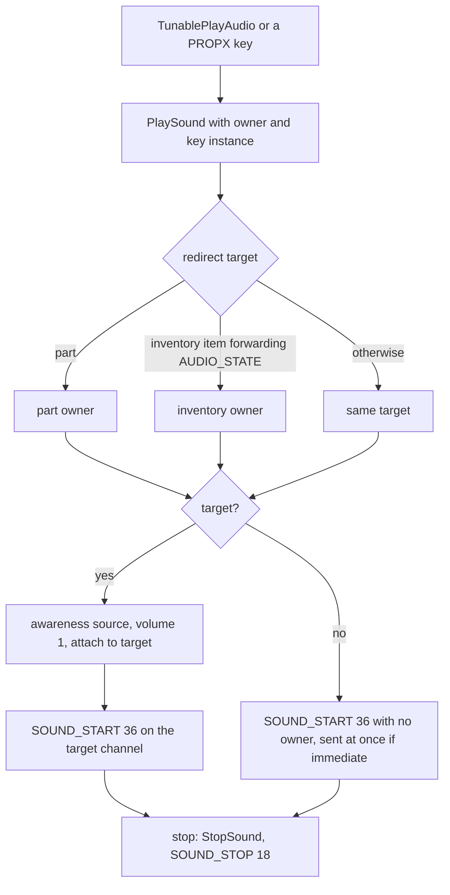
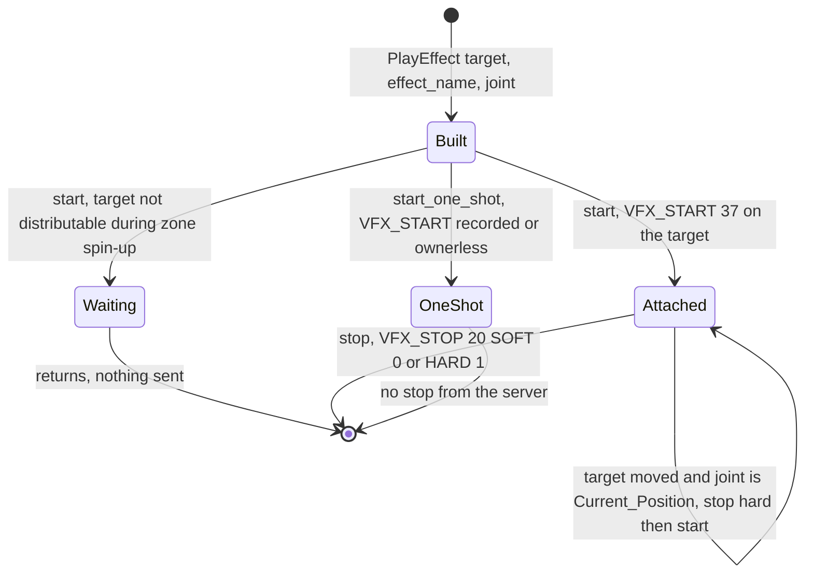
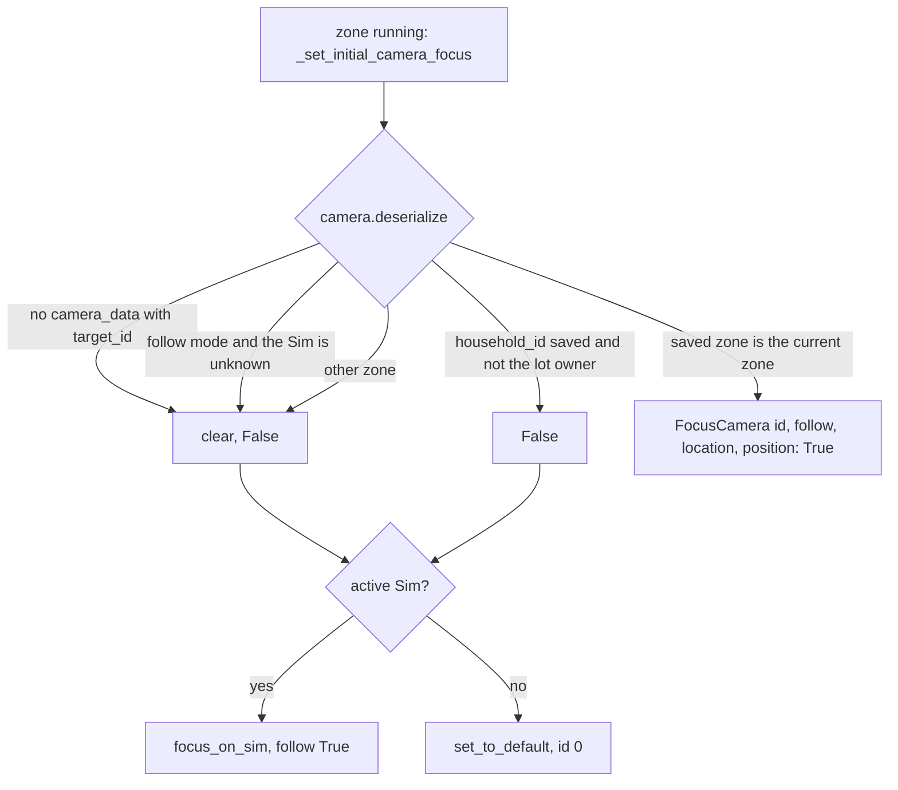

# 7.02 Audio, VFX and the camera

*Game version 1.128.90.1030 (Steam, Linux/Proton). Live numbers are the merged tuning of the base game and the installed packs: EP04 (Cats & Dogs), EP06 (Get Famous), EP09 (Eco Lifestyle), EP12 (High School Years), GP04 (Vampires), GP12 (Werewolves), SP01 (Luxury Party) and SP42 (Grunge Revival); package counts are index scans of the same install. Written 2026-10-12. Checked 2026-10-12: 104 claims checked, 12 corrected, 0 relabelled, 0 removed, 10 added.*

## In plain words

Sound, sparkles and the camera all live in the game client, the program that draws the world. The simulation (the Python side) never mixes audio or renders a particle. What it can do is send short instructions: "play sound number X on this object", "start the effect called Y on that joint", "stop it softly", "point the camera at this Sim and follow her". Everything else, from which sample plays to how the smoke drifts, is decided by the client from its own files.

Most of what you hear is not requested by the simulation at all. Of the 22,155 sound references in the live tuning, about two thirds are handed to the client as data and never touched by Python: all 7,583 moodlets (buffs) carry a sting for gaining and one for losing them, and all but two use the same pair, and the client plays them when the moodlet list changes. Another 2,484 travel as a field inside a UI message (a goal completed, an event starting). Only about a fifth, 4,381, are sounds the server explicitly starts: interaction stings, radio stations, instrument tracks, dialog chimes.

Effects work the same way. An effect is named by a plain text string, attached to an object or a Sim at a slot, and stopped either gently (it fades) or hard. Many effects are fire-and-forget: the server starts them and never sends a stop. A small bit mask, set by age and a few special traits, tells the client which variant of an effect the player's current Sim should see.

The camera listens to a handful of commands: look at this Sim (and optionally follow), look at this spot, look at this lot, keep the walls up, shake. When you load a save, the camera goes back to where you left it, but only if you load the same household on the same lot; otherwise it jumps to your active Sim. A few things would surprise players: the "loot" that plays a sound always plays it on the selected Sim, whatever Sim the loot is about; earthquakes can shake the camera in code but no installed content asks for it; and removing one trait can switch off an effect variant that another trait still needs, which happens at the teen birthday of every Sim who reached the top level of the toddler imagination skill.

## Key facts

- A server sound is one op, `SOUND_START` (36), carrying a 64-bit `sound_id` and a per-sound `channel`; it stops with `SOUND_STOP` (18) on the same object and channel. The `sound_id` is the instance of a PROPX key, and that instance is FNV-1 64 of the lowercased file stem: all 1,364 distinct key and path pairs in the live tuning match (1,363 ids, one of them under two path spellings).
- Live tuning holds 22,155 non-zero PROPX references (1,362 distinct sounds) in 12,421 records. 15,272 are client-only data (no Python reader), 2,484 ride inside UI messages, 4,381 are started by the server with `SOUND_START`, and 18 are keys inside a test.
- All 7,583 buffs carry `audio_sting_on_add` and `audio_sting_on_remove`: `sting_buff_gain` on 7,581 and `sting_buff_loss` on all 7,583. Python never reads these fields.
- The loot op `audio` (`PlayAudioOp`) ignores its subject and plays on the active Sim, or ownerless when there is none (Observed in bytecode).
- `PlaySound` moves a sound from an object part to the part owner, and from an inventory item to its inventory owner when the item forwards `AUDIO_STATE`; a sound with a target also makes that target an awareness source at volume 1.
- 5,552 effect uses in 2,133 live records name 1,457 distinct effects. 209 use `Current_Position` (the effect is placed at the target's transform and restarted whenever the target moves); 238 set `play_immediate`.
- Of the 663 visual-effect basic extras on interactions, 543 are one-shot (never stopped by the server), 114 last for the interaction and 6 stop on an animation event. All 60 loot `vfx` ops are one-shot.
- Stopping an effect sends `VFX_STOP` (20) with `SOFT_TRANSITION` (0) by default and `HARD_TRANSITION` (1) when the stop is immediate; nothing is sent while the zone shuts down.
- The effect mask (`VFXMask`) has 23 bits; 19 live traits set 15 of them (ages, imagination levels, high fishing skill, vampire, werewolf). Adding a trait ORs its bits in, removing it XORs them out, so a bit that two held traits share is cleared when either goes. In normal play this happens at the child-to-teen age-up: the child age trait `trait_child` sets SKILL_LEVEL_5 (2048), so does the hidden `trait_Skill_Imagination_5` that a Sim keeps after reaching toddler imagination level 5, and removing `trait_child` clears the bit until the next load.
- The exclude mask (`MASK_PHOTOGRAPHY` 1, `MASK_MISSION` 2) is set by no trait in the live tuning nor in the patch data of the packs that are not installed, and `_add_vfx_mask` never sends it.
- Voice effects are chosen per Sim by the highest trait priority: `ghostvox` (priority GHOST 2) on 38 traits and `reaper` (GRIM REAPER 3) on one. The buff `voice_pitch_modifier` exists in code but no live buff sets it.
- The camera ops are `FOCUS_CAMERA` (186), `CANCEL_FOCUS_CAMERA` (1203), `FOCUS_CAMERA_ON_LOT` (218, lerp 1.0 s by default in Python), `OVERRIDE_WALLS_UP` (219) and `INIT_CAMERA_SHAKE` (209). Live tuning uses only the focus: `camera_focus` appears in 64 interactions, and no walls-up override or camera shake is tuned. Two more camera ops are sent outside `camera.py`: `SET_WALLS_UP_OR_DOWN` (165) by the burglar and ungreeted-visitor situations, and `TOGGLE_CUSTOM_CAMERA` (1100) by `CustomCameraLiability`.
- On load the saved camera is restored only when the save's household id matches the lot owner and the saved zone is the current zone; the focus target is always replaced by the current active Sim when there is one.
- The sound ids resolve on disk to resource types Python never names: 1,338 of the 1,362 live sound ids are instances in 0xFD04E3BE (126,226 entries plus 2,366 deletion markers, 15.0 MiB), 88 of those also in 0x01A527DB (336,788 entries plus 8,430 deletion markers, 9,173.7 MiB, the most numerous type in the install), and 24 match no package type.

## How it works

### Three routes for a sound

**Observed** (live census; readers found by grepping every decompiled module and the strings of the failed ones). Every PROPX reference in the live tuning falls into one of four groups, by who reads the field:

| Route | Refs | Where | What happens |
|---|---|---|---|
| Client-only data | 15,514 | buff `audio_sting_on_add` and `audio_sting_on_remove` (15,408), mood `audio_stings_on_add` (32, export `ClientBinary`), tutorial tip `voiceover_audio` and its `_ps4` and `_xb1` variants (74) | No Python reads the field; the tuning is exported to the client |
| Key in a UI message | 2,806 | situation goal `audio_sting_on_complete` (2,044, all one key `bumper_event_goal_complete`), situation `audio_sting_on_start` (305), `main_goal_audio_sting` (305), level `audio_sting_on_end` (151), vet `audio_sting_on_symptom_discovery` (1) | Python copies type, group and instance into the goal, start or end message |
| Server sound op | 4,421 | every `TunablePlayAudio` (3,509: interaction stings, dialogs, careers, objects, states, drama nodes), crafting `music_clip` and `vocal_clip` (892), music production snippets (18), business open and close stings (2) | Python builds a `PlaySound` and sends `SOUND_START` |
| Test value | 18 | `SoundMatchesStoredAudioComponentTest.sound` (`objects/object_tests.py`) | compared, never played |

**Observed** (`situations/situation_goal.py: build_goal_message`, `situations/base_situation.py`, `situations/situation_goal_tracker.py`, `whims/whims_tracker.py`). The message route only fills a `ResourceKey` field (`audio_sting`, `start_audio_sting`, `whim_audio_sting_on_complete`). **Inferred**: the client plays it when it shows the update.

Animation adds a fifth source that has no tuning reference: sound events inside clips. **Observed** (`animation/__init__.py: AnimationContext._event_handler_sound_start`): the event carries a sound name; the server hashes it with `sims4.hash_util.hash64`, applies the interaction's sound overrides, marks names starting with `vo` as voice (`is_vox`), and plays it with `PlaySound`. A voice sound goes out with `is_vox` and no name, another sound with its name, and an overridden sound with neither. The rest of that machinery is in [3.06 Animation, thought balloons and the hand-off to the client](3.06-animation.md).

### Asking for a sound: TunablePlayAudio and PlaySound



**Observed** (`audio/primitive.py: TunablePlayAudio`). The tunable has four fields: `audio` (a PROPX resource key, code default none), `joint_name_hash` (optional slot name hashed to 32 bits; without it, the tuning text says, the sound is attached to the object's origin), `play_on_active_sim_only` (default False) and `immediate_audio` (default False). Its factory returns `PlaySound(owner, audio.instance, ...)`: only the instance travels, the type and group are dropped. The tuning text says `play_on_active_sim_only` must stay False on objects or the sound never plays, and gives earbuds as the use case (the `immediate_audio` text names earbuds too). Live, 80 sounds set it: 66 loot sounds (social media posts and prom invitations), 12 on high school festival drama nodes, one snippet and one object state, `stereoChannel_HipHop_EarBuds`.

**Observed** (`audio/primitive.py: PlaySound.__init__`, checked in bytecode because the decompiler turned an `and` into an `or`). If the target is not a Sim and is a part, the sound moves to `part_owner`. Otherwise, if the target is an inventory item whose `forward_client_state_change_to_inventory_owner` list contains `StateChange.AUDIO_STATE` and the item has an inventory owner, the sound moves to that owner. Each `PlaySound` gets a unique `channel` from `@unique_id("channel")`.

**Observed** (`PlaySound.start`, `stop`, `_stop_sound`, `detach`). With a target, `start` opens an `AwarenessSourceRequest` with `AUDIO_VOLUME` 1 (how pets react to it is in [3.06](3.06-animation.md)) and attaches the op to the target, so it rides the target's distributor channel. Without a target it builds the `SoundStart` message itself and sends it ownerless: through `send_op_with_no_owner_immediate` when `immediate` is set, otherwise queued with `add_op_with_no_owner`. `stop` closes the awareness request, then detaches (which records `StopSound(target.id, channel)` on the target) or, for an ownerless sound, calls `_stop_sound`; a sound that was never sent logs an error. No stop is recorded while the zone is shutting down.

**Observed** (`play_tunable_audio`). The helper used by most callers takes an owner; when the caller passes none (the `DEFAULT` sentinel), the owner becomes the first client's active Sim, or nothing when there is no active Sim. `PlayAudioOp._apply_to_subject_and_target` (`interactions/utils/audio.py`, loot key `audio` in `interactions/utils/loot.py`, which failed to decompile and was read in bytecode) calls it with no owner, so a loot sound always plays on the active Sim. Other callers that leave the owner out are the bills stings, narratives, the acting studio wrap, `world/lot_utils.py` and the zone-modifier sound; lot-level loot (`world/lot_level_loot.py`) passes `owner=None` explicitly, which sends the sound ownerless, and dialogs, prep tasks and mission objectives pass an owner of their own.

**Observed** (`interactions/utils/audio.py: TunableAudioSting`). The interaction basic extra plays `audio_sting` on `subject` (default Actor) at its timing (default `AT_END`). With `stop_audio_on_end` and any timing other than the end, a stop element runs after the sequence and on cancel. Live: 590 stings on interactions (215 at the default end, 256 at the beginning, 75 on an animation event, 44 explicitly at the end); 14 set `stop_audio_on_end`. **Inferred**: the rest are one-shots the client lets finish.

**Observed** (`immediate`). `immediate=True` gives the op a zero primary-channel mask, so it does not wait for animation tags ([0.02 Architecture](0.02-architecture.md)). Live, `immediate_audio` is True on 93 loot sounds (75 loot `audio` ops and 17 notification sounds among them), 32 snippet sounds, 28 interaction sounds (26 of them dialog sounds), 4 object-state sounds, 2 goal sounds and 1 object sound.

### Music and the radio

**Observed** (live tuning; `crafting/music.py`, `crafting/music_interactions.py`). An instrument track is a `MusicTrack` recipe (868 live) with a `music_clip` PROPX (849 distinct), `length` in real seconds and `buffer`; the tuning text asks for the length to match the clip's file name, and it does in the samples read (`violin_practice_skill1_slow_3sec`, length 3). 24 `VocalTrack` recipes carry a `vocal_clip`, and 149 `MusicStyle` records group tracks. On the interaction's audio start event the server sets an alarm for the track length (plus `buffer` when the interaction's `use_buffer` is set), plays the clip on the instrument and plays each vocal clip on its musician with `is_vox`. When the alarm fires it either picks the next track (`play_multiple_clips`) or ends the interaction. Crafting itself is in [6.01 Crafting, cooking and making things](6.01-crafting-cooking.md).

**Observed** (`object_state` class `AudioChannel`, 72 live; `objects/electronics/stereo.py: SkipToNextSongSuperInteraction`, read in bytecode). A radio station is one object state whose `audio_state` starts one PROPX such as `mu_lot_speakers_romance`. "Next song" sends `OBJECT_AUDIO_PLAYLIST_SKIP_TO_NEXT` (144) with `SoundSkipToNext` (object id, channel of the playing station sound); the object is the stereo, or its inventory owner when the stereo forwards audio. **Inferred**: the station PROPX is a playlist the client steps through, since the server never names songs. The state machinery and the TV channels (79 `VideoChannel` states, `VIDEO_SET_PLAYLIST` 64) are in [2.02 Objects: components, states and wear](2.02-objects-states-wear.md).

**Observed** (`objects/components/stored_audio_component.py`). The music production station stores a `MusicTrackData` snippet (9 live) and plays its `looping_audio` or `fixed_length_audio` with `PlaySound`; mixer channel values go out as an audio effect's track flags.

### Audio effects

**Observed** (`audio/audio_effect_data.py`, `objects/client_object_mixin.py: ClientObjectMixin.audio_effects`, `append_audio_effect`, `remove_audio_effect`). An audio effect is a filter the client applies to an object's sounds. Every object keeps a dict from a 64-bit tag key to an `AudioEffectData(effect_id, track_flags)`; `append_audio_effect` replaces the entry with the same key and resends the whole dict as `SET_AUDIO_EFFECTS` (29); removing the last one sends an empty set.

**Observed** (`interactions/utils/audio.py: ApplyAudioEffect`, `TunableAudioModificationElement`). Both tunables hash `effect_name` and `tag_name` to 64 bits; `tag_name` defaults to `x`. `ApplyAudioEffect` is the object-state distributable `audio_effect_state`, and it forwards to the inventory owner when the item forwards `AUDIO_EFFECT_STATE`. The interaction element wraps the interaction in a start and a finally-stop. Live: 199 uses with 9 distinct names (`stereo_volume_zero`, `_low`, `_normal`, `_high`, `stereo_quality_low`, `_medium`, `_high`, `stereo_teenmoodswing` and the tent's `tent`; 189 uses sit on objects, 9 on object states and 1 on an interaction). Most are tagged `volume` (139) or `all_effects` (51); the tent's interaction uses `in_tent` and the rest keep the default `x`.

**Observed** (index match). FNV-1 64 of the 8 stereo effect names hits instances in two tiny client types, 0x73CB32C2 (50 entries) and 0xC582D2FB (70 entries), 8 of 8; `tent` hits neither, and FNV-1 32 hits nothing. **Inferred**: these hold the effect definitions (the tuning text calls them `.effectx`).

### Voices: actor, suffixes, effect and pitch

**Observed** (`sims/sim_info_base_wrapper.py`). A Sim's voice is three distributor fields: `voice_pitch` (`SET_VOICE_PITCH` 30, a float), `voice_actor` (`SET_VOICE_ACTOR` 48, a 32-bit id) and `voice_effect` (`SET_VOICE_EFFECT` 181, a 64-bit hash). How they are picked in Create a Sim is in [3.01 Create a Sim](3.01-create-a-sim.md).

**Observed** (`traits/trait_voice_effect.py`; `traits/trait_tracker.py: TraitTracker._update_voice_effect`, read in bytecode since the module failed to decompile). Each trait may carry a `VoiceEffectRequest` (`voice_effect` hash, `priority`). On every update the tracker takes the request with the highest priority among the Sim's traits and writes its effect to `sim_info.voice_effect`; with none, it writes None. The priority enum (base delta module tuning) is OCCULT 1, GHOST 2, GRIM REAPER 3, ALIEN GHOST 4, IMAGINARY FRIEND 5. Live: 38 traits ask for `ghostvox` at GHOST and one for `reaper` at GRIM REAPER, so a Sim holding both kinds of trait speaks with the reaper effect.

**Observed** (`audio/object_voice_actor_state.py: SetObjectVoiceActorState`, bytecode of `start`). The object-state distributable `voice_actor` holds `actor_audio_suffix_override`, a map from `SuffixType` (22 values in `audio/audio_constants.py`: actor, shoe, terrain, mood, ghost, saddle, wings, source and destination materials and qualities and others) to a 32-bit hash. For `SUFFIX_ACTOR` on a Sim, `start` saves the old `voice_actor` and sets the new one, and adds no suffix override; every other entry goes to `add_voice_suffix_override`, sent as `SET_VOICE_SUFFIX_OVERRIDES` (1200). `stop` restores the actor and removes every key of the map. Live, the state is used three times (`animalObjects_StateValues_AnimalClothing_NoClothing` and its `_Clean` and `_Dirty` variants), each with an empty map. **Inferred**: these exist to clear another state's override when the state changes. In the patch data of packs not installed, the filled maps are all on objects: `SUFFIX_ACTOR` (with a shoe suffix on animals) on EP11 (Cottage Living) livestock, the EP14 (Horse Ranch) goat and sheep, the EP17 (Life & Death) pet crow and the GP09 (Journey to Batuu) droids, and `SUFFIX_NECKLACE` bells on EP11 cow outfits. On an object `start` turns `SUFFIX_ACTOR` into an ordinary suffix override, so `stop` removes only keys it added.

**Observed** (`audio/voice/voice_pitch.py: VoicePitchModifier`; `buffs/buff.py`; the `Sim.voice_pitch_override` field in `sims/sim.py`, read in bytecode). A buff's optional `voice_pitch_modifier` sets `voice_pitch_override` to `voice_pitch * pitch_multiplier + pitch_modifier` (defaults 1.0 and 0.0; the verify callback errors when both are left at default) together with `override_pitch_during_fast_gameplay` (default False), sent as `SET_OVERRIDE_DIALOG_PITCH` (208). `start` works only on Sims and warns when an override already exists; `stop` clears the override only when it is still the one this modifier wrote, or when it never wrote one. No live buff sets the field. In the patch data of packs not installed, EP03 (City Living) sets it on 8 bubble blower buffs, EP14 (Horse Ranch) on one buff and EP18 (Businesses & Hobbies) on two.

### The resource types behind sounds and effects

**Observed** (index-only scan of all 120 package files of the install; nothing was extracted). No package holds type 0x39B2AA4A (PROPX) itself. The sound ids in tuning resolve by instance to client-only types:

| Type | Entries | Unique keys | Size | Match with tuning |
|---|---|---|---|---|
| 0x01A527DB | 345,218 (8,430 of them deletion markers) | 327,171 | 9,173.7 MiB | 88 of the 1,362 live sound ids (all also in 0xFD04E3BE) |
| 0xFD04E3BE | 128,592 (2,366 of them deletion markers) | 87,348 | 15.0 MiB | 1,338 of the 1,362 live sound ids |
| 0x01EEF63A | 321 (1 deletion marker) | 320 | 2,512.5 MiB | 2 sound ids (also in both types above) |
| 0x73CB32C2, 0xC582D2FB | 50, 70 | 50, 70 | under 0.1 MiB | 8 of 8 audio effect names |
| 0x1B192049 | 12,430 | 12,430 | 61.7 MiB, base only | 509 of the 1,457 live effect names (FNV-1 64) |
| 0xEA5118B0 | 2 | 1 | 67.2 MiB, base only | none (not tested by name) |

**Inferred** (sizes and matches). 0xFD04E3BE is the per-sound descriptor that a `sound_id` names; 0x01A527DB and 0x01EEF63A carry the audio data, small and large; the client's string table names classes such as `AudioSoundStreamData`, `AudioBinarySampleData` and `XMLMusicData`. For effects, a single large client resource probably holds the effect library, with 0x1B192049 covering only part of the names. This chapter does not open or describe any of their contents.

### Starting and stopping a visual effect



**Observed** (`vfx/__init__.py: PlayEffect`). The tunable is `effect_name` (a string), `joint_name` (optional slot hashed to 32 bits, default `_FX_`; disabled means `Current_Position`, the constant 1899928870) and `play_immediate` (default False). Each instance gets an `actor_id` from `@unique_id("actor_id")`. `__init__` (checked in bytecode) moves the effect to the inventory owner when the item forwards `StateChange.VFX`, and, for any target with a crafting component, swaps the name through `get_recipe_effect_overrides`.

**Observed** (`PlayEffect.start`, `_is_valid_target`, `stop`, `detach`, all checked in bytecode; the decompiled `_is_valid_target` and `stop` have wrong return paths). `start` logs an error for a missing target and carries on, so the next access to the target raises (`register_on_location_changed` for `Current_Position`, else `valid_for_distribution` inside `_is_valid_target`). With a target it registers a location-changed callback when the joint is `Current_Position`, then checks the target: a target that is not yet `valid_for_distribution` is refused only while the zone spin-up service is still running (or missing, which also logs); otherwise it is accepted. An accepted effect attaches once. `stop` returns at once for a missing or non-distributable target, unregisters the callback, and if attached sets `HARD_TRANSITION` for `immediate=True`, else `SOFT_TRANSITION`, and detaches; `detach` records `StopVFX` on the target unless the zone is shutting down. A move of a `Current_Position` effect runs `stop(immediate=True)` then `start`.

**Observed** (`PlayEffect.write`). `VFXStart` carries the object id, the name as text, the actor id, the joint hash, an optional second actor and joint (an effect stretched between two objects), `mirror_effect`, `auto_on_effect`, `target_joint_offset`, `callback_event_id` and, for `Current_Position`, the full transform (the stored one when `store_target_position` is set). `start_one_shot` records the op on the target, or sends it ownerless for terrain or no target.

**Observed** (`PlayMultipleEffects`, `TunablePlayEffectVariant`). A list form plays several effects with one call; the variant offers `play_effect`, `play_multiple_effects` or `no_effect` (default).

**Observed** (live census). Where the 5,552 effect uses sit: object state values on objects 3,683 single and 128 multiple; interaction basic extras 663; buffs 459 (253 inside `play_multiple_effects`); object-state records 314; `call_to_action` records 165; loot `vfx` 60; business tuning 26; mood `thumbnail_vfx_list` 16; snippets 4; and 34 more in other object and interaction fields (18 in objects' own `visual_effect`, 11 one-shot effect elements inside object records, 2 lightning overrides, 2 interaction impact effects, 1 other). Joints: 2,818 tuned slots, 2,509 default `_FX_`, 209 `Current_Position`, 16 other forms.

### Effect lifetimes in interactions and loot

**Observed** (`interactions/utils/visual_effect.py`, `PlayVisualEffectElement._do_behavior` and `PlayVisualEffectLootOp._apply_to_subject_and_target` checked in bytecode; the decompile wrongly limits both to Sims). The element plays its `vfx` on every object or Sim its `participant` generator returns (default Object), optionally aimed at another participant's joint through `vfx_target` (default TargetSim, joint `_FX_`); a `SimInfo` participant is swapped for its instanced Sim, and the element returns without playing when a tuned `vfx_target` participant is missing. `vfx_lifetime` picks the end:

| Lifetime | Start | Stop | Live uses |
|---|---|---|---|
| `one_shot` (default) | `start_one_shot` | none | 543 |
| `interaction` | `start` | finally of the interaction sequence | 114 |
| `animation_event` | `start` | the animation event `event` (default 100), or the end | 6 |
| `continuation` | `start` | a liability released when the continuation chain ends | 0 |

The loot op (`vfx` key) always uses one-shot and replaces a `SimInfo` subject by its instanced Sim, returning when the Sim is not instanced. `PlayVFXOnObjectsWithTagsLootOp` plays a one-shot on every object that has any of its tags and passes its tests.

### VFX states: one effect, several looks

**Observed** (`vfx/vfx_state.py: PlayEffectState`, `SetEffectState`). An object state can switch an effect that another state started into one of its internal states, without restarting it. `state_index` (minimum 0) indexes the states inside the effect; `state_owning_vfx` either uses the state that is changing (`Use_Current_State`, the default) or a list of other states (`Use_Specific_State`). `start` finds the running `vfx_state` distributable of each owning state and attaches `SetEffectState(target, actor_id, state_index)`, sent as `VFX_SET_STATE` (202). With no client connected the ops are kept as pending until written. `stop` does nothing. Live: 62 object state values apply it (`vfx_state_state`, `apply_new_value`), with indexes 0 to 11; 14 of them name specific states.

### The effect mask

**Observed** (`vfx/vfx_mask.py`). `VFXMask` is a 23-bit flag set: BABY 1, TODDLER 2, CHILD 4, TEEN 8, YOUNGADULT 16, ADULT 32, ELDER 64, SKILL_LEVEL_1 to 5 (128 to 2048), DREAM_BIG 4096, VAMPIRE 8192, PARENTING_SKILL 16384, CURSED 32768, SKILL_LEVEL_HIGH 65536, WITCH_MOTES 131072, SECRET_SOCIETY 262144, SPRITE_LOW, MEDIUM, HIGH (524288 to 2097152), WEREWOLF 4194304. `ExcludeVFXMask` has PHOTOGRAPHY 1 and MISSION 2. **Inferred** (names): the client shows or hides effect variants for the player's Sim by these bits.

**Observed** (`traits/trait_tracker.py: _apply_trait`, `_remove_trait`, `_add_vfx_mask`, `_remove_vfx_mask`, bytecode lines 1436 to 1470). Adding a trait ORs each of its `vfx_mask` and `exclude_vfx_mask` flags into the tracker's two masks (`INPLACE_OR`), with `send_op = not from_load`; if the Sim is the active Sim, only the include mask is sent (`SET_VFX_MASK` 207 on the Sim's channel). Removing a trait applies `INPLACE_XOR` per flag and sends the include mask to the active Sim, even when it is 0. `notify_client_mask_update`, called from `server/client.py: Client.notify_active_sim_changed`, sends the include mask and then the exclude mask (`SET_EXCLUDE_VFX_MASK` 231), each only when non-zero.

**Observed** (live census). 19 traits set masks: the seven human age traits, `trait_Pet_age_Adult`, `_Elder`, `_Child`, `trait_Skill_Imagination_1` to `_4` (one level bit each), `trait_Skill_Imagination_5`, `trait_Childish` (both SKILL_LEVEL_5), `trait_Skill_Fishing_HiSkill`, `trait_OccultVampire_Manifested` and `trait_OccultWerewolf`. `trait_child` and `trait_Pet_age_Child` both carry CHILD and SKILL_LEVEL_5 (the human trait's SKILL_LEVEL_5 sits in a shared tuning node, x=333238, so a scan of raw values misses it). The bits DREAM_BIG, PARENTING_SKILL, CURSED, WITCH_MOTES, SECRET_SOCIETY and SPRITE_* appear only in patch data, packs not installed: EP03 (City Living), EP05 (Seasons), GP05 (Parenthood), GP06 (Jungle Adventure), GP08 (Realm of Magic) and EP08 (Discover University).

**Observed, with reach checked in live tuning**. The XOR on removal is not a clear: removing a trait flips its bits even when another held trait set them. Three human traits set SKILL_LEVEL_5: `trait_child`, `trait_Childish` (a personality trait for teens to elders) and the hidden `trait_Skill_Imagination_5` (valid at every age, no conflict with either). The hidden trait is added only by `loot_Trait_ImaginationVFX_5`, which also removes `trait_Skill_Imagination_4`; that loot runs from `buff_Toddlers_Hidden_Skill_Imagination_Levels_5`, the level 5 buff of the toddler skill `statistic_Skill_Toddler_Imagination`. The toddler age-up loots remove the buff, never the trait, and no live tuning removes the trait. So the Sim enters childhood holding it, `trait_child` ORs the same bit in, and at the teen birthday `change_age` removes `trait_child` (the `age_trait` of `agingTransition_Human_Child`), whose XOR clears bit 2048 while the hidden trait still holds it. A reload rebuilds the mask with OR. Pairing `trait_Childish` with the hidden trait needs one of the two removed, and no live loot does that: 457 `specific_trait` and 19 `all_from_list` removals name neither, `traits_of_type` removals touch only TEMPERAMENT and GHOST, and no random removal is tuned. A trait change outside tuning, such as a Create a Sim edit, was not traced. **Inferred**: the effect that depends on the bit disappears for that teen until the save is reloaded.

**Observed** (`notify_client_mask_update`). Switching to a Sim whose include mask is 0 sends no mask op at all. Live, `trait_infant` sets no mask. **Inferred**: unless the client resets the mask itself, the previous Sim's mask stays in force.

### The camera

**Observed** (`camera.py`, op classes in `distributor/ops.py`). The module is a thin sender; every call goes out ownerless:

| Call | Op | Fields |
|---|---|---|
| `focus_on_sim(sim, follow=True, client)` | `FOCUS_CAMERA` 186 | id, follow_mode |
| `focus_on_object(object, follow=True)` | `FOCUS_CAMERA` 186 | id, follow_mode |
| `focus_on_position(pos)` | `FOCUS_CAMERA` 186 | location |
| `focus_on_object_from_position(obj_position, camera_position)` | `FOCUS_CAMERA` 186 | location, position |
| `set_to_default()` | `FOCUS_CAMERA` 186 | id 0 |
| `cancel_focus(object)` | `CANCEL_FOCUS_CAMERA` 1203 | id |
| `focus_on_lot(lot_id, lerp_time=1.0)` | `FOCUS_CAMERA_ON_LOT` 218 | lot_id, lerp_time |
| `walls_up_override(walls_up, lot_id)` | `OVERRIDE_WALLS_UP` 219 | enable_override, lot_id |
| `shake_camera(duration, frequency, amplitude, octaves, fade_multiplier)` | `INIT_CAMERA_SHAKE` 209 | duration required, the rest optional |

**Observed** (`interactions/utils/camera.py: CameraFocusElement._do_behavior`, checked in bytecode). The basic extra `camera_focus` (also an immediate-interaction extra) resolves its subject from `sim_filter` (the first instanced Sim that matches) or from `participant` (default Actor). Only the participant route returns when there is no subject; a Sim filter that matches no instanced Sim leaves the subject None, and unless the participant is `Lot` the next check (`has_component`, bytecode offset 130) raises. A `Lot` participant focuses the lot with `time_to_position` (default 1.0 s) as the lerp; a subject with a camera-view component gets a focus from its own camera position; a Sim gets `focus_on_sim` with `follow` (default False); an item in an inventory focuses its last inventory owner; anything else gets `focus_on_object`. Live: 64 interactions, mostly the default Actor; three focus a `PickedObject`, three follow, four use a Sim filter.

**Observed** (`SetWallsUpOverrideElement`, `TunableCameraShake`, `zone_modifier/zone_modifier_actions.py: ZoneModifierTriggerQuake`). The walls-up extra sends `enable` (default True); its tuning text says a manual camera move also cancels it. The shake tunable's `duration` defaults to 1.0 s (minimum 0). `frequency`, `amplitude` (in Sim metres), `octaves` and `fade_multiplier` are optional and unset by default (`use_default`), so the op leaves them out and the client uses its own values, which the tuning texts give as 1.0, 1.0, 1 and 1.0; when set, each starts at that value, and `fade_multiplier` has a minimum of 1.0 (above it the shake plateaus). Its only user is the zone-modifier quake, which plays its sound, shakes the camera and applies loot to Sims on the active lot. Live: no walls-up override and no quake is tuned. In the patch data of packs not installed, EP03 (City Living, `quakeZone`) and EP07 (Island Living, `volcanicActivity`) each tune a major and a minor quake with every shake field set.

**Observed** (other callers). The newborn flow focuses the new baby without follow (`sims/baby/baby.py`); hiding an object or reparenting it cancels any focus on it (`objects/client_object_mixin.py`); the EP09 (Eco Lifestyle) community board command and `objects.focus_camera_on_object` use `focus_on_position`; the GP07 (StrangerVille) and GP06 zone directors (`venues/secret_lab_venue/secret_lab_zone_director.py`, `temple/temple_zone_director.py`) also call the module, but those packs are not installed. Two camera-related ops are sent outside `camera.py`: `SET_WALLS_UP_OR_DOWN` (165), which the burglar situation (`situations/breaking_and_entering`) sends ownerless to raise the walls before the break-in and lower them when it starts, and which the ungreeted-visitor situation (`situations/visiting/ungreeted_player_visiting_npc_situation.py`) sends as its create and delete ops and around build mode; and `TOGGLE_CUSTOM_CAMERA` (1100), which `CustomCameraLiability` (`interactions/utils/custom_camera_liability.py`) sends on its Actor with a hashed `camera_mode` and the Sim id, on when the interaction runs and off on release.

### Saving and restoring the camera



**Observed** (`camera.py: deserialize`, checked in bytecode; `zone.py: Zone._set_initial_camera_focus`). The save slot's `gameplay_data.camera_data` holds `target_id`, `target_position`, `camera_position`, `follow_mode`, `zone_id` and `household_id`. On load the target becomes the active Sim's id whenever there is an active Sim, so the stored `target_id` matters only without one. The household check runs only when the field is present. The restore runs at the end of a normal load and of a build-mode spin-up.

**Observed** (`server_commands/camera_commands.py`, `camera.update`, `serialize`; `services/persistence_service.py`). The client reports its camera with the Live command `update.camera.information` (Sim id, target x y z, camera x y z, follow mode); `update` stores those with the current zone id and the active lot's owner household. On save, `serialize` writes the block only when both `_sim_id` and `_household_id` are set. `deserialize` never restores `_household_id`, so a save made after a load and before the next report leaves the old block in the slot as it was. **Inferred**: the client reports often enough that this rarely matters.

## Numbers

| Name | Value | Unit | Where | Source |
|---|---|---|---|---|
| PROPX references, non-zero | 22,155 refs, 1,362 distinct, 12,421 records | count | all instance tuning | live census |
| client-only sound references | 15,514 | refs | buff, mood, tutorial tip | live census |
| sound keys inside UI messages | 2,806 | refs | situations, goals, vet | live census |
| sounds started by the server | 4,421 | refs | `TunablePlayAudio`, music, stored audio, business | live census |
| buffs with both stings | 7,583 | records | `audio_sting_on_add`, `audio_sting_on_remove` | live |
| goal completion sting | 2,044 of 2,044 | refs | `audio_sting_on_complete` = `bumper_event_goal_complete` | live |
| `play_on_active_sim_only` code default | False | bool | `TunablePlayAudio` | code |
| `immediate_audio` code default | False | bool | `TunablePlayAudio` | code |
| `immediate_audio` True | 93 loot, 32 snippet, 28 interaction, 4 object state, 2 goal, 1 object | refs | live tuning | live |
| interaction stings | 590 (215 default end, 256 beginning, 75 event, 44 end) | elements | `TunableAudioSting` | live |
| `stop_audio_on_end` True | 14 | elements | `TunableAudioSting` | live (code default False) |
| MusicTrack, VocalTrack, MusicStyle | 868, 24, 149 | records | recipe tuning | live |
| AudioChannel, VideoChannel states | 72, 79 | records | object_state | live |
| audio effect uses | 199, 9 names | uses | `audio_effect_state`, `audio_modification` | live |
| audio effect `tag_name` default | `x` | hash64 | `ApplyAudioEffect` | code |
| effect uses | 5,552 in 2,133 records, 1,457 names | uses | all instance tuning | live |
| `Current_Position` effects | 209 | uses | `joint_name` disabled | live |
| `play_immediate` True | 238 | uses | `PlayEffect` | live (code default False) |
| `JOINT_NAME_CURRENT_POSITION` | 1899928870 | hash | `PlayEffect` | code |
| default effect joint | `_FX_` | slot name | `PlayEffect.joint_name` | code |
| visual-effect extras by lifetime | 543 one-shot, 114 interaction, 6 event | elements | `PlayVisualEffectElement` | live |
| animation-event stop id | 100 | event id | `_VisualEffectLifetimeAnimationEvent` | code default |
| VFX states | 62 state values, indexes 0 to 11 | uses | `vfx_state_state` | live |
| traits with `vfx_mask` | 19 (15 of 23 bits) | traits | trait tuning | live |
| traits with `exclude_vfx_mask` | 0 | traits | trait tuning | live and patch data |
| voice effect traits | 38 `ghostvox`, 1 `reaper` | traits | `voice_effect` | live |
| voice effect priorities | OCCULT 1, GHOST 2, GRIM REAPER 3, ALIEN GHOST 4, IMAGINARY FRIEND 5 | enum | `traits.trait_voice_effect` | base delta module tuning |
| `pitch_multiplier`, `pitch_modifier` | 1.0, 0.0 | factor, add | `VoicePitchModifier` | code default; 0 live buffs use it |
| voice actor state uses | 3, all empty | states | `voice_actor` | live |
| `camera_focus` extras | 64 | interactions | basic and immediate extras | live |
| `time_to_position` | 1.0 | s | `CameraFocusElement` | code default |
| `lerp_time` | 1.0 | s | `focus_on_lot`, `FocusCameraOnLot` | code default |
| camera shake `duration` | 1.0 | s | `TunableCameraShake`; the other four fields are unset by default and not sent | code default; 0 live uses |
| walls-up overrides | 0 | uses | `walls_up_override` | live |
| type 0x01A527DB (88 sound ids) | 345,218 index entries (8,430 deletion markers), 9,173.7 MiB | resources | client packages | package index |
| type 0xFD04E3BE (1,338 of 1,362 sound ids) | 128,592 index entries (2,366 deletion markers), 15.0 MiB | resources | client packages | package index |

Module tuning read from the base delta (packs ship none): `world.travel_tuning` (`bumper_new_game`, `bumper_travel_lot_success`), `sims.bills` (four bill stings), `objects.collection_manager` (`sting_collection_progress`, `sting_collection_complete`), `holidays.custom_holiday` (`GENERIC_HOLIDAY_START_AUDIO` = `bumper_holiday_generic`, an EP05 path). These are server sounds outside the instance count above.

## Data shapes

Field numbers are from the protobuf descriptors in `Simulation_x64.dll`.

```
SoundStart:  1 object_id, 2 channel, 3 sound_id uint64 (required), 4 is_vox,
             5 joint_name_hash, 6 play_on_active_sim_only, 7 sound_name
SoundStop:   1 object_id, 2 channel (both required)
SoundSkipToNext: object_id, channel
SoundResource:   1 sound ResourceKey, 2 music_track_snippet
SetAudioEffects.AudioEffect: key uint64, effect_id uint64 (both required), track_flags uint32
SetVoiceSuffixOverrides.SuffixOverride: suffix_type uint32, suffix_override uint32
SetVoicePitch float, SetVoiceActor uint32, SetVoiceEffect uint64 (all required)
SetOverrideDialogPitch: pitch float, override_fast_speed bool
```

```
VFXStart:    1 object_id, 2 effect_name string, 3 actor_id, 4 joint_name_hash (2 to 4 required),
             5 target_actor_id, 6 target_joint_name_hash, 7 mirror_effect, 8 auto_on_effect,
             9 transition_type, 10 transform, 11 target_joint_offset, 12 callback_event_id
VFXStop:     object_id, actor_id, transition_type (SOFT_TRANSITION 0, HARD_TRANSITION 1)
VFXSetState: object_id, actor_id, state_index int32 (all required), transition_type (default HARD_TRANSITION)
SetVFXMask: vfx_mask uint64        SetExcludeVFXMask: exclude_vfx_mask uint64
FocusCamera: 1 id, 2 location Vector3, 3 follow_mode, 4 position Vector3
CancelFocusCamera: id      FocusCameraOnLot: lot_id, lerp_time float (default 1)
InitCameraShake: 1 duration float (required), 2 frequency, 3 amplitude, 4 octaves uint32, 5 fade_multiplier
OverrideWallsUp: enable_override (required), lot_id
```

Operation ids used here: SOUND_STOP 18, VFX_STOP 20, SET_AUDIO_EFFECTS 29, SET_VOICE_PITCH 30, SOUND_START 36, VFX_START 37, SET_VOICE_ACTOR 48, VIDEO_SET_PLAYLIST 64, OBJECT_AUDIO_PLAYLIST_SKIP_TO_NEXT 144, SET_VOICE_EFFECT 181, FOCUS_CAMERA 186, VFX_SET_STATE 202, SET_VFX_MASK 207, SET_OVERRIDE_DIALOG_PITCH 208, INIT_CAMERA_SHAKE 209, FOCUS_CAMERA_ON_LOT 218, OVERRIDE_WALLS_UP 219, SET_EXCLUDE_VFX_MASK 231, SET_VOICE_SUFFIX_OVERRIDES 1200, CANCEL_FOCUS_CAMERA 1203.

Python classes, briefly:

- `PlaySound(target, sound_id, sound_name, is_vox, joint_name_hash, play_on_active_sim_only, immediate)`: `channel` (unique id), `_manually_distributed`, `_awareness_request`.
- `TunablePlayAudio`: `audio`, `joint_name_hash`, `play_on_active_sim_only`, `immediate_audio`. `TunablePlayAudioAllPacks` and `TunableAudioAllPacks` are pack-safe PROPX keys that skip pack validation; the first is a bare key, so callers wrap it in `PlaySound` themselves (business stings) or hand it on (holiday sting).
- `AudioEffectData(effect_id, track_flags)`; `ApplyAudioEffect(effect_name, tag_name)`.
- `SetObjectVoiceActorState(actor_audio_suffix_override: SuffixType to hash32)`; `VoicePitchModifier(pitch_modifier, pitch_multiplier, override_pitch_during_fast_gameplay)`.
- `PlayEffect(target, effect_name, joint_name, target_actor_id, target_joint_name_hash, mirror_effect, auto_on_effect, target_joint_offset, play_immediate, callback_event_id, store_target_position, transform_override)`: `actor_id` (unique id), `_stop_type`.
- `PlayEffectState(state_index, state_owning_vfx)`, `SetEffectState(target_id, actor_id, state_index)`.
- `VFXMask`, `ExcludeVFXMask` (IntFlags); `TraitTracker.trait_vfx_mask`, `trait_exclude_vfx_mask`.
- `camera` module globals: `_sim_id`, `_target_position`, `_camera_position`, `_follow_mode`, `_zone_id`, `_household_id`.

## For modders

**Tuning to change.**

- *A sound on an interaction*: basic extra `audio_sting` (`TunableAudioSting`: `audio_sting`, `subject`, `timing`, `stop_audio_on_end`). Set `stop_audio_on_end` for anything that loops, or it keeps playing after the interaction.
- *A sound from a loot*: loot op `audio`. It plays on the active Sim whatever the loot's subject; for a Sim-specific sound use an interaction sting instead.
- *An object's ambient sound or radio station*: the object state's `audio_state` (`start_audio` is a `TunablePlayAudio`), see [2.02](2.02-objects-states-wear.md).
- *A filter on an object's sounds*: `audio_effect_state` (`ApplyAudioEffect`). Give each family of effects its own `tag_name`; two effects with the default `x` replace each other.
- *A buff's sound*: `audio_sting_on_add` and `audio_sting_on_remove`. These are client data; replacing them changes nothing Python can see.
- *An effect*: basic extra `vfx` (`PlayVisualEffectElement`), loot `vfx`, object state `vfx_state`, buff `vfx`. Pick `vfx_lifetime` `interaction` for anything that must end with the interaction; the default `one_shot` is never stopped by the server.
- *A different look per Sim*: trait `vfx_mask` (`apply_vfx_mask` with `VFXMask` flags). Avoid sharing a bit with a trait the same Sim can hold (see the XOR trap).
- *A voice*: trait `voice_effect` (`voice_effect` hash and `priority`), buff `voice_pitch_modifier`.
- *Camera*: basic extra `camera_focus` (`participant`, `follow`, `time_to_position`, `sim_filter`), `walls_up_override`; a zone modifier `quake` for a shake.

**Commands.** Types are read from the `@Command` decorators (the `sims.*` ones from bytecode, since `server_commands/sim_commands.py` failed to decompile). Untyped commands are DebugOnly and not registered in the retail game ([1.04 Debug tools, cheats and telemetry](1.04-debug-cheats-telemetry.md)).

| Command | Type | What it does |
|---|---|---|
| `update.camera.information` | Live | client reports Sim id, target and camera positions, follow mode; stored for the next save |
| `camera.focus_on_sim <sim>` | Live | focus and follow a Sim |
| `camera.focus_on_locator <id>` | Live | focus the first locator with that id |
| `objects.focus_camera_on_object <id>` | Live | focus the object's position |
| `civic_policy.focus_camera_on_community_board` | Live, EP09 | focus the first community board that is not on the active lot |
| `objects.set_voice_actor <id> <name>` | Cheat | sends `SET_VOICE_ACTOR` with hash32 of the name to that object |
| `camera.focus_on_position <x,y,z>` | untyped | focus a position |
| `camera.shake <duration> ...` | untyped | send a camera shake |
| `sims.focus_camera_on_sim [sim]` | untyped | focus and follow a Sim |
| `debug.set_audio_effect <target> <key> <effect>` | untyped | add an audio effect with hash64 key and effect |
| `objects.play_vfx_one_shot <name> <obj> <joint>` | untyped | one-shot effect on a joint |
| `objects.play_vfx_one_shot_between_objects ...` | untyped | one-shot effect stretched to a second object's joint |
| `retail.toggle_for_sale_vfx` | Live, EP01 (Get To Work) | for-sale markers; pack not installed |

**Traps.**

- The VFX mask is removed with XOR (`TraitTracker._remove_vfx_mask`). When two held traits share a bit, removing either clears it; live, SKILL_LEVEL_5 is shared by `trait_child`, `trait_Childish` and `trait_Skill_Imagination_5`, and the child-to-teen age-up of a Sim who reached toddler imagination level 5 clears it.
- `SetObjectVoiceActorState` with a `SUFFIX_ACTOR` entry on a Sim sets the voice actor in `start` and adds no override (bytecode offset 56 jumps back to the loop), but `stop` calls `remove_voice_suffix_override` for every key. On a Sim with no other override, `_voice_suffix_overrides` is None and the `in` test at offset 6 of `ClientObjectMixin.remove_voice_suffix_override` raises. Live tuning never reaches this (the three uses have empty maps); a mod that sets a Sim voice actor through a state would.
- `play_on_active_sim_only` on a sound whose target is an object: the tuning text says it never plays.
- `TunablePlayAudioAllPacks` is a bare resource key. `play_tunable_audio` calls its argument as a factory (`tunable_play_audio(owner)`), so it needs a `TunablePlayAudio`; wrap a bare key in `PlaySound` as the business code does.
- The decompiled `vfx/__init__.py` is wrong in two places: `_is_valid_target` falls through to None for a valid target (the bytecode returns True), and `stop` lets a missing target through (the bytecode returns for a missing or non-distributable target).
- `PlayEffect.start` on a target that is not yet distributable during zone spin-up returns without sending anything, and `PlayEffect` itself has no retry. With no target at all it logs an error and then raises.
- `camera_focus` with a `sim_filter` raises when no instanced Sim matches the filter; the participant route returns quietly instead.
- A `TunableCameraShake` left at its defaults sends only the duration; set the other fields to get a known shake.
- Buff, mood and tutorial sounds are client data: a script mod that wants to suppress them cannot do it from Python.

## Limits

- The client's audio and effect engines are native. Which file a `sound_id` loads, how playlists step, how the masks gate effects and how the camera eases are not visible; everything said about the client side is Inferred.
- The resource types 0x01A527DB, 0xFD04E3BE, 0x01EEF63A, 0x73CB32C2, 0xC582D2FB, 0x1B192049 and 0xEA5118B0 have no Python name; their roles here come from index matches and sizes only. Their contents were not opened, by design: the book carries no game audio or effect data.
- `traits/traits.py`, `traits/trait_tracker.py`, `sims/sim.py`, `server_commands/sim_commands.py`, `interactions/utils/loot.py` and `objects/electronics/stereo.py` paths were read in bytecode (failed or untrusted decompiles); the claims drawn from them cite the methods.
- Effect counts are for effects named in tuning. Effects started from animation clip events, and every sound inside clips, are authored in the animation data and not counted.
- The GP07 and GP06 camera callers and the EP01 for-sale effect command named here are in code that runs only with packs this install lacks.
- Effect names that do not hash into 0x1B192049 (948 of the 1,457 live names) were not traced further. 24 live sound ids match no package type and were not traced either.

## File index

| Module | What it holds | Depth |
|---|---|---|
| `simulation/audio/__init__.py` | empty package marker | listed (no code) |
| `simulation/audio/audio_constants.py` | `SuffixType`, 22 voice suffix kinds exported to the client | deep |
| `simulation/audio/audio_effect_data.py` | `AudioEffectData(effect_id, track_flags)` | deep |
| `simulation/audio/object_voice_actor_state.py` | `SetObjectVoiceActorState`: voice actor and suffix overrides from object states | deep |
| `simulation/audio/primitive.py` | `PlaySound`, `play_tunable_audio`, `TunablePlayAudio`, `TunablePlayAudioAllPacks` | deep |
| `simulation/audio/tunable_audio.py` | `TunableAudioAllPacks`, a pack-safe PROPX key | deep |
| `simulation/audio/voice/__init__.py` | empty package marker | listed (no code) |
| `simulation/audio/voice/voice_pitch.py` | `VoicePitchModifier`: buff voice pitch override | deep |
| `simulation/camera.py` | camera focus, lot focus, walls up, shake, default; save and restore of the camera | deep |
| `simulation/vfx/__init__.py` | `PlayEffect`, `PlayMultipleEffects`, `TunablePlayEffectVariant` | deep |
| `simulation/vfx/vfx_mask.py` | `VFXMask`, `ExcludeVFXMask`, mask messages on active Sim change | deep |
| `simulation/vfx/vfx_state.py` | `PlayEffectState`, `SetEffectState`: switch a running effect's internal state | deep |

Other modules read for this chapter (owned elsewhere): `simulation/interactions/utils/audio.py`, `simulation/interactions/utils/visual_effect.py`, `simulation/interactions/utils/camera.py`, `simulation/interactions/utils/loot.py` (bytecode), `simulation/objects/client_object_mixin.py`, `simulation/objects/components/stored_audio_component.py`, `simulation/objects/electronics/stereo.py`, `simulation/objects/object_tests.py`, `simulation/crafting/music.py`, `simulation/crafting/music_interactions.py`, `simulation/world/lot_level_loot.py`, `simulation/interactions/base/basic.py`, `simulation/interactions/base/immediate_interaction.py`, `simulation/civic_policies/street_civic_policy_commands.py`, `simulation/sims/sim_info_base_wrapper.py`, `simulation/sims/sim.py` (bytecode), `simulation/traits/trait_voice_effect.py`, `simulation/traits/trait_tracker.py` (bytecode), `simulation/buffs/buff.py`, `simulation/statistics/mood.py`, `simulation/situations/situation_goal.py`, `simulation/situations/base_situation.py`, `simulation/zone.py`, `simulation/server/client.py`, `simulation/services/persistence_service.py`, `simulation/server_commands/camera_commands.py`, `simulation/server_commands/object_commands.py`, `simulation/server_commands/developer_commands.py`, `simulation/server_commands/sim_commands.py` (bytecode), `simulation/zone_modifier/zone_modifier_actions.py`, `simulation/sims/baby/baby.py`, `simulation/business/business_manager.py`, `simulation/animation/__init__.py`, `simulation/distributor/ops.py`.

Tuning used (the live merge; module tuning from the base delta): instance types buff, mood, situation_goal, situation, interaction, action, snippet, object, object_state, recipe, trait, career, career_gig, career_level, statistic, achievement, tutorial_tip, drama_node, zone_director, call_to_action, business; records `trait_Childish`, `trait_Skill_Imagination_1` to `_5`, `trait_child`, `trait_Pet_age_Child`, `trait_infant`, `buff_Toddlers_Hidden_Skill_Imagination_Levels_5`, `statistic_Skill_Toddler_Imagination`, `agingTransition_Human_Child`, `loot_Buff_Toddler_RemoveBuffs_AgeUp`, `loot_Trait_Toddler_AgeUp_Traits`, `animalObjects_StateValues_AnimalClothing_NoClothing`, `StereoWall_Channel_Romance`, `stereoChannel_HipHop_EarBuds`, `MusicTrack_Violin_Practice_Skill01_12`, `loot_Trait_ImaginationVFX_5`; modules `traits.trait_voice_effect`, `world.travel_tuning`, `sims.bills`, `objects.collection_manager`, `holidays.custom_holiday`.

