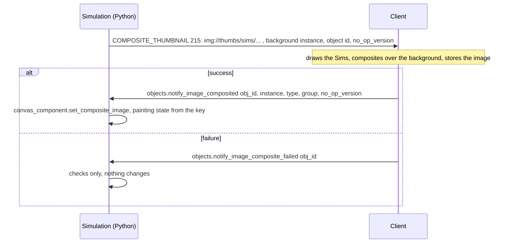
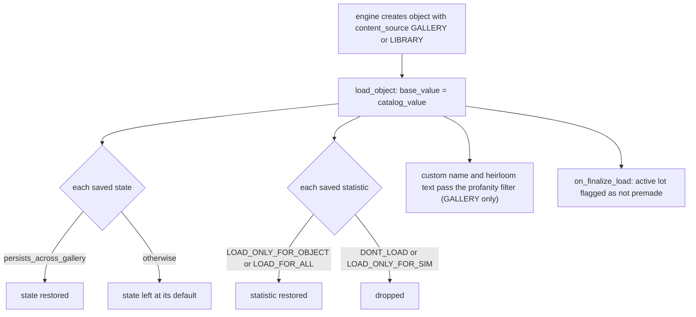

# 7.03 Thumbnails and the gallery

*Game version 1.128.90.1030 (Steam, Linux/Proton). Live numbers are the merged tuning of the base game and the installed packs: EP04 (Cats & Dogs), EP06 (Get Famous), EP09 (Eco Lifestyle), EP12 (High School Years), GP04 (Vampires), GP12 (Werewolves), SP01 (Luxury Party) and SP42 (Grunge Revival); package counts are index scans of the same install, given both as copies on disk and as the live set (the highest-priority copy of each key, deletion markers removed). Written 2026-10-12. Checked 2026-10-12: 72 claims checked, 10 corrected, 1 relabelled, 0 removed, 5 added. Deepened 2026-10-13: 0 modules newly explained (the one listed row, `thumbnails/__init__.py`, is an empty package marker), 0 failed decompiles read. Checked again 2026-10-13: 104 claims checked, 19 corrected, 1 relabelled, 0 removed. Cross-chapter edits 2026-10-13: 2 applied.*

## In plain words

Every small picture in the game, the catalog icons in Build/Buy, the clothing swatches in Create a Sim, the Sim portraits along the bottom of the screen, a family portrait on the wall, is drawn by the game client. The Python simulation never makes an image. For the catalogs the pictures are made ahead of time and shipped in `thumbnails.package` files, about 1.2 GB of small JPEG files in this install. For anything that depends on the player's own Sims, such as a framed autograph or a photo booth strip, the simulation sends the client a short text address like `img://thumbs/sims/h_0x..._x_0` that says which household, which outfit and which picture style to draw; the client draws it, stores the result, and tells the simulation which image to put on the object.

The gallery is EA's online library of houses, rooms and households that players share. Everything about talking to that service, uploading, searching and downloading, happens in the client and on EA's servers, and none of it is visible in the Python. What the Python shows is the game-side half: how an object or a Sim behaves once it has arrived from the gallery, which parts of it are kept, and which tuning helps convert a lot so it fits in your world.

When a lot comes down from the gallery, its objects are marked as downloaded. Each one goes back to its catalog price, forgets most of its states (dirty, broken and so on) and most of its counters, and its custom name is run through the profanity filter. A downloaded household's Sims keep their looks and most of their statistics, but lose traits that are not allowed to travel (71 in this install, such as the high school exit traits and some ghost traits), and its Sims start with their core needs reset to default levels. The client can ask the simulation for the save data of objects that carry the "shareable" tag; the tag's own description says this is so that crafted items and books keep their details on the gallery, and the client most likely asks while it packages a lot for upload.

## Key facts

- `thumbnails/__init__.py` is empty. `thumbnails/thumbnail_constants.py` holds seven `img://thumbs/sims/...` address patterns and a map from memorial dedication to one letter. `objects/gallery_tuning.py` holds one module tunable (`EXPORT_SAVE_DATA_TO_GALLERY_TAG`) and the `ContentSource` enum.
- The server asks for a composite picture with `COMPOSITE_THUMBNAIL` (215): an address, a background image instance, the target object and a version counter. The client answers with the Live command `objects.notify_image_composited`, which sets the new image on the object's canvas.
- `objects.notify_image_composite_failed` checks that the object and its canvas exist and does nothing else (bytecode). A failed composite leaves the old picture in place.
- Live portrait objects: 4 Sim portraits (three autograph items and the high school graduation photo), 1 family portrait, 1 photo booth strip. The memorial portrait exists only in patch data for EP17 (Life & Death), which is not installed, and the memorial photo request (`GENERATE_MEMORIAL_PHOTO`, 1267) is only sent when EP17 is available.
- Python sets a Sim's `thumbnail` only to the default `profile_happy_low.png`. The server can ask the client to redraw portraits: `UPDATE_SKEWER_THUMBNAIL` (285) after an appearance change flagged `should_refresh_thumbnail` (26 live entries in buffs), and the client-read trait flag `refresh_sim_thumbnail` (38 live traits, all of them ghost traits).
- `REQUEST_OBJECT_THUMBNAIL` (234) is in the operation list but no Python module sends it, and the `is_modded` field of `CompositeThumbnail` is always False from Python.
- 12 `thumbnails.package` files (1,262 MB) hold 14 resource types, 13 of which occur in no other package. Two dominate: 0x3C2A8647 (152,098 copies on disk, 139,564 live keys; its 41,228 instance ids cover 29,173 of the 30,424 live object definitions) and 0x3C1AF1F2 (116,278 copies, 115,376 live keys; its 46,448 instance ids cover 38,145 of the 38,185 live CAS parts).
- 0x3C2A8647 stores a catalog icon at up to five sizes chosen by the low four bits of the group: 32, 64, 78, 116 and 180 pixels square; the 180 px size exists for only 1,256 live keys. 0x3C1AF1F2 stores CAS swatches at 100 x 100 (group low byte 1) and 104 x 148 (low byte 2).
- An object's `content_source` is DEFAULT 0, LIBRARY 1, GALLERY 2 or HOUSEHOLD_INVENTORY_PROXY 3. Python never sets GALLERY or LIBRARY; they arrive only through the engine's `c_api_create_object` call.
- A downloaded object (gallery or library) takes its catalog price as its value, keeps only states with `persists_across_gallery` (65 live states, code default False) and only statistics whose `gallery_load_behavior` is LOAD_ONLY_FOR_OBJECT or LOAD_FOR_ALL (37 live: 26 and 11; the code default LOAD_ONLY_FOR_SIM drops it).
- A Sim loaded through any creation path (`sim_creation_path` not NONE) loads with `skip_load`; its traits with `allow_from_gallery` False (71 live, code default True) are dropped unless it is a premade Sim still waiting for its fixup. A Sim from the gallery then has every core, non-skill commodity reset to its auto-satisfy or initial value (bytecode).
- `EXPORT_SAVE_DATA_TO_GALLERY_TAG` is `BuyCat_Shareable` (base delta module tuning; the code default is INVALID). The Live command `objects.request_customizable_object_data` answers only for objects with that tag.
- Eight venues set `gallery_upload_venue_type` (rentals upload as residential, the generic venue as `venue_VisitorsAllowed`, acting studio, high school and auditorium venues as generic) and five regions map a generic gallery venue to residential on download.
- Moving a gallery household into a lot is one terrain interaction that sends `MOVE_HOUSEHOLD_INTO_LOT_FROM_GALLERY` (196); the download itself is done by the client.

## How it works

### What the three modules hold

**Observed** (`thumbnails/thumbnail_constants.py`). The module star-imports `objects/components/canvas_component_enums.py` (for `DedicationType`: UNDEDICATED 0, FAMILY 1, HUMAN 2, DOG 3, CAT 4, HORSE 5, OTHER 6) and defines:

| Name | Pattern | Filled with |
|---|---|---|
| `MEMORIAL_SINGLE_SIM_URL` | `img://thumbs/sims/a_0x{:016x}_l_{}` | Sim id, dedication letter |
| `MEMORIAL_GENERIC_SIM_URL` | `img://thumbs/sims/a_mem_{}` | dedication letter |
| `FAMILY_PORTRAIT_URL` | `img://thumbs/sims/h_0x{:016x}_x_{:d}` | household id, outfit category |
| `AUTOGRAPH_PORTRAIT_URL` | `img://thumbs/sims/b_0x{:016x}_x_{:d}` | Sim id, outfit category |
| `UNIVERSITY_GRADUATION_URL` | `img://thumbs/sims/d_0x{:016x}_x_{:s}` | Sim id, robe colour letter |
| `HS_GRADUATION_URL` | `img://thumbs/sims/d_0x{:016x}_x_h` | Sim id |
| `PHOTOBOOTH_BASE_URL` | `img://thumbs/sims/multi/p_{}_` | number of Sims, then appended ids and pose |

`memorial_dedication_to_char` maps UNDEDICATED to `u`, HUMAN `m`, FAMILY `f`, DOG `l`, CAT `x`, HORSE `h`, OTHER and anything else `r`. **Inferred** (pattern shape): the first letter picks the picture style and `_x_` or `_l_` a size or layout. The client's own string table also has `img://thumbs/sims/o_%llu`, a pattern Python never builds.

**Observed** (`objects/gallery_tuning.py`). `GalleryGameplayTuning.EXPORT_SAVE_DATA_TO_GALLERY_TAG` is a tag tunable whose text says it marks objects whose save data must be stored in the gallery, giving craftables and books as examples. `ContentSource` (not exported) has DEFAULT 0, LIBRARY 1, GALLERY 2, HOUSEHOLD_INVENTORY_PROXY 3. `thumbnails/__init__.py` contains only `pass`.

### Asking the client for a composite picture



**Observed** (`objects/components/canvas_component.py`; the `CompositeThumbnail` op class in `distributor/ops.py`, read in bytecode since that module failed to decompile). Four component variants build an address and send `CompositeThumbnail(url, background_image.instance, owner.id, no_op_version, force_rebuild_thumb, additional_composite_operations)` with no owner. The constructor's defaults are `is_modded=False`, `force_rebuild_thumb=False` and no extra operations, and no Python caller passes `is_modded`:

| Component | When | Address |
|---|---|---|
| `FamilyPortraitComponent` | when the zone reaches `HOUSEHOLDS_AND_SIM_INFOS_LOADED`, and from the `UpdateFamilyPortrait` element | family pattern with the owning household and the portrait's outfit category; nothing if the object has no owning household |
| `SimPortraitComponent` | when it enters an inventory with no picture yet (if `update_upon_inventory_addition`, True by default, after picking a signature seeded by the stored Sim's id), and from `UpdateFamilyPortrait` | AUTOGRAPH: autograph pattern with outfit category; GRADUATION: university pattern with the robe letter fixed to `b`; HS_GRADUATION: high school pattern; one `CompositeParams` overlay added |
| `MemorialPortraitComponent` | when its stored Sim or its parent's Sim changes (slotting, if `update_portrait_from_parent_upon_slot`; the two refresh actions of `UpdateFamilyPortrait`), and from `UpdateFamilyPortrait` | generic pattern for a FAMILY dedication or no Sim, else the single-Sim pattern; optional overlay |
| `PhotoboothPortraitComponent` | when the `CreatePhotoboothPortrait` element creates the photo | `p_{n}_` then `0x{sim id:016x}_` per Sim then `{pose}_l`; always `force_rebuild_thumb=True` |

A locked family, Sim or memorial portrait (`locked`) sends nothing; the photo booth has no lock check. `UpdateFamilyPortrait` with its default action (randomize the pose) sends with `force_rebuild_thumb=True`; its other actions send with False. **Observed** (`server_commands/object_commands.py`): the reply command finds the object and calls `set_composite_image(instance, type, group, no_op_version)`, which builds a painting state from the key. For a family portrait the image, and with it the reply's `no_op_version`, is stored only if the portrait has no painting yet or was not just loaded into a running zone (`ignore_last_update_composite_image`); every reply clears that flag, so the next reply applies. **Inferred**: the version counter lets the client skip a rebuild when nothing changed.

**Observed** (`interactions/utils/apply_overlay_loot.py`). A loot op can also stamp a TGA overlay onto a canvas object's current painting: it sends `COMPOSITE_IMAGES` (222) with the canvas texture id, the painting effect and the object, plus one operation holding the overlay instance.

### Portrait objects in the live tuning

**Observed** (live census). Canvas variants on live objects: 18 plain canvases (`object_Canvas` and its three sizes, the six framed photos and `object_photo_General`, the two digital photo frames, the sketchpad, the craft picture, the promposal sign and two civil designer objects; painting surfaces are covered in [6.01 Crafting, cooking and making things](6.01-crafting-cooking.md)), 4 `sim_portrait` (`Object_AutographedCard`, `Object_AutographedPhoto`, `Object_AutographedPaper`, `object_HSGraduation_Photo`), 1 `family_portrait` (`object_FamilyPortrait`) and 1 `photobooth_portrait` (`object_Photo_Photobooth`). `memorial_portrait` appears only in EP17 patch data (`object_MemorialPortrait`, pack not installed). In the patch data of other packs not installed, EP08 (Discover University) adds a `sim_portrait` (`object_University_Graduation_Portrait`) and EP16 (Lovestruck) a `photobooth_portrait` (`object_Photo_CAD`); no patch pack adds a family portrait.

**Observed** (`interactions/utils/death.py: DeathTracker._set_death_type`, bytecode offsets 248 to 266). When a Sim's death type is set, the tracker calls `_cache_sim_death_photo` only if `is_available_pack(Pack.EP17)`; that method checks nothing itself and sends `GENERATE_MEMORIAL_PHOTO` with the Sim's id, ownerless. In this install the request is never sent. How death works is in [3.09 Life cycle: aging, babies, family and death](3.09-life-cycle.md).

### Sim thumbnails and refresh requests

**Observed** (`sims/sim_info.py`; `sims/sim.py`, read in bytecode). A Sim's `thumbnail` is a distributor field sent as `SET_THUMBNAIL` (52) with a resource key. Python sets it in one place, to `SimInfo.DEFAULT_THUMBNAIL`, whose live value (base delta module tuning; the full build holds the same key) is the PNG `2f7d0004:00000000:2cafa54b01826078`, `profile_happy_low.png`. The command `sims.set_thumbnail` would set it to `Key.hash64(name, PNG)`, but its decorator names no type, so it is `DebugOnly`, and `sims4/commands.py: Command.is_valid_command` refuses to register DebugOnly commands, so the shipped game never has it. **Inferred**: the real portraits in the household bar are drawn by the client from the Sim's look; the server field is a fallback icon.

**Observed** (`buffs/appearance_modifier/appearance_tracker.py`). After an appearance modifier is applied with `should_refresh_thumbnail`, the tracker sends `UPDATE_SKEWER_THUMBNAIL` (285) with the Sim's id, but only for a Sim that is not an NPC and not the selected Sim. Live, 26 appearance-modifier entries inside buffs set the flag (costume box outfits among them). Internal callers (tattoos, jewelry, club outfits, schedules, CAS fixups) pass False. **Inferred**: "skewer" is the household portrait bar.

**Observed** (`traits/traits.py`, read in bytecode: the tunable is defined with `ExportModes.All`, default False, and no method reads it). The trait flag `refresh_sim_thumbnail` ("refresh the sim thumbnail when a new trait is added or removed") is client data; 38 live traits set it, all of them ghost traits (`trait_Ghost_*` and `trait_ghost_*`, such as `trait_Ghost_Beetle` and `trait_ghost_Fire`). `sims/baby/baby_tuning.py` has `BABY_THUMBNAIL_DEFINITION` (base delta value 62095), marked as client use only.

**Observed** (live census, classes). The client's own thumbnail tuning ships as instance tuning with no Python class: `Client_CASThumbnailCamera` (508 live records), `Client_CASThumbnailPartTuning` (23), `Client_ThumbnailPoses` (10) and `Client_CASCameraTuning` (10). Recipes add `thumbnail_geo_state` and `thumbnail_material_state` (49 each, mostly drink recipes) and moods a `thumbnail_vfx_list` (16 moods, each naming an `ep08_humanoid_robot_brain_*` effect; EP08 (Discover University) is not installed). How CAS parts are built is in [3.02 Sculpting and parts](3.02-cas-sculpting-parts.md).

### Shipped thumbnails in the packages

**Observed** (an index scan of every package whose name contains `thumbnails`, and the JPEG header of every entry in all twelve of them). The live set follows each folder's `Resource.cfg` or `ResourceClient.cfg` priorities: in `Data/Client`, `thumbnails2` at -30 beats `thumbnailsdeltabg1` and `thumbnailsdeltapack1` at -35, which beat `thumbnails` at -40; each pack's `thumbnails.package` sits at -40. Twelve such packages exist: four in `Data/Client` (`thumbnails.package` 334.7 MB, `thumbnails2` 69.9 MB, `thumbnailsdeltabg1` 281.5 MB, `thumbnailsdeltapack1` 164.1 MB) and one per installed pack (EP04 99.7, EP06 (Get Famous) 65.0, EP09 (Eco Lifestyle) 63.1, EP12 (High School Years) 99.4, GP04 (Vampires) 28.9, GP12 (Werewolves) 41.8, SP01 (Luxury Party) 8.2, SP42 (Grunge Revival) 6.1 MB), 1,262.5 MB in all (MB here are 2^20 bytes). A scan of every package in the install finds every type below only in these packages, except 0x0166038C. None has a name in `sims4.resources`. "Copies" counts every index entry in the twelve files; "live keys" counts each (type, group, instance) once, after the priority rule. The partner counts are live: instance ids of the thumbnail type that are also live instances of the partner type, against the partner's live total.

| Type | Copies / live keys | Distinct instances | Format | Shares instance ids with (live) |
|---|---|---|---|---|
| 0x3C2A8647 | 152,098 / 139,564 (505.8 / 460.5 MB) | 41,228 | JPEG 32, 64, 78, 116, 180 px square | OBJECTDEFINITION 0xC0DB5AE7 (29,173 of 30,424), OBJCATALOG 0x319E4F1D (28,931 of 30,140) |
| 0x3C1AF1F2 | 116,278 / 115,376 (655.6 / 649.9 MB) | 46,448 | JPEG 100 x 100 and 104 x 148 | CASPART 0x034AEECB (38,145 of 38,185) |
| 0x8E71065D | 3,084 (EP04 2,422, GP12 662) / 3,084 | 1,094 | JPEG 104 x 148 | unnamed 0xC4DFAE6D (1,094 of 1,094) |
| 0x5B282D45 | 1,912 / 1,912 | 1,042 | JPEG 100 x 100 (group 2), 104 x 148 (group 3) | unnamed 0xEAA32ADD (981 of 996) |
| 0xCD9DE247 | 1,331 / 1,331 | 1,331 | JPEG 460 x 460 | unnamed 0x71BDB8A2 (1,310 of 1,310) |
| 0x3BD45407 | 450 / 450 | 83 | JPEG 32 x 32, 180 x 120, 300 x 200, 591 x 394 and 1000 x 667 | HOUSEHOLD_BINARY 0xB3C438F0 (57 of 59), TRAY_METADATA 0x2A8A5E22 (6 of 56) |
| 0xB67673A2 | 394 (EP04) / 394 | 394 | JPEG 104 x 148 | unnamed 0x105205BA (394 of 673) |
| 0x9C925813 | 260 / 259 | 259 | JPEG 100 x 100 | unnamed 0x105205BA (241 of 673) |
| 0x0D338A3A, 0xA1FF2FC4 | 203 / 194 each | 194, the same ids | JPEG 256 x 256, 400 x 400 | each other (194), HOUSEHOLD_DESCRIPTION 0x729F6C4F (178 of 201) |
| 0xAB19BCBA, 0xBD491726 | 2 / 2 each (EP09) | 2 | JPEG 750 x 630 | LOT_DESCRIPTION 0x01942E2C (2 of 144) |
| 0xB93A9915 | 10, one in each of 10 packages, all with the key group 0, instance 0 | 1 | not an image | unnamed 0x81CA1A10 (its one id; 0x81CA1A10 has 3,123 ids on disk, but deletion markers leave only this one live) |
| 0x0166038C | 1 / 1 | 1 | not an image | none |

0x0166038C also has a copy in the base `Strings_ENG_US.package` and one in `SimulationFullBuild0.package`, which a deletion marker in `SimulationDeltaBuild0.package` removes, so outside the thumbnails packages one copy is live.

**Observed** (JPEG headers of every entry, live keys from the index). In 0x3C2A8647 the low four bits of the group select the size: 0 is 32, 1 is 64, 2 is 78, 3 is 116 and 5 is 180 pixels (live keys per code: 25,897, 31,151, 41,085, 40,175 and 1,256; code 4 never occurs). The exceptions are 62 copies in group code 2 that are 256 px and 62 in code 3 that are 512 px. In 127,648 of the 139,564 live keys the upper group bits are the instance's low 28 bits, so the group is `((instance & 0x0FFFFFFF) << 4) | size code`; the other 11,916 keys use plain groups 0 to 3. In 0x3C1AF1F2 groups 0x1 and 0x101 are 100 x 100 and 0x2 and 0x102 are 104 x 148, without exception. In 0x3BD45407 the low byte of the group (0 to 4, 90 keys each) picks the size and the upper bits vary; two group-1 copies are 90 x 60 instead of 180 x 120, and one 0xA1FF2FC4 picture is 455 x 455.

**Inferred** (from the id overlaps). 0x3C2A8647 is the Build/Buy catalog icon, 0x3C1AF1F2 the CAS swatch, 0x3BD45407 the shipped household and lot pictures in several sizes, and the 0x0D338A3A and 0xA1FF2FC4 pair the 256 and 400 pixel pictures of premade households, the same sizes a save uses for its lot pictures. 0xB93A9915 grows with its package (largest 3.2 MB unpacked, in the base `thumbnails.package`; 16 bytes in SP42) and is probably an index of its own package, read per file: merged like an ordinary resource, the ten copies of one key would leave only the `thumbnails2` copy (priority -30). The smaller types belong to pack-specific catalogues whose own types (0xC4DFAE6D, 0xEAA32ADD, 0x71BDB8A2, 0x105205BA) Python never names. Package layout in general is in [8.01 Package files and resource types](8.01-package-files.md).

### Thumbnails in saves and the local caches

A save slot carries its own pictures: a 180 x 120 slot thumbnail (type 0x14) and two lot pictures (0x0F at 256 px and 0x10 at 400 px) for zones saved while loaded. Their layout and sizes are measured in [8.04 The save file format](8.04-save-file-format.md); the save and load path is in [1.02 Saves and persistence](1.02-saves-persistence.md).

**Observed** (client strings, ASCII and UTF-16). The client names `thumbnails.package` and `_thumbnails_version.txt`, a setting `ThumbnailsDownloadUrl` with the address `http://sims4cdn.ea.com/content.ts4/config/live/thumbs/`, the options `thumbcachelimit`, `ignoreprebuiltthumbs` and `thumbnailgenexport`, a `localthumbcache.package`, an `onlinethumbnailcache` (with `.dat`), per-item cache files `householdthumbnail-%.16lx-%u.thm`, `lotthumbnail-%.16llx-%u.thm`, `rlotthumbnail-%.16llx-%u-%u.thm` and `memorialthumbnail-%.16llx-%u.thm`, and a `NeighborhoodThumbnailChunkPackageHeader` protobuf message. The native half of the simulation (`Simulation_x64.dll`) has a class `BuildBuy::NeighborhoodThumbnailChunkManager` with a `ChunkTransferComplete` step, next to `LotThumbnailChunkManager`, `BlueprintThumbnailChunkManager` and `MemoriesChunkManager` with the same step, so neighborhood, lot and blueprint thumbnails also pass through native server code that Python never sees. **Inferred**: the client keeps generated pictures in a local cache package, keeps gallery pictures in a separate online cache, can fall back from the shipped thumbnails (`ignoreprebuiltthumbs`) and can fetch updated thumbnail sets from the CDN. The cache files live in the user's Documents folder, which this book does not read.

### Content source: what a downloaded object is

**Observed** (`objects/base_object.py`, `objects/system.py`, `build_buy.py`). Every object starts with `content_source = DEFAULT`. `is_downloaded` is true for GALLERY and LIBRARY, `is_from_gallery` only for GALLERY. `create_object` takes the value as an argument; the only Python caller that passes one is Build/Buy, which creates HOUSEHOLD_INVENTORY_PROXY objects for household inventory. GALLERY and LIBRARY arrive only through `c_api_create_object`, the entry point the engine calls. Lots, regions, lot levels, crafting processes and fashion trends have their own `is_downloaded`, all hard-coded False.

### Objects loading from the gallery



**Observed** (`objects/game_object.py: GameObject.load_object`, checked in bytecode). For any downloaded object, `base_value` becomes `catalog_value`; otherwise it is the saved `cost`. The branch is not nested under the owner check that precedes it.

**Observed** (`objects/components/state.py: _persist_accross_gallery` and the state load loop). A downloaded object skips every saved state whose `persists_across_gallery` is False (the code default), so the state stays at its default value. The tuning text says dirty and broken are meant to reset and quality-like states to persist, and that a state with a linked statistic needs that statistic marked too. Live, 65 states set it True (for example `BedLowerBunkState`, `CanvasFrame_States`, `Consumable`, `Cowplant_GrowthState`) and 5 set it False explicitly.

**Observed** (`statistics/base_statistic_tracker.py: _should_add_commodity_from_gallery`; `statistics/base_statistic.py: GalleryLoadBehavior`). LOAD_FOR_ALL always loads. On a Sim loading with `skip_load`, anything other than LOAD_ONLY_FOR_SIM is dropped; on a downloaded object, anything other than LOAD_ONLY_FOR_OBJECT is dropped; every other owner loads everything. The code default in `statistics/statistic.py` and `statistics/continuous_statistic_tuning.py` is LOAD_ONLY_FOR_SIM. Live explicit values: LOAD_ONLY_FOR_OBJECT 26 (crafting progress, gardening, pond denizens), DONT_LOAD 14 (trait autonomy commodities among them), LOAD_FOR_ALL 11 (animal object commodities such as `commodity_AnimalObjects_Age`), LOAD_ONLY_FOR_SIM 2 (prom votes).

**Observed** (`objects/components/name_component.py`, `objects/components/heirloom_component.py`, `crafting/crafting_process.py`, `objects/script_object.py`). For an object from the gallery (not the library), custom names and descriptions go through `profanity.check` before display; a crafted item shows its stored crafter data in "crafted by" instead of looking up a live Sim. When a downloaded object finishes loading it calls `services.active_lot().flag_as_premade(False)`; what "premade" means for a lot is in [2.01 Lots, venues and rooms](2.01-lots-venues-rooms.md).

### Sims loading from the gallery

**Observed** (`sims/sim_info.py: _load_sim_info`, `set_default_data`; `traits/trait_tracker.py: TraitTracker.load`, read in bytecode lines 1691 to 1693; the `SimData` protobuf). A Sim proto carries `sim_creation_path`: NONE 0, INIT 1, REENTRY_ADDSIM 2, GALLERY 3, PRE_MADE 4, CLONED 5. Loading computes `skip_load = sim_creation_path != NONE`, so a Sim fresh from Create a Sim, the gallery, premade data or a clone all load with it. Before the traits load, `premade_sim_fixup_completed` is set True unless the Sim has a template and its save says the fixup is still pending. The trait tracker then drops a saved trait when all three hold: `skip_load`, the Sim does not need the premade fixup, and the trait's `allow_from_gallery` is False (the tuning text: the trait is not transferred from Sims downloaded from the gallery). Live, 71 traits set it False, among them `trait_Ghost_R3Event`, `trait_Ghost_UrbanMyth` and the `trait_HSExit_*` traits.

**Observed** (`set_default_data`, bytecode: `LOAD_ATTR core; POP_JUMP_IF_TRUE` keeps core commodities and skips the rest; the decompiled `if not not commodity.core: continue` reads the opposite way and is wrong). For a creation source of GALLERY, every commodity that is core, not a skill, and not the fitness body commodities (`FAT_COMMODITY`, `FIT_COMMODITY`) is set to its auto-satisfy value, or to its initial value when it has none. Then the creation path is cleared to NONE. How Sims are built and added is in [3.01 Create a Sim: how a person is built](3.01-create-a-sim.md).

### Uploading: shareable objects and venue types

**Observed** (`server_commands/object_commands.py: request_customizable_object_data`; `CustomizableObjectDataList` in `distributor/ops.py`, bytecode lines 3326 to 3370). The client passes object ids; the server keeps those that have the tag in `EXPORT_SAVE_DATA_TO_GALLERY_TAG` and sends one `CUSTOMIZABLE_OBJECT_DATA_LIST` (261) without an owner. Each entry carries the object id, its serialized attribute save data, its material variant, its canvas texture id and effect when it has a painting, and, when the animal service exists, the animal home it sits in and its slot. The live tag is `BuyCat_Shareable` (base delta; the base full build has no record of it, but the game does not load the full build). **Inferred**: the client calls this while packaging a lot or room for upload, so that crafted items, books and paintings keep their details.

**Observed** (live census; `world/region.py`; `ui/pack_specific_tuning.py`; the venue tuning module failed to decompile and was read from its string table). A venue's `gallery_upload_venue_type` names the venue type it is uploaded as; the tuning text says rentable venues upload as residential. Live, 8 venues set it: `venue_rentable_vacation_generic` uploads as `venue_residential` (28614), `venue_generic` as `venue_VisitorsAllowed` (98817), and `venue_ActingStudio`, `venue_HighSchool`, `venue_Auditorium` and its three sub-venues as `venue_generic` (9279). On download, a region's `gallery_download_venue_map` turns a gallery venue type into one the region allows; live, 5 regions (`region_Residential_OasisSprings`, `_Newcrest`, `_WillowCreek`, `region_Hidden_ForgottenGrotto`, `region_Hidden_SlyvanGlade`) map `venue_generic` to `venue_residential`. Python never reads the map (it is exported to the client). `PackSpecificTuning.VENUE_PACK_TUNING` (base delta module tuning) is tuned with 27 venues for players without their pack; two of them (ids 229251 and 252380, neither a live venue record) download as `venue_residential`. Its key is a `TunableReference(pack_safe=True)`, so the mapping Python loads in this install keeps only the 8 entries whose venue is live (`venue_Vet`, `venue_ActingStudio`, `venue_CommunityLot`, `subVenue_Market`, `subVenue_Garden`, `subVenue_MakerSpace`, `venue_HighSchool`, `venue_ThriftStore`), and neither download entry survives there; the tuning is exported (`ExportModes.All`), so the UI may read the tuned list. **Inferred** (tuning text; the list is exported for the UI and Python never reads it for a download): the rest get the generic venue, applied by the client. Venues themselves are in [2.01](2.01-lots-venues-rooms.md).

### Moving a household in from the gallery

**Observed** (`interactions/gallery_interactions.py: MoveInFromGallerySuperInteraction`, one live record; the apartment branch was checked in bytecode in an earlier pass). The interaction is picked on terrain. The picked zone must not be the active household's home or the current zone. A lot that is not an apartment must have a residential, single-unit venue. For an apartment building the pick becomes the list of its unit zones without the active household's home, unless the current zone is in the building. On run (skipped while the save is locked) it sends `MOVE_HOUSEHOLD_INTO_LOT_FROM_GALLERY` with the picked zone or the unit list, plus the id and size of the household that lives there now, on the acting Sim's channel. **Inferred**: the client then opens the gallery to choose a household and performs the move; the simulation only checks the destination.

### The online side

**Inferred** (client strings only). The gallery service sits behind the client: client strings such as `SimGallery` and `gallery_kill_switch_enabled` (the latter also in `Simulation_x64.dll`, and as an attribute that `MatchmakingService.set_gallery_kill_switch` stores, read in bytecode because `services/matchmaking_service.py` failed to decompile; `matchmaking.refresh_candidates` passes it in), and the GALLERY creation path in `SimData`, show a switch that can turn the feature off and a separate path for gallery Sims, but there is no Python code for search, upload, ratings or downloads. EP16's matchmaking feature (pack not installed) uses gallery Sims as date candidates through Live `matchmaking.*` commands such as `matchmaking.refresh_candidates` and `matchmaking.clean_up_gallery_sim`. Those commands carry no pack gate and are registered in this install; only the three `toggle_*` commands and two automation commands are tied to EP16, and `Command` does not register them here. The commands read here (`set_profile_thumbnail`, `refresh_candidates`, `clean_up_gallery_sim`) return when the matchmaking service is not loaded. The feature's rules belong with that pack.

## Numbers

| Name | Value | Unit | Where | Source |
|---|---|---|---|---|
| thumbnail packages | 12, 1,262 MB | files | `Data/Client` and each pack folder | package scan |
| catalog icon type 0x3C2A8647 | 152,098 copies (505.8 MB), 139,564 live keys (460.5 MB), 41,228 ids | resources | thumbnails packages | package index (copies and live set) |
| catalog icon sizes | 32, 64, 78, 116, 180 (180 only for 1,256 live keys) | px square | group low nibble 0, 1, 2, 3, 5 | JPEG headers of every copy |
| CAS swatch type 0x3C1AF1F2 | 116,278 copies (655.6 MB), 115,376 live keys (649.9 MB), 46,448 ids | resources | thumbnails packages | package index (copies and live set) |
| CAS swatch sizes | 100 x 100, 104 x 148 | px | group 0x1 or 0x101, 0x2 or 0x102 | JPEG headers |
| 256 and 400 px picture types | 203 + 203 copies, 194 + 194 live keys, 194 ids | resources | 0x0D338A3A 256 px, 0xA1FF2FC4 400 px | package index |
| picture type 0x3BD45407 | 450 entries, 83 ids, 5 sizes (32 x 32 to 1000 x 667) | resources | thumbnails packages | package index, JPEG headers |
| URL patterns | 7 | constants | `thumbnail_constants` | code |
| portrait objects | 4 Sim, 1 family, 1 photo booth, 0 memorial | objects | canvas variants | live |
| plain canvases | 18 | objects | `canvas_component` | live |
| `DEFAULT_THUMBNAIL` | `2f7d0004:00000000:2cafa54b01826078` | PNG key | `sims.sim_info` | base delta (full build the same) |
| `BABY_THUMBNAIL_DEFINITION` | 62095 | definition id | `sims.baby.baby_tuning` | base delta |
| `should_refresh_thumbnail` True | 26 | entries in buffs | appearance modifiers | live (code default False) |
| `refresh_sim_thumbnail` True | 38 | traits | trait tuning | live (code default False) |
| `EXPORT_SAVE_DATA_TO_GALLERY_TAG` | `BuyCat_Shareable` | tag | `objects.gallery_tuning` | base delta (code default INVALID) |
| `allow_from_gallery` False | 71 | traits | trait tuning | live (code default True) |
| `persists_across_gallery` True | 65 (5 explicit False) | states | object_state tuning | live (code default False) |
| `gallery_load_behavior` explicit | 26 object only, 14 never, 11 all, 2 Sim only | statistics | statistic tuning | live (code default LOAD_ONLY_FOR_SIM) |
| `gallery_upload_venue_type` set | 8 | venues | venue tuning | live |
| `gallery_download_venue_map` entries | 5 regions, generic to residential | regions | region tuning | live |
| `VENUE_PACK_TUNING` | 27 tuned venues, 2 with a download venue; 8 loaded by Python here (pack-safe keys), neither of the 2 among them | entries | `ui.pack_specific_tuning` | base delta, live venue set |
| move-in interaction | 1 | interaction | `MoveInFromGallerySuperInteraction` | live |
| `force_rebuild_thumb` | False; photo booth always True; True from `UpdateFamilyPortrait`'s default action | flag | `CompositeThumbnail` | code default |

## Data shapes

Field numbers are from the protobuf descriptors in `Simulation_x64.dll`.

```
CompositeThumbnail: 1 thumbnail_url_source string, 2 composite_target uint64, 3 target_object fixed64,
                    4 no_op_version uint32, 5 is_modded bool (required), 6 force_rebuild_thumb bool (required),
                    7 additional_composite_operations repeated CompositeParams
CompositeParams:    1 texture_hash uint64, 2-5 base_scale_x/y and base_offset_x/y float,
                    6-9 overlay_scale_x/y and overlay_offset_x/y float, 10 overlay_color, 11 technique uint32
CompositeImages:    1 composite_target uint64, 2 composite_target_effect uint64, 3 target_object fixed64,
                    4 additional_composite_operations repeated CompositeParams
SetThumbnail: 1 key ResourceKey (required)      UpdateSkewerThumbnail: 1 sim_id uint64
GenerateMemorialPhoto: 1 sim_id uint64 (required)
```

```
CustomizableObjectDataList: 1 object_data repeated CustomizableObjectData
CustomizableObjectData: 1 object_id fixed64, 2 attributes bytes, 3 texture_id fixed64, 4 material_variant uint32,
                        5 texture_effect uint32, 6 parent_id uint64, 7 slot_hash uint32
MoveHouseholdIntoLotFromGallery: 1 zone_id fixed64 (required), 2 household_id uint64,
                                 3 num_household_sims uint32, 4 zone_ids repeated fixed64
SimData.sim_creation_path (field 52): NONE 0, INIT 1, REENTRY_ADDSIM 2, GALLERY 3, PRE_MADE 4, CLONED 5
```

The gallery's own item records are client data that no Python module names: `ExchangeItemTypes` (`Consts.proto`) is INVALIDTYPE 0, HOUSEHOLD 1, BLUEPRINT 2, ROOM 3, ALLTYPES 4, PART 5, ITEMTYPE_MAX 6, and in `TrayMetadata` (`Exchange.proto`) the enum `TrayMetadataVersion` (`v000` 0, `currentVersion` 12800) types only the obsolete field `SpecificData.version_OBSOLETE` (1000); the current `SpecificData.version` (1001) is a uint32 with default 0.

Operation ids: SET_THUMBNAIL 52, MOVE_HOUSEHOLD_INTO_LOT_FROM_GALLERY 196, COMPOSITE_THUMBNAIL 215, COMPOSITE_IMAGES 222, REQUEST_OBJECT_THUMBNAIL 234 (no Python sender), CUSTOMIZABLE_OBJECT_DATA_LIST 261, UPDATE_SKEWER_THUMBNAIL 285, GENERATE_MEMORIAL_PHOTO 1267.

Python state, briefly: `BaseObject.content_source` (a `ContentSource`); canvas components keep `painting_state`, `outfit_category`, `no_op_version`, `locked`, `sim_id` on Sim and memorial portraits, and `portrait_type` on Sim portraits (NONE 0, AUTOGRAPH 1, GRADUATION 2, HS_GRADUATION 3); `SimInfo.thumbnail`, `premade_sim_fixup_completed`, `creation_source`.

## For modders

**Tuning to change.**

- *Keep a state on download*: object state `persists_across_gallery`. If the state is linked to a statistic, set that statistic's `gallery_load_behavior` to LOAD_ONLY_FOR_OBJECT or LOAD_FOR_ALL as well.
- *Keep a counter on a downloaded object*: statistic or commodity `gallery_load_behavior`. The default keeps it only for Sims.
- *Let a trait travel with gallery Sims*: trait `allow_from_gallery` (default True). Set it False for traits that only make sense in the save they were earned in.
- *Redraw portraits*: trait `refresh_sim_thumbnail`, or `should_refresh_thumbnail` on a buff's appearance modifier.
- *Save data with an object on upload*: give the object the `BuyCat_Shareable` tag.
- *Upload and download venues*: venue `gallery_upload_venue_type`, region `gallery_download_venue_map`, and `PackSpecificTuning.VENUE_PACK_TUNING` for venues from packs the downloader may not own.
- *Portrait objects*: a canvas component of type `sim_portrait`, `family_portrait` or `photobooth_portrait` with a `background_image`; the `UpdateFamilyPortrait` element changes the outfit, locks, unlocks or refreshes it.

**Commands.** Types are read from the `@Command` decorators (`sims.set_thumbnail` from bytecode). A command with no type is `DebugOnly`, and the shipped `Command` decorator never registers DebugOnly commands.

| Command | Type | What it does |
|---|---|---|
| `objects.notify_image_composited <obj> <instance> <type> <group> <no_op_version>` | Live | client reply: set the composited image on the object's canvas |
| `objects.notify_image_composite_failed <obj>` | Live | client reply: checks only, no change |
| `objects.request_customizable_object_data <ids...>` | Live | sends save data of the listed objects that carry the shareable tag |
| `matchmaking.set_profile_thumbnail <sim> <url>` | Live (no pack gate) | stores a dating profile's thumbnail address through the matchmaking service; the EP16 content that uses it is not installed |
| `sims.set_thumbnail <name> [sim_id]` | DebugOnly (no type given), not registered in the shipped game | would set the Sim's thumbnail field to a PNG key hashed from the name |

**Traps.**

- The `persists_across_gallery` tuning text warns that a state with a linked statistic needs the statistic marked as well (`gallery_load_behavior`). Marking only the state leaves the statistic at its default after a download; **Inferred**: the state then follows the reset statistic. `ObjectState._verify_tuning_callback` compares the two flags, but that callback never runs when the shipped game loads its tuning ([0.03](0.03-tuning-system.md)), and it would report only through `logger.error`, which writes nothing in the shipped build, so a mismatch goes unnoticed.
- `allow_from_gallery` False applies to every Sim that loads with `skip_load`, whatever its creation path (a cloned Sim, for example), except a premade Sim whose fixup is still pending; the field name suggests the gallery only.
- `refresh_sim_thumbnail` is read by the client; changing it in a script has no effect.
- `UpdateSkewerThumbnail` is never sent for the selected Sim or for NPCs.
- The decompiled `set_default_data` in `sims/sim_info.py` inverts the core-commodity test; read the bytecode before relying on it.
- Python treats library downloads (LIBRARY) like gallery downloads for value, states and statistics, but only GALLERY items get the profanity filter.

## Limits

- The client draws every thumbnail and runs the gallery service. How addresses are parsed, how the caches are evicted and what the gallery stores online are not visible; those statements are Inferred.
- The thumbnail cache files and the player's Tray folder live under the user's Documents folder, which this book does not read; only the shipped packages and save copies described in [8.04](8.04-save-file-format.md) were examined.
- Image contents were not opened beyond the JPEG header bytes needed for format and size; the second check read those headers for every entry of all twelve thumbnail packages.
- The meaning of the unnamed thumbnail types and of their partner types is inferred from shared instance ids only.
- The number of live objects carrying `BuyCat_Shareable` was not counted, because object tags come partly from the client catalog.
- `venues/venue_tuning.py` failed to decompile; the gallery upload field was read from its strings and the live tuning. `distributor/ops.py`, `sims/sim.py`, `traits/traits.py`, `traits/trait_tracker.py` and `services/matchmaking_service.py` were read in bytecode.
- EP08, EP16 and EP17 content named here (university graduation portraits, matchmaking, memorial portraits) is not installed; the memorial request and the matchmaking toggles are gated on their packs in code, the other matchmaking commands are registered but have no installed content to serve.

## File index

| Module | What it holds | Depth |
|---|---|---|
| `simulation/objects/gallery_tuning.py` | `GalleryGameplayTuning.EXPORT_SAVE_DATA_TO_GALLERY_TAG`, `ContentSource` | deep |
| `simulation/thumbnails/__init__.py` | empty package marker | listed (empty: `pass` only, nothing to explain) |
| `simulation/thumbnails/thumbnail_constants.py` | seven `img://thumbs/sims` patterns, `memorial_dedication_to_char` | deep |

Other modules read for this chapter (owned elsewhere): `simulation/objects/components/canvas_component.py`, `simulation/objects/components/canvas_component_enums.py`, `simulation/interactions/utils/apply_overlay_loot.py`, `simulation/interactions/utils/death.py` (bytecode), `simulation/interactions/gallery_interactions.py`, `simulation/server_commands/object_commands.py`, `simulation/server_commands/sim_commands.py` (bytecode), `simulation/distributor/ops.py` (bytecode), `simulation/objects/base_object.py`, `simulation/objects/system.py`, `simulation/build_buy.py`, `simulation/objects/game_object.py` (bytecode), `simulation/objects/script_object.py`, `simulation/objects/components/state.py`, `simulation/objects/components/name_component.py`, `simulation/objects/components/heirloom_component.py`, `simulation/crafting/crafting_process.py`, `simulation/statistics/base_statistic_tracker.py`, `simulation/statistics/base_statistic.py`, `simulation/statistics/statistic.py`, `simulation/statistics/continuous_statistic_tuning.py`, `simulation/sims/sim_info.py` (bytecode for `set_default_data`), `simulation/sims/sim.py` (bytecode), `simulation/sims/baby/baby_tuning.py`, `simulation/traits/traits.py` (bytecode), `simulation/traits/trait_tracker.py` (bytecode), `simulation/buffs/appearance_modifier/appearance_tracker.py`, `simulation/world/region.py`, `simulation/ui/pack_specific_tuning.py`, `simulation/venues/venue_tuning.py` (strings), `simulation/matchmaking/matchmaking_commands.py`, `simulation/services/matchmaking_service.py` (bytecode), `simulation/statistics/statistic_tracker.py`, `simulation/statistics/commodity_tracker.py` (bytecode for `load`), `core/sims4/commands.py` (bytecode for `is_valid_command`).

Tuning used (the live merge; module tuning from the base pickles): instance types object (canvas variants), trait (`allow_from_gallery`, `refresh_sim_thumbnail`), buff (appearance modifiers), statistic (`gallery_load_behavior`), object_state (`persists_across_gallery`), venue (`gallery_upload_venue_type`), region (`gallery_download_venue_map`), interaction (`MoveInFromGallerySuperInteraction`), recipe, mood, sim_template, account_reward, and the client classes `Client_CASThumbnailCamera`, `Client_CASThumbnailPartTuning`, `Client_ThumbnailPoses`, `Client_CASCameraTuning`; modules `objects.gallery_tuning`, `sims.sim_info`, `sims.baby.baby_tuning`, `ui.pack_specific_tuning`.

