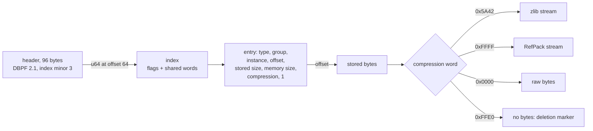
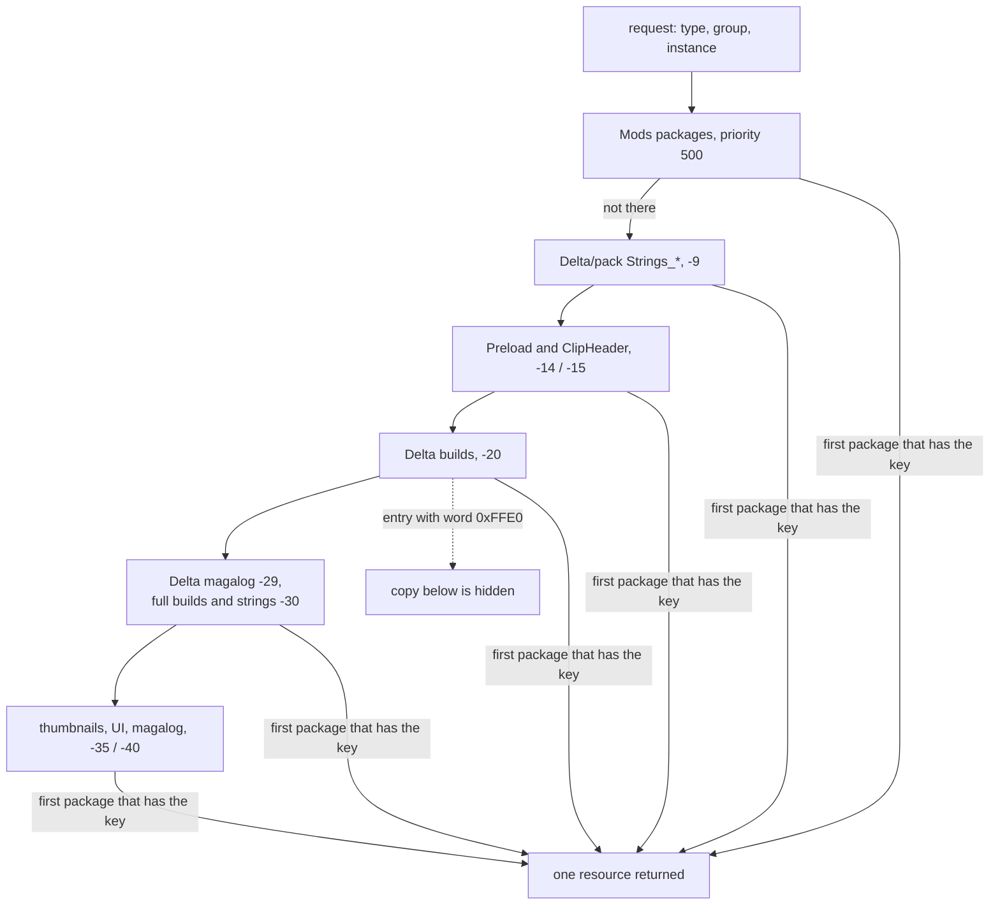

# 8.01 Package files and resource types

*Game version 1.128.90.1030 (Steam, Linux/Proton). Counts come from the base game and the installed packs EP04 (Cats & Dogs), EP06 (Get Famous), EP09 (Eco Lifestyle), EP12 (High School Years), GP04 (Vampires), GP12 (Werewolves), SP01 (Luxury Party) and SP42 (Grunge Revival): every package in `Data/`, in those eight pack folders and in their `Delta/` folders, read with the package reader and the authors' own scripts, re-derived with the checker's independent parser and again with the second checker's own reader, with resource counts on the live set (delta copy over full copy, deletion markers removed, full-only keys kept) unless a count says it covers every copy in the files. Written 2026-10-12. Checked 2026-10-12: 68 claims checked, 22 corrected, 5 relabelled, 0 removed. Checked again 2026-10-13: 146 claims checked, 25 corrected, 2 relabelled, 0 removed. Cross-chapter edits 2026-10-13: 3 applied.*

## In plain words

Apart from its code, almost everything the game draws, plays or simulates lives in a few hundred container files called packages. A package is a plain archive: a short header, the stored resources one after another, and an index that lists each resource by a three-part number: its type, its group and its instance. There are no file names inside. A texture, a sofa's catalog entry, a hairstyle, a sound and a string table are all just numbered resources, and the game asks for them by number.

The game never unpacks anything. When it starts it mounts a list of packages, each with a priority written in small text files that sit next to them, and when it needs a resource it takes, as far as the files can show, the copy from the highest-priority package that has it. That is how patches work. The packages first installed ("full builds") are left as they are. A patch ships "delta" packages at a higher priority holding only the resources that changed or are new, plus a third kind of entry: a deletion marker, an index line with no data, which hides the older copy.

Three things surprise most people. A delta is a patch layer and does not repeat what stayed the same: 185,406 of the base game's client resources are still read from files dated December 2025. The tuning asks for pictures as PNG files and for sounds as "PropX" files, yet almost none of those keys exist under those types: the build tools stored them as DDS textures and as a compiled sound format under the same group and instance. And the install carries patch folders for 117 packs, installed or not; the 109 that belong to packs this install does not have take 5.56 GB, and nothing suggests the game reads them without the pack.

Text works the same way. Each pack has one English string table, a list of 32-bit ids and UTF-8 strings, and the tuning stores only those ids. This install has the English tables only (76,335 strings in 9 tables, no id in two tables), so the language a player picks decides which `Strings_` files are on disk for the game to mount.

## Key facts

- Every content file is a DBPF 2.1 container: 796 files in the install (673 `.package`, 123 `.world`), each with a 96-byte header whose u64 at offset 64 points to the index. 70 of them are empty headers with no resources (64 are `ClipHeader.package` files).
- An index starts with a flags word; bits 1, 2 and 4 hoist a type, group or instance-high word shared by every entry, so an entry is 32 bytes minus 4 per bit set. All 3,014,566 entries in the install use the extended form with a compression word, and their second u16 is 1 everywhere.
- Four compression words occur in the 170 files of the installed content (every copy counted, shadowed full-build copies included): zlib `0x5A42` (1,306,272 entries), none `0x0000` (659,838: JPEG thumbnails, audio and sound properties), RefPack `0xFFFF` (16,825, only in `.world` files, string tables and 9 other entries) and the deletion marker `0xFFE0` (29,712, stored and memory size both 0, only in delta builds). Among the copies a lookup returns (delta over full, markers applied, each pack's `Delta/` world in place of its namesake) they are 773,257 zlib, 605,546 raw and 10,540 RefPack (10,532 in worlds, 8 string tables).
- A resource key is type (u32), group (u32) and instance (u64). Python builds it as `Key(type, instance, group)`; tuning writes it as `type:group:instance` in hex.
- 113 of the 116 tuning types with an explicit id use the FNV-1 32-bit hash of their file extension as type id (`buff` is `0x6017E896`); `Key.hash64(name)` is the FNV-1 64-bit hash of the lower-cased name.
- Priorities come from `Resource.cfg` files: base `ClipHeader` -15, delta builds -20, full builds and strings -30, UI, thumbnails and magalog -40; a pack's `Delta/` strings sit at -9, the highest shipped value. The client carries a default config with priority 500 and package patterns down to five folder levels, which is (**Inferred**) the one it writes for the Mods folder.
- The base Client delta repeats 135,533 of the full build's 328,794 keys, all of them changed (117,469 differ in size, and each of the other 18,064 differs in its bytes), adds 352,979 and deletes 7,855; the other 185,406 full-build keys have no delta entry and still load from the full build. Every one of the 29,712 deletion markers names a key that exists in the same pack's full build.
- A pack's delta replaces keys of its own full build and almost never a key the base game also ships: the only exceptions are one key of type `0xC71CA490` that the base game and all eight packs ship (six pack deltas re-ship it) and 6 SimData records in GP12's preload. 11,091 pack markers delete pack copies of resources the base game now ships itself, most of them audio.
- The installed content (base game and the eight installed packs with their `Delta/` folders) is 170 files with 2,012,647 index entries (29,712 of them markers) and 1,181,636 distinct keys over 183 resource types. 11,899 of those keys are hidden by a marker wherever they occur (each set's markers counted against its own copies), which leaves 1,169,737 with data, in 182 types (every key of type `0xB6C8B6A0`, 31 of them, is deleted). Python's `sims4.resources.Types` names 50 of the types.
- None of the 117 tuning type ids occurs as a resource type anywhere in the install: shipped tuning travels inside 8 combined tuning resources (type `0x62E94D38`, one key per pack group, 24 copies across full, delta and preload).
- The live base tuning names images as PNG (`0x2F7D0004`, 8,108 keys) or TGA (`0x2F7D0006`, 439) and sounds as PROPX (`0x39B2AA4A`, 975). 7,728, 439 and 974 of them exist only as a DDS (`0x00B2D882`) or as type `0xFD04E3BE` with the same group and instance; one PNG exists as a PNG, and 379 PNG keys and one PROPX key are missing from this install.
- A string table (`0x220557DA`, tag `STBL`, version 5) is a 21-byte header and one 7-byte entry header per string. Its header length field equals the string bytes plus one per entry. All 3,140 string ids written directly as `display_name` in the live base tuning resolve in the installed English tables.
- `SimulationPreload` (priority -15 base, -14 in a pack's `Delta/`) repeats 118,947 resources of the base simulation delta byte for byte and adds 663 rigs copied unchanged from the full build. Across all ten preload packages, the key set of each of the 55 types they carry is exactly the simulation side's live set (delta copy over full copy, markers removed, full-only keys kept): 183,169 keys, each with a byte-identical copy of the resource that rule picks. The Python calls `sims4.resources.release_preload_buffers()` once all tuning has loaded.

## How it works

### The game folder and what each package holds

**Observed** (directory listing and the package reader over every file):

| Folder | What it holds | Files | Index entries | Size |
|---|---|---|---|---|
| `Data/Client` | 9 `ClientFullBuild`, 9 `ClientDeltaBuild`, `ClipHeader`, `Strings_ENG_US`, `UI`, `thumbnails`, `thumbnails2`, `thumbnailsdeltabg1`, `thumbnailsdeltapack1`, `magalog`, `magalog2`; `Resource.cfg`, `Resource_LE.cfg` | 27 packages | 1,043,850 | 20.44 GB |
| `Data/Simulation` | `SimulationFullBuild0`, `SimulationDeltaBuild0`, `SimulationPreload`, `magalog`, `magalog2`; `Gameplay/` holds `base.zip`, `core.zip`, `simulation.zip` (the Python, see [0.02 Architecture](0.02-architecture.md)) | 5 packages | 314,559 | 0.15 GB |
| `Data/Shared/Worlds/Areas` | 18 base-game `.world` files | 18 | 4,489 | 0.06 GB |
| `EP04/` ... `SP42/` | each pack's `ClientFullBuild*`, `SimulationFullBuild0`, `Strings_ENG_US`, `thumbnails`, `magalog`, `Worlds/Areas/*.world`, `ResourceClient.cfg`, `ResourceSimulation.cfg`, `Version.ini` (SP42 also `ClipHeader` and `SimulationPreload`, and no magalog) | 44 packages + 16 worlds | 394,081 | 10.20 GB |
| `Delta/<installed pack>/` | `ClientDeltaBuild*`, `SimulationDeltaBuild0`, `SimulationPreload`, `ClipHeader`, `Strings_ENG_US`, sometimes `magalog` and `Worlds/`, two cfg files, `Version.ini` | 44 packages + 16 worlds | 255,668 | 1.60 GB |
| `Delta/<pack not installed>/` | the same layout for the 109 other packs that have a `Delta/` folder | 626 | 1,001,919 | 5.56 GB |
| `Game/Bin` | executables, `Default.ini` (base `gameversion = 1.128.90.1030`), `res/` | no packages | | |

**Observed**: the base game has no `Delta/` folder. On this install its ten full builds are dated 2025-12-21 and 2025-12-22, and its other 22 packages (delta builds, preload, `Strings_ENG_US`, `ClipHeader`, `UI`, thumbnails, magalog) 2026-09-25. **Inferred**: a base-game patch rewrites the delta files in `Data/` in place, while a pack patch writes `Delta/<pack>/`. Each pack's `Version.ini` records the pack's own build (EP04: `packversion = 23.0.65.1020`, `assetsversion = 1.assets.ml-ep04.2`), and its `Delta/EP04/Version.ini` records the current one (`1.128.90.1030`, `1.assets.ml-ep04.438`).

What each kind of package holds (**Observed**, file kinds; names of types from the table further down):

| Package | Holds | Priority |
|---|---|---|
| `ClientFullBuild*`, `SimulationFullBuild0` | the build as first installed: models, textures, audio, CAS parts, object definitions, combined tuning (base: XML text) | -30 |
| `ClientDeltaBuild*`, `SimulationDeltaBuild0` | changed and new resources, and deletion markers | -20 |
| `SimulationPreload` | 118,947 of the 131,394 resources in the base simulation delta, byte for byte, plus 663 rigs (`0x8EAF13DE`) copied unchanged from the full build; a pack's preload mixes its delta's resources with full-build ones the same way (EP04: 18,043 and 926); no markers | -15 base, -14 in `Delta/<pack>`, -15 for SP42's own (shadowed) copy |
| `ClipHeader` | animation clip headers only (`0xBC4A5044`, 21,619 in the base file) | -15 |
| `Strings_ENG_US` | one English string table; the base file also has 41 audio resources and a name map | -30, -9 in `Delta/` |
| `UI` | Flash UI movies (tag `GFX`), XML and DDS | -40 |
| `thumbnails*` | JPEG thumbnails for catalog objects and CAS parts, uncompressed | -30 (`thumbnails2`), -35 (the two delta thumbnail files), -40 |
| `magalog*` | DDS and PNG images and `0xB91E18DB` records; **Inferred** from the name: catalog magazine pages | -35 to -40, -29 in `Delta/` |
| `.world` | one world's lots, terrain and textures, mostly RefPack compressed (16,801 of the 17,667 entries in the 50 installed world files; 10,532 of 11,090 in the 34 left once each pack's `Delta/` world stands in for its namesake); not listed in any cfg | opened by name (**Inferred**) |

**Observed** (a scan of the package index): the client and the simulation have separate packages, and many types sit in both (object definitions, CAS parts, SimData, footprints: the ten `SimulationPreload` packages together hold 30,424 `0xC0DB5AE7` object definitions and the base and pack `ClientDeltaBuild` files together 30,424, the same 30,424 live keys), while textures, models and audio are client only. **Observed** (strings): the client names `ResourceClient.cfg`, `Data/Client`, `\Delta\%s\` and `Data/Simulation/Resource.cfg`; `Simulation_x64.dll` names `%lsResource.cfg` and `ResourceSimulation.cfg`. **Inferred**: each side mounts its own set through its own cfg files.

### The container: header and index

**Observed** (a scan of all 796 files; the package reader). The header is 96 bytes (table in [Data shapes](#data-shapes)). Only five words other than the count, size and position are ever non-zero: major version 2 at offset 4, minor 1 at 8, index minor version 3 at 60, the word 65,535 at 80 (0 in six files: five base `ClientFullBuild` files and SP42's `thumbnails`), and 12,800 (`0x3200`) at offset 16 in 597 files: every file in `Data/` except the ten full builds and `Strings_ENG_US` (so the 18 base worlds, `UI`, `ClipHeader`, thumbnails and magalog too), 558 of the 686 files in `Delta/` (all but 116 string packages, 6 magalog files and 6 client delta builds), and no file in a pack folder. The meaning of the last two is unknown. **Observed** (file modification dates on this install): every file carrying 12,800 is dated September 2026, and every file dated before that carries 0, so the word is something the current build writes. **Inferred**, a lead only: 12,800 is 128 x 100, the form [8.04](8.04-save-file-format.md) infers for a save's `compatibility_version` on version 1.128, and the tray schema's `TrayMetadataVersion.currentVersion` is also 12800 ([8.03](8.03-sim-cas-files.md)); but files patched earlier in 2026 carry 0 rather than an older stamp, so nothing here shows the word is a version. The old 32-bit index position at offset 40 is 0 everywhere, so a reader must use the u64 at 64. The authors' package reader falls back to offset 40 only when the u64 is 0, which never happens here.

The index begins with a u32 of flags. Bit 1 means every entry has the same type, bit 2 the same group, bit 4 the same high word of the instance, and each set bit is followed by that shared u32. Each entry then stores the words that are not shared, the instance low word, the file offset, the stored size and the memory size; when the stored size has its top bit set, a u16 compression word and a second u16 follow. Over the 726 non-empty files the index size in the header always equals the size this layout implies. All 3,014,566 entries have the top bit set, and the second u16 (called `committed` in the authors' package reader) is 1 in every one.

**Observed** (flag values by package kind): 0 in most build files, the thumbnails and UI; 2 (shared group) in all 123 worlds, many build files and magalog; 3 (shared type and group) in the 55 non-empty `ClipHeader` files and two magalog files; 7 (all shared) in 124 single-table `Strings_ENG_US` packages and 28 small build files; 4 and 6 in five files.

Two layouts occur. **Observed** (a scan of the package index, re-checked by the checker): every package in `Data/Client` and `Data/Simulation` except the full builds and the strings package, SP42's own `SimulationPreload`, and in `Delta/` every `SimulationDeltaBuild`, `SimulationPreload` and non-empty `ClipHeader` plus 112 of the 118 non-empty client delta builds (two of those hold only markers), put the index right after the header at offset 96 and the data after it. Full builds, string packages, the packs' own thumbnails and magalog files and the `Delta/` magalog files put the data first and the index last. Worlds mostly do too: in 109 of the 123 the index follows the last resource and ends the file, in 4 it ends the file after a gap, and in 10 some resources sit after the index. Data is contiguous in every package except the `.world` files and one pack thumbnails file, which have gaps between resources.

### Compression kinds

**Observed** (a scan of the index of the 170 installed-content files, then the live copies). "Entries" counts every copy in those files, including full-build copies a delta shadows; "live copies" counts the copy a lookup returns (delta over full by cfg priority, markers hiding their own pack's copies, each pack's `Delta/` world file in place of its namesake; a copy that answers on both the client and simulation side, such as a pack magalog's, counted once).

| Word | Kind | Entries | Live copies | Where (entries) | First bytes (entries) |
|---|---|---|---|---|---|
| `0x5A42` | zlib | 1,306,272 | 773,257 | every Client and Simulation build, `ClipHeader`, magalog, UI, the base strings package's audio | `78 DA` (1,258,091) or `78 01` (48,181) |
| `0x0000` | none | 659,838 | 605,546 | thumbnails (276,220, all but 3 JPEG `FF D8`), audio data (276,023), sound properties `0xFD04E3BE` (104,246), a few thousand UI, world and other entries | the format's own |
| `0xFFFF` | RefPack | 16,825 | 10,540 | `.world` files (16,801), string tables (15: the 8 live ones and 7 shadowed pack copies), 9 others (8 copies of the `0xB93A9915` instance-0 resource in thumbnail packages, all shadowed by `thumbnails2` at -30, and the simulation name map a marker hides) | `10 FB` (16,471) or `50 FB` (354) |
| `0xFFE0` | deletion marker | 29,712 | 0 | delta builds only (22,493 client side, 7,219 simulation side) | none: stored and memory size 0 |

`0xFFFE` and every other value never occur. For zlib and RefPack the memory size in the index is the decompressed length. In all 16,825 RefPack streams the size field after the two header bytes (3 bytes, big endian, because bit `0x80` of the first byte is clear) equals that memory size. The RefPack command forms are listed under [Data shapes](#data-shapes). **Observed** (strings): the client and `Simulation_x64.dll` both carry `EACore/ResourceMan/CompressionRefPack` and `EACore/UTFFoundation/CompressionRefPack`.

### Resource keys and the hashes behind them

**Observed** (`resources.py`; `_resourceman` strings in `Simulation_x64.dll`). A key is a type (u32), a group (u32) and an instance (u64). The native class `_resourceman.Key` takes them in the order type, instance, group (`|IKI:Key`, all optional) and has `hash32` and `hash64` constructors (`u#|II`: a string, then optional type and group). `sims4.resources` re-exports it with `from _resourceman import *`. `INVALID_KEY` is `Key(0, 0, 0)`; `get_key_from_protobuff` builds `Key(type, instance, group)`, and `get_protobuff_for_key` writes the `EA.Sims4.Network.ResourceKey` message with fields `type`, `group`, `instance`.

**Observed** (`resources.py: ResourceKeyWrapper`, values in the tuning XML). Tuning stores a key as text `type:group:instance` in hex, for example a PNG icon `2f7d0004:00000000:3093e48e0ec6c852`; the decoded live base tuning holds 10,825 such values (the old full build 3,874). The wrapper splits on `:` and calls `Key(t[0], t[2], t[1])`, which reads that order correctly. Its error message says "Type:Instance:Group", which is wrong. A two-part `type:name` form hashes the name instead.

**Observed** (`resources.py: InstanceTuningDefinition`). A tuning type's id defaults to `hash32(file_extension)`. Of the 116 tuning types with an explicit id, 113 equal the FNV-1 32-bit hash of their extension (`buff` `0x6017E896`, `interaction` `0xE882D22F`, `scommodity` for `static_commodity`). The three exceptions are module tuning `tun` (`0x03B33DDF`), `relbit` (`0x0904DF10`) and `notebook_entry` (`0x9902FA76`). The 117th, `TDESC_DEBUG`, has no explicit id.

**Observed** (`get_resource_key`, `tuning_dependencies_cache.py`). A name becomes an instance through `Key.hash64`, the FNV-1 64-bit hash of the lower-cased name. The tuning-dependency cache for the base game is named `td_pickle_cache_BASE_GAME`; the lower-cased hash `0x21635FF03B356AE4` is its instance in `SimulationDeltaBuild0`, and the hash of the name as typed matches nothing. `ac_pickle_cache_BASE_GAME`, `bc_pickle_cache_BASE_GAME`, `td_pickle_cache_EP04` and `ac_pickle_cache_EP04_bg_delta` behave the same way (found by the checker). **Inferred**: the native `Key.hash64` lower-cases its input, since the Python passes these names in mixed case. Module tuning files are named after the module with dots turned into dashes (`serialization.py`): `careers-career_tuning` hashes to `0xDEC1849CA980A37B`, the `s` id of that module record.

**Observed** (client UTF-16 strings `0x%08x!0x%08x%08x.0x%08x` and `0x%08x!0x%08x%08x.%ls`; DLL string `<Resource key='%08x!%08x'%08x.%08x' size=%zu>`). The engine also writes keys as text with a `!` and a `.`. **Inferred**: the order is group, then the 64-bit instance in two halves, then the type, because the variant with `%ls` swaps the last field for a string, which matches a file extension. `res/Resource.cfg` maps type ids to extensions for loose files (`FileType 0x25796dca otf`, `0x12952634 dat`, `0x1f886ead ini`).

### Mounting: `Resource.cfg` and priorities

**Observed** (the cfg files, read whole). Each cfg is a list of `Priority N` lines, each followed by the `PackedFile` patterns mounted at that priority. Other keywords are `DirectoryFiles` (a folder of loose files), `FileType` (type id to extension), `Select NAME` ... `End` (a conditional block: `Data/Client/Resource.cfg` mounts `ConsoleTray.package` only under `CONSOLETRAY`, and that file is absent) and `StopScan`, `autoupdate` (both in the client strings beside `DirectoryFiles`).

| Priority | `Data/Client` | `Data/Simulation` | pack folder (client / simulation) | `Delta/<pack>` (client / simulation) |
|---|---|---|---|---|
| -9 | | | | `Strings_*` |
| -14 | | | | / `SimulationPreload` |
| -15 | `ClipHeader` | `SimulationPreload` | SP42 only: `ClipHeader` / `SimulationPreload` | `ClipHeader` / |
| -20 | `ClientDeltaBuild0` to `8` | `SimulationDeltaBuild0` | `ClientDeltaBuild*` / `SimulationDeltaBuild*` (none present) | `ClientDeltaBuild*` / `SimulationDeltaBuild*` |
| -29 | | | | `magalog` / `magalog` |
| -30 | `ClientFullBuild0` to `8`, `Strings_*`, `thumbnails2` | `SimulationFullBuild0` | `ClientFullBuild*`, `Strings_*` / `SimulationFullBuild*` | `ClientFullBuild*` / `SimulationFullBuild*` (none present) |
| -35 | `thumbnailsdeltabg1`, `thumbnailsdeltapack1`, `magalog2` | | | |
| -40 | `UI*`, `thumbnails`, `magalog` | `magalog`, `magalog2` | `UI*`, `thumbnails`, `magalog` / `magalog` | `UI*`, `thumbnails` / |

**Observed** (`Game/Bin/res/ResourceClient.dat`, `ResourceSimulation.dat`): these are templates of the same files with extra non-shipping lines fenced by `ORIGIN_INSTALL_BUILD_DISABLE_START` and `_END`: `Autobuild.package` and `Gameplay*.package` at -10, `blockmodels.package` at -40 (client) or -30 (simulation), `Tools.package` at -40 (simulation), `*.keynamemap.package` files at -60 and -70, and, in `ResourceSimulation.dat` only, `DirectoryFiles LocalWork` at priority 1, which a comment ties to EA's automated tests. The `Priority -10` line itself sits outside the fence in `ResourceClient.dat` and inside it in `ResourceSimulation.dat`. **Inferred**: that is why every client cfg (pack folder and `Delta/`) keeps an empty `Priority -10` line and no simulation cfg does. **Observed**: no `keynamemap` file ships, and the client and DLL strings still name the key-name map kinds (`sims4/hash_util.py` re-exports them from the native `_hashutil`) (`KEYNAMEMAPTYPE_RESOURCES`, `_RESOURCESTRINGS`, `_OBJECTINSTANCES`, `_SWARM`, `_STRINGHASHES`, `_TUNINGINSTANCES`). **Inferred**: those maps give keys their names in EA's own builds; without them the shipped packages carry numbers only.

**Observed** (client strings, in order): `Priority 500`, then `PackedFile *.package`, `*/*.package` and so on to `*/*/*/*/*/*.package`, next to the options `ModsDisabled`, `ScriptModsEnabled`, `ignoreMods` and `ShowModListStartup`. **Inferred**: this is the `Resource.cfg` the game writes into an empty Mods folder, so mod packages up to five folders deep mount at 500. The user folder was not read for this book.

The lookup order the priorities imply (**Inferred**: the resolver is native, see below):

**Inferred** (native, not readable): a key found in several mounted packages resolves to the copy with the highest priority. Every observation fits: delta (-20) must beat full (-30) for patches to show; the base preload (-15) and delta copies of the combined tuning are byte-identical, so either answer gives the current data ([0.03 The tuning system](0.03-tuning-system.md)), and the same holds for every type the preloads carry (next section); and the 0xFFE0 markers sit in the higher-priority deltas and name keys of the lower-priority full builds, which only works if the higher package answers first. The order between two packages at equal priority (a pack's delta and the base delta are both -20) is not visible.

### How a Delta package replaces and deletes

**Observed** (a scan of the package index). The base game's two sides, delta builds against full builds:

| Side | Full keys | Delta keys | In both (replaced) | Full only (still read from full) | Delta only (new) | Deletion markers |
|---|---|---|---|---|---|---|
| Client | 328,794 | 488,512 | 135,533 | 185,406 | 352,979 | 7,855 |
| Simulation (delta + preload) | 59,820 | 132,057 | 51,992 | 4,379 | 80,065 | 3,449 |

Of the 135,533 client keys the delta repeats, 117,469 have a different decompressed size, and all 18,064 same-size pairs differ in their bytes (the writer's sample of 500 found the same). The base `SimulationDeltaBuild0` repeats 51,329 full-build keys, and its 1,606 same-size pairs all differ too; the table's 51,992 also counts the 663 rigs that `SimulationPreload` copies unchanged from the full build. **Inferred**: the build tools put a resource in the delta only when it changed or is new, so a delta is a patch layer over its full build. A reader that opens only the full builds sees the December 2025 snapshot; one that opens only the deltas misses 185,406 client resources.

**Observed** (the second check's index scan and a byte compare of every preload entry). The game ships that live set itself for part of the simulation side. Build the live set of the simulation packages without the preloads: per pack, the delta copy replaces the full copy under the same key, a marker removes its own pack's key, full-only keys stay. The ten `SimulationPreload` packages (base `Data/Simulation`, the eight installed packs' `Delta/` folders and SP42's own folder) carry 55 resource types, and for every one of them the preload keys are exactly that set: 183,169 keys, among them CASPART 38,185, SimData 33,537, OBJECTDEFINITION 30,424, CLIP_HEADER 30,320, OBJCATALOG 30,140, RIG 2,904, SKINTONE 145, WALKSTYLE 180, `0x26AF8338` 350, CAS presets `0xEAA32ADD` 996, `0xC5F6763E` 1,548, `0x9D1AB874` 913 and the 8 combined tuning files. For each key one preload copy is byte-identical to the copy the rule picks; the 441 other copies are older ones: SP42's own `SimulationPreload` (-15) repeats its full build's 435 CAS parts under the keys `Delta/SP42/SimulationPreload` (-14) carries in their delta form, and GP12's `Delta/` preload carries the 6 SimData described below. No preload holds a marker. The simulation side's other 27,275 live keys are of 34 types the preloads leave out, among them footprints (11,595), `0xAC16FBEC` (2,922), SIMINFO (2,315), BGEO (1,850) and audio events (1,591). **Observed** (docstring in `Simulation_x64.dll`): `release_preload_buffers` tells "the resource system to free the memory used by the preload buffer optimization". **Inferred**: the preload is a precomputed copy of the current simulation data for the types read at startup, held in memory until tuning has loaded.

**Observed** (a scan of the package index): every deletion marker has stored size 0 and memory size 0, and for all 29,712 of them (16 sets: base and 7 packs, client and simulation; SP42 has none) the same key exists in that set's full build. Types most often deleted: audio `0x01A527DB` (8,430), `0x81CA1A10` (6,244, nearly all of that type), SimData `0x545AC67A` (2,594), `0xFD04E3BE` (2,366), `0x033B2B66` (2,054) and `0x6F40796A` (2,034).

The clearest single example is the combined tuning. **Observed** (sha1 of the decompressed resources): base `SimulationFullBuild0`, `SimulationDeltaBuild0` and `SimulationPreload` all carry key `0x62E94D38:00000000:F1352E740C4710BA`. The full copy is 14,527,097 bytes, while the delta and preload copies are byte-identical at 32,472,930. EP04 repeats the pattern with `00000019:E23BB17404760CFF` in `EP04/` (4,310,866 bytes) and in `Delta/EP04/` (4,941,298, delta and preload identical), and so do EP06, EP09, EP12, GP04, GP12 and SP01; SP42 ships none. `MergedTuningManager.load` lists the type once with `get_all_resources_of_type` and loads each key once through `ResourceLoader`, so the Python receives one copy per pack: the current one (**Inferred**, the resolver is native). What the tuning inside means is [0.03](0.03-tuning-system.md) and [8.02 Tuning XML and binary delta tuning](8.02-tuning-formats.md).

**Observed** (a scan of the package index): the EP04, EP06 and EP09 combined-tuning instances (`E23BB17404760CFF`, `...CFD`, `...CF2`) differ only in the last byte, and those bytes are `0xCB` XOR the ASCII code of the pack's last digit (`0x34`, `0x36`, `0x39`); the patch data of EP01 (Get To Work) to EP09 follows the same rule (`...0CFA` to `...0CF2`). That is what FNV-1 64 gives for names that differ only in their final character. **Inferred**, as in [8.02](8.02-tuning-formats.md): the instance is the hash of a name ending in the pack code; the name itself was not recovered. The tuning patch also deletes: 1,175 of the base `SimulationDeltaBuild0`'s SimData entries are deletion markers (a scan of the package index; 8.02 counts the same with its own script).

A delta copy is a whole resource. **Observed** (a scan of the string tables): `Delta/EP04/Strings_ENG_US` carries a complete table under the same key as `EP04/Strings_ENG_US`, 3,248 strings against 3,258, with 214 old ids gone and 84 texts changed. A pack's delta world files are complete copies as well: over the six packs with worlds, the delta `.world` files repeat 6,575 of the pack files' 6,577 keys, add 26 and delete none.

### Packs, their Delta folders and the base game

**Observed** (a scan of the package index, re-checked by the checker): for every installed pack and both sides, the keys in `Delta/<pack>` either replace a key in the same pack's full build or are new. A handful also exist in the base game, and each of them is in the pack's own full build as well. One key, `0xC71CA490:00000000:905BE3F9F06EDEAD` (type unnamed), is shipped by the base full and delta builds and by all eight packs' full builds, each copy different (from 1,112 bytes in SP42 to 4,685,648 in the base delta; SP42's begins with a version 1 and a count of 30 records), and six pack deltas (all but GP12's and SP42's) re-ship it. And GP12's `Delta/` `SimulationPreload` carries 6 SimData records (group `0x00496642`) byte-identical to GP12's full build, while the base delta and preload carry different copies under the same keys. **Inferred**: the engine either reads every copy of the shared key or uses one; nothing on disk shows which, nor which SimData copy wins: by cfg priority alone GP12's preload (-14) outranks the base preload (-15) and delta (-20), which would serve GP12's older copy on the simulation side, while on the client side the base delta (-20) outranks GP12's full build (-30). EP04 client: 30,702 delta keys, 28,350 replacing EP04 full-build keys, 2,352 new, while 27,970 of the full build's 61,098 keys have no delta entry and still load from it (and 4,778 are deleted); EP04 simulation: 19,370, 17,688 and 1,682. A pack's delta is a patch layer over its full build in the same way as the base game's. SP42's client delta replaces all 978 of its keys and adds none.

**Observed** (a scan of the package index): a pack's full build still carries copies of resources whose keys the base game now also ships, mostly audio `0x01A527DB` and sound properties `0xFD04E3BE`. The pack's delta deletes them: 11,091 markers across the packs (EP04 3,816, GP04 2,690, EP12 1,831, EP06 1,671, EP09 604, SP01 393, GP12 86) name keys that also live in the base game, 3,246 of EP04's only in the base `ClientDeltaBuild`. The CAS kinds show the same pattern: EP04's delta deletes all 91 of its pelt brushes (`0x9D7E7558`) and the base delta carries all 91 keys; EP06's delta deletes 20 GEOMs (16 of them in the base delta), 2 RMAPs and 2 RLES (all in the base delta) ([8.03](8.03-sim-cas-files.md)). **Inferred**: these are resources moved from the packs into the base game. Both the marker and the base copy sit at priority -20, so the marker can only work if it hides the copy in its own pack's full build. If it hid the base copy, those sounds would vanish for every owner of the pack. Whether the resource manager scopes markers by package set or orders equal priorities by mount order cannot be read.

**Observed** (a scan of the package index): pack content keeps group 0 for most resources (EP04's packages, worlds aside: 127,476 entries in group 0 against 16,738 in `0x001407EC`, the next most common). The combined tuning is the exception: its group is the pack's number (SP01 `0x01`, GP04 `0x11`, EP04 `0x19`, EP06 `0x1B`, EP09 `0x1E`, EP12 `0x35`, GP12 `0x3F`). [8.03](8.03-sim-cas-files.md) reads the same number as an i16 pack word in every version 52 CAS part (EP04 25 in all 2,676 parts, GP12 63 in all 1,512), and 83 in all 435 of SP42's, which ships no combined tuning; the `Pack(pack_id)` calls in `tuning_managers.py` treat such numbers as `Pack` values. The decompiled `Pack` class holds no numbers, and its declaration order would give GP12 64 and SP42 84, so the ids cannot be read off that order. `MergedTuningManager` keeps records from a non-zero group in `res_id_group_map`, and loose tuning overrides count only when `is_available_pack(key.group)` ([0.03](0.03-tuning-system.md)). Thumbnails spread one instance over several groups. `0x3C1AF1F2` uses groups 1, 2, `0x101` and `0x102`. `0x3C2A8647` uses plain groups 0 to 3 for 11,916 keys; for the other 127,648 the group is the instance's low 28 bits shifted left by four, plus 0, 1, 2, 3 or 5 in the low four bits (found by the checker). **Inferred**: the low bits pick the picture's size; the sizes are in [7.03](7.03-thumbnails-gallery.md).

**Observed**: `Delta/` has folders for 117 packs; the 109 for packs not installed hold 626 files. They carry their own `ResourceClient.cfg` and `ResourceSimulation.cfg`; **Inferred**: the game opens a `Delta/<pack>` folder only for a pack it has (the client builds the path from `\Delta\%s\`), so they never load. 82 of the 117 `Delta/` folders carry a combined tuning file (79 in their delta build; SP57 (Cozy Kitsch), SP70 (SpongeBob Kid's Room) and SP82 (Yard Charm) only in their preload package); 75 of the 82 belong to packs that are not installed, and of the installed packs only SP42 has none. In all 79 folders that have both, the `SimulationPreload` copy has the delta build's key and is byte-identical to it, the same layout as the installed packs; those preloads also carry the folder's CAS parts, object definitions, catalog entries and SimData (types `0x034AEECB`, `0xC0DB5AE7`, `0x319E4F1D` and `0x545AC67A` are the most common), all patch data, pack not installed. The authors decoded all 75 (patch data, pack not installed; [0.03](0.03-tuning-system.md)). Pack hot-loading is native: `register_pack_hotload_callback` hands the Python a list of pack ids, and `InstanceTuningManagers.hot_load_packs` reloads tuning for them (`tuning_managers.py`; [0.02](0.02-architecture.md)).

### Mods and loose overrides, seen from the Python

**Observed** (`merged_tuning_manager.py: _load_combined_file_by_key`, `get_all_res_ids`; `serialization.py: create_class_instance`, `load_from_xml`). After reading a combined file, the tuning loader calls `sims4.resources.list_local(key=combined_key, packed_types=tuning types)` (API version 2 or later). It returns two lists: local keys and local deleted keys of the tuning types, each kept only when its group is an available pack. For every tuning instance, a local deleted key means the instance is not created; a local key means the loose resource is loaded instead of the combined record. The set of instances of a type is combined-file ids, plus local keys, minus local deleted keys.

**Observed** (the docstring of `list_local` in `Simulation_x64.dll`): it returns two lists of keys, the first "of each file in LocalWork, if key available, otherwise keys modified after the passed in key", the second "of all deleted resource"; with `include_packed` (default True, and the tuning loader does not change it) it "also include[s] resources from packed package files", and `packed_types` (API v2+) restricts the types. **Inferred**: the packed packages that count are the ones outside the shipped builds, such as Mods packages at priority 500; the local deleted list is how a mod can remove an EA tuning instance, and the 0xFFE0 marker is the obvious form for it, but which package files the native side scans cannot be read. Separately, `resources.localwork` holds `list_local(key=None, include_packed=False)[0]`, which by the same docstring is the keys of the loose files in the non-shipping `LocalWork` folder.

**Observed** (`resources.py`): object definitions and every tuning type are registered with `make_resource_hot_swappable` when the module loads, unconditionally (a `RuntimeError` is ignored); what that does is native. `file_change_handler.py` registers callbacks with `register_change_notification(type_filter, group_filter)`, and the service built on it exists only when `paths.SUPPORT_RELOADING_RESOURCES` is set (default `False`; `core_services.py`). **Inferred**: both serve development reloading.

### What the tuning asks for and what the packages hold

**Observed** (every `type:group:instance` value in the decoded live base tuning, looked up in the live set of the installed content, then in the `Delta/` folders of packs not installed):

| Type in tuning | Distinct keys | Found under that type | Found only under another type | Missing from the live set |
|---|---|---|---|---|
| `0x2F7D0004` PNG | 8,108 | 1 | 7,728 as `0x00B2D882` DDS | 379 (10 in `Delta/` of packs not installed) |
| `0x02D5DF13` STATEMACHINE | 978 | 977 | | 1 (patch data of EP07 (Island Living), not installed) |
| `0x39B2AA4A` PROPX | 975 | 0 | 974 as `0xFD04E3BE` | 1 |
| `0x2F7D0006` TGA | 439 | 0 | 439 as DDS | 0 |
| `0x27C01D95` WALKSTYLE | 107 | 60 | | 47 (all in `Delta/` of packs not installed, 21 of them EP14 (Horse Ranch)) |
| `0x376840D7` VP6 | 70 | 70 | | 0 |
| `0x025ED6F4` SIMINFO | 40 | 30 | | 10 (patch data of GP03 (Dine Out) and EP02 (Get Together)) |
| `0x545AC67A` SimData | 10 | 10 | | 0 |
| `0xB3C438F0` HOUSEHOLD_BINARY | 4 | 0 | | 4 |
| `0x00B2D882` DDS | 2 | 2 | | 0 |

**Inferred**: the missing keys belong to packs this install does not have (the walk styles, the state machine and the SIMINFO records are in their patch data); the base tuning refers to them and the game skips what it cannot load. The old full-build tuning shows the same split: all 399 TGA and 834 PROPX keys and 2,012 of its 2,036 PNG keys have a live copy only as the built type; the other 24 PNG keys exist only as DDS copies in the base full build that a base delta marker deletes.

**Inferred** (native): the asset build converts source formats and keeps the group and instance, and the resource manager maps a request for the source type to the built type. Image keys in tuning are tunables restricted to `CompoundTypes.IMAGE` (`[Types.PNG]`, used in 52 modules), and sound keys are PROPX (`audio/primitive.py`). **Observed** (a sample of 3,000, then every copy by the checker): 66,379 of the 68,001 `0xFD04E3BE` resources in the base client delta contain, as 8 little-endian bytes, the instance id of a `0x01A527DB` resource, which ties the compiled sound properties to the audio data; over the whole live set it is 85,175 of 87,101. **Observed** (the second check's per-function decompile of `core/sims4/tuning/tunable.py`, which does not decompile whole): `TunableResourceKey` writes its `resource_types` only into the tuning description (`export_desc`), and its load path tests nothing but existence, and only when the tunable is pack-safe: `TunablePackSafeResourceKey` calls `does_key_exist` and turns a missing key into no value.

### Resource types in this install

**Observed** (a scan of the package index, recounted over the live set by the second check). Counted over the installed content only: the 27 packages in `Data/Client`, 5 in `Data/Simulation`, the 18 base worlds, the eight installed pack folders and their `Delta/` folders (170 files). "Live keys" counts each (type, group, instance) once if a copy survives the live rule (per pack, the delta copy replaces the full copy, a marker removes its own pack's key, full-only keys stay; each pack's `Delta/` world file stands in for its namesake). The files hold 11,899 more keys that a marker hides (`0x81CA1A10` keeps data for only 8 of its 3,130). "Markers" counts deletion entries. "GB" is the decompressed size of the live copies, a key present on both the client and the simulation side counted on both. "Tag" is the start of the live copies as text (all of them for types under 400 live copies, a random 400 otherwise), or the chunk tags for RCOL containers (a first word of 3, then a chunk table; the scan reads the chunk tags). Names marked "Types" are EA's own from `sims4.resources.Types`; names marked "community" are names used by modding tools, which the files neither confirm nor contradict (**Inferred**).

| Type | Name (source) | Tag | Live keys | Markers | Where | GB | More in |
|---|---|---|---|---|---|---|---|
| `0x01A527DB` | audio data (community "SNR"; tied to sound properties above) | none | 326,235 | 8,430 | client builds, 41 in base strings | 9.32 | [7.02](7.02-audio-vfx-camera.md) |
| `0x3C2A8647` | object thumbnail (instances match 29,173 of the 30,424 live object definitions) | JPEG | 139,564 | 0 | thumbnail packages | 0.48 | [7.03](7.03-thumbnails-gallery.md) |
| `0x3C1AF1F2` | CAS part thumbnail (instances match 38,145 of the 38,185 live CAS parts) | JPEG | 115,376 | 0 | thumbnail packages | 0.68 | [7.03](7.03-thumbnails-gallery.md) |
| `0x00B2D882` | DDS (Types) | `DDS ` | 95,192 | 332 | client builds, worlds, UI, magalog | 26.38 | |
| `0xFD04E3BE` | built form of PROPX, sound properties (see above) | binary | 87,101 | 2,366 | client builds | 0.01 | [7.02](7.02-audio-vfx-camera.md) |
| `0x034AEECB` | CASPART (Types) | binary | 38,185 | 2 | both sides | 0.06 | [8.03](8.03-sim-cas-files.md) |
| `0x545AC67A` | SimData (Types calls it PLAYLIST) | `DATA` | 33,537 | 2,594 | both sides | 0.04 | [8.02](8.02-tuning-formats.md) |
| `0x015A1849` | body geometry | RCOL `GEOM` | 33,226 | 44 | client | 1.72 | [8.03](8.03-sim-cas-files.md) |
| `0x3453CF95` | texture (community RLE2) | `DXT5RLE2` (`L8  RLE2` in a few) | 32,657 | 2,018 | client | 7.28 | |
| `0xC0DB5AE7` | OBJECTDEFINITION (Types) | binary | 30,424 | 94 | both sides | 0.02 | [2.02](2.02-objects-states-wear.md) |
| `0xBC4A5044` | CLIP_HEADER (Types) | binary | 30,320 | 714 | both sides, `ClipHeader` | 0.04 | [3.06](3.06-animation.md) |
| `0x6B20C4F3` | CLIP (Types) | binary | 30,320 | 357 | client | 2.55 | [3.06](3.06-animation.md) |
| `0x319E4F1D` | OBJCATALOG (Types) | binary | 30,140 | 92 | both sides | 0.02 | [2.03](2.03-build-buy-placement.md) |
| `0x01D10F34` | model level of detail | RCOL `MLOD` with `MATD`, `VBUF`, `IBUF`, often `VRTF`, `SKIN`, `MTST` | 28,042 | 244 | client | 0.72 | |
| `0x01661233` | MODEL (Types) | RCOL `MODL`, `MLOD`, `MATD`, `VRTF`, `VBUF`, `IBUF`, often `SKIN`, `MTST` | 14,318 | 1,159 | client | 0.32 | |
| `0x1B192049` | unnamed | binary | 12,430 | 0 | base client delta only | 0.06 | |
| `0x03B4C61D` | light | RCOL `LITE` | 12,257 | 102 | client | 0.00 | |
| `0xD382BF57` | FOOTPRINT (Types) | RCOL `FTPT` | 11,595 | 250 | both sides | 0.00 | [2.03](2.03-build-buy-placement.md) |
| `0x01D0E75D` | material | RCOL `MATD` | 10,380 | 24 | client | 0.00 | |
| `0x2BC04EDF` | texture (community LRLE) | `LRLE` | 5,158 | 0 | client | 0.56 | [8.03](8.03-sim-cas-files.md) |
| `0x8E71065D` | thumbnail (instances match all 1,094 `0xC4DFAE6D` keys) | JPEG | 3,084 | 0 | pack thumbnail packages | 0.02 | [7.03](7.03-thumbnails-gallery.md) |
| `0xAC16FBEC` | unnamed (community "region map", unconfirmed) | RCOL, untagged chunk | 2,922 | 4 | both sides | 0.00 | [8.03](8.03-sim-cas-files.md) |
| `0x8EAF13DE` | RIG (Types) | binary | 2,904 | 22 | both sides, preload | 0.00 | [3.06](3.06-animation.md) |
| `0xBA856C78` | texture (community RLES) | `DXT5RLES` | 2,734 | 2 | client | 0.34 | |
| `0xD3044521` | SLOT (Types) | RCOL `RSLT` | 2,501 | 16 | both sides | 0.00 | [2.03](2.03-build-buy-placement.md) |
| `0x025ED6F4` | SIMINFO (Types) | binary | 2,315 | 0 | both sides | 0.01 | [8.03](8.03-sim-cas-files.md) |
| `0xD5F0F921` | WALL_PATTERN (Types) | binary | 2,252 | 0 | both sides | 0.00 | [2.03](2.03-build-buy-placement.md) |
| `0x5B282D45` | thumbnail (instances match 981 of the 996 `0xEAA32ADD` keys) | JPEG | 1,912 | 0 | thumbnail packages | 0.01 | [7.03](7.03-thumbnails-gallery.md) |
| `0x067CAA11` | blend geometry | RCOL `BGEO` | 1,850 | 2 | both sides | 0.12 | [3.02](3.02-cas-sculpting-parts.md) |
| `0x02D5DF13` | STATEMACHINE (Types) | `DATA` (binary) in every live copy; XML text in 980 of its 7,017 entries, all shadowed full-build copies (976 of them base) | 1,625 | 52 | both sides | 0.03 | [3.06](3.06-animation.md) |
| `0xBDD82221` | audio events (Inferred from the tag) | `AUEV` | 1,591 | 20 | both sides | 0.00 | [7.02](7.02-audio-vfx-camera.md) |
| `0xC5F6763E` | Sim modifier (community) | RCOL, untagged chunk | 1,548 | 0 | both sides | 0.00 | [3.02](3.02-cas-sculpting-parts.md) |
| `0x033B2B66` | unnamed | RCOL with an untagged chunk, or binary | 1,335 | 2,054 | builds, worlds | 0.04 | |
| `0xCD9DE247` | thumbnail (instances match all 1,310 `0x71BDB8A2` keys) | JPEG | 1,331 | 0 | thumbnail packages | 0.04 | [7.03](7.03-thumbnails-gallery.md) |
| `0x71BDB8A2` | unnamed | binary | 1,310 | 0 | both sides | 0.00 | [8.03](8.03-sim-cas-files.md) |
| `0x16CA6BC4` | unnamed | RCOL `THUM` | 1,215 | 12 | client | 0.00 | |
| `0xC4DFAE6D` | unnamed | binary | 1,094 | 0 | both sides | 0.00 | |
| `0x9D1AB874` | sculpt (community) | RCOL, untagged chunk | 913 | 0 | both sides | 0.00 | [3.02](3.02-cas-sculpting-parts.md) |
| `0x6F40796A` | unnamed | `WRPR` | 857 | 2,034 | builds | 0.01 | |
| `0x12952634` | world data (`dat` in `res/Resource.cfg`) | binary | 405 | 0 | worlds | 0.08 | [2.06](2.06-worlds-regions-travel.md) |
| `0x2F7D0004` | PNG (Types) | PNG | 403 | 0 | magalog, client | 0.00 | |
| `0x62ECC59A` | UI movie | `GFX` | 258 | 0 | `UI` | 0.23 | [7.01](7.01-ui-dialogs-tutorials.md) |
| `0x376840D7` | VP6 video (Types) | `SCHl` (`MVhd` in 3 pack copies) | 145 | 3 | client | 0.37 | |
| `0x0354796A` | SKINTONE (Types) | binary | 145 | 0 | both sides | 0.00 | [8.03](8.03-sim-cas-files.md) |
| `0x346CB93E`, `0xE2249422`, `0x1C99B344` | TD_CACHE, AC_CACHE, BC_CACHE (Types): Python pickles | `version#` | 18, 34, 18 | 0, 2, 2 | simulation builds | 0.06 | [3.06](3.06-animation.md) |
| `0x81CA1A10` | unnamed | `MTBL` | 8 | 6,244 | full builds; the deltas delete 3,122 of the 3,130 keys | 0.00 | |
| `0x220557DA` | string table | `STBL` | 9 | 0 | `Strings_ENG_US` | 0.01 | below |
| `0x62E94D38` | COMBINED_TUNING (Types) | `DATA` in every live copy; the shadowed base full build copy is XML | 8 | 0 | simulation builds and preload | 0.05 | [0.03](0.03-tuning-system.md) |
| `0x25796DCA` | OpenType font (`otf` in `res/Resource.cfg`) | `OTTO`, or `00 01 00 00` in 3 delta copies | 6 | 0 | client | 0.00 | |
| `0x0166038C` | name map | binary | 2 | 1 | strings, thumbnails (and simulation full, hidden) | 0.00 | |

The table holds all 37 types with 1,000 live keys or more, two that drop below 1,000 once markers apply (`0x6F40796A`, `0x81CA1A10`) and the smaller ones this book cites; the full list of 183 is in the authors' working files, which are not published. The 117 tuning types never appear as resources of their own (the `Types` table against a scan of the package index, every one of the 796 files).

### String tables and locales

**Observed** (a scan of the 17 English tables in the installed-content files; 9 of them are live, the 8 pack full-build tables being replaced by their `Delta/` copies at -9). A string table is resource type `0x220557DA`: the tag `STBL`, version 5, a flag byte 0, a u64 entry count, two zero bytes and a u32 length (table in [Data shapes](#data-shapes)), then per string a u32 id, a flag byte (0 in all 76,335 live strings), a u16 byte length and the UTF-8 text with no terminator. The u32 length equals the text bytes plus one per entry in every table, as if each string were counted with a terminator.

| Table | Instance | Strings (live) | Strings (pack full build) |
|---|---|---|---|
| Base | `0x0054935F2685AD48` | 58,374 | |
| EP04 | `0x00CBE0D75CADF1FE` | 3,248 | 3,258 |
| EP06 | `0x006EEEDD094BE440` | 4,145 | 3,938 |
| EP09 | `0x0011D90A624B4EE7` | 2,898 | 2,862 |
| EP12 | `0x0024B902F073370B` | 3,987 | 3,938 |
| GP04 | `0x002786F8758C7438` | 1,529 | 1,584 |
| GP12 | `0x00285B951EDC6A61` | 2,065 | 2,042 |
| SP01 | `0x00442F0FCA455485` | 87 | 143 |
| SP42 | `0x0009DC6BD7F9952A` | 2 | 2 |

Every table has group 0 and an instance whose top byte is `0x00`. No id appears in two tables (76,335 strings, 76,335 distinct ids), so a lookup by id never has to choose between tables. **Inferred** from SP42's two strings: a newer pack's text goes into the base table. **Observed** (recounted by the checker): all 3,140 string ids written directly as `display_name` in the decoded live base tuning are keys of these tables (the writer's first count matched only the 2,935 written with eight hex digits and missed the 205 written with fewer); in the old full-build tuning 211 of 1,729 are not, which is one more sign that the full builds are stale.

**Observed** (strings in the client): a list of 18 locale codes, `CZE_CZ`, `DAN_DK`, `GER_DE`, `ENG_US`, `SPA_ES`, `FIN_FI`, `FRE_FR`, `ITA_IT`, `JPN_JP`, `KOR_KR`, `DUT_NL`, `NOR_NO`, `POL_PL`, `POR_BR`, `RUS_RU`, `SWE_SE`, `CHS_CN`, `CHT_CN`, followed by the pattern `Strings_%s%s.package`. **Observed** (the cfg files): every client cfg mounts `PackedFile Strings_*.package`. All 125 string packages on disk are `Strings_ENG_US.package`. **Inferred**: the game downloads or installs one `Strings_<locale>` file per pack for the chosen language and mounts it through that wildcard; in the community convention the top byte of the instance is the locale (0 for English), which the English-only install cannot confirm.

**Observed** (`localization/__init__.py: _create_localized_string`): the Python never reads a table. A `TunableLocalizedString` is an int, and the Python only puts that hash in a `LocalizedString` message with its tokens; the client resolves the text. How text is built and shown is [7.01 UI, dialogs, notifications and tutorials](7.01-ui-dialogs-tutorials.md).

### What the Python reads from packages directly

**Observed** (`grep` over `core` and `simulation`: 1,083 modules mention `sims4.resources`, nearly all for `Types` in tunable references). Few read resources themselves:

- `objects/definition_manager.py: _load_definition` loads `Key(OBJECTDEFINITION, def_id)` with the default group and parses it with the native `sims4.PropertyStreamReader`; `refresh_build_buy_tag_cache` lists every object definition key ([2.02](2.02-objects-states-wear.md)).
- `merged_tuning_manager.py`, `module_tuning.py` and `serialization.py` load the combined files and loose tuning through `ResourceLoader`, which wraps `sims4.resources.load` and returns the bytes as a `BytesIO`.
- `tuning_dependencies_cache.py`, `animation_ac_cache.py` and `animation_bc_cache.py` load one pickle per available pack by `Key.hash64("<cache>_<PACK>", type)`, and the AC cache a second one per pack named `<cache>_<PACK>_bg_delta`; each starts with a version tag (`version#0001` tuning dependencies, `version#0002` BC, `version#0004` AC).
- `animation_utils.py`, `walkstyle_commands.py`, `object_commands.py` and `gsi_handlers/object_handlers.py` call `sims4.resources.list(type=...)` for rigs, walk styles and object definitions.
- `instance_manager.py` calls `release_preload_buffers()` once every instance manager has run its callbacks; `tuning_managers.py` registers the pack hot-load callbacks.

Everything below those calls (`load`, `list`, `list_local`, `get_normalized_key`, priority resolution, decompression) is native `_resourceman` code in `Simulation_x64.dll` ([0.02](0.02-architecture.md)). The DLL also exports `does_key_exist`, but `resources.py` replaces it with a Python function: normalize the key, list (cached) every key of its group and type, and test membership. **Observed** (docstring in `Simulation_x64.dll`): `get_normalized_key` "accounts for modded content": for certain resource types it returns the key with the group's high bit set when the instance's high bit is set. Which types, and why, is native.

## Numbers

| Name | Value | Unit | Where | Source |
|---|---|---|---|---|
| DBPF header size | 96 | bytes | header | bytes, all 796 files |
| Version major, minor, index minor | 2, 1, 3 | | header offsets 4, 8, 60 | bytes |
| Index entry size | 32 minus 4 per flag bit | bytes | index | bytes |
| Second u16 after the compression word | 1 | | 3,014,566 entries | bytes |
| Header word at 16 | 12,800 in 597 files, else 0 | | header | bytes, meaning unknown |
| Header word at 80 | 65,535 (0 in 6 files) | | header | bytes, meaning unknown |
| Empty packages | 70 | files | header only, 96 bytes | bytes |
| Content files | 796 (673 packages, 123 worlds) | files | install | disk |
| Installed-content files | 170 | files | `Data`, 8 pack folders, their `Delta` | disk |
| Index entries in those files | 2,012,647 (29,712 markers) | entries | installed-content files | package reader |
| Distinct keys | 1,181,636 in the files; 1,169,737 live (client side 1,168,361, simulation side 210,444) | keys | installed-content files | a scan of the package index, live rule |
| Resource types | 183 in the files, 182 with a live copy (50 named in `Types`) | types | installed-content files | a scan of the package index, `resources.py` |
| zlib, raw, RefPack, marker entries | 1,306,272; 659,838; 16,825; 29,712 (live copies 773,257; 605,546; 10,540; 0) | entries | installed-content files | kind census, live rule |
| RefPack header bytes | `10 FB` (16,471), `50 FB` (354) | | installed-content files | bytes |
| zlib header bytes | `78 DA` (1,258,091), `78 01` (48,181) | | installed-content files | bytes |
| Mods priority | 500 | priority | client default cfg | client strings |
| Delta strings priority | -9 | priority | `Delta/<pack>/ResourceClient.cfg` | cfg |
| Preload priority | -15 base, -14 in `Delta/<pack>`, -15 in SP42's own folder | priority | `Resource.cfg`, `ResourceSimulation.cfg` | cfg |
| ClipHeader priority | -15 | priority | `Data/Client/Resource.cfg`, `Delta/<pack>` | cfg |
| Delta build priority | -20 | priority | all cfgs | cfg |
| Delta magalog priority | -29 | priority | `Delta/<pack>` cfgs | cfg |
| Full build and strings priority | -30 | priority | all cfgs | cfg |
| Delta thumbnails, `magalog2` priority | -35 | priority | `Data/Client/Resource.cfg` | cfg |
| UI, thumbnails, magalog priority | -40 | priority | all cfgs | cfg |
| LocalWork priority (not shipped) | 1 | priority | `res/ResourceSimulation.dat` | template cfg |
| Base client full / delta keys | 328,794 / 488,512 | keys | `Data/Client` | a scan of the package index |
| Base client keys replaced, full only, new, deleted | 135,533; 185,406; 352,979; 7,855 | keys | `Data/Client` | a scan of the package index |
| Base simulation full / delta+preload keys | 59,820 / 132,057 | keys | `Data/Simulation` | a scan of the package index |
| Preload keys shared with delta | 118,947 of 119,610, byte-identical | keys | `SimulationPreload` | bytes |
| Preload keys equal to the simulation live set | 183,169 keys in 55 types, all ten preloads; 441 extra older copies (SP42 435, GP12 6) | keys | `SimulationPreload` packages | index and bytes, second check |
| Keys hidden by markers wherever they occur | 11,899 (1,169,737 keys keep data) | keys | installed-content files | a scan of the package index |
| Pack-delta markers on base-game keys | 11,091 | markers | `Delta/<pack>` | a scan of the package index |
| Pack-delta data keys that the base game also ships | 1 key (`0xC71CA490`, in six pack deltas) plus 6 SimData in GP12's preload, each also in the pack's own full build | keys | `Delta/<pack>` | a scan of the package index |
| Tuning types | 117 | types | `Types` | `resources.py` |
| Tuning type ids equal to FNV-1 32 of the extension | 113 of 116 | types | `Types` | code (a grep over the decompiled source) |
| FNV-1 32 offset basis, prime | `0x811C9DC5`, `0x01000193` | | `hash32` | matches `Types` ids |
| FNV-1 64 offset basis, prime | `0xCBF29CE484222325`, `0x100000001B3` | | `hash64` | matches cache and module keys |
| Combined tuning keys | 8 (24 copies) | keys | simulation builds | a scan of the package index |
| Base combined tuning sizes | 14,527,097 full; 32,472,930 delta and preload | bytes | `Data/Simulation` | a scan of the package index |
| Resource key values in the base tuning | 10,825 live (3,874 in the full build) | values | decoded base delta build, base full build | `grep` |
| PNG, TGA, PROPX keys found only under the built type | 7,728 of 8,108; 439 of 439; 974 of 975 (old full build: 2,012 of 2,036; 399; 834) | keys | live base tuning against the live set | a scan of the package index |
| `display_name` string ids in the base tuning that resolve | 3,140 of 3,140 live; 1,518 of 1,729 full build | ids | decoded base delta build, base full build | the checker's recount |
| Sound properties naming an audio instance | 66,379 of 68,001 (live set: 85,175 of 87,101) | resources | base `ClientDeltaBuild*` | bytes |
| English string tables, strings | 9; 76,335 | | live strings packages | a scan of the string tables |
| Base string table | 58,374 | strings | `Data/Client/Strings_ENG_US` | a scan of the string tables |
| STBL version | 5 | | header | bytes |
| Locale codes in the client | 18 | codes | client strings | strings |
| Delta folders | 117 (8 installed); 82 with combined tuning (79 in the delta build), 75 of them not installed | folders | `Delta/` | disk, a scan of the package index |
| Not-installed Delta data | 626 files, 1,001,919 entries, 5.56 GB | | `Delta/` | a scan of the package index |

## Data shapes

**DBPF header** (96 bytes, little endian; values as found in every file of this install)

| Offset | Size | Field | Value |
|---|---|---|---|
| 0 | 4 | magic | `DBPF` |
| 4 | 4 | major version | 2 |
| 8 | 4 | minor version | 1 |
| 12 | 4 | unused | 0 |
| 16 | 4 | unknown | 0 or 12,800 |
| 20 | 16 | unused | 0 |
| 36 | 4 | index entry count | |
| 40 | 4 | old 32-bit index position | 0 |
| 44 | 4 | index size in bytes | |
| 48 | 12 | unused | 0 |
| 60 | 4 | index minor version | 3 |
| 64 | 8 | index position (u64) | 96 or after the data |
| 72 | 8 | unused | 0 |
| 80 | 4 | unknown | 65,535 (0 in 6 files) |
| 84 | 12 | unused | 0 |

**Index**

| Part | Size | Present when |
|---|---|---|
| flags | 4 | always |
| shared type | 4 | flags & 1 |
| shared group | 4 | flags & 2 |
| shared instance high word | 4 | flags & 4 |
| per entry: type | 4 | not flags & 1 |
| per entry: group | 4 | not flags & 2 |
| per entry: instance high word | 4 | not flags & 4 |
| per entry: instance low word | 4 | always |
| per entry: offset in file | 4 | always |
| per entry: stored size | 4 | always; low 31 bits are the size, top bit means the next two fields follow (set on every entry here) |
| per entry: memory size | 4 | always; decompressed length, 0 for a marker |
| per entry: compression | 2 | top bit set: `0x0000`, `0x5A42`, `0xFFFF`, `0xFFE0` |
| per entry: second word | 2 | top bit set: 1 everywhere |

**RefPack stream** (from the package reader's RefPack decoder; every stream here starts `10 FB` or `50 FB` and has a 3-byte size)

| Bytes | Form | Literal bytes | Copy length | Copy distance |
|---|---|---|---|---|
| 2 | first byte < `0x80` | `b0 & 3` | `((b0 & 0x1C) >> 2) + 3` | `((b0 & 0x60) << 3) + b1 + 1` |
| 3 | `0x80` to `0xBF` | `b1 >> 6` | `(b0 & 0x3F) + 4` | `((b1 & 0x3F) << 8) + b2 + 1` |
| 4 | `0xC0` to `0xDF` | `b0 & 3` | `((b0 & 0x0C) << 6) + b3 + 5` | `((b0 & 0x10) << 12) + (b1 << 8) + b2 + 1` |
| 1 | `0xE0` to `0xFB` | `((b0 & 0x1F) << 2) + 4` | 0 | |
| 1 | `0xFC` to `0xFF` | `b0 & 3`, then stop | 0 | |

The header is the flag byte, `0xFB`, and the decompressed size: 4 bytes when the flag byte has bit `0x80`, else 3, big endian. Literal bytes are copied first, then the copy runs from that distance back in the output.

**String table (`0x220557DA`)**

| Offset | Size | Field | Value seen |
|---|---|---|---|
| 0 | 4 | tag | `STBL` |
| 4 | 2 | version | 5 |
| 6 | 1 | flag | 0 |
| 7 | 8 | entry count | |
| 15 | 2 | unused | 0 |
| 17 | 4 | text length | sum of string bytes plus the entry count |
| 21 | | entries | u32 id, u8 flag (0), u16 byte length, UTF-8 text |

**Name map (`0x0166038C`)**: u32 version (1), u32 count, then per name a u64 instance, a u32 length and the text. The three shipped maps (group 2) hold eight names, for example `old-Strings_ENG_US`, `thumbnails-delta-EP10` and `ac_pickle_cache`; the simulation one is deleted by a marker in `SimulationDeltaBuild0`. They are leftovers of the build, and no map names game content.

**RCOL container** (first word 3): u32 version, u32 public chunk count, u32 unused, u32 external count, u32 internal count, 16 bytes per internal and external key, then a (u32 offset, u32 size) pair per internal chunk; each chunk starts with its 4-character tag (`GEOM`, `MODL`, `MLOD`, `MATD`, `VRTF`, `VBUF`, `IBUF`, `SKIN`, `LITE`, `FTPT`, `RSLT`, `BGEO`, `MTST`, `THUM`, `WMAP`, `RNDP`, `TMLT`). The chunk formats belong to [8.03](8.03-sim-cas-files.md) and later work.

**Python side**

| Name | Fields or signature | Notes |
|---|---|---|
| `_resourceman.Key` | `Key(type, instance, group)`, all optional; `.type`, `.group`, `.instance`; `Key.hash32`, `Key.hash64(name, type, group)` | fields cannot be deleted (native errors) |
| `_resourceman.Resource` | bytes-like; repr `<Resource key='...' size=...>` | returned by `load` |
| `_resourceman` functions | `load`, `list(group, type)`, `list_local(key, include_packed, packed_types)`, `does_key_exist`, `get_normalized_key`, `get_name_from_key`, `purge_cache`, `make_resource_hot_swappable`, `register_change_notification`, `unregister_change_notification`, `release_preload_buffers`, `register_pack_hotload_callback`, `register_pack_hotload_request_callback`, `databases`, `python_telemetry_event`, `RESMAN_API_VERSION` | from the DLL's method table strings |
| `InstanceTuningDefinition` | `type_name`, `TYPE_NAME`, `TypeNames`, `file_extension`, `resource_type` (default `hash32(file_extension)`), `manager_name`, `manager_type`, `use_guid_for_ref`, `base_game_only`, `require_reference` | 117 instances in `INSTANCE_TUNING_DEFINITIONS` |
| `TYPE_RES_DICT`, `extensions` | both map a tuning type id to its file extension (`extensions` is keyed by the `Types` member) | `extensions` also maps `TUNING_DESCRIPTION` (`0x962C5034`) to `tdesc` |
| `ResourceLoader` | `resource_key`, `filename`; `load()`, `load_raw()`, `cook()` | `load_raw` returns `None` on a missing key, and with `silent_fail=False` also writes "File not found" through `logger.exception`, which still writes in retail |
| `ResourceKeyWrapper` | parses `type:group:instance` or `type:name` | used for `Key` tunables |
| `CompoundTypes.IMAGE` | `[Types.PNG]` | image tunables |

**Resource.cfg keywords**: `Priority N`, `PackedFile <pattern>`, `DirectoryFiles <folder> [autoupdate]`, `FileType <type id> <extension>`, `Select <NAME>` ... `End`, `StopScan`, `#` comments.

## For modders

- **Replace a resource** by shipping a package with the identical type, group and instance. Mods mount at priority 500, above every shipped package (**Inferred** direction, see Mounting). Group matters: object definitions are fetched as `Key(OBJECTDEFINITION, def_id)` with the default group (`definition_manager.py`), and loose tuning counts only under an available pack's group ([0.03](0.03-tuning-system.md)).
- **Start from the current copy.** Copy the resource from the delta build when it has one; a copy taken from the full build reverts EA's patches to the 2025 version. Read deltas first and fall back to the full build, the way the priorities do.
- **Remove a resource.** EA removes with an index entry of compression `0xFFE0` and sizes 0. For tuning, the Python honours "local deleted" keys (`get_all_res_ids` subtracts them, `create_class_instance` returns nothing). Whether a marker in a Mods package removes non-tuning resources is native and untested here.
- **Icons and sounds.** Tuning that names a PNG, TGA or PROPX key is answered by a DDS (`0x00B2D882`) or a `0xFD04E3BE` resource with the same group and instance in every case this install can answer. **Inferred**: give a new icon as a DDS under that key.
- **Strings.** Add a new table with a fresh instance; ids are 32-bit and no two shipped tables share one. Which copy wins on a clash with an EA id is not visible.
- **Hashes.** A resource named in code gets instance `FNV-1 64(lower-case name)` (`Key.hash64`); a new tuning type id is `FNV-1 32(extension)` unless the code gives one.
- **Commands** (all from `server_commands/tuning_commands.py` and `shared_commands/reloader_commands.py`): `tuning.localwork.refresh_cache` would re-read the loose `LocalWork` key list and `tuning.localwork.analyze` would report its size with and without groups; `hot.files.list`, `hot.files.consume NAME` and `hot.reload` would list watched file change sets and reload. All five are DebugOnly (the default type), and **Observed** (`sims4/commands.py: Command`, `is_valid_command`): a DebugOnly command is never registered in the shipped scripts, so none of them exists in the game; their text would also go through plain `sims4.commands.Output`, whose `output` has an empty body. `tuning.load_pack PACK` and `tuning.unload_pack PACK` hot-load or unload a pack's tuning; they are Automation commands, registered but refused without a message unless the game runs in automation mode (`server_commands/__init__.py: is_command_available`), which players do not reach. See [1.04 Debug tools, cheats and telemetry](1.04-debug-cheats-telemetry.md).
- **Traps for tool writers.** Take the index position from the u64 at offset 64 (the u32 at 40 is 0). The index can come first. Entries can have size 0, and not all of them are markers: besides the deletion markers (compression word `0xFFE0`), 414 entries in the client and simulation builds have stored and memory size 0 with compression word 0 (409 of type `0x01661233`, 33 of those in the base `ClientDeltaBuild`; one each of `0xB8444447` and `0xD99F5E5C` in the base full build and its simulation copy; one DDS in GP12's full build). Tell them apart by the compression word. The builds use zlib, and RefPack appears mostly in worlds and string tables. Packages carry no names, so tools show numbers unless they bring their own name lists. The authors' package reader ignores the RefPack flag bit that announces a compressed-size field, which no stream here sets; its count by type counts deletion markers among the resources, and its single-resource writer writes a 0-byte file for a marker.
- **Reading tools**: the authors' package reader ([0.01](0.01-reading-guide.md#5-read-package-files-and-native-strings)) counts a package's resources by type, finds the resources whose decompressed bytes contain a string in ASCII or UTF-16, and writes one resource out decompressed by its type, group and instance.

## Limits

- The resource manager is native and the client executable is encrypted and was not opened. So priority resolution, the scope of deletion markers, ties between equal priorities, the mapping from PNG and PROPX requests to the built types, locale selection and Mods loading are **Inferred** from the cfg files, strings, Python call sites and the bytes.
- `core/sims4/tuning/tunable.py` does not decompile whole (the decompiler's failure list); the second check recovered `TunableResourceKey` and `TunablePackSafeResourceKey` with the per-function decompiler (see the tuning keys section). The key text format comes from `ResourceKeyWrapper` and the tuning values.
- Only English is installed, so the locale layout of other `Strings_` files and the meaning of the instance's top byte are unconfirmed.
- The meaning of header words 16 and 80, and of the client strings `.deleted`, `DDFMap` and `DDFList` (which may be the loose-file form of a deletion), is unknown.
- 133 of the 183 types have no name in the game's Python. The names above for them are format tags, chunk tags, matching instance ids or community names, labelled as such. Type formats themselves are out of scope here: tuning and SimData in [8.02](8.02-tuning-formats.md), CAS and Sim resources in [8.03](8.03-sim-cas-files.md), saves (also DBPF) in [8.04 The save file format](8.04-save-file-format.md).
- The 109 `Delta/` folders of packs not installed were counted only for size and never as live data. No user folder (Mods, saves, tray) was read for this chapter.

## File index

No module in the coverage manifest belongs to this chapter (coverage 0/0). These are the Python modules that read packages or resource keys; each is covered in the chapter named.

| Path | What it holds for this chapter | Depth | Chapter |
|---|---|---|---|
| `core/sims4/resources.py` | `Types` (resource and tuning type ids), `InstanceTuningDefinition`, `Groups`, `CompoundTypes`, `get_resource_key`, `ResourceKeyWrapper`, `ResourceLoader`, protobuf key helpers, `localwork` | deep | [0.02](0.02-architecture.md) |
| `core/sims4/hash_util.py` | wrappers over native `_hashutil` (`hash32`, `hash64`, `unhash`) | skim | [0.02](0.02-architecture.md) |
| `core/sims4/file_change_handler.py` | `FileChangeHandler`: resource change callbacks by type and group | skim | [0.02](0.02-architecture.md) |
| `core/sims4/common.py` | `Pack` enum from native `_common_types`, `is_available_pack` | skim | [0.02](0.02-architecture.md) |
| `core/paths.py` | `SUPPORT_RELOADING_RESOURCES`, tuning roots by type | skim | [0.02](0.02-architecture.md) |
| `simulation/services/tuning_managers.py` | pack hot-load callbacks, `hot_load_packs` | skim | [0.02](0.02-architecture.md) |
| `core/sims4/tuning/merged_tuning_manager.py` | `load` per combined key, binary or XML detection, `list_local` local and deleted keys, `get_all_res_ids` | deep | [0.03](0.03-tuning-system.md) |
| `core/sims4/tuning/serialization.py` | module tuning file names (dots to dashes), loose override and deleted-key checks per instance | skim | [0.03](0.03-tuning-system.md) |
| `core/sims4/tuning/module_tuning.py` | `ResourceLoader` for module tuning | listed (only its loader call read) | [0.03](0.03-tuning-system.md) |
| `core/sims4/tuning/tuning_dependencies_cache.py` | per-pack pickle cache keyed by `Key.hash64`, version header | skim | [0.03](0.03-tuning-system.md) |
| `core/sims4/tuning/instance_manager.py` | `release_preload_buffers` after loading | skim | [0.03](0.03-tuning-system.md) |
| `core/sims4/tuning/tunable_base.py` | `Key` tunables export through `ResourceKeyWrapper` | skim | [0.03](0.03-tuning-system.md) |
| `core/sims4/localization/__init__.py` | `_create_localized_string`: the string id goes out as a hash | skim | [7.01](7.01-ui-dialogs-tutorials.md) |
| `simulation/objects/definition_manager.py` | object definitions loaded by key and parsed by `PropertyStreamReader` | skim | [2.02](2.02-objects-states-wear.md) |
| `simulation/animation/animation_ac_cache.py` | per-pack AC pickle cache by `Key.hash64` | skim | [3.06](3.06-animation.md) |
| `simulation/animation/animation_bc_cache.py` | per-pack BC pickle cache, `version#0002` | skim | [3.06](3.06-animation.md) |
| `simulation/animation/animation_utils.py` | lists every RIG key | listed (one call read) | [3.06](3.06-animation.md) |
| `core/native/animation/__init__.py` | imports `Key` from `_resourceman` | listed (import only) | [3.06](3.06-animation.md) |
| `simulation/audio/primitive.py` | sound tunables restricted to PROPX keys | listed (key type only) | [7.02](7.02-audio-vfx-camera.md) |
| `simulation/server_commands/tuning_commands.py` | `tuning.localwork.*`, `tuning.load_pack`, `tuning.unload_pack` | skim | [1.04](1.04-debug-cheats-telemetry.md) |
| `core/shared_commands/reloader_commands.py` | `hot.files.list`, `hot.files.consume`, `hot.reload` | skim | [1.04](1.04-debug-cheats-telemetry.md) |
| `core/sims4/commands.py` | `Command` default type DebugOnly; `is_valid_command` never registers a DebugOnly command | skim | [1.04](1.04-debug-cheats-telemetry.md) |
| `simulation/server_commands/object_commands.py` | builds and lists OBJECTDEFINITION keys | listed (two calls read) | [1.04](1.04-debug-cheats-telemetry.md) |
| `simulation/gsi_handlers/object_handlers.py` | lists OBJECTDEFINITION keys | listed (one call read) | [1.04](1.04-debug-cheats-telemetry.md) |
| `simulation/routing/walkstyle/walkstyle_commands.py` | lists WALKSTYLE keys | listed (one call read) | [3.05](3.05-interactions-postures-routing.md) |

Methods used (the authors' scripts are not published; [0.01](0.01-reading-guide.md#the-tools-by-what-they-do) describes the tools by what they do):

| Tool or file | What it does or holds |
|---|---|
| package reader | header and index reader, zlib and RefPack decoder; counts by type, searches for a string, writes one resource out |
| authors' scripts | header words, index layout check, index position and data layout per file |
| authors' scripts | per-file and per-type census |
| authors' scripts | `Types` id table from `resources.py`; format and RCOL chunk tags |
| authors' scripts | full against delta layers, changed bytes, pack replacements, deletion markers, groups and keys shared with the base |
| authors' script | keys of one type, tested against FNV-1 64 hashes of candidate names |
| authors' scripts | string table parser, base and pack overlap, tuning string ids against the tables |
| authors' scripts | tuning keys against packages (and against `Delta/` of packs not installed), sound properties against audio, thumbnail owners, compression headers |
| second check's scripts | own index reader over all 796 files, the live set (per pack, delta over full, markers on their own pack, cfg priorities across packs), preload against live set with a byte compare, per-type live table, tags of live copies |
| `Data/Client/Resource.cfg`, `Data/Simulation/Resource.cfg`, `<pack>/Resource*.cfg`, `Delta/<pack>/Resource*.cfg`, `Game/Bin/res/Resource.cfg`, `ResourceClient.dat`, `ResourceSimulation.dat` | mount priorities and the non-shipping template |
| the client executable's strings (ASCII and UTF-16), the strings of `Simulation_x64.dll` | config keywords, Mods defaults, locale list, key text formats, `_resourceman` method table |
| base full build, decoded base delta build | resource key and string id values in the base full and live tuning |

Tuning names used: none by instance. The tuning was read only for its `type:group:instance` values and `display_name` ids.
