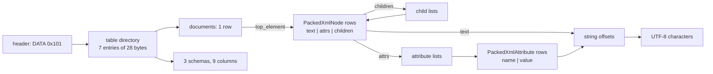
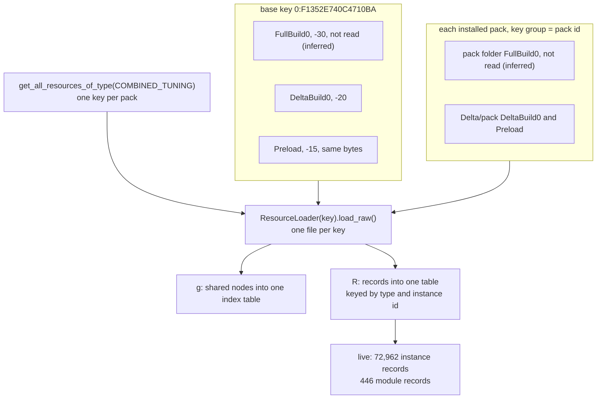

# 8.02 Tuning XML and binary delta tuning

*Game version 1.128.90.1030 (Steam, Linux/Proton). Numbers come from the base game and the installed packs EP04 (Cats & Dogs), EP06 (Get Famous), EP09 (Eco Lifestyle), EP12 (High School Years), GP04 (Vampires), GP12 (Werewolves) and SP01 (Luxury Party); SP42 (Grunge Revival) ships no tuning. The patch data of 75 packs that are not installed is described, labelled, and never counted as live. Written 2026-10-12. Checked 2026-10-12: 90 claims checked, 19 corrected, 3 relabelled, 1 removed. Checked again 2026-10-13: 141 claims checked, 19 corrected, 0 relabelled, 2 removed. Cross-chapter edits 2026-10-13: 2 applied.*

## In plain words

All of a pack's tuning travels as a single file. Inside it is one big tree, written with a handful of one-letter labels: one for a record, one for a single value, one for a list, one for a group of named fields, one for a choice between options and one for the name of an enum value. How the game turns that tree into the rules it plays by is the subject of [0.03 The tuning system](0.03-tuning-system.md). This chapter is about the file itself: what the labels mean, how repeated pieces are stored, and how the same tree is packed into a compact binary form.

There are two encodings. The base game's oldest copy, an early snapshot that is probably the launch build, is plain XML text. Every current copy, of the base game and of every pack, is binary. The binary is still the same tree. Nothing in it is turned into real numbers: a value of 13477 is stored as the text "13477", a true or false as the word. What the binary adds is packing. Every word is stored once, every repeated branch is stored once, and the tree becomes rows in numbered tables that the engine can walk without parsing anything.

Three things tend to surprise people. Sharing goes very deep: anything that appears twice is written once and pointed at, down to single values, and the most-used piece of tuning in the base game is one "False", pointed at 22,436 times. A game update ships a new, complete tuning file for each pack while the old copy stays on disk, never read; a tool that stacks the old copy under the new one invents about 3,600 records the game no longer has. And every install carries the tuning of every pack in its patch folder, owned or not: here, 75 packs this player does not have, about 89 MB of rules that never run.

## Key facts

- One resource of type `COMBINED_TUNING` (`0x62E94D38`) per pack holds every record of that pack: a `<combined>` tree with one shared group `g` first, then one `R` group per record type, named by the type's file extension and sorted by name.
- The vocabulary is eight element tags (`I` record, `M` module record, `C` class inside a module, `T` value, `E` enum value, `L` list, `U` tuple, `V` variant) plus `r`, a reference to a shared node, inside the containers `combined`, `g` and `R`. The attributes are `n`, `s`, `c`, `m`, `i`, `t`, `x`, plus three the loader never reads (`p`, `o`) or reads only for enum items (`ev`).
- Every value is text in both encodings: decimal numbers, `0x` hex hashes, resource keys as `type:group:instance` hex, enum names, `True` and `False`.
- Any subtree that occurs at least twice in a file is stored once in `g` (checked exactly, without hashing, in both base files, the seven installed pack deltas and SP01's full build: no subtree is left inline twice, and none left inline equals a shared node). The base delta has 102,039 shared nodes and 835,550 `r` references to them; no shared node is used fewer than two times.
- Shared indices are numbered per pack: the base game uses 0 to 659,902, a pack uses its pack id times 1,000,000 plus a local number (EP04, id 25, from 25,000,000). The loader keeps one index table for all files, so the ranges must not overlap.
- The base full build is the only text file: 14,527,097 bytes of one-line ASCII XML. The base delta (32,472,930 bytes) and all 14 installed pack builds are binary.
- The binary is a SimData "DATA" container, version `0x101`, with 7 tables and 3 schemas: `PackedXmlDocument`, `PackedXmlNode` (12-byte rows: text, attributes, children) and `PackedXmlAttribute` (8-byte rows: name, value). Offsets are relative to their own position, and `0x80000000` means none.
- The packing is maximal: no two node rows and no two attribute pairs are equal. The base delta stores 969,224 node rows for a tree of 1,665,752 nodes, and 333,215 distinct strings in 5,082,905 bytes.
- A text node and an element with neither attributes nor children look the same in a row; only the row's position (text rows come before `first_element`) tells them apart. The patch data and installed SP01's delta hold 41 such empty elements. The book's binary tuning decoder wrote each one as bare text until it was fixed on 2026-10-13; the re-decoded files now match the package bytes exactly, and no count in the book moved.
- The full build and the delta share one resource key and the loader reads each key once, so only one copy reaches the Python. That it is the delta (or its byte-identical preload) is inferred: the resolver is native. Of the 17,302 base records present in both, only 3,509 are unchanged once references are expanded; 3,049 exist only in the old full build and 29,861 only in the delta.
- Live in this install: 72,962 instance records (72,956 distinct type and id pairs) in the base delta and the seven pack deltas, plus 446 module records, all in the base game.
- Three wrong ways to merge, and their cost here: stacking the full builds under the deltas adds 3,570 dead records and gives 154 others an outdated version; applying a pack's delta before its full build would give 10,354 records the older copy; keying records by name loses 223, because 135 names in the base delta alone are used by more than one record type.
- SimData resources (`0x545AC67A`, which `sims4.resources.Types` calls `PLAYLIST`; "SimData" is the community name) are a separate, per-record binary copy of the fields exported to the client: 21,920 in the base delta, keyed by group = a 24-bit fold of the FNV-1 32 hash of the record type's extension and instance = the record id.
- The `Delta` folder holds combined tuning for 82 packs; 75 of them are not installed (88,895,638 bytes). Decoded, all 75 hold 103,427 records: patch data, pack not installed.
- Loose tuning files (mods) are always text XML. Only the combined file path checks for the binary form.

## How it works

### What "combined" means

**Observed** (`sims4/tuning/merged_tuning_manager.py`: `COMBINED_TUNING_NAME = "combined_tuning.xml"`, `MergedTuningManager._load_combined_file_by_key`; package scan with the package reader): EA's tools do not ship one file per record. Every record of a pack, of every type, is merged into one resource whose group is the pack id. None of the 646 packages in `Data/Simulation`, the installed pack folders and `Delta/` contains a single loose tuning resource (0 resources of any of the 117 tuning type ids that `sims4.resources` defines, module tuning included).

**Observed** (both base files and all 89 decoded pack and patch files): the root is `<combined>`. Its first child is `<g s="merged">`, the shared group; then come the `R` groups.

- Each `R` has `n` set to the record type's file extension, the same string `sims4.resources.TYPE_RES_DICT` maps the type id to (`scommodity` for static commodities, `relbit` for relationship bits, `tun` for module tuning). The loader files records under that string (`_load_res_node`, `get_tuning_res`).
- The `R` groups are sorted by name in byte order, so capitalised client types such as `Automation` and `Renderer_*` come first. The base delta has 122 groups (89 that Python reads, 33 client types); the full build has 84.
- Inside a group, records have no fixed order: of the 99 base delta groups with more than one record, only 3 are in id order and 2 in name order, each with 2 or 3 records.
- Every `I` carries `c` (class), `i` (type extension, always equal to its `R` group's `n`), `m` (module), `n` (name) and `s` (instance id, decimal). Every `M` carries `n` (dotted module name) and `s`.

The meaning of records, ids, pack groups and module tuning is in [0.03 The tuning system](0.03-tuning-system.md); this chapter keeps to the file.

### The element vocabulary

**Observed** (`merged_tuning_manager.py: NAME_ABBR`, `sims4/tuning/tunable_base.py: LoadingTags`, `LoadingAttributes`): the code itself lists the abbreviations. Counts are elements stored in the base delta, with shared nodes counted once.

| Tag | Long name in `NAME_ABBR` | Holds | Base delta | Base full |
|---|---|---|---|---|
| `r` | ref | a pointer to a shared node, `x` = its index | 835,550 | 260,536 |
| `U` | TunableTuple | named fields as children | 200,721 | 66,913 |
| `T` | Tunable | one value as text | 164,126 | 50,071 |
| `V` | TunableVariant | the chosen option in `t`, its value as a child | 125,882 | 40,931 |
| `L` | TunableList | unnamed children | 115,302 | 35,347 |
| `I` | Instance | one record | 47,163 | 20,351 |
| `E` | TunableEnum | an enum member's name as text | 5,894 | 1,929 |
| `C` | Class | a class inside a module record | 528 | 197 |
| `M` | Module | one module record | 446 | 167 |
| `R` | Res_Type | all records of one type | 122 | 84 |
| `g` | merged | the shared group | 1 | 1 |

| Attribute | Long name | On | Read by the loader |
|---|---|---|---|
| `n` | name | field name on children of `U`, `V`, `I`, `C`, `M` (on `r` too when the child is a reference); record or module name; the type extension on `R` | yes |
| `s` | res_inst | instance id of `I` and `M`; `merged` on `g` | yes for `I` and `M`, combined files only |
| `c`, `m`, `i` | class, module, instance_type | `I` | `c` and `m` find the class |
| `t` | type | `V`: the option name (`enabled` 31,590 times, `single` 8,317, `buff` 5,894) | yes |
| `x` | ix | shared nodes and `r` | yes |
| `ev` | enum value (`LoadingAttributes.EnumValue`) | `T` items of dynamic enums in module tuning (7,814: 7,805 inside module records, 9 in shared nodes) | yes, by `TunableEnumItem` |
| `p` | TOOL_path | resource-key values: the source file the key was built from (10,826: all 10,825 resource keys and one empty shared `T` with `p=""`) | no |
| `o` | is_none | one shared `T` with no text | no |

- **Observed** (`ETreeTuningLoader._load_tunable`): a node's tag should match its tunable's loading tag (`T` for `Tunable`, `L` for lists and so on). On a mismatch the loader calls `logger.error` with "Incorrectly matched tuning types", which writes nothing in the retail build, and then loads the node anyway. An `r` is exempt from the check, since its target carries the real tag.
- **Observed** (base delta): `p` values are developer paths such as `InGame\UI\Icons\Buffs\buffs_chess.png`; by extension, 8,196 `png`, 976 `propx`, 876 `interactionasm`, 439 `tga`. Every one of the 10,825 resource-key texts carries one. **Observed** (`LoadingAttributes.Path = "p"`, no reader in the decompiled source or the rescued `tunable.py`): nothing reads it.
- **Observed** (rescued `tunable.py: Tunable.load_etree_node`, `TunableReference.load_etree_node`, and the 3.7 bytecode of the first): the `o="true"` marker is never read. What matters is that its element has no text: a plain tunable then takes its default (for an `int`, `float` or bool with no default it also calls `logger.error`, silent in the retail build), and a reference becomes `None`. The decompiled source indents that `return self.default` one level too deep; the bytecode returns the default in every case.
- **Observed** (text full build, `<T x="1332" o="true" />`, 189 references; decoded delta, `x="11317"`, 540 references, led by `category` 145, `target_name` 128, `mood_type` 67 and `carry_target_name` 50): the one `o` node in each file is the shared "explicit none". The base delta has two more text-less shared `T` nodes without the marker (`x="2032"`, 273 references, and `x="313917"`, 3).

### Values are text

**Observed** (a count over the base delta, each stored `T` and `E` counted once):

| Shape | `T` | Example |
|---|---|---|
| decimal integer (ids, counts, enum numbers) | 65,739 | `283722` |
| other text (state names, enum-like names, strings) | 47,067 | `Clean` |
| `0x` hex (string hashes, localized string ids) | 38,781 | `0xC75384B0` |
| resource key `type:group:instance` | 10,825 | `2f7d0004:00000000:f4bb2d2933173106` |
| float | 1,707 | `0.75` |
| `True`, `False`, `true`, `false` | 4 | `False` |

- **Observed**: 5,888 of the 5,893 `E` texts are names (`TargetSim`), 5 are digits. Each boolean text is stored exactly once, and all four are shared nodes: no record holds a boolean inline, and 42,391 `r` references point at the shared `True` and `False`.
- **Observed** (base delta strings): text is UTF-8. 18,343 runs of non-ASCII bytes occur, for example the Chinese name fragments used by the name generators. The text full build is pure ASCII.
- **Inferred** (from the loader, which hands the text to each tunable's converter): the file format has no types at all. A field's type comes only from the Python tunable that reads it, which is why the same text `5` can be an int in one record and a reference id in another.

### Shared nodes and `r` references

**Observed** (a count over the decoded base delta build):

- `g` holds the subtrees that occur more than once. Every shared node is referenced at least twice and none is unused; in the other direction, none of the 409,931 subtrees left inside the base delta's records (field name aside, 106,452 of them leaves) occurs twice, and none equals a shared node. The base full build (136,854 inline subtrees), the seven installed pack deltas and SP01's full build have no repeats either. Shared nodes never carry `n`; the `r` that points at one carries the field name instead (`<r n="visible" x="63"/>`).
- A trap for anyone checking this with Python's built-in `hash`: it hashes the bytes a string is stored in, so `Ng` (two 1-byte characters, `4E 67`) and `李` (one 16-bit character, `0x674E`, stored as `4E 67`) hash alike, and so do `Él` and `泉` (`0x6CC9`). Observed with CPython 3.14. A hash-based check reports the name fragments `Ng` and `Él` in `sims.sim_spawner` as repeats of the shared nodes `x="589365"` (`李`) and `x="613915"` (`泉`); compared exactly, they differ.
- What gets shared, by references in the base delta: `T` values 337,992, variants 158,014 plus 33,435 option-only variants, tuples 135,891, lists 107,645 plus 4,236 empty lists, enum values 58,254, 79 empty tuples and 4 classes.
- Sharing nests: shared nodes contain 152,453 `r` references of their own, and every one points at a lower index. Indices in `g` are ascending, so one pass in file order resolves everything.
- The most-referenced node in the base delta is `<T x="63">False</T>`: 22,436 references, led by `visible` (4,215), `allow_autonomous` (2,365) and `allow_user_directed` (2,225). In the full build it is `x="57"`, also `False`, with 10,696.
- Indices are sparse: the base delta's 102,039 shared nodes use numbers from 0 to 659,902. **Inferred**: EA's build tool numbers candidates across a larger pool and keeps the ones used at least twice.

**Observed** (index ranges in all 89 decoded pack and patch files against their package groups): a pack's indices start at its pack id times 1,000,000. EP04 (id 25) uses 25,000,000 to 25,087,292 in its full build and 25,000,003 to 25,101,591 in its delta; EP21 (Royalty & Legacy, id 141) uses 141,000,000 upward. All 75 decoded patch files follow the rule, including the three read from a preload package (SP57 (Cozy Kitsch), group `0x62`: 98,000,015 to 98,000,173).

**Observed** (`MergedTuningManager._load_merged_file`): the loader stores every shared node of every combined file in one dictionary, `indexed_tunables`, keyed by the `x` string. **Inferred**: the per-pack ranges are what keeps a pack's index 5 from overwriting the base game's index 5. The base game's 659,902 fits under 1,000,000, the first pack range.

**Observed** (`ETreeTuningLoader._load_node`, `_load_tunable`, `MergedTuningManager.get_tunable`): an `r` is resolved by looking up `x`, and the value built from it is cached per (index, cache key), so every record that points at the same node gets the same Python object. The cache and its consequences are in [0.03](0.03-tuning-system.md).

### Full build and delta build

**Observed** (package index; priorities from `Data/Simulation/Resource.cfg`; both base files decoded and compared by type and id with references expanded): the three base packages in `Data/Simulation` each carry the combined file under the same key, group 0, instance `F1352E740C4710BA`.

| Copy | Package priority | Form | Raw bytes | Stored (zlib) | Records |
|---|---|---|---|---|---|
| `SimulationFullBuild0` | -30 | text XML | 14,527,097 | 2,908,466 | 20,351 instances, 167 modules |
| `SimulationDeltaBuild0` | -20 | binary | 32,472,930 | 11,907,984 | 47,163 instances, 446 modules |
| `SimulationPreload` | -15 | binary, byte-identical to the delta | 32,472,930 | 11,907,984 | same |

- Of the 17,302 instance records in both, 3,509 have identical content after references are expanded and 13,793 changed; 66 kept their id under a new name. 3,049 exist only in the full build and 29,861 only in the delta. Module records: 137 in both (44 unchanged), 30 only in the full build. Of the 3,079 full-build records missing from the delta (3,049 instances and 30 modules), 53 instances come back in the delta under the same type and name with a new id, so 3,026 are gone (the same split as [0.03](0.03-tuning-system.md)). A comparison that does not expand references gets the unchanged count wrong: the same value can sit inline in one build and behind a shared reference in the other, and the two builds number their shared nodes differently.
- **Observed** (same script, every all-digit leaf of the eight live delta files): only 97 of the 3,049 full-only ids (3%) appear anywhere as a number in the live files, against 24,701 of the 29,861 delta-only ids (83%). The delta does not lean on records it lacks. **Inferred**: it is a complete replacement of the full build's combined tuning, and a patch replaces that whole resource.
- **Observed** (first bytes of all 171 combined entries): the base full build is the only text copy. It is one line with no line breaks and no XML declaration, writes empty elements as ` />` and sorts attributes alphabetically. **Inferred**: that is the output style of the Python 3.7 `ElementTree` writer, the game's own Python version. The binary files keep the same alphabetical attribute order.
- **Observed** (pack folders against `Delta/<pack>`): every installed pack has the same three-way layout. Its full build sits in the pack's own folder, its delta and preload in `Delta/<pack>`, all three under one key, and all are binary. The priorities are in [0.03](0.03-tuning-system.md).

| Pack | Group | Full: records | Full raw bytes | Delta: records | Delta raw bytes | In both | Unchanged | Full only |
|---|---|---|---|---|---|---|---|---|
| EP04 | 0x19 | 7,003 | 4,310,866 | 7,248 | 4,941,298 | 6,715 | 2,916 | 288 |
| EP06 | 0x1B | 5,645 | 3,759,474 | 5,849 | 4,231,794 | 5,528 | 3,103 | 117 |
| EP09 | 0x1E | 3,949 | 2,908,706 | 3,983 | 3,241,410 | 3,837 | 2,283 | 112 |
| EP12 | 0x35 | 4,834 | 3,276,290 | 4,916 | 3,521,122 | 4,824 | 3,553 | 10 |
| GP04 | 0x11 | 1,442 | 1,264,642 | 1,499 | 1,694,994 | 1,360 | 670 | 82 |
| GP12 | 0x3F | 2,169 | 1,987,554 | 2,215 | 2,146,306 | 2,167 | 1,615 | 2 |
| SP01 | 0x01 | 202 | 201,586 | 89 | 178,002 | 85 | 22 | 117 |

**Inferred** (116 of SP01's 117 full-only ids now sit in the base delta, as 0.03 also counts): SP01's delta is smaller than its full build because the base game took over those records, which is also why 100 of SP01's 117 full-only ids are still named in live tuning.

**Observed** (instance ids of the combined resources): the keys of EP01 (Get To Work) to EP09 differ only in the last byte, and that byte is always `0xCB` XOR the ASCII code of the pack's last digit (EP01 `...0CFA`, EP04 `...0CFF`, EP05 (Seasons) `...0CFE`, EP09 `...0CF2`). **Inferred**: the instance is an FNV-1 64 hash of a name that ends in the pack number, since FNV-1 gives exactly this pattern when only the last character changes (its last step is the XOR). The name itself was not recovered.

### The binary container: a SimData table set

The binary combined file uses the same container as SimData resources, which the native code calls a "table set" (native strings of `Simulation_x64.dll`). The values below are from the base delta; the layout (version, directory, table shapes, schema hashes, the word at 0x18) is the same in all 170 binary combined entries on disk, installed or patch data.

| Offset | Size | Field | Base delta value |
|---|---|---|---|
| 0x00 | 4 | magic | `DATA` |
| 0x04 | 4 | version | `0x101` |
| 0x08 | 4 | table directory, relative to this field | 0x18, so 0x20 |
| 0x0C | 4 | table count | 7 |
| 0x10 | 4 | schema list, relative | 0x1EF7DC0, so 0x1EF7DD0 |
| 0x14 | 4 | schema count | 3 |
| 0x18 | 4 | unknown | `0xFFFFFFFF` in every combined file, 0 in every SimData resource |
| 0x1C | 4 | unknown | 0 |

**Table directory entry** (28 bytes each), **Observed**: name offset, name hash, schema offset (or none), data type, row size, row offset, row count. Offsets are relative to the field that holds them; `0x80000000` means "none". Names and hashes: the name hash is FNV-1 32 of the lowercased name (`documents` gives `0xCEBE54D9`, and an empty name gives the FNV offset basis `0x811C9DC5`).

| # | Name | Schema | Type code | Row size | Rows in base delta | Holds |
|---|---|---|---|---|---|---|
| 0 | `documents` | `PackedXmlDocument` | 13 | 20 | 1 | where the tree starts |
| 1 | (empty) | `PackedXmlNode` | 13 | 12 | 969,224 | every element and text node |
| 2 | (empty) | `PackedXmlAttribute` | 13 | 8 | 226,598 | every (name, value) pair |
| 3 | (empty) | none | 13 | 4 | 2,300,802 | child lists |
| 4 | (empty) | none | 13 | 4 | 852,446 | attribute lists |
| 5 | (empty) | none | 11 | 4 | 333,215 | string offsets |
| 6 | none | none | 1 | 1 | 5,082,905 | UTF-8 characters, each string ending in a zero byte |

**Schema** (24 bytes): name offset, name hash, a second 32-bit hash, row size, column list offset, column count. **Column** (20 bytes): name offset, name hash, a 16-bit type code, 16-bit flags (always 0 here), byte offset in the row, schema offset (none here). Columns are stored sorted by name hash. Then come the name strings, ending the file at exactly 32,472,930 bytes.

**Observed** (base delta): each table starts on a 16-byte boundary. The row data fills 0xF0 to 0x1EF7DC8, the schemas follow at 0x1EF7DD0, and the column entries and names close the file.

**Inferred** (native error strings): the second schema hash is a layout check. The engine's messages distinguish "not binary", "validation failed, possibly out-of-date binary format" and "no packed XML table found", so it validates the schemas before it trusts the rows. It fits the SimData schemas, where 2 schema names keep one name hash but come in several layouts, each with its own second hash and row size: `TunableTuple` three times (rows of 12, 8 and 8 bytes), `OptionalDisplayMixinTunable` twice (16 and 40 bytes).

### PackedXml: the tree in three schemas

**Observed** (schema columns of every binary combined file):

| Schema | Column | Type code | Offset | Meaning |
|---|---|---|---|---|
| `PackedXmlDocument` | `first_element` | 13 (pointer) | 0 | first node row that is an element |
| | `top_element` | 13 (pointer) | 4 | the root, `<combined>` |
| | `element_count` | 7 (uint32) | 8 | element rows: 804,002 |
| | `string_table` | 14 (vector) | 12 | offset and count of the string offsets: 333,215 |
| `PackedXmlNode` | `text` | 7 (uint32) | 0 | string index: the tag of an element, or the text of a text node |
| | `attrs` | 13 (pointer) | 4 | attribute list, or none |
| | `children` | 13 (pointer) | 8 | child list, or none |
| `PackedXmlAttribute` | `name` | 7 (uint32) | 0 | string index |
| | `value` | 7 (uint32) | 4 | string index |

How the tree is encoded, all **Observed** in the base delta and EP04's delta:

- A list is a run of 4-byte relative pointers ended by `0x80000000`. Each pointer counts from its own position.
- An element's text is a child node with neither attributes nor children: `<T n="visible">True</T>` is a `T` node whose attribute list holds the pair (`n`, `visible`) and whose child list holds one text node, `True`.
- There is no empty list anywhere: a node without attributes or children stores "none" for both. A text node therefore looks exactly like an element that has no attributes and no children (`<E/>`); only its row position tells them apart, since every text row comes before `first_element` and every element row at or after it (true in all 170 binary combined files; no text row carries an attribute or child list).
- Such empty elements are rare. Neither base file has one, and of the 14 installed pack files only SP01's delta does (one). The patch data has 40 more, in the files of 33 packs that are not installed: 41 in 34 packs in all, 25 `<E/>`, 15 `<U/>` and one `<T/>`, every one an item of a list (`<L n="species"><E/></L>` in SP01, a leading `<U/>` in the `autonomy_modifiers` list of SP70 (SpongeBob Kid's Room)'s object record, `<T/>` in GP07 (StrangerVille)'s `Mood_Possessed`). Each is one row, used once or through a shared node; none is a record or a shared node itself.
- **Observed** (the decoder's code and its output, re-encoded from the package bytes): until 2026-10-13 the book's binary tuning decoder wrote every node with neither attributes nor children as text, so its decoded files carried each of these 41 elements as a bare letter inside its list (`<L n="species">E</L>`), one entry short with a stray text. It now treats a row at or after `first_element` as an element. Re-decoding all 90 files changed exactly these 41 spots (1 in SP01's delta, 40 in 33 packs' patch data, 3 bytes each) and nothing else; all 90 now equal the format-rule re-encoding of the package bytes, and the rebuilt live merge still holds 72,956 records. The one live spot is the shared node `x="1001352"` of SP01's delta: the `species` list of a `sim_info` test used by 29 SP01 records (27 interactions such as `fruitPunchFountain_GrabServing_Caramel` and the situation goals `whimGoal_BuyBanquetTable` and `whimGoal_BuyBanquetFountain`), which read as an empty list before the fix. No count in the book used it. **Observed** (`sims/sim_info_tests.py: _SpeciesTestSpecies`): the list is a `TunableEnumSet` of `Species` whose `enum_default` is HUMAN, and the test passes when the Sim's species is in the set, so an empty set would fail every Sim. **Inferred** (from `Tunable.load_etree_node` and the native docstring of `text`, "None if there is no text"): the game reads the entry with no text as that default, so these 29 records ask for a human Sim.
- Row order is fixed. The 165,222 text nodes come first, then the 804,002 element rows (`first_element` points at row 165,222). Every child row sits before its parent, and the root is the very last row.
- Strings are numbered in the order of first use in a depth-first walk: tag, then each attribute's name and value, then the children. String 0 is `combined`, then `g`, `s`, and so on. No string occurs twice, and none is hashed.



### How the binary saves space

**Observed** (a scan of the binary delta builds):

- The tree described by the base delta has 1,665,752 nodes once every pointer is followed (1,495,736 elements and 170,016 texts, the same totals the decoded XML has). The file stores 969,224 rows, because no two rows are equal: 101,438 rows sit under more than one parent. The most-shared rows are `r` elements: `<r n="display_name_text_tokens" x="79"/>` sits under 7,728 parents.
- Lists are shared as well: 658,641 nodes with children use 650,750 distinct child lists, and 682,081 nodes with attributes use 270,121 attribute lists. No list starts inside another one.
- No (name, value) pair is stored twice: 226,598 pairs fill the 1,062,921 attribute slots of the 682,081 rows that have attributes (2,213,278 uses once the tree is expanded).
- This sharing comes on top of the `g` group, which already shares subtrees at the XML level. **Inferred**: the `g` group is what the Python loader sees and caches; the row sharing only saves bytes and is invisible above the native reader.
- Sizes: the base delta is 32,472,930 bytes as binary and 42,138,683 bytes as decoded XML text (binary 77% of text); EP04's delta is 4,941,298 against 7,213,056 (69%). Compressed in the package, the binary base delta stores at 11,907,984 bytes (37%) while the text full build stores at 2,908,466 bytes (20%).

### Reading it: the native reader and the book's decoders

**Observed** (`MergedTuningManager._load_combined_file_by_key`): the loader asks the native `_tuning.is_binary_merged_tuning(raw)` first. If it says yes, `_tuning.BinaryTuning(raw)` wraps the bytes and the loader walks `binxml.root`; otherwise it parses text with `ElementTree`. Either way the code below only uses `tag`, `get`, `items`, iteration and `text` (`items` only in the tag-mismatch log of `ETreeTuningLoader._load_tunable`).

**Observed** (native strings and docstrings in `Simulation_x64.dll`): `BinaryTuning`, `BinaryTuningElement` and `BinaryTuningElementIterator` are described as a partial reimplementation of the `xml.etree.ElementTree` interface on top of packed XML. `text` returns the text right after the begin tag, or `None`; iteration yields child elements; `get` and `items` read attributes. Elements are weakly linked to their `BinaryTuning`, and using one after the base object is disposed raises an error. The manager keeps every wrapper in `binxml_list` until it is cleared; **Inferred**: that is what keeps the shared nodes and records it stored usable. The object prints as `<binary tuning: N elements, N strings>`. The executable and the engine library were not disassembled, so the reader's internals are known only from these strings and from the format.

The book's own decoders, all read in full:

- The binary tuning decoder decodes a binary combined file into the same XML text the full build uses (under ten seconds and 42 MB for the base delta). It assumes the `documents` row sits at 0xF0 instead of reading the table directory, which holds because every combined file has the same 7-entry directory. It reads `top_element`, `first_element` and the string table and ignores `element_count`. Since 2026-10-13 it uses `first_element` to tell an empty element from a text row; before that it wrote every node with neither attributes nor children as text, which turned the 41 empty elements described above into bare text. Its output now matches the package data byte for byte under the format's rule (all 90 files).
- The tuning indexer reads combined XML text (the base full build) and expands `r` references when it prints. It finds records by name, class and type; prints one record and notes, beside any number that is an instance id, the record it names; and maps an instance id to a name. The tuning indexer (decoded delta) is the same tool pointed at the decoded base delta.
- The package reader lists, greps and extracts package resources, handling zlib (`0x5A42`) and RefPack (`0xFFFF`) compression. The package format itself is [8.01 Package files and resource types](8.01-package-files.md).

### SimData resources: the client's copy of exported fields

Besides the combined file, the simulation packages carry thousands of small SimData resources (type `0x545AC67A`; `sims4.resources.Types` names this id `PLAYLIST`, and "SimData" is the modding community's name). They use the same `DATA` container, with ordinary schemas instead of PackedXml.

**Observed** (a scan of `SimulationDeltaBuild0`):

- The package indexes 23,095 SimData entries: 21,920 real resources and 1,175 empty ones (size 0, compression code `0xFFE0`). Every empty entry's key also exists in `SimulationFullBuild0`. **Inferred**: these are deletion markers, through which the delta removes SimData the full build had. The preload carries no such entries and exactly the 21,920 resources, under the same keys.
- The instance is the tuning record's id: 21,779 match an instance record of the base delta and 67 a module record; 74 match neither (all 74 sit in the module-tuning group).
- The group is a 24-bit fold, `(h >> 24) XOR (h & 0xFFFFFF)`, of `h` = FNV-1 32 of the lowercased type extension (the `R` group's name). For most types `h` is the type id itself: buff `0x6017E896` gives `0x0017E8F6`, trait `0xCB5FDDC7` gives `0x005FDD0C`, object `0xB61DE6B4` gives `0x001DE602`, action `0x0C772E27` gives `0x00772E2B`. Where the type id is not that hash, the hash still decides: `relbit` (id `0x0904DF10`) and module tuning (`tun`, group `0x006CA304`) use the hash of their extension, and so do client types that Python has no id for (`camera`, `casmodifiertuning`). The rule holds for all 21,920. The biggest groups are loot actions 5,776, buffs 4,691, objects 1,927, tutorial tips 994 and objectives 982.
- One resource holds one row. Its first table is named after the record (all 21,779 that match an instance record by type and id; the 67 module ones are named after module and class, such as `tag.TagCategory`) and its schema after the class (all 21,779 instance records): `Buff_Object_DonePondering_Hidden` (table hash `0xBCF61AA0`, FNV-1 32 of the lowercased name), schema `Buff` (hash `0x6017E896`, which is FNV-1 32 of `buff` and so equal to the buff type id), 96-byte row, 12 columns. The base delta defines 557 distinct schema names (560 layouts).
- The `Buff` columns are exactly the twelve buff tunables that carry an `export_modes` argument in `buffs/buff.py` (`buff_name`, `buff_description`, `icon`, `ui_sort_order`, `mood_type`, `mood_weight`, `audio_sting_on_add` and the rest). The row holds the code default for fields the XML leaves out: this record sets no `ui_sort_order`, and its row stores 1, the default in `buff.py`.
- The same icon is `2f7d0004:00000000:3ef446c8cc0cecfc` in the XML and type `0x00B2D882` with the same instance in SimData. The two audio stings change as well, from type `39b2aa4a` group 0 in the XML to type `fd04e3be` group `0x001407EC`. **Inferred**: the export converts the developers' source keys to the resource types the client loads.

**Observed** (`tunable_base.py: ExportModes`): the export modes are `client_binary`, `server_binary` and `server_xml`, and `All` is the three together. **Inferred** (from the match above and from 0.03's count of 402 `ClientBinary` and 437 `All` markings): SimData is the client's copy of the `client_binary` fields, built by EA's tools from the same tuning. The Python never reads it.

Column type codes seen across all 557 schemas (code, how many columns, usual size). The names are the ones the modding community uses; the game's strings do not list them. The sizes and example columns are **Observed**.

| Code | Name | Bytes | Columns | Examples |
|---|---|---|---|---|
| 0 | Boolean | 1 | 121 | `visible`, `available_in_restaurant` |
| 1 | Char8 | 1 | (string data tables only) | |
| 6 | Int32 | 4 | 165 | `ui_sort_order`, `mood_weight` |
| 7 | UInt32 | 4 | 65 | `recipe_difficulty`; PackedXml `text`, `name`, `value` |
| 8 | Int64 | 8 | 177 | `Tag`, `Age`, `OccultType` |
| 9 | UInt64 | 8 | 10 | `ModifierName` |
| 10 | Float | 4 | 438 | `Intensity`, `FOV` |
| 11 | String8 | 4 (offset) | 65 | `cas_vfx`, `plumbob_vfx` |
| 12 | HashedString8 | 8 | 2 | `BoneName` |
| 13 | Object | 4 (offset) | 153 | `_components`; PackedXml `attrs`, `children` |
| 14 | Vector | 8 (offset, count) | 434 | `ages`, `objectives`; PackedXml `string_table` |
| 15, 16, 17 | Float2, Float3, Float4 | 8, 12, 16 | 6, 39, 7 | `Color`, `CameraPosition` |
| 18 | TableSetReference | 8 (instance id) | 131 | `mood_type` |
| 19 | ResourceKey | 16 | 152 | `icon`, `image` |
| 20 | LocalizationKey | 4 | 280 | `buff_name`, `display_name` |
| 21 | Variant | 8 | 90 | `_display_data`, `ui_category` |

Codes 2 to 5 (8- and 16-bit integers) never occur in this package.

### How the game merges base, delta and pack tuning



1. **Observed** (`MergedTuningManager.load`): the loader asks the resource manager for every key of type `COMBINED_TUNING` and loads each one through `ResourceLoader(key).load_raw()`, which takes a key and no package. A pack's three copies share one key, so one copy per pack reaches the Python. Which one is native. **Inferred**: it is the delta (or its byte-identical preload): the full build lacks content the game plainly has, such as the 29,861 base records added since the full build.
2. **Observed** (`_load_merged_file`, `_load_res_node`): each file's shared nodes go into the one index table by `x`, and each record into `_tuning_resources[type extension][instance id]`. A later file with the same type and id would replace the earlier record. The pack group is remembered per id.
3. **Observed** (all seven pack deltas against the base delta and each other): in this install the files barely meet. No two packs share a key, and only GP12's six `auCASPart_BodyScar*` camera records reuse base ids. Those six are identical to the base copies once references are expanded, and `camera` is a client type with no Python manager, so the order of the files, which is native, changes nothing here.
4. **Observed** (`list_local`, same method): loose tuning in other packages is listed afterwards and replaces or deletes records by key (see [0.03](0.03-tuning-system.md)).

The live totals, read directly from the eight live files by type and id:

| Source | Instance records | Module records | Shared nodes |
|---|---|---|---|
| Base delta | 47,163 | 446 | 102,039 |
| EP04 delta | 7,248 | 0 | 16,874 |
| EP06 delta | 5,849 | 0 | 13,181 |
| EP09 delta | 3,983 | 0 | 10,758 |
| EP12 delta | 4,916 | 0 | 11,107 |
| GP04 delta | 1,499 | 0 | 6,527 |
| GP12 delta | 2,215 | 0 | 7,480 |
| SP01 delta | 89 | 0 | 792 |
| Live total | 72,962 (72,956 distinct type and id pairs) | 446 | |

### Wrong merges and what they cost

These are traps for anyone writing their own loader or counting tool. Each was measured on this install by comparing the 16 decoded builds by type and id, with references expanded.

- **Stacking the full builds under the deltas.** Treating the delta as a patch on the full build keeps 3,570 records that are dead in the game: 3,049 base records and 521 pack records (EP04 274, EP06 110, EP09 100, GP04 28, EP12 6, GP12 2, SP01 1). Worse, a pack's full build applied after the base delta overrides 207 records the base game took over, and 154 of them get an outdated version (SP01 77, GP04 44, EP04 12, EP09 12, EP06 7, EP12 2).
- **Applying a pack's delta before its full build.** With both builds merged, the older full copy then wins every record in both: 10,354 records would carry the full build's content (EP04 3,799, EP06 2,425, EP09 1,554, EP12 1,271, GP04 690, GP12 552, SP01 63).
- **Keying records by name.** A name is unique only within a record type. In the base delta, 135 names are used by more than one type, 282 records in all: 134 names by two types (`animation` and `interaction` share 77, `aspiration` and `objective` 34, `interaction` and `object_state` 8, `situation_goal` and `whim` 5) and `default` by 14 client types. Keying the base delta by name keeps one record per name and loses 147. Keyed by name, the live set drops from 72,956 keys to 72,733. A reader that keys by name inside each file, even if it merges by type and id afterwards, keeps 72,740.
- **Comparing builds without expanding references.** The same value can be inline in one build and shared in the other, and the two builds number their shared nodes differently. In the base game a comparison of the stored form that keeps each `r` with its `x` finds only 360 of the 3,509 unchanged records; one that drops `x` calls 4,407 records unchanged, about 900 too many, because it cannot see a change behind a reference.

### The Delta folder: patch data for packs that are not installed

**Observed** (a scan of every package in `Delta/`, and of the decoded patch tuning):

- `Delta/` has 117 pack folders. 82 carry a combined tuning file: 79 in both `SimulationDeltaBuild0` and `SimulationPreload` (same key in each pair, and the two copies byte-identical), and SP57 (Cozy Kitsch), SP70 (SpongeBob Kid's Room) and SP82 (Yard Charm) in the preload only.
- 75 of those 82 packs are not installed here: 17 expansion packs, 10 game packs, 47 stuff packs and FP01 (Holiday). Their combined files total 88,895,638 bytes raw. The biggest are EP03 (City Living) 5,508,578 and EP08 (Discover University) 4,952,626; the smallest is SP24 (Fashion Street) at 2,290 bytes.
- All 75 are in the decoded patch tuning: 72 decoded from the delta build, and SP57, SP70 and SP82 from their preload package, whose combined file has the same header, table layout and document row (0xF0) as the others, so the same package reader and binary tuning decoder read it unchanged. Together they hold 103,427 instance records and no module records: the largest are EP03 8,073, EP08 6,977, EP17 (Life & Death) 5,640, EP01 (Get To Work) 5,163, EP20 (Adventure Awaits) 4,908, EP11 (Cottage Living) 4,890, EP18 (Businesses & Hobbies) 4,840, EP13 (Growing Together) 4,749 and EP05 (Seasons) 4,721; SP24's file holds 2 records and 4 shared nodes. The three preload-only files are among the smallest: SP57 holds 2 object records (`object_sitLiving_SP57retro`, `object_light_Candle_SP57`), SP70 one (`object_dollhouseGENModern_01_SP70`) and SP82 one (`object_hottub_SP82YARD`). Compared leaf by leaf with references expanded, each is a copy of an existing object: the candle is the base game's `light_Candle_Table` with one effect name changed, the chair matches EP01's `object_sitLiving_EP01POLICEoffice_01` exactly, the dollhouse is the base game's `object_dollhouseGENModern_01` with three prop definitions changed (plus the empty list entry above), and the hot tub matches SP02 (Perfect Patio)'s `object_hottub` exactly.
- They use the same binary format and the same per-pack index ranges as the installed packs, so they read with the same tools.

This is patch data, pack not installed. It describes what those packs would load, and nothing in it runs here. **Observed** (`MergedTuningManager.__init__`, `load`): the Python filters combined files by pack group only under a `--skip_packs` command-line argument; in a normal start it loads every combined key the resource manager lists. **Inferred** (as in [0.03](0.03-tuning-system.md)): so the engine must mount a `Delta/<pack>` folder only when the pack is installed.

### Loose tuning files

**Observed** (`serialization.py: create_class_instance`, `ETreeClassCreator._load_node`, `load_from_xml`, `load_module_tuning`):

- A loose instance file is parsed with `ElementTree` from text. Its root is an `I` whose `m`, `c` and `n` the class creator reads; the instance id comes from the resource key, so `s` and `i` are not read from a loose file. A loose module file is an `M` whose key is the hash of its name.
- Only `_load_combined_file_by_key` asks `is_binary_merged_tuning`, so a loose file in the binary form would fail to parse.
- The children use the same tags and attributes as records inside a combined file. A loose file has no `g` of its own. **Inferred**: an `r` inside a loose file would resolve against whatever the combined files put in the shared index table under that number, which changes with every patch.

## Numbers

| Name | Value | Unit | Where | Source |
|---|---|---|---|---|
| `COMBINED_TUNING` type | 0x62E94D38 | type id | `sims4/resources.py`, packages | code |
| SimData type | 0x545AC67A (`Types.PLAYLIST` in code) | type id | packages, `sims4/resources.py` | package scan, code |
| Base combined key | group 0, `F1352E740C4710BA` | key | 3 base packages | package scan |
| Base package priorities | full -30, delta -20, preload -15 | priority | `Data/Simulation/Resource.cfg` | config |
| `COMBINED_TUNING_NAME` | `combined_tuning.xml` | name | `merged_tuning_manager.py` | code |
| Base full build | 14,527,097 raw, 2,908,466 stored | bytes | `SimulationFullBuild0` | full |
| Base delta build | 32,472,930 raw, 11,907,984 stored | bytes | `SimulationDeltaBuild0`, `SimulationPreload` | delta |
| Base delta as decoded XML | 42,138,683 | bytes | binary tuning decoder output | delta |
| Compression | zlib `0x5A42` | code | every combined entry | package scan |
| Base instance records | 20,351 full, 47,163 delta | records | `I` elements | full / delta |
| Base module records | 167 full, 446 delta | records | `M` elements | full / delta |
| Base records full and delta | 17,302 in both, 3,509 unchanged (references expanded), 3,049 full only, 29,861 delta only, 66 renamed | records | comparison by type and id | full / delta |
| Record types (`R` groups) | 84 full, 122 delta | groups | base files | full / delta |
| Shared nodes | 29,541 full, 102,039 delta | nodes | `g` | full / delta |
| `r` references | 260,536 full, 835,550 delta | elements | base files | full / delta |
| Shared index range, base | 0 to 659,902 | index | base delta | delta |
| Shared index base per pack | pack id × 1,000,000 | index | every pack file | full / delta / patch data |
| Most-referenced node | `False`, 22,436 references | references | base delta `x="63"` | delta |
| `p` attributes | 3,874 full, 10,826 delta | attributes | `T` resource keys | full / delta |
| `ev` attributes | 1,829 full, 7,814 delta | attributes | module tuning enum items | full / delta |
| Header magic, version | `DATA`, 0x101 | | binary combined and SimData | delta |
| Header word at 0x18 | 0xFFFFFFFF combined, 0 SimData | | all 170 binary combined entries, all 21,920 base delta SimData | delta |
| Table directory entry | 28 | bytes | binary | delta |
| Schema / column entry | 24 / 20 | bytes | binary | delta |
| Tables / schemas per combined file | 7 / 3 | count | all 170 binary combined entries | full / delta / patch data |
| None marker | 0x80000000 | offset | every pointer | delta |
| Node row / attribute row / document row | 12 / 8 / 20 | bytes | schemas | delta |
| Node rows | 969,224 (165,222 text, 804,002 element) | rows | base delta | delta |
| Tree nodes after expansion | 1,665,752 (1,495,736 elements, 170,016 texts) | nodes | base delta | delta |
| Attribute rows | 226,598, filling 1,062,921 attribute slots (2,213,278 uses in the expanded tree) | rows | base delta | delta |
| Empty elements (no attributes, no children) | 41 in 34 packs' files (1 in SP01's live delta, 40 in patch data); 0 in both base files | rows | every binary combined file | delta / patch data |
| Child list / attribute list table rows | 2,300,802 / 852,446 | rows | base delta | delta |
| Distinct child / attribute lists | 650,750 / 270,121 | lists | base delta | delta |
| Strings | 333,215 in 5,082,905 bytes | strings | base delta | delta |
| Binary size against text | 77% base delta, 69% EP04 delta | ratio | decoded XML | delta |
| Live instance records | 72,962 (72,956 distinct keys) | records | base and 7 pack deltas | delta |
| Records lost when keyed by name | 223 (live set 72,733) | records | same | delta |
| Names used by more than one type | 135 names, 282 records (147 lost when keyed by name) | names | base delta | delta |
| Dead records from stacking full builds | 3,570 (base 3,049, packs 521) | records | full against delta | full |
| Records given an outdated version | 154 of 207 overridden | records | pack full over base delta | full |
| Records wrong if delta goes before full | 10,354 | records | 7 pack pairs | full / delta |
| Full-only ids named in live files | 97 of 3,049 (3%), against 24,701 of 29,861 delta-only (83%) | ids | base | full / delta |
| SimData entries, base delta | 23,095 (21,920 resources, 1,175 deletion markers) | resources | `SimulationDeltaBuild0` | delta |
| SimData deletion marker | size 0, compression 0xFFE0 | | same | delta |
| SimData schemas | 557 names (560 layouts) | schemas | same | delta |
| SimData ids matching a record | 21,779 instance, 67 module, 74 none | resources | same | delta |
| SimData group | `(h >> 24) XOR (h & 0xFFFFFF)`, `h` = FNV-1 32 of the type extension | rule | same | delta |
| `Buff` SimData row | 96 bytes, 12 columns | | `Buff_Object_DonePondering_Hidden` (40570) | delta |
| `ui_sort_order` default | 1 | sort index | `buffs/buff.py` | code |
| Delta folders | 117, of which 82 carry combined tuning | folders | `Delta/` | install |
| Packs with patch data only | 75 (17 EP, 10 GP, 47 SP, FP01) | packs | `Delta/` | patch data, pack not installed |
| Their combined tuning | 88,895,638 | bytes | same | patch data, pack not installed |
| Decoded patch records | 103,427 in 75 packs (SP57, SP70, SP82 from the preload) | records | the decoded patch tuning | patch data, pack not installed |
| Largest patch file | EP03, 5,508,578 bytes, 8,073 records | | `Delta/EP03` | patch data, pack not installed |

Per-pack counts and sizes of the installed packs are in the tables under "Full build and delta build" and "How the game merges". All values are from this install's files; none are code defaults except where marked.

## Data shapes

**A combined file as XML** (shape only, values invented):

```xml
<combined>
  <g s="merged"><T x="4">True</T><L x="9"><r x="4"/><T>2</T></L></g>
  <R n="buff">
    <I c="Buff" i="buff" m="buffs.buff" n="Buff_Example" s="12345">
      <r n="visible" x="4"/>
      <V n="mood" t="enabled"><T n="enabled">14640</T></V>
      <T n="icon" p="InGame\UI\Icons\x.png">2f7d0004:00000000:0123456789abcdef</T>
    </I>
  </R>
  <R n="tun"><M n="tag" s="15608553923092786359"><C n="Tag">...</C></M></R>
</combined>
```

**`PackedXmlDocument`** (20 bytes): `first_element` pointer, `top_element` pointer, `element_count` uint32, `string_table` vector (pointer, count).

**`PackedXmlNode`** (12 bytes): `text` uint32 string index, `attrs` pointer to a list of attribute row pointers, `children` pointer to a list of node row pointers. A text node has both pointers set to none, and so does an element with no attributes and no children; the row's position against `first_element` tells them apart.

**`PackedXmlAttribute`** (8 bytes): `name` and `value`, both uint32 string indices.

**A reference list**: 4-byte signed offsets, each relative to its own position, ending with `0x80000000`.

**A SimData resource**: the same header and directory; table 0 named after the record, with a schema named after the class (hash = FNV-1 32 of the lowercased class name) and one row whose columns are the record's `client_binary` fields; extra tables hold strings (type 1), vectors and nested objects. Key: group = 24-bit fold of FNV-1 32 of the record type's extension (for most types the type id itself), instance = the record's instance id.

**A loose tuning file**: text XML whose root is one `I` (`c`, `i`, `m`, `n`, `s`; only `c`, `m` and `n` are read) or one `M` (`n`, `s`), with the record's fields as children.

## For modders

**Reading the shipped tuning.**

- Read the delta, never the full build. The full build is an early snapshot: 3,049 of its base instance ids are gone from the delta (53 of those records return under a new id, the rest were dropped) and 13,793 of the records it shares with the delta changed.
- Expand `r` references before deciding a field is missing. A record's own children often carry only `r` elements, and in the base delta every boolean is a reference to one of the four shared boolean nodes (`True`, `False`, `true`, `false`). The pack deltas keep a few inline (EP04 one `true`, EP06 one `true` and one `false`).
- Select records by type and id. Names repeat across types (an `animation` and an `interaction` share 77 names in the base delta), so a lookup by name alone can return the wrong record.
- When reading SimData, the same image appears under a different type (`0x00B2D882`) from the one in the XML (`0x2F7D0004`); match on the instance.

**Writing an override** (how the loader treats it is in [0.03](0.03-tuning-system.md)):

- Write text XML with the same tags. Numbers go in as decimal text, hashes as `0x` hex, resource keys as `type:group:instance` hex, enum values by name.
- Use no `r` elements and no `x` attributes. Shared indices belong to EA's combined files, change with every patch, and are looked up in one table shared by all packs.
- `p` and `o` are not needed: nothing reads them. An element with no text gives a plain tunable its code default, the same as leaving the field out, and always gives a reference `None`.
- The loader takes the record's id from the resource key and its class from `c` and `m`. Keep `i` and `s` consistent with the key anyway, since tools read them.
- Fields exported to the client also live in that record's SimData. **Inferred** (from the SimData match above): an override of the XML alone leaves the client's copy as shipped, so a change to a displayed name, icon or sort order may not show on screen.

**Commands.** This format registers no console commands. The `tuning.*` commands are listed in [0.03](0.03-tuning-system.md) and [1.04 Debug tools, cheats and telemetry](1.04-debug-cheats-telemetry.md); none of them is available to a player. **Observed** (`server_commands/tuning_commands.py`): `tuning.load_pack` and `tuning.unload_pack` are `Automation` commands, which run only in automation mode; the other ten (`tuning.inspect`, `tuning.reload` and the rest) give no command type, so they default to `DebugOnly` and are never registered in the shipped game.

**Traps.**

- A pack's full combined tuning and its delta combined tuning are not two halves of one dataset: the delta's combined tuning resource replaces the full build's copy whole. The packages around it are a patch layer, so this holds for the tuning resource, not for the full build package ([8.01](8.01-package-files.md)).
- Patch data in `Delta/` for packs the player does not own looks exactly like live data. It is not loaded, and a tool that scans every `Delta` folder counts at least 103,427 extra records.
- The binary files hold no types. A tool that guesses types from text (digits mean integer) will misread ids, enum numbers and string hashes alike.
- For anyone reading or writing the binary form: an element with neither attributes nor children has the same row shape as a text node and is told apart only by its row position (at or after `first_element`). EA's files contain 41 of them (SP01's delta and 33 packs' patch data), so a reader must check the row position, and a writer must keep text rows and element rows in their two ranges. The book's own decoder missed this until 2026-10-13 (see "PackedXml" above).

## Limits

- The native reader (`_tuning.BinaryTuning`), the resource manager that picks one copy per key and the code that mounts `Delta` folders live in `Simulation_x64.dll` and the encrypted executable, which were not disassembled. Which copy wins and which folders mount are inferred from behaviour, as in [0.03](0.03-tuning-system.md).
- The meaning of the header word at 0x18 (`0xFFFFFFFF` in combined files, 0 in SimData), of the second schema hash and of the column flags (always 0 here) was not established.
- The SimData type names are the modding community's. The game's strings do not list them, so only the sizes and the matching columns are observed.
- The name behind each combined key's instance id was not recovered; only the FNV-1 pattern of its last character is shown.
- EA's build tool that writes these files does not ship. How it chooses shared nodes and numbers them is inferred from its output.
- The patch data of SP57, SP70 and SP82 exists only in their preload package. It was decoded from there with the same reader and decoder as the other 72 packs and is patch data, pack not installed. No patch data was run, so its content is described only as data.
- SimData was surveyed in the base delta package only, and decoded row by row for one record. The packs' SimData and the client's use of it were not followed.

## File index

The coverage manifest assigns no Python modules to 8.02. The loader side is [0.03 The tuning system](0.03-tuning-system.md), which covers every module below; this chapter read them for the file format only.

| Module | What it holds for this chapter | Depth |
|---|---|---|
| `core/sims4/tuning/merged_tuning_manager.py` | `NAME_ABBR`, `COMBINED_TUNING_NAME`, binary or text detection, `g` and `R` loading, the shared index table, value cache | deep |
| `core/sims4/tuning/serialization.py` | `ETreeTuningLoader` (`r` handling, tag check), `ETreeClassCreator`, `create_class_instance`, `load_from_xml`, `load_module_tuning` | skim |
| `core/sims4/tuning/tunable_base.py` | `Tags`, `LoadingTags`, `LoadingAttributes` (`ev`, `p`), `ExportModes` | skim |
| `core/sims4/tuning/tunable.py` (rescued per function; `Tunable.load_etree_node` also read in the 3.7 bytecode, whose control flow the decompile misplaces) | `Tunable.load_etree_node` (empty text), `TunableEnumItem`, `TunableReference.load_etree_node` | skim |
| `core/sims4/resources.py` | `Types.COMBINED_TUNING`, `Types.PLAYLIST` (the SimData id), `_add_inst_tuning` and `TYPE_RES_DICT` (the 117 tuning type ids) | skim |
| `simulation/buffs/buff.py` | the buff tunables with `export_modes`, matched against the `Buff` SimData schema | skim |

Methods used (the authors' scripts are not published; [0.01](0.01-reading-guide.md#the-tools-by-what-they-do) describes the tools by what they do):

| Tool | Does | Used for |
|---|---|---|
| binary tuning decoder | binary combined file to XML text | reading the format, the decoded files |
| tuning indexer (full build), tuning indexer (decoded delta) | find and show records in combined XML (full, decoded delta) | record examples |
| package reader | package index, extraction | the census and SimData |
| live merge | the live tuning merge | live total (72,956 keys), cross-checked by the checker |
| authors' scripts | combined, SimData and tuning-type entries in 646 packages; decoded files checked against the package bytes; layout of all 170 binary combined entries | sizes, keys, Delta folders |
| authors' scripts | `DATA` header, directory, schemas, columns; row order, sharing, lists, strings | the binary sections |
| authors' scripts | tag and attribute census, value shapes, shared targets, whether every repeat is shared, attribute order | the XML sections |
| authors' script | shared index ranges and record counts of every pack and patch file | index rule, Delta folder section |
| authors' scripts | full against delta and the merge traps, keyed by type and id, references expanded | merge numbers |
| authors' scripts | SimData keys, groups, schemas, type codes, deletion markers, one decoded row | SimData section |

Native strings: the strings of `Simulation_x64.dll` (the `BinaryTuning` docstrings, PackedXml schema names, error messages).

**Tuning names used:** the base `COMBINED_TUNING` records (full, delta, preload) and those of EP04, EP06, EP09, EP12, GP04, GP12 and SP01; the decoded patch data of 75 packs, three of them from the preload package (patch data, pack not installed); the SP57, SP70 and SP82 object records named above; `Buff_Object_DonePondering_Hidden` and its SimData; module tuning `tag` and `sims.sim_spawner`; GP12's six `auCASPart_BodyScar*` camera records; the shared nodes `x="63"`, `x="11317"`, `x="2032"`, `x="313917"`, `x="589365"` and `x="613915"` of the base delta and `x="1001352"` of SP01's delta; the SP01 records `fruitPunchFountain_GrabServing_Caramel`, `whimGoal_BuyBanquetTable` and `whimGoal_BuyBanquetFountain`; the patch records `Mood_Possessed` (GP07), `object_sitLiving_EP01POLICEoffice_01` (EP01) and `object_hottub` (SP02); the base records `light_Candle_Table` and `object_dollhouseGENModern_01`.
