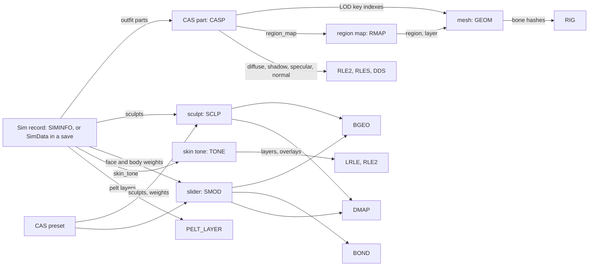

# 8.03 Sim and CAS files

*Game version 1.128.90.1030 (Steam, Linux/Proton). Package counts from the client builds of the base game and the eight installed packs, EP04 (Cats & Dogs), EP06 (Get Famous), EP09 (Eco Lifestyle), EP12 (High School Years), GP04 (Vampires), GP12 (Werewolves), SP01 (Luxury Party) and SP42 (Grunge Revival), with the build named for every count; protobuf schemas from the descriptors in `Simulation_x64.dll`. No tuning values are cited. Written 2026-10-12. Checked 2026-10-12: 81 claims checked against the package bytes, the schemas and the Python with the checker's own readers, 23 corrected, 5 relabelled, none removed. Checked again 2026-10-13: 140 claims checked, 19 corrected, 1 relabelled, 0 removed (every count re-derived on the live set: delta copy wins, deletion markers removed, full-only keys kept). Cross-chapter edits 2026-10-13: 2 applied.*

## In plain words

A Sim's body is a set of references. The Sim itself holds very little: a skin tone, a list of sculpts and slider weights, a few body-shape numbers, a voice, and for each outfit a short list of clothing and hair parts. Everything that has a shape or a picture lives in separate files in the game's packages: a part file for each piece of clothing or hair, meshes at four levels of detail, textures, slider files that say which vertices or bones move, and skin-tone files that say which skin pictures to blend. Change a slider and the game changes one number on the Sim; the files stay the same.

The game ships each of these files up to twice. The older "full" copy sits next to a newer "delta" copy under the same name, and the delta copy wins. For clothing parts, meshes and premade Sims every full copy is replaced by a delta entry under the same name, so the 18,857 older part files in the full builds are never read. Some pack files go the other way: the slider files of Cats & Dogs and Werewolves exist only in the full builds and are read from there. A few delta entries are empty on purpose: an empty entry removes the file. Some pack items removed this way still exist under the same name in the base game, which looks like a move into the base game.

Three things would surprise most players. All 38,185 live clothing and hair parts use one file layout, and every one of them can be read byte for byte. Each part records which pack it belongs to as a number (Cats & Dogs is 25, Werewolves 63). And a premade Sim in the game files stores each piece of an outfit in 22 bytes; the same data in a save file uses a different, general-purpose message format that keeps parallel lists. The household, lot and room files that the gallery and the library share use that message format too; this chapter describes them from the message definitions and the code, without opening any player files.

## Key facts

- **Live counts (client builds, deletion markers removed):** 38,185 CAS parts (CASP), 33,226 meshes (GEOM), 2,315 premade Sim records (SIMINFO), 145 skin tones (TONE), 1,548 sliders (SMOD), 913 sculpts (SCLP), 996 CAS presets, 2,922 region maps (RMAP) and 2,904 rigs.
- **Every live CAS part is format 52 and sits in a delta build.** Base delta holds 25,434 and the pack deltas 12,751. The 18,857 full-build parts (formats 26, 31, 42 and 46) all share their key with a delta entry: a newer copy, or in one case a deletion marker.
- **Every installed CAS part parses to the exact byte** where its key table starts, counting a fixed tail of 0, 1, 2, 2 and 4 key-index bytes: 7,069 of format 26, 433 of 31, 6,362 of 42, 4,993 of 46 and 38,185 of 52. The fields that differ appear in four steps (4 at format 31, 8 at 42, 5 at 46, the flag block at 52); closure cannot place a change between two shipped formats more finely.
- **The pack word in a part is one number per pack:** base 0, SP01 1, GP04 17, EP04 25, EP06 27, EP09 30, EP12 53, GP12 63, SP42 83, in every v52 part of each pack; for all but SP42 it equals the group of the pack's combined tuning.
- **Every live SIMINFO is version 38** and parses to the byte (2,315 of 2,315). Its 2,315 records carry 135,231 face and body slider weights (all SMOD keys; the aged lists add 46), 10,912 sculpts (all SCLP), 35,855 outfit parts (35,839 CASP keys and 16 null keys) and 1,571 pelt layers.
- **A zero-size delta entry with compression 0xFFE0 deletes the key:** 1 CASP, 44 GEOM, 8 DMAP, 11 RIG, 2 RMAP, 1 BGEO, 91 pelt brushes, 332 DDS, 2,018 RLE2 and 2 RLES. Each marker sits over a full-build key of its own pack.
- **The default colour shift is 0x4000000000000000** (4611686018427387904), the `PartData.color_shift` default in the schema; it is the value in 35,550 of the 35,855 outfit parts and all 12,203 genetic parts of the live SIMINFO records.
- **Six resource kinds share one wrapper** (five words, own key, external keys, chunk offset and size): SMOD, SCLP, BGEO, BOND, RMAP and GEOM (whose own-key slot is all zero). CASP, SIMINFO, TONE, presets, DMAP and RIG have none.
- **Humans use 165-bone rigs** (`auRig`, `cuRig`, `puRig`, `iuRig`); the cat and dog rigs have 178 bones, `ahRig` and `chRig` 195.
- **Four texture kinds carry CAS pictures:** DDS (93,398 live keys in the client builds, one of them a zero-byte GP12 full-build entry; the UI, magalog and world packages hold more, not counted), RLE2 (32,657), RLES (2,734) and LRLE (5,158). In v52 parts the diffuse slot is always RLE2, the specular slot RLES, the normal slot DDS.
- **A Sim's look in a save** is `SimData.facial_attr` (bytes), `physique` (a text field), `skin_tone`, `outfits` (an `OutfitList`) and `genetic_data` (a `GeneticData`), with the same set again for each occult form.
- **The tray header message is `TrayMetadata`,** with a type of HOUSEHOLD 1, BLUEPRINT 2, ROOM 3 or PART 5. Its `TrayMetadataVersion` enum (currentVersion 12800) types only the field `version_OBSOLETE`; the live `version` field is a plain uint32 with default 0.

## How it works

### The whole path



- **Observed** (key-table census). Each arrow but the last two is a key reference whose target type was counted over every live record: SIMINFO sculpt indexes resolve to SCLP, modifier indexes to SMOD, outfit part indexes to CASP; CASP LOD key indexes resolve to GEOM (377,344 references), the region-map slot to RMAP (33,209), RMAP keys to GEOM (44,314 in the 2,922 live RMAPs), and the lists of the 873 live presets that close to live SCLP (633) and SMOD (5,690) instances (second check; 670 and 6,044 when the shadowed full-build preset copies are counted too). The SMOD and SCLP arrows are [3.02](3.02-cas-sculpting-parts.md)'s. The GEOM to RIG arrow is a name-hash match, not a key: all 383,982 bone hashes of the 33,226 live GEOMs occur among the bone hashes of the live rigs (second check). The TONE arrow is a pair of plain u64 instances (see Skin tones).
- **Inferred.** How the engine composes these (skinning, slider deformation, texture compositing) is native and is covered as far as the data allows in [3.02](3.02-cas-sculpting-parts.md); this chapter is about the bytes.

### Where the resources live and which copy is read

- **Observed** (reads with the package reader; the checker's own index). In the base game the non-texture Sim and CAS types live in `Data/Client/ClientFullBuild0` and `ClientDeltaBuild0`, and the RLE2, RLES and LRLE textures (with more DDS) in builds 6 to 8 of each side; each pack has them in `<PACK>/ClientFullBuild0` and `Delta/<PACK>/ClientDeltaBuild0`, with textures also in build 2. The simulation packages (`SimulationFullBuild0`, `SimulationDeltaBuild0`, `SimulationPreload`) carry copies of CASP, SIMINFO, TONE, SMOD, SCLP, BGEO, BOND, RMAP, CAS preset and RIG (and of walk styles and pelt data), but no GEOM, DMAP or texture. Every client entry of those ten types has a byte-identical simulation copy from the matching build (all 57,042 CASPs included, compared by the checker). All counts in this chapter are client-side.
- **Observed** (a scan of the package index). Full against delta, per type, for the client builds:

| Type | Full keys the same pack's delta also carries | Read from the full build only |
|---|---|---|
| CASP, GEOM, SIMINFO, TONE, PELT_LAYER | all | none |
| SMOD, SCLP | all of base | EP04 264 and GP12 601 SMODs; EP04 77 and GP12 334 SCLPs |
| BGEO, BOND, DMAP | all of base but 4 BONDs | EP04 24, GP12 780 BGEOs; EP04 280, GP12 213 BONDs; EP04 616, GP12 6 DMAPs |
| CAS preset | all of base | EP04 30, GP12 136 |
| RMAP | 29 of base's 643 | base 614 and most pack RMAPs (all of EP12, GP04, GP12 and SP42) |
| RIG | 249 of base's 912 | base 663; EP04 123, EP09 82, EP12 74, EP06 63, GP04 49, GP12 27, SP01 none (SP42 ships no RIG) |

- **Inferred** (from the priorities in [8.01](8.01-package-files.md): delta -20, full -30). Where both builds hold a key, the delta copy is read; a full-only key is still read from the full build. So the live count is the union of keys minus the deleted ones, and adding full and delta counts would count most CAS parts twice.
- **Observed** (second check, a scan of the package index and a byte compare). The game's own `SimulationPreload` packages (base `Data/Simulation` and each pack's `Delta/<PACK>`) hold exactly that set for the eight types they carry: CASP 38,185, TONE 145, SMOD 1,548, SCLP 913, CAS preset 996, RIG 2,904, WALKSTYLE 180 and PELT_LAYER 350, each key once and byte-identical to the copy the rule above picks (the delta copy, or the full copy for a full-only key such as EP04's 264 SMODs; the one deleted CASP is absent). SIMINFO, GEOM, RMAP, BGEO, BOND and DMAP are not in the preload.
- **Observed** (a scan of the package index). Deletion markers are entries of stored size 0, memory size 0 and compression 0xFFE0, all in delta builds and all over a full-build key of the same pack. The base delta deletes 1 CASP, 24 GEOMs, 8 DMAPs and 11 RIGs; EP06's delta deletes 20 GEOMs, 2 RMAPs and 2 RLES; EP04's delta deletes all 91 of its pelt brushes and 1 of its 25 BGEOs. The 91 EP04 brushes, 16 of EP06's 20 GEOMs, both RMAPs and both RLES are carried under the same keys by the base delta. Outside the CAS kinds, the base delta also deletes all 31 entries of type 0xB6C8B6A0, 15 of 0x105205BA, 1 HOUSEHOLD_DESCRIPTION and 1 LOT_DESCRIPTION (counted by the checker). **Inferred:** those were moved into the base game and the pack copy removed, the pattern [8.01](8.01-package-files.md) finds for pack audio. Read globally instead (a marker hiding its key in every package) the live counts would drop to 33,210 GEOMs, 2,920 RMAPs and 29 pelt brushes.

### The shared wrapper

- **Observed** (the checker's scan of every non-empty client entry of the six types). SMOD, SCLP, BGEO, BOND, RMAP and GEOM start with five u32 words, then the resource's own key (u64 instance, u32 type, u32 group), then external keys of 16 bytes each, then u32 chunk offset and u32 chunk size. The chunk starts right after that pair and ends on the file's last byte in every file. The words are (3, 1, 0, n, 1), with n the external-key count (0 or 1; the one external key is always a BGEO, in 1,189 SMOD and 1,174 SCLP entries of all builds, 1,009 and 817 of them in the live set), and the own key equals the entry's own instance and type. GEOM differs: words (3, 0, 0, 0, 1) and an own-key slot of 16 zero bytes in all 53,994 GEOMs.
- **Inferred.** The community calls this the RCOL wrapper. [3.02](3.02-cas-sculpting-parts.md) decodes the SMOD, SCLP, BGEO and BOND payloads inside it.

### CAS parts (CASP)

- **Observed** (exact closure). A CASP begins with u32 version and u32 key offset; the key table sits at 8 plus that offset, as u8 count and then 16-byte keys (u64 instance, u32 group, u32 type). Every key-valued field inside the part is a one-byte index into that table; only the opposite-gender part, the fallback part and the voice effect are stored as u64 values in place. The parse closes on the table's first byte in all 57,042 non-empty installed parts, and the table closes the file (re-derived with the checker's own reader). The last 0, 1, 2, 2 or 4 bytes before the table (formats 26, 31, 42, 46, 52) are not decoded; every one of them is a valid index into the table, and in v52 the first names a DDS in 167 parts, the second a BGEO in 25, the third an RLE2 in 81 and the fourth only the null key.
- **Observed.** Field order (full list in Data shapes): name (UTF-16 big-endian, 7-bit length prefix), sort priority, secondary sort, property id, aural hash, a flag block, tags, price, title, description and (in v46 and v52) create-description string keys, unique-texture-space byte, body type, body sub-type, age-gender word, species, pack id and pack flags, swatch colours, buff index, variant thumbnail index, voice effect, three material hashes, occult words, opposite-gender and fallback parts, opacity, three HSV slider ranges, a list of linked parts, naked and parent indexes, sort layer, LODs, slot keys, the texture indexes, UV space, and a short tail of key indexes.
- **Observed.** The flag block changes most between formats. v26 and v31: u8 flags, u64 exclusion word, u32 region mask (a v31 reader with one more byte here fails on all 433 parts). v42 and v46: two flag bytes, two u64 exclusion words, u64 region mask. v52: four flag bytes, a u32 count (3 in every part) of u64 exclusion words, then the u64 region mask. In the 7,068 parts present in both v26 and v52, the first v52 flag byte equals the v26 flags in 6,267, the first exclusion word matches in 6,962 and the region mask in 7,033.
- **Observed** (second check, the live v52 parts). 1,590 of the 25,434 base delta parts set a bit in the three exclusion words, all 755 hats among them (then full body 390, tops 208, hair 79, gloves 48, glasses 43, trousers 30, head decorations 30, heads 7); the pack deltas add 1,120 (311 of their 320 hats), 2,710 in the live set. The set bits run from 1 to 115 and sit in the first two words only: the third word is 0 in every live part. The region mask is nonzero in 402 base delta and 169 pack-delta parts. (The shadowed v26 copies set an exclusion bit in only 67 parts.)
- **Inferred** (with [3.02](3.02-cas-sculpting-parts.md), which reads the same live words and calls them `exclude_part_flags` and `exclude_modifier_region_flags`; neither name occurs in the Python or the native strings). Bit n of the exclusion words hides the worn part of body type n (`sims/outfits/outfit_enums.py: BodyType`; bit 115 is HEADDECO), so the three words cover body types 0 to 191; the region mask lists `SimRegion` bits whose sliders do not deform the part.
- **Observed** (38,185 v52 parts). Key targets: diffuse always RLE2; shadow RLE2 in 29,911; specular RLES in 33,577; normal DDS in 27,899; region map RMAP in 33,209; variant thumbnail DDS in 2,972; buff BUFF tuning (0x6017E896) in 586, every one a live buff record (27 buffs; `buff_Sim_PubertyChanges_HasVisibleBodyHair_BG` in 360 parts; live merge, second check); naked and parent keys always the null key; slot keys always null (two per part). LOD counts: 4 in 30,398, none in 4,976, 1 in 1,426, 3 in 1,269, 2 in 116. Swatch colours: 1 in 30,732, 2 in 3,291, 3 in 3,657, none in 505.
- **Observed.** Other v52 values: the material count is 3 in every part (and in every v31, v42 and v46 part); the opposite-gender part is set in 23,052 (22,182 of them name a live CASP instance), the fallback part in 51 (all live CASPs), the voice effect in 52; opacity is (0.2, 0.05) in 38,172 and (0.4, 0.05) in 13; the HSV ranges are (-0.5, 0.5, 0.05) three times in 37,192; 588 links to other CASPs sit in the linked-part list, all in 24 parts: the 12 `yfHat_SDX036HeadScarf_*` swatches carry 25 each and the 12 `ymHat_SDX036HeadScarf_*` swatches 24 each (576 of the 588 name a live CASP). The presets count word is 0 in every part of every format. Before v42 the pack block is two bytes, (1, 0) in every v26 and v31 part.
- **Observed** (`sims/occult/occult_enums.py: OccultType`, HUMAN 1 to FAIRY 64). The three v52 occult words read (32, 32, 32) in 17,675 parts, (0, 0, 0) in 17,366, (0, 32, 32) in 2,099, (0, 2, 0) in 456, (2, 32, 32) in 295 and (95, 127, 127) in 94, with 13 rarer patterns. **Inferred:** OccultType bit masks; 32 is WEREWOLF, 95 every type but werewolf, 127 all seven. Which mask means "shown in" and which "hidden in" is not settled.
- **Observed** (per-pack counts). Formats by build: base full 26; SP01 full 31; EP04, EP06, EP09 and GP04 full 42; EP12, GP12 and SP42 full 46; every delta 52. **Inferred:** a pack's full build is frozen at the format of its release, and the delta re-saves every part in the current format.
- **Observed** (the checker's census). The i16 pack id is one value per pack, in every v52 part of it: EP04 25 in 2,676 parts, EP06 27 in 1,798, EP09 30 in 1,828, EP12 53 in 3,047, GP04 17 in 790, GP12 63 in 1,512, SP01 1 in 665, SP42 83 in 435, base 0 in 25,434. For the seven packs that ship combined tuning these are the group of that resource (type 0x62E94D38), which [8.01](8.01-package-files.md) also finds, and the Python treats a tuning group as a `Pack` value (`core/sims4/tuning/merged_tuning_manager.py` passes `key.group` to `is_available_pack`). **Inferred:** the word is the native `Pack` number. The decompiled `core/sims4/common.py: Pack` holds no numbers (each member is read from native `_common_types`), and its declaration order would give GP12 64 and SP42 84, so the order is not the numbering; SP42's 83 has no second source.

### Meshes (GEOM)

- **Observed** (the writer's and the checker's readers). Every live GEOM is version 15 and sits in a delta build; the 20,768 full-build GEOMs are older versions (v12 7,575, v13 851, v14 12,342) and are all shadowed. All 33,226 live v15 meshes parse to the last byte of the chunk. In 33,198 the key list is u32 count plus 16-byte keys and its size word is 4 plus 16 per key. In the other 28 (24 base, 4 EP04) the size word is 0, the key-list offset points at the chunk's end and there is no key list at all, not even a count.
- **Observed.** Chunk layout: "GEOM", u32 version, u32 key-list offset (from chunk start plus 12, checked in every closing file), u32 key-list size; a shader hash (0x548394B9 in 32,998, 0x5EDA9CDE in 222, 0xB9105A6D in 6) and, when nonzero, a sized MTNF parameter block; merge group, sort order, vertex count; the vertex format (usage, data type, byte size per element); the vertices; one submesh with 2-byte indices; UV stitches; seam stitches (u32, u16); slot rays of 66 bytes each; the bone hash list; a u32 that is 0 in every file; and the key list (all DDS, 95,184 keys). Every live GEOM has a nonzero shader and an MTNF block (magic checked in all 33,226 by the second check), one submesh and 2-byte indices.
- **Inferred.** The MTNF block names shader parameters whose texture values index the key list. The vertex streams and bone weights are measured in [3.02](3.02-cas-sculpting-parts.md).

### Rigs (RIG)

- **Observed** (all 3,275 non-empty client entries close, the 2,904 live rigs among them; re-derived by both checkers). RIG 0x8EAF13DE has no wrapper: u32 3, u32 1, u32 bone count; per bone ten f32 (Inferred: position, quaternion, scale), u32 name length and name, i32 mirror index, i32 parent index, u32 hash, u32 flags; then a u32 chain count and per chain u32 n and n + 3 u32 values. Every mirror and parent index is -1 or a bone of the same rig, and every bone hash (38,200 in all entries, 31,446 in the live rigs) is FNV-1 32 of the lowercased bone name; only 12,545 match the name as written. The instance is FNV-1 64 of the lowercased rig name ([3.02](3.02-cas-sculpting-parts.md)).
- **Observed** (second check, the chain trailer of every live rig). 2,883 live rigs have no chain; 9 have 5 and 12 have 1, all in the base delta (14 and 12 when the shadowed full-build copies are counted too). The values are bone indexes into the same rig, or 0xFFFFFFFF. The 5-chain rigs (`auRig`, `buRig`, `cuRig`, `iuRig`, `puRig`, `uuRig` and three unnamed ones of 165, 171 and 189 bones) list four limb chains, each three bones (upper arm, forearm, hand; or thigh, calf, foot, left and right) followed by the side's `ArmExportPole` or `LegExportPole` bone, the end bone again and `b__ROOT__`; their fifth chain, and the only chain of the 12 one-chain rigs (the cat, dog and horse rigs and five unnamed ones), is `b__ROOT_bind__` followed by 0xFFFFFFFF, `b__ROOT_bind__` and `b__ROOT__`. **Inferred:** inverse-kinematics chains: n bones, then pole bone (none for the root chain), effector and root.
- **Observed** (names tested by FNV-1 64). In the base delta, `auRig`, `cuRig`, `puRig` and `iuRig` have 165 bones (so do `buRig`, `uuRig` and one rig of unknown name); `acRig`, `adRig`, `alRig`, `ccRig` and `cdRig` have 178, and so does one rig whose name is not known (instance 0x601BE7C4F54AAA68); `ahRig` and `chRig` have 195. No rig named `clRig` exists in any build. **Inferred** from the prefixes and `sims/sim_info_types.py: SpeciesExtended`: adult, child, toddler, infant; adult cat, dog and small dog, child cat and dog (the unnamed 178-bone rig is probably the child small dog); adult and young horse.

### Sliders, sculpts, bone deltas and deformer maps

- **Observed** (a scan of the package index). Live: 1,548 SMOD (base 683, EP04 264, GP12 601), 913 SCLP, 1,850 BGEO, 740 BOND, 932 DMAP (base 306 after its 8 deletions, EP04 620, GP12 6). Their payloads, the BGEO vertex tables, the DMAP pixel encoding and how weights deform the model are decoded in [3.02](3.02-cas-sculpting-parts.md); nothing here repeats that.
- **Observed.** The instances of SMOD and RIG are FNV-1 64 of the lowercased name (the second check tested `yfheadBody_Heavy`, `ymheadBody_Fit`, `yfheadModifier_Brows_RotateIn` and `ymheadChest_Expand` against the live SMODs: each matches lowercased, none as written), which is how a Sim's slider list maps to tuned names ([3.02](3.02-cas-sculpting-parts.md)).

### Skin tones (TONE)

- **Observed** (all 145 base-delta tones close at the file's last byte; no key table; re-derived by the checker). Version 12: three layers (in every tone), each a u64 texture instance (a live LRLE 0x2BC04EDF in 415 of the 435 layers, 0 in the other 20), a second u64 instance (a live RLE2 in 127, 0 in 308) and three floats; a u32 overlay count with (u32 age-gender word, u64 texture) pairs (0x2004 in 144 overlays, 0x1004 in 13, every texture a live RLE2; 131 tones have one, 13 two, 1 none); u16 saturation, u16 hue, u32 opacity; 9 to 16 tags (one tone has 1); swatch colours; f32 sort order; a u64 word (0x260A5 in 134, meaning unknown); a u16 type; a shift range of three floats ((-0.05, 0.05, 0.005) in 142) and three more floats.
- **Observed** (`cas/cas_enums.py: CASSkinToneType`). The u16 type reads 1 in 45 tones, 2 in 45, 3 in 45 and 4 in 10. **Inferred:** WARM 1, NEUTRAL 2, COOL 3, MISC 4 from that enum. Read as the age-gender bit word, the overlay words are female child and male child (Inferred).
- **Observed.** The 19 base full-build tones are version 6 and are shadowed by the delta (not decoded). No pack ships a TONE.

### CAS presets

- **Observed** (type 0xEAA32ADD, no key table; re-derived by the checker, and by the second check over the live set). All 996 live presets are version 12 (base delta 678; EP04 134 from its delta and 30 full-only; GP04 18, delta; GP12 136, full only). 873 of them close exactly, 29 fail and 94 leave 18 to 52 bytes (over all 1,142 v12 client entries, the 146 shadowed EP04 and GP04 full copies included: 1,005, 29 and 108). Layout: u32 version, age-gender, a frame word, species, region, a small word, a bit word, f32 sort, two hashes, then u32 count and u64 SCLP instances, u32 count and (u64 SMOD instance, f32 weight) pairs, two bytes and an f32, and tags. In the 873 closing live presets: frame word 0x1000 in 306, 0x2000 in 294, 0x3000 in 273; species human 744, dog 44, cat 41, small dog 44; small word 0 in 831, 1 in 24, 2 in 18; SCLP count 0 in 249, 1 in 622, 5 and 6 in one each; 785 have SMOD pairs; the f32 is 1.0 in 847. The frame word uses the gender bit values (male 0x1000, female 0x2000, both 0x3000) and never contradicts the age-gender word, but it is narrower in 551 presets: of the 824 whose age-gender word is unisex, 279 have frame 0x1000 and 272 frame 0x2000. **Inferred:** it names the body frame (masculine or feminine) a preset fits.
- **Observed** (`cas/cas_enums.py: SimRegion`). Regions of the 873 closing live presets: EYES 202, CHEEKS 143, NOSE 140, EARS 94, MOUTH 85, CHIN 69, JAW 46, FOREHEAD 46, BROWS 22, FUR 21, HEAD 3, FULLFACE 2. **Inferred:** a preset is a named bundle of sculpts and slider weights for one region, the face presets of Create a Sim ([3.01](3.01-create-a-sim.md)).
- **Observed.** The 479 base full-build presets are version 7 (not decoded) and all are shadowed. Live: 996, all version 12.

### Region maps (RMAP)

- **Observed** (all 2,969 non-empty entries close; the 2 empty ones are EP06 deletion markers; re-derived by the checker). Payload: u32 version (1), u32 entry count, then per entry u32 region (0 to 25; 0 in 2,112 of the 10,766 entries of the live RMAPs, 2,145 of 10,882 over all entries), f32 layer, u8 flag (always 0), u32 key count and 16-byte keys. All 44,765 keys are GEOMs with the RMAP's own instance (44,314 of them in the 2,922 live RMAPs). Layer values seen: 0, 1, 100, 200, 300, 350, 400, 500, 600, 601, 1000, 10001, 10003, 20001 and 20002.
- **Observed** (`Simulation_x64.dll` strings, a resource-name list next to `Texture`, `Geometry`, `MaterialSet` and `CombinedTuning`). The list holds `CASPartRegionMap`. **Inferred:** that is this type's name; the list carries no type ids.
- **Inferred.** An RMAP tells the engine which mesh pieces of a part cover which body region and at what layer, so a jacket can hide the shirt's sleeves without hiding its collar.

### Texture kinds

- **Observed** (sampled by the writer; the checker reads the first 32 bytes of every live client-build entry, inflating each stream only that far; no pixel data read or written). DDS 0x00B2D882: all 93,397 non-empty entries start with "DDS ". RLE2 0x3453CF95: a DXT5 (32,293) or L8 (364) fourcc then "RLE2"; 1024 x 2048 in 31,442 and 2048 x 1024 in 1,198; 12 mips in 32,276, 9 in the 364 L8 ones. RLES 0xBA856C78: DXT5 then "RLES" in all 2,734; 512 x 1024 in 2,564, 1024 x 512 in 169; 11 mips in 2,733. LRLE 0x2BC04EDF: "LRLE", then version word "V002" (3,206) or 0 (1,952); 1024 x 2048 in 5,104, 2048 x 1024 in 54. These counts cover every texture in the client builds, CAS and otherwise; `UI.package` (732), the magalog packages (1,006) and the `.world` files also hold DDS, which are not counted. One more DDS key (GP12 full build, `0x00000000:AAEB78FADF7EF9CC`) is a zero-byte entry with no compression word: not a deletion marker, and the only zero-size CAS-kind entry that is not one.
- **Inferred.** RLE2 and RLES are run-length packed DXT5 (or L8) data (the CAS part's diffuse and specular), LRLE a packed format for skin layers.

### The Sim record (SIMINFO)

- **Observed** (exact closure on the key table; re-derived with the checker's own reader, written from the Data shapes below). Version 38 closes in 2,315 of 2,315 live records; version 18 in all 666 base full-build records. The pack full-build versions (21 in SP01, 24 in GP04, 27 in EP04, EP06 and EP09, 28 in GP12, 32 in EP12 and SP42) are not decoded; their keys are all repeated in the pack's delta as v38.
- **Observed.** Field order: version, key offset, eight f32 physique values, age, gender, species, an occult word (1 in 2,271 records, 4 in 25 of GP04's 60, 32 in 19 of GP12's 108), a five-entry pronoun list (u32 byte length and UTF-8 text each, mostly empty), u64 skin tone, f32 skin shift, pelt layers (u64, u32), sculpt indexes, face and body modifier lists (u8 index, f32), aged face and aged body lists, voice actor, pitch, voice effect and two unknown words, the outfits, the genetic block, flags (u32), aspiration (u64), traits (u64 list), then the key table.
- **Observed.** Outfits: a u32 category count; per category a u8 category, a u32 (0 in all 10,317 categories), a u32 outfit count; per outfit a u64 id, two u64 flag words, 12 unknown bytes, one flag byte (1 in 3,272 of 3,436 outfits) and the parts. A v38 outfit part is (u8 key index, u32 body type, u64 colour shift, u64, u8); the second u64 is 0 in every shipped part and the last byte 0 or 1. A v18 part is just the first two. The genetic block holds sculpts, face and body lists, four f32 physique values, parts of (u8, u32, u64 colour shift, u8), growth parts (u8, u32), and the genetic voice actor and pitch.
- **Observed** (counted by the checker). The skin tone names one of the 145 live tones in 1,825 records and is 0 in the other 490: all 478 pet records and 12 humans. Pets carry pelt layers instead: 1,509 of the 1,571 sit on the 478 pet records, and the other 62 on 26 GP12 human records (19 with occult word 32, 7 with 1). All 1,571 name a live PELT_LAYER instance. Of the 35,839 outfit-part CASP keys, 35,573 name a live CASP and 266 do not (second check). **Inferred** from the species split and `OccultType` (VAMPIRE 4, WEREWOLF 32) together with the native field name `Occult` in the same string list: the word after species is the record's occult type.
- **Observed** (native strings near `SimInfoDataResource`). The engine's field names include `OutfitFlags128`, `OutfitMatchHairStyle`, `GrowthPart`, `ColorShift`, `ObjectId`, `LayerId`, `PronounCount`, `PeltLayer`, `Occult`, `Species` and `IsGhost`. **Inferred:** the two flag words are the 128-bit outfit flags, the flag byte is the match-hair-style flag, and the second u64 in an outfit part is the object id.
- **Observed** (`S4Common` schema: `SimPronoun.GrammaticalCase`, cases 1 to 5). The five pronoun slots line up with SUBJECTIVE, OBJECTIVE, POSSESSIVE_DEPENDENT, POSSESSIVE_INDEPENDENT and REFLEXIVE; 13 records fill them (10 with "she, her, her, hers, herself", 2 with the "he" set, 1 with the "they" set), the rest leave all five empty.
- **Observed** (v38 census). Species: human 1,837, cat 180, dog 164, small dog 134. Outfits by category (`sims/outfits/outfit_enums.py: OutfitCategory`): EVERYDAY 2,317, FORMAL 169, ATHLETIC 164, SLEEP 167, PARTY 167, BATHING 41, CAREER 14, SWIMWEAR 166, HOTWEATHER 116, COLDWEATHER 115; SITUATION and SPECIAL appear with no outfits. Growth parts: 1,508, all of body type 28 (FACIAL_HAIR, 324) or 78 to 81 (BODYHAIR_ARM, _LEG, _TORSOFRONT and _TORSOBACK, 296 each).
- **Observed** (`sims/body_type_level/hair_growth_flags.py: HairGrowthFlags`; `body_type_level_tracker.py` masks it against `sim_info.flags`). FACIAL_HAIR 256, ARM_HAIR 512, LEG_HAIR 1024, TORSOFRONT_HAIR 2048, TORSOBACK_HAIR 4096. **Inferred:** these bits live in the record's u32 flags word. No shipped record sets them: the word holds nine values from 0 to 63 (3 in 1,856 records, 63 in 348).

### How a Sim's look is stored in a save

- **Observed** (protobuf descriptors). `SimData` look fields: gender 7, age 8, voice_pitch 9, skin_tone 10, voice_actor 11, physique 12 (string), age_progress 13, deprecated_attributes 17 and facial_attr 18 (bytes), outfits 21 (`OutfitList`), genetic_data 28 (`GeneticData`), flags 29, primary_aspiration 34, current outfit 38 and 39, sim_creation_path 52, voice_effect 54, previous outfit 58 and 59, extended_species 60, custom_texture 62, pelt_layers 63, skin_tone_val_shift 67, pronouns 69, parts_custom_tattoos 75, parts_creator_data 76. The container is [8.04](8.04-save-file-format.md)'s.
- **Observed.** `OutfitData` holds outfit_id, category, parts (an id list), created, body_types_list, match_hair_style, outfit_flags and outfit_flags_high, part_shifts, title, object_ids, layer_ids and outfitflags_array: parallel lists where SIMINFO packs one record per part. `PartData` is id, body_type, color_shift (default 4611686018427387904), object_id, layer_id. `GeneticData` is sculpts_and_mods_attr (bytes), physique, voice_pitch, voice_actor, parts_list and growth_parts_list.
- **Observed.** `BlobSimFacialCustomizationData` has sculpts (repeated u64), face_modifiers, body_modifiers, aged_face_modifiers and aged_body_modifiers, each modifier a (key u64, amount float). It is the only message of `PersistenceBlobs.proto`, and no field in any embedded schema has it as its type. The Python moves `facial_attr` only as opaque bytes (`sims/sim_info.py: sim_msg.facial_attr = self._base.facial_attributes or bytes(0)`) and never names the message. **Inferred** (not proven by the schema or the code): this is the message serialized inside `facial_attr` and `sculpts_and_mods_attr`, the same five lists SIMINFO stores with key indexes in place of keys.
- **Observed.** The same look block repeats in `PersistableOccultTracker.OccultSimData` (occult_type 1, physique 11, facial_attributes 12, skin_tone 16, genetic_data 17, outfits 21, ...), `MannequinSimData` (physique 11, facial_attributes 12, skin_tone 13, outfits 21) and `MatchmakingCandidateData`.
- **Observed** (`sims/sim_info_base_wrapper.py: SimInfoBaseWrapper.save_sim_info`, `load_sim_info`, `copy_genetic_data`; `sims/outfits/outfit_tracker.py: OutfitTrackerMixin.load_outfits`, `save_outfits`, `set_outfit_flags`). Python stores outfits on the native base object as serialized `OutfitList` bytes and parses them back on save; `save_sim_info` (used for mannequins, uniforms, matchmaking profiles, saved outfit data and the fashion-trend mannequins) writes `facial_attributes`, while `load_sim_info` reads `facial_attr` when the message has it, else `facial_attributes`; genetic data is copied with `SerializeToString` and `MergeFromString`; outfit flags are split into low and high 64-bit halves.

### Tray and gallery files

- **Observed** (`Exchange` and `Consts` schemas). The `TrayMetadata` header message holds id, type (`ExchangeItemTypes` in `Consts`, each name prefixed `EXCHANGE_`: INVALIDTYPE 0, HOUSEHOLD 1, BLUEPRINT 2, ROOM 3, ALLTYPES 4, PART 5, ITEMTYPE_MAX 6), remote id, name, description, creator id and name, favourites and downloads, `metadata` (a `SpecificData`), timestamps, mtx ids, creator uuid, modifier, verify code, custom image count, mannequin count, platform fields, image uri type and liked. Its nested enum `TrayMetadataVersion` has v000 0 and currentVersion 12800, but only `SpecificData.version_OBSOLETE` (field 1000) uses it; the current `SpecificData.version` (1001) is a uint32 with default 0. **Inferred:** every shared item carries this header (no Python module names the message, so its use is native).
- **Observed.** `SpecificData` carries one of `hh_metadata` (`TrayHouseholdMetadata`: family size, a `TraySimMetadata` per Sim, pending babies), `bp_metadata` (`TrayBlueprintMetadata`: venue type, size, price, bedrooms and bathrooms, thumbnail count default 1, ground floor index default 2, lot traits, building type, lot template, tile and unit counts), `ro_metadata` (`TrayRoomBlueprintMetadata`: room type, size, price, height) or `part_metadata` (`TrayPartMetadata`: body type, thumbnail count default 2, part id), plus flags such as is_hidden, is_modded_content and is_maxis_content and a version field.
- **Observed** (`TraySimMetadata`). Per Sim the header keeps names, id, gender, age, species, aspiration, traits, relationships, occult types, breed name, fame, likes and dislikes, custom pronoun and death trait: enough to show a card without loading the Sim. It has no look fields. **Inferred:** the look is in a separate household file.
- **Observed** (native string dumps). The client's UTF-16 strings hold `householdbinary` and `Households/` together, `.siminfo` a few lines later, and `%sTrayDeletedItems`, `trayitem` and `blueprint` together; its ASCII strings list `GetTrayItems`, `ShareTrayItem`, `DeleteTrayItem` and `CopyTrayItem` in a row. The file name template `0x%08x!0x%08x%08x.%ls` sits elsewhere, among the resource manager's loose-file strings (`TempDBPF_`, `LOCAL_WORK_ROOT_PATH`, `DDFMap.txt`, `.deleted`), which [8.01](8.01-package-files.md) reads as group, 64-bit instance in two halves, and extension. **Inferred:** tray files use that naming (a 32-bit word, an exclamation mark, a 64-bit id, an extension per kind) and deleted items move to a TrayDeletedItems folder. No player file was opened to check this.
- **Observed** (`core/sims4/resources.py: Types`; a scan of the package index). The game's own packages hold household and lot resources: HOUSEHOLD_BINARY 0xB3C438F0 (59 live: base 23, EP04 8, EP06 10, EP09 4, EP12 6, GP04 2, GP12 6), HOUSEHOLD_DESCRIPTION 0x729F6C4F (201), LOT_DESCRIPTION 0x01942E2C (144) and TRAY_METADATA 0x2A8A5E22 (56: base 50, EP04 6). **Inferred:** these are the premade households and lots of the shipped worlds. Outside `resources.py` the Python names one of these types once (`gsi_handlers/travel_group_handlers.py` builds a `LOT_DESCRIPTION` key); elsewhere lot and house descriptions travel as ids (`lot_description_id`, `house_description_id`) handed to native calls, and premade households are tuned in `world/premade_household_template.py`. The parsing is native. The gallery flow is [7.03](7.03-thumbnails-gallery.md)'s.

### Other CAS-side types

- **Observed** (a scan of the package index). WALKSTYLE 0x27C01D95 (180 live: base 122 and five packs), PELT_BRUSH 0x9D7E7558 (120, base delta), PELT_LAYER 0x26AF8338 (350: EP04 299, GP12 51), 0xB6C8B6A0 (31 full-build entries, every one deleted by a marker in the delta, so none live), and four undecoded types: 0x71BDB8A2 (1,310 live), 0x105205BA (673; version 5, 51 to 111 bytes, median 85; the second word reads as an age-gender word, 0x3078 (unisex, teen to elder) in 417), 0x8B18FF6E (415) and 0x1B192049 (12,430, base delta only). Pelts are [3.12](3.12-pets-horses.md)'s.

## Numbers

| Name | Value | Unit | Where | Build |
|---|---|---|---|---|
| CASP live | 38,185 | resources | a scan of the package index | union of client builds, markers removed |
| CASP base delta | 25,434 | resources | `ClientDeltaBuild*` | delta (25,435 entries, 1 marker) |
| CASP per pack | EP04 2,676; EP06 1,798; EP09 1,828; EP12 3,047; GP04 790; GP12 1,512; SP01 665; SP42 435 | resources | `Delta/<pack>` | delta |
| CASP full-build copies | 18,857 (base 7,069, packs 11,788) | resources | `ClientFullBuild*` | full, all shadowed |
| CASP format 52 parsed exactly | 38,185 of 38,185 | parts | authors' CASP decoder | delta |
| CASP formats 26 / 31 / 42 / 46 parsed exactly | 7,069 / 433 / 6,362 / 4,993 | parts | authors' CASP decoder | full |
| CASP LOD references | 377,344 | keys | authors' CASP key census | delta |
| GEOM live | 33,226 | resources | a scan of the package index | delta (full 20,768 shadowed) |
| GEOM v15 parsed exactly | 33,226 (33,198 with a key list, 28 without) | meshes | authors' and checker's GEOM readers | delta |
| GEOM texture keys | 95,184 | keys | authors' GEOM census | delta |
| SIMINFO live | 2,315 (base 1,230; EP04 563; EP06 87; EP09 78; EP12 160; GP04 60; GP12 108; SP01 19; SP42 10) | records | a scan of the package index | delta |
| SIMINFO v18 | 666 | records | authors' SIMINFO decoder | base full, shadowed |
| SIMINFO face and body slider weights | 135,231: base 74,833 face + 7,878 body, packs 44,029 + 8,491 (aged lists 46 more, genetic lists 75,719) | entries | authors' SIMINFO decoder, both checkers' censuses | base and pack deltas |
| SIMINFO sculpts | 10,912 | entries | authors' SIMINFO decoder | delta |
| SIMINFO outfit parts | 35,855 (35,839 CASP keys, 16 null) | entries | checker's census | delta |
| TONE live | 145 (v12) | resources | authors' TONE decoder | base delta |
| SMOD live | 1,548 (base 683, EP04 264, GP12 601) | resources | a scan of the package index | base delta, pack full |
| SCLP / BGEO / BOND / DMAP live | 913 / 1,850 / 740 / 932 | resources | a scan of the package index | union |
| CAS preset live | 996 | resources | a scan of the package index | union |
| CAS preset v12 parsed exactly | 873 of the 996 live (1,005 of all 1,142 v12 entries) | entries | authors' preset decoder | live union (all: full and delta entries) |
| RMAP live | 2,922 | resources | a scan of the package index | union |
| RMAP GEOM keys | 44,765 (44,314 in live RMAPs) | keys | authors' and checker's RMAP readers | all entries |
| RIG live | 2,904 | resources | a scan of the package index | union |
| RIG chains | 9 rigs with 5, 12 with 1 (14 and 12 over all entries) | rigs | second check's RIG reader | base delta |
| Human rig bones | 165 | bones | authors' RIG decoder | base delta |
| Cat and dog rig bones | 178 | bones | authors' RIG decoder | base delta |
| DDS / RLE2 / RLES / LRLE live | 93,398 (one zero-byte) / 32,657 / 2,734 / 5,158 | resources | checker's live counts | union, client builds only |
| Deletion markers (CASP, GEOM, DMAP, RIG, RMAP, BGEO) | 1, 44, 8, 11, 2, 1 | entries | a scan of the package index | delta |
| Deletion markers (pelt brush, DDS, RLE2, RLES) | 91, 332, 2,018, 2 | entries | a scan of the package index | delta |
| HOUSEHOLD_BINARY / HOUSEHOLD_DESCRIPTION / LOT_DESCRIPTION / TRAY_METADATA live | 59 / 201 / 144 / 56 | resources | a scan of the package index | union |
| Default colour shift | 4611686018427387904 (0x4000000000000000) | word | `PartData.color_shift` | schema default |
| TrayMetadataVersion current | 12800 (types only `version_OBSOLETE`; `version` defaults to 0) | version | `Exchange` schema | schema |
| Pronoun slots | 5 | entries | authors' SIMINFO decoder | delta |

## Data shapes

CAS part, format 52, in byte order (the last column gives the first shipped format that has a field. Closure only places a change between two shipped formats, so the exact first version is not known):

| Field | Type | First shipped format |
|---|---|---|
| version, key_offset, presets | u32 x 3 | 26 |
| name | 7-bit length, UTF-16BE | 26 |
| sort_priority, secondary_sort, property_id, aural_hash | f32, u16, u32, u32 | 26 |
| flags, exclusion words, region mask | 4 bytes, u32 n + n x u64, u64 | 52 (26 and 31: u8, u64, u32; 42 and 46: 2 bytes, 2 x u64, u64) |
| tags | u32 n + (u16 category, u32 value) | 26 (u16 value before 42) |
| price, title, description, create description | u32 x 4 | 26 (create description 46) |
| unique_texture_space, body_type, body_sub_type, age_gender, species | u8, i32, i32, u32, u32 | 26 (species 42) |
| pack_id, pack_flags, reserved | i16, u8, 9 bytes | 42 (26 and 31: two bytes, (1, 0)) |
| swatch colours | u8 n + n x u32 ARGB | 26 |
| buff, variant_thumb (key indexes); voice_effect | u8, u8; u64 | 26 (voice 31) |
| materials | u8 n (3) + n x u32 | 31 |
| occult words | 1 x u32 (31, 42), 3 x u32 (46, 52) | 31 |
| opposite_gender_part, fallback_part | u64, u64 | 42 |
| opacity; HSV ranges; linked parts | 2 x f32; 3 x (min, max, step); u8 n + indexes | 46 |
| naked, parent (indexes); sort_layer | u8, u8; i32 | 26 |
| LODs | u8 n; each u8 level, u32 flags, u8 n + n x 3 i32, u8 n + key indexes | 26 |
| slot keys; diffuse, shadow, composition, region_map; overrides; normal, specular | u8 n + indexes; 4 x u8; u8 n + (u8, f32); 2 x u8 | 26 |
| uv_space; tail | u32; 0, 1, 2, 2 or 4 index bytes | 31; by format (26, 31, 42, 46, 52) |
| key table | u8 n + (u64 instance, u32 group, u32 type) | 26 |

SIMINFO, version 38:

```
u32 version, key_offset; f32 physique[8]; u32 age, gender, species, occult
pronouns: u32 n (5) x (u32 len, utf8)
u64 skin_tone; f32 skin_shift; pelts: u8 n x (u64 layer, u32 colour)
sculpts: u8 n x u8 idx; face, body, aged_face, aged_body: u8 n x (u8 idx, f32)
u32 voice_actor; f32 pitch; u64 voice_effect; u32 unk2, unk3
outfits: u32 ncat x (u8 cat, u32, u32 n x outfit)
  outfit: u64 id; u64 flags[2]; 12 bytes; u8 match_hair; u32 n x (u8 idx, u32 body_type, u64 shift, u64, u8)
genetic: sculpts, face, body (as above); f32 physique[4]; u8 n x (u8, u32, u64 shift, u8)
growth: u8 n x (u8 idx, u32 body_type); u32 voice_actor; f32 pitch
u32 flags; u64 aspiration; u8 n x u64 traits; key table
```

GEOM version 15 chunk:

```
"GEOM", u32 version (15), u32 keylist_offset (from +12), u32 keylist_size
u32 shader; if shader: u32 size, MTNF block
u32 merge_group, sort_order, vertex_count; u32 n x (u32 usage, u32 type, u8 size)
vertices; u32 submeshes (1); u8 index_size (2); u32 n; indices
uv stitches: u32 n x (u32 index, u32 m, m x 2 f32); seams: u32 n x (u32, u16)
slot rays: u32 n x 66 bytes; bones: u32 n x u32 hash; u32 0
key list: u32 n x (u32 type, u32 group, u64 instance); absent when keylist_size is 0
```

TONE v12, CAS preset v12, RMAP and RIG:

```
TONE:   u32 ver; u8 n x (u64 tex, u64 tex2, 3 f32); u32 n x (u32 age_gender, u64 tex)
        u16 sat, u16 hue, u32 opacity; u32 n x (u16, u32) tags; u8 n x u32 colours
        f32 sort; u64 unknown; u16 type; 3 f32 shift range; 3 f32
PRESET: u32 ver, age_gender, frame, species, region, small, bits; f32 sort; u32 h1, h2
        u32 n x u64 sclp; u32 n x (u64 smod, f32); u8, u8, f32; u32 n x (u16, u32) tags
RMAP:   wrapper; u32 ver (1), u32 n x (u32 region, f32 layer, u8 0, u32 m x key)
RIG:    u32 3, u32 1, u32 n x bone(10 f32, u32 len + name, i32 mirror, i32 parent, u32 hash, u32 flags)
        u32 chains x (u32 n, n bone idx, pole idx or 0xFFFFFFFF, end idx, root idx)
```

Save-side messages: `SimData` (look fields above), `OutfitList.outfits` of `OutfitData`, `PartData`, `GeneticData`, `BlobSimFacialCustomizationData` with `Modifier(key, amount)`, `PeltLayerData(layer_id, color)`, `SimPronoun(case, pronoun)`. Tray: `TrayMetadata` with `SpecificData` holding one of `TrayHouseholdMetadata`, `TrayBlueprintMetadata`, `TrayRoomBlueprintMetadata` or `TrayPartMetadata`.

## For modders

- **Override the delta copy.** A CAS part, mesh, skin tone or premade Sim is read from the delta build, so a replacement must use the same key and win over the delta's priority ([8.01](8.01-package-files.md)). For EP04 and GP12 sliders, sculpts, bone deltas and deformer maps the live copy is the pack's full build.
- **Write format 52 parts and version 38 Sim records.** The full builds still ship older formats, but every one of those parts and records is shadowed, so the game itself ships nothing older among live parts (whether the engine still reads an older format from a mod is not tested); a tool that reads format 26 sees fields in other places (flag block, tag width, pack word).
- **Key fields are indexes.** Every texture, mesh, region map and linked part in a CASP, and every sculpt, slider and part in a SIMINFO, is a one-byte index into the resource's own key table. Reordering the table without renumbering breaks the part.
- **Keep the colour shift at 0x4000000000000000** unless you mean to shift colour; that value is the schema default and what 35,550 of 35,855 outfit parts in the shipped Sim records carry.
- **Set the pack word** to the pack's number (0 for base content), the value the pack's own parts carry (table above). The Python's `Pack` class reads these numbers from native code and does not list them.
- **Commands** (from [3.02](3.02-cas-sculpting-parts.md), `server_commands/sim_commands.py`): `sims.dump_modifiers` builds tables of a Sim's face and body modifiers with genetic, base and aged values but writes them through `Output`, which is empty in retail, so nothing appears; `sims.revert_modifiers_override` and `sims.decrement_modifier_override` undo overrides. All three are Live. `outfits.generate_outfit` and `outfits.get_tags` give no command type, so they are DebugOnly and never registered in the shipped game; `outfits.current_outfit_info` is Automation and runs only in automation mode. The `cas.modify_*` commands that open Create a Sim on a mannequin or uniform are Live, but `cas.modify_business_uniform` (EP01 (Get To Work)), `cas.modify_club_mannequin_in_cas` (EP02 (Get Together)) and `cas.modify_small_business_uniform` (EP18 (Businesses & Hobbies)) name a pack that is not installed, so they do not register here (decorators in `server_commands/outfit_commands.py` and `server_commands/cas_commands.py`; [1.04](1.04-debug-cheats-telemetry.md) gives the rule, [3.01](3.01-create-a-sim.md) the commands).
- **Traps:**
  - Full and delta counts must never be added: CASP would read 57,042 where 38,185 exist.
  - An empty delta entry is a deletion; a tool that skips empty entries and falls back to the full copy resurrects a removed part.
  - A pack's deletion can be a move: EP04's pelt brushes are gone from EP04 and live in the base delta.
  - The SIMINFO in a pack full build (versions 21 to 32) is never read; edit the v38 copy.
  - Tray files belong to the player's own folders; describe them from the schema, and keep tools away from other people's items.

## Limits

- **Not decoded:** SIMINFO versions 21 to 32 (pack full builds, all shadowed); GEOM versions 12 to 14 (all shadowed); TONE version 6 (19, shadowed); CAS preset version 7 (479, shadowed) and 123 of the 996 live v12 presets (137 of all 1,142 v12 entries); DMAP version 9 ([3.02](3.02-cas-sculpting-parts.md)); the types 0x71BDB8A2, 0x105205BA, 0x8B18FF6E and 0x1B192049.
- **Unknown meanings:** in CASP, flag bytes 1 to 3 of v52, the composition byte, what the tail indexes point at (DDS, BGEO and RLE2 targets in a few hundred parts) and the occult-word direction; in SIMINFO, the 12 bytes after the outfit flags, the per-category u32, the two words after the voice effect and the last byte of each part; in TONE, the u64 word and the trailing floats; in GEOM, the u32 after the bone list.
- **No engine code read.** Every field name is from the schema, the Python or the native string list, or is this book's; layouts are proven only by exact closure, which checks the sizes of the fields; what most fields do is read from names and value patterns.
- **Tray and gallery files** are described from the protobuf definitions and the code only, by rule: no Tray folder, Documents folder or save was opened, so the file naming and the on-disk layout of household, blueprint and room files are Inferred.
- **Textures** were read only to their headers (32 bytes, inflated no further); no picture, mesh or texture was extracted or rendered. The header counts cover every live client-build entry (the checker's scan); the writer sampled 1,500 per type.
- **Simulation copies** were compared byte for byte for every client entry of the ten types they hold (the checker's scan); the writer sampled 150 per type.
- **Pack numbers** come from the parts and the combined-tuning groups, not from code: the Python's `Pack` enum reads them from native `_common_types`.

## File index

This chapter owns no modules (the manifest maps none to 8.03). Python modules cited, with the chapter that covers each:

| Path | What it holds here | Depth | Owner |
|---|---|---|---|
| `core/sims4/resources.py` | `Types`: SIMINFO, CASPART, SKINTONE, RIG, DDS, WALKSTYLE, PELT_*, HOUSEHOLD_*, LOT_DESCRIPTION, TRAY_METADATA ids | skim | [0.02](0.02-architecture.md) |
| `core/sims4/common.py` | `Pack` enum: names only, every value read from native `_common_types`; `is_available_pack` | skim | [0.02](0.02-architecture.md) |
| `core/sims4/tuning/merged_tuning_manager.py` | passes a tuning key's group to `is_available_pack` | listed (two calls) | [0.03](0.03-tuning-system.md) |
| `simulation/sims/sim_info_base_wrapper.py` | `save_sim_info`, `load_sim_info`, `copy_genetic_data` | deep | [4.02](4.02-story-progression-townies.md) |
| `simulation/sims/sim_info.py` | writes and reads `SimData.facial_attr` as opaque bytes | listed (two lines) | [4.02](4.02-story-progression-townies.md) |
| `simulation/sims/outfits/outfit_tracker.py` | outfits held as serialized `OutfitList`; 128-bit flag split | deep | [3.01](3.01-create-a-sim.md) |
| `simulation/sims/outfits/outfit_enums.py` | `OutfitCategory`, `BodyType` | skim | [3.01](3.01-create-a-sim.md) |
| `simulation/sims/body_type_level/hair_growth_flags.py` | `HairGrowthFlags` bits | skim | [3.01](3.01-create-a-sim.md) |
| `simulation/sims/body_type_level/body_type_level_tracker.py` | masks growth flags against `sim_info.flags` | skim | [3.01](3.01-create-a-sim.md) |
| `simulation/cas/cas_enums.py` | `SimRegion`, `CASSkinToneType` | skim | [3.01](3.01-create-a-sim.md) |
| `simulation/sims/sim_info_types.py` | `Species`, `SpeciesExtended` | skim | [4.02](4.02-story-progression-townies.md) |
| `simulation/sims/occult/occult_enums.py` | `OccultType` bits | skim | [3.11](3.11-occults.md) |
| `simulation/world/premade_household_template.py` | premade household tuning | listed (names only, for the tray section) | [4.02](4.02-story-progression-townies.md) |
| `simulation/gsi_handlers/travel_group_handlers.py` | builds a `LOT_DESCRIPTION` key | listed (one call) | [1.04](1.04-debug-cheats-telemetry.md) |
| `simulation/server_commands/sim_commands.py` | modifier commands (read via [3.02](3.02-cas-sculpting-parts.md); not in the manifest, it did not decompile; the second check rescued `dump_modifiers` per function and saw it write through `sims4.commands.Output`) | listed (per-function decompile of three commands) | [3.02](3.02-cas-sculpting-parts.md) |
| `simulation/server_commands/outfit_commands.py` | `outfits.*` commands | listed (names and decorators: type, pack gate) | [1.04](1.04-debug-cheats-telemetry.md) |
| `simulation/server_commands/cas_commands.py` | `cas.modify_*` commands | listed (names and decorators: type, pack gate) | [1.04](1.04-debug-cheats-telemetry.md) |

Methods used (the authors' scripts are not published; [0.01](0.01-reading-guide.md#the-tools-by-what-they-do) describes the tools by what they do):

- index of 59 client and simulation packages (1,620,579 entries)
- entry counts per type and build
- full against delta per pack, deletion markers, live counts
- CASP decoder, formats 26 to 52
- CASP key targets and value census
- SIMINFO decoder, versions 18 and 38
- GEOM v15 census and slot-ray size
- RIG decoder
- TONE v12 decoder
- CAS preset v12 decoder
- RMAP decoder
- protobuf descriptor reader
- checker's own index, live counts and deletion markers
- checker's CASP and SIMINFO readers and censuses
- checker's GEOM, RIG, TONE, preset, RMAP and wrapper readers
- second check: own index and live sets, preload comparison, own GEOM, RIG (chain values), wrapper and texture-header readers; the authors' CASP, SIMINFO, TONE, preset and RMAP decoders rerun over the live set
- every live texture header; every simulation copy
- package reader

Tuning names used: none tuned; the BUFF keys of the CAS parts (resource type 0x6017E896) were resolved against the live tuning (27 buff records, among them `buff_Sim_PubertyChanges_HasVisibleBodyHair_BG`).
