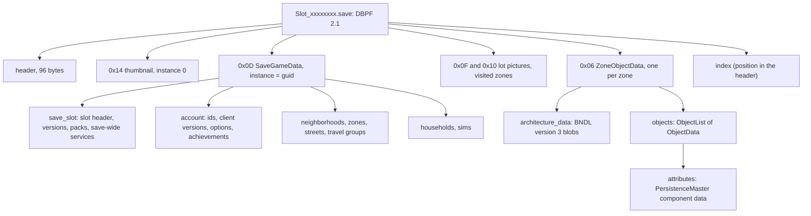

# 8.04 The save file format

*Game version 1.128.90.1030 (Steam, Linux/Proton). Installed packs EP04, EP06, EP09, EP12, GP04, GP12, SP01, SP42. The message schema is decoded from the protobuf descriptors embedded in `Simulation_x64.dll`; the byte layout and every count come from read-only copies of one of the authors' save folders (seven slot files written by earlier game versions, plus the account files), decoded with the 1.128 schema. No names or other player content are reproduced. Written 2026-10-12. Checked 2026-10-12: 90 claims checked, 11 corrected, 1 relabelled, 2 removed. Checked again 2026-10-13: 109 claims checked, 10 corrected, 4 relabelled, 0 removed; the sample copies had been deleted, so 39 claims that rest only on them were not re-read and were checked for consistency with the schema and code. Cross-chapter edits 2026-10-13: 1 applied.*

## In plain words

A save slot is one file, and it is the same kind of container as the game's own content: a package with a short header, a set of numbered resources and an index at the end. Inside are five kinds of resource. The biggest part by far is one record per lot holding that lot's walls, floors and objects. One record holds everything else: households, Sims, the summary of every lot and street, the account details and the state of each save-wide game system. The rest are small pictures: the slot's thumbnail and two pictures of each lot you have visited.

The records are written in Google's protocol buffer format, a compact tagged binary format. The game ships the exact description of every message inside its engine library, so a reader can decode a save with the game's own schema and needs no guessed field lists. Each field has a number, so a newer game adds fields without breaking older files, and an older reader skips what it does not know.

The game keeps older copies of each slot next to it (five in the folder this chapter was read from), and the autosave is simply slot number 0xFFFFFFFF. A manual save leaves a stale first copy of the main record inside the file. The files look as if the game writes everything once, then appends a better-compressed copy of the main record and a new index, leaving the old bytes behind. A reader that walks the index never sees them; a reader that scans the file from the start does.

A save is personal. Besides your households it carries your EA account number and persona name, and the number of times you have saved. A separate small account file in the user folder, one level above the saves, holds data that follows you from save to save, in an encoded form this book does not decode.

## Key facts

- A slot file is a DBPF 2.1 package (index minor version 3) named `Slot_%08x.save`; the autosave is `Slot_ffffffff.save`, and a manual slot is, for example, `Slot_00000002.save`.
- Five resource types, all in group 0: 0x0000000D the main `SaveGameData` record (instance = its `guid`), 0x00000006 one `ZoneObjectData` per zone (instance = zone id), 0x00000014 the slot thumbnail (instance 0), 0x0000000F and 0x00000010 two lot pictures per visited zone (instance = zone id).
- In the sample manual slot: 142 resources, 3,962,251 bytes on disk, 46.9 MB once decompressed; the 124 zone records are 44.3 MB of that, and 94% of their bytes are opaque architecture blobs.
- The main record is 2.24 MB decompressed (556 KB stored): its roughly 200 Sims take 1.75 MB of it (outfits 565 KB, attributes 369 KB, genetics 365 KB, face 314 KB).
- The schema is protobuf (proto2), package `EA.Sims4.Persistence`, from 57 game `.proto` descriptors in `Simulation_x64.dll` (1,511 messages and 209 enums, nested ones included; with Google's `descriptor.proto`, also embedded, 1,531 and 213). `FileSerialization.proto` holds the file-level messages. One of the 57, `SimsCustomOptions.proto`, holds no message: it declares two field options that mark which Sim fields survive cloning (39 fields) and premade-household export (41).
- Versioning lives in the record: `SaveSlotData.compatibility_version` (one value per game version that wrote the file; **Inferred**: the minor version times 100), `AccountData.client_version` and `client_version_at_creation`, `is_migrated`, and `GameContentData` (required pack ids, content-patch changelists).
- Backups are named `Slot_%08x.save.ver%d`; the sample folder held `.ver0` to `.ver4`, newest first. The client strings also name `.day.verN`, `.week.verN`, `.month.verN` and `.tmp` files.
- Manual slot files carry an orphaned first copy of the main record (identical once decompressed, worse compression) plus an orphaned index; the autosave copy in the sample has neither.
- Only lots that were saved while loaded (a handful of the 124 in the sample) get the two lot pictures; every zone gets an object record, even lots never visited.
- Lot objects store their component state as a nested `PersistenceMaster` blob in `ObjectData.attributes`: a list of entries tagged with one of 71 component and tracker types, each carrying its data as one of 77 protobuf extensions.
- In the sample, `accountDataDB.package` holds six resources: four whose type ids equal the four non-zero Python `UserAccountDataTypeEnum` values and two the enum does not name, each a version word, a length and an encoded payload.
- The schema has spelling slips that are now permanent field names, such as `SaveSlotData.neighboorhoods`.

## How it works

### Where the files are and what they are called

**Observed** (the saves folder, by listing; the client executable's UTF-16 strings). Saves live in `Documents/Electronic Arts/The Sims 4/saves/` (on Steam under Proton, inside the game's prefix under `compatdata/1222670/pfx/drive_c/users/steamuser/`). The folder held one manual slot with five backups, the autosave slot and Steam's `steam_autocloud.vdf`. The client's strings name the patterns:

| Pattern | Meaning |
|---|---|
| `Slot_%08x.save` | a slot; the id in eight hex digits |
| `Slot_%08x.save.ver%d` | backup N; `.ver0` is the newest |
| `Slot_%08x.save.day.ver%d`, `.week.ver%d`, `.month.ver%d` | further backup tiers (none in the sample) |
| `Slot_%08x.save.tmp` | a temporary file (none in the sample) |
| `Slot_????????.save`, `*.save.ver*`, `Slot_%08x.save.ver?` (and its `.day`, `.week`, `.month` forms) | wildcard patterns; **Inferred**: used to list slots and backups |
| `accountDataDB.package` | the account store (below) |
| `UserData.lock` | a lock file in the user folder |
| `GameVersion.txt` | in the user folder: a u32 length (13) and the version string |

- **Inferred** (file names and times). Each save rotates the previous file into `.ver0`, `.ver0` into `.ver1`, and so on, keeping five. In the sample, `.ver0` and `.ver1` have 142 resources and `.ver2` to `.ver4` have 140 (one lot fewer had been visited), and all five were written by an earlier game version than the live file.
- **Inferred** (names). `.tmp` is the write target that replaces the slot when complete. The strings `SaveSlot-*` and `Household-0x%016llx-9.dat` sit next to the slot names; no such files were in the sample folder. **Observed** (`world/premade_household_commands.py`): the only Python caller of the native `SaveHousehold` operation is `premade_household.generate`, a command with no type, so DebugOnly, which does not register in retail ([1.04](1.04-debug-cheats-telemetry.md)). **Inferred**: the `Household-...dat` pattern names that operation's output; the code does not show it.
- **Observed** ([1.02](1.02-saves-persistence.md)). Slot 0 is the engine's working "scratch" slot and 0xFFFFFFFF the autosave slot; neither 0 nor 1 appears as a file in the sample.

### The container

- **Observed** (all seven slot copies). Header: `DBPF`, major 2, minor 1, resource count at 36, index size at 44, index minor 3 at 60, index position as a u64 at 64, and the word 65535 at 80; every other header word is zero, including the old 32-bit index position at 40. The account and client packages in the user folder have the same header shape. Shipped game packages can differ in two words: 597 of them set the word at 16 to 12,800, and six have 0 instead of 65,535 at 80 ([8.01 Package files and resource types](8.01-package-files.md)), so a reader should not reject a package for either.
- **Observed** (index flags 2 in every slot copy). The group is stored once for the whole index (0); each entry stores type, instance high and low words, offset, stored size and memory size, and, because the stored size has its top bit set, two u16 compression fields. That gives 28 bytes per entry: 142 entries make the 3,984-byte index exactly.
- **Observed** (a count over one of the authors' saves). Compression is RefPack (0xFFFF) for the main record, the thumbnail and almost all zone records; the two tiny zone records, all 256-pixel lot pictures and one 400-pixel picture are stored raw (0x0000). Zone records shrink 18 times (44.3 MB to 2.42 MB). The RefPack streams start with the flag byte 0x50 and 0xFB, one of the two openings the shipped packages use (`10 FB` and `50 FB`, [8.01](8.01-package-files.md)).

### The five resource types

| Type | Instance | Content | Sample count and size |
|---|---|---|---|
| 0x00000014 | 0 | JPEG 180 x 120, the slot thumbnail | 1, 5.7 KB |
| 0x00000006 | zone id | `ZoneObjectData` protobuf | 124 (one per zone in `SaveGameData.zones`), 9 bytes to 2.19 MB each |
| 0x0000000F | zone id | JPEG 256 x 256 | one per visited zone (a handful in the sample) |
| 0x00000010 | zone id | JPEG 400 x 400 (one in the sample is 499 x 499) | one per visited zone |
| 0x0000000D | `SaveGameData.guid` | `SaveGameData` protobuf | 1, 2.24 MB |

- **Observed** (a count over one of the authors' saves). Every 0x06 instance equals a zone id in the main record and the record's own `zone_id`. The 0x0F and 0x10 pictures exist for exactly the zones whose `GameplayZoneData` has `venue_type_id_on_save`, which [1.02](1.02-saves-persistence.md) shows is written each time a loaded lot is saved. **Inferred**: they are the lot pictures the map and the lot panels show; the thumbnail is the picture in the load menu.
- **Inferred** (124 records, with only a handful of zones visited). The engine writes an object record for every zone from the start, from the world and lot template data, and replaces it when a loaded lot is saved.

### Two writes in one manual save

- **Observed** (a scan of all copies). In the manual slot and in every backup, the first resource after the thumbnail is a gap: a complete RefPack copy of the main record that the index does not point to, followed later by a second, stale index. In the live slot the stale index lists the same 142 entries as the live one; only its 0x0D entry differs, pointing at the gap. The live 0x0D sits after the stale index and the live index ends the file. Decompressed, the two copies of the main record are identical (2,236,859 bytes each in the live slot); stored, the orphan is 624,539 bytes and the live copy 555,745.
- **Observed**. The autosave copy has no gap: its main record sits right after the thumbnail, 623,093 bytes stored, and the index follows the last zone.
- **Inferred**. The engine writes the whole file once with a fast compressor, then recompresses the main record, appends it with a new index and updates the header, leaving the first copy and the first index as dead bytes (about 16% of the file). Only the index tells which copy is live.

### The main record: SaveGameData

**Observed** (`FileSerialization.proto` descriptor; a census of one of the authors' saves). Top-level fields, with the bytes they took in the sample manual slot (each field's tag and length bytes included; the sample was written by an earlier version and read with the 1.128 schema):

| # | Field | Type | Sample |
|---|---|---|---|
| 1 | `guid` | uint32 | equals the 0x0D instance; the same in the manual and the autosave slot |
| 2 | `save_slot` | `SaveSlotData` | 85 KB |
| 3 | `account` | `AccountData` | 42.5 KB |
| 4 | `neighborhoods` | repeated `NeighborhoodData` | 11, 13 KB |
| 5 | `households` | repeated `HouseholdData` | about 100, 58 KB |
| 6 | `sims` | repeated `SimData` | about 200, 1.75 MB |
| 7 | `zones` | repeated `ZoneData` | 124, 42 KB |
| 8 | `streets` | repeated `OpenStreetsData` | 6, 160 KB |
| 9 | `travel_groups` | repeated `TravelGroupData` | absent |
| 10 | `uninstalled_region_ids` | repeated uint64 | absent |
| 11 | `object_fallbacks` | `ObjectFallbackDataList` (`guid`, `fallback_guid` pairs) | 9,102 pairs, 90 KB |
| 12 | `destination_clean_up_data` | repeated | absent |
| 14 | `gameplay_data` | `GameplayData` (`premade_lot_status`, `daily_sim_info_creation_count`) | 4 bytes (2 of data) |
| 15 | `mannequins` | repeated `MannequinSimData` | absent |
| 16 | `relgraph` | `SimRelationshipGraphData` | absent |
| 17 | `tutorial_tips` | repeated fixed64 | absent |
| 18 | `sims_removed_from_travel_groups` | repeated uint64 | absent |
| 19 | `custom_colors` | `PlayerCustomColors` | absent |
| 20, 21 | `gig_start_objects_tracking_data`, `gig_end_...` | repeated | absent |
| 22 | `gig_restrictions_data` | repeated | absent |
| 23, 24 | `protected_` and `unprotected_households_story_progression_rule_set` | `StoryProgressionRuleSet` | 93 bytes each (90 of data) |

Field 13 is unused. **Inferred** (name and size): `object_fallbacks` maps object definitions to stand-ins for content that may be missing. **Observed** (grep of the decompiled Python): no Python module reads or writes `object_fallbacks`, so the engine keeps it. **Observed** (`sims/sim_info_base_wrapper.py`, `objects/components/mannequin_component.py: populate_sim_info_data_proto`, `services/persistence_service.py: prepare_mannequin_for_cas`): `SimInfoBaseWrapper.save_sim_info` fills a `MannequinSimData` with the look as `facial_attributes` (12), `physique` (11), `skin_tone` (13), `outfits` (21), the current and previous outfit, and gender, age, species and skin tone shift; `load_sim_info` reads `facial_attr` when the message has it, else `facial_attributes`.

**SaveSlotData** (field numbers and the sample's presence):

| # | Field | Type | Note |
|---|---|---|---|
| 1 | `slot_id` | fixed64 | 2 or 0xFFFFFFFF in the sample |
| 2 | `neighboorhoods` (sic) | repeated fixed64 | absent |
| 3, 5 | `last_neighborhood`, `last_zone` | fixed64 | `last_zone` present |
| 4 | `zones` | repeated fixed64 | absent |
| 6 | `households` | `IdList` | absent |
| 7 | `is_migrated` | bool | 1 |
| 8 | `gameplay_data` | `GameplaySaveSlotData` | 85 KB |
| 9 | `slot_name` | string | the name shown in the menu |
| 10 | `timestamp` | uint64 | absent in every sample file |
| 11 | `active_household_id` | uint64 | present |
| 12 | `nucleus_id` | fixed64 | the EA account id |
| 13 | `s4_guid_seed` | fixed64 | absent |
| 14 | `compatibility_version` | uint32 | one value per game version that wrote a sample file |
| 15 | `trigger_tutorial_drama_node` | bool | absent |
| 16 | `tutorial_mode` | int32, default 1 | absent |
| 17 | `game_content_data` | `GameContentData` | present |
| 18 | `applied_aging_fixup` | bool, default false | absent |
| 19 | `kingdom_service` | `PersistableKingdomService` | absent (its service is gated to EP21 (Royalty & Legacy), not installed) |
| 20, 21 | `preferred_manual_slot_id`, `..._name` | uint32, string | absent |

- **Observed** (`GameplaySaveData.proto`). `GameplaySaveSlotData` holds `world_game_time` (1), `travel_situation_seed` (2), `camera_data` (3), `is_phone_silenced` (4), `career_choices_seed` (5), `enable_autogeneration_same_sex_preference` (6), and from field 7 to 64 one sub-record per save-wide service (clubs 7, drama schedule 8, relationships 13, seasons 16, weather 17, story progression 30, ... family tree forgery 64), except `once_only_drama_nodes` (12), a packed id list that no Python module reads or writes. Three service records do not say "service" in their field name: `business_service_data` (10, `BusinessService`), `object_lost_and_found` (24, `ObjectLostAndFoundService`) and `tenant_applications_data` (52, written by `TenantApplicationService.save`, read from the bytecode of `multi_unit/tenant_application_service.pyc`, which did not decompile; its `required_packs` is EP15 (For Rent), not installed, so this install never writes it). It has its own `kingdom_service` (59) besides `SaveSlotData.kingdom_service` (19); Python writes the latter.
- **Observed** (census). In the sample, the relationship service sub-record is 55 KB of the 85 KB, the family tree 13.6 KB, the drama schedule 7.6 KB, the street service 5.4 KB; most others are a few bytes.
- **Observed** (`GameContentData`). `required_pack_ids` (packed uint32), `cds_patch_base_changelists`, `cds_content_patch_mounted`, `saved_by_feature_preview_build`. The sample holds eight pack ids, 1, 17, 25, 27, 30, 53, 63 and 83, and four changelist numbers (two of 11047934, two of 11047940). **Observed** (`Consts.proto`, enum `Pack`, 142 values): these are the eight installed packs, SP01 (Luxury Party) 1, GP04 (Vampires) 17, EP04 (Cats & Dogs) 25, EP06 (Get Famous) 27, EP09 (Eco Lifestyle) 30, EP12 (High School Years) 53, GP12 (Werewolves) 63 and SP42 (Grunge Revival) 83. The field itself is a plain `uint32`, and the descriptor's enum has no EP21 value at all (its expansion packs stop at EP20, 61), although the Python gates the kingdom service on `Pack.EP21`.

**AccountData:**

| # | Field | Type | Sample |
|---|---|---|---|
| 1 | `nucleus_id` | fixed64, required | present |
| 2 | `persona_name` | string, required | present (the EA persona) |
| 3 | `email` | string | absent |
| 4, 5 | `created`, `last_login` | uint64 | present |
| 8 | `entitlements` | repeated | absent |
| 9 | `ui_options` | `UiOptionsData` | present |
| 10 | `client_version` | string | the version that wrote the file |
| 12 | `save_slot_id` | fixed64 | present |
| 14 | `gameplay_account_data` | `GameplayAccountData` | achievements 6 KB, 9 options, cheat flags |
| 16 | `game_notification` | repeated `UiDialogMessage` | present |
| 17 | `client_version_at_creation` | string | an earlier version string, the same in every sample file |
| 18, 19, 20 | `number_of_saves`, `..._mods`, `..._script_mods` | uint64 | only `number_of_saves` present |
| 21 | `is_pack_usage_telemetry_version` | bool | present |

`GameplayAccountData`: `achievement_data` (1), `gameplay_options` (2, `GameplayOptions`, 67 fields in the schema), `game_notification` (8), `cheats_enabled` (9), `cheats_ever_enabled` (10). **Observed** (`Dialog.proto`; a walk of the whole main record and every zone record with the 1.128 schema, on the manual slot, the autosave and the oldest backup). The sample's `game_notification` entries carry field 102, which is not a plain field: `UiDialogMessage` reserves 100 and up for extensions, and 102 is the extension `UiDialogNotification.dialog`. The walk found no field that the 1.128 schema does not define.

### Zones, streets and lot objects

**ZoneData** (one per lot in `SaveGameData.zones`): `zone_id` (1), `name` (2), `world_id` (3), `lot_id` (4), `lot_template_id` (5), `household_id` (6), `nucleus_id` (7), `permissions` (8), `neighborhood_id` (10), `gameplay_zone_data` (11), `lot_description_id` (12), `front_door_id` (13), `description` (14), `spawn_point_ids` (15), `bedroom_count` and `bathroom_count` (16, 17), `active_plex` (18), `master_zone_object_data_id` (19), `lot_traits` (20), `pending_house_desc_id` (21), `university_housing_configuration` (22), `pending_plex_exterior_house_desc_id` (23), `custom_schedule` (24).

**GameplayZoneData** (written by Python, [1.02](1.02-saves-persistence.md)):

| # | Field | # | Field |
|---|---|---|---|
| 1 | `game_time` (Sim ticks at save) | 11 | `skill_tracker` |
| 2 | `clock_speed_mode` | 12 | `active_travel_group_id_on_save` |
| 3 | `situations_data` | 13 | `ensemble_service_data` |
| 4 | `venue_data` | 14 | `ranked_statistic_tracker` |
| 5 | `active_household_id_on_save` | 15 | `curfew_setting` (default -1) |
| 6 | `lot_owner_household_id_on_save` | 16 | `hidden_sim_service_data` |
| 7 | `venue_type_id_on_save` | 17 | `curfew_settings` |
| 8 | `bed_info_data` | 18 | `architectural_statistics` |
| 9, 10 | `commodity_tracker`, `statistics_tracker` | 19 | `lot_level_data` |

**ZoneObjectData** (resource 0x06): `zone_id` (1, fixed64), `architecture_data` (2, repeated bytes), `objects` (3, repeated `ObjectList`), `active_data_index` (4), `sub_venue_keys` (5), `is_modified_from_lot_template` (6).

- **Observed** (a count over one of the authors' saves). In the sample, 118 zones hold one blob and one object list, 4 hold four of each, 2 hold none (a 9-byte record with only the zone id). All 134 blobs start with the bytes `LDNB` and a u32 3, the FourCC `BNDL` stored little-endian with version 3. They total 41.7 MB, the object lists 2.6 MB with 24,952 objects.
- **Inferred** (names and counts). The blob is the engine's build data for the lot (walls, floors, terrain and the like); the zones with four pairs keep alternative layouts, selected by `active_data_index` and named by `sub_venue_keys`. Python only ever sends one object list per save ([1.02](1.02-saves-persistence.md)), so the extra pairs are kept by the engine.

**OpenStreetsData:** `world_id` (1), `nbh_id` (2), `objects` (4, `ObjectList`), `situation_seeds` (5), `active_household_id_on_save` (6), `active_zone_id_on_save` (7), `sim_time_on_save` (8), `open_street_director` (9), `conditional_layer_service` (10), `ambient_service` (11), `situation_conditional_layers` (12). Street objects live here, inside the main record, while lot objects live in the 0x06 resources.

**ObjectData** (in `ObjectList`, in zone records, street records, Sim and household inventories):

| # | Field | # | Field |
|---|---|---|---|
| 1 | `object_id` (fixed64) | 21 | `material_variant` |
| 2 | `owner_id` | 22 | `stack_sort_order` |
| 3 | `parent_id` | 23 | `light_color` |
| 4 | `slot_id` (bone hash) | 24, 25 | `material_state`, `geometry_state` |
| 5 | `position` (`LotCoord`: x, y, z and a quaternion) | 26, 27 | `object_parent_type`, `encoded_parent_location` |
| 6 | `loc_type` | 28 | `light_dimmer_value` |
| 7 | `container_id` | 29 | `model_override_resource_key` |
| 8 | `type` | 30 | `guid` (the definition id) |
| 9 | `level` | 31 | `unique_inventory` (`ObjectList`) |
| 10 | `scale` | 32 | `needs_post_bb_fixup` |
| 11 | `state_index` | 33 | `buildbuy_use_flags` |
| 12 | `attributes` (bytes: `PersistenceMaster`) | 34 | `texture_effect` (default 0xFFFFFFFF) |
| 13 | `cost` | 35 | `multicolor` |
| 14 | `baby_sim_id` | 36 | `inventory_plex_id` |
| 15 | `ui_metadata` | 37 | `is_new_object` |
| 16 to 19 | `has_been_depreciated`, `needs_depreciation`, `created_from_lot_template`, `is_new` | 38 | `persisted_tags` |
| 20 | `texture_id` | 39 | `canvas_state_type` |

- **Observed** (`SimObjectAttributes.proto`). `PersistenceMaster` is a list of `PersistableData`, each with a required `type` from a 71-value `DATA_TYPE` enum (SimInfoAttribute 1, StateComponent 2, ... TravelDestinationComponent 77; 39 to 41 and 71 to 73 unused). `PersistableData` declares the extension range 21000 and up, and 77 extensions, numbered 21001 to 21077, are declared inside the component messages of the same file (for example `PersistableStateComponent` at 21002). The extension numbers do not follow the type values: `PersistableStoryProgressionTracker` is type 36 and extension 21039. A reader decodes a component by the extension number on the wire, using these declarations.

### Sims and households

**SimData** (selected fields; 73 fields numbered up to 76): `sim_id` (1, required), `zone_id` (2), `world_id` (3), `household_id` (4), names (5, 6, with string keys 55, 56), `gender` (7), `age` (8), `voice_pitch` (9), `skin_tone` (10), `voice_actor` (11), `physique` (12, a string), `age_progress` (13), `money` (27; 14 is the old 32-bit one), `facial_attr` (18, bytes, opaque to the Python (`sims/sim_info.py`); **Inferred**: a serialized `BlobSimFacialCustomizationData` (sculpts, face, body, aged face and aged body modifiers), the only message of `PersistenceBlobs.proto` and the type of no field; `GeneticData.sculpts_and_mods_attr` likewise), `created` (19), `inventory` (20), `outfits` (21), `genetic_data` (28), `flags` (29), `attributes` (30, `PersistableSimInfoAttributes`), `revision` (31), `current_mood` (41), `gameplay_data` (47, `GameplaySimData`), `sim_creation_path` (52), `extended_species` (60), `sim_lod` (61), `pelt_layers` (63), `pronouns` (69).

- **Observed** (census). The top-level `location` (32) and `interaction_state` (37) are never present: the current code writes both inside `gameplay_data` (`GameplaySimData.location` 1, `interaction_state` 6), next to `zone_time_stamp` (4: `game_time_expire`, `time_sim_info_was_saved`, `time_sim_was_saved`), `serialization_option` (15) and `time_alive` (16).
- **Observed** (a count over one of the authors' saves). The Sims at `sim_lod` 1 (about one in twenty in the sample) carry no `inventory`, `current_mood` or outfit index: they are saved at minimum detail. **Observed** (`sims/sim_info.py: SimInfo._generate_sim_protocol_buffer`, `sims/sim_info_lod.py`): the writer returns right after `created` and three `gameplay_data` fields when the Sim's level of detail is `SimInfoLODLevel.MINIMUM` (1), before pregnancy, age progress, inventory, aspiration, current outfit and mood.
- **Observed** (`SimsCustomOptions.proto`; `core/sims4/protocol_buffer_utils.py: persist_fields_for_custom_option`; `sims/sim_info.py`). Two custom field options, `persist_for_new_game` (50000) and `persist_for_cloned_sim` (50001), mark fields of `SimData`, `GameplaySimData` and `PersistableSimInfoAttributes`: 41 fields carry the first, 39 the second. When a Sim is saved for cloning, or while `premade_household.generate` runs, the writer clears every unmarked field and prunes sub-records left empty, so only the marked fields (name, look, genetics, traits, skills and similar) remain.

**HouseholdData** (selected): `account_id` (1), `household_id` (2, required), `name` (3), `home_zone` (4), `money` (5), `inventory` (6), `last_played_sim_id` (9), `creation_time` (10), `sims` (11, `IdList`), `revision` (15), `gameplay_data` (16), `hidden` (26), `cheats_enabled` (27), `is_unplayed` (14), `is_player` (31), `scenario_data` (33), `story_progression_rule_set` (34), `dependent` (35).

### Description-only messages and the slot list

- **Observed** (`FileSerialization.proto`). `SaveGameDataDescOnly` reuses the numbers 1, 2 and 5 of `SaveGameData` with smaller types: `SaveSlotDataDescOnly` keeps `slot_id` 1, `slot_name` 9, `timestamp` 10, `active_household_id` 11, `compatibility_version` 14, `game_content_data` 17, and `HouseholdDataDescOnly` keeps `household_id` 2, `name` 3, `scenario_data` 33. Parsing a full record with these types reads only those fields and skips the rest.
- **Observed** (client strings `Protobuf/SaveGameData`, `Protobuf/SaveGameDataDescOnly`, `Protobuf/SaveGameSlotList`, `Protobuf/SaveGameSlotMetaData`). `SaveGameSlotList` (`slots`, `allow_incompatible`) and `SaveGameSlotMetaData` (`slot_id`, `slot_name`, `force_override`, `include_backups`, `timestamp`, `last_household_name`, `isValid`, `scratch_id`, `slot_version`, `incompatible`, `required_pack_ids`, `cds_patch_base_changelists`, `cds_content_patch_mounted`, `scenario_ids`, `saved_by_feature_preview_build`) are not in the file. **Inferred**: the engine builds the load menu's slot list from the description-only parse.
- **Observed** (`FileSerialization.proto` enums). `PersistenceActions` (0 to 18, slot new, copy, delete, rename, list and file operations), `ActionErrorType` (slot save 1127087018, slot copy 1652429822, slot load 650303489) and `ActionFailureCodes` (for example disk full 4, file not found 10, no account 40, OS-handled error 50) describe the engine's file operations and their errors. **Inferred** (name): `AFC_FILE_CREATE_VERSION_NAME_FAILED` (23) is a failure to build a backup's `.ver` name.
- **Observed** (`FileSerialization.proto`). `ZoneObjectDataScratchPair` holds a `zone_id` and a `zone_object_data_scratch_path` string. **Inferred**: it ties a lot's object record in the scratch slot to a working file ([1.02](1.02-saves-persistence.md)).

### Versions and compatibility

| Field | Where | Sample values | Use |
|---|---|---|---|
| DBPF major, minor, index minor | header | 2, 1, 3 | container version |
| `compatibility_version` | `SaveSlotData` 14 | one value per writing version | **Inferred**: game version minor x 100 (1.128 would write 12800) |
| `client_version` | `AccountData` 10 | full version strings of the earlier versions that wrote the sample files | the writer |
| `client_version_at_creation` | `AccountData` 17 | a full version string | the game that started the save |
| `is_migrated` | `SaveSlotData` 7 | 1 | **Inferred**: an old-format migration has run |
| `required_pack_ids` | `GameContentData` 1 | 8 ids | packs the save needs |
| `cds_patch_base_changelists`, `cds_content_patch_mounted` | `GameContentData` 2, 3 | 4 numbers, 0 | content-patch state |
| `slot_version`, `incompatible` | `SaveGameSlotMetaData` | not in the file | the load menu's verdict |
| `PersistVersion` | Python constants in `primitives/persistence_primitives.py` | 1 to 5 | **Inferred**: object and SI save format steps; no other Python module references them |

- **Observed** (grep of the decompiled Python for writes to the slot record). Python sets only `slot_id`, `slot_name` and `active_household_id` (`services/persistence_service.py`), the two tutorial fields (`tutorials/tutorial_service.py`), `kingdom_service` and the services' `gameplay_data`. Nothing in Python writes or reads `timestamp`, `nucleus_id`, `is_migrated`, `compatibility_version` or `game_content_data`. **Inferred**: the engine fills these when it writes the file.

### The account store and the other packages

- **Observed** (copy of `accountDataDB.package`, which sits in the user folder one level above `saves/`). A DBPF with index flags 6 (group and instance high word shared), six resources all with the same instance. Their types are 0x1577DC52 (EVENTS), 0x2600FB7F (GAMEPLAY_VALUES), 0xF068E4DB (PIVOTAL_MOMENTS), 0x93741E37 (REWARDS), and 0xD5A1790B and 0x2E8A1EA2, which the Python enum does not name. Each payload starts with a u32 1 and a u32 length; two are empty (length 0), two are RefPack-compressed. The bytes after the length do not parse as protobuf (wire type 3 within the first fields).
- **Observed** (`server/account.py: Account.save_account`; `DistributorOps.proto`). What Python hands the engine for GAMEPLAY_VALUES is a `UserAccountData` (`nucleusId`, `data_type`, `data` bytes) whose `data` is a serialized `UserAccountStoredGameplayData`: key and value string pairs.
- **Inferred**. The payloads are those `UserAccountData.data` bytes ([1.02](1.02-saves-persistence.md)) in an encoded or encrypted form; they were not decoded.
- **Observed**. `avatarcache.package` holds one resource of type 0xD7937D10, a raw JPEG. `clientDB.package` is a bare 96-byte header with no resources.

### How to read a save safely

1. Copy the file out of the saves folder and open only the copy. Steam Cloud syncs the folder (`steam_autocloud.vdf`), and the game keeps `UserData.lock` while running (**Inferred**), so never write into the live folder.
2. Read the 96-byte header and seek to the u64 index position at offset 64. Walk the index only. A scan from the start of the file finds the orphaned first copy of the main record and the stale index.
3. Decompress each entry by its compression word: 0xFFFF RefPack, 0x0000 raw (0x5A42 zlib does not occur in saves). The memory size in the index is the decompressed length.
4. Decode with a schema at least as new as the game that wrote the file (this chapter read files written by earlier versions with the 1.128 schema; an older schema leaves newer fields unknown). Extract it from the descriptors in `Simulation_x64.dll` instead of a hand-written list: fields change between patches. Read field by field, keep unknown fields as raw bytes, and load the extensions declared in every descriptor file: the sample's notifications carry one (field 102 of `UiDialogMessage`, declared in `Dialog.proto`).
5. Handle the types the schema declares: ids are mostly `fixed64` (8 raw bytes), not varints; repeated numbers can be packed; `ObjectData.attributes` is a nested serialized `PersistenceMaster`.
6. Treat the content as personal: the account record carries the Nucleus id and persona name, and the Sim and household records carry names. Publish counts and shapes, never values.

## Numbers

| Name | Value | Unit | Where | Build |
|---|---|---|---|---|
| DBPF header size | 96 | bytes | header | save copies |
| Index entry size (flags 2) | 28 | bytes | index | save copies |
| Resources in the manual slot | 142 (140 in `.ver2` to `.ver4`) | count | index | save copies |
| Manual slot size | 3,962,251 | bytes | file | save copy |
| Decompressed total | 46.9 | MB | all resources | save copy |
| Zone records | 124, 44.3 MB (2.42 MB stored) | count, size | 0x06 | save copy |
| Architecture blobs | 134, 41.7 MB | count, size | `ZoneObjectData.architecture_data` | save copy |
| Lot objects | 24,952 | objects | `ZoneObjectData.objects` | save copy |
| Main record | 2,236,859 (555,745 stored, 624,539 in the first pass) | bytes | 0x0D | save copy |
| Dead bytes in the manual slot | 628,523 | bytes | gap + stale index | save copy |
| Sims, households, zones, streets, neighbourhoods | about 200, about 100, 124, 6, 11 | count | `SaveGameData` | save copy |
| Object fallback pairs | 9,102 | pairs | `object_fallbacks` | save copy |
| Thumbnail / lot pictures | 180 x 120 / 256 x 256 and 400 x 400 (one 0x10 is 499 x 499) | pixels | 0x14 / 0x0F, 0x10 | save copy |
| Backups kept | 5 (`.ver0` to `.ver4`) in the sample; the number is not in the code | files | saves folder | save copies |
| Autosave slot id | 0xFFFFFFFF | slot id | file name, `slot_id` | save copy and code |
| `compatibility_version` | minor game version x 100 (**Inferred**) | integer | `SaveSlotData` | save copies |
| `.proto` descriptors | 57 (+ `descriptor.proto`); one, `SimsCustomOptions.proto`, has no messages | files | `Simulation_x64.dll` | native |
| Fields marked `persist_for_new_game` / `persist_for_cloned_sim` | 41 / 39 | fields | field options, `SimsCustomOptions.proto` 50000 / 50001 | native |
| Messages / enums in them | 1,511 / 209 (1,531 / 213 with `descriptor.proto`) | count | same | native |
| `FileSerialization.proto` | 60 messages, 7 enums (5 top-level, 2 nested), 18,125 bytes | count | same | native |
| `PersistenceMaster.DATA_TYPE` | 71 values (1 to 77) | enum values | `SimObjectAttributes.proto` | native |
| `SimData` fields | 73 (numbers 1 to 76) | fields | `FileSerialization.proto` | native |
| `PersistableData` extensions | 77 (21001 to 21077) | extensions | `SimObjectAttributes.proto` | native |
| `GameplayOptions` fields | 67 schema, 9 in the sample | fields | `GameplaySaveData.proto` | native, save copy |

## Data shapes

**DBPF header** (as found in every save copy)

| Offset | Field |
|---|---|
| 0 | `DBPF` |
| 4, 8 | u32 major 2, u32 minor 1 |
| 12 to 35 | zero |
| 36 | u32 resource count |
| 40 | u32 0 (the old index position) |
| 44 | u32 index size in bytes |
| 48 to 59 | zero |
| 60 | u32 index minor version 3 |
| 64 | u64 index position |
| 72 to 79 | zero |
| 80 | u32 65535 |
| 84 to 95 | zero |

**Index** (flags 2: group shared)

| Offset | Field |
|---|---|
| 0 | u32 flags (bit 0 type shared, bit 1 group shared, bit 2 instance high word shared) |
| 4 | u32 shared group (0) |
| 8 + 28 n | entry n: u32 type, u32 instance high, u32 instance low, u32 offset, u32 stored size (top bit set), u32 memory size, u16 compression, u16 second word |

**Account store resource payload**

| Offset | Field |
|---|---|
| 0 | u32 1 |
| 4 | u32 payload length |
| 8 | encoded payload (not decoded) |

**`GameVersion.txt`**: u32 length, then that many ASCII bytes (`1.128.90.1030`, 13).

The protobuf messages are tabled under How it works; their full definitions, `FileSerialization.proto` whole included, can be printed from the descriptors embedded in `Simulation_x64.dll`.

## For modders

- **Read with the game's schema.** The authors' descriptor reader pulls every descriptor out of `Simulation_x64.dll` with no protobuf library; a second script turns them into a dict for a field census. After a patch, re-extract before reading new saves.
- **Lot objects and street objects live in different places**: lot objects in the 0x06 resource of their zone, street objects inside the main record under `streets[].objects`, Sims' and households' inventories inside their records.
- **Component data is two levels deep**: `ObjectData.attributes` is bytes holding a `PersistenceMaster`, whose entries carry the component messages as extensions.
- **Ids are mostly `fixed64`**: zone ids, Sim ids and household ids in their own records are 8 little-endian bytes on the wire. Some are varints: `SaveSlotData.active_household_id`, `ObjectData.guid`, `ObjectFallbackData` and the world ids. Resource instances use the same zone ids.
- **No retail commands** read or write the file format itself; the save commands are in [1.02](1.02-saves-persistence.md). The DebugOnly `premade_household.generate` writes a premade household through the native `SaveHousehold` operation and does not register in retail.
- **Traps**:
  - Do not scan a manual slot from the start: its first record copy is stale.
  - `SaveSlotData.timestamp` is absent in all sample files; the load menu's date must come from elsewhere (file time or the slot list, **Inferred**).
  - `SimData.created` is the time of the last save ([1.02](1.02-saves-persistence.md)).
  - The schema's typos (`neighboorhoods`, `CORE_SERICES` in the Python codes) are the real names.
  - Sharing a save shares the EA account id and persona name in `AccountData`.

## Limits

- The engine's writer, its compression choices and its backup rotation are not readable; the two-pass write and the rotation are inferred from the files.
- The sample is one player's folder: one manual slot, its five backups and one autosave, written by earlier versions and read with the 1.128 schema. Fields that only newer saves or other packs write (kingdoms, gigs, mannequins, travel groups) were never seen filled.
- The architecture blobs (`BNDL` version 3) and the account store payloads are not decoded.
- Component extensions inside `PersistenceMaster` were not decoded one by one; only the outer list and its type enum are described.
- The orphaned-record observation comes from the files present; why the engine rewrites the record is not known.
- The sample copies were deleted after the first check. The second check re-read every schema, code and string claim; the sample's counts, sizes, offsets and observed versions it could only test for internal consistency and against the schema and code.

## File index

The coverage manifest assigns no Python modules to 8.04. The Python side of saving is in [1.02](1.02-saves-persistence.md).

Resource types in a slot file:

| Type | Name used here | Decoded here |
|---|---|---|
| 0x0000000D | SaveGameData | fully, with the embedded schema |
| 0x00000006 | ZoneObjectData | outer message; architecture blobs not decoded |
| 0x00000014 | slot thumbnail (JPEG) | size only |
| 0x0000000F | lot picture 256 px (JPEG) | size only |
| 0x00000010 | lot picture 400 px, one at 499 px (JPEG) | size only |
| 0x1577DC52, 0x2600FB7F, 0xF068E4DB, 0x93741E37, 0xD5A1790B, 0x2E8A1EA2 | account store records | header only |
| 0xD7937D10 | avatar cache (JPEG) | magic only |

Protobuf messages described (all in `EA.Sims4.Persistence` unless noted): `SaveGameData`, `SaveSlotData`, `GameplaySaveSlotData`, `GameContentData`, `AccountData`, `GameplayAccountData`, `GameplayOptions`, `ZoneData`, `GameplayZoneData`, `ZoneObjectData`, `ZoneObjectDataScratchPair`, `OpenStreetsData`, `ObjectList`, `ObjectData`, `LotCoord`, `ObjectFallbackDataList`, `PersistenceMaster`, `SimData`, `GameplaySimData`, `ZoneTimeStamp`, `HouseholdData`, `NeighborhoodData`, `GameplayData`, `SaveGameDataDescOnly`, `SaveSlotDataDescOnly`, `HouseholdDataDescOnly`, `SaveGameSlotList`, `SaveGameSlotMetaData`, `MannequinSimData`, `BlobSimFacialCustomizationData`, `UserAccountStoredGameplayData`, `UserAccountData` (`EA.Sims4.Network`, `DistributorOps.proto`).

Python modules read for this chapter (all assigned to other chapters in the manifest): `services/persistence_service.py`, `zone.py`, `sims/sim_info.py`, `sims/sim_info_base_wrapper.py`, `sims/sim_info_lod.py`, `objects/script_object.py`, `objects/game_object.py`, `objects/object_manager.py`, `objects/components/mannequin_component.py`, `kingdom/kingdom_service.py`, `server/account.py`, `user_account_data/user_account_data_enums.py`, `primitives/persistence_primitives.py`, `persistence_error_types.py`, `world/premade_household_commands.py`, `tutorials/tutorial_service.py`, `business/business_service.py`, `services/object_lost_and_found_service.py`, `multi_unit/tenant_application_service.pyc` (bytecode), `core/sims4/protocol_buffer_utils.py`.

Methods used (the authors' scripts are not published; [0.01](0.01-reading-guide.md#the-tools-by-what-they-do) describes the tools by what they do):

- finds every serialized `FileDescriptorProto` in `Simulation_x64.dll` and prints files, messages and enums
- the 2.05 single-field descriptor decoder, copied as the starting point for the descriptor reader
- the descriptors as dicts; field census and whitelisted value reads
- header and index listing
- gaps, first bytes and top-level field census per type
- schema census of the main record; version fields only
- zones against resources, picture sizes, gaps
- the orphaned record and the stale index
- Sims per saved level of detail
- zone record census and blob headers
- the fact-checker's independent scripts: index and gaps, sizes and pictures, record census, descriptors, a whole-record schema walk, version fields, account packages
- the second checker's descriptor reader (a strict parse of every `FileDescriptorProto`, with defaults, packed flags and extensions) and a scan of the custom field options

Native data used: the descriptor blobs in `Simulation_x64.dll` (read in memory, nothing patched), and the strings `Slot_%08x.save`, `Slot_%08x.save.ver%d`, the `.day`, `.week`, `.month` and `.tmp` variants, `Slot_????????.save`, `*.save.ver*`, the `.ver?` forms, `SaveSlot-*`, `Household-0x%016llx-9.dat`, `householdthumbnail-%.16lx-%u.thm`, `accountDataDB.package`, `UserData.lock`, `GameVersion.txt`, `Protobuf/SaveGameDataDescOnly`, `Protobuf/SaveGameSlotList`, `zone_object_data_scratch_path`.
